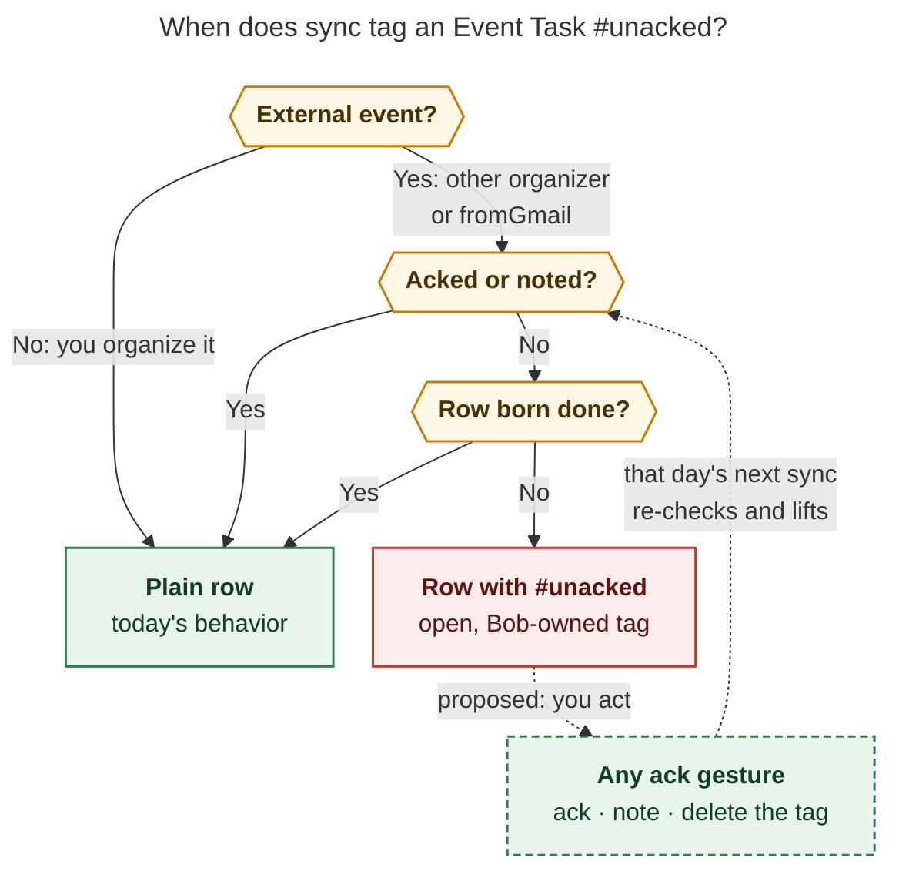
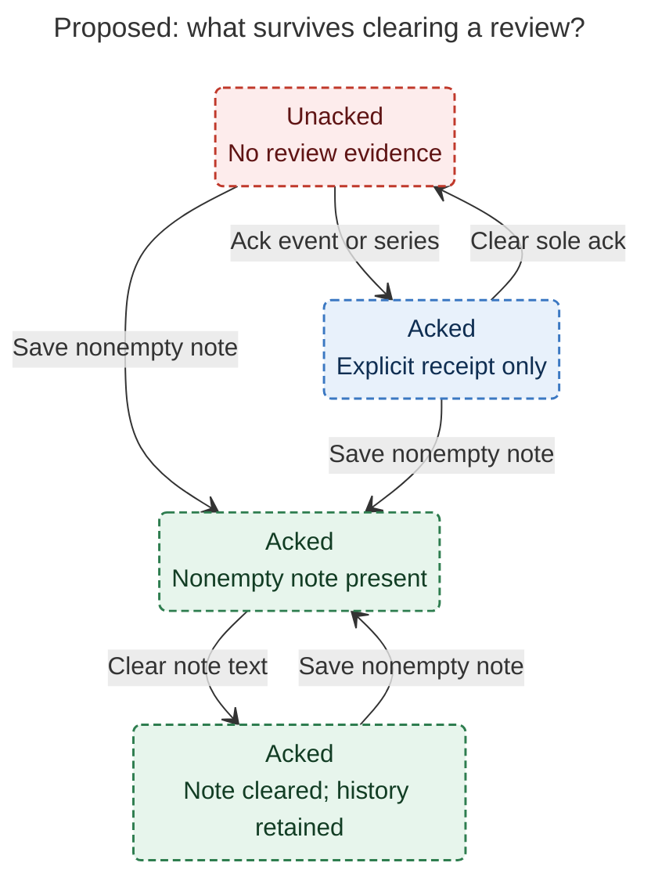
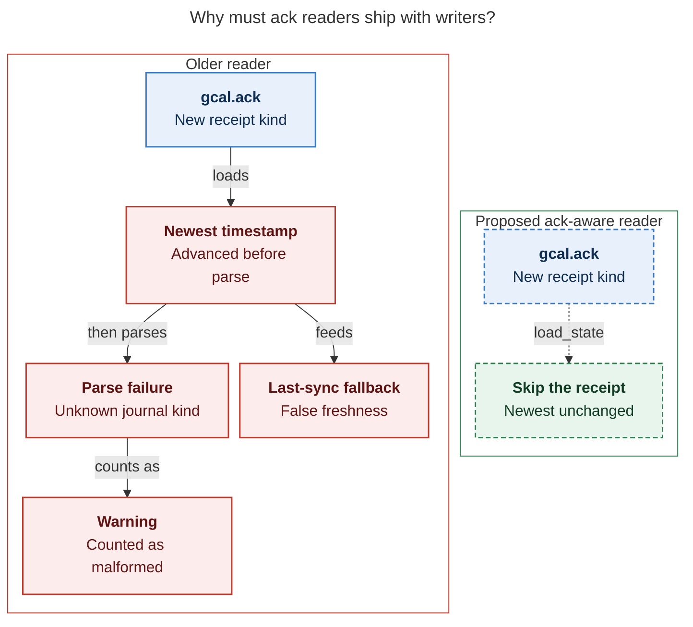

# Ack external Google Calendar events: consolidated research and recommended design

> **Research query:** How should Bob softly require that every external (not owned by
> me) Google Calendar event be acked, either explicitly with a no-op ack or by adding a
> note as `bob gcal note` does, before it becomes an Event Task, using a new
> `bob gmail ack -n|--next-n-days` command that walks every unacked external event in
> that window (always including today) with single-keypress Ack and Note choices, while
> `bob gcal sync` still creates Event Tasks for unacked events but marks them with a
> hard-to-miss warning and a weekly recurring task in `~/bob/gtd_daily.md` reminds me to
> run `bob gcal ack -n 7`? Is this a good idea, would a different approach be better,
> which requirement adjustments are justified, and what intuitive, reliable, and
> beautiful design do you recommend?


## Bottom line

**Build it.** All five researchers independently reached the same verdict: the feature
closes a real gap — external events land as Event Tasks with a default root, no buffer,
and on-clock billing unless Bryan happened to remember `bob gcal note` — and the *soft*
shape (sync always writes the row; the row wears a warning until processed) is exactly
right. A hard gate was unanimously rejected: a missed meeting costs far more than a
wrong root, and holding rows back would fight MEET filing, timed close, off-clock
settlement, and the capture agenda.

The consolidated design in one paragraph: ship **`bob gcal ack`** (the request's
`bob gmail ack` is [a slip](#requirement-adjustments) — all five agree) as a
one-key-per-card review queue over the next N local days of **external,
Event-Task-bound** Google events. Persist acks as [a new **`gcal.ack`**
kind](#storage-and-rollout) in the existing per-host journal `.bob/gcal/<host>.jsonl`;
a saved private note also counts as acked. Sync keeps writing every row, and an open row
for an unacked external event carries [a Bob-owned **`#unacked`**
tag](#where-the-warning-lives) at the end of its suffix; any of three gestures clears
it — ack, note, or deleting the tag by hand. A [weekly Monday `#pre #terminal`
chore](#reminder-cadence) in `gtd_daily.md` runs `bob gcal ack -n 7`, and the in-row
tag plus a one-line `sync` hint are the safety net for invites that arrive mid-week.

cld's one-sentence rule for docs and `--help`:

> Bob asks once about every event you can't describe in Google: press `a` when Bob's
> handling is right, or `n` to write a private note. Until you answer, that Event Task
> carries an `#unacked` tag.

Observed volume makes the ritual cheap: cld's read-only 90-day calendar sample found
**one** event that would need an ack in the next 7 days (a screening call), with the
weekly *Little Gym* Maybe series never asked (it never becomes an Event Task) and the
one interview already acked by its existing private note. grk's journal census (76
`gcal.row`, 2 `gcal.note` — both interview prep) tells the same story: seconds a week,
with one series-ack of Swings up front.

## Requirement adjustments

Consolidated and called out: changes from the request as written, each load-bearing:

| # | As asked | Adjusted | Why |
| --- | --- | --- | --- |
| R1 | `bob gmail ack` | **`bob gcal ack`** | Unanimous; the request itself later says `bob gcal ack -n 7`. `gcal` owns Calendar → Event Tasks |
| R2 | "External = not owned by me" | **`!organizer_is_self || event_type == "fromGmail"`**; missing organizer ⇒ external | Verified: `fromGmail` events are task-capable, list Bryan as organizer, and lock their description. Per-calendar `organizer.self` caveat recorded for shared calendars |
| R3 | "Every external event" in the window | **Only events that will land as Event Tasks** (Yes, or Maybe under `gcal.tentative: task`) that haven't ended; unanswered invites are a footer count, included only under `-a` | 13 of 16 external events in cld's live sample were a Maybe series that never becomes a task; asking about them is pure noise |
| R4 | Options: Ack, Note | **Ack, Note, plus Skip, Quit, Help; editor and open-in-browser behind `?`** | Without Skip you can't defer; without Quit-that-saves you lose answers; two keys is too few for an inbox |
| R5 | (unstated) | **Recurring events get a scope prompt**: `a` on a recurring card asks This event / All events, **default All events**; `n` keeps note's This event default | Swings is one decision; an interview buffer is one occurrence. Prompt defaults are printed, so the asymmetry is visible. Reject cld's Shift-key ack-all variants: an uppercase sweep can stamp an interview with the same keystroke as Swings (grk) |
| R6 | `-n\|--next-n-days` including today | Window = today .. today+(N−1), local tz, **default `-n 7`**, bound 1..=366, `-D` anchor supported; events already ended are excluded | 4 of 5 reports default 7; a lookahead command should do the useful thing bare. Mirrors `--last-n-days` with the arrow flipped — both helps state direction up front |
| R7 | Warning "of some sort, hard to miss" | **Bob-owned `#unacked` tag, last token before `^id`**, plus `⚠` marks and a `bob gcal ack` hint in `list`/`sync`; deleting the tag acks | [§Disagreement: where the warning lives](#where-the-warning-lives). Never the title, never between `#task` and the time span, not a child bullet in v1 |
| R8 | Weekly recurring task | **Weekly Monday `#pre #terminal` row as requested**; daily `#browser` RSVP review stays; the tag is the mid-week net | [§Disagreement: reminder cadence](#reminder-cadence) |
| R9 | (unstated) | **Each card shows what Bob will write** — the rendered row, root and its source, buffer, clock, time rail | Without it, `a` is a rubber stamp; with it, a two-second review (cld). Reuses the note card's existing preview and time rail |
| R10 | (unstated) | **Non-interactive forms**: `-l` list, `-f json`, `-i ID [-C CAL] [-s scope]` one-shot, `-c` clear, `-d` dry-run | Scripts, tests, and Mac Capture (a thin client that may only consume bob JSON) need a non-TTY path |
| R11 | (unstated) | **`gcal.ack: external \| off`** config kill switch, default `external` | Like `gcal.description: off`; with `off`, `want` is false everywhere and the next sync removes Bob-written tags |

## What every report agreed on

These points were reached independently five times and need no further debate:

1. **`bob gcal ack`, never `bob gmail ack`.** Calendar events belong under the `gcal`
   noun; `gmail` owns labelled threads. Do not ship a gmail alias.
2. **Soft, not hard.** Sync always creates the Event Task. The decision records
   (`calendar-events-are-daily-note-event-tasks`, `synced-meetings-link-by-phase`,
   `ended-off-clock-events-settle`) all depend on rows existing.
3. **Queue only what becomes a task.** "Every external event" is far too broad:
   declined, cancelled, unanswered (`Omitted("reply in Calendar")`), all-day, free, and
   context events never produce a row. Gate the queue on `Inclusion::Task` (Yes, or
   Maybe under `gcal.tentative: task`). Unanswered invites get a read-only footer count
   ("N awaiting your reply in Google Calendar"), optionally included via `-a`.
4. **A saved private note is an ack.** `bob gcal note` is already the high-touch review
   gesture; the no-op ack is the cheap sibling for events where Bob's defaults are right.
5. **Storage is a new `gcal.ack` kind in `.bob/gcal/<host>.jsonl`**, keyed like notes
   (`{calendar_id, event_id}` or `{calendar_id, series}`, account-guarded), union-merged
   across hosts, surviving `sync -F`. Never a vault task field (hand-editable derived
   state), never a Google write (the grant is read-only;
   `bob-gcal-is-read-only-and-proposes-once`), never an empty-text note (empty text
   already means "clear the note" — overloading it would make older binaries delete
   real notes).
6. **Never put the warning in the Google-owned title span.** Prefixing `⚠` onto the
   title makes Bob the title author; the next Google summary edit reports `kept_edit`
   and freezes the real name. Four reports converged on this independently.
7. **`-n|--next-n-days` is the forward mirror of sync's `--last-n-days`**: today through
   today+(N−1) in Bob's local timezone, bound 1..=366. Both help strings must state the
   direction in the first words, since the short flag `-n` points backward on `sync`
   and forward on `ack`.
8. **Single-keypress needs real terminal work**: libc termios raw mode (libc is already
   a dependency — no crossterm), restore on drop and on panic, cooked mode for the note
   line, `BOB_GCAL_ASSUME_TTY` as the test hook, and a non-TTY path that refuses the
   interactive walk (exit 2) in favor of `-l`/`-f json`/`-i ID`.
9. **The Note branch reuses the note write path byte-for-byte** — same TEXT grammar
   (`@route`, `#off`/`#on`, `-30 reason`, `+15 reason`, `--`, prose), same validation,
   preview, editor (`-e`), adopt (`-A`), and This event / All events scope prompt. A
   second parser would drift within a release (mus).
10. **Per-answer persistence.** Each answer is appended to the journal the moment it is
    given; quitting or crashing never loses prior answers. One sync at the end (on the
    writer host) applies the row changes.

## Disagreements, resolved

The five reports genuinely diverged on five questions. Lead decisions follow, with the
code facts I verified where the reports conflicted.

### What counts as "external"

- grk/mus/gem: `!organizer_is_self`. cld: `!organizer_is_self || event_type ==
  "fromGmail"`. cdx: a three-state classifier (owned/external/unknown) using organizer
  email plus calendar access roles.

**Decision: cld's rule — `!organizer_is_self || event_type == "fromGmail"`.**

Verified: `classify.rs:134` admits exactly `default` and `fromGmail` event types, and
the test suite asserts `inclusion("gmail") == Inclusion::Task` — so a Gmail-derived
flight or reservation *does* become an Event Task, Google lists the recipient (Bryan) as
its organizer, and its description is locked (Google permits editing only reminders,
colour, visibility, status, and extended properties on `fromGmail` events). Exactly the
events where a `-90 Drive to the airport` buffer matters most would silently skip an
`!organizer_is_self`-only queue. One boolean buys the fix.

Also verified: `model.rs:285` derives `organizer_is_self` as
`raw.organizer.is_some_and(|o| o.is_self)` — a missing organizer yields `false`, so
unknown ownership is conservatively external, which is the right default (cdx's
"unknown → review it" without cdx's machinery). Do **not** use
`organizer_or_no_guests`: it is the RSVP-as-Yes convenience and is true for
guest-less family-calendar events, which are precisely the ones that must enter the
queue (grk).

cdx's full classifier (organizer-email identity, calendar `accessRole`) is the right
*reopen path*, not v1: with only `primary` configured today, `organizer.self` means
"you organize it." Record the caveat in the decision record — `organizer.self` is a
per-calendar-copy fact, so if a shared or read-only calendar is ever added to
`gcal.calendars`, the rule needs the access-role check (events created *on* a shared
calendar carry `self: true` even when Kelly created them).

### Where the warning lives

The widest split. cld: an exact `#unacked` tag at the end of the row suffix. grk: a
managed first-child `⚠ **UNACKED:**` in the closed registry beside CANCEL LOG and
Gmail's `⚠️ **GMAIL ROUTE:**`. mus: an inline `⚠ UNACKED` token before `[root::]`.
cdx: a Bob-managed `⚠ UNACKED` span near the title. gem: a hybrid — `#unacked`
directly after `#task` plus a warning child bullet.

First, two verified eliminations:

- **gem's tag placement is invalid.** `event_task.rs` (`parse_event_task`, line 465)
  requires `#task` to be followed directly by `**HHMM-HHMM**`; a tag between them breaks
  every Event Task reader, including the JavaScript mirrors in bob-plugins. (gem's
  child-bullet half survives as grk's design.)
- **Title-area placement is out** per the unanimous `kept_edit` argument; cdx's
  separate-span variant avoids the freeze but adds a new span class to the row grammar,
  the most invasive parser change of the four, for no visibility gain over the suffix.

**Decision: cld's `#unacked` tag, last token before `^id`, plus grk's loud
list/sync surfaces.** Reasons, in order of weight:

1. **Visible when folded.** The tag rides the task line itself, so it shows in every
   task view, query, the daily note, and Obsidian Live Preview (where tags render as
   coloured pills with zero plugin work). grk's managed child — the strongest
   alternative — is hidden the moment the task is folded, and task-only rollups (the
   capture agenda) show only the task line. "Hard to miss" is the stated bar.
2. **Deleting the tag is an ack.** Sync journals whether it wrote the tag (`last`),
   sees whether it is present now, and knows whether the event is acked — so a
   hand-deleted tag becomes an inferred ack (`via: "row"`), reported once. The fix
   gesture is available in the editor where Bryan actually sees the warning.
3. **Precedent.** Bob automation already owns exact task tags: `#awaiting_reply`
   (`gmail-reply-wait-is-a-tagged-hold`) and `#prj_is_blocked`
   (`projects-block-from-prj-line`). grk's objection that tags "mint user vocabulary"
   is contradicted by both.
4. **One small, verified parser change makes it reliable.** `lifecycle.rs::split_suffix`
   (line 159–163) opens the suffix only at `[root::`, `[type::`, `[completion::`, or
   `^`. On a row with no root and no type, a trailing `#unacked` would otherwise fall
   into the hashed badge span and read as a user edit (`kept_edit`). Add an exact,
   whitespace-preceded ` #unacked` marker to `split_suffix`. Titles cannot collide:
   `escape_title` already writes a mid-title `#unacked` as `\#unacked`.

grk's drawer-collision and bullet-insertion concerns (ALL-CAPS `UNACKED` looks like a
Task Drawer; description bullets insert after the managed child run) are real but apply
to the child-bullet design, not the tag. Keep the managed child as the documented
fallback if a month of use shows the tag is too subtle; do not ship both (gem's hybrid
doubles the owned surface for marginal gain).

Sync reconciles the tag with cld's three-input table — `want` (open row ∧ external ∧
unacked), `present` (exact token in the row), `last` (journaled "Bob wrote it", an
additive `unacked: true` field on `gcal.row`, downgrade-safe since older binaries read
fields with `object.get`):

| Situation | Action | Reported |
| --- | --- | --- |
| `last ∧ ¬present ∧ ¬acked` — you deleted the tag | Append `gcal.ack {via: "row"}` | Once: `acked by removing #unacked` |
| `want ∧ ¬present` | Add the tag | `⚠ unacked` on the row line |
| `¬want ∧ present ∧ last` — acked, or row closed | Remove the tag | Row `updated`, detail `acked`/`closed` |
| `¬want ∧ present ∧ ¬last` — you typed it yourself | Leave it | — |

Never tag context rows or rows born done (a past meeting has nothing left to decide);
lift the tag when a row closes; compute `needs_meet_type` on the line *without* the tag
so type and MEET filing are unaffected; `sync -F` resets day state only — acks, like
notes, survive.



*Figure (carried over from the cld report; re-rendered and verified for this
consolidation): sync tags only open Event Tasks for external events with no ack and no
private note; any of three gestures acks the event, and that day's next sync lifts the
tag. Converging arrows into "Plain row" mean any path suffices. Rendered with
mermaid-cli 12.0.0 under the research-PDF config: 597 × 960 px, fit 93.0%.*

### What "acked" means over time (the clear-a-note question)

cld and mus: acked = a *live* ack or a *live* note, so clearing the only note reopens
review. cdx: review is a historical gesture — any valid nonempty note record *ever*
counts, derived during the fold, with no double writes. grk: same product rule as cdx,
implemented by having every note save also append a `gcal.ack`.

**Decision: cdx's history rule, implemented cdx's way.**

```text
acked(event) = live gcal.ack on this event or its series (acked: true wins the fold)
             OR any persisted nonempty gcal.note record for this event or its series
```

Deleting travel instructions does not undo having reviewed the event; a weekly queue
that resurrects events whose notes were deliberately cleared breeds exactly the churn
this feature must avoid. Deriving note evidence in the same pass as `load_notes` (a
"has ever had nonempty text" flag per identity, separate from the last-writer-wins fold
of current text) avoids grk's double write — no write amplification, no new record on
every note save, and **existing notes qualify on upgrade without rewriting anything**
(the two live interview notes are grandfathered for free). Explicit `gcal.ack` records
still fold last-writer-wins with `acked: false` as a deliberate clear (`bob gcal ack
-c`), so un-acking remains possible; clearing a *note* simply never un-acks.
[The review-evidence state diagram](#figure-review-evidence) traces which clears reopen
review: clearing a note's text leaves the event acked through note history, while
clearing a sole explicit ack with no note evidence reopens it.

<div id="figure-review-evidence">



_Historical nonempty notes preserve review after text is cleared; clearing the sole explicit ack reopens review only when no note evidence remains._

</div>

Document the one deliberate consequence (cdx): a series that ever received a valid
series note stays acked after the note is cleared, including future instances. The
coherent alternative — "only a currently nonempty note counts" — reopens review on
clear; do not let a fold implementation pick the product rule by accident.

### Does a reschedule un-ack? (restack)

cdx and cld: an ack survives renames and reschedules of the same identity; re-asking
breeds fatigue. grk: a no-op ack restacks when the occurrence's local start/end
changes. gem: the fold auto-invalidates when `event.start != ack.seen_start`. mus:
never auto-clear; warn `ack_stale` instead.

**Decision: v1 acks survive edits of the same event identity; record `seen`
(title/start/end/original_start) in every ack; surface a stale notice; defer automatic
restack.**

Two findings force this. First, **gem's fold-level invalidation breaks series acks
outright**: a series ack records the one occurrence shown at ack time, so every other
occurrence in the series would compare unequal and stay permanently unacked. Second,
grk's restack is coherent for event-scope acks but needs series semantics nobody
designed (compare time-of-day? weekday? duration?) — a sign it is not v1-shaped. The
harm of deferring is low: a moved meeting's row follows Google to the new time anyway,
notes re-layer, and the original motivation (catch missing prep/buffers when the
commitment *first* lands) is already served. mus's compromise keeps the evidence
honest: `list`, `ack -l`, and `doctor` print `ack stale · moved since ack?` when live
times disagree with `seen` on an event-scope ack, JSON sets `ack_stale: true`, and
re-acking refreshes `seen`. Say plainly in docs (cdx): "Ack records that you reviewed
this event; it does not approve later changes." If practice shows a missed reschedule
that mattered, the stale signal is the hook an automatic restack (or cdx's fuller
"Changed since review" state) bolts onto.

### Reminder cadence

Weekly, daily, or replace? cdx and grk: the weekly Monday task as requested; grk adds
"do not run it daily — after the first series-acks most days are empty, and empty walks
train skipping." cld: prefer appending `gcal ack` to the existing daily `#pre #sync`
chore. gem: convert the daily browser row into a daily ack checkpoint plus a weekly
14-day sweep. mus: the weekly task should *replace* the daily "Review next week in
Google Calendar" row.

**Decision: ship the weekly Monday `#pre #terminal` chore as requested, keep the daily
`#browser` review untouched, and let the `#unacked` tag plus the sync hint be the
mid-week net.**

The daily "Review next week in Google Calendar" row is the RSVP-and-glance beat —
Google decides attendance; Bob cannot RSVP (read-only grant) — so it is a different job
from Bob-side logistics processing, and mus's replacement would delete the only place
RSVPs happen (grk's two-beat argument). gem's "fatal flaw" (a Tuesday invite for
Thursday waits until Monday) is answered without any daily chore: the invite's row is
born with `#unacked` in the daily note Bryan reads every morning, and every `gcal sync`
run (already a daily `#pre #sync` chore) prints `⚠ 1 unacked external event ·
bob gcal ack`. The warning *is* the daily checkpoint; the weekly walk is the batch
sweep. If a month of use shows mid-week surprises still sting, cld's adjustment —
appending `gcal ack` to the daily `#sync` chore line — is a one-line vault edit, not a
design change.

The exact row (implementer writes it on the writer Mac at rollout, after the command
ships — installing a reminder for a nonexistent command would be premature; vault-sync
commits it). Place it under the existing Monday rows; `#pre #terminal` walks before the
`#browser` RSVP glance; a future `[scheduled::]` stores `[?]`, which `bob task
reconcile` derives anyway; `when done` matches every sibling and avoids accumulating
missed occurrences:

```markdown
- [?] #task #gtd #pre #terminal **Ack external events**: run `bob gcal ack -n 7` · a ack · n note · s skip · empty queue? completing this is the record  [repeat:: every week on Monday when done]  [created:: <ship date>]  [scheduled:: <first Monday>]
```

The ethic is copied from bank ack: the chore is *to run the command*; skips are
allowed; the tag keeps pressure on anything left. `ack` must not auto-complete this
checklist row (cdx — the user may have quit or skipped, and binding a command to one
vault line is brittle).

## Command contract

```text
bob gcal ack [-a|--all] [-b|--bob-dir DIR] [-C|--calendar ID] [-c|--clear]
             [-D|--day DAY] [-d|--dry-run] [-f|--format human|json] [-h|--help]
             [-i|--event-id ID] [-l|--list] [-n|--next-n-days N]
             [-q|--quiet] [-s|--scope event|series]
```

Options alphabetical, every long option short-aliased (cli_rules). `ack` sorts first
among `bob gcal` subcommands. **Required fix (verified):** `note.rs`'s
`find_note_subcommand` sibling list (`note.rs:78`) is
`["calendars", "doctor", "list", "login", "logout", "sync"]` — it must gain `"ack"`, or
`bob gcal ack @family` can be parsed as a `note` tail (grk's footgun, confirmed in
source).

| Form | Behavior |
| --- | --- |
| `bob gcal ack` (TTY) | Queue session: one card per unacked external task-bound event, soonest first, today through day 7 |
| `bob gcal ack -n 14` | Two weeks ahead |
| `bob gcal ack -a` | Adds awaiting-reply and Maybe-as-context externals so they can be acked early |
| `bob gcal ack QUERY` / `-i ID [-C CAL]` | One event, no queue — same matcher, `eid=` URL decoding, picker, and recurring scope prompt as `note`; `-s` required off a TTY |
| `bob gcal ack -c QUERY` | Clears an ack (`acked: false`); note history still acks |
| `bob gcal ack -l` (also bare `ack` off a TTY) | Prints the queue, exit 0, with a hint |
| `-d` / `-f json` | Preview / structured output; never prompt, never write |

**Queue membership** (one inclusion function — sync's; never a second): eligible and
external, `lands == task`, not acked, ends after now, starts within the window, and the
day's journal hasn't tombstoned its row as `removed_by_you` (deleting the row already
answered it). The walker reads the Google snapshot via the existing batched
`FetchContext::fetch_days` (one range per calendar, all pages drained) — future days
need no daily note, and sync must never pre-create one.

**Keys** (one keypress, no Enter; bare Return inert; held/repeated keys must not sweep
the queue):

| Key | Action |
| --- | --- |
| `a` | Ack. Recurring: This event / All events prompt, default All events |
| `n` | Note: one line of `bob gcal note` TEXT; empty line returns to the card; validation errors keep the draft and offer the editor |
| `e` | Note in `$VISUAL`/`$EDITOR`, reusing `note -e` scissors + cheat sheet |
| `s` | Skip this run; it returns next time |
| `q` / Esc / Ctrl-C | Quit; answers so far are saved; remaining count printed |
| `?` | All keys, one line each (includes `o` open Calendar link, `A` adopt when the ⚑ fragile-directives hint applies, `u` undo-last if implemented) |

After a series answer, recompute the queue so covered occurrences disappear, and report
them as series-covered rather than individually viewed (cdx). End-of-session summary
counts disjoint actions (`✓ 1 acked · 1 noted · 1 skipped`) plus the next step when
anything remains.

**Exit codes:** 0 — completed session, empty queue, list, or voluntary quit (JSON
carries `complete: false` when skips remain); 1 — gog/network/persistence failure;
2 — usage, setup, non-TTY interactive attempt, ambiguous `-i`, or recurring `-i`
without `-s` off a TTY; 130 — Ctrl-C after saving and restoring the terminal.

**JSON** (`schema_version: 1`): window, queue rows (event identity, organizer,
`external`, `lands`, root + source, buffer, `ack: {state, scope, via, at}`,
`ack_stale`), `waiting` lane, and counts. `ack.state` ∈ `unacked | acked | noted |
not_required`. Note and ack text never appear in list/sync JSON (existing redaction
rule). The same `ack` object is added additively to `bob gcal list` and `sync -f json`
rows so Ledger Tools and Mac Capture can render badges without a second membership
implementation.

**Card sketch** (cld's layout, which reuses the existing note-card preview, hue dots,
and time rail; fits 80 columns; `NO_COLOR` drops colour but keeps glyphs):

```text
─ 1 of 2 ─────────────────────────────────────────────────────────
Screening between Thomas Holvoet and Bryan
  Tue Nov 17 · 12:00–12:15 · in 5 days · from Thomas · ✓ Yes

  ● meet ━━━━━━━━━━━━━━━━━━━━━━━━━ 12:00 ─ 12:15
  meet (default) · no buffer · on-clock · ≡ 2 bullets from Google

  lands as
  - [*] #task **1200-1215** Screening between Thomas Holvoet and Bryan 📅 📹 [root:: meet] #unacked

  a ack   n note   s skip   q quit   ? more
```

## Storage and rollout

These are the reliability facts. Record shape (new kind beside `gcal.note` in
`.bob/gcal/<host>.jsonl`):

```json
{
  "v": 1, "ts": "2026-11-16T07:12:04-05:00", "host": "kellys-macbook-pro",
  "kind": "gcal.ack", "account": "you@example.com",
  "key": {"calendar_id": "primary", "event_id": "…"},
  "scope": "event", "acked": true, "via": "ack",
  "seen": {"title": "…", "start": "…", "end": "…", "original_start": null}
}
```

`scope: series` keys on Google's `recurringEventId` (instance event IDs already embed
original start; never key by current start time or bare `iCalUID` — cdx, from Google's
recurring-events docs). `seen` is display/stale-detection only, never identity
transfer. `via` ∈ `ack | row | mac | plugin` for display and debugging. Fold
last-writer-wins per `(account, calendar, scope key)` ordered by
`(ts, host, path, line)`, exactly like `load_notes`; foreign-account records never
apply.

**Verified compatibility facts the implementer must respect:**

1. `load_state` (`journal.rs:278`) skips only `gcal.series_root` and `gcal.note` *by
   exact name*. Any other `gcal.*` kind reaches `parse_record`, fails, and **counts as
   malformed** — and, worse, **advances `newest`** (line 307 sets it before parsing),
   which feeds the `list` header's "last sync" fallback. So on older binaries a
   `gcal.ack` line is a per-line warning *and* a bogus freshness signal. grk's claim
   that unknown kinds are skipped like `gcal.note` is wrong. Consequences: the new
   binary must add `gcal.ack` to the skip list in `load_state` (acks neither fold as
   occurrences nor move `newest`), `malformed_count` gains `parse_ack_record`, and the
   reader and writer ship in the same release with the writer Mac upgraded first
   (acks are normally written where Calendar OAuth lives, which is also the writer).
2. The additive `unacked` field on `gcal.row` is downgrade-safe (older binaries read
   row fields with `object.get` — documented in `journal.rs`).
3. The shared append helper does not `fsync`; follow existing durability guarantees and
   claim nothing stronger (cdx).
4. `doctor` gains an acks section: fold counts, malformed, foreign-account, orphans
   (acks on gone/cancelled events — never silently pruned), and stale-`seen` warnings.
5. Apollo has no gcal client (`no_client`); the interactive walk runs where OAuth
   lives. Any host may append acks (like notes); only the writer applies row changes.
   On a non-writer host the command saves and says where the change will land.

[The journal reader-compatibility diagram](#figure-journal-reader-compatibility)
contrasts both readers: an older one advances `newest` before failing to parse
`gcal.ack` and counts it malformed, while the proposed `load_state` skip leaves `newest`
unchanged.

<div id="figure-journal-reader-compatibility">



_Ship ack-aware readers with writers, upgrading the writer Mac first: older readers turn ack receipts into malformed warnings and bogus freshness._

</div>

**Other surfaces:** `sync` human output marks new unacked rows (`⚠ unacked`) and ends
with one summary hint (`⚠ 1 unacked external event · bob gcal ack`) — never a per-row
scream; `sync -q -f json` (what Ledger Tools runs silently) carries `counts.unacked`,
which is why the vault row, not command output, is the real warning (cld). `list` gets
a dim `⚠` beside unacked task rows, sibling of the `✎` note glyph, plus the same
footer hint. `note` success on a previously-unacked event appends `· acked`. v2
(separate cross-repo work, after the CLI is real): an amber Ledger Tools pill, a MEET
link-time dot, and an **Ack** action in Mac Capture's Command-E picker driven entirely
by `bob gcal ack -i … -f json` (thin client).

## Implementation plan

| Phase | Repo | Work |
| --- | --- | --- |
| 1. Journal + model | bob-cli | `gcal.ack` parse/fold/append (`AckBook`), note-history evidence flag in the same pass as `load_notes`, `load_state` skip, `malformed_count`, account guard, `-F` survival; `model.rs::is_external()` (organizer + `fromGmail`) |
| 2. Row tag | bob-cli | `plan.rs` want/present/last reconcile + inferred `via: "row"` ack; `render.rs` tag before `^id`; `lifecycle.rs::split_suffix` learns ` #unacked`; additive `unacked` on `gcal.row`; sync human/JSON output + summary hint |
| 3. CLI | bob-cli | New `ack.rs`: window, queue via sync's inclusion + `note::fetch_candidates`-style fetch, termios raw-mode session, note branch through the shared note writer, one-shot/list/clear/dry-run/JSON; `cli.rs` subcommand; `note.rs` sibling-list fix + `· acked`; `gcal.ack` config key; shell completion |
| 4. Docs + records | bob-cli | `docs/gcal.md` (Commands, ownership-table row for `#unacked`, JSON, Known limits: older binaries warn on `gcal.ack` and misread `newest`), Acks section in `docs/gcal-notes.md` or new `docs/gcal-acks.md`, `just docs-gen`/`docs-check`; decision record + glossary term via `/sase_memory_write` |
| 5. Vault | vault | The Monday reminder row, written on the writer at rollout |
| 6. v2 display | bob-plugins, bob-mac-capture | Pills/dots/Ack action, JSON-contract coordinated |

**Decision record to file** (e.g. `external-gcal-events-are-acked-once`): every
external event bound for an Event Task is asked about once; an ack or a private note —
including any historical nonempty note — answers it; until then its open row carries a
Bob-owned `#unacked` tag, and deleting the tag acks; rows are never held. Rejected: a
hard gate, title placement, a tag between `#task` and the time span, a child-bullet
warning as primary, empty-note-as-ack, auto-restack in v1, `bob gmail ack`. Reopens
when: external volume exceeds ~10/week (organizer/domain trust), a shared or read-only
calendar is configured (access-role classifier), Bob gains RSVP writes, or a missed
reschedule shows the stale notice isn't enough.

**Test priorities** (the highest-risk work is ownership-preserving tag reconciliation,
not appending a receipt — cdx): the full want/present/last table including rootless
rows (the `split_suffix` marker), edited-title/root rows with no false `kept_edit`,
born-done/context/closed rows, `-F`, tombstones and replaced Events; queue membership
(external incl. `fromGmail`, lands, ended, tombstoned, `-a`); fold vectors
(last-writer-wins, clear, account guard, note-history evidence incl. cleared notes,
series coverage, moved-instance stability); a key-driven session via
`BOB_GCAL_ASSUME_TTY` piped bytes including quit-saves-answers and Ctrl-C terminal
restore; non-TTY exit 2; JSON redaction; `-d` writes nothing. Fake-gog
(`BOB_GCAL_GOG`) throughout; no real Google writes.

## Open questions for Bryan (non-blocking)

1. Tag spelling: `#unacked` (state, matches the command — recommended) or `#needs_ack`?
2. Confirm on the Mac that Swings is `organizer_is_self == false`
   (`bob gcal list -f json`) before locking the series-ack copy — apollo cannot
   live-classify.
3. After a month: if mid-week invites still surprise you, append `gcal ack` to the
   daily `#pre #sync` chore (one vault line) rather than changing the design (see
   [reminder cadence](#reminder-cadence)).

## Corrections to the individual reports

For the record, where verification contradicted a report:

- **gem**: `#unacked` directly after `#task` breaks `parse_event_task` and every
  mirror; the fold-level `seen_start` invalidation breaks series acks. gem's cadence
  critique is answered by the tag-as-daily-net, not a daily chore.
- **grk**: older binaries do *not* skip unknown `gcal.*` kinds — they count them
  malformed and advance `newest` (see [Storage and rollout, compatibility fact
  1](#storage-and-rollout)). grk's registry/drawer analysis is correct but applies to
  the child design; the no-double-write evidence rule (cdx) supersedes grk's
  note-save-appends-ack mechanism.
- **mus**: replacing the daily "Review next week in Google Calendar" row is rejected —
  it is the RSVP beat, which `bob gcal ack` cannot do (read-only grant).
- **cld**: the Shift-key series answers are replaced by an explicit scope prompt;
  "clearing the only note prints `⚠ now unacked`" is superseded by the history rule
  (clearing a note never un-acks).
- **cdx**: the full ownership classifier and separate title-area marker span are
  deferred; the rest of cdx's evidence semantics and acceptance list carry forward.

## Method and sources

*Lead researcher consolidation · 2026-11-12 · merges five independent reports
(`__cdx`, `__cld`, `__grk`, `__mus`, `__gem`, siblings in this directory) plus the
lead's own verification against bob-cli `master` (`b04120b0`) and the live vault.*

The five sibling reports in this directory and their cited sources, especially: bob-cli
`b04120b0` — `src/native/gcal/{model,classify,note,note/write,journal,render,lifecycle,
bullet_block,cli,list,plan}.rs`, `src/native/event_task.rs`, `src/native/gmail/sync/
health.rs`, `docs/gcal.md`, `docs/gcal-notes.md`, `docs/date-marks.md`; lead
verification of `classify.rs:134` (`fromGmail` task-capable), `event_task.rs:465`
(`#task` + time-span adjacency), `lifecycle.rs:159` (`split_suffix` markers),
`journal.rs:278–343` (unknown-kind malformed + `newest` advance), `note.rs:78`
(sibling-subcommand list), `bullet_block.rs` (managed-run registry), `~/bob/
gtd_daily.md` (daily `#pre #sync`/`#browser` rows, Monday weekly rows). Decisions:
`bob-gcal-is-read-only-and-proposes-once`, `private-event-notes-beat-google-per-field`,
`calendar-events-are-daily-note-event-tasks`, `gmail-reply-wait-is-a-tagged-hold`,
`mac-capture-is-a-thin-client`, `gcal-force-resets-the-day`. Google Calendar API:
Events resource (`organizer.self`), recurring events guide, and the May 2024
`fromGmail` event-type announcement. Live data: cld's read-only 90-day calendar sample
(writer Mac), grk's journal census and vault week review.
