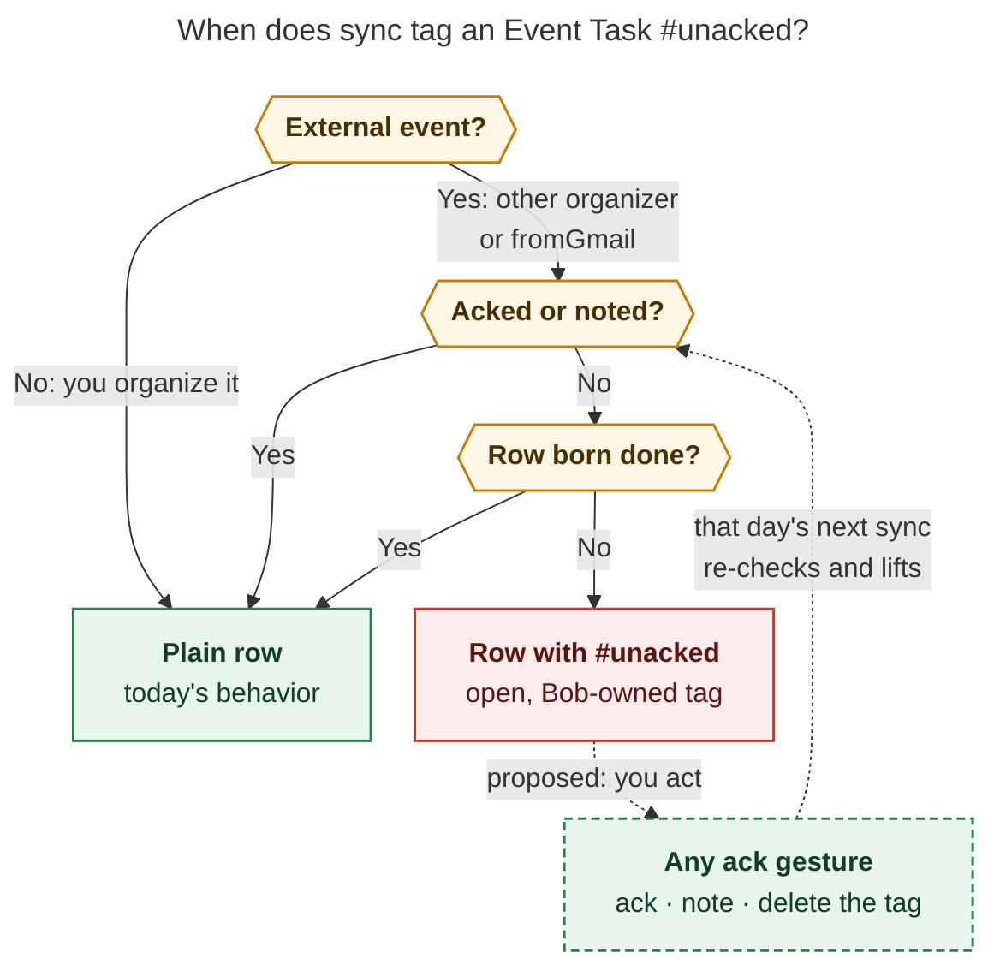

# Ack external Google Calendar events before they become Event Tasks

*Researcher cld · 2026-11-12 · bob-cli `master` @ `b04120b0` · read-only
calendar sample taken on the writer Mac*

---

## Bottom line

**Build it, with eight adjustments.** The ack is a forcing function for a
feature you already have. A private event note (`bob gcal note`) can fix
routing, buffers, and the clock on any event you can't describe in Google, but
only if you remember to write one. An ack turns "remember to note it" into
"Bob asks once, and you answer with one key".

The rule in one sentence, for docs and `--help`:

> Bob asks once about every event you can't describe in Google: press `a` when
> Bob's handling is right, or `n` to write a private note. Until you answer,
> that Event Task carries an `#unacked` tag.

What I'd change from the request (details in
[Requirement adjustments](#requirement-adjustments-called-out)):

1. The command is **`bob gcal ack`**. `bob gmail ack` is a typo; the request
   itself later says `bob gcal ack -n 7`.
2. **"External" also covers Google's `fromGmail` events** (flights, hotels,
   restaurant bookings). Google lists you as their organizer, but you can't
   edit their description.
3. **Only ask about events that will actually become Event Tasks.** Unanswered
   invitations and Maybe events go in a footer, not in the queue.
4. **Recurring events get a whole-series answer:** Shift gives the same answer
   for every event in the series (`A`, `N`).
5. **The ack card shows exactly what Bob will write** (row, root, buffer,
   clock, and time rail). You ack Bob's version of the event, not just its
   title.
6. **The warning is an `#unacked` tag at the end of the row**, not the start.
   Bob owns it, and deleting it by hand counts as an ack.
7. **Add skip, undo, quit, and help** next to Ack and Note.
8. **Put the reminder in the existing daily `#sync` chore** rather than a new
   weekly task. If you'd rather keep the weekly cadence you asked for, the
   exact line is ready below.

---

## What I checked

| Source | What it settled |
| --- | --- |
| `src/native/gcal/model.rs` (`from_google`, `my_answer`) | Bob already parses `organizer.self` into `organizer_is_self`. An organizer-self event counts as Yes. The external test needs no new fetch fields |
| `src/native/gcal/note.rs` (`is_eligible`, `fetch_candidates`, `NoteCandidate::lands`, picker, `pick_scope`) | The 90-day candidate fetch, query matching, TTY picker, and `lands` vocabulary (`task`, `context`, `waiting_reply`, `waiting_maybe`) are reusable as they are |
| `src/native/gcal/note/write.rs` (`normalize`, `validate`, `preview`, `time_rail`, `print_result`) | The note card already renders the "lands as" row, the bullets, and a route-coloured time rail. The ack card can reuse them |
| `src/native/gcal/journal.rs` (`load_state`, `load_notes`, `malformed_count`, `RowRecord`) | A new kind belongs in the same per-host journal. An unknown `gcal.*` kind counts as malformed on older binaries. A new `gcal.row` field is downgrade-safe ("older binaries read fields with `object.get`") |
| `src/native/gcal/render.rs`, `lifecycle.rs::split_row_spans`, `split_suffix` | Row shape is `- [s] #task **HHMM-HHMM** title badges [#off] [buffer::] [root::] [type::] ^id`. The badges, the clock tag, and the buffer form one hashed span owned by Google. Only `[root::]`, `[type::]`, `[completion::]`, or `^id` open the suffix |
| `src/native/event_task.rs::parse_event_task` | Every Event Task reader requires `#task` to be followed directly by `**HHMM-HHMM**`. That rules out putting a warning tag at the start of the row |
| `docs/gcal.md`, `docs/gcal-notes.md` | Ownership table, sync reports, `-n` semantics (`sync -n N` means N days ending today), and Ledger Tools running `sync -q -f json` silently |
| `docs/gmail.md` § Hold, decision `gmail-reply-wait-is-a-tagged-hold` | Precedent for a tag that Bob automation adds and removes (`#awaiting_reply`). `#prj_is_blocked` is a second one |
| `docs/bank.md`, `docs/guides/acknowledge-bank-transactions.md` | "Ack" already means "I have seen this" in Bob (`bob bank ack`) |
| Decisions `bob-gcal-is-read-only-and-proposes-once` and `private-event-notes-beat-google-per-field` | Google stays read-only. A note never changes inclusion and never RSVPs. Once a row exists, it follows the layered description until you edit it |
| `~/bob/gtd_daily.md` (read only) | You already run a daily `#pre #sync` chore ("Run `gcal sync` + `gkeep pull` + `gmail sync`") and a daily "Review next week in Google Calendar". Monday `#pre` chores use `[repeat:: every week on Monday when done]` |
| Prior research `private_notes_for_unowned_gcal_events__final.md` | Events you don't own are "rare but high-stakes" (interviews, family outings with travel) |
| Google Calendar API reference and the `fromGmail` announcement ([Sources](#sources)) | `organizer.self` means the organizer is *the calendar holding this copy*, not "a person who is you". `fromGmail` events list the recipient (you) as organizer, and Google lets you edit only reminders, colour, visibility, status, and extended properties on them |

### The calendar sample (writer Mac, read-only `bob gcal note -l -a -f json`)

The window was 2026-11-12 → 2027-02-10, which is 90 days and every eligible
event. Apollo has no gcal login (`no_client`), so I ran the same read-only
listing on the Mac.

| Class | Count | Examples (organizer) | Lands |
| --- | --- | --- | --- |
| Owned | 3 | Bryan's own events | task |
| External, accepted, one-off | 3 | a product-engineer interview (**already has a private note**), a screening call on Tue Nov 17, *Deerwood. Christmas breakfast* (Kelly) on Dec 13 | task |
| External, Maybe, recurring | 13 occurrences of one series | *Little Gym* (Kelly), weekly | `waiting_maybe`, a context row |

If this shipped today, **only one event would need an ack in the next 7 days**
(the screening call). Within 90 days there would be one more (Deerwood). The
interview already counts as acked because it has a note. The weekly Maybe
series would never be asked, because it never becomes an Event Task. The
ritual is cheap: seconds a week.

---

## Is this a good idea?

**Yes.** Four reasons:

1. **It closes a real gap.** An external event lands as `[root:: meet]` with no
   buffer and on-clock unless you remembered to write a private note. The cases
   where that is wrong are the expensive ones: interview prep, driving to a
   family event, a flight.
2. **Today the fix is opt-in recall; the ack makes it opt-out.** `bob gcal note`
   already lets you set the right fields weeks ahead. What's missing is a
   moment when Bob asks.
3. **The cost is tiny at today's volume.** That's about one event a week, and
   Shift answers a whole recurring series at once.
4. **It fits Bob's existing models.** The ack lives in the gcal journal next to
   notes. The warning is a tag Bob adds and removes, like `#awaiting_reply`.
   "Ack" already means "I've seen it" in `bob bank ack`.

**Ways it could go wrong, which the design must prevent:**

| Risk | Why it matters | Countermeasure in this design |
| --- | --- | --- |
| **Rubber-stamping** | If the card shows only a title, `a` becomes a reflex and the ack means nothing | The card shows the exact row, root and its source, buffer, clock, and the time rail. You ack Bob's version of the event |
| **Alert fatigue** | A new job could bring 10–30 meetings a week organized by coworkers | Series acks (`A`), the `gcal.ack: off` kill switch, and a stated reopen trigger (organizer-domain trust) |
| **Latency** | Interviews are often booked 1–5 days out, so a Monday-only ack misses most of them | The `#unacked` tag catches them on the day. A daily `bob gcal ack` costs about a second when the queue is empty |
| **Sync output is invisible** | Ledger Tools runs `bob gcal sync -q -f json`, and nobody reads that output | The warning lives **in the vault row**, not just in command output |
| **Mixed binary versions across hosts** | Older binaries count an unknown `gcal.*` kind as malformed | Same rollout as `gcal.note`: one skip warning per line until upgraded. Ship the reader and the writer in one release |
| **A hard gate** | Holding back an unacked row means a missed meeting | Keep it soft, as you asked. Sync always writes the row |

---

## Would I take a different approach?

**Same approach, sharper edges.** I weighed these alternatives:

| Alternative | Verdict | Why |
| --- | --- | --- |
| **Hard gate**: hold unacked rows out of the note | Reject | A missing meeting costs far more than a wrong root |
| **Warn on default-routed rows** (any owner) instead of external ones | Reject as the trigger | An owned event's defaults were your choice when you created it. A meeting where `meet` *is* right would still need a way to say "this is fine", which is the ack |
| **Fold the queue into `bob gcal note`** (bare `note` walks unnoted events) | Reject | Bare `note` already means "list notes". Two verbs ("this is fine" and "change it") are clearer than one overloaded verb |
| **Answer acks in the Obsidian `]s` morning walk** | Later (v3) | Best ergonomics, but it needs bob-plugins, walk-tier rules, and Ledger Tools. Ship the CLI first and keep the JSON ready for it |
| **Display-only warning** (the plugin reads `.bob/gcal/*.jsonl`) | Reject | Invisible without the plugin, on mobile, and to every other Bob reader (plan, capture agenda) |
| **Warning as a first child bullet** | Reject | Hidden when the task is folded, and task queries show only the task line |
| **Warning tag at the start of the row** (`#task #unacked **…**`) | Reject | `event_task.rs` and the span splitter require `#task` to be followed directly by `**HHMM-HHMM**`. Every Event Task reader, the JavaScript mirrors in bob-plugins included, would need a new contract |
| **Ack at RSVP time** (watch for invitation emails) | Reject | Bob can't observe an RSVP, and the grant is read-only. The decision record's reopen trigger is "Bob needs to RSVP" |
| **Weekly ritual only** | Adjust | Run the same command daily: an empty queue costs about a second, and the in-row tag is the real safety net |

---

## Requirement adjustments (called out)

| # | As asked | Adjusted | Why |
| --- | --- | --- | --- |
| R1 | `bob gmail ack` | **`bob gcal ack`** | Typo. The request itself says `bob gcal ack -n 7` later |
| R2 | External means "not owned by me" | **External = `organizer.self == false` *or* `eventType == fromGmail`** | Google sets `organizer.self` per calendar copy. `fromGmail` events list you as organizer, yet their description is locked, so a flight could never carry `-90 Drive to the airport` except through a note |
| R3 | Every external event in the window | **Only external events that will land as Event Tasks** (Yes, or Maybe when `gcal.tentative: task`) that haven't ended. Unanswered or Maybe invitations appear in a dim footer, and `-a` adds them so you can ack early | Asking about a weekly Maybe class that only ever becomes a context row is noise (13 of the 16 external events in the sample) |
| R4 | (unstated) | **Recurring events get an all-events answer**: `A` acks the series, `N` notes the series | Mirrors the `This event` / `All events` scopes notes already have. One keypress per series, forever |
| R5 | Two options: Ack and Note | **Ack, Note, plus Skip, Undo, Quit, and Help**, with Editor and Open behind `?` | Without Skip you can't defer. Without Undo, a mistyped `a` turns into a hand edit. Quitting must never lose answers |
| R6 | `-n\|--next-n-days`, always including today | **N local days starting today** (`-n 1` = today, `-n 7` = today plus 6 days), 1–90, **default 7**. Events that already ended today are left out | Mirrors `sync -n N` ("N days ending today"). 90 matches the note fetch horizon. An ended meeting has nothing left to decide |
| R7 | Prompt per event | **Each card shows exactly what sync will write** | Without it the ack is a rubber stamp. With it, it's a two-second review |
| R8 | A hard-to-miss warning of some sort | **An exact `#unacked` tag at the end of the row, which Bob owns.** Removing it by hand counts as an ack. Bob never adds it to context rows or rows born done, and lifts it when the row closes | See [The warning](#the-warning-unacked). The tag shows up in every task view and query, unlike a child bullet |
| R9 | Interactive only | **Also one-shot and list forms**: `bob gcal ack QUERY`, `-i ID`, `-l`, `-c`, `-f json` | Scripts, Mac Capture, and the in-row hint need a non-interactive path |
| R10 | (unstated) | **An ack never expires** when the event moves or is renamed | It's keyed by event identity, like notes, and nothing in the ack depends on the time. Re-asking would breed fatigue |
| R11 | A weekly recurring task | **Recommended: add `bob gcal ack` to the existing daily `#pre #sync` chore.** Fallback: the weekly Monday task you asked for (exact lines below) | Daily catches short-notice invites before their day at about a second per run, and the chore already runs on the gcal writer |
| R12 | (unstated) | **`gcal.ack: external \| off`** config, default `external` | A kill switch, like `gcal.description: off` |

---

## Design

### Vocabulary

- **External event**: an eligible Google event whose description you can't
  durably control: `organizer.self` is false, or `eventType` is `fromGmail`.
- **Ack**: a Bob-only record saying "Bob's handling of this event is right".
  It changes nothing about the row except lifting the warning.
- **Acked**: an event with a live ack (this event or all events) **or** a live
  private note (this event or all events). Writing a note *is* an ack, so
  there is never a double write.
- **`#unacked` row**: an open Event Task for an external event that isn't
  acked.

### Who counts as external

```rust
// model.rs — the one place the rule lives
pub(crate) fn is_external(&self) -> bool {
    !self.organizer_is_self || self.event_type == "fromGmail"
}
```

- `organizer.self` is "whether the organizer corresponds to the calendar on
  which this copy of the event appears", so it's a per-calendar fact. With
  only `primary` configured (as today), it means "you organize it".
- **Caveat for later:** on a *shared* calendar added to `gcal.calendars`, an
  event created on that calendar has the calendar as organizer, so
  `self: true` even if Kelly created it. If you ever add a read-only shared
  calendar, add the reopen rule *calendar `accessRole` is `reader` → every
  event is external*. It's not needed today.
- The `fromGmail` clause also covers flights and reservations. I could not
  confirm any in the 90-day sample, so this is a design-for-later choice that
  costs one boolean.

### What counts as acked, and where it's stored

A new kind, `gcal.ack`, goes in the existing per-host journal
`.bob/gcal/<host>.jsonl`. That file is union-merged, already tracked, and
already holds `gcal.note`.

```json
{
  "v": 1,
  "ts": "2026-11-12T21:04:11-05:00",
  "host": "kellys-macbook-pro",
  "kind": "gcal.ack",
  "account": "you@example.com",
  "key": { "calendar_id": "primary", "event_id": "st49ogf0k0jiciob1ebgj1aupo" },
  "scope": "event",
  "acked": true,
  "via": "ack",
  "seen": { "title": "Deerwood. Christmas breakfast", "start": "2026-12-13T10:00:00-05:00" }
}
```

- **Key and scope** are the same as notes: `{calendar_id, event_id}` for
  `scope: event`, or `{calendar_id, series}` (Google's `recurringEventId`)
  for `scope: series`.
- **`acked: false`** is a clear (undo, or `bob gcal ack -c`). The fold
  remembers it, as notes remember a deliberate clear.
- **`via`** records where the ack came from, for display and debugging:
  `ack` (the command), `row` (you deleted the tag), and later `mac` or
  `plugin`.
- **Fold:** last writer wins per `(account, calendar, scope key)`, ordered by
  `(ts, host, path, line)`, exactly like `load_notes`.
- **Derivation:** `acked = ack(event) ∨ ack(series) ∨ note(event) ∨
  note(series)`. Each part means a live record, never a clear.
- **Account guard:** an ack whose `account` differs from the snapshot's
  resolved account never applies (the same rule as notes).
- **`seen`** is for display only. It never moves an ack to another event.
- **Compatibility:**
  - `load_state` must skip `gcal.ack`, as it skips `gcal.note`. The kind
    neither folds as an occurrence nor moves `newest`.
  - `malformed_count` gains `parse_ack_record`.
  - Older binaries count each ack line as malformed until upgraded. That is
    the same cost `gcal.note` accepted, and it goes in Known limits.
  - Ship the reader and the writer in the same release. Acks are normally
    written on the Mac, which is also the writer, so the host writing acks is
    always the newest.
- **Why not a field on `gcal.note`?** An empty-text note is already a clear,
  so an older binary would fold an "ack" as a note clear. That would delete a
  real note. A new kind can't be misread that way.

### The `bob gcal ack` command

```text
bob gcal ack [-a|--all] [-b|--bob-dir DIR] [-C|--calendar ID] [-c|--clear]
             [-d|--dry-run] [-f|--format human|json] [-h|--help]
             [-i|--event-id ID] [-l|--list] [-n|--next-n-days N]
             [-s|--scope event|series] [QUERY...]
```

Options are alphabetical and every long option has a short alias, per the CLI
rules. `-a` means "include more events" here, as it does in `note -l -a`.
`ack` sorts first among the `bob gcal` subcommands.

| Form | What it does |
| --- | --- |
| `bob gcal ack` on a TTY | **The queue session**: one card per unacked external event that will land as a task, soonest first, from now through the end of day N |
| `bob gcal ack -n 14` | The same, two weeks ahead |
| `bob gcal ack -a` | Also asks about invitations awaiting your reply and Maybe events, so you can ack them early |
| `bob gcal ack QUERY` / `-i ID [-C CAL]` | Acks one event without the queue, using the same matcher, `eid=` URL decoding, picker, and recurring scope prompt as `note` (`-s` is required off a TTY) |
| `bob gcal ack -c QUERY` | Clears an ack (`acked: false`). A private note still acks the event |
| `bob gcal ack -l` (also bare `ack` off a TTY) | Prints the queue and exits 0 with a hint: `ack one: bob gcal ack QUERY` |
| `-d` | Previews a one-shot ack or clear without saving |
| `-f json` | Non-interactive only: list or one-shot |

**Queue membership.** An event joins the queue when all of these hold:

- it is eligible (`note`'s `is_eligible`) and external
- it will land as a task (`lands == "task"`)
- it isn't acked
- it ends after now and starts on or before the window's last day
- the day's journal hasn't tombstoned its row as `removed_by_you`, because
  deleting the row already answered it

Under `-a`, `lands` may also be `waiting_reply` or `waiting_maybe`.

**Recurring events.** Each occurrence gets a card. A recurring card adds the
series answers (`A`, `N`). Answering for all events removes the series' later
occurrences from the queue.

#### The session

Each answer is appended to the journal the moment you give it (`O_APPEND`), so
a crash or Ctrl-C never loses answers. At the end, on the writer host, the
command runs **one** sync over every rendered daily note that holds a row for
an answered event, which lifts tags and applies notes. On another host it
saves and says where the change will land, as `note` already does.

Illustrative TTY output for `bob gcal ack -n 32`, a window wide enough to reach
the Dec 13 event; the default 7 days would show only the first card. Glyphs and
spacing follow the existing gcal output, and colour is described in brackets:

```text
bob gcal ack · Thu Nov 12 – Sun Dec 13
  2 to ack · 1 already noted · 5 Maybe not asked (Little Gym) [dim]

─ 1 of 2 ─────────────────────────────────────────────────────────
Screening between Thomas Holvoet and Bryan
  Tue Nov 17 · 12:00–12:15 · in 5 days · from Thomas · ✓ Yes

  ● meet ━━━━━━━━━━━━━━━━━━━━━━━━━ 12:00 ─ 12:15            [meet hue]
  meet (default) · no buffer · on-clock · ≡ 2 bullets from Google

  lands as [dim]
  - [*] #task **1200-1215** Screening between Thomas Holvoet and Bryan 📅 📹 [root:: meet] #unacked
      [#unacked in amber]
  a ack   n note   s skip   q quit   ? more
```

Press `a`:

```text
  ✓ acked · lands without #unacked [green]
```

The next card is a one-off from Kelly. Press `n`, type the same TEXT form
`bob gcal note` accepts, and press Enter:

```text
─ 2 of 2 ─────────────────────────────────────────────────────────
Deerwood. Christmas breakfast
  Sun Dec 13 · 10:00–12:00 · in 31 days · from Kelly · ✓ Yes
  ...
  ✎ note › @family -30 Drive to Deerwood +15 Drive home

  ● family ━ 09:30 ━━━━ 10:00 ━━━━━━━━━━━━━━━ 12:00 ━ 12:15    [family hue]
  lands as [dim]
  - [*] #task **1000-1200** Deerwood. Christmas breakfast 📅 [buffer:: -30m +15m] [root:: family] ^…
      - ↤ *30m before* Drive to Deerwood
      - ↦ *15m after* Drive home
  ✎ noted · only in Bob · lands Sun Dec 13 [violet ✎, as today]
```

The session ends with:

```text
✓ 1 acked · 1 noted · nothing left through Sun Dec 13
↻ applied to today's note · 0 rows changed
```

If you skipped anything, the summary says so instead:
`⚠ 1 skipped · its row will carry #unacked · bob gcal ack` (amber).

**Keys.** One keypress each, with no Enter. Uppercase means "every event in
this series" and only appears on recurring cards.

| Key | Action |
| --- | --- |
| `a` / `A` | Ack this event / every event in the series |
| `n` / `N` | Note this event / the series: a one-line prompt that takes `bob gcal note` TEXT (`@route`, `#off`/`#on`, `-30 reason`, `+15 reason`, prose) |
| `e` / `E` | Write the note in `$VISUAL`/`$EDITOR`, reusing `note -e` with its scissors line and cheat sheet |
| `s` or Space | Skip: the event stays unacked and its row will carry `#unacked` |
| `u` | Undo the last answer: appends a clear for what you just wrote, then shows that card again |
| `o` | Open the event in Google Calendar on a desktop session; over SSH it prints the URL |
| `q`, Esc, Ctrl-C | Quit. Answers so far are saved, and the final sync still runs |
| `?` | Show every key with a one-line meaning |

**The note prompt.**

- Enter on an empty line returns to the card.
- A validation error prints the existing coloured spans and route suggestions
  and offers `e fix in editor (prefilled) · n retype · Enter back`. A plain
  line read can't prefill text; `$EDITOR` can, so no line-editor crate is
  needed.
- A saved note shows the same "lands as" preview and time rail that
  `bob gcal note` prints. A wrong buffer sign is obvious in the rail.

**Terminal handling.** Single keys need non-canonical, no-echo input:

- Use `termios` through the existing `libc` dependency, so there's no new
  crate.
- Clear `ISIG` and treat byte `0x03` as quit, so Ctrl-C restores the terminal
  instead of killing the process mid-raw-mode.
- Restore the terminal through a drop guard as well.
- Switch back to cooked mode for the note line, so the kernel's line editing
  (backspace, Ctrl-U) works.
- When stdin is not a real TTY but `BOB_GCAL_ASSUME_TTY=1` is set (the test
  hook), skip `tcsetattr` and read bytes from the pipe. Tests can then drive a
  full session with `printf 'a' 'n@family -30 Drive\n' 'q'`.

**Why it looks this way.**

- Each card is the existing note card plus a single keys line, so a note
  answered here reads like a note written with `bob gcal note`.
- Colour carries meaning, with the glyph alongside it: amber `⚠`/`#unacked`
  means unanswered, green `✓` means acked, `✎` means noted, and the `●` dot
  uses the route hue.
- The header counts what's left. Cards say "in 5 days" next to the date,
  because urgency is relative.
- Everything fits in 80 columns, and `NO_COLOR` or a pipe drops colour but
  keeps the glyphs (`Styler::detect`).

**Exit status:**

| Code | When |
| --- | --- |
| 0 | Success: a completed session, `q`, an empty queue, or a list |
| 130 | Ctrl-C, after saving answers and restoring the terminal |
| 1 | gog, network, or timeout failure |
| 2 | Usage or setup errors, no match, ambiguous match off a TTY, recurring match without `-s` off a TTY, an invalid note in a one-shot path |

**JSON** (`-l -f json` and one-shot):

```json
{
  "schema_version": 1,
  "ok": true,
  "window": { "from": "...", "to": "...", "start": "2026-11-12", "end": "2026-11-18", "days": 7 },
  "queue":   [ { "...event_json fields...": "", "ack": { "state": "unacked", "scope": null, "via": null, "at": null } } ],
  "waiting": [ ],
  "counts": { "external": 3, "acked": 0, "noted": 1, "unacked": 1, "waiting": 1 }
}
```

`ack.state` is one of:

| `ack.state` | Meaning |
| --- | --- |
| `unacked` | An external event with no ack and no note |
| `acked` | It has a live ack |
| `noted` | It has a live note |
| `not_required` | You organize it, or `gcal.ack: off` |

A one-shot write adds `action` (`acked`, `cleared`, `unchanged`, or
`preview`) and `status` with the same states `note` uses (`applied`,
`saved_elsewhere`, `waiting_note`, …). The same `ack` object is added to
`bob gcal list` events and to `bob gcal note -l -a` events, which is the Mac
picker source.

### The warning: `#unacked`

**Placement.** The tag is the last token before the block ID, in the
Bob-and-Bryan suffix and outside every span Google owns:

```markdown
- [*] #task **1200-1215** Screening between Thomas Holvoet and Bryan [📅](…) [📹](…) [root:: meet] #unacked ^screening-between-thomas
```

After an ack, the same row on that day's next sync:

```markdown
- [*] #task **1200-1215** Screening between Thomas Holvoet and Bryan [📅](…) [📹](…) [root:: meet] ^screening-between-thomas
```

**Why the end of the row and not the start.** Bob's other system tags
(`#awaiting_reply`, `#prj_is_blocked`) go right after `#task`. On an Event
Task that would sit between `#task` and `**HHMM-HHMM**`, where
`event_task.rs::parse_event_task`, `lifecycle::split_row_spans`, and the
JavaScript mirrors in bob-plugins (event link times, the capture agenda) all
expect the time span.

In Live Preview the badges collapse to emoji, so the end of the row sits right
after the title: `☐ ⌗ 12:00–12:15 Screening … 📅 📹 ● meet  ⚠ unacked`.

**One parser change keeps it reliable.** `split_suffix` only opens the suffix
at `[root::`, `[type::`, `[completion::`, or ` ^id`. On a row with no root and
no type (possible when no root candidate validates), a trailing `#unacked`
would fall into the hashed badge span and read as your edit (`kept_edit`).
Add an exact, whitespace-preceded ` #unacked` token to the `split_suffix`
markers. Titles can't collide, because `escape_title` already writes a
mid-title `#unacked` as `\#unacked`.

**The rule, stated once:** *an open Event Task carries `#unacked` exactly
while its external event is unacked.*



*Figure: Sync tags only open Event Tasks for external events with no ack and
no private note. Any of three gestures acks the event, and that day's next
sync lifts the tag. Context rows never become Event Tasks, so they never
reach this chart. Rendered with mermaid-cli 12.0.0 under the research-PDF
config: 597 × 960 px, 93% fit.*

**What sync does on every row it reconciles.** Each `gcal.row` record gains
an additive field, `"unacked": true`, set only when Bob wrote the tag. Older
binaries ignore it, so a downgrade is safe. The table uses three inputs:
`last` is that journaled field, `present` is the exact token in the row now,
and `want` is "the row is open, the event is external, and the event is
unacked".

| Situation | Sync's action | Reported |
| --- | --- | --- |
| `last ∧ ¬present ∧ ¬acked`: you deleted the tag | Append `gcal.ack {via: "row", scope: "event"}`. The event is now acked | Once: `acked by removing #unacked` |
| `want ∧ ¬present` | Add the tag | Human row shows `⚠ unacked` |
| `¬want ∧ present ∧ last`: acked, or the row closed | Remove the tag | Row action `updated` with detail `acked` or `closed` |
| `¬want ∧ present ∧ ¬last`: you typed it yourself | Leave it | — |

- **Never on context rows or rows born done.** A past meeting has nothing left
  to decide.
- **Closed rows.** A row you close while it's unacked loses the tag on that
  day's next sync. The tag is about a decision that no longer exists, and
  keeping it would fill done notes with noise. Until that sync, a display mark
  can draw it muted (see Display).
- **Rollout.** Existing open rows for unacked external events get the tag on
  their day's next sync. Today that is one row at most.
- **Type and filing are unaffected.** Compute `needs_meet_type` on the line
  *without* the tag. MEET links, buffers, and phases don't read it.
- **`sync -F`** resets day state only. Acks, like notes, survive, and restored
  rows get the tag exactly when the event is still unacked.
- **New row in the ownership table** (`docs/gcal.md` § Who owns each part of a
  row):

  | Part | Owner | Sync behavior |
  | --- | --- | --- |
  | `#unacked` | Bob, until you delete it | Present on an open Event Task exactly while its external event is unacked. Deleting it acks the event (reported once). An ack or a closed row removes it on that day's next sync |

**Display (v2, bob-plugins).**

- Ledger Tools gains an `#unacked` mark: an amber `⚠ ack` pill whose tooltip
  reads `External event · Bob used its defaults · run bob gcal ack, or delete
  this tag to ack`. It's drawn muted on a closed row. It follows the
  task-tag-mark principles: display-only, truthful, and reversible.
- The Event link times pill on the MEET Task Link gains a small amber dot when
  its target row carries `#unacked`.
- In Mac Capture, the idle agenda can draw the same dot from an `unacked`
  flag in `capture-pomodoros --tasks`. The Event notes picker (Command-E) can
  sort unacked events first and offer **Ack** next to **Note** by calling
  `bob gcal ack -i … -f json`. That keeps Mac Capture a thin client.

### Other surfaces

| Surface | Change |
| --- | --- |
| `bob gcal sync` (human) | `+ task 12:00–12:15  Screening …  ● meet ⚠ unacked`. The summary ends `· ⚠ 1 unacked`, followed by a cyan hint `bob gcal ack` |
| `bob gcal sync -f json` | Each `rows[]` entry gains `ack` (state object) and `unacked` (bool). The summary gains `unacked` |
| `bob gcal list` | The VAULT cell appends ` · unacked` (amber). A footer reads `⚠ 1 external event unacked today · bob gcal ack`. JSON events gain `external` and `ack` |
| `bob gcal note` | Saving a note acks the event; on an event that was unacked, the success line appends `· acked`. Clearing the only note behind an ack prints `⚠ now unacked · bob gcal ack <query>` |
| `bob gcal doctor` | No change. Doctor reports setup health, not workload |

### Configuration

```yaml
gcal:
  ack: external   # external | off — off writes no #unacked tags and empties the queue
```

A wrong type is a setup error (exit 2) that names `gcal.ack`, like every other
gcal key. With `off`, the next sync removes Bob-written tags, because `want`
becomes false.

### The reminder task

**Recommended (R11): edit the existing daily chore** in `~/bob/gtd_daily.md`
so the ack runs in the same terminal session as sync:

```markdown
- [?] #task #gtd #pre #sync Run `gcal sync` + `gcal ack` + `gkeep pull` + `gmail sync`  [repeat:: every day when done]  [created:: 2026-11-12]  [scheduled:: 2026-11-13]
```

**As requested (weekly)**, if you'd rather batch it. Monday `#pre` matches
your other weekly chores, and `-n 7` covers exactly the Monday–Sunday week the
weekly review plans:

```markdown
- [?] #task #gtd #pre #terminal **Ack external events**: on the Mac (the gcal writer) run `bob gcal ack -n 7` · answer each card with one key (a ack · n note · s skip) · nothing to ack? completing this is the record  [repeat:: every week on Monday when done]  [created:: 2026-11-12]  [scheduled:: 2026-11-16]
```

Use one or the other, not both. Each line follows the file's siblings: a
future `[scheduled::]` stores `[?]`, which `bob task reconcile` derives
anyway. Put it in `### Blocked` under the existing Monday chores. The
implementer edits the vault on the writer and lets vault-sync commit it.

---

## Reliability and edge cases

| Case | Behavior |
| --- | --- |
| The organizer reschedules or renames the event | The ack follows the event id. Time and title come from Google as usual |
| The organizer cancels, or you decline | No row (or an untouched row is cancelled, as today). The ack becomes inert, and it's never pruned silently |
| Maybe → Yes after the session | The row upgrades in place as today. It gets `#unacked` only if no ack or note exists, and an earlier ack under `-a` prevents that |
| Ack written on a non-writer host | Saved. The next sync on the writer lifts the tag, and the command says so |
| Ack written while the daily note is still unrendered | Saved. The row is born without the tag |
| Two hosts answer the same event | Last writer wins, ordered by `(ts, host, path, line)`. Both records are kept in the journal |
| A malformed journal line | The row-hold rule for notes is unchanged. An unreadable ack can only *add* a tag, never drop a row, so it never holds |
| Crash mid-session | Answers given so far are in the journal. The final sync runs on the next ordinary sync |
| You delete the row | It's tombstoned as today and leaves the queue. Bob infers no ack |
| You type `#unacked` on an acked row by hand | Bob leaves it, because `last` is false |
| An all-day external event | It's context, never an Event Task, so it's never asked or tagged |
| A recurring event with an event-scope clear but a series ack | Still acked. Clearing one scope removes only that scope's record |

---

## Implementation plan

| Phase | Repo | Work |
| --- | --- | --- |
| **1. Core (read-only surfaces)** | bob-cli | `journal.rs`: the `gcal.ack` kind, `parse_ack_record`, `load_acks` (last writer wins), `append_ack`, skipped in `load_state`, accepted by `malformed_count`. `model.rs`: `is_external()`. `snapshot.rs` `fetch_day`: load acks next to notes and attach `AckState` to each event. `list.rs`: VAULT ` · unacked`, footer, JSON `external`/`ack`. `config/gcal.rs`: `gcal.ack` |
| **2. Row tag** | bob-cli | `plan.rs`: the `want`/`present`/`last` reconcile, the inferred `via: "row"` ack, and reports. `render.rs`: append the tag last before `^id`. `lifecycle.rs::split_suffix`: treat ` #unacked` as a suffix marker. `journal.rs` `RowRecord`: additive `unacked`. `sync.rs` human and JSON output |
| **3. CLI** | bob-cli | `ack.rs` (new): window fetch reusing `note::fetch_candidates`, queue build, one-shot, list, and clear, then the interactive session (a termios key reader built on `libc`, cards built from the `write.rs` preview and time rail, the note path through `write_one` with deferred sync, undo, and one final sync). `cli.rs`: subcommand and help. `note.rs`: `· acked` on note success and the unacked hint on clear. Shell completion |
| **4. Docs and records** | bob-cli | New `docs/gcal-acks.md` (or an "Acks" section in `gcal-notes.md`). `docs/gcal.md`: Commands, ownership table, Configuration, list and sync JSON, Known limits (older binaries warn on `gcal.ack`). Command catalog and reference CLI page. New decision record (below) and glossary term **Event Ack** (aliases ack, unacked), each through `/sase_memory_write` |
| **5. Vault** | vault | The reminder line (R11). Run on the writer and let vault-sync commit |
| **6. Display (v2)** | bob-plugins, bob-mac-capture | Ledger Tools `#unacked` mark and link-time dot. Mac Event notes **Ack** action plus an `unacked` flag in the agenda. Coordinate the JSON contract across repos |

**The decision record to file**, for example
`external-gcal-events-are-acked-once`:

- **Claim:** every external event bound for an Event Task is asked about once.
  An ack or a private note answers it. Until then, its open row carries a
  Bob-owned `#unacked` tag, and deleting the tag acks the event. The row is
  never held.
- **Rejected:** a hard gate, a tag at the start of the row, a child-bullet
  warning, display-only marks, and RSVP-time triggers.
- **Cost:** one tag Bob owns in the row suffix, plus older-binary warnings.
- **Reopens when:** external volume exceeds about 10 a week (add organizer or
  domain trust), a read-only shared calendar is configured, or Bob gains RSVP
  writes.

**Tests:**

- `tests/gcal_ack_cli.rs` with the fake gog (`BOB_GCAL_GOG`): queue
  membership (external, `lands`, ended, tombstoned, `-a`), one-shot, clear,
  recurring scope off a TTY, and JSON.
- A key-driven session through `BOB_GCAL_ASSUME_TTY` and piped bytes,
  including undo and `0x03`.
- Journal fold vectors: last writer wins, the clear, the account guard, and
  older-binary `malformed_count`.
- `plan/tests.rs`: the full `want`/`present`/`last` table, born-done rows,
  context rows, a closed row, a rootless row (the `split_suffix` marker), and
  `-F`.

---

## Open questions for Bryan

1. **Daily or weekly?** I recommend adding `bob gcal ack` to the daily `#sync`
   chore. The weekly Monday line is ready if you'd rather batch.
2. **Tag spelling:** `#unacked` (a state, like `#awaiting_reply`) or
   `#needs_ack` (an instruction)? I prefer `#unacked` because it matches the
   command.
3. **Should `fromGmail` count as external?** I say yes, because flights and
   reservations are exactly where buffers matter.
4. **Should the tag come off closed rows?** I say yes. The other option keeps
   a record of meetings that were never acked.

---

## Recommended solution

1. **Ship `bob gcal ack`** as a one-key review queue. Default `-n 7` covers
   today plus six days and leaves out meetings that already ended. Each card
   shows the event, who organizes it, and **exactly what Bob will write**:
   the row, root and its source, buffer, clock, and a time rail. The
   answers:
   - **`a` ack** or **`n` note**, where the note takes the same TEXT as
     `bob gcal note`
   - **`s` skip**, **`u` undo**, **`q` quit**, and **`?`** for the rest
     (`e` editor, `o` open)
   - **Shift (`A`, `N`)** to answer for every event in a recurring series

   Each answer is journaled immediately, and one sync at the end applies them
   on the writer.
2. **External** means `organizer.self == false` or `eventType == fromGmail`.
   **Acked** means a live `gcal.ack` record *or* a live private note, at
   event or series scope. Acks live in the existing gcal journal as a new
   kind, fold last-writer-wins like notes, and never expire on a reschedule.
3. **Keep sync soft.** Every event still becomes an Event Task. An open row for
   an unacked external event carries an exact, Bob-owned **`#unacked`** tag
   as the last token before `^id`, outside every span Google owns. Sync adds
   it while the event is unacked and removes it after an ack or once the row
   closes. **Deleting the tag yourself counts as an ack.** Teach `split_suffix`
   the new marker so the tag can never land in the hashed badge span.
4. **Surface it** in `sync` and `list` output (`⚠ unacked`, a summary count,
   and a cyan `bob gcal ack` hint) and in JSON for Mac Capture and Ledger
   Tools. Then, as a cross-repo v2, add an amber `⚠ ack` mark in Obsidian and
   an **Ack** button in Mac Capture's Event notes picker.
5. **Add `gcal.ack: external | off`** as the kill switch.
6. **Reminder:** add `bob gcal ack` to the daily `#pre #sync` chore
   (recommended), or add the weekly Monday `#pre` task with `bob gcal ack -n 7`
   as requested. Use one or the other.
7. **Record it:** a decision record, a glossary term, `docs/gcal-acks.md`, and
   the ownership-table row.

With today's calendar the result is about one keypress a week, plus a tag you
can't miss on the rare short-notice invite you didn't get to.

---

## Sources

- Google Calendar API, Events resource (`organizer.self`: "whether the
  organizer corresponds to the calendar on which this copy of the event
  appears"): <https://developers.google.com/workspace/calendar/api/v3/reference/events>
- Google Calendar API, `EventOrganizer` model:
  <https://google-api-calendar.hexdocs.pm/GoogleApi.Calendar.V3.Model.EventOrganizer.html>
- Google Workspace Updates, "Google Calendar API event type fromGmail" (May
  2024): the organizer becomes the email recipient, and edits are limited to
  reminders, colour, visibility, status, and extended properties:
  <https://workspaceupdates.googleblog.com/2024/05/google-calendar-api-event-type-fromgmail.html>
- Google Calendar API release notes: <https://developers.google.com/calendar/docs/release-notes>
- Google Calendar API event types guide: <https://developers.google.com/workspace/calendar/api/guides/event-types>
- bob-cli at `b04120b0`: `docs/gcal.md`, `docs/gcal-notes.md`,
  `docs/gmail.md`, `docs/bank.md`, `docs/task-tag-marks.md`,
  `src/native/gcal/{model,note,note/write,journal,render,lifecycle}.rs`, and
  `src/native/event_task.rs`
- Prior research: `research:202611/private_notes_for_unowned_gcal_events/private_notes_for_unowned_gcal_events__final.md`
- Decision records: `bob-gcal-is-read-only-and-proposes-once`,
  `private-event-notes-beat-google-per-field`, and
  `gmail-reply-wait-is-a-tagged-hold`
