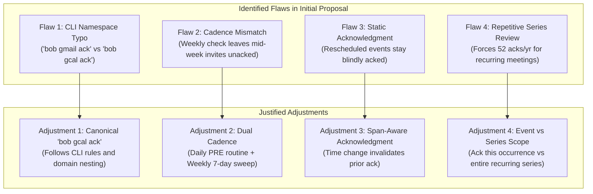
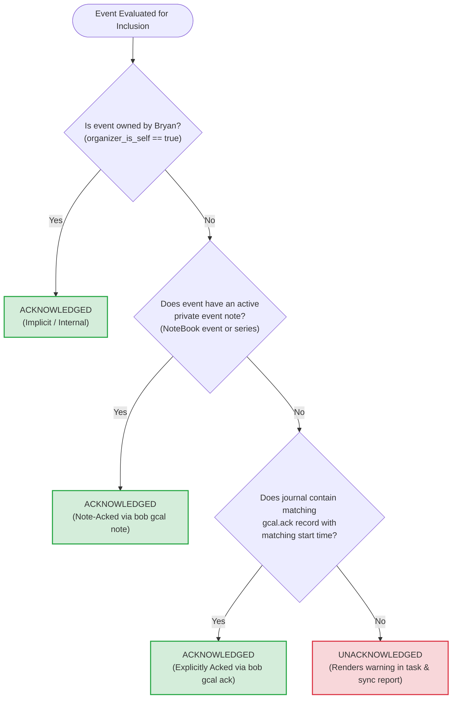
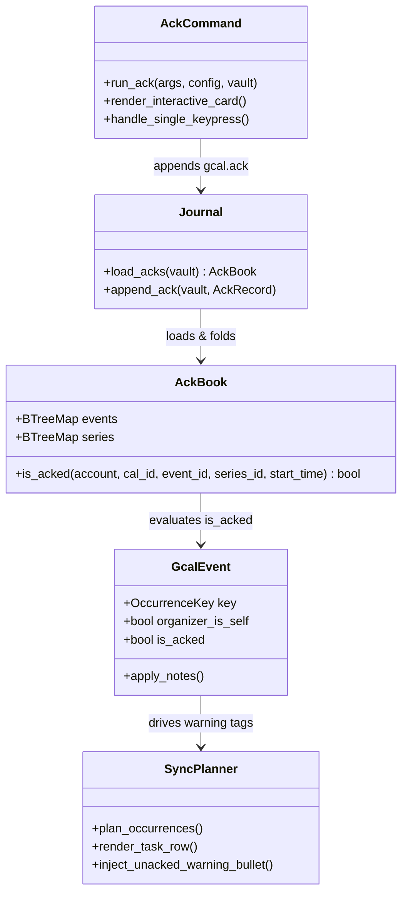

# Architectural & UX Research: Soft Acknowledgment for External Google Calendar Events

**Author:** Researcher `gem` (5-Researcher Swarm)  
**Date:** 2026-11-12  
**Target System:** `bob-cli` (`bob gcal`), Bob Mac Capture, and Bob Vault GTD Workflow  
**Artifact ID:** `gcal_external_event_acknowledgment__gem`  
**Status:** Complete Analysis & Recommended Design  

---

## Executive Summary

This research investigates the design, system architecture, CLI interactions, and GTD workflow implications of introducing a **soft acknowledgment requirement** for external (unowned) Google Calendar events before they become regular Event Tasks in Bryan's daily notes.

### High-Level Verdict

The proposed feature addresses a significant operational gap in Bryan's time-management architecture. Under the current implementation, any meeting invitation organized by an external party that is accepted on Google Calendar automatically materializes on today's daily note as an Event Task with a default root (typically `[root:: meet]`), default on-clock billing, and zero travel or preparation buffer. This frequently creates **logistical blindspots**: meetings land without proper contextual grouping, without buffer time to prepare or travel, and occasionally without Bryan realizing they were scheduled for today.

A **soft requirement**—where unacknowledged events still project into the daily note but carry a striking, unambiguous warning—is precisely the right balance. A hard gate (omitting unacked events or failing `gcal sync`) would risk catastrophic failure (missing a live meeting). However, several key aspects of the user's initial proposal require **critical critique and design adjustments**:

1. **CLI Namespace Slip (`bob gmail ack` vs `bob gcal ack`):** The prompt mentions `bob gmail ack` in one place and `bob gcal ack -n 7` in another. Calendar event acknowledgment belongs strictly under `bob gcal ack` under Bob's CLI rules.
2. **Cadence & Horizon Mismatch (Weekly vs Daily):** A single weekly recurring task (`bob gcal ack -n 7`) fails for mid-week invitations. If an invitation is accepted on Tuesday for Thursday, a Monday-only weekly review leaves Thursday's event unacknowledged until it syncs with a warning. We propose harmonizing this with Bryan's existing daily morning review (`gtd_daily.md`).
3. **Acknowledgment Invalidation on Reschedule:** If an organizer moves an event's time or day after Bryan has acknowledged it, the acknowledgment must automatically invalidate so Bryan is alerted to the new logistical constraint.
4. **Recurring Series Semantics:** External recurring invitations (e.g., weekly syncs) must support series-level acknowledgment so Bryan is not forced to acknowledge 52 identical instances per year.
5. **Warning Aesthetics & Non-Destructive Lifecycle:** The warning on unacknowledged event tasks must be prominent and visually unmistakable, yet clean enough that when acknowledged, `bob gcal sync` can seamlessly remove the warning without disturbing any user-authored edits.

---

## 1. Critique of the Proposal

### 1.1 Is This a Good Idea?

**Yes, emphatically.** In an automated GTD system, calendar synchronization is one of the few ingestion pipelines where third parties can unilaterally write obligations onto your daily horizon. 

When Bryan creates an event himself, he already knows the intent, the area of life or project it serves (`@work`, `@family`, `@admin`), and the travel requirements. But when an external organizer creates an event:
- **Root Attribution is Incomplete:** Unless Bryan has a private event note or a title keyword match, the event defaults to generic `[root:: meet]` or the calendar default root.
- **Buffers are Missing:** External organizers rarely budget Bryan's travel or context-switching time. An unacknowledged meeting at 14:00 might leave Bryan stranded if he needs 30 minutes of transit.
- **Attention Blindspots:** Invitations accepted weeks in advance suddenly appear on the daily note without active conscious planning.

By creating a deliberate acknowledgment checkpoint, Bob transforms passive calendar ingestion into an active commitment gesture.

### 1.2 Soft Requirement vs. Hard Gate

The user correctly specifies a **(soft) requirement**:
> *"The `bob gcal sync` command should still create event tasks for external events that have not been acked, but we should render a warning of some sort that is hard to miss in the event tasks that we create that correspond with unacked events."*

A **hard gate** (e.g., refusing to sync or omitting unacknowledged events from the daily note) would be dangerous:
- If Bryan is in a rush, misses his morning acknowledgment pass, and runs `bob gcal sync`, omitting an unacked meeting could cause him to miss an important external client or team call entirely.
- In Bob's design philosophy (see `decisions:bob-gcal-is-read-only-and-proposes-once`), calendar sync represents ground truth of occupied time.
- A **soft warning** guarantees that Bryan's daily schedule is never blind to reality, while ensuring that the missing logistical review is front and center.

### 1.3 Identification of Flaws & Justified Adjustments



#### Adjustment 1: Command Naming (`bob gcal ack`)
- **Issue:** The prompt states: *"We can accomplish this by adding a new `bob gmail ack` command that accepts an `-n|--next-n-days` option"* and later refers to *"reminds me to run the `bob gcal ack -n 7` command."*
- **Adjustment:** The command MUST be `bob gcal ack`. Under `cli_rules.md`:
  > *"Nest only under a noun with a stated membership rule."*
  `gcal` is the noun governing all Google Calendar operations (`list`, `sync`, `note`, `doctor`, `calendars`). `gmail` governs email reading, compose, and send. Acknowledging calendar events under `bob gmail` would violate CLI rules and cause severe mental friction.

#### Adjustment 2: Cadence Mismatch (Weekly vs Daily)
- **Issue:** The prompt suggests adding a *weekly recurring task* to `~/bob/gtd_daily.md` to run `bob gcal ack -n 7`. However, calendar invites do not arrive on weekly boundaries. An invite accepted on Tuesday for Thursday would not be caught by Monday's weekly check and would sync on Thursday as an unacknowledged emergency.
- **Adjustment:** 
  1. In `~/bob/gtd_daily.md`, line 18 already has an established daily habit:  
     `- [?] #task #gtd #pre #browser Review next week in Google Calendar [repeat:: every day when done]`
  2. Bryan's morning PRE ritual also runs `gcal sync` (line 16).
  3. We should adjust the workflow so `bob gcal ack` can be used both as a **fast daily morning checkpoint** (taking ≤15 seconds if nothing is new) AND as part of the **weekly horizon sweep**. Furthermore, `bob gcal sync` should output a helpful hint when unacked events exist (`⚑ 1 unacked external event · run 'bob gcal ack'`).

#### Adjustment 3: Reschedule Invalidation
- **Issue:** An event acknowledged at 10:00 AM might be rescheduled by the external organizer to 4:00 PM or moved to Friday.
- **Adjustment:** An acknowledgment must be tied to the event's start time and day (`seen_start`). If the organizer shifts the meeting time, the event must automatically revert to unacknowledged status so Bryan is prompted to re-evaluate his buffers and daily schedule.

#### Adjustment 4: Recurring Series Support
- **Issue:** If an external colleague invites Bryan to a weekly 1:1, requiring an individual acknowledgment for all future instances across the next 7 days week after week is tedious.
- **Adjustment:** Mirroring `bob gcal note`, `bob gcal ack` should allow acknowledging either **This event** (`scope: event`) or **All events** (`scope: series`). A series acknowledgment covers all future occurrences of that recurring event unless rescheduled.

---

## 2. Acknowledgment Semantics & Data Architecture

### 2.1 The Definition of "External"

In Bob's calendar model (`src/native/gcal/model.rs`), an event is represented by `GcalEvent`:
- `organizer_is_self: bool` — Derived from Google's `organizer.self == true`.
- `organizer_or_no_guests: bool` — True if Bryan is the organizer OR if the event has no attendees list.

An event is defined as **external** (and therefore subject to acknowledgment) if and only if:
```rust
let is_external = !event.organizer_is_self;
```
*Note on secondary calendars:* If Bryan configures a secondary calendar in `~/.config/bob/config.yml` where he is the calendar owner, events created by him on that calendar have `organizer_is_self == true` and are automatically considered internal.

### 2.2 The Tri-State Definition of "Acknowledged"

An event is considered **Acknowledged** (`is_acked == true`) if ANY of the following three conditions holds:



1. **Implicitly Acknowledged (Owned):** The event was organized by Bryan (`organizer_is_self == true`).
2. **Note-Acknowledged (`bob gcal note`):** The event or its recurring series has a non-cleared private note in Bob's `NoteBook`. Writing a note (`@work -15 Prep slides`) represents an explicit, high-touch review of the event's logistics.
3. **Explicitly Acknowledged (`bob gcal ack`):** The user confirmed the event with a no-op acknowledgment via `bob gcal ack`, recorded in the journal.

### 2.3 Journal Persistence: `.bob/gcal/<host>.jsonl`

To conform with Bob's multi-host, vault-synced architecture (linking `kellys-macbook-pro`, `athena`, and `apollo`), acknowledgments MUST NOT be stored in ephemeral host-local caches or daily note frontmatter.

They belong in the existing journal namespace (`.bob/gcal/<host>.jsonl`) alongside `gcal.note`, `gcal.row`, and `gcal.link`:

```json
{
  "kind": "gcal.ack",
  "account": "bryanbugyi34@gmail.com",
  "calendar_id": "primary",
  "event_id": "st49ogf0k0jiciob1ebgj1aupo",
  "series_id": "recurring_series_xyz123",
  "scope": "event",
  "seen_start": "2026-11-16T14:00:00-05:00",
  "seen_title": "Q4 Strategy Alignment",
  "host": "kellys-macbook-pro",
  "ts": "2026-11-12T20:15:00-05:00"
}
```

#### Field Specifications:
- `scope`: `"event"` (acknowledges this occurrence) or `"series"` (acknowledges all current and future occurrences of this recurring event).
- `seen_start`: RFC 3339 timestamp of the event's start time when acknowledged. If Google Calendar reports a different start time on a later sync, the acknowledgment is automatically invalidated, prompting re-review.
- `seen_title`: Stored for diagnostic display and orphan detection in `bob gcal doctor`.

#### Folding Logic (`AckBook`):
Just as `journal::NoteBook` folds `gcal.note` lines into last-writer-wins state per account, `AckBook` folds `gcal.ack` records:
- An event-level ack takes precedence over a series-level ack.
- If `event.start != ack.seen_start`, the fold treats the occurrence as unacknowledged (`AckState::Rescheduled`).

---

## 3. Interactive CLI Design: `bob gcal ack`

### 3.1 Command Tree & Options

Under `src/native/gcal/cli.rs`:

```bash
bob gcal ack [-b|--bob-dir DIR] [-D|--day DAY] [-n|--next-n-days DAYS] [-a|--all] [-d|--dry-run] [-f|--format FORMAT]
```

- `-n, --next-n-days <N>`: Number of days to inspect ahead (default: `7`). Always includes today.
- `-D, --day <DAY>`: Anchor start day (default: `today`, accepts `tomorrow`, `yesterday`, or `YYYY-MM-DD`). Consistent with all `bob gcal` commands.
- `-a, --all`: Inspect all external events across the window, including already-acknowledged ones (useful for reviewing or editing existing notes).
- `-d, --dry-run`: Preview unacknowledged events and prompt interactions without writing to `.bob/gcal/`.
- `-f, --format <table|json>`: Non-interactive machine-readable output for scripts and Mac Capture.

### 3.2 Visual Terminal Design (Interactive TTY)

When executed on a TTY, `bob gcal ack` enters a focused, aesthetic interactive review mode. Each unacknowledged event is presented as a high-density, beautifully styled card:

```text
📅 Google Calendar Acknowledgment · 3 events to review (2026-11-12 → 2026-11-19)

[1/3] Monday, Nov 16 · 14:00 – 15:00 (in 4 days)
  Title:      Q4 Strategy Alignment
  Organizer:  Sarah Jenkins <sarah.jenkins@deepmind.com>
  Location:   Google Meet · https://meet.google.com/abc-defg-hij
  Inferred:   [root:: meet] · on-clock · no buffer

  [a] Ack (as-is)   [n] Note   [e] Edit note in $EDITOR   [s] Skip   [o] Open in browser   [q] Quit
  > 
```

### 3.3 Single-Keypress Interactions

Using standard terminal raw mode (`libc` termios attributes already available in `Cargo.toml`), single keypresses execute immediately without requiring the Enter key:

1. **`[a]` Ack (as-is / no-op):**
   - Writes a `gcal.ack` record with `scope: event` and `seen_start`.
   - If the event is recurring, asks one quick follow-up: `[1] This event only  [2] All events in series`.
   - Terminal immediately prints:
     `  ✓ Acknowledged (as-is)`
   - Advances automatically to `[2/3]`.

2. **`[n]` Note (Custom Logistics):**
   - Switches terminal back to cooked line-input mode with an inline prompt:
     `  Note: @work -15 Review prep doc beforehand`
   - Accepts the exact same grammar as `bob gcal note`: directives (`@route`, `-30`, `+15`, `#off`, `#on`) and prose.
   - On Enter, runs the input through `src/native/gcal/note/write.rs` validation.
   - Saves the private note to `.bob/gcal/` (which automatically satisfies the acknowledgment requirement).
   - Terminal prints:
     `  ✓ Saved note: @work -15m Review prep doc beforehand · [root:: work] [buffer:: -15]`
   - Advances automatically to `[2/3]`.

3. **`[e]` Edit in `$EDITOR`:**
   - Launches `$VISUAL`, `$EDITOR`, or `vi` with a git-style scissors template pre-populated with event details, allowing multi-line note writing or detailed agenda notes.
   - On editor save/close, validates and writes the note.

4. **`[s]` Skip:**
   - Leaves the event unacknowledged for now (useful when waiting for an organizer's reply or schedule confirmation).
   - Advances to `[2/3]`.

5. **`[o]` Open in Browser:**
   - Spawns the default browser opening `htmlLink` so Bryan can view attendee RSVP status or full calendar context.
   - Keeps the prompt active on the same event.

6. **`[q]` Quit:**
   - Exits cleanly. Any acknowledgments or notes written earlier in the session remain durably committed to the journal.

When all events are reviewed:
```text
✨ All external events across the next 7 days are acknowledged!
```

If run when zero unacknowledged events exist:
```text
✨ Nothing to acknowledge · all external events through 2026-11-19 are confirmed.
```

---

## 4. Warning Rendering in Daily Note Event Tasks

### 4.1 Comparison of Warning Formats

The user requirement states:
> *"The `bob gcal sync` command should still create event tasks for external events that have not been acked, but we should render a warning of some sort that is hard to miss in the event tasks that we create that correspond with unacked events."*

We evaluated four alternative visual designs:

| Design Option | Example Daily Note Rendering | Pros | Cons | Verdict |
| :--- | :--- | :--- | :--- | :--- |
| **Option 1: Inline `#unacked` Tag Only** | `- [ ] #task #unacked **14:00-15:00** Title [📅](...) [root:: meet] ^e1` | Minimalist; queryable via Dataview; standard tag styling. | Too easy to overlook during rapid morning review scan. | Rejected (insufficient urgency) |
| **Option 2: Title Prefix Emoji** | `- [ ] #task **14:00-15:00** ⚠️ UNACKED · Title [📅](...) [root:: meet] ^e1` | Impossible to miss; visible in every view and walk. | Mutilates the title span; complicates span tracking and diffs when acked. | Rejected (violates title span purity) |
| **Option 3: Child Warning Bullet Only** | `- [ ] #task **14:00-15:00** Title [📅](...) [root:: meet] ^e1`<br/>`  - ⚠️ **UNACKED EVENT** (invited by...) · run bob gcal ack` | High visibility; isolates warning from main task row; clean deletion. | Invisible in task-only rollups (e.g., capture agenda) that fold bullets. | Partially Accepted |
| **Option 4: The Hybrid (Tag + Child Bullet)** | `- [ ] #task #unacked **14:00-15:00** Title [📅](...) [root:: meet] ^e1`<br/>`  - ⚠️ **UNACKED EVENT** (invited by Sarah) · run bob gcal ack` | **Maximum visibility; queryable; task row stays parseable; non-destructive removal.** | Requires managing both tag and child bullet. | **Recommended** |

### 4.2 The Recommended Hybrid Warning Design

#### Before Acknowledgment (Rendered by `bob gcal sync`):
```markdown
- [ ] #task #unacked **14:00-15:00** Q4 Strategy Alignment [📅](https://calendar.google.com/event?eid=...) [📹](https://meet.google.com/abc-defg-hij) [root:: meet] ^e1f2a3
	- ⚠️ **UNACKED EVENT** (invited by Sarah Jenkins) · review with `bob gcal ack` or `bob gcal note`
	- Google description bullet 1...
	- Google description bullet 2...
```

#### After Acknowledgment (`bob gcal ack` or `bob gcal note`):
On the next `bob gcal sync` run (or automatic sync triggered by `ack`):
```markdown
- [ ] #task **14:00-15:00** Q4 Strategy Alignment [📅](https://calendar.google.com/event?eid=...) [📹](https://meet.google.com/abc-defg-hij) [root:: strategy] ^e1f2a3
	- Google description bullet 1...
	- Google description bullet 2...
```

### 4.3 Technical Mechanics of Warning Placement & Removal

1. **Tag Placement:** In `src/native/gcal/render.rs`, `render_task_row`:
   `#unacked` is placed immediately after `#task`.
   - When `unacked == true`, Bob emits `- [ ] #task #unacked **HH:MM-HH:MM** ...`.
   - When `unacked == false`, Bob emits `- [ ] #task **HH:MM-HH:MM** ...`.
   - If Bryan edited `[root:: meet]` to `[root:: strategy]` while the row was unacknowledged, Bob's `set_row_metadata` and span preservation rules (see `decisions:gcal-root-follows-google-until-edited`) preserve his edited root while stripping `#unacked`.
2. **Child Bullet Placement:** In `src/native/gcal/description/bullets.rs`:
   The warning bullet is generated as synthetic bullet line 0 of `DescriptionBullets`:
   ```rust
   if occurrence.unacked {
       let organizer = occurrence.organizer_name.as_deref().unwrap_or("external organizer");
       bullets.insert(0, DescriptionBullet {
           depth: 1,
           body: format!("⚠️ **UNACKED EVENT** (invited by {organizer}) · run `bob gcal ack` or `bob gcal note`"),
       });
   }
   ```
   When the event becomes acknowledged, the synthetic bullet vanishes, and `sync` seamlessly rewrites the description block without touching any user-added notes.

### 4.4 Diagnostic Warnings in Other Surfaces

To make the feature completely cohesive across Bob:
1. **`bob gcal list`:** Renders an orange/yellow chip `[⚠️ unacked]` in the table row and appends a footer:
   ```text
   ⚑ 1 unacknowledged external event · run 'bob gcal ack'
   ```
2. **`bob gcal sync` Output:**
   ```text
   Events (2026-11-12):
     + 14:00-15:00 Q4 Strategy Alignment (⚠️ unacked)
   ⚠️ 1 unacked external event was synced · run 'bob gcal ack' to review logistics
   ```
3. **`bob gcal doctor`:** Adds a check item under `Events`:
   ```text
   ✓ gcal events: 2 external upcoming (0 unacknowledged)
   ```

---

## 5. GTD Workflow & `~/bob/gtd_daily.md` Integration

### 5.1 Review of Current `gtd_daily.md` Rituals

Bryan's current `~/bob/gtd_daily.md` contains the following active recurring checklist tasks:

- Line 12: `- [?] #task #gtd #post **Morning review**: ... [repeat:: every day when done]`
- Line 13: `- [?] #task #gtd #pre **Acknowledge bank**: ... [repeat:: every day when done]`
- Line 16: `- [?] #task #gtd #pre #sync Run gcal sync + gkeep pull + gmail sync [repeat:: every day when done]`
- Line 18: `- [?] #task #gtd #pre #browser Review next week in Google Calendar [repeat:: every day when done]`
- Line 22: `- [?] #task #gtd #pre **Bank import**: ... [repeat:: every week on Monday when done]`
- Line 24: `- [?] #task #gtd #post #periods **Weekly review**: ... [repeat:: every week on Monday when done]`

Notice the striking parallels:
1. **`Acknowledge bank` (Daily):** Bryan already has a daily habit of acknowledging posted transactions (`bob bank ack` / Wells Fargo app).
2. **`Review next week in Google Calendar` (Daily):** Line 18 is ALREADY a daily `#pre` chore pointing to the browser!
3. **`Run gcal sync` (Daily):** Line 16 syncs today's calendar every morning.

### 5.2 Critique of the Proposed Weekly-Only Task

The user proposed:
> *"As a part of this change, you should add a new weekly recurring task to the ~/bob/gtd_daily.md file that reminds me to run the `bob gcal ack -n 7` command."*

While a weekly anchor is great for deep planning, relying **solely** on a weekly task has fatal flaws:
- External meeting invites arrive continuously Monday through Friday.
- A weekly run on Monday morning will miss any invite accepted on Tuesday, Wednesday, or Thursday.
- On Thursday morning, `bob gcal sync` will sync the Thursday invite with an unacked warning, forcing an unplanned context switch during the morning review.

### 5.3 Recommended Multi-Tier Integration

We recommend a **two-tier GTD integration**:

#### Tier 1: Upgrade the Daily Morning PRE Chore (Line 18)
Instead of a vague browser reminder (`Review next week in Google Calendar`), upgrade Line 18 to leverage the new CLI command:

```markdown
- [?] #task #gtd #pre #terminal **Acknowledge upcoming events**: run `bob gcal ack -n 7` to review routes, buffers, and private notes · nothing unacked? exits in 1s  [repeat:: every day when done]  [created:: 2026-11-12]  [scheduled:: 2026-11-13]
```

*Why this is superior:*
- If all events for the next 7 days are already acknowledged, running `bob gcal ack -n 7` takes **under 1 second** and outputs `✨ Nothing to acknowledge`.
- If a new invite landed yesterday, Bryan immediately handles it in 10 seconds right alongside his bank acknowledgment and morning chores.
- Eliminates unacknowledged warnings on daily notes completely.

#### Tier 2: Dedicated Weekly Horizon Sweep (In Weekly Review)
If Bryan specifically desires a weekly recurring task on Mondays (matching `Bank import` and `Weekly review`), add:

```markdown
- [?] #task #gtd #pre #terminal **Weekly calendar horizon audit**: run `bob gcal ack -n 14` to audit all external logistics and buffers for the next two weeks  [repeat:: every week on Monday when done]  [created:: 2026-11-12]  [scheduled:: 2026-11-16]
```

This dual setup guarantees that Bryan is never surprised mid-week, while maintaining a high-level weekly planning rhythm.

---

## 6. Implementation Architecture & File Changes

The implementation spans `bob-cli` native modules:



### 6.1 Concrete Modifications Needed in `bob-cli`

1. **`src/native/gcal/journal.rs`:**
   - Define `AckScope` (`Event`, `Series`).
   - Define `AckRecord` and `FoldedAck`.
   - Implement `AckBook` with `is_acked(...)` checking `seen_start`.
   - Update `load_state` / journal reader to fold `gcal.ack` lines.
   - Implement `append_ack(vault, account, calendar_id, event_id, series_id, scope, seen_start, seen_title)`.

2. **`src/native/gcal/cli.rs`:**
   - Add `ack_command()` builder with options `-D`, `-n`, `-a`, `-d`, `-f`.
   - Export `AckArgs`.
   - Wire `bob gcal ack` into the top-level command dispatcher.

3. **`src/native/gcal/ack.rs` (New module):**
   - Implement `run_ack(args: &AckArgs)`.
   - Window calculation: `[day, day + next_n_days]`.
   - Candidate filtering: `event.inclusion == Inclusion::Task && !event.organizer_is_self && !event.is_acked`.
   - Terminal interactive engine:
     - Detect TTY via `io::stdin().is_terminal()`.
     - Raw mode single-keypress capture (`libc` termios).
     - Handler for `[a]` (ack), `[n]` (note prompt), `[e]` (editor), `[s]` (skip), `[o]` (browser open), `[q]` (quit).
     - Seamless integration with `src/native/gcal/note/write.rs` for note handling.

4. **`src/native/gcal/render.rs` & `sync.rs`:**
   - Add `unacked: bool` to `PlannedOccurrence` and `TaskRowInput`.
   - In `render_task_row`: render `#unacked` when `unacked == true`.
   - In `src/native/gcal/description/bullets.rs`: prepend the bold warning child bullet when `unacked == true`.
   - In `sync.rs`: include unacked counts in the summary message and CLI hints.

5. **`docs/` & Reference Memory:**
   - Update `docs/gcal.md` and add `docs/gcal-ack.md`.
   - Update reference memory `sase/memory/cli_rules.md`.

---

## 7. Recommended Solution & Action Plan

### Recommended Plan Summary

1. **Rename to `bob gcal ack`:** Reject the `bob gmail ack` typo in accordance with CLI naming conventions.
2. **Implement `gcal.ack` in `.bob/gcal/<host>.jsonl`:** Store acknowledgments in the existing multi-host journal, keyed by event and series with `seen_start` validation.
3. **Tri-State Acknowledgment Logic:** Treat an event as acknowledged if owned, noted, or explicitly acked. Invalidate ack if the organizer shifts the start time.
4. **Single-Keypress Interactive CLI (`[a]`, `[n]`, `[e]`, `[s]`, `[o]`, `[q]`):** Build a responsive, beautiful terminal experience that defaults to `-n 7`.
5. **Hybrid Non-Destructive Warning:** Render `#unacked` tag in the task line and a bold warning bullet in the description block. Automatically clean both up upon acknowledgment without touching user edits.
6. **Dual GTD Integration in `~/bob/gtd_daily.md`:** 
   - Convert Line 18 (`Review next week in Google Calendar`) into the daily `bob gcal ack -n 7` checkpoint.
   - Add the weekly Monday review task for a deeper 14-day horizon audit.

### Final Takeaway

This design elevates Bob's calendar integration from passive projection into proactive executive oversight. It protects Bryan from meeting surprises, ensures all meetings have proper travel buffers and project roots, and accomplishes this with minimal friction—taking less than 15 seconds a day to maintain complete calendar clarity.
