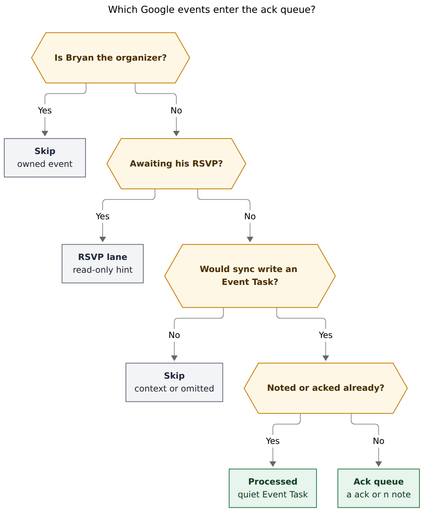
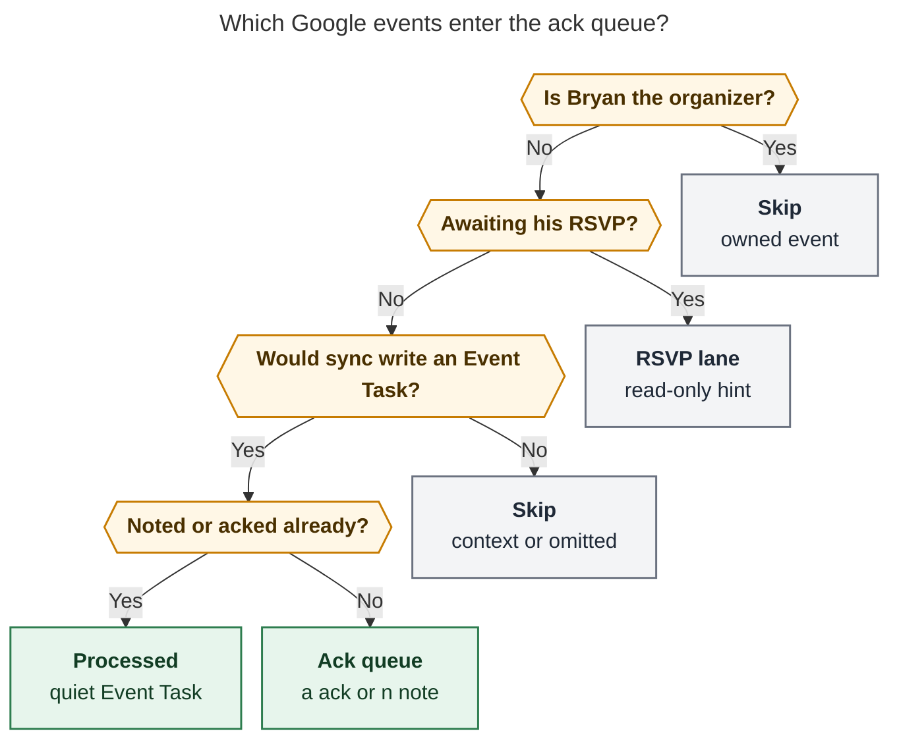
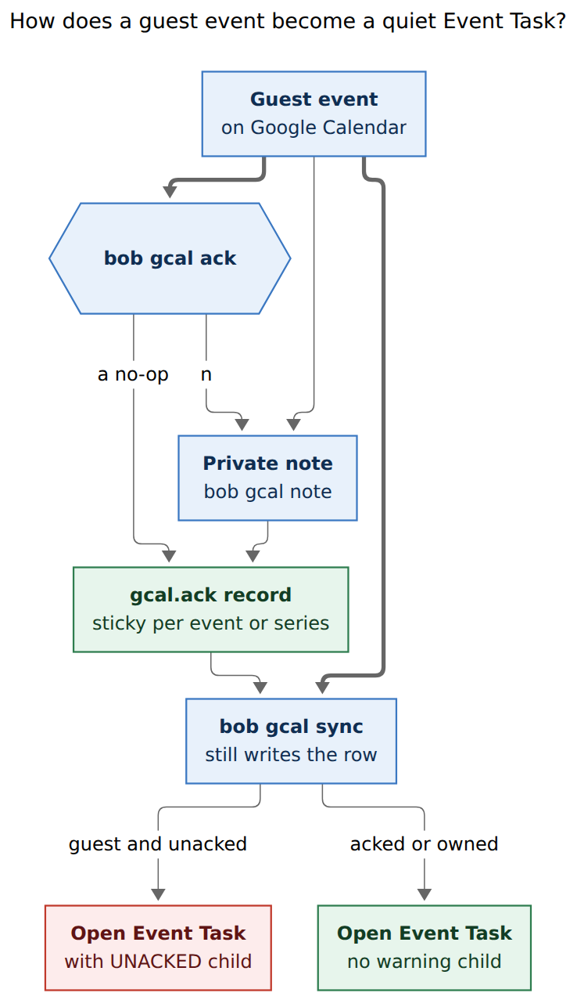
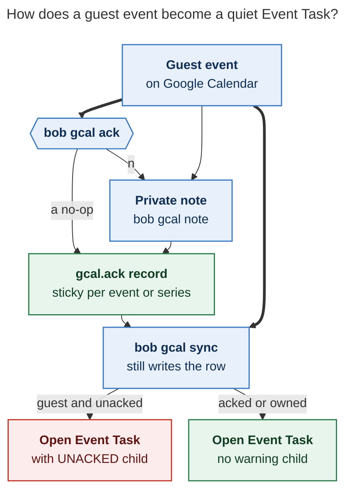

# Soft-require guest Google Calendar events to be acked before they go quiet

**Date:** 2026-11-12
**Researcher:** grk
**Question:** What is the best way to soft-require that external Google Calendar events be acknowledged in Bob before their Event Tasks go quiet, and is the proposed `bob gcal ack` walk the right shape?
**Repos:** bob-cli (current tree), Bob vault `~/bob`
**Status:** design research. Do not implement from this note.

## Recommended solution

Ship **`bob gcal ack`**, a git-`add -p` walker over the next N local days of **guest Event-Task-eligible** Google events that Bob has not yet processed. Ack is a **Bob processing stamp**, layered beside private event notes. Google RSVP stays in Calendar. Sync keeps writing Event Tasks for unacked guests, and those open rows wear a managed **`⚠ UNACKED`** first-child that is impossible to miss and impossible to confuse with the Google-owned title.

A guest event is **acked** when the folded journal has a live `gcal.ack` **or** a live nonempty `gcal.note`. Saving a note acks. Clearing a note leaves the ack in place. An explicit no-op ack writes `gcal.ack` and no note.

This is a good idea. Take this shape rather than a hard gate, a Gmail command, a title warning, or a daily inbox drain.

---

## 1. Verdict

The brief is aiming at a real gap. Bob already projects guest meetings onto daily-note Event Tasks, files MEET links, copies description bullets, and layers private notes. It never asks “have you *processed* this invite in Bob?” Google Yes is attendance. Bob processing is route, clock, buffer, prep, and “I saw this.” Those are different jobs.

Today that gap is filled by habit and by `bob gcal note` on the events that already hurt (job interviews). The live journal has **2** `gcal.note` records, both `@job` interview prep, against **76** `gcal.row` records. The rest of a typical week is Swings at 08:00 plus one evening `@abby` outing. Those evenings already pick up Google buffers when Kelly writes them; they still never get a Bob-side “I looked.” Interviews get notes because the cost of missing prep is obvious. Family evenings get a row and a −30m walk home because Google already said so.

A weekly, single-keypress walk that offers **ack** or **note** on every unacked guest Event Task closes that gap without hiding today’s meetings.

Soft-require is the correct force. Event Tasks drive MEET filing, timed close, off-clock settlement, capture agenda order, and the day strip. Skipping an unacked guest would drop a 19:00 movie from today because Monday’s walk was skipped. That is worse than a loud child on the row.

---

## 2. Critique of the original brief

The brief is directionally right and locally imprecise. The useful core:

1. External events should be processed in Bob (no-op ack **or** a private note).
2. The gesture is an interactive walk with single-keypress Ack / Note.
3. Sync still creates the Event Task.
4. The unacked row is loud.
5. A weekly `gtd_daily.md` chore reminds Bryan to run `bob gcal ack -n 7`.

The imprecise parts, each with a concrete replacement in §3:

**Command family.** The walk is specified once as `bob gmail ack` and once as `bob gcal ack`. Gmail Tasks watch labelled threads. Event Tasks live in `## Events`. Ack belongs under `bob gcal`. Nesting under `gmail` would teach the wrong noun and collide with a future mail-ack if one is ever wanted.

**“External.”** List language already splits `✓ own` (organizer **or** empty attendee list) from `✓ going` (guest with a Yes). Family-calendar events often have **no attendees**. Those currently render `✓ own` even when `organizer.self` is false. Treating “external” as `!organizer_or_no_guests` would skip the Swings / movie / park series that are the whole point. Guest for ack is **`!organizer_is_self`**.

**`-n` direction.** `bob gcal sync -n 7` means *the last 7 local days ending today* (`--last-n-days`, 1 = today only, max 366). The brief’s `-n|--next-n-days` is the forward mirror: *the next 7 local days starting today* (today through today+6). Same short letter, opposite long name, opposite window. Document that mirror in help. Do not reuse `--last-n-days`.

**Ack storage.** The brief defines acked as “explicit no-op or a note” and stops. Notes already live in `.bob/gcal/<host>.jsonl` as `gcal.note`. A no-op needs a sibling `gcal.ack` kind, folded the same way, or every no-op becomes a fake empty note and collides with “empty text clears the note.”

**Warning placement.** “Hard to miss in the Event Tasks we create” is the right bar. Putting that bar in the **Google-owned title** would freeze the title (`kept_edit`) the first time Google changes the summary. Putting it in a `#unacked` tag would mint user vocabulary on a residence-exception row. Putting it in a drawer named `UNACKED` would collide with ALL-CAPS drawer capture. The bar belongs on a **closed-registry managed first-child**, the same family as `❌ **CANCEL LOG**` and Gmail’s `⚠️ **GMAIL ROUTE:**`.

**Daily vs weekly.** `gtd_daily.md` already has a daily `#pre #browser` chore, “Review next week in Google Calendar.” That is RSVP and glance. The new chore is Bob logistics. Keep both. Do not replace the browser review, and do not run the ack walk every morning.

**Hard vs soft.** The brief already says sync still creates the row. Keep that. A hard skip would fight `calendar-events-are-daily-note-event-tasks`, `synced-meetings-link-by-phase`, and `ended-off-clock-events-settle`.

**TTY.** Today every `bob gcal` prompt is line-based (`read_line`, `BOB_GCAL_ASSUME_TTY`). Single-keypress is new. It is worth doing, with libc termios (already in `Cargo.toml`; no crossterm), restored on drop, tests through the existing assume-TTY knob.

**Volume.** A naive daily walk of every guest Event Task would be Swings × 7 plus evenings. After one series-ack of Swings, a Monday `-n 7` walk is the new one-offs and interviews. That is a weekly chore, not a morning drain.

---

## 3. Justified requirement adjustments

Call these out as changes to the brief. Each one is load-bearing.

| # | Brief | Adjustment | Why |
| --- | --- | --- | --- |
| A1 | `bob gmail ack` | Canonical command is **`bob gcal ack`**. Do not ship a `gmail` spelling, even as a hidden alias. | Membership rule: `gcal` owns Calendar → Event Tasks. `gmail` owns labelled threads. CLI rules forbid a misleading nest. |
| A2 | “External” / “not owned by me” | Guest ⇔ **`!event.organizer_is_self`**. | Empty-attendee family events would otherwise skip the queue. `organizer_or_no_guests` is the RSVP-as-Yes rule, not an ownership test. |
| A3 | `-n/--next-n-days`, always including today | **`--next-n-days` / `-n`**, integer 1..=366, window = today .. today+(N−1) in Bob’s timezone. Bare `ack` is **`-n 1`** (today). Weekly chore passes **`-n 7`**. | Mirrors `sync --last-n-days` with the arrow flipped. 1 = today only, same as sync. |
| A4 | Ack = no-op or note | **Acked ⇔ live nonempty `gcal.note` OR live `gcal.ack`.** Note-save writes (or confirms) ack. `text: ""` still clears the note and does **not** un-ack. | Empty note is already a clear. A fake empty note would destroy that contract. |
| A5 | Walk “every external event” | Queue = Event-Task-eligible (or Maybe-as-task) **and** guest **and** not declined/cancelled **and** not already acked. Unanswered invites are an **RSVP lane** (count + hint). All-day / free / multi-day context is skipped. Owned events are skipped. | Ack is processing of rows sync will write. Bob cannot RSVP. Notes on unanswered invites already exist via `bob gcal note`; they auto-ack when they save. |
| A6 | Recurring unspecified | No-op **`a`** on a series defaults to **All events**. **`n`** keeps note’s default **This event**. | Swings is one decision. An interview buffer is often one occurrence. |
| A7 | Warning “in the Event Tasks” | Managed first-child **`⚠ **UNACKED:**`**, closed registry, sync-owned, leading run (with CANCEL LOG / Depends-On / LINKS), **never the title, never a tag, never a drawer.** Loud in `list` / `sync` as well. Warn **open current/future** rows. Born-done past rows stay quiet. | Title is Google-owned. ALL-CAPS `UNACKED` would look like a drawer. Description bullets insert *after* the managed run (`bullet_block::insertion_index`). |
| A8 | Weekly reminder to run `bob gcal ack -n 7` | Monday `#pre #terminal` chore. Completing the chore **is** the record, even if the queue still has skips. Exit 0 on empty, processed, or `q`. | Matches bank: “nothing new? completing this is the record.” Soft-require. `#terminal` walks in PRE stage `terminal` before `#browser` RSVP. |
| A9 | Single-keypress Ack / Note | Keys: **`a`/Enter** ack, **`n`** note, **`e`** editor, **`A`** adopt when ⚑, **`s`** skip, **`q`** quit, **`?`** help. Off TTY: JSON queue, no interactive writes. **`bob gcal ack -i ID`** is the non-interactive no-op. | `A` is adopt (already the note flag), not ack-all. Ack-all is too easy to smash through interviews. |
| A10 | Existing rows unspecified | **Grandfather as unacked.** Live notes already count as acked. Do not backfill `gcal.ack` for every historic guest row. | The first Monday walk *is* the catch-up. Quietly stamping Swings would hide the series-ack question. |
| A11 | Time change unspecified | A no-op ack **restacks** when the occurrence’s local start or end datetime changes. Notes already re-layer. | “Acked last week at 19:00” is stale when Kelly moved it to 18:00. |
| A12 | Daily browser review untouched | **Keep** “Review next week in Google Calendar.” Ack does not RSVP and does not replace glance. | Two-step GTD calendar review: Google for Yes/No/Maybe, Bob for logistics. |

Optional, not required for v1:

- Per-calendar `ack: false` for reader-only holiday calendars.
- `-n 14` as a *personal* override if Monday still surprises you on Thursday. Do not change the chore default.
- Plugin chip / Mac Command-E unacked badge after the CLI is real.

---

## 4. Why this is the right product

### 4.1 Google RSVP ≠ Bob processing

`decisions:private-event-notes-beat-google-per-field` already states the note never RSVPs, never changes inclusion, and never creates a row. `docs/guides/plan-events-you-dont-own.md` is explicit: RSVP in Google, then write the note. The daily `#pre #browser` chore is that RSVP glance.

Ack is the missing third beat: *I have processed this guest event in Bob.* Sometimes that is a note (`@job -30 Prepare for interview.`). Sometimes it is a look and a no-op (Swings, a movie whose −30m walk is already in Google). Both are processing. Neither is attendance.

### 4.2 Soft-require protects the day

Event Tasks are a daily-note residence exception (`glossary:event-task`, `decisions:calendar-events-are-daily-note-event-tasks`). Sync files them under past / running / planned MEET (`synced-meetings-link-by-phase`), sorts links by meeting span, closes by the clock, and settles ended off-clock rows. A hard “no Event Task until acked” would:

- hide today’s 19:00 movie if the Monday walk was skipped,
- drop MEET links from the capture agenda,
- skip off-clock settlement,
- fight Ledger Tools’ create-hook sync, which runs when the daily note is born, hours or days before a weekly ack.

Soft-require keeps those engines. The UNACKED child is the tax.

### 4.3 Notes already almost do this

`bob gcal note` is the right write path for logistics. The brief’s “Note accepts the same argument form as `bob gcal note`” is correct and should be literal: same TEXT grammar, same `-e` editor, same `-A` adopt, same This event / All events prompt, same immediate re-sync of an existing rendered day on the writer host.

What notes do not do is *walk the gaps*. Bare `bob gcal note` lists noted events for 90 days. `bob gcal note -a` lists everything. Neither is a processing inbox. Ack is that inbox, and a successful note *from the walker or from `bob gcal note`* marks the event processed.

### 4.4 Bank is a cousin, not a template

`bob bank ack` ticks waiting rows by id or day. Empty state: `🏦 Bank · nothing to acknowledge`. Daily PRE chore: type posted rows; completing with nothing new is the record. Weekly Monday: QFX import.

Reuse the empty-state voice and the “completing is the record” ethic. Do not reuse the mechanics. Bank ack is a batch tick of vault rows Bob already wrote. Gcal ack is a Google-snapshot walk that may run **before** the daily note (and the Event Task) exists — the same horizon private notes already use.

### 4.5 Observed volume (vault, week of 2026-11-08)

Daily notes 2026-11-08 .. 2026-11-12 each hold 2–3 Event Tasks: Swings 08:00–08:15 `[root:: abby]`, plus an evening `@abby` outing, plus occasional `@body` / `@job`. 2026-11-12 also has a cancelled PermitFlow interview that already carries a private note and a CANCEL LOG. Future days in this vault are not created yet; ack must not wait for them.

Journal (union of `kellys-mbp`, `athena`, `kellys-macbook-pro-local`): 76 `gcal.row`, 29 `gcal.link`, 13 `gcal.gone`, 5 `gcal.flag`, 1 `gcal.reset`, **2 `gcal.note`**. Both notes are job interviews.

First Monday `-n 7` after ship: on the order of **7 Swings + ~5–8 unique evenings + any interviews**, minus the two already-noted interviews. Series-ack Swings once. Steady state is new one-offs.

Apollo cannot live-classify (doctor `no_client`); the Mac is the writer (`decisions:bob-gcal-is-read-only-and-proposes-once`). The interactive walk runs where Calendar OAuth lives.

---

## 5. Queue membership

**Reader question:** Which Google events enter the ack queue?

**Caption:** Owned events skip; unanswered guests are an RSVP hint; only Event-Task-eligible guests that are still unacked walk in `bob gcal ack`.



Rendered size: 792.764 × 958 px; fit scale: 82.3%.



Converging arrows mean **any** path to that box.

Membership, in code terms (`classify.rs`, `model.rs`):

1. **Owned → skip.** `organizer_is_self == true`. Bryan authored it; Google is already the note surface.
2. **Awaiting RSVP → RSVP lane.** `my_answer == NoReply`. Inclusion today is omitted (`"reply in Calendar"`). Print a trailing count: `N awaiting your reply in Google Calendar`. Do not ack them. A note already saved on an unanswered invite still counts as acked for the day they become a task.
3. **Would sync write an Event Task?** `Inclusion::Task` — busy, timed, under 24 hours, starts this local day, Yes (or Maybe with `gcal.tentative: task`). Declined, cancelled, all-day, free, multi-day, and ordinary Maybe-as-context skip.
4. **Already processed → quiet.** Live nonempty note (event or covering series) or live ack (event or covering series).
5. **Else → queue.** Walk in local start order, grouped by day.

Optional later: calendars with `ack: false` skip at step 1.5, for subscribed holiday feeds.

The walker reads the **Google snapshot**, the same 90-day-style fetch `bob gcal note` uses, clipped to the `-n` window. Future days do not need a daily note.

---

## 6. Lifecycle

**Reader question:** How does a guest event become a quiet Event Task?

**Caption:** Sync always writes the Event Task; a no-op ack or a private note stamps `gcal.ack`, and only then does the UNACKED child come off.



Rendered size: 491.281 × 852 px; fit scale: 100.0%.



The thick path is the weekly walk. The thin `INVITE → NOTE` path is today’s `bob gcal note deerwood @family -30 …`, which already acks as a side effect of save.

---

## 7. Storage

Append to the existing per-host journal `.bob/gcal/<host>.jsonl`. Union-merge and last-writer-wins fold already exist for notes. `load_state` already skips `gcal.note`; it must skip `gcal.ack` the same way (acks are not occurrence rows). `sync -F` resets day state only; notes **and** acks survive.

```json
{
  "v": 1,
  "ts": "2026-11-16T07:12:04-05:00",
  "host": "kellys-macbook-pro-local",
  "kind": "gcal.ack",
  "account": "bryanbugyi34@gmail.com",
  "key": { "calendar_id": "primary", "event_id": "44ui91fqpvj46i09vapi3neq75" },
  "scope": "event",
  "acked": true,
  "seen": {
    "title": "MOVIE: The Good Dinosaur",
    "start": "2026-11-12T19:00:00-05:00",
    "end": "2026-11-12T20:30:00-05:00",
    "ical_uid": "…",
    "original_start": null
  }
}
```

Series no-op:

```json
"key": { "calendar_id": "primary", "series": "<recurringEventId>" },
"scope": "series"
```

Fold rules, matching `gcal.note`:

- Last writer wins, ordered by `(ts, host, path, line)`.
- Keyed by `(account, calendar_id, event_id | series)`.
- `acked: false` is an explicit un-ack (v1 needs the field for symmetry; the walker does not have to expose it).
- Account guard: a foreign-account ack is never applied.
- `seen` is display and restack only. Never retarget an ack by title.
- Malformed: missing key part, unknown scope, or `acked` not bool.

**Processed predicate** (sync, list, walker):

```
acked(event) =
    nonempty folded note on this event
    OR nonempty folded note on this series
    OR folded ack on this event with acked == true
    OR folded ack on this series with acked == true
```

Then, if `seen.start`/`seen.end` on the winning ack (not on a note) disagree with the live occurrence’s local start/end datetimes, treat as **unacked for restack**. Notes do not restack: they re-layer.

A note save appends `gcal.note` **and**, when no live ack covers that scope, a `gcal.ack` with the same key/scope. That way clearing the note (`text: ""`) cannot un-process the event.

Older binaries skip unknown `gcal.*` kinds in `load_state` the same way they skipped `gcal.note` before notes shipped. Doctor should still warn “upgrade Bob” if an older binary starts counting malformed lines; follow the notes compatibility pattern.

---

## 8. Command contract

### 8.1 Tree

Add `ack` to `build_cli()`, alphabetically before `calendars`. Update `note.rs` `find_note_subcommand`: the sibling-subcommand list is currently

```rust
["calendars", "doctor", "list", "login", "logout", "sync"]
```

**Must include `ack`**, or `bob gcal ack @family` can be mistaken for a `note` tail. This is a real footgun; notes already special-case those names so a vault named `note` is not the subcommand.

Help, diagnostics, and commit subjects print `bob gcal ack` only. Do not add `bob gmail ack`.

### 8.2 Flags

Alphabetical, every public long option a short alias (`cli_rules`):

| Flag | Meaning |
| --- | --- |
| `-b, --bob-dir` | Vault root |
| `-C, --calendar` | Disambiguate with `-i` |
| `-d, --dry-run` | Print the queue; write nothing |
| `-D, --day` | Anchor day (default today). `-n` counts forward from here. |
| `-f, --format` | `table` (default) or `json` |
| `-h, --help` | Help |
| `-i, --event-id` | Non-interactive no-op of one event (needs `-s` off TTY when recurring) |
| `-n, --next-n-days <N>` | Next N local days starting at `-D` (1 = that day only; 1..=366) |
| `-q, --quiet` | Counts only |
| `-s, --scope` | `event` or `series`, required off TTY for recurring `-i` |

Bare `bob gcal ack` = today. Weekly chore = `bob gcal ack -n 7`.

JSON off a TTY is the queue, `schema_version: 1`, no writes. Several matches for `-i` without a unique id exit 2 with candidates, matching `bob gcal note`.

### 8.3 Empty and done

```text
✓ Guest events · next 7 days · all acked
  1 awaiting your reply in Google Calendar
```

Voice matches `🏦 Bank · nothing to acknowledge` and `bob gcal note`’s `✎ N private notes · next 90 days`.

Exit 0: empty queue, finished walk, `q`, dry-run. Print remaining skips on `q`: `3 skipped · bob gcal ack -n 7`. Completing the GTD chore is allowed with skips.

### 8.4 JSON (walker / list extras)

Each queue row:

```json
{
  "day": "2026-11-12",
  "time": "19:00-20:30",
  "title": "MOVIE: The Good Dinosaur",
  "organizer": { "name": "Kelly", "self": false },
  "answer": "yes",
  "role": "guest",
  "root": { "value": "abby", "source": "…" },
  "buffer": { "before_minutes": 30, "after_minutes": 0 },
  "note": null,
  "acked": false,
  "fragile_directives": true,
  "calendar_id": "primary",
  "event_id": "…",
  "series_id": null
}
```

`list` / `sync` gain `acked: true|false|null` (`null` for owned or non-task) and `unacked` counts. Note text still never appears in list/sync JSON.

---

## 9. The walker, made beautiful

Treat this as `git add -p` with `interactive.singleKey`, in Bob’s existing hue-dot / dim-buffer / ⚑ language. One card, one event, one key.

```text
Google Calendar · guest ack   2/9   Thu 12 → Wed 18

  Thu 12  19:00-20:30 −30m
  MOVIE: The Good Dinosaur
  from Kelly · ✓ going · guest · ● abby
  ⚠ unacked
  ⚑ Bob lines live in the organizer's description

  a ack   n note   e edit   A adopt   s skip   q quit   ?
```

Design notes:

- **Progress** `2/9` is the git hunk counter. Day range in the header is the `-n` window.
- **Time rail** reuses list’s buffer dim (`−30m`).
- **from Kelly** is `organizer_name`. Role is `guest` even when list would have said `✓ own` because attendees were empty — the card tells the truth ack uses.
- **Hue dot** is the chosen root, same helper as `list`.
- **⚑** only when `fragile_directives` would already print. `A` is offered only then; otherwise the hint is absent so `A` is not a mystery key.
- Keys sit on one dim footer. `?` prints a short help overlay, including “note uses the same TEXT as `bob gcal note`.”

**`a` / Enter.** Write `gcal.ack`. Recurring: This event / All events, **default 2 All events**, labelled like today’s note prompt:

```text
Swings! repeats · Friday 08:00-08:15 · guest · ✓ going
  1  This event   Fri Nov 13
  2  All events   every Swings!
Which? [2] ›
```

Note’s prompt defaults to **1**. Ack’s default is **2**. Print the default in the prompt so the difference is visible.

**`n`.** Inline `note › ` reads a line of TEXT, parsed by the existing note rewriter (directive tokens, `--`, `@route`, `-30 reason`). Recurring uses note’s This event default. Validation errors ask `Edit again? [Y/n]`, same as note. Success writes note + ack and, on the writer host, re-syncs an existing rendered day.

**`e`.** `$VISUAL` / `$EDITOR` / `vi` on the selected scope, scissors block, empty-clear of the *note* only.

**`A`.** `bob gcal note -A` adopt path. Refuses when a note already exists, unless combined with `e`. Adopting writes a note, which acks.

**`s`.** Leave unacked, next card.

**`q`.** Stop. Remaining count on stderr.

Raw mode: libc termios, cbreak, no echo, one byte, restore on Drop / panic. `BOB_GCAL_ASSUME_TTY=1` keeps tests deterministic; tests feed keys through a fake reader, not a real tty. Off TTY, refuse the walk with the existing `needs_tty` kind and a hint to `-f json` or `-i`.

Do not ship ack-all in v1. Nine cards is already a short Monday. Ack-all would stamp an interview with the same key as Swings.

---

## 10. The UNACKED child

### 10.1 Shape

On an **open** guest Event Task that is unacked, sync writes one managed first-child, after CANCEL LOG / Depends-On / LINKS if those exist, before description bullets:

```markdown
- [*] #task **1900-2030** MOVIE: The Good Dinosaur [📅](…) [buffer:: -30m] [root:: abby] [type:: MEET] ^movie-good-dinosaur
	- ⚠ **UNACKED:** guest event from Kelly · `bob gcal ack`
	- ↤ *30m before* · Walk home from Cranford train station.
```

Writer form: `⚠` (U+26A0, no VS16), space, `**UNACKED:**`, space, gloss. Gloss is `guest event from <organizer>` when a display name exists, else `guest event`, then ` · \`bob gcal ack\``. The command in the gloss is the recovery, the same way Gmail’s child names the bad label.

When the event is acked or owned, sync **removes** that child if it is still Bob-shaped (byte-identical to what Bob last wrote). A hand edit of the child makes it yours: leave it, report once, same as `kept_description`.

### 10.2 Why managed, and why the closed registry

Description bullets insert after the leading managed run (`src/native/gcal/bullet_block.rs`). An unacked line that is merely authored would sit in the hash window and get rewritten as Google prose, or block insertion.

ALL-CAPS `UNACKED` is drawer-shaped (`glossary:task-drawer`). If capture classifies it as a drawer, nested notes become drawer entries. It must parse as managed.

Add to the closed registry in `docs/reference/vault-format.md` beside CANCEL LOG. Add a `ManagedLogKind::Unacked` (or a dedicated marker next to `is_cancel_log`). Teach `task_children::classify_task_child`, `parse_managed_task_log_marker` (or a sibling), description-bullet skip tests, and capture so a user cannot mint this line by typing.

Gmail’s `⚠️ **GMAIL ROUTE:**` is the product precedent for a sync-owned warning child. Event Tasks already have a stricter managed-run than Gmail Tasks; follow the Event Task registry, not Gmail’s VS16 emoji.

### 10.3 Why not the title

| Part | Owner | Sync |
| --- | --- | --- |
| Time span, title, badges | Google | In-place while untouched; edits freeze the span (`kept_edit`) |

Prefixing `⚠ ` onto “MOVIE: The Good Dinosaur” would make Bob the title author. The next Google summary edit would report `kept_edit` and stop following the real name. Badges, list’s EVENT column, and MEET pills would all show the warning as part of the meeting. That is ugly and sticky.

### 10.4 Surfaces besides the child

- **`bob gcal list`:** dim `⚠` after the title of an unacked guest Event Task, sibling of dim `✎` for notes. Footer: `2 unacked guest events · bob gcal ack`. Yellow ⚠ lines under the table, same weight as ⚑ fragile-directive hints.
- **`bob gcal sync`:** summary line `⚠ 2 unacked guest events · bob gcal ack` (human; JSON `counts.unacked`). Quiet `-q` still carries the count in JSON.
- **`bob gcal doctor`:** `acks` check, `N guest events acked · next 7 days` / warn on malformed `gcal.ack`, foreign-account acks, restacked-since-move. Fix command: `bob gcal ack -n 7`.
- **Born-done / cancelled / past closed:** no child. 2026-11-12’s cancelled PermitFlow interview already has CANCEL LOG; do not stack UNACKED under a dead row.
- **Plugin chip / Mac Command-E:** later. Mac Capture is a thin client (`decisions:mac-capture-is-a-thin-client`); any badge is decoded JSON from bob, never a second ack implementation.

---

## 11. Weekly ritual

`gtd_daily.md` already contains:

- daily `#pre #sync` — `gcal sync` + `gkeep pull` + `gmail sync`
- daily `#pre #browser` — Review next week in Google Calendar
- Monday `#pre` — Bank import (14-day QFX)
- Monday `#post #periods` — Weekly review

PRE stages walk `terminal → periods → browser`, then unstaged PRE (`#sync` is unstaged). Put the new chore in **`#pre #terminal`** so Monday’s walk hits it with SASE cleanup, before the browser RSVP glance.

Proposed row (implementer writes this; this research does not edit the vault):

```markdown
- [?] #task #gtd #pre #terminal **Ack guest events**: run `bob gcal ack -n 7` · a to ack, n to note · unanswered invites stay in Google Calendar · empty queue? completing this is the record  [repeat:: every week on Monday when done]
```

Ethics, copied from bank: the chore is **to run the command**. Skips are allowed. The UNACKED child keeps pressure on anything left.

Do not fold this into Weekly review’s paragraph. Weekly review is period notes and lane prune. Ack is a 90-second terminal walk.

Do not make it daily. After Swings is series-acked, most weekdays the queue is empty; a daily empty walk trains people to skip the chore.

Keep `-n 7`. GTD’s “scan two or three weeks” is the browser glance plus, if surprises still land, a personal `-n 14`. Changing the default now guesses at a problem the first month will measure.

---

## 12. Recurring, restack, grandfather, Maybe

**Series-ack** keys on Google’s `recurringEventId`, the same as note `scope: series`. One `a` on Swings processes every future occurrence in that series. An exception instance with its own event id still walks if its fingerprint moved.

**This-event ack** keys on `{calendar_id, event_id}` (instance id already embeds original start).

**Restack.** Compare live local start and end to `seen.start` / `seen.end` on the folded ack. Title changes do not restack (Kelly fixing a typo should not reopen Swings). Buffer-only changes from a note do not restack the ack; they re-layer.

**Grandfather.** Historic guest Event Tasks without a live note are unacked. Open rows on current/future days get the child on the next sync after ship. That is the point of the first Monday walk. Do not write a migration that stamps `gcal.ack` for every existing `gcal.row`.

**Maybe.** Default Maybe is context → skip. `gcal.tentative: task` promotes to Event Task → queue. Same inclusion function sync uses; do not invent a second one.

**Cancelled / declined.** Omitted. An ack on a later-cancelled event becomes an orphan; doctor lists it the way it lists note orphans; `bob gcal ack` does not need a clear-orphans flag in v1 (`bob gcal note -c` already exists for notes).

**Owned events with notes.** Notes remain legal on owned events (`gcal-notes.md`: any event qualifies). They simply never enter the ack *queue*.

---

## 13. Implementation sketch

Do not implement in this research turn. When a plan is cut, this order keeps each PR reviewable and shippable:

1. **Journal.** `gcal.ack` parse/fold/append. `load_state` skips it. Note-save appends ack when uncovered. Tests beside `tests/gcal_notes.rs`. Predicate `acked()` + restack fingerprint.
2. **`bob gcal ack`.** CLI tree, argv rewrite includes `ack`, `-n` window, JSON queue, TTY walker, `-i` no-op, dry-run. Tests with `BOB_GCAL_ASSUME_TTY`.
3. **Sync + list + doctor.** Managed UNACKED child, closed registry, `⚠` in EVENT column, counts, doctor `acks` check. Warn open current/future only.
4. **Vault chore.** The Monday `#pre #terminal` row in `gtd_daily.md`.
5. **Docs.** `just docs-gen` for CLI reference. Contract: `docs/gcal.md` (new Ack section, inclusion pointer, who-owns table unchanged except the new managed child). `docs/gcal-notes.md` (save acks; clear does not un-ack). `docs/reference/vault-format.md` registry. Guide candidate: `docs/guides/ack-guest-events.md`, linked from `plan-events-you-dont-own.md` and `run-morning-review.md`. Decision record, new, immutable: guest ack is Bob processing; Google RSVP stays in Calendar; soft-require; guest ⇔ `!organizer_is_self`; warning is a managed child.
6. **Later.** Mac Command-E unacked badge (decode-only). Plugin chip. Optional `ack: false` per calendar.

Writer host remains the Mac. Any host may append `gcal.ack`, matching notes. Only `gcal.writer` applies the child, through sync.

JSON/CLI contracts grow additively (`!` in the daily train only if a list/sync field meaning flips; adding `acked` is additive).

---

## 14. What not to do

- Hard-skip unacked guests in `classify` / sync.
- Put a warning glyph in the Google-owned title or badges.
- Mint `#unacked` (or any processing tag) on Event Tasks.
- Use a drawer named `UNACKED`.
- Ship `bob gmail ack`.
- Treat `!organizer_or_no_guests` as “external.”
- Reuse `sync --last-n-days` semantics for a forward window.
- Encode no-op ack as `gcal.note` with empty text.
- Un-ack when a note is cleared.
- Replace the daily browser “Review next week in Google Calendar” chore.
- Run the walker every morning.
- Default the weekly chore to `-n 14`.
- Ack-all / `A` as ack-remaining (keep `A` = adopt).
- Backfill `gcal.ack` for historic rows.
- Pre-create future daily notes so the walker has Event Tasks to tick (the walker reads Google).
- Write ack into Google (`extendedProperties`, RSVP comment, description). The grant is read-only and the note would leak to guests.
- A second Swift/Mac implementation of membership. Mac Capture stays a thin client of `bob gcal ack -f json`.
- Crossterm as a new TTY stack. libc termios is enough and already a dependency.

---

## 15. Alternative approaches considered

| Approach | Fate |
| --- | --- |
| Hard gate: no Event Task until acked | Rejected. Hides meetings, breaks MEET filing / off-clock settle / create-hook sync. |
| Title prefix `⚠ Guest` | Rejected. Freezes Google title. |
| `#unacked` tag + `]s` PRE row | Rejected. Event Tasks are a residence exception; tags become user vocabulary; the walk is the wrong inbox. |
| Drain guests into `mac_inbox.md` as ordinary tasks | Rejected. Duplicates the Event Task, clogs NEW, fights daily residence. |
| Daily walker | Rejected at default. Volume is weekly after series-ack. |
| Note-only (no no-op) | Rejected. Forces fake notes onto Swings. The brief’s no-op is the correct cheap path. |
| Ack-only (notes stay a separate habit) | Weaker. The walker should be allowed to note *now*, with the same TEXT, or interviews get a second tool switch. |
| Tick vault Event Tasks like `bank ack` | Rejected. Future days have no rows yet; notes already proved the Google-identity key is the right one. |
| Per-occurrence ack only | Painful for Swings. Series default on no-op fixes it. |
| Auto-ack anything with a Google description | Rejected. Kelly’s “walk home” bullet is not Bryan processing. |

---

## 16. Open questions for the implementer (non-blocking)

1. **Is Swings `organizer_is_self` false?** Almost certainly, given `[root:: abby]` and family-calendar shape, but apollo cannot live-list. Confirm on the Mac with `bob gcal list -f json` and `organizer.self` before locking series-ack copy. If Bryan is the organizer, Swings never enters the queue and A6 is still right for Kelly-owned series.
2. **Holiday / school subscribed calendars.** If a feed of all-day context is later promoted, add `ack: false`. Not v1.
3. **Restack on title?** Recommended no. Revisit if a series is *replaced* (new id) rather than moved.
4. **Plugin chip.** Worth a follow-up once the child is in the vault; do not block CLI on Obsidian chrome.
5. **`-D` + `-n`.** Recommended: `-n` counts forward from `-D` (default today), matching how people will test `bob gcal ack -D tomorrow -n 3`. Confirm in help examples.

---

## 17. Evidence

| Claim | Source |
| --- | --- |
| Google grant is read-only; Mac is the writer | `decisions:bob-gcal-is-read-only-and-proposes-once`; `docs/gcal.md` |
| Event Tasks live in daily `## Events` | `glossary:event-task`; `decisions:calendar-events-are-daily-note-event-tasks` |
| Private notes beat Google per field; note never RSVPs or creates a row | `decisions:private-event-notes-beat-google-per-field`; `docs/gcal-notes.md` |
| Inclusion: busy timed <24h, accepted / organizer / no guests | `docs/gcal.md` § Event inclusion; `src/native/gcal/classify.rs` |
| `organizer_is_self` vs `organizer_or_no_guests` | `src/native/gcal/model.rs` `my_answer`; `list.rs` `answer_label` (`✓ own` / `✓ going`) |
| `sync -n` = last N days ending today | `cli.rs` `last_n_days_arg`; `sync.rs` `last_n_days_start` |
| Note argv sibling list omits `ack` today | `src/native/gcal/note.rs` `find_note_subcommand` |
| TTY is line-based; `BOB_GCAL_ASSUME_TTY` | `note.rs` `read_line`; tests in `gcal_note_cli.rs` |
| libc present, no crossterm | `Cargo.toml` |
| Managed first-child run; bullets insert after it | `docs/gcal.md` § Description bullets; `bullet_block.rs` `insertion_index`; `vault-format.md` closed registry |
| Gmail warning-child precedent | `⚠️ **GMAIL ROUTE:**` in `gmail/sync/file.rs`, `docs/gmail.md` |
| Fragile ⚑ adopt path | `list.rs` `fragile_directives`; `docs/gcal.md` list; `bob gcal note -A` |
| Daily browser RSVP chore + Monday bank import | `~/bob/gtd_daily.md` |
| PRE stages `terminal → periods → browser` | `docs/guides/run-morning-review.md` § 1a |
| Originating vault task | `~/bob/bob.md` `^gcal-ack` |
| Journal mix and the two interview notes | `~/bob/.bob/gcal/*.jsonl` |
| Week of Event Tasks | `~/bob/2026/20261108.md` … `20261112.md` |
| Bank empty-state voice | `docs/guides/acknowledge-bank-transactions.md` |
| CLI rules (aliases, nest, no hard-rename, help quality) | `sase/memory/cli_rules.md` |
| Docs routing (CLI → docs-gen; new goal → guide; design → decision) | `sase/memory/docs.md` |
| Mac Capture is a thin client of bob | `decisions:mac-capture-is-a-thin-client` |

Figures rendered with `@mermaid-js/mermaid-cli@12.0.0`, PDF-mirroring config, Puppeteer `--no-sandbox` (this host’s Chromium has no usable sandbox). Visual inspect of both PNGs: labels distinct, `a no-op` / `n` are separate edges, three colour classes each, fit ≥75%.

---

## 18. Recommended solution, restated

Implement **`bob gcal ack -n N`** as a single-keypress walk over **guest** (`!organizer_is_self`) Event-Task-eligible Google events in the next N local days. Persist processing as **`gcal.ack`**, with live notes counting as acked. Keep **`bob gcal sync`** creating Event Tasks, and make unacked *open* guests wear a managed **`⚠ **UNACKED:**`** child plus list/sync ⚠ counts. Add a Monday `#pre #terminal` chore in `gtd_daily.md` that runs `bob gcal ack -n 7`, where completing the chore is the record.

That is intuitive (git-add-p, same note grammar, same list glyphs), reliable (journal fold, restack on move, no title freeze, argv rewrite includes `ack`), and beautiful (one card, one key, hue dots, an empty state that feels like bank).

The brief’s idea is good. The adjustments in §3 are the difference between a Calendar inbox and a second, leaky sync rule.
