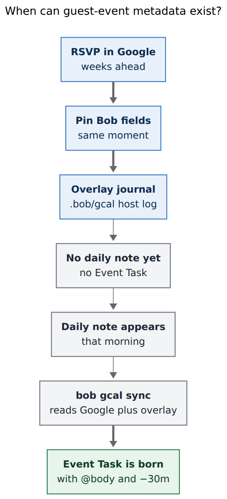
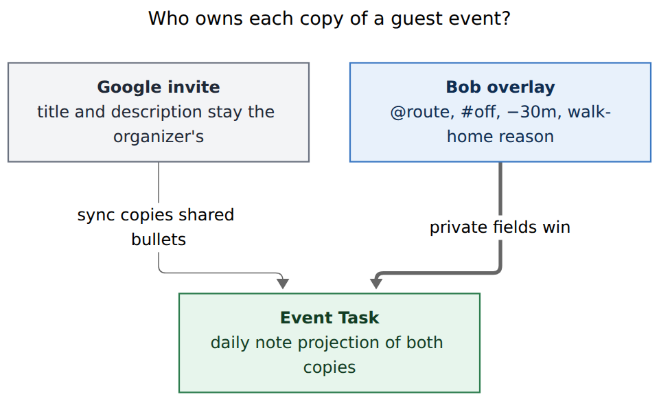
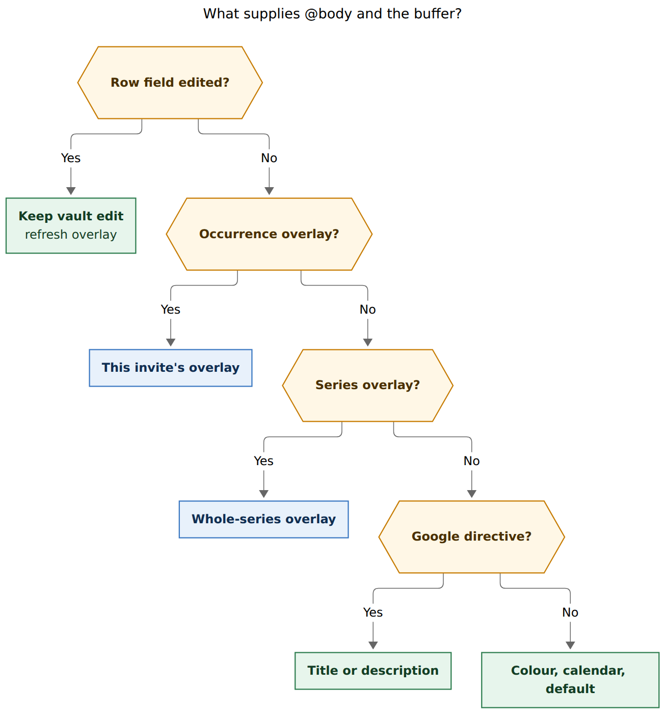

# Guest-event metadata belongs in a Bob overlay, not in Google and not in tomorrow's Event Task

> **Research query.** Give Event Tasks for Google Calendar events Bryan does not own metadata such as `@body` or `-30 I need to walk home from the park`. He cannot change those events' titles or descriptions. He needs to set the metadata ahead of time, at RSVP, not on the day. Lead the design so it is intuitive, reliable, and beautiful. Critique the plan, call out justified requirement adjustments, and end with a recommended solution.

**Researcher.** `grk` (independent swarm report).
**Date.** 2026-11-09.
**Scope.** Research only. No bob-cli, plugin, chezmoi, vault, or memory files were changed. This file is the deliverable.

**Primary evidence in this repo.**
`docs/gcal.md` §§ How it works, List, Sync, Off-clock events, Buffers, Buffer reasons, Description bullets, Who owns each part of a row, Event inclusion, Root selection, Known limits;
`docs/capture.md` § Grammar at a glance;
`docs/reference/cli/gcal.md`;
`src/native/gcal/model.rs` (`organizer_or_no_guests`, `color_id`, description directives, no `guestsCanModify`);
`src/native/gcal/gog.rs` (`FIELDS` omits `extendedProperties` and `guestsCanModify`);
`src/native/gcal/root.rs` (root chain: series memory → `@route` → colour → calendar → default);
`src/native/gcal/journal.rs` (`gcal.row`, `gcal.series_root`, per-host JSONL);
`src/native/gcal/render.rs` (`badge_text` hashes 📅/📹/📍 plus `#off`/`#on` plus `[buffer::]`);
`src/native/gcal/cli.rs` (list is one local day; sync needs that day's note);
`src/native/google/profile.rs` (`calendar.readonly`);
`src/native/pref_journal/mod.rs` (last-writer-wins host journals);
`src/native/capture_complete/model.rs` (`Candidates` has no calendar-event kind);
`plan:202611/gcal_event_buffers.md`;
`plan:202611/gcal_buffer_reasons.md`;
decisions `bob-gcal-is-read-only-and-proposes-once`, `event-buffers-widen-the-span`, `buffer-reasons-ride-description-bullets`, `gcal-root-follows-google-until-edited`, `calendar-events-are-daily-note-event-tasks`, `mac-capture-is-a-thin-client`.

**External evidence.**
[Google Calendar API Events resource](https://developers.google.com/workspace/calendar/api/v3/reference/events) (`guestsCanModify` defaults false; `colorId` and `extendedProperties.private` are writable on the attendee's copy);
[Extended properties](https://developers.google.com/workspace/calendar/api/guides/extended-properties) (private = this calendar's copy; key ≤ 44 chars, value ≤ 1024 chars, 300 properties / 32 KiB across copies);
[fromGmail event updates](https://developers.google.com/workspace/calendar/api/guides/event-types) (attendees may patch `colorId`, reminders, and private extended properties even when they cannot edit summary or description);
[Color labels are private](https://support.google.com/calendar/answer/12377581) (a guest's colour is visible to that guest, not to the organizer).

Figures rendered with Mermaid CLI 12.0.0, PDF-mirroring config, DejaVu Sans.

---

## Bottom line

**Build a Bob overlay: private directives stored in the gcal journal at RSVP time, applied when `bob gcal sync` first writes the Event Task.**

Do not put `@body` or `-30 I need to walk home from the park` on the Google invite. A guest cannot edit that title or description, and Bob's grant is `calendar.readonly`. Do not wait for the daily-note Event Task either. That row does not exist until the morning of the event, which is exactly when Bryan does not want to remember the walk home.

The overlay is the missing *Bob copy* of the fields he already types on events he owns:

```text
@body
-30 I need to walk home from the park
```

Same grammar. Same `[root:: body]`, `[buffer:: -30m]`, and `↤ *30m before* · I need to walk home from the park` on the Event Task. Same hatched wings. The only new object is a durable journal record keyed by the Google event, authored from capture the moment he RSVPs.

**The rule in one sentence (for docs and help):**

> For any Google event, including invitations you cannot edit, you can pin the same Bob directives you would have put in the title and description. Bob keeps them privately and writes them onto the Event Task when that day's note exists.

---

## Is this a good idea?

**Yes, with the adjustments below.** The need is already a documented hole, not a new taste.

`docs/gcal.md` Known limits says a description you cannot edit cannot take a Google-owned buffer, and a hand-added `[buffer::]` is kept as your edit. That sentence is the whole feature request, minus the timing. Hand-adding the field only works after the Event Task exists. Sync creates that row when the daily note exists, which on the Mac is the morning of the event (`docs/gcal.md` § Where it runs). RSVP is often days or weeks earlier. The Event Task is the *projection*, not the store.

The two examples in the request are also the two fields that actually change the day:

| What he wants | What it does today | What breaks on a guest event |
| --- | --- | --- |
| `@body` | Title-ending `@route` or a description directive sets `[root:: body]` (`docs/gcal.md` § Root selection) | He cannot edit the title or description, so the root falls through to colour, then the calendar, then `gcal.root` (`meet`) |
| `-30 I need to walk home from the park` | Description reason line sets the before-buffer and a `↤` bullet (`docs/gcal.md` § Buffer reasons) | Occupied time stays the meeting span. MEET clustering, run-into-event warnings, and the agenda gap all ignore the walk home |

Without `@body`, park time is attributed to `meet` (or whatever colour/calendar fallback hits). Without `-30`, a 14:00 picnic occupies 14:00, and a 13:40 BOB session does not warn. That is not a cosmetic gap. Buffers *are* occupied time (`decisions:event-buffers-widen-the-span`).

Would I take a different approach than "give the Event Task metadata"? **Yes: give the Google event a Bob copy, and let the Event Task inherit it.** Parking the metadata on the row itself is how owned events work, because Google is the store. For guest events Google is not a store Bryan can write. Inventing a second store *on the row* still leaves the weeks between RSVP and the daily note with nowhere to put the pin.

---

## Requirement adjustments

These are deliberate. Each one tightens the original request rather than shrinking it.

1. **Store the pin on the Google event's identity, not on the Event Task.** The daily-note row is born too late (`calendar-events-are-daily-note-event-tasks`). The overlay must live in `.bob/gcal/<host>.jsonl` beside `gcal.series_root`, which already remembers a `[root::]` before a later occurrence exists.

2. **Support the full directive set, not only `@body` and one before-buffer.** A guest also cannot type `#off`, `#on`, `+15`, or a second reason. Clock tags, both buffer sides, and both reasons are the same parser (`src/native/gcal/description.rs`). Extra Bob-owned note bullets are in scope as a child of the same pin. Colour mapping stays a root fallback, never the buffer path.

3. **Author at RSVP, including unanswered invitations.** `docs/gcal.md` § Event inclusion omits `needsAction` from Event Tasks. The overlay must still accept those rows, then apply once he accepts. Waiting for `accepted` would miss the moment he named.

4. **Keep Google read-only.** Do not PATCH titles, descriptions, or private extended properties in v1. The overlay UI has to live in Bob either way; writing Google would reopen `bob-gcal-is-read-only-and-proposes-once` for no user-visible gain. Private extended properties remain a later backup, not the design.

5. **Overlays are private logistics.** A walk-home reason does not belong on someone else's shared description even when Bryan *could* edit it. Owned events keep today's Google-description workflow. The overlay is available on owned events too, for things he does not want attendees to see. Overlay wins per field; Google fills what the overlay left empty.

6. **Do not treat a hand-edited `[buffer::]` as the feature.** That edit sits in the Google-owned badges span (`render.rs` `badge_text`), so it freezes clock tags and buffer together and is reported as `kept_edit`. The overlay must supply those fields without poisoning the 📅/📹/📍 hash.

7. **Default recurring pins to the series, with an occurrence override.** This matches `gcal.series_root`: one park picnic every Saturday needs one `-30`, and one wet Saturday needs a one-off `+60`.

8. **Do not pre-create future daily notes, duplicate the invite onto an owned calendar, or wait for `guestsCanModify`.** Those are workarounds. They fight Templater, double-book, or depend on the organizer.

---

## The gap today

### Owned events already have a beautiful language

On an event Bryan organizes, this Google description is enough:

```text
@body
-30 I need to walk home from the park
```

Sync writes:

```markdown
- [*] #task **1400-1600** Park picnic [📅](…) [buffer:: -30m] [root:: body] [type:: MEET] ^park-picnic
  - ↤ *30m before* · I need to walk home from the park
```

The meeting keeps `**1400-1600**`. Occupied time is 13:30–16:00. Ledger Tools paints a hatched lead-in wing. Capture's MEET run and conflict warnings use the buffered span. That language should not change.

### Guest events cannot use it

Google's `guestsCanModify` defaults to false. Title and description are organizer-owned. Bob never even fetches that flag (`gog.rs` `FIELDS` lists `summary,description,…,colorId,attendees,organizer` only). Inclusion treats "organized by you, or has no guests" as Yes; a real invitation requires an RSVP. There is no path from "I accepted a picnic" to `@body` or `-30` except:

- Recolour the event in Google Calendar, if `gcal.colors` maps that colour to `body`. Eleven (now somewhat more) colours, already used for other roots, and **no buffer**.
- Create that day's daily note early, sync `-D`, hand-edit `[root::]` and `[buffer::]`. Fights Templater, and the badges-span freeze above.
- Remember on the morning of the picnic.

### Event Tasks are too late



*An RSVP-time overlay is stored in Bob's journal weeks before the daily note exists. Sync applies it when it first writes the Event Task. Rendered 371 × 814 px, fit 100%.*

`bob gcal list -D 2026-11-22` can show a future picnic today. `bob gcal sync -D 2026-11-22` will not write it until that daily note exists and Templater has rendered `## Pomodoros`. There is no periodic sync. Invitations accepted later in the day land on the next run. The RSVP moment and the Event Task's birthday are different days. Any design that starts from "edit the Event Task" has already missed the requirement.

### Series memory is the closest existing object

`gcal.series_root` already stores a `[root::]` Bryan typed on one occurrence and applies it to later ones, last writer wins, independent of that later day's row. It is the proof that Bob can remember event-keyed metadata before a given Event Task exists. It is root-only, it is taught by a vault edit (so it still needs a first row), and it does not cover buffers or clock tags. The overlay generalizes it to RSVP time and to the rest of the directive grammar.

---

## Critique of the literal plan

The literal plan says: give those Event Tasks metadata, because Google will not take it.

That diagnosis is right. The proposed object is wrong.

- **Event Tasks are a daily-note residence exception.** Putting a durable pin there couples travel time to Templater's morning create. RSVP is the moment he knows he will walk home.
- **"Metadata like `@body`" is two different fields.** Root already has colour and calendar fallbacks. Buffer has none. A design that only solves `@body` (a colour) leaves the walk home unsolved.
- **On-the-day editing already exists** and is the known-limit workaround. Shipping that as the feature would document a failure.
- **Writing Google** (title, description, or a hidden private property) looks tempting because RSVP happens in Google Calendar. There is no Google UI for private properties. Capture still has to be the editor. The write would buy a 1024-character backup and cost the read-only grant.
- **Beauty here is sameness.** A new field, a new glyph, a parallel "guest notes" drawer, or a holding note of fake Event Tasks would teach a second language for the same facts. The Event Task should look like every other Event Task. Only the *source* of `[root::]` / `[buffer::]` changes (`via overlay`, next to today's `via @body` and `learned from your 2026-10-29 edit`).

---

## Alternatives considered

| Approach | Verdict | Why |
| --- | --- | --- |
| Edit Google title/description | Impossible | Guest cannot; Bob is `calendar.readonly`; `guestsCanModify` is false by default |
| PATCH `extendedProperties.private` | Reject for v1 | Attendee-local, designed for this, and used for `fromGmail` events — but 1024-char values, no Google UI, needs `calendar.events`, reopens the read-only decision, and still needs the capture picker |
| Recolour the invite | Keep as root fallback | Already in the root chain; private to his copy; cannot express `-30` or a reason; 11 API colours collide with existing `gcal.colors` |
| Duplicate the event onto a calendar he owns | Reject | Two busy blocks, two rows, identity hell |
| Pre-create future daily notes and sync `-D` | Reject | Fights Templater, leaves empty future notes, still not RSVP-shaped |
| A `gcal.md` holding note of fake Event Tasks | Reject | Violates daily-note residence; goes stale on reschedule; duplicates `list` |
| Hand-edit `[buffer::]` / `[root::]` on the day | Insufficient | Works after the row exists; freezes the badges span; misses ahead-of-time |
| **Bob overlay journal + capture pin** | **Recommend** | Same grammar, RSVP-time, private, survives `-F`, applied at sync, no Google write |

Google private properties are the only runner-up. They are the API's name for "attendee-local copy." If Bob ever gains a write grant for RSVP, they become a sensible *replica* of the overlay, not a replacement for the capture UI. Do not lead with them.

---

## Recommended solution

**Name.** Internally, `gcal.overlay`. In the UI, **Your copy** / **Pin**. The Event Task does not grow a new field name.

### 1. One journal kind, event-keyed

Append `gcal.overlay` records to the existing `.bob/gcal/<host>.jsonl` namespace. Same last-writer-wins fold as themes, relations, and `gcal.series_root`. Same host file, so vault-sync already carries it. `gcal.reset` / `sync -F` must **not** clear overlays (they are not a day's row state).

Payload, one record per pin:

```json
{
  "kind": "gcal.overlay",
  "key": {
    "calendar_id": "primary",
    "event_id": "abc123",
    "series_id": "series456",
    "ical_uid": "uid@google.com"
  },
  "scope": "series",
  "route": "body",
  "clock": "off",
  "buffer": {"before_minutes": 30, "after_minutes": 0},
  "reasons": {"before": "I need to walk home from the park"},
  "notes": [],
  "cleared": false
}
```

Identity, in match order:

1. Occurrence overlay on `(calendar_id, event_id)`.
2. Occurrence overlay on `(ical_uid, original_start)` when the instance id changed.
3. Series overlay on `(calendar_id, series_id)` or `ical_uid`.

`scope: "series"` is the default for recurring events. `scope: "occurrence"` is the wet-Saturday override. A `cleared: true` record is the tombstone; do not delete lines from an append-only journal.

Unanswered, declined, and deleted events keep their overlay until he clears it. `bob gcal overlay` lists orphans. Auto-deleting a pin because he hit Maybe would throw away the walk-home note he typed while deciding.

### 2. Same grammar he already types

The pin body is the existing directive grammar from `docs/gcal.md` § Off-clock events and § Buffer reasons, parsed with the same `parse_description` path. No new tokens.

```text
📅 Park picnic · Sat 14:00
@body
-30 I need to walk home from the park
```

Optional extra bullets become Bob-owned notes under the Event Task, below the Google description block, matching today's "your notes go below."

Do not invent `@gcal` as a note route. It would collide with a real `gcal.md`. Canonical bind sigil is the 📅 badge he already knows from Event Tasks; ASCII alias `gcal+` opens the picker the way `@body+` opens a task picker. Incomplete until an event is chosen (`capture-parse` needs `gcal_event`). Execution mode is `gcal_overlay`, never a new inbox task.

Replacement after pick, self-contained for CLI and Mac:

```text
📅 primary/abc123 Park picnic
```

Human title is display; `primary/abc123` is the occurrence key.

### 3. Capture is the RSVP companion

Mac Capture is a thin client (`decisions:mac-capture-is-a-thin-client`). Bob must grow a `capture-complete` candidate kind (`Candidates` in `capture_complete/model.rs` has routes, tasks, relations, types — no events). The app renders rows; it does not fetch Google.

Picker contents, one multi-day gog snapshot (next 21 days is enough; include `needsAction`):

- Guest invitations first, then owned events.
- Soonest first.
- Badge: `guest` vs `yours`, RSVP, existing pin (`@body · −30m`).
- Filter on title.

RSVP-time loop, the beautiful one:

1. Accept in Google Calendar (phone or desktop).
2. Hotkey Mac Capture.
3. Type `gcal+` (or a dedicated Event chip). The picnic he just accepted is at the top.
4. Type `@body` and `-30 I need to walk home from the park`.
5. Return. Journal append. No daily note involved.

Idle agenda stays today's Pomodoros. Do not dump three weeks of invites into that pane. A later "Invites" strip of *unpinned guest events in the next few days* would be a nice phase-2 heads-up, in the spirit of similar-tasks: settled, never stealing Return.

CLI engine, nested under the gcal noun (cli_rules: never a `bob capture` subcommand):

```bash
bob gcal overlay              # upcoming pins and orphans
bob gcal overlay set …        # same parse as capture
bob gcal overlay clear …
```

`bob gcal list` gains `root.source: overlay` and `buffer.source: overlay`, next to `@body` and `learned from your 2026-10-29 edit`. JSON stays free of description text.

### 4. Sync projects both copies onto one row



*Google keeps the shared invite. Bob's overlay holds private directives. Sync projects both onto the daily-note Event Task. Rendered 640 × 390 px, fit 100%.*

Effective fields, first match wins:



*A later row edit wins and refreshes the overlay; then this-occurrence overlay; then series overlay; then a Google title or description directive; then colour, calendar, and default. Colour never supplies a buffer. Rendered 870 × 934 px, fit 75%.*

Per-field, not all-or-nothing: an overlay can set `@body` and leave Google's `#off` in place, or set `-30` and leave a title-ending `@love`.

**Hashing (the reliability hinge).** Today's `badge_text` folds 📅/📹/📍, the clock tag, and `[buffer::]` into one Google-owned span. A hand-added buffer therefore freezes the whole run. Split it:

- Google badges hash: 📅/📹/📍 only. Title and time stay as they are.
- Overlay-owned tokens: `#off`/`#on` and `[buffer::]` when the overlay (or a later row edit that refreshed it) supplied them. Sync reapplies them every run from the overlay. A Google description that later grows `-30` does not clobber a pin, and a Google join-link change does not look like a buffer edit.

`[root::]` is already outside the badges span. Overlay root is source `overlay`, same slot as `@body` and series memory. A later vault edit of `[root::]` wins, is reported once, **and writes back to the overlay** so the journal stays the durable copy (the way a `[root::]` edit already teaches `gcal.series_root`).

**Reason bullets.** Overlay `↤` / `↦` lines use the same glyphs as Google buffer reasons so the row stays beautiful. They are *not* part of the Google-owned description block. Sync rewrites them from the overlay independently, so a `kept_description` on organizer prose cannot freeze the walk-home reason, and editing the walk-home reason cannot freeze organizer bullets.

Born rows, Maybe→Yes upgrades, refiles, and `-F` restores all consult the overlay. A picnic that moves from Saturday to Sunday keeps the pin, because the key is the event, not the day.

### 5. What the row looks like

A guest picnic, pin applied, organizer description `Bring a dish`:

```markdown
- [*] #task **1400-1600** Park picnic [📅](…) [buffer:: -30m] [root:: body] [type:: MEET] ^park-picnic
  - ↤ *30m before* · I need to walk home from the park
  - Bring a dish
```

Indistinguishable from an owned event whose description held both the directive and the dish. The 📅 badge is still the live Google view. Wings, list TIME column (`14:00-16:00 −30m`), agenda gaps, and MEET clustering all already read `[buffer::]`. Plugins need a tooltip (`from your copy`) and nothing else in v1. Mac rail wings light up as soon as list JSON carries the overlay buffer, including on days whose note does not exist yet — that is the ahead-of-time proof on the calendar band.

### 6. Fetch one extra flag

Add `guestsCanModify` (and, cheaply, `extendedProperties` if a later replica wants it) to `gog.rs` `FIELDS`. Use it only to label picker rows `guest` vs `yours`. Do not use colour or `guestsCanModify` as the store.

---

## Implementation sketch

| Phase | Repo | What |
| --- | --- | --- |
| `overlay-journal` | bob-cli | `gcal.overlay` records, fold, identity, `bob gcal overlay` list/set/clear, doctor warnings for orphans |
| `overlay-merge` | bob-cli | list + sync apply the precedence table; split badge hashes; overlay reason bullets; JSON `*.source` |
| `overlay-capture` | bob-cli | `gcal+` / 📅 picker, `gcal_event` incomplete need, `gcal_overlay` mode, same directive parser, 21-day snapshot |
| `overlay-plugins` | bob-plugins | tooltip provenance; wings already follow `[buffer::]` |
| `overlay-mac` | bob-mac-capture | thin-client event picker; decode overlay sources; rail wings from list JSON before the note exists |

`overlay-journal` + `overlay-merge` already make CLI pinning work before the picker exists. Capture is what makes RSVP-time beautiful; do not ship the store without it.

Verification, scratch vault, fake gog, `BOB_NOW` a Wednesday:

1. Guest picnic Saturday 14:00, no description directives, RSVP `needsAction`.
2. `gcal+picnic` → `@body` / `-30 I need to walk home from the park`.
3. `bob gcal overlay` shows the pin; Saturday's note does not exist.
4. Accept in the fake; create Saturday's note; `bob gcal sync -D that-day`.
5. Row has `[root:: body]`, `[buffer:: -30m]`, `↤ *30m before*`, Google bullets empty or organizer prose.
6. Move the picnic to Sunday: Sunday's sync carries the pin; Saturday tombstones as today.
7. Edit `[buffer:: -45m]` on the row: next sync keeps 45, overlay refreshes, 📅 URL still follows Google.
8. `sync -F` restores the row with the overlay still applied.

---

## Risks

- **Instance ids change** when an organizer rebuilds a recurring occurrence. Mitigate with `ical_uid` + `original_start`; show orphans rather than silently dropping pins.
- **21-day picker window** misses a pin on an invite three months out. Allow `bob gcal overlay set` from `list -D` / `-a` for those, and consider a longer window for `needsAction` only.
- **`+1 to that` in organizer prose** already becomes a 1-minute after-buffer (known limit). Overlay does not make that worse; it can override it.
- **Mac/plugins lag.** Additive JSON and vault fields mean bob-cli can land first. An old Mac still pins via CLI; it just has no picker card.
- **Dual source of truth** if he also starts putting `@body` on owned titles *and* pinning. Document: overlay wins; clear the pin to return to Google. Do not auto-clear.

---

## What I would not do

- Reopen Calendar write to stuff directives into a description the organizer owns.
- Lead with private extended properties.
- Teach a second visual language (new glyphs, a "Guest notes" drawer, a parallel holding note).
- Use event colour as the `@body` design. Keep it as the fallback it already is.
- Make idle capture a three-week invitation inbox.
- Pre-create daily notes so the Event Task can be the store.

---

## Open questions for Bryan

These are preferences, not blockers. The design stands without them.

1. **Pin owned events too, from day one?** I would: private walk-home notes are useful even when he *can* edit Google. The default authoring path for owned events can stay "type it in Google."
2. **21 days vs a longer unanswered window?** I would fetch 21 days of timed events plus `needsAction` out to 90 days, because RSVP piles are shallow and far-future Yes piles are not.
3. **Should a later Google `#off` on a guest event (if the organizer typed it) override a pin?** I would say no: overlay wins until he clears it. Confirm.
4. **Phase-2 Invites strip in idle capture?** Useful, not required for v1.

---

## Recommended solution, one screen

Keep Google read-only. Keep Event Tasks on the daily note. Add a **Bob overlay** in `.bob/gcal/<host>.jsonl`, authored with the directive grammar he already knows, from a capture event picker at RSVP — including unanswered invitations. Sync merges overlay over Google per field, hashes 📅 separately from `[buffer::]` / `#off`, writes the same row shape as owned events, and remembers series pins the way `gcal.series_root` already remembers roots. That is the intuitive, reliable, and beautiful version of the request.
