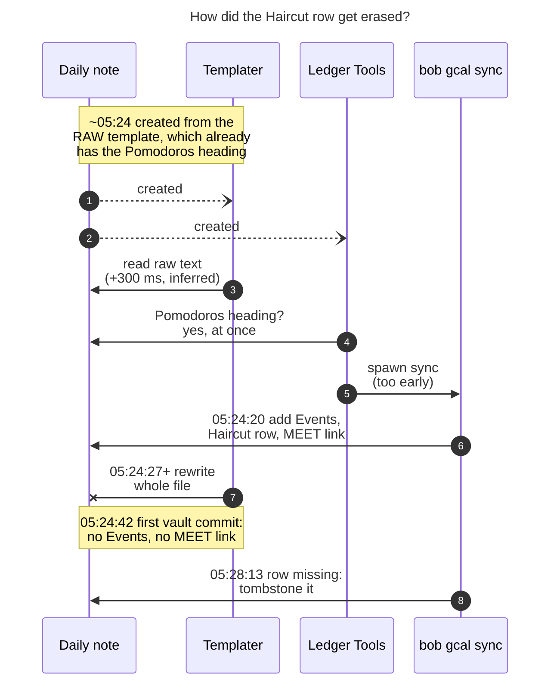
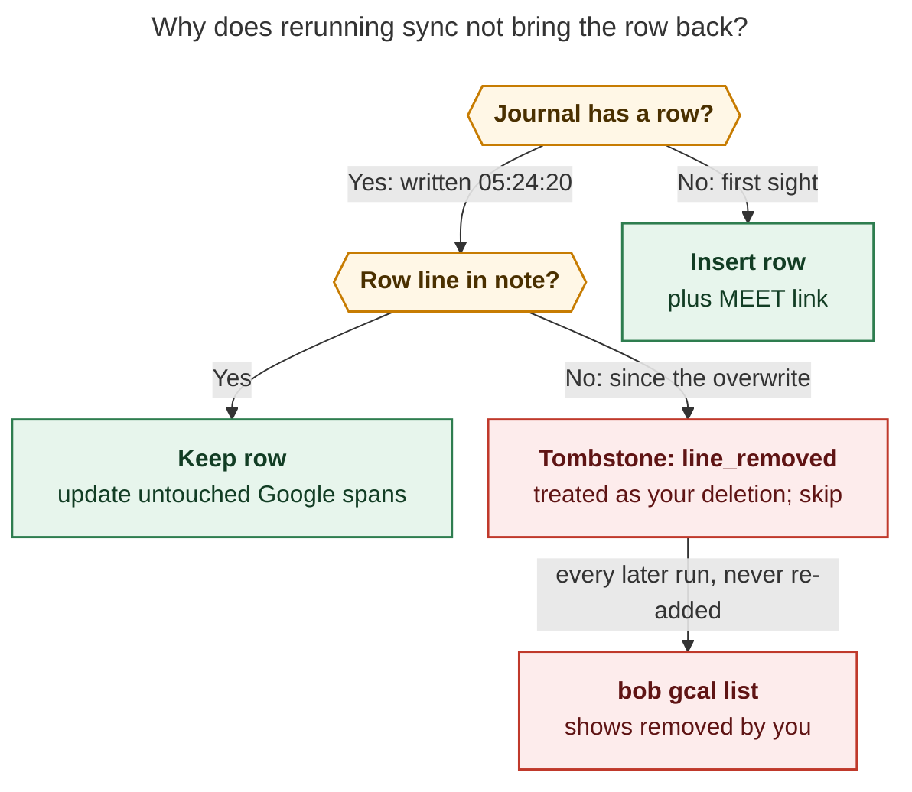

# Why `bob gcal sync` won't create today's Haircut Event Task

**Date:** 2026-11-09 · **Question:** Why does `bob gcal sync` fail to create an Event Task for the 4 PM "Haircut"
event? · **Repos:** bob-cli `1c4939b9`, bob-plugins `d962fb1`

## TL;DR

- **Sync did create it.** At 05:24:20 it wrote the Haircut row (`^haircut-wolves-den`), its description bullet, and a
  MEET link into `2026/20261109.md`, and recorded that in its journal.
- **Then Obsidian overwrote it, seconds later.** Ledger Tools starts sync as soon as a new daily note contains a
  `## Pomodoros` heading. The raw template has that heading before Templater renders it, so sync ran too early.
  Templater then rewrote the whole file from the raw text it had already read, and the Events section was lost.
- **Sync now treats the row as one you deleted.** The next run (05:28:13) found its journaled row missing and recorded a
  `line_removed` tombstone. Bob never re-adds a tombstoned row, so every later run skips it and `bob gcal list` shows
  **"removed by you"**.

## 1. What happened



*Figure 1. Ledger Tools' "is Templater done?" check passes on the raw template, so sync writes first. Templater's
later whole-file write then erases what sync added.*

| Time (EST) | Event | Evidence |
| --- | --- | --- |
| ~05:24:1x | Core Daily Notes creates `2026/20261109.md` from `_templates/daily`, with raw `<% … %>` tags and `## Pomodoros` | `.obsidian/daily-notes.json` → `"template": "_templates/daily"` |
| **05:24:20** | Sync writes the Haircut row plus its MEET link | `.bob/gcal/kellys-macbook-pro-local.jsonl`: `gcal.row` + `gcal.link`, `block_id: haircut-wolves-den` |
| 05:24:24 | Gmail's create hook runs next, as expected after gcal | `.bob/gmail/…jsonl`: `gmail.turn` |
| **05:24:27** | Templater renders `created: 05:24:27` into the note, 7 s *after* sync's write | note frontmatter (`tp.file.creation_date`) |
| 05:24:42 | First vault commit: the rendered template, with no `## Events` and no MEET entry | `git show 73976a67a` |
| **05:28:13** | Next sync: the journaled row is missing, so it is tombstoned (`gcal.gone`, `line_removed`) | journal |
| 05:43:55, 05:44:14 | Reruns re-tombstone it and add nothing (`tasks_added: 0`) | journal; Mac `status.json` |

## 2. Why rerunning sync doesn't fix it



*Figure 2. Sync can't tell a clobbered row from a deleted one. A missing journaled row is always read as your
deletion, and deletions are permanent by design.*

This is working as designed. `decisions:bob-gcal-is-read-only-and-proposes-once` says "deleted rows are
tombstoned and never re-added", and `docs/gcal.md:545` has "The whole row · You · tombstoned, never re-added". In
code, `plan.rs:377` emits `GoneRow { reason: "line_removed" }` whenever a journaled row's line is missing, and
`journal.rs:190` keeps the row record when it sets `gone`, so this branch runs on every later sync. The bug is
upstream: the deletion never came from you.

Live check on the Mac (writer host), 05:49:

```text
TIME              EVENT                         RSVP   ROOT    VAULT
16:00-17:00 −15m  Haircut (The Wolves Den) ≡ 1  ✓ own  ● body  removed by you
```

## 3. Today was the first time the order flipped

The create hook has fired on other days too. Each of them shows the expected order: Templater stamps the note, then
sync writes. Today is the only day sync wrote first, and the only day the note has no Events section. The table
lists every day where the first sync ran within minutes of note creation.

| Day | Note `created:` (Templater) | First sync row write | Order | `## Events` today? |
| --- | --- | --- | --- | --- |
| 2026-10-31 | 07:39:11 | 07:44:21 | Templater → sync | ✅ |
| 2026-11-03 | 05:45:00 | 05:45:08 | Templater → sync (8 s) | ✅ |
| 2026-11-07 | 03:57:33 | 04:01:10 | Templater → sync | ✅ |
| **2026-11-09** | **05:24:27** | **05:24:20** | **sync → Templater (−7 s)** | ❌ |

It's a timing race. Templater normally finishes about 300 ms after creation, well before sync's Google fetch returns.
This morning Templater ran at least 7 s late (likely a just-woken Mac with several create hooks spawning `bob` at
once), so sync won.

## 4. Root cause in code

`plugins/bob-ledger-tools/src/291-plugin-gcal-events.js`:

- Line 2 states the intent: *"this plugin only starts `bob gcal sync` after Templater has finished today's note."*
- Lines 316–329 (`gcalEventsWaitForPomodoros`) actually check only whether a `## Pomodoros` section exists.
- Your daily notes come from core Daily Notes, which copies the **raw** template, `## Pomodoros` included, into the
  new file before Templater runs. So the check passes immediately (`292b-plugin-period-notes.js:11` also assumes
  "Templater fills a new **empty** note").
- Templater 2.26.0's `on_file_creation` waits 300 ms, reads the file, renders it, then calls
  `vault.modify(file, rendered)`: a whole-file replace built from what it read. Any write that lands between that
  read and that write is lost.

## 5. Get today's Haircut back

Paste the row back under a `## Events` heading above `## Pomodoros`. Because the line ends in `^haircut-wolves-den`,
sync matches it to its journaled row (`plan.rs:1813–1822`) and resumes managing it. Sync re-adds the `↻ synced` stamp
line itself. It won't re-add the MEET link, though, because the tombstone also blocks links, so add that by hand:

```markdown
## Events

- [*] #task **1600-1700** Haircut (The Wolves Den) [📅](<event URL>) [📹](<Meet URL>) [📍](<maps URL>) [buffer:: -15m] [root:: body] [type:: MEET] ^haircut-wolves-den
	- ↤ *15m before* · Walk to The Wolves Den in Westfield!

## Pomodoros
…
- [ ] () — MEET
	- [[#^haircut-wolves-den]]
```

The URLs are placeholders because this repo is public. To print the exact row, dry-run sync on the Mac against a
scratch copy whose journal has no entries for today. Your vault is not touched:

```bash
T=$(mktemp -d); rsync -a --exclude=.git --exclude=xlib --exclude=attachments --exclude=ref-sources \
  --include='*/' --include='*.md' --include='.bob/**' --exclude='*' ~/bob/ "$T/bob/"
J="$T/bob/.bob/gcal/kellys-macbook-pro-local.jsonl"; grep -v '"day":"2026-11-09"' "$J" >"$J.new" && mv "$J.new" "$J"
bob gcal sync -d -b "$T/bob"; rm -rf "$T"
```

## 6. Preventing a repeat

| # | Change | Where | Why |
| --- | --- | --- | --- |
| 1 | **Wait for Templater to actually finish.** Count the note as ready only when it has `## Pomodoros` **and** no `<%` tags remain, or wait for Templater's `templater:overwrite-file` workspace event for that file, then allow a short settle delay. | bob-plugins, Ledger Tools `gcalEventsWaitForPomodoros` (also used by the Gmail hook) | Fixes the race where it starts. |
| 2 | **Have sync refuse to write into an unrendered note.** If the daily note still contains `<%` Templater tags, return `waiting`, the same way it already waits when `## Pomodoros` is missing. | bob-cli `gcal/sync.rs`, next to the `pomodoros_section_range` check | Protects manual and hook runs alike, and stays within "Bob never creates daily notes". |
| 3 | *(Optional; needs a new decision record)* When the entire Events section, `↻` stamp included, has disappeared, report it as "section lost" instead of tombstoning each row. | bob-cli `gcal/plan.rs` | It would self-heal any other clobber, but it changes the propose-once rule in `decisions:bob-gcal-is-read-only-and-proposes-once`. |

I recommend #1 and #2 together. #2 alone would have turned this morning's permanent loss into a harmless `waiting`. The hook runs only once, though, so you would still have needed a manual `bob gcal sync`. #1 makes the hook run at the right moment.

## Confidence

- **Proven:** sync wrote the row (journal). The row was gone by the first commit (git). Every later run tombstones it
  (journal, `plan.rs:377`, and `list` on the Mac). The readiness check only looks for `## Pomodoros` (code). Daily
  notes are created from the raw template (config).
- **Strongly inferred:** Templater's whole-file `vault.modify` was the overwriting write. Its rendered
  `created: 05:24:27` shows it rendered after sync's 05:24:20 write, and the committed note is exactly the rendered
  template. Obsidian logs aren't available to confirm it directly.
- **Side note:** a second "context" row written at 05:24:20 was erased the same way. That event no longer appears in
  today's calendar, so it doesn't matter.
