# Multi-calendar `bob gcal sync`, starting with Birthdays

> **Research query.** I use a different Google Calendar under the same
> `bryanbugyi34@gmail.com` account to track birthdays. See
> `~/tmp/screenshots/20261115_105604.png`. I want `bob gcal sync` to
> support syncing multiple calendars from that account, starting with
> this Birthdays calendar. It should always be clear which event task
> came from which Google Calendar. After implementation, run
> `bob gcal sync -D yesterday` with the updated `bob` binary so Ava's
> birthday lands as an all-day bullet. Lead the design. Critique the
> plan, call out justified requirement adjustments, and recommend an
> intuitive, reliable, and beautiful solution.

**Researcher.** `grk` (independent swarm report).
**Date.** 2026-11-15.
**Scope.** Research only. No bob-cli, plugin, chezmoi, vault, or memory
files were changed. This file is the deliverable.

**Primary evidence in this repo.**
`docs/gcal.md` §§ Configuration, Calendars, List, Sync, Event inclusion,
Root selection, JSON, Known limits;
`docs/reference/vault-format.md` § Events section and Event Tasks;
`docs/reference/configuration.md` `gcal.calendars`;
`docs/reference/plugins/calendar-events.md`;
`docs/guides/connect-google-calendar.md`;
`src/native/config/gcal.rs` (`GcalCalendarSettings` is `{id, root?}`);
`src/native/gcal/config.rs` (default sync set is `[primary]`);
`src/native/gcal/snapshot.rs` (already fetches every configured calendar);
`src/native/gcal/classify.rs` (allows only `default` and `fromGmail`);
`src/native/gcal/render.rs` (`render_context_row`, `render_task_row`);
`src/native/gcal/list.rs` (header names calendars; table has no CAL column;
JSON events have `calendar_id` and no `calendar_name`);
`src/native/gcal/stamp.rs` (account link only; extra stamp text is malformed);
`src/native/gcal/gog.rs` (per-calendar `gog calendar events <id>`);
`src/native/gcal/journal.rs` (`occurrence_key` is `calendar_id` + unit
separator + `event_id`);
`src/native/gcal/ack.rs` (all-day events never enter the ack queue);
`src/native/gcal/plan.rs` (all-day rows sort first; context rows have no
MEET phase);
bob-plugins `291-plugin-gcal-events.js` (paints `**all day**` and
`*(maybe|free|day N of M)*` only);
`~/.config/bob/config.yml` (`gcal.calendars` is commented out, so the live
default is `[primary]`);
`sase/repos/research/202610/bob_gcal_daily_events/bob_gcal_daily_events.md`
(original v1: primary calendar only; birthdays omitted on purpose).

**External evidence.**
Screenshot `~/tmp/screenshots/20261115_105604.png` (week of 8–14 Nov 2026;
Ava's Birthday, Saturday 14 Nov, all-day, annually, calendar Birthdays,
created by Bryan Bugyi, birthday cover art; two sidebar calendars both
named Birthdays);
[Google Calendar event types](https://developers.google.com/workspace/calendar/api/guides/event-types)
(`eventType: birthday` is a special all-day yearly event; `birthdayProperties`;
Contacts and profile birthdays sync here; transparency is `transparent`);
[Events resource](https://developers.google.com/workspace/calendar/api/v3/reference/events)
(`birthday` is a first-class `eventType`; list returns birthdays by default);
gog v0.44.0 `calendar events --help` (`--cal` accepts id or name;
`--event-types` includes `birthday`; `--all` fetches every calendar).

**This host could not live-list calendars.** `bob gcal calendars -f json`
returned `no_client` (`no bob-gcal OAuth client is stored in
/home/bryan/.local/share/gogcli`). Implementation verification of
`bob gcal sync -D yesterday` belongs on the writer Mac after login.

Mermaid CLI: `@mermaid-js/mermaid-cli@12.0.0`.

---

## Bottom line

**Yes, build multi-calendar sync. Do not turn Ava's Birthday into an Event
Task.** The fetch loop already walks `gcal.calendars`. The missing work is
identity, the birthday event type, and a careful first calendar pick.

Ava's Birthday should land on yesterday's daily note as an all-day
**context row**, with a visible calendar chip:

```markdown
## Events

*↻ synced 14:05 · [bryanbugyi34@gmail.com](https://calendar.google.com/calendar/r/day/2026/11/14?authuser=bryanbugyi34%40gmail.com) · Bryan Bugyi, Birthdays*
- **all day** Ava's Birthday [📅](https://calendar.google.com/event?eid=…) [cal:: Birthdays]
- [*] #task **1600-1630** Haircut (The Wolves Den) [📅](…) [cal:: Bryan Bugyi] [root:: body] [type:: MEET] ^haircut-the-wolves-den
```

That is the beautiful object: one Events list, all-day markers on top,
meetings on the clock below, every row named by calendar, no fake MEET
session for a birthday.

Three facts decide the design:

1. **Multi-calendar plumbing already exists.** Config, snapshot, journal
   keys, list JSON, and `bob gcal calendars` already speak a list of
   calendars. Live config leaves that list at the default `[primary]`.
2. **Ava is probably `eventType: birthday`, which Bob currently omits.**
   The screenshot is the new Google birthday UI (cover art, "Annually on
   November 14", calendar Birthdays). `classify.rs` returns
   `event type: {type}` for everything except `default` and `fromGmail`.
   Adding the calendar id and doing nothing else can still skip her.
3. **The Google sidebar shows two calendars named Birthdays.** Matching
   by summary is a setup error. v1 syncs the user-created one (Created
   by: Bryan Bugyi), identified by Google calendar id, with label
   `Birthdays`.

---

## Is this a good idea?

**Yes.** The original gcal research kept v1 on the primary calendar and
omitted birthdays so a checkbox would mean a timed, busy commitment
([bob_gcal_daily_events.md](../../202610/bob_gcal_daily_events/bob_gcal_daily_events.md)
A1). That rule still holds for meetings. It is the wrong rule for a
calendar whose job is "who to remember today."

Birthdays belong in the daily note. They do not belong in the MEET
queue, the review walk, Done counts, or Worked minutes. Bob already has
the right landing zone: the all-day context row
(`- **all day** School holiday`). The original design built that row for
holidays and Maybe events. Birthdays reuse it.

Would I take a different approach? I would keep your user-facing shape
(one `bob gcal sync`, one Events section, Ava as an all-day bullet) and
change four rules underneath it:

- Treat "event task" in the request as "Events-section row." Birthdays
  stay context. Timed busy events on any synced calendar stay Event
  Tasks.
- Identify calendars by Google id, with a unique display `label`.
- Accept Google's `birthday` event type as all-day context.
- Put calendar identity on the row (`[cal:: Birthdays]`), in `list`,
  and in JSON. Do not rely on the 📅 URL.

Approaches I weighed and rejected are in
[What not to do](#what-not-to-do).

---

## Critique of the stated plan

The request is directionally right and under-specified in four places
that will bite the implementer.

**"Support syncing multiple calendars" is mostly already done.**
`docs/gcal.md` already says every configured calendar is fetched with
all pages. `snapshot.rs` loops `self.config.calendars()`. Journal keys
are `(calendar_id, event_id)`. Login already prints
`syncing 1: primary`. The live gap is that `~/.config/bob/config.yml`
has `gcal.calendars` commented out, so Bob only asks Google for
`primary`. A config-only change is necessary and not sufficient.

**"Always clear which event task came from which Google Calendar" has
no current vault grammar.** JSON has `calendar_id`. The list header
joins configured names. The table columns are TIME, EVENT, RSVP, ROOT,
VAULT. Context and task rows carry a 📅 badge whose URL encodes the
event, not a name a human can read. Plugin painting treats 📅 as "open
in Google Calendar," not "this row came from Birthdays." Identity has
to be invented, not uncovered.

**"Ava's birthday should be added as an all-day bullet" is the right
shape and the wrong type-name.** Vault-format is explicit: an Event
Task is a checkbox whose description starts with `**HHMM-HHMM**`.
Context rows have no checkbox. `**all day**` is already the context
span. Promoting birthdays to `#task` would file them under MEET,
complete them on past-day sync, and count them as meetings. That is
how you make the feature ugly.

**"Run `bob gcal sync -D yesterday`" is an implementation gate, not a
research step.** Yesterday relative to 2026-11-15 is 2026-11-14, which
is Ava's day in the screenshot. Dad's Birthday is 8 Nov and will not
appear on that run. This host has no bob-gcal client. The writer Mac
is the right machine. Preview with `-d` and `list -a` before writing.

---

## Requirement adjustments

These are deliberate changes to the wording. Each one is load-bearing.

### A1. Birthdays are context rows, not Event Tasks

- **Request:** "which event task came from which Google Calendar";
  "all-day bullet."
- **I recommend:** All-day and `eventType: birthday` rows are context
  (`- **all day** Title [📅](…) [cal:: Birthdays]`). A checkbox still
  means a timed, busy commitment on a synced calendar.
- **Why:** Event Tasks get MEET links, phase close, `[type:: MEET]`,
  ack tags, and stats. A birthday is a day marker. Context rows already
  sort first, skip MEET, skip ack (`ack.rs` continues on `AllDay`),
  and paint as `bob-calendar-event-context`. Past-day sync of
  yesterday then inserts Ava without inventing a closed MEET.

### A2. Accept `eventType: birthday`; keep omitting the other special types

- **Request:** implied "once the Birthdays calendar is in the sync set,
  Ava appears."
- **I recommend:** `classify.rs` allows `default | fromGmail | birthday`.
  `focusTime`, `outOfOffice`, and `workingLocation` stay omitted.
- **Why:** Google's birthday events are not `default`. The 2024+
  birthday composer writes `eventType: birthday`, `transparency:
  transparent`, yearly recurrence, private, exactly one all-day.
  Today's omit path is `Google birthday events are not synced`. The
  original daily-events research listed birthday next to OOO as
  omit-on-purpose. That was right when the only calendar was primary
  and the only wanted rows were meetings. It is wrong now.

### A3. Identify by Google calendar id; `label` is the human name

- **Request:** "this Birthdays calendar."
- **I recommend:** `gcal.calendars` entries keep `id` as the source of
  truth. Add optional `label`. Default label is the live Google
  summary. Two synced calendars may not share a label. A unique
  summary may resolve at fetch time, then the run journals the real
  id. Ambiguous summaries are a setup error that prints both ids.
- **Why:** The screenshot has two checked calendars named Birthdays.
  gog's `--cal=Birthdays` has the same collision. Contacts birthdays
  and the user-created Birthdays calendar can both contain Ava.
  Journal keys already use `calendar_id`. Names are display.

### A4. v1 syncs primary plus one user-created Birthdays calendar

- **Request:** "multiple calendars … starting with this Birthdays
  calendar."
- **I recommend:** Do not enable Health, Surf, Bloomberg, Time Blocks,
  Recurring Events, or the second Birthdays calendar in v1. Do not
  add a `--all` path (gog has one; Bob should not use it). Adding a
  calendar later is one config row.
- **Why:** Ten visible calendars. Time Blocks and Recurring Events
  would duplicate or flood the timeline. Two Birthdays calendars
  would likely double Ava. Explicit opt-in is the reliability story.

### A5. Calendar identity is a Google-owned `[cal::]` field on every row

- **Request:** "always be clear."
- **I recommend:** Every synced context row and Event Task carries
  `[cal:: <label>]` in the Google-owned badge run (after 📅/📹/📍,
  before `#off` / `[buffer::]` / `[root::]`). Primary uses its
  summary (`Bryan Bugyi`), not the word `primary`. The painter hides
  the raw field and paints a chip in that calendar's Google colour,
  quieter for the primary calendar. `bob gcal list` gains a CAL
  column. JSON events gain `calendar_name` (and keep `calendar_id`).
- **Why:** The 📅 URL is not readable. Italic `· *Birthdays*` collides
  with the existing `· *maybe*` / `· *free*` / `· *day N of M*`
  qualifiers the plugin already paints. A field is Bob-shaped,
  journal-hashable, and works on tasks and context alike.

### A6. Stamp lists the sync set; do not put calendar names only there

- **Request:** implied section-level clarity.
- **I recommend:** Extend the Events stamp with an optional label
  list after the account link. Today's parser rejects leftover text
  (`stamp.rs` `parse`: `if !rest.is_empty() { return None }`). The
  next sync rewrites every stamp. Row-level `[cal::]` remains
  mandatory so a single row still names its calendar if the stamp is
  folded away.
- **Why:** The stamp is the caption of the section. It should say
  which calendars this run reconciled. It cannot be the only identity,
  because "always" is per row.

### A7. No calendar-level `as: context` switch in v1

- **Request:** not asked; tempting.
- **I recommend:** Keep the existing inclusion rule per event. A 14:00
  party on the Birthdays calendar becomes an Event Task. An all-day
  holiday on primary stays context.
- **Why:** Google's birthday type is already all-day. Timed events on
  that calendar are meetings that happen to live there. One classifier
  is more reliable than a per-calendar mode matrix.

### A8. Config stays in chezmoi; `bob gcal calendars` prints paste-ready YAML

- **Request:** implied "make sync see Birthdays."
- **I recommend:** Do not teach bob to write `~/.config/bob/config.yml`.
  Doctor already hints `chezmoi apply ~/.config/bob/config.yml`.
  Improve `bob gcal calendars` so unsynced rows print a commented
  YAML snippet with id, name, and colour. Bryan pastes into chezmoi.
- **Why:** A bob command that rewrites chezmoi-managed config will
  fight the next apply.

### A9. Verification is `list -a` then `sync -d` then `sync -D yesterday` on the writer

- **Request:** run `bob gcal sync -D yesterday` once confident.
- **I recommend:** On the Mac, after the new binary and the config row:
  1. `bob gcal calendars` — two Birthdays rows, pick the user-created id.
  2. `bob gcal list -D yesterday -a` — Ava is `context`, not
     `event type: birthday`.
  3. `bob gcal sync -D yesterday -d` — the diff shows the all-day
     bullet with `[cal:: Birthdays]`.
  4. `bob gcal sync -D yesterday` — write it.
- **Why:** If classify is still wrong, sync will skip her with a
  friendly omit. Dry-run is the confidence the request asked for.

---

## What exists today

### Fetch and config

`gcal.calendars` is a nonempty sequence of ids or `{id, root?}` maps.
Default is `[{id: primary}]`. `id: primary` matches a calendar whose
`primary` flag is true or whose id is the literal `primary`. Each
entry may already override `[root::]` for Event Tasks from that
calendar. Context rows do not take a root.

`FetchContext::fetch_days` calls `gog.events(&configured.id, …)` once
per configured calendar per contiguous day run. A transport failure
fails the whole snapshot. That is the right reliability default.

Live `~/.config/bob/config.yml` has the calendars block commented, so
production is still one calendar.

### Inclusion

```text
eventType ∉ {default, fromGmail}     → omitted
cancelled / declined / no-reply      → omitted
all-day covering this local day      → context
timed, busy, < 24h, starts today,
  accepted / organized / no guests   → Event Task
Maybe (unless tentative: task)       → context
free or multi-day                    → context
```

All-day context is already rendered as
`- **all day** Title [📅](url)` plus optional `· *day N of M*`,
`· *maybe*`, `· *free*`. All-day sorts above timed. Plugin painting
already understands `**all day**`.

### Identity

| Surface | Calendar name today |
| --- | --- |
| Vault Event Task | No |
| Vault context row | No |
| Events stamp | Account only |
| `bob gcal list` table | Header join of configured names; no per-row CAL |
| `bob gcal list -f json` | `calendar_id` on the event; `name` only on the top-level `calendars` array |
| Journal | `key.calendar_id` |
| Ack / notes | `-C` calendar id |
| Painter | 📅/📹/📍 badges; no source chip |

`calendar_name` is computed in the snapshot and then largely unused
on the list table and the vault row. Root source text can say
`calendar Health` when a calendar-level `root:` wins. Birthdays will
not use that path, because they are not tasks.

### Screenshot reading

Week view, 8–14 November 2026. All-day bar: Dad's Birthday (Sun 8),
Ava's Birthday (Sat 14). Popup:

- Title: Ava's Birthday
- Date: Saturday, November 14
- Recurrence: Annually on November 14
- Calendar: Birthdays
- Created by: Bryan Bugyi
- Cover: balloons and cake (Google's birthday event chrome)

Sidebar, both checked, both green, both named Birthdays, plus Bryan
Bugyi (primary), Bloomberg, Health, Recurring Events, Surf, Tasks,
Time Blocks.

Created-by-Bryan plus birthday chrome is the user-created Birthdays
calendar, not a random holiday feed. The duplicate name is still real.

---

## Figures

### Where Ava lands

**Reader question:** Where should Ava's Birthday land in the daily note?

**Caption:** Google `birthday` events join `default` and `fromGmail` as
allowed types, then follow the all-day path to a context bullet. Timed
busy events on any synced calendar remain Event Tasks. Focus time, out
of office, and declined invites stay out.



Rendered size: 697.2 × 784 px; fit scale: 93.6%.

### Identity stack

**Reader question:** How does a reader tell which Google Calendar a row
came from?

**Caption:** Config stores the Google id and a unique label. The journal
keys by id. The vault row carries `[cal:: Birthdays]`. List and the
Ledger painter show the same label, painted in the calendar's colour.



Rendered size: 529 × 763 px; fit scale: 100%.

### Two calendars named Birthdays

**Reader question:** How should Bob choose between two calendars named
Birthdays?

**Caption:** Unique summaries may resolve to a real Google id. Colliding
summaries cannot. v1 configures the user-created calendar by id, gives
it the label Birthdays, and leaves the Contacts twin unsynced.



Rendered size: 615.3 × 676 px; fit scale: 100%.

---

## Recommended solution

### Shape

One Events section, one sync command, N explicit calendars. The
classifier stays event-shaped. Calendar membership is config. Calendar
identity is a field. Birthdays are day markers.

```yaml
gcal:
  account: bryanbugyi34@gmail.com
  root: meet_inbox
  calendars:
    - id: primary
    - id: <paste from bob gcal calendars>
      label: Birthdays
```

`bob gcal calendars` should make that paste obvious: id, name, colour,
SYNC yes/no, and a duplicate-name warning on the two Birthdays rows.

### Vault grammar

Google-owned run, left to right:

1. Span (`**all day**` or `**HHMM-HHMM**`)
2. Title
3. Context qualifiers (`· *maybe*`, `· *free*`, `· *day N of M*`)
4. 📅 / 📹 / 📍
5. **`[cal:: Label]`**
6. `#off` / `#on` (tasks only)
7. `[buffer::]` (tasks only)
8. `[root::]` / `[type:: MEET]` (tasks only)
9. `#unacked` (open external tasks only)
10. `^block-id` (tasks only)

Ownership: `[cal::]` follows Google (the configured label, falling
back to the live summary) until Bryan edits it. A later Google rename
or config label change updates untouched rows and is reported once if
he edited the field. Same propose-once rule as title, badges, and
root.

Do not put the calendar name in a link title. Badges stay title-free
so Jump-to-link keeps working.

### Stamp

Canonical line becomes:

```markdown
*↻ synced 14:05 · [bryanbugyi34@gmail.com](<day-url>) · Bryan Bugyi, Birthdays*
```

Parse the account link as today, then allow an optional ` · ` plus
comma-separated labels. `account_changed` still keys on the account.
Labels are display; they are not a second account. A same-minute rerun
with an unchanged label list still writes nothing.

### Classifier

```rust
if !matches!(event.event_type.as_str(), "default" | "fromGmail" | "birthday") {
    return Inclusion::Omitted(format!("event type: {}", event.event_type));
}
```

Then the existing all-day / timed split. Google's birthday spec is
all-day and transparent; the all-day branch does not require busy, so
they become context. Tests: a `birthday` all-day covering the window
is context; a `focusTime` is still omitted; a timed busy event on the
Birthdays calendar is still a task.

Optional later: request `birthdayProperties` in the gog field mask and
wiki-link a Contacts person. Out of v1.

### Resolution of `gcal.calendars` entries

For each configured entry, against the live `gog calendar calendars
--all` list:

1. `primary` matches the primary calendar. Journal key stays
   `primary` so existing rows do not fork.
2. Exact calendar id match.
3. Unique case-insensitive summary match, then journal the **real
   id**, never the summary string.
4. Otherwise setup error. If several calendars share that summary,
   the error lists each id, role, primary flag, and colour.

Doctor warns when two synced labels collide, when a configured id is
missing, when `primary` and the primary's real email are both listed
(double fetch), and when two synced calendars share a Google summary
without distinct labels.

Do not pass summaries into `gog calendar events`. Pass resolved ids.
gog's `--cal=name` is convenient and unsafe here.

### List, JSON, Mac Capture

Human `bob gcal list`: columns `TIME EVENT CAL RSVP ROOT VAULT`. CAL
is the label. Colour the CAL cell when the terminal can, using the
calendar's Google colour.

JSON events add:

```json
"calendar_name": "Birthdays",
"calendar_color": "#0B8043"
```

`calendar_id` stays. Mac Capture is a thin client of `bob`; idle
agenda all-day rows already sit above "Calendar clear for the rest of
the day." Give those rows the same chip from `calendar_name`. No
client-side calendar parsing.

### Plugin paint

Ledger Tools already marks context rows and time pills. Add:

- Hide `.dataview.inline-field` for `cal` in Reading view, as `buffer`
  is hidden.
- Paint a small chip from `[cal:: Label]` in the calendar colour
  (passed via list/sync JSON cache, or parsed from the field with a
  fallback hue from the label).
- Primary chip is muted; other calendars use Google colour. Birthdays
  in the screenshot is green.
- Do not treat `Birthdays` as a `bob-calendar-event-tag`. Those tags
  stay `maybe` / `free` / `day N of M`.

Painting reads the note. It never writes.

### What sync does for Ava on yesterday

`-D yesterday` on 2026-11-15 reconciles `2026/20261114.md`.

- All-day covering 14 Nov → context, insert at the top of Events
  (all-day sort key already exists).
- No MEET link, no checkbox, no `#unacked`, no `[root::]`.
- Past-day close logic does not apply (no Event Task).
- Tombestone and 📅 adoption work as for any context row.
- If the day's Events section was replaced, the run holds; `-F`
  restores, including the birthday bullet.

Dad's Birthday (8 Nov) needs `-D 2026-11-08` or a catch-up `-n` that
covers that date. Do not surprise-backfill a week of birthdays in v1
unless Bryan asks. The requested gate is yesterday / Ava.

### CLI and docs

- `just docs-gen` after help text changes.
- `bob gcal calendars` after-help: how to paste a second calendar,
  what a duplicate name looks like, why ids beat names.
- Event inclusion table: add `birthday` next to all-day context;
  keep focus/OOO omitted.
- Vault-format: document `[cal::]` on both row kinds.
- Connect guide: step 3 becomes "copy the Birthdays id, set `label`
  if the name collides."
- Decision record after implementation: multi-calendar sync is
  explicit, identity is `[cal::]`, birthday type is context. The
  original "omit birthday / primary only" record is historical and
  should be marked superseded, not edited in place.

### Tests that must exist

- Config: `{id, label}` parse; empty label treated as unset; duplicate
  labels are setup errors; unique summary resolves to real id.
- Classify: `eventType: birthday` all-day → context; `focusTime`
  still omitted; timed busy on a secondary calendar → task.
- Render: context and task rows include `[cal::]`; span hashes cover
  it; a kept edit of the field is reported once.
- Snapshot: two calendars, two ids, no cross-keying; `primary`
  grandfathered.
- List: CAL column; JSON `calendar_name`.
- Sync plan: all-day birthday inserts above timed rows; no pomodoro
  entry; skip reason `event_type` is gone for birthday.
- Stamp parse accepts the label tail; `account_changed` still fires
  on a different account.
- Plugin unit: `[cal:: Birthdays]` paints; `· *Birthdays*` does not
  steal the maybe-tag path.
- Collision: two summaries `Birthdays` → setup error unless ids and
  distinct labels.

### Implementation order

1. **Diagnose on the Mac with today's binary.**
   `bob gcal calendars -f json` and `bob gcal list -D yesterday -a -f json`.
   Record whether Ava is missing because she is off the sync set,
   omitted as `event type: birthday`, or both.
2. **Classifier + config label.** Enough to see her as context in
   `list -a`.
3. **`[cal::]` render, journal hash, list/JSON.** Enough to meet
   "always clear."
4. **Stamp labels.** Additive parser.
5. **Plugin chip.** Visual finish; can ship right after 3 with raw
   `[cal::]` visible for a day.
6. **Chezmoi config row** for the chosen id.
7. **`sync -d` then `sync -D yesterday`** on the writer. Confirm the
   bullet, the chip, no MEET, no checkbox.

Steps 2–5 are one bob-cli PR if they stay tight. Plugin paint is a
bob-plugins PR. Config is chezmoi. Do not mix those three writes.

---

## What not to do

**Promote birthdays to Event Tasks** with `**all day**` as a new task
span. That reopens Event Task, MEET filing, timed close, freshness,
and every plugin that assumes `HHMM-HHMM`. A checkbox would lie.

**A `## Birthdays` subsection** under Events. Parsers treat Events as
a flat list under one H2. Subheadings split the day's timeline the
moment a timed party appears on that calendar. The all-day sort plus
`[cal::]` already clusters birthdays at the top.

**Auto-sync every calendar gog can see.** gog `--all` exists. Time
Blocks, Recurring Events, and Bloomberg would drown the note. Explicit
`gcal.calendars` is the product.

**Sync both Birthdays calendars in v1.** Duplicate Ava is worse than
a missing Contacts-only person. Add the Contacts twin later, with a
distinct label, after `list -a` shows it carries events the
user-created calendar lacks.

**Dedup across calendars by title or iCalUID.** Silent drops. Warn in
list/doctor when the same title and day appear on two synced
calendars; let Bryan drop one calendar.

**A per-calendar `kind: birthday`.** The event type and all-day rule
already classify. A 14:00 party on Birthdays should be a meeting.

**Calendar identity only in the stamp, or only in JSON.** Stamp-only
fails the "always" test on a single row. JSON-only fails anyone
reading the note.

**`· *Birthdays*` as an italic qualifier.** The painter's tag regex is
`maybe|free|day N of M`. Overloading italics mixes "why this is
context" with "which calendar."

**Write config from `bob gcal calendars --add`.** Chezmoi owns
`config.yml`.

**Change journal keys for `primary` to the real email.** That would
duplicate every existing Event Task. Grandfather `primary`. New
calendars journal their real ids from day one.

**People-API wiki-links, cake emoji in the title, or age math in v1.**
Beautiful later. They are not required to land Ava.

**Two-way sync, or writing birthday events back to Google.** Read-only
stands.

---

## Risks

- **Wrong Birthdays calendar.** Mitigate with `calendars` table, ids,
  and a first `list -a` before any write.
- **`#` in Contacts calendar ids.** If that calendar is added later,
  gog must receive a correctly encoded id. Pass the id as one argv
  token; add a fixture with `#` in the id.
- **Birthday events without `htmlLink`.** Context rows without a URL
  are hard to re-adopt. Treat a missing link as a snapshot parse
  failure for v1 rather than writing an unkeyed bullet.
- **Recurring yearly instances.** List already expands the window;
  each instance has its own event id. Series-root learning is
  task-only and does not apply.
- **29 February.** Google uses `BYMONTHDAY=-1`. Instances land on
  28 Feb in common years. No extra code if we trust Google's instance
  start date.
- **Stamp rewrite.** Every reconciled day gets a new stamp shape once.
  That is one extra vault-sync commit per note, then quiet.
- **Primary `[cal:: Bryan Bugyi]` noise.** Raw Markdown is a bit
  louder. The painter mutes the primary chip. That is the cost of
  "always." If it feels wrong in week one, omit the field on the first
  configured calendar only — that is a one-line follow-up, not a
  redesign.
- **Writer host.** Sync on this research host cannot prove Ava. The
  Mac can.

---

## Open questions for Bryan (none block v1)

1. Is the user-created Birthdays calendar enough, or do Contacts-only
   people also need to appear? v1 assumes the calendar in the popup.
2. Should `[cal::]` appear on primary rows in raw Markdown, or only
   on non-primary calendars with the stamp naming the default? I
   recommend on every row.
3. Catch up other recent birthdays (`-n 14`) after Ava, or wait for
   each day's ordinary sync?

---

## Recommended solution (short)

**Config two calendars (primary + the user-created Birthdays id with
`label: Birthdays`). Allow `eventType: birthday`. Land those rows as
all-day context with `[cal:: Birthdays]`. Do not MEET-file them. Show
the same label in list, JSON, the stamp, and a painted chip.**

That is intuitive (one sync, one section, the all-day bullet you
already know), reliable (ids, propose-once, no duplicate-name
matching), and beautiful (green Birthdays chip over `**all day**
Ava's Birthday`, meetings still on the clock).

The first proof is on the writer Mac:

```bash
bob gcal calendars
bob gcal list -D yesterday -a
bob gcal sync -D yesterday -d
bob gcal sync -D yesterday
```

Success is a single new all-day bullet for Ava on `2026/20261114.md`,
marked Birthdays, with no checkbox and no MEET.
