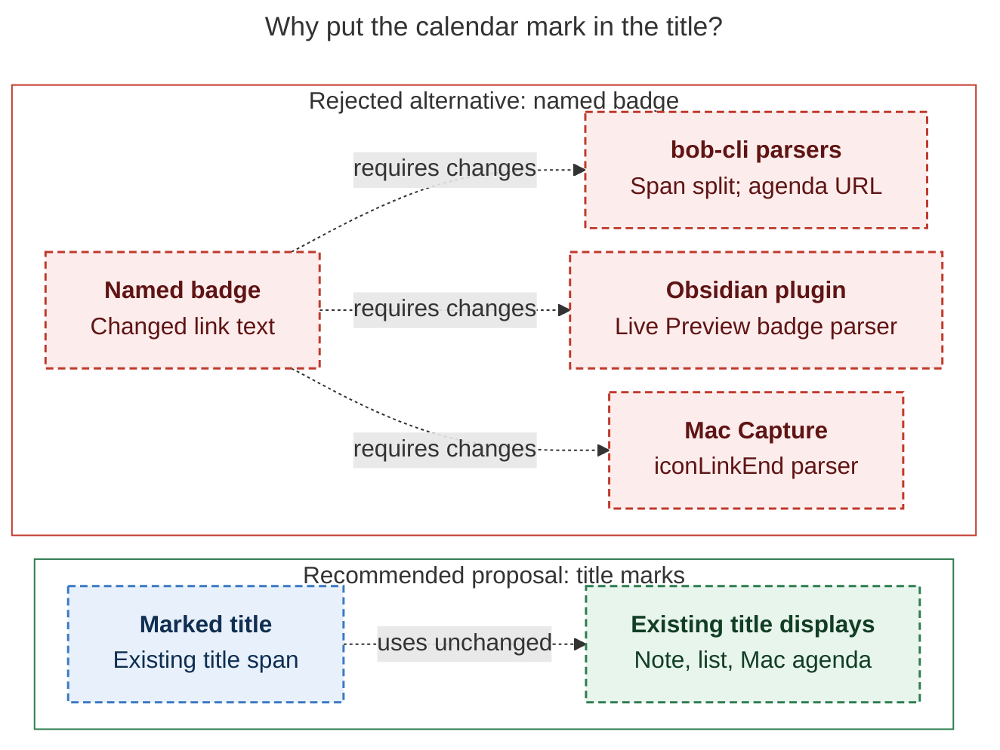
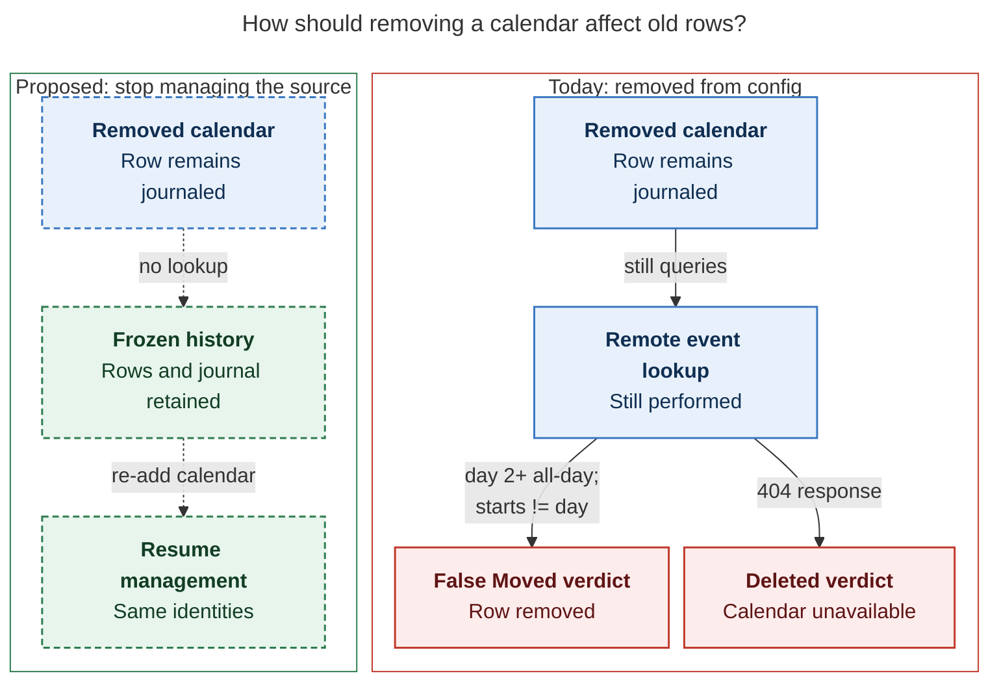

# Diagram proposals: Multi-calendar `bob gcal sync`, starting with Birthdays

Proposals for the swarm linker, not a report. Each diagram restates only what the source
report says.

```yaml
source: research:202611/gcal_multi_calendar_sync/gcal_multi_calendar_sync__final.md
producer: research.4q.image
check: "mmdc 12.0.0 with --no-sandbox and the PDF-mirroring config rendered 2 of 2 Mermaid diagrams; batch exit 0; both SVG files measured above 75%"
```

## title-mark-compatibility

```yaml
anchor: |-
  It lost on reliability and blast radius:
question: |-
  Why does a named badge require more coordinated changes than a title mark?
illustrates: |-
  The named badge changes four parse sites across three repos, while the title mark reaches existing title displays without plugin or Mac changes.
caption: Title marks reuse existing displays; named badges require parser changes in all three repositories.
review: "681x696 px, fit 95.9%; question, source trace, labels, arrows and visual checks passed; 0 revisions"
```



## removed-calendar-history

```yaml
anchor: |-
  means "stop managing this source" — prior rows and journals stay;
question: |-
  How does the proposed freeze prevent a removed calendar from losing history?
illustrates: |-
  Removing a calendar from config freezes prior rows and journals without a lookup, and re-adding it resumes the same identities instead of losing history to the current false-Moved or Deleted paths.
caption: Freezing a removed calendar preserves rows and journal identities; re-adding it resumes management without the current lookup hazards.
review: "841.578x661 px, fit 77.6%; question, source trace, labels, arrows and visual checks passed after 1 layout revision; second look passed"
```


