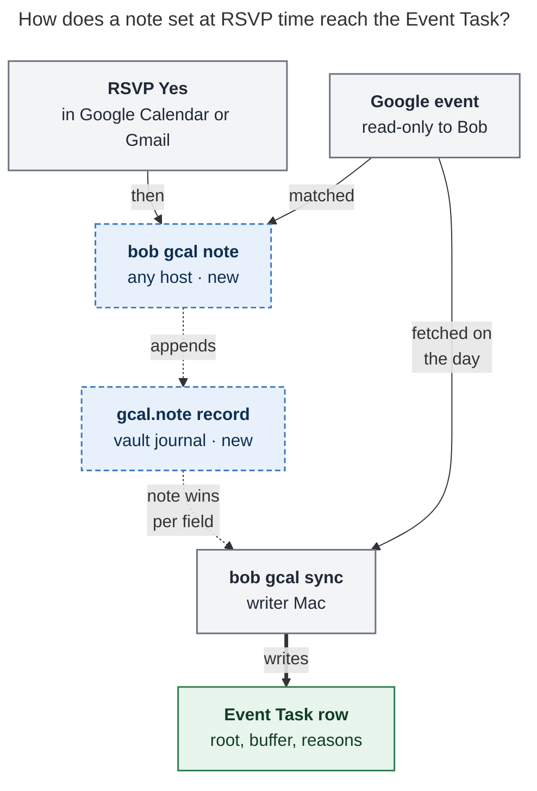

# Private notes for calendar events you can't edit

*Researcher cld · 2026-11-09 · bob-cli `master` @ `b97d8d4c`*

**The request.** Give Event Tasks synced from Google Calendar events that Bryan
does not own the same metadata his own events get from their description:
`@body`, `-30 I need to walk home from the park`, and the rest. Bryan cannot
edit those descriptions or titles. He wants to set the metadata ahead of time,
when he RSVPs, not on the day.

---

## Bottom line

**Build it, with one change of framing.** This is not "metadata for events I
don't own". It is a **private note**: a description that only Bob reads. Bob
keeps it in the vault and applies it on top of Google's description, field by
field, when sync writes the Event Task. It works on any event, including ones
Bryan owns.

```console
$ bob gcal note deerwood @family -30 Drive to Deerwood +15 Drive home
```

- **Same grammar.** A note uses exactly the directive, reason, and prose lines
  that already work in a Google description. There is no new metadata syntax to
  learn and no new syntax in the vault.
- **Google stays read-only.** Notes live in the existing per-host gcal journal
  as one new record kind, `gcal.note`. The OAuth grant stays
  `calendar.readonly`. The decision `bob-gcal-is-read-only-and-proposes-once`
  does not reopen.
- **The note wins per field, and Google fills in the rest.** The note's route,
  clock tag, and each buffer side beat Google's. Google still owns the time,
  title, badges, and every field the note does not set.
- **Existing ownership rules are reused, not reinvented.** A note-derived
  `[root::]`, `[buffer::]`, `#off`, or reason bullet follows the note while the
  row is untouched, exactly as Google-derived values follow Google today. An
  edit to the row still wins and is reported once. Re-filing a MEET after a
  buffer change also comes free: the planner already treats any rendered buffer
  change as a move.
- **No plugin or Mac Capture changes are needed for v1.** The row a note
  produces is byte-for-byte the row the same lines would produce in a Google
  description. Bob Ledger Tools, the capture agenda, and Bob Mac Capture already
  read `[buffer::]` and `[root::]` from the vault.

Zero-code stopgap for today: `gcal.colors` already maps an event's colour to a
root. A guest's colour choice is private to their copy, and Google's phone app
lets you set it at RSVP time. That covers `@body`-style routing now. It cannot
carry buffers or reasons.

---

## What exists today (verified)

### How directives work

`bob gcal sync` reads **directive lines** from an event's description. Every
whitespace- or comma-separated token on such a line must be one of `@route`,
`#off`, `#on`, `-N`, or `+M`. A **reason line** such as `-30 Drive to Kelly's`
sets a buffer and writes a labelled `↤ *30m before* · …` bullet. Human lines
become description bullets. See `docs/gcal.md` § Off-clock events, § Buffers,
and § Description bullets.

The parse happens once, in `GcalEvent::from_google`
(`src/native/gcal/model.rs`), through `parse_description`
(`src/native/gcal/description.rs`). The result fills `route_hint`,
`clock_tag`, `buffer`, and `description.buffer_reasons`. Root choice reads
those fields in `choose_event_root` (`src/native/gcal/root.rs`) in this order:

1. Series memory
2. Title or description `@route`
3. Colour
4. Calendar
5. Default

Both `list` and `sync` build their events through `snapshot::fetch_day`. That
function already loads one piece of vault-side, per-series event metadata from
the journal: learned series roots (`journal::load_series_roots`).

The docs already name the gap in § Known limits:

> A description you cannot edit cannot take a Google-owned buffer: a
> hand-added `[buffer::]` is your edit — kept and reported once.

### What Bryan's calendar shows

I took a read-only sample of the primary calendar, 2026-10-01 → 2026-12-31,
through the Google Calendar connector.

| Finding | Count / example |
| --- | --- |
| Events in the window | 40 |
| Owned events whose description carries Bob directives (Oct 31 → Nov 12) | 19. Almost every owned event has `@abby`, `@body`, `@family`, or `@kelly`. 8 also carry a buffer reason such as `-30 Walk home from Cranford train station!` |
| Events organized by someone else | 17: Kelly's weekly *Little Gym* (×13, RSVP Maybe), *Ang/Abby Disney* (Kelly, multi-day), *Deerwood. Christmas breakfast* (Kelly, accepted), and two external interviews |
| Of those, timed and accepted (they would become Event Tasks) | 3. *Deerwood* has no description, so it lands at the default `[root:: meet]` with no buffer |
| Ahead-of-time evidence | Kelly created *Deerwood* on 2026-10-23 for 2026-12-13, **51 days** ahead |
| A non-owned event Bryan edited anyway | *Interview with PermitFlow* (organizer `hr@permitflow.com`). The description of Bryan's copy ends with `@job` / `-30 Prep for interview!`, lines no recruiter would write. The copy was last updated this morning. |
| Owned events whose directives the guests can read | 5 events with Kelly as a guest, for example *Haircut* (`@body` / `-15 Walk to The Wolves Den in Westfield!`) and *Halloween at Aunt Jenny's!* (`@family #offclock`) |

Three classes of events have the problem, not one:

1. **Locked:** another Google user's event (Kelly's). Bryan cannot edit the
   description, so the metadata has nowhere to go.
2. **Editable but fragile:** external iCal-style invites such as PermitFlow.
   Google lets the guest edit their own copy. Google's API guide warns that
   such edits "are only reflected on their own copy and might be lost if the
   organizer makes a change". A reschedule from the recruiter can replace the
   description. Bob then follows Google, as designed: `[root:: job]` quietly
   reroutes to `meet`, and the 30-minute prep buffer disappears.
3. **Owned but shared:** Bryan's own events with guests. The directives work,
   but every guest sees `@body -15 Walk to …` in the invite.

---

## Is this a good idea?

**Yes.** The directives are not an occasional feature. They are how Bryan
attributes almost every calendar hour in November. Events he doesn't own are
rarer (3 accepted in three months, plus Little Gym whenever he says Yes). They
are also the high-stakes ones: interviews, family outings with travel. Today
they are second-class: wrong root, no buffer, no reason, and no way to fix it
before the day.

"Just fix the row on the day" is a weak answer, for four reasons:

- **The row doesn't exist ahead of time.** Bob never creates daily notes,
  because Templater would race the write (see
  `research:202611/gcal_haircut_lost_to_daily_note_race.md`). Bryan makes the
  logistics decision at RSVP time, weeks before the note exists.
- **Remembering on the day is the failure mode.** The point of directives is
  to decide once, when you have the context.
- **Birth matters for some rows.** Phase and MEET filing are computed when the
  row is created, from the buffered span. A buffer typed into the row later
  is "your edit". It never triggers the re-file that a Google-side buffer
  change does (`docs/gcal.md` § Sync). In fairness, most rows are born in the
  morning in the Future phase, so this bites only rows that are current or past
  at birth. The human cost above is the bigger reason.
- **Reasons and recurring events are tedious by hand.** Reason bullets must be
  typed in the exact `↤ *30m before* · …` shape. A weekly series would need the
  edit every week.

**The risks, and how the design answers each one:**

| Risk | Answer |
| --- | --- |
| Two sources of truth for one fact | A fixed precedence (note beats Google, per field). `bob gcal list` shows the source (`✎`). The row ownership rules are unchanged. |
| Notes rot when organizers change things | Notes key on the Google event id, which survives reschedules and description edits. A missing event is reported, never silently dropped. |
| New syntax, new parsers in Rust, JS, and Swift | None. The note is parsed by the same `parse_description` and renders the same row. |
| Scope creep into two-way sync | Bob writes nothing to Google. |

**Would I take a different approach?** I would not write to Google, and I
would not ask organizers for edit rights. I would widen the scope from "events
I don't own" to "private notes on any event", for the reasons in the next
section.

---

## Requirement adjustments (called out)

| # | Original | Adjusted | Why |
| --- | --- | --- | --- |
| R1 | Events I don't own | **Any event**, owned or not | The PermitFlow class (editable but fragile) needs it for reliability. The owned-with-guests class needs it for privacy. One rule is simpler than an ownership test. |
| R2 | "Metadata like `@body` or `-30 …`" | **A description only Bob reads**: the full directive, reason, and prose grammar | Nothing new to learn: "if you can write it in a description, you can write it in a note". Prose lines (`Bring the stroller`) come free as bullets. |
| R3 | Set the metadata | **The note beats Google per field.** Google keeps everything else. | Bryan's private intent is the most specific source. Per field means a note that only sets `-30` still keeps Google's `+15`. |
| R4 | Ahead of time | **Any time.** Applied at birth, and it follows untouched rows afterwards. | The same rule as every other Google-derived part of the row. Same-day changes work too. |
| R5 | (unstated) | **Recurring events need an explicit scope: this event or all events** | Little Gym is weekly. The choice mirrors Google's own RSVP dialog. |
| R6 | At RSVP | **Right after the RSVP, as a second gesture in Bob. Bob does not RSVP.** | RSVPing from Bob needs a write scope and reopens the read-only decision ("Reopens when Bob needs to RSVP to or create events in Google"). Deferred, see Phase 3. |
| R7 | (unstated: on the phone?) | **v1 is the Mac and SSH.** Phone routing uses colours today. A phone path for buffers is Phase 2. | Neither Google's mobile UI nor Obsidian mobile can run `bob`. I won't pretend otherwise. |
| R8 | (unstated) | **Note text stays out of list and sync JSON** | Matches the existing rule that JSON never carries description text. Only `bob gcal note` and `sync -d` diffs show the words. |

---

## What Google lets a guest change

Google's API guide splits event fields into **shared** properties, which the
organizer's calendar owns, and **private** properties, which each attendee's
settings control.

| Field | Guest can change it? | Survives an organizer update? | Who sees it | Bob reads it today? |
| --- | --- | --- | --- | --- |
| Description, title | Only with `guestsCanModify` (default false), or on an editable external-invite copy | No: "might be lost if the organizer makes a change" | Everyone (when shared) | Yes (directives) |
| `colorId` | **Yes**, in the UI on web and phone | Yes (private property) | Only you | **Yes** (`gcal.colors` → root) |
| `extendedProperties.private` | Yes, through the API only, never in the UI | Implied yes (per copy); the docs don't state it | Only you | No; writing needs `calendar.events` |
| RSVP note (`attendees[].comment`) | Yes, at RSVP time, on web, Gmail, and phone | Yes | **Every invitee**, and it emails the organizer | No |
| Reminders, transparency | Yes | Yes | Only you | Transparency only |

Two tempting Google-native paths fail on closer inspection:

- **Private extended properties.** They are the textbook "private metadata on a
  guest's copy" feature. But they need the `calendar.events` scope
  (`events.patch` lists no read-only scope), and they are invisible in Google's
  UI, so Bryan would still need a Bob command to set them. They would buy
  nothing over a vault record and would cost the read-only guarantee.
- **The RSVP note.** It sits exactly at the moment Bryan named, on every
  device. But Google states that a response note is visible to everyone
  invited. Kelly, or a recruiter, would get "Bryan accepted: @family -30 Drive
  to Deerwood". That is not beautiful.

---

## Options considered

| Option | Verdict | Reason |
| --- | --- | --- |
| **A. Private note in the vault gcal journal** | **Recommended** | Read-only stays intact. Same grammar. Reuses the precedence, ownership, and re-file machinery. Settable from any host. Version-controlled with the vault. |
| B. Bob writes `extendedProperties.private` | Rejected now | Needs a write scope, reopens the read-only decision, and is invisible in Google anyway. Revisit only together with Phase 3 RSVP. |
| C. RSVP note as a directive source | Rejected | Visible to all invitees and emails the organizer. |
| D. Colour → root (`gcal.colors`) | **Keep as a complement** | Already shipped, private, and works on the phone. Routes only, with 11 colours. |
| E. Ask organizers to allow "Modify event" | Rejected | A social workaround: directives become visible to all, and external organizers won't do it. |
| F. Edit your local copy of external invites | Not a design | Works for some invites (PermitFlow) but is lost on organizer updates (see class 2). |
| G. Shadow event on a Bob calendar | Rejected | Duplicate events in Google, a fuzzy match back to the original, and drift on reschedule. |
| H. Pre-create future daily notes | Rejected | Bob never creates daily notes, because of the Templater race. |
| I. A hand-edited Markdown "upcoming events" note | Rejected for v1 | Identity anchoring (the user would need event ids or URLs) and fragile parsing. A generated read-only view could come later. |
| J. Title-pattern rules in config (`Little Gym → @abby -30`) | Deferred | Brittle title matching. A series-scoped note covers the recurring case. |
| K. Extend series memory: learn buffers from a vault edit | Rejected as primary | Works only after a first occurrence and only for series, so it is never "ahead of time". |

---

## Recommended design: private event notes

### The rule in one sentence (for docs and help)

> A private note is an event description only Bob reads: write the same
> `@route`, `#off`, `-30 Drive there` lines you would put in Google, and they
> win over Google's description on that event's Event Task.

### Data flow



*The note never touches Google. It rides the vault journal to the writer Mac,
where sync lets it beat Google's description field by field when it writes the
Event Task. Dashed boxes are new.*

### Grammar

A note is plain text in the existing description grammar, parsed by the
plain-text path of `parse_description`:

```text
@body
-30 I need to walk home from the park
Bring the stroller
```

- **Directive lines** (`@route`, `#off`, `#on`, `-N`, `+M`) drive root, clock,
  and buffers.
- **Reason lines** (`-30 …`, `+15 …`) set a side and write its `↤`/`↦` bullet.
- **Anything else** is prose and becomes a bullet.
- `-0` / `+0` in a note explicitly clear a side Google's description set.
  `-0` already parses as a directive token today (`parse_buffer_token`
  accepts 1–3 digits, including `0`). The layering just needs the parse to
  expose whether each side was *set*. `DescriptionDirectives.buffer` is two
  plain `u16`s today, so "set to 0" and "unset" look the same.

**The one-liner trap.** Typed on one line, Bryan's own example (`@body -30 I
need to walk home from the park`) is *prose* under today's grammar. A mixed
line is never a directive, and a reason line must start with its sign. So the
CLI normalizes a one-liner into lines and **always echoes the canonical lines
back**. The rule:

1. Leading directive tokens form the directive line.
2. A `±N[m]` token followed by text starts a reason that runs to the next
   `±N[m]` token for a side not yet set.
3. `;` (or a real newline) forces a line break.
4. Any other text becomes a prose line.

So `@body -30 I need to walk home from the park` is stored as two lines, and
`-30 Drive there +15 Drive home` as two reasons. `@` and `#` inside a reason
stay text, as the docs already say for descriptions.

### Precedence

Each field takes the first layer that sets it:

| Field | 1 | 2 | 3 | then (unchanged) |
| --- | --- | --- | --- | --- |
| Root | ✎ this event | ✎ all events | learned series memory | title `@route`, description `@route`, colour, calendar, default |
| Clock tag | ✎ this event | ✎ all events | Google title or description tag | root walk (`offclock`, `offclock_types`), on-clock |
| Before buffer | ✎ this event | ✎ all events | Google description | none |
| After buffer | ✎ this event | ✎ all events | Google description | none |
| Reason | travels with the winning value for its side | | | |
| Prose bullets | ✎ this event lines, then ✎ all events lines, then Google's copied lines | | | |

Within one layer, today's rules hold: `#on` beats off, and the first value per
side wins.

The note comes before series memory deliberately. A note is an explicit
statement for this event or series. Series memory is inferred from a vault edit
on some other occurrence. Note prose and reasons are exempt from the
`description_lines` cap, which keeps limiting Google's copied lines.
`gcal.description: off` stays a total kill switch for bullets, reasons
included. Note *directives* still apply when it is off, just as Google
directives do.

### Storage: one new journal record

The note goes in the existing `.bob/gcal/<host>.jsonl` journal, so it inherits
the journal's gitignore exception, `merge=union`, per-host files, and the
doctor checks. The record:

```json
{"v":1,"ts":"2026-11-09T18:02:11-05:00","host":"athena","kind":"gcal.note",
 "key":{"calendar_id":"primary","event_id":"st49ogf0k0jiciob1ebgj1aupo"},
 "scope":"event",
 "text":"@family\n-30 Drive to Deerwood\n+15 Drive home",
 "seen":{"title":"Deerwood. Christmas breakfast","start":"2026-12-13T10:00:00-05:00"}}
```

- `scope: "series"` keys on `{"calendar_id", "series": <recurringEventId>}`,
  the same key shape as `gcal.series_root`.
- `text: ""` clears the note.
- The fold is last writer wins, ordered by `(ts, host, path, line)`, the same
  order `load_series_roots` uses. Notes from any host apply.
- The raw text is stored, not a parse, so the grammar can evolve. Cap it (for
  example at 2 KiB).
- `seen` is display-only. It lets `bob gcal note -l` name an orphaned note
  after its event is gone.

Two code-level details I verified:

- **Last-sync fallback.** The occurrence fold (`journal.rs`, the loop at
  roughly line 155) sets `newest` from every `gcal.*` record except
  `gcal.series_root`. That `newest` is the "last sync" fallback the `list`
  header uses on hosts without a local status file. `gcal.note` must be
  excluded the same way. Otherwise a note written on athena reads as
  "synced just now on athena".
- **Older binaries.** They count an unknown `gcal.*` kind as malformed in
  `bob gcal doctor` and skip it. This is the same accepted cost as the
  `gcal.reset` record, and the daily release train shortens it.

`-F` resets must keep notes. They are user intent, not sync decisions, just as
reset keeps learned series roots today.

### Ownership in the row (no new rules)

Only the "Owner" column of today's table changes:

| Part | Owner | Sync behavior (unchanged) |
| --- | --- | --- |
| `[root::]`, `[buffer::]`, `#off`/`#on`, description bullets (reasons included) | **Your private note, then Google**, until you edit that part of the row | Follows while untouched. Your row edit wins and is reported once (`kept_root`, `kept_edit`, `kept_description`). |

A buffer change from a note is a "parsed buffer change" to the planner.
`plan.rs` computes `buffer_changed` by comparing the re-rendered line's
`[buffer::]` with the original, then pushes a `MovedRow`. So a note set after
birth re-files Bob-owned MEET filing exactly as a Google buffer change does.
There is no new code path.

I'd keep the vault row free of any "from your note" marker. The decision
`event-buffers-widen-the-span` already rejected glyph tokens because they can
be forged from titles and need parsers in three languages. Provenance belongs
in `bob gcal list`, which already reports root sources.

### The command: `bob gcal note`

```text
bob gcal note [-b|--bob-dir DIR] [-c|--clear] [-D|--day DAY] [-d|--dry-run]
              [-e|--edit] [-f|--format human|json] [-i|--event-id ID]
              [-l|--list] [-s|--series] [QUERY [TEXT...]]
```

How it behaves:

- **QUERY selects the event.** It matches titles case-insensitively across the
  configured calendars, from today to 90 days out. A pasted Google event URL
  (`…/event?eid=…`) selects the exact event; Gmail invitations contain one.
- **TEXT starts at the first directive token.** In
  `bob gcal note christmas breakfast @family -30 …`, the query is "christmas
  breakfast". clap needs `allow_negative_numbers` and a trailing var-arg so
  that `-30` is text, not a flag.
- **Events awaiting your reply are included**, because the note often comes a
  minute before or after clicking Yes. Declined and cancelled events are not.
- **`-l` lists notes** (upcoming, waiting, orphaned). `-c` clears. `-e` opens
  `$EDITOR` with the current text. `-d` previews without writing. `-i` takes
  an exact id, for scripts and the later Mac Capture client.
- **The root is validated at write time** with `validate_root_with`, against
  the daily-note path of the event's day. `@bdy` fails *now* and lists the
  closest routes. It is not discovered on the morning of the event.

**One-off, the common case:**

```console
$ bob gcal note deerwood @family -30 Drive to Deerwood +15 Drive home
bob gcal note · Sun Dec 13  10:00–12:00  Deerwood. Christmas breakfast  · kelly.donnelly554@…
  ✎ @family
  ✎ -30 Drive to Deerwood
  ✎ +15 Drive home
  lands as
  - [ ] #task **1000-1200** Deerwood. Christmas breakfast [📅](…) [📹](…)
    [buffer:: -30m +15m] [root:: family] [type:: MEET] ^deerwood-christmas-breakfast
    - ↤ *30m before* · Drive to Deerwood
    - ↦ *15m after* · Drive home
✓ Noted · ● family · occupies 09:30–12:15 · lands in 2026/20261213.md when that day syncs
```

The "lands as" block comes from the same renderer sync uses, dimmed: what you
see is what lands. On a host allowed to sync, if the event's daily note already
exists (today, or tomorrow after `sync -D tomorrow`), the command runs that
day's sync at once and adds `↻ applied to 2026/20261109.md`. Elsewhere it
prints the exact command to run.

**Recurring:**

```console
$ bob gcal note little gym @abby -30 I need to walk home from the park
Little Gym repeats weekly · Fridays 09:15–10:00 · kelly.donnelly554@…
  1  This event   Fri Nov 13
  2  All events   every Little Gym
Which? [1] › 1
  ✎ @abby
  ✎ -30 I need to walk home from the park
✓ Noted · ● abby · occupies 08:45–10:00 · you answered Maybe: lands when you say Yes
```

`-s` picks all events and `-D fri` picks one occurrence, with no prompt. Off a
TTY, an ambiguous match exits 2 and lists the candidates with their `-D`
values.

**Listing:**

```console
$ bob gcal note -l
✎ 3 private notes
  Fri Nov 13  09:15  Little Gym                      this event  ● abby    −30m       waiting for Yes
  Sun Dec 13  10:00  Deerwood. Christmas breakfast   this event  ● family  −30m +15m
  ⚠ Thu Nov 12        Interview with PermitFlow      this event  event no longer on your calendar · bob gcal note -c -i …
```

### Where else notes show

- **`bob gcal list`** shows a dim `✎` after the title and the root source
  `✎ @family` (`✎ all events @abby` for a series note). JSON gains
  `note: null | {"scope": "event"|"series", "lines": N}` and
  `root.source: "note @family"`, never the text. The glyph is not new to Bob:
  `bob ref`'s board already uses `✎ N` for "your annotations".
- **`bob gcal sync`** rows read
  `+ task  10:00–12:00 −30m +15m  Deerwood. Christmas breakfast  ● family  via ✎ @family ≡ 2`.
  This reuses the existing `via @love` and `≡ N` vocabulary.
- **`bob gcal doctor`** gains a `notes` check: the count, orphaned notes, and
  notes whose route no longer resolves.
- **Optional hint:** `list` could flag an event you don't organize whose
  *description* carries Bob directives (the PermitFlow case): "may vanish when
  the organizer updates · keep them with `bob gcal note`". The fetch mask
  already includes `organizer(self)`.

### When does a note land?

| You write the note… | Result |
| --- | --- |
| Before the day's daily note exists (the usual case, at RSVP) | Applied when the row is born, by the daily-note sync that Ledger Tools triggers |
| After the row exists, and the row is untouched | The next sync updates the root, tag, buffer, and bullets in place. A buffer change re-files Bob-owned MEET filing. |
| After you edited that part of the row | Your row edit wins and is reported once |
| For an event you haven't accepted yet | It waits. It applies when you say Yes (a Maybe→Yes upgrade renders it too). |
| For a declined or cancelled event | Never applied. Shown under `note -l` as inactive. |
| From athena, for today, after the morning sync | It waits for the next sync on the writer. Sync is never periodic, so the command prints `bob gcal sync`. See Phase 2 for an automatic trigger. |

### Reliability: failure modes and answers

| Failure | Answer |
| --- | --- |
| Wrong event matched | The preview shows day, time, title, and organizer. `-d` writes nothing. Re-running replaces the note (last writer wins), and `-c` clears it. |
| Typo in a route | Validated at write time, with the closest matches |
| Organizer reschedules | The event id is stable. The note follows, and the time comes from Google. |
| Organizer edits the description | The note is unaffected; it lives in the vault |
| Organizer deletes and recreates the event | Orphaned: `note -l` and `doctor` report it with a one-line fix |
| Series split ("this and following") | The new series has a new `recurringEventId`. `note -l` shows "matches no upcoming occurrence". |
| Two hosts write at once | Per-host files, union merge, last writer wins by timestamp |
| An old bob on another host | Skips the record and counts it once in doctor's malformed total |
| `bob gcal sync -F` | Keeps notes and reapplies Google plus note |
| Note text in machine output | Never in list or sync JSON, only counts |
| Calendar id spelled two ways (`primary` vs the email) | The note stores the configured id, the same key the row journal uses. A config respelling breaks both alike, which is an existing limit. |

### What does not change

- The vault syntax: no new field, glyph, or section.
- bob-plugins (Ledger Tools wings, the time pill, the agenda), which read
  `[buffer::]` and `[root::]` from the row.
- Bob Mac Capture, a thin client that reads bob's agenda JSON.
- The Google grant, which stays `calendar.readonly`.

---

## Implementation map (for the plan)

| File | Change |
| --- | --- |
| `src/native/gcal/journal.rs` | `gcal.note` kind. `load_notes()`, a last-writer-wins fold mirroring `load_series_roots`. Exclude it from the occurrence fold and from `newest`. Teach `malformed_count` to recognize it. Add `append_note`. |
| `src/native/gcal/description.rs` / `model.rs` | Note layering: parse each layer with `parse_description` (plain path), then override `route_hint`, `clock_tag`, each `buffer` side, and `buffer_reasons` per field. Prepend note prose with a `from_note` flag so the cap skips it. Track a per-side "set" flag so a note's `-0`/`+0` can clear Google's value. |
| `src/native/gcal/root.rs` | `RootSourceKind::Note` first in `choose_event_root`. Labels `✎ @family` and `✎ all events @abby`. |
| `src/native/gcal/snapshot.rs` | `fetch_day` loads notes once, next to `series_roots`, and applies them right after `GcalEvent::from_google`. List and sync agree by construction. |
| `src/native/gcal/note.rs` (new) | Window fetch (today → +90 days) through `Gog::events`; match; scope prompt; one-liner normalization; validation; "lands as" preview through `render.rs`; append; the optional same-day sync. |
| `src/native/gcal/cli.rs`, `list.rs`, `doctor.rs` | Subcommand and help, list `✎` and JSON, the doctor `notes` check |
| `tests/gcal_notes.rs` (new, fake gog) | See the test list below |
| `docs/gcal.md` | New § Private notes. Updated ownership table, Root selection, and Known limits (drop "a description you cannot edit cannot take a Google-owned buffer"). Command catalog entry. |

Tests for `tests/gcal_notes.rs`:

1. Kelly's event plus a note is born with root, buffer, and reasons.
2. A note added after birth updates an untouched row and re-files its MEET.
3. A row-edited root is kept and reported with `kept_root`.
4. Occurrence beats series beats description.
5. Clearing a note restores Google's values on untouched rows.
6. A note in another host's file applies.
7. `-F` keeps notes.
8. A `gcal.note` line does not move the last-sync fallback.
9. List and sync JSON carry no note text.

**Size:** one epic of about three phases.

1. Journal plus layering plus root source, with sync and list tests. This is
   the core and is usable through `-i`.
2. The `bob gcal note` UX: matching, scope prompt, preview, and `-l`.
3. Doctor, docs, the decision record, and the glossary.

---

## Phasing beyond v1

- **Phase 2 (make the gesture cheaper):**
  - **A Mac Capture surface for notes.** It calls `bob gcal note -f json`
    for candidates and `-i ID TEXT` to save, staying a thin client. Fast
    completion would need a cached upcoming-events snapshot. The trigger
    grammar needs its own decision record; capture sigils are a contested
    namespace (`capture-sigils-say-where-what-how`).
  - **Automatic same-day apply.** Ledger Tools reacts to a new `gcal.note` for
    today's events by running `bob gcal sync -q -f json`, closing the
    no-periodic-sync gap above.
  - **A phone path.** Today SSH to athena works. A Keep capture line could
    become one later.
- **Phase 3 (only if wanted; reopens a decision):** `bob gcal rsvp deerwood yes
  @family -30 Drive to Deerwood` makes the RSVP and the note one gesture. It
  needs the `calendar.events` scope, which is exactly the trigger
  `bob-gcal-is-read-only-and-proposes-once` names for reopening. Notes would
  still live in the vault. Only the RSVP would go to Google.

## Decision record and glossary

- A new decision, **"Private event notes beat Google per field"**. It partly
  supersedes three records:
  - `event-buffers-widen-the-span`: its cost line "a description you cannot
    edit cannot take a Google-owned buffer".
  - `gcal-root-follows-google-until-edited`: the "chosen root" now includes
    notes, ahead of series memory.
  - `buffer-reasons-ride-description-bullets`: note reasons ride the same
    block.
- Rejected alternatives to record: extended properties (write scope), the RSVP
  note (visible to all invitees), colour-only routing (no buffers), a shadow
  event, a vault glyph marking provenance.
- A glossary term, **Private Event Note** (aliases: private note, ✎ note). The
  word "note" is heavily used for daily notes. If that collision worries you,
  **memo** (`bob gcal memo`) is the fallback name. I prefer `note`, because it
  is the word Google itself uses for the per-guest RSVP note, which is exactly
  what this is, minus the audience.

## Open questions for Bryan

1. Do you usually RSVP on the phone or the Mac? On the phone, the Phase 2
   phone path moves up.
2. Should a note on an event *you own* also win over its description? I say
   yes (R1), but you may prefer "description wins on owned events".
3. Should `bob gcal note` sync the event's day immediately when that note
   exists and the host may sync? I say yes. It is printed as its own line.

---

## Recommended solution

Ship **private event notes**:

- **Storage:** a `gcal.note` record in the existing per-host gcal journal,
  scoped to one event or all events in a series, last writer wins.
- **Effect:** each note is parsed with the existing description grammar and
  layered per field over Google's description inside `snapshot::fetch_day`.
  Root, clock tag, buffers, reasons, and prose all reach the Event Task through
  the unchanged renderer, ownership rules, and MEET re-filing.
- **Command:** `bob gcal note QUERY TEXT…`, used right after the RSVP. It
  validates at write time, echoes the canonical lines, and shows the row as it
  will land.
- **Visibility:** `✎` in list and sync, notes counted in doctor.
- **Stopgap today:** configure `gcal.colors` (for example
  `{sage: body, flamingo: abby, grape: family, tomato: job}`) and recolour
  invitations on the phone when you RSVP.

Keep Google read-only. Treat RSVP-in-Bob as a separate, later decision.

---

## Sources

- Google, *Invite users to an event* (private vs shared properties; attendee
  edits "only reflected on their own copy and might be lost if the organizer
  makes a change"):
  <https://developers.google.com/workspace/calendar/api/concepts/inviting-attendees-to-events>
- Google, *Extended properties* (private properties are per copy):
  <https://developers.google.com/workspace/calendar/api/guides/extended-properties>
- Google, *Events resource* (`guestsCanModify` default false;
  `extendedProperties.private`):
  <https://developers.google.com/workspace/calendar/api/v3/reference/events>
- Google, *Events: patch* (scopes; no read-only scope):
  <https://developers.google.com/workspace/calendar/api/v3/reference/events/patch>
- Google Calendar Help, *Respond to event invitations* (an RSVP note is
  visible to invitees): <https://support.google.com/calendar/answer/37135>
- DataCamp, *Google Calendar: respond to and manage events* (guest edits stay
  on the guest's calendar without modify access):
  <https://campus.datacamp.com/courses/google-workspace-end-user-google-calendar/respond-to-and-manage-events?ex=1>
- Repo: `docs/gcal.md` (§ Buffers, § Buffer reasons, § Description bullets,
  § Who owns each part of a row, § Root selection, § Known limits);
  `src/native/gcal/{model,description,root,snapshot,journal,plan,refile}.rs`.
- Decisions: `bob-gcal-is-read-only-and-proposes-once`,
  `gcal-root-follows-google-until-edited`,
  `buffer-reasons-ride-description-bullets`, `event-buffers-widen-the-span`.
- Prior research: `research:202611/gcal_event_description_notes/gcal_event_description_notes__final.md`
  (the description-bullet ownership rule this design reuses).
- Read-only calendar sample (primary calendar, 2026-10-01 → 2026-12-31),
  through the Google Calendar connector, 2026-11-09.
