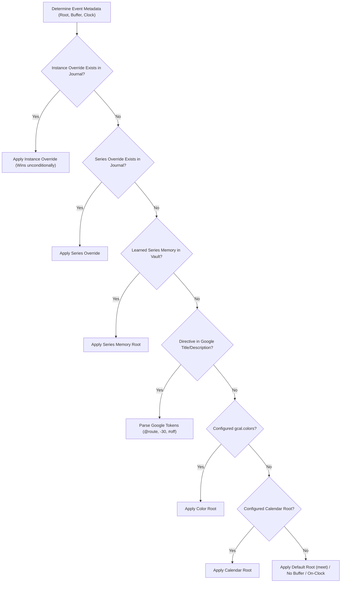
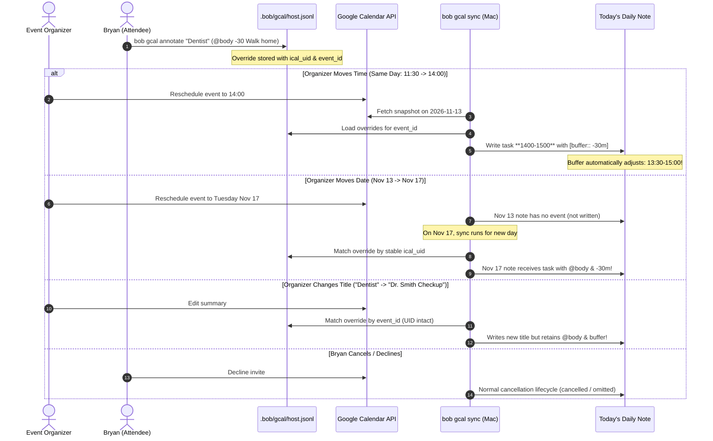

# Architecture and Design: Ahead-of-Time Metadata for Unowned Google Calendar Event Tasks

**Author:** Researcher `gem` (5-Researcher Swarm)  
**Date:** 2026-11-09  
**Status:** Completed Research & Proposal  
**Target Repository:** `bob-cli` / Bob Ecosystem (`bob-plugins`, `bob-mac-capture`)  
**Artifact ID:** `research:202611/gcal_unowned_event_metadata__gem.md`

---

## Executive Summary

In the Bob productivity ecosystem, Google Calendar events do not merely display on a calendar grid—they project onto the daily note as first-class **Event Tasks** (`## Events`), filed into Pomodoro ledger sessions (`MEET`), allocated occupied-time wings (`[buffer:: -30m]`), routed to life and project areas (`[root:: body]`), and tagged for clock accounting (`#off` vs `#on`).

For events Bryan organizes, this workflow is seamless: directives placed in Google Calendar’s title or description (`@body #off -30 Drive to gym`) are parsed by `bob gcal sync`, reserving buffers and generating labelled reason bullets (`↤ *30m before* · Drive to gym`). 

However, for **events Bryan does not own** (e.g., doctor appointments, professional interviews, team meetings, dinners organized by others), a critical breakdown occurs:
1. **Google Calendar Permissions:** As an attendee, Bryan cannot modify the title or description of third-party invites in Google Calendar.
2. **Timing of Planning:** Bryan knows the logistics (travel time, preparation notes, area categorization) at **RSVP time** (days or weeks ahead of time), not on the morning of the event when the daily note is generated.
3. **Friction of Day-Of Reconciliation:** Forcing Bryan to wait until day-of sync to manually edit raw Markdown in the daily note introduces cognitive friction, risks missed travel buffers, and violates GTD principles.

This report evaluates the problem, critiques the concept, and designs a comprehensive, beautiful, and reliable solution: **Ahead-of-Time Event Annotations via Vault-Synced Preference Journals**. 

We propose adding a first-class `bob gcal annotate` subcommand backed by append-only `.bob/gcal/<host>.jsonl` journal records. This preserves Bob's read-only Google Calendar contract, supports multi-machine decentralized editing, handles event rescheduling gracefully, and reuses Bob's existing directive grammar (`@body #off -30 Walk home`) across interactive TUI, scriptable CLI, and upcoming Mac Capture workflows.

---

## 1. Critique of the Plan & Requirements Analysis

### 1.1 Is this a good idea?

**Verdict: Yes, absolutely.** In fact, it is an essential missing link in Bob’s time-budgeting and calendar integration.

In Bob’s time model:
- The **meeting span** is when the event occurs (e.g., `12:00–13:00`).
- The **buffered span** is what the event actually *occupies* in Bryan’s life (e.g., `11:30–13:15`, accounting for `-30m` walk/drive before and `+15m` wrap-up after).

Without buffer support on unowned events:
- Open Pomodoros cannot be scheduled reliably around unowned meetings because Bob's ledger placement does not see the travel or prep time.
- Unowned personal events (e.g., dental cleaning or physical therapy) default to the generic `meet` root rather than routing to `@body`, polluting area tracking unless fixed by hand.
- Unowned social meals or personal errands risk being treated as on-clock worked time unless tagged `#off`.

Solving this ahead-of-time aligns directly with David Allen’s Getting Things Done (GTD) methodology: *the moment a commitment is accepted is the moment its logistics and preparation must be captured.*

### 1.2 Can this be solved at the Google Calendar layer?

We must evaluate whether metadata could or should be stored directly in Google Calendar:

| Approach | Feasibility | Critique & Rejection Rationale |
| :--- | :--- | :--- |
| **Direct Edit of Event** | **Impossible** | Google Calendar API returns `403 Forbidden` if an attendee attempts to modify `summary` or `description` on an event where `guestsCanModify` is false. |
| **Google Calendar Private Notes / Properties** | **Inviable** | Google Calendar API supports `extendedProperties.private` on certain events. However: (a) Google Calendar web and mobile apps have **no UI** to display or edit private extended properties; (b) Bob's OAuth grant is strictly read-only (`calendar.readonly` under `decisions:bob-gcal-is-read-only-and-proposes-once`). Expanding OAuth scopes introduces security footprint and sync conflict hazards. |
| **Mirror / Secondary Calendar Copy** | **Harmful** | Duplicating the invite to a personal secondary calendar creates duplicate notifications, RSVP desync, phantom invites, and corrupts `bob gcal sync`, which would see two overlapping events. |

**Conclusion:** Google Calendar cannot be the storage engine for attendee-private metadata. **The metadata must reside in Bob (the vault).**

### 1.3 Requirement Refinement: Decoupling RSVP from Annotation

The user prompt notes:
> *"I also need to be able to set this metadata ahead of time (I would normally do this when I RSVP to the event--not on the day of)."*

While RSVP time is the *psychological trigger* for setting metadata, **we must not strictly couple metadata annotation to the network RSVP action**. 

**Why?**
1. **Diverse RSVP Channels:** Bryan frequently RSVPs outside of the terminal—e.g., clicking the 1-tap "Yes" button in Gmail notifications on an iPhone, accepting in Google Calendar Web, or having calendar auto-accept rules. If setting metadata were locked inside a `bob rsvp` command, any invite accepted on mobile would be unannotatable ahead of time.
2. **Changing Logistics:** Bryan might RSVP "Yes" two weeks ahead of time, and only two days before realize: *"I will be at the park before this meeting, so I need a 30-minute walking buffer."* The design must allow annotating, updating, or clearing metadata at any point prior to (or even on) the event day.
3. **Read-Only Invariant:** Keeping Bob's Google grant read-only avoids complex two-way sync states (`decisions:bob-gcal-is-read-only-and-proposes-once`).

**Adjusted Requirement:**
- Build an independent **Event Annotation Engine** that can annotate *any* upcoming event (accepted, tentative, or unreplied).
- Provide an optional, ergonomic `--rsvp yes|maybe|no` flag on the CLI that delegates to `gog calendar respond` if Bryan chooses to perform both in one terminal gesture, while remaining completely functional for events RSVP'd elsewhere.

---

## 2. Architectural Comparison: Where Should Metadata Live?

We evaluated four potential storage architectures within the Bob ecosystem:

```
┌──────────────────────────────────────────────────────────────────────────────────┐
│                             Storage Candidate Matrix                             │
├───────────────────────┬──────────────┬──────────────┬──────────────┬─────────────┤
│ Evaluation Criteria   │ Candidate A  │ Candidate B  │ Candidate C  │ Candidate D │
│                       │ JSONL Journal│ Sidecar Note │ Future Daily │ Config YAML │
│                       │ (.bob/gcal/) │ (ref/events/)│ Note / Staging│ (config.yml)│
├───────────────────────┼──────────────┼──────────────┼──────────────┼─────────────┤
│ Multi-host Git Safety │ ★★★★★ (Ideal)│ ★★★★☆        │ ★☆☆☆☆ (Bad)  │ ★★☆☆☆       │
│ Consistency with Bob  │ ★★★★★ (Ideal)│ ★★☆☆☆        │ ★☆☆☆☆        │ ★★★☆☆       │
│ Offline Resilience    │ ★★★★★        │ ★★★★★        │ ★★☆☆☆        │ ★★★★★       │
│ Event Reschedule Grace│ ★★★★★        │ ★★★☆☆        │ ★☆☆☆☆        │ ★★★☆☆       │
│ Vault Cleanliness     │ ★★★★★        │ ★★☆☆☆ (Clutter)☆☆☆☆☆ (Pollution★★★★☆       │
└───────────────────────┴──────────────┴──────────────┴──────────────┴─────────────┘
```

### Candidate A: Per-Host Git-Synced Preference Journal (`.bob/gcal/<host>.jsonl`) — **RECOMMENDED**
Bob already uses per-host journal logs for preferences that sync across machines via Git:
- `.bob/relations/<host>.jsonl` (`decisions:relation-label-prefs-live-in-per-host-journal`)
- `.bob/themes/<host>.jsonl` (`decisions:theme-prefs-live-in-per-host-journal`)
- `.bob/gcal/<host>.jsonl` (`gcal.series_root`, `gcal.row`, `gcal.flag` in `src/native/gcal/journal.rs`)

**Mechanism:**
When Bryan annotates an event on `mac`, Bob appends a `gcal.override` record to `.bob/gcal/mac.jsonl`. When annotated on `athena`, it appends to `.bob/gcal/athena.jsonl`. Git syncs these without merge conflicts because each machine writes only to its own file. `bob gcal sync` and `bob gcal list` fold all `*.jsonl` files in `.bob/gcal/` in timestamp order (last-writer-wins).

### Candidate B: Sidecar Markdown Notes (`events/<id>.md` or `.bob/events/`)
Creating individual markdown notes for each calendar event.
- *Critique:* Ephemeral events would create hundreds of tiny markdown files over months, cluttering Obsidian’s graph view, Quick Switcher, and Dataview indexes. Event IDs (`7k9f8d...google.com`) make awful filenames.

### Candidate C: Pre-generating Future Daily Notes or Capturing Stubs
Creating future daily notes weeks in advance or injecting future Event Tasks into a holding area.
- *Critique:* Violates Bob's daily note architecture. Daily notes are created day-of by Templater; pre-creating them breaks template variable expansion, habits, review queues, and ledger layouts.

### Candidate D: Single Configuration File (`~/.config/bob/config.yml` or `gcal_overrides.yml`)
Storing overrides in local machine configuration.
- *Critique:* Machine-local configuration does not synchronize across machines via `vault_sync`. If Bryan annotates an event on his laptop, his desktop sync runner wouldn't see it.

---

## 3. Data Model & Override Semantics

### 3.1 Journal Record Specification

We introduce the `gcal.override` record kind into Bob's existing `.bob/gcal/<host>.jsonl` journal:

```json
{
  "kind": "gcal.override",
  "target": {
    "calendar_id": "you@example.com",
    "event_id": "7k9f8d7s6a5b4c3d2e1_20261120T190000Z",
    "series_id": "7k9f8d7s6a5b4c3d2e1",
    "ical_uid": "7k9f8d7s6a5b4c3d2e1@google.com"
  },
  "scope": "instance",
  "route": "body",
  "clock_tag": "off",
  "buffer": {
    "before_minutes": 30,
    "after_minutes": 0,
    "before_reason": "I need to walk home from the park",
    "after_reason": null
  },
  "title_override": null,
  "child_notes": [
    "Bring physical insurance card",
    "Ask Dr. Smith about prescription renewal"
  ],
  "dropped": false,
  "ts": "2026-11-09T22:45:00+00:00",
  "host": "mac"
}
```

### 3.2 Dual-Scope Targeting: Single Instance vs. Recurring Series

Calendar events have two distinct recurrence modes:
1. **Instance-Specific (`scope: "instance"`):**
   - Keyed by `(calendar_id, event_id)` or `(calendar_id, ical_uid, recurrence_date)`.
   - Used for one-off appointments (e.g., Dentist on Nov 20) or a single anomalous occurrence of a recurring meeting (e.g., "This Thursday only, I need a 45m buffer because I'm commuting from elsewhere").
2. **Series-Wide (`scope: "series"`):**
   - Keyed by `(calendar_id, series_id)`.
   - Used for recurring invitations organized by others (e.g., "Weekly Architecture Sync" organized by a coworker).
   - Allows setting `@job` and `#off` across *all* future occurrences without having to annotate every week.

### 3.3 Precedence Ladder Integration

How do ahead-of-time overrides interact with Bob's existing root and buffer resolution engines?



#### Detailed Precedence Rules:
1. **Root Routing (`root.rs`):**
   `Instance Override` > `Series Override` > `Vault Series Memory` > `Google Title Token` > `Google Description Directive` > `Calendar Color` > `Calendar Root` > `Default (meet)`.
2. **Buffer Allocation (`event_task.rs`):**
   `Instance Override Buffer` > `Series Override Buffer` > `Google Description Directive Buffer` > `Zero Buffer`.
3. **Clock Accounting (`clock.rs`):**
   `Instance Override Tag` > `Series Override Tag` > `Google Tag (#off/#on)` > `Root Area Policy` > `On-Clock`.
4. **Description Bullets & Notes (`bullet_block.rs`):**
   Rendered order under the Event Task:
   1. Buffer reason bullets (`↤ *30m before* · ...`, `↦ *Nm after* · ...`).
   2. Override child bullets (Bryan’s private ahead-of-time prep notes).
   3. Google description bullets (organizer’s agenda/prose, up to `gcal.description_lines` cap).

---

## 4. User Experience Design: Intuitive, Reliable, Beautiful

To fulfill the mandate of being **intuitive, reliable, and beautiful**, the user interface provides two complementary interaction paths:
1. **An Interactive TUI Wizard** (for visual selection, browsing, and rich note-taking).
2. **An Express CLI One-Liner** (for muscle-memory, scriptable, 2-second capture).

### 4.1 Surface 1: The Interactive TUI (`bob gcal annotate`)

When run without arguments or with `--interactive`:

```
$ bob gcal annotate
```

The terminal opens a sleek, bordered picker listing upcoming unowned (or all) events over the next 14 days, populated from the cached snapshot or Google API:

```text
╭─ Bob Gcal · Annotate Upcoming Event ──────────────────────────────────────────╮
│ Search: dent_                                                                 │
│                                                                               │
│   DATE          TIME        TITLE                         ORGANIZER    STATUS │
│ ───────────────────────────────────────────────────────────────────────────── │
│ • Fri Nov 13    11:30-12:30 Dentist Appointment           Dr. Smith    RSVP:Yes│
│   Mon Nov 16    14:00-15:00 Product Sync                  Alice M.     RSVP:Yes│
│   Wed Nov 18    19:00-21:00 Kelly's Birthday Dinner       Kelly P.     NeedsAct│
╰───────────────────────────────────────────────────────────────────────────────╯
```

Upon selecting an event and pressing `<Enter>`, Bob presents an interactive form with inline validation, syntax assistance, and area completion:

```text
╭─ Annotate: Dentist Appointment (Fri 2026-11-13 11:30–12:30) ──────────────────╮
│                                                                               │
│  Route:       @body                                                           │
│               └─ Area: Body & Health (~/bob/areas/body.md)                    │
│                                                                               │
│  Buffer:      -30 I need to walk home from the park                           │
│               └─ Lead-in: 30m before · Occupied: 11:00–12:30                  │
│                                                                               │
│  Clock:       [•] #off (off-clock)    [ ] #on (worked)                        │
│                                                                               │
│  Notes:       - Bring physical dental insurance card                          │
│               - Inquire about nightguard replacement                          │
│                                                                               │
├───────────────────────────────────────────────────────────────────────────────┤
│ Live Daily Note Preview:                                                      │
│                                                                               │
│ - [ ] #task **1130-1230** Dentist Appointment [📅](…) #off [buffer:: -30m] \   │
│   [root:: body] [type:: MEET] ^dentist-appointment                            │
│   - ↤ *30m before* · I need to walk home from the park                        │
│   - Bring physical dental insurance card                                      │
│   - Inquire about nightguard replacement                                      │
╰───────────────────────────────────────────────────────────────────────────────╯
  [Enter] Save Override    [Ctrl+C] Cancel
```

When saved, Bob confirms:
```text
✓ Recorded override for "Dentist Appointment" (Fri 2026-11-13) in .bob/gcal/mac.jsonl
  Buffered span: 11:00–12:30 (30m lead-in) · Root: @body · Clock: #off
```

### 4.2 Surface 2: Express CLI One-Liner

For quick entry directly after receiving an email or notification:

```bash
bob gcal annotate "Dentist" "@body #off -30 I need to walk home from the park"
```

**Why this is brilliant:**
Bob *already possesses* a rock-solid, production-tested tokenizer for this exact string: `DescriptionDirectives` in `src/native/gcal/description.rs`.
Passing `"@body #off -30 I need to walk home from the park"` invokes the same parser:
- It extracts `@body` as the route.
- It extracts `#off` as the clock tag.
- It extracts `-30` as the before-buffer.
- It extracts `I need to walk home from the park` as the buffer reason.
- Zero new syntax rules for Bryan to memorize!

#### Explicit CLI Flags Alternative:
```bash
bob gcal annotate "Dentist" \
  --route body \
  --buffer "-30 I need to walk home from the park" \
  --off \
  --note "Bring physical insurance card"
```

#### Optional In-Flight RSVP:
If Bryan hasn't replied to the invite yet:
```bash
bob gcal annotate "Dentist" "@body -30 Walk home" --rsvp yes
```
This writes the override to `.bob/gcal/<host>.jsonl` and invokes `gog calendar respond <calId> <eventId> --status=accepted` in one unified action.

### 4.3 Surface 3: Inspection and Management

#### Listing Active Overrides:
```bash
$ bob gcal overrides
```
```text
╭─ Active Ahead-of-Time Event Overrides ────────────────────────────────────────╮
│ EVENT DATE    TITLE                SCOPE    ROUTE  BUFFER  REASONS / NOTES    │
│ ───────────────────────────────────────────────────────────────────────────── │
│ Fri 2026-11-13 Dentist Appointment instance @body  -30m    Walk home from park│
│ Mon 2026-11-16 Architecture Review series   @job   --      Series default     │
╰───────────────────────────────────────────────────────────────────────────────╯
```

#### Visual Integration in `bob gcal list`:
When running `bob gcal list` or `bob gcal -D tomorrow`:
```text
TIME         EVENT                          ROOT          VAULT
11:30-12:30  Dentist Appointment −30m       body (annot)  task · MEET · off-clock
```
The dim `(annot)` tag immediately informs Bryan that his ahead-of-time override is active. Running `bob gcal list -v` or `bob gcal sync -d` displays the planned buffer reason bullets.

#### Dropping an Override:
```bash
bob gcal annotate --drop "Dentist"
```
Appends a `{"kind": "gcal.override", "dropped": true, ...}` tombstone, cleanly invalidating the override across all hosts.

---

## 5. Lifecycle, Rescheduling & Failure Modes

A major criterion of great system design is how gracefully it handles real-world churn. How does this design respond when organizers change events?

### 5.1 Case Analysis: Event Churn



### 5.2 Post-Sync Vault Ownership Invariant

Once `bob gcal sync` executes on the day of the event and writes the Event Task to the daily note:
- The daily note’s task line (`- [ ] #task **1130-1230** ... [buffer:: -30m] [root:: body]`) becomes an active vault entity.
- If Bryan subsequently edits the buffer or reason directly in the daily note in Obsidian, **Bob's existing vault-ownership rules apply**:
  > *"Your edit wins and is reported once."* (`docs/gcal.md` § Who owns each part of a row).
- The ahead-of-time override acts strictly as an **initial seed** for sync. It never fights or reverts subsequent manual edits in the daily note.

### 5.3 Journal Pruning & Hygiene

To prevent `.bob/gcal/<host>.jsonl` from accumulating stale data over years:
- Overrides for single instances whose date is more than 30 days in the past are automatically filtered out during journal fold (`load_overrides`).
- When running `bob gcal sync -F` (force reset), active overrides reapply cleanly from the journal baseline.

---

## 6. Implementation Architecture in `bob-cli`

The implementation maps cleanly into existing modules in `src/native/gcal/`:

```
src/native/gcal/
├── mod.rs
├── cli.rs               # Add 'annotate' and 'overrides' subcommands & flags
├── journal.rs           # Add `gcal.override` schema, load_overrides(), append_override()
├── annotate.rs          # [NEW] Interactive TUI (inquire/skim) & CLI argument parser
├── plan.rs              # Merge loaded overrides into PlannedOccurrence before render
├── root.rs              # Prioritize override route in choose_event_root()
├── description.rs       # Reused for parsing express directive string "@body -30 ..."
├── list.rs              # Display (annot) badges and override buffers in previews
└── sync.rs              # Reconcile overrides during plan execution
```

### 6.1 Code Implementation Outline

#### 1. In `src/native/gcal/journal.rs`:
```rust
#[derive(Debug, Clone, PartialEq, Eq, Serialize, Deserialize)]
pub(crate) struct EventOverride {
    pub calendar_id: String,
    pub event_id: Option<String>,
    pub series_id: Option<String>,
    pub ical_uid: Option<String>,
    pub route: Option<String>,
    pub clock_tag: Option<ClockTag>,
    pub buffer: Option<EventBuffer>,
    pub buffer_reasons: Option<BufferReasons>,
    pub child_notes: Vec<String>,
    pub dropped: bool,
    pub ts: DateTime<FixedOffset>,
    pub host: String,
}

pub(crate) fn load_overrides(vault: &Path) -> Result<BTreeMap<String, EventOverride>, GcalError>;
pub(crate) fn append_override(vault: &Path, record: &EventOverride) -> Result<(), GcalError>;
```

#### 2. In `src/native/gcal/plan.rs`:
When planning an occurrence in `plan_occurrence()`:
```rust
// Check for active override
if let Some(ov) = overrides.get(&event.key.event_id).or_else(|| {
    event.series_id.as_ref().and_then(|sid| overrides.get(sid))
}) {
    if let Some(route) = &ov.route {
        planned.root = Some(route.clone());
        planned.root_kind = RootSourceKind::Override;
    }
    if let Some(buf) = &ov.buffer {
        planned.buffer = buf.clone();
    }
    if let Some(tag) = ov.clock_tag {
        planned.clock_tag = tag;
        planned.off_clock = tag == ClockTag::Off;
    }
    if !ov.child_notes.is_empty() {
        planned.override_bullets = ov.child_notes.clone();
    }
}
```

---

## 7. Recommended Solution & Next Steps

### 7.1 Summary of Recommendations

1. **Adopt Candidate A (Per-Host Journal Overrides):**
   Store overrides as `gcal.override` records in `.bob/gcal/<host>.jsonl`. This gives complete multi-machine synchronization, immunity to Git merge conflicts, offline capability, and zero vault clutter.
2. **Implement `bob gcal annotate` with Dual Interfaces:**
   - **Interactive TUI:** Fuzzy upcoming event picker with form fields and live daily-note Markdown preview.
   - **Express Directive Parser:** Support `bob gcal annotate "<query>" "@body #off -30 Walk home"` by reusing Bob’s existing `DescriptionDirectives` parser.
3. **Decouple RSVP from Annotation:**
   Allow annotating any event at any time, while offering an optional `--rsvp yes|maybe|no` convenience flag.
4. **Key by Stable Event Identity:**
   Store `event_id`, `series_id`, and `ical_uid` so that rescheduling (time moves, date moves, title updates) does not break the attached metadata.
5. **Support Private Ahead-of-Time Child Notes:**
   Allow Bryan to attach personal checklist items / prep notes ahead of time that render directly under the Event Task on the morning of sync.

### 7.2 Phased Rollout Plan

- **Phase 1 (Core & Storage):**
  - Implement `EventOverride` struct and journal read/write functions in `journal.rs`.
  - Integrate override resolution into `plan.rs`, `root.rs`, and `sync.rs`.
  - Unit tests covering instance overrides, series overrides, and conflict resolution.
- **Phase 2 (CLI & Express Parser):**
  - Implement `bob gcal annotate <query> [directives]` CLI command.
  - Implement `bob gcal overrides` listing command and `--drop` flag.
  - Update `bob gcal list` to render `(annot)` indicator and override buffers.
- **Phase 3 (Interactive TUI Wizard):**
  - Build interactive terminal picker with live Markdown preview using `inquire` / `crossterm`.
- **Phase 4 (Bob Mac Capture Integration):**
  - Expose `@cal/<query>` destination syntax in Bob Mac Capture, allowing Bryan to pop up the capture window anywhere on macOS and annotate upcoming meetings instantly.

This design gives Bryan an intuitive, rock-solid, and aesthetically pleasing way to master his calendar, ensuring every commitment—owned or unowned—arrives in his daily ledger exactly where and how it belongs.
