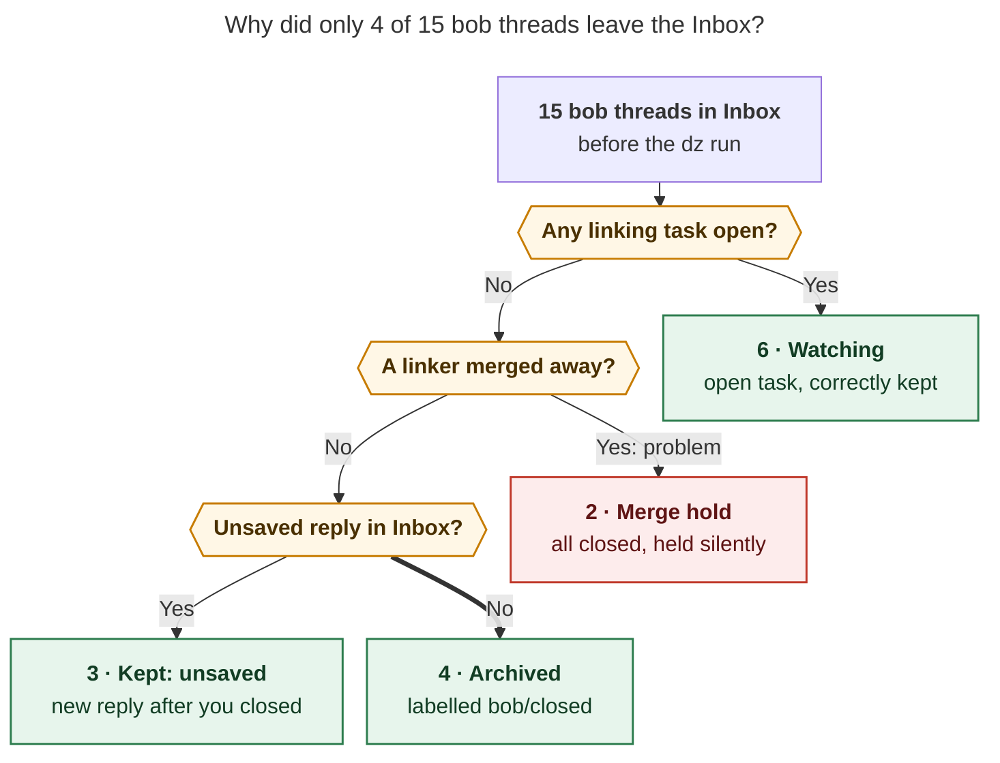
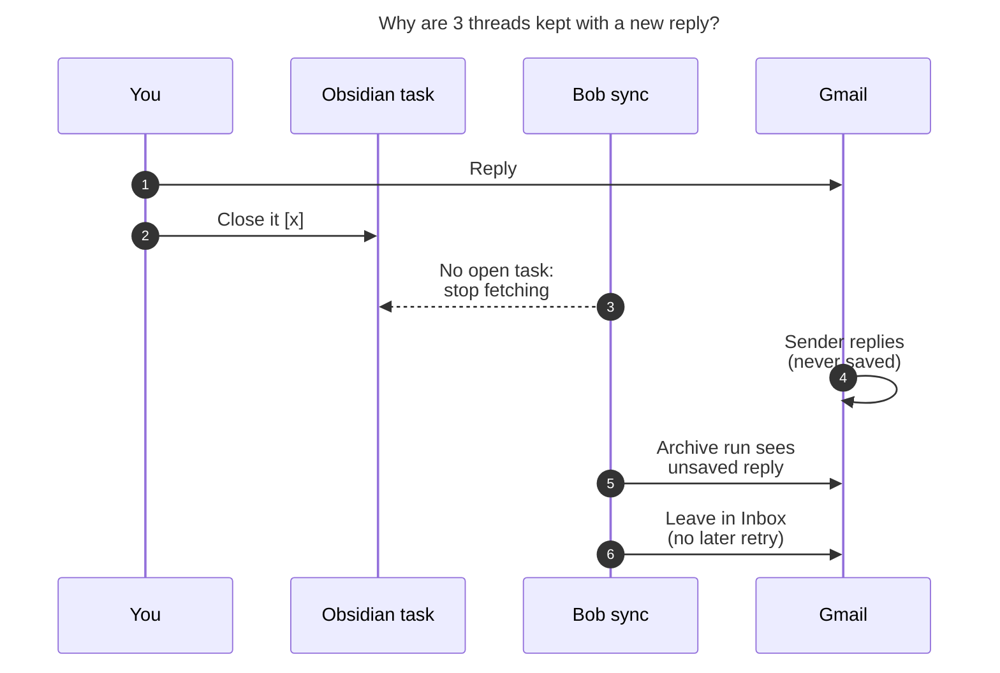

# Why `dz` Archived Only 4 of Your "bob" Emails

_Checked 2026-11-14, about 10:30 EST, against live Gmail, the Bob vault, and bob-cli
`master`._

> **Short answer:** No. 11 "bob"-labelled threads in your Inbox does **not** mean 11 open
> tasks. Only **6** of the 11 have an open Obsidian task. `dz` archived all 4 threads
> that qualified. Of the 5 threads with no open task, **3 stay on purpose** because
> someone replied after you closed the task. The other **2 are stuck because of a gap in
> Bob**: a silent "merge hold".

## The numbers

```text
Before the dz run  ███████████████  15  bob threads in Inbox
Archived by dz     ████              4  ✓ all 4 that qualified
Still in Inbox     ███████████      11
  ├ open task      ██████            6  ✓ correct: you still have work here
  ├ new reply      ███               3  ✓ by design: someone wrote back after you closed
  └ merge hold     ██                2  ✗ stuck: everything is closed, Bob holds anyway
```

You have **7** open Gmail tasks in total. Six of them match the 6 Inbox threads above.
The seventh, _Move sase-core-rs to a PyPI organization?!_ (`sase.md:382`), links a
thread that isn't in your Inbox.

## How Bob decided



_Bob archives a thread only when every linking task is closed, no linking task was
merged into another, and Bob has saved every Inbox message. Each of the 11 remaining
threads fails one of these checks, in this order (`held_reason` in
`src/native/gmail/sync/archive_preview.rs`)._

## All 11 threads

### ✅ 6 with an open task: staying is correct

| Thread                                         | Open task in Obsidian                                                                   |
| ---------------------------------------------- | --------------------------------------------------------------------------------------- |
| 🔥 Python/release tooling · Ray Lyles          | `[ ]` `job_email_recruiters.md:16`                                                      |
| Senior Rust or Java engineer · Jack C.         | `[*]` Next · `job_email_recruiters.md:24`                                               |
| Interview cheat sheet · Luzern Risk            | `[?]` blocked on a dependency · `job.md:32`                                             |
| MyPay log-in update · Google payroll           | `[?]` scheduled 12-08 · `cash.md:42`                                                    |
| Claim your child's Trump Account               | merged into `[?]` _Sign up for Trump account?!_ (scheduled 11-27) · `cash.md:159`      |
| Important info about your retirement plan · Vanguard | merged into `[?]` _Merge all of your 401Ks!_ (scheduled 12-04) · `cash.md:45`     |

The last two show that an open task doesn't always have the email as its title. A merged
task still carries the mail link.

### 📬 3 closed, but they wrote back: kept on purpose

| Thread                                  | Task closed                                | You replied         | They replied (unsaved) |
| --------------------------------------- | ------------------------------------------ | ------------------- | ---------------------- |
| Bryan & Thomas (Converge) · Paraform    | `[x]` 11-12 · `job.md:48`                  | 11-12 13:29         | **11-12 13:55**        |
| Founding Engineer at EcoGPT · Roej      | `[x]` 11-12 · `job_email_recruiters.md:32` | 11-12 15:31         | **11-13 08:57**        |
| Product Engineer · Dan Dowd             | `[x]` 11-11 · `job_email_recruiters.md:35` | 11-11 17:21, 11-12 13:53 | **11-12 14:03**   |



_Closing a task ends Bob's watch on its thread. A reply that arrives afterwards never
reaches Obsidian, so the Inbox is the only place it shows up._

Bob behaved as designed here. Archiving would have buried three live recruiter replies.
Two things are easy to miss, though:

- **No Obsidian task tracks these replies.** Bob stops fetching a thread once every
  linking task is closed (docs/gmail.md, _Watch_).
- **Bob never retries the keep.** A `kept: unsaved` result uses up that close. Bob
  archives the thread only if you reopen the task and close it again (docs/gmail.md,
  _Archive on close_).

### ⚠️ 2 closed, held by a merge: the actual problem

| Thread                                           | Retired source task                       | Merged into (closed)                         |
| ------------------------------------------------ | ----------------------------------------- | -------------------------------------------- |
| Confirm your application… Converge · Paraform    | `[-]` `job.md:55` "merged into"           | `[x]` Converge referral · `job.md:48`        |
| EcoGPT – Founding Engineer · LinkedIn InMail     | `[-]` `done/job_done.md:79` "merged into" | `[x]` EcoGPT · `job_email_recruiters.md:32`  |

Both threads have every task closed, every message saved, the `bob` label on, and
`INBOX` set. In each case the closed target task links the same mail note. The only
blocker is the **merge hold**. Bob holds any thread whose linking task carries a
`merged into` edge, and it does so even when the target is resolved and closed. A test
pins this on purpose: _"the hold needs no resolvable merge target"_
(`archive_scan.rs`, `fallback_merged_into_and_section_tombstones_hold`).

Two parts of this miss what the epic asked for:

1. **The hold is stricter than the plan.** Requirement A2 in
   `plan:202611/gmail_archive_on_task_close.md` says to hold merge-retired sources only
   when the merge target is unresolved. The research (H10) says to follow the merge
   relation when it resolves reliably. Here both targets resolve and are `[x]`.
2. **The review never happens.** "Hold for review" got no review surface. Held threads
   get no sync row, no doctor count, and no hint. The `dz` result lists 9 decisions,
   and these 2 threads aren't among them. They will stay in your Inbox indefinitely,
   and nothing will tell you why.

## So, is something wrong?

| Question                                    | Answer                                                                                   |
| ------------------------------------------- | ---------------------------------------------------------------------------------------- |
| Did `dz` miss archivable threads?           | **No.** It archived all 4 eligible threads, and they now carry `bob/closed`.            |
| Should 11 Inbox threads mean 11 open tasks? | **No.** The `bob` label marks a thread as enrolled. It stays on after a task closes.    |
| Is anything broken?                         | **Yes, a small gap:** the silent, permanent merge hold on 2 threads.                    |
| Anything else worth changing?               | **A habit:** closing a task right after you reply ends the reply watch (see below).     |

## What to do

1. **Read the 3 new replies** from Thomas (Converge), Roej (EcoGPT), and Dan (Product
   Engineer). If one needs action, reopen its task. That also lets Bob archive the
   thread later. Otherwise, archive it by hand.
2. **Archive the 2 merge-held threads by hand.** Nothing else will move them.
3. **Leave the task open after you reply.** Bob's reply watch then tags it
   `#awaiting_reply` and sets a nudge date. When the other person writes back, Bob
   removes the tag and the task returns. Close the task when the conversation is done.
   Then Bob archives the thread on its own.
4. **Fix the merge hold in bob-cli.** Follow the `merged into` edge. When the target
   resolves, use its status. When it doesn't resolve, show a visible "held for review"
   row and a doctor count, not silence.

## Evidence

- **`dz` session:** `dz--0` through `dz--2` and the gate turns `dz--gate`,
  `dz--gate-0`, and `dz--gate-1`, in `~/.sase/chats/202611/`. The first gate paused on
  `confirm_mismatch` because a task line moved. The retry (`dz--gate-1`, 10:14 EST)
  archived 4 threads and kept 5. The 5 kept were 3 `unsaved`, 1 `consent_removed`
  (the Claude Code newsletter, whose `bob` label was removed), and 1 `manual` (EcoGPT
  11-13, which had already left the Inbox). Mac outputs:
  `~/.local/state/bob/kx5_archive_{preview,sync}_20261114T101410.json`.
- **Gmail:** `in:inbox label:bob` returns 11 threads. The 4 archived threads carry
  `bob/closed` and have no `INBOX` label. Message-level reads confirmed the saved and
  unsaved IDs listed above.
- **Vault:** I located task lines by grepping each mail-note stem across the vault,
  including `done/`. The `watch[]` list in the `dz` result shows exactly the 7
  open-task threads.
- **Code and docs:** in `src/native/gmail/sync/`, `archive_scan.rs` (status classes and
  merge hold) and `archive_preview.rs` (`held_reason` order, `KEPT_UNSAVED`). In
  `docs/gmail.md`, the _Watch_, _Hold_, _Lift_, and _Archive on close_ sections.
