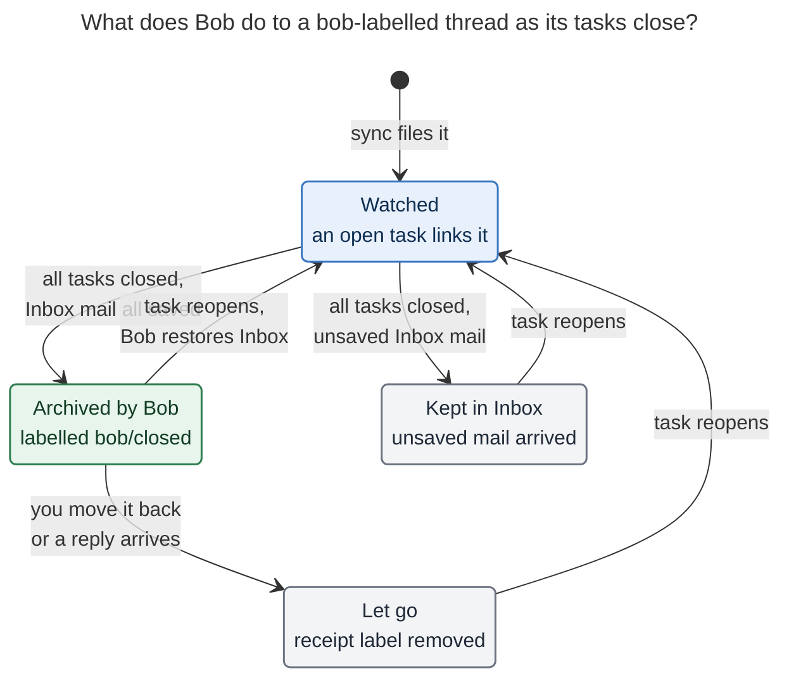

# Gmail archive on close: let the Gmail Inbox follow your Bob tasks

> *"Make `bob gmail sync` archive emails in Gmail automatically when appropriate:
> archive iff the email was labelled `bob` and its Obsidian task has been closed. Make it
> super clear to the user when we do this. Lead the design: intuitive, reliable, and
> beautiful. Critique the plan, adjust the requirements where justified, and end with a
> recommended solution."*

*Researcher cld · 2026-11-12 · scope: bob-cli (`src/native/gmail/`, `docs/gmail.md`),
bob-plugins (read-only), gog v0.44.0 help, Google's Gmail API reference, a read-only
count of the live account, and earlier Bob Gmail research.*

---

## Bottom line

- **Build it, and reframe it.** Don't treat this as a one-off "archive on close" side
  effect. Treat it as a mirror: **the Gmail Inbox follows the task for `bob`-labelled
  mail, and Bob signs every archive it makes.** Closing the last task archives the
  thread. Reopening a task brings it back. Bob never touches a thread whose Inbox state
  you changed yourself.
- **The need is real.** Today 15 of the 18 `bob`-labelled threads are still in the Gmail
  Inbox. 8 of the vault's 20 mail notes are linked only by closed tasks, and 5 of those 8
  threads are still sitting in the Inbox. The label → task → done loop stops one step
  short.
- **Taken literally, the requirement has six sharp edges:**
  - a reply that arrives between your close and the sync gets archived with the thread;
  - a deleted task looks the same as a closed one;
  - "labelled `bob`" is ambiguous once enrollment is durable;
  - a bulk-close bug could empty the Inbox;
  - Bob needs a much broader Google grant;
  - a silent archive is invisible exactly where you'd go looking for the email.

  Each one has a structural fix ([§3](#3-requirement-adjustments-called-out)).
- **How to make it super clear:** be visible where the absence is noticed.
  - **In Gmail:** a receipt label, `bob/closed`, on every thread Bob archived.
  - **In Obsidian:** a quiet `⤓ archived` chip on the closed task, plus a banner with a
    **Move back to Inbox** button on the mail note.
  - **Elsewhere:** sync and doctor rows, and one calm morning notice.

  The receipt label also serves as Bob's crash-safe record of what it did.
- **To make it reliable:**
  - Archive only messages Bob had already saved before it saw the close, at message
    level and never at thread level.
  - Require positive evidence of a close, not just a missing task.
  - Stop and ask when an unusual number of threads become eligible at once.
  - Keep it opt-in, and only on the Mac writer, under a narrowly fenced `gmail.modify`
    grant.
- **What this reverses:** the earlier Gmail epic chose to *"never mutate Gmail when a
  task completes"*. That was a reasonable default for a read-only first release, and
  this proposal keeps its spirit (Gmail stays the mailbox, and nothing is ever deleted).
  It still needs a new decision record and doc updates
  ([§6](#6-rollout-docs-and-decision-record)).

## Contents

1. [What exists today](#1-what-exists-today)
2. [Is this a good idea?](#2-is-this-a-good-idea)
3. [Requirement adjustments (called out)](#3-requirement-adjustments-called-out)
4. [Design](#4-design)
5. [Conformance vectors](#5-conformance-vectors)
6. [Rollout, docs, and decision record](#6-rollout-docs-and-decision-record)
7. [Open questions for Bryan](#7-open-questions-for-bryan)
8. [Recommended solution](#8-recommended-solution)
9. [Sources](#9-sources)

---

## 1. What exists today

| Fact | Where | Why it matters here |
| --- | --- | --- |
| `bob gmail sync` searches `label:bob` and files each new thread as one `#task` in its routed note or `gmail_inbox.md`. Enrollment by `(account, thread id)` is **durable**: removing the label, or closing, moving, or deleting the task, never un-enrolls. | `docs/gmail.md` §Sync; `sync/enroll.rs` | "Labelled `bob`" (in Gmail now) and "enrolled" (Bob's memory) are different facts. |
| Sync is **read-only** today: *"sync uses read-only access and never unlabels, archives, marks read, or changes a message."* The phone guide repeats *"Bob never archives, marks read, or removes labels."* | `docs/gmail.md`; `docs/guides/file-email-from-your-phone.md` | This feature reverses a documented promise. |
| A thread is **watched** while an open `#task` (`[ ]`, `[*]`, `[/]`, `[?]`) carrying the exact `#task` token links its mail note on its own line or in a direct link-only child bullet. Closed rows, mentions, and deeper descendants never watch. | `sync/scan.rs` (`OPEN_STATUSES`, `parse_open_task`) | Gives us "no open task" for free. "A closed task exists" needs a sibling scan. |
| The vault walk skips the top-level `done/` archive. `bob task archive` keeps closed rows in their source note for 7 days (max 10) before moving them to `done/`. | `gmail/vault_walk.rs`; `docs/task-archive.md` | An hourly sync almost always sees the closed row in place, but a robust closed-task scan must also read `done/`. |
| Each mail-note message card carries `<!-- bob:gmail:msg <hex id> <rfc id> -->`. Notes refresh only while watched. | `note/layout.rs`; `docs/gmail.md` §Watch | This is exactly the set of messages "Bob has shown you". |
| On the Mac, cron runs `bob gmail sync -q` hourly at `:07`. Obsidian also runs `bob gmail sync -q -f json -r 30` once when today's daily note is created, and shows a notice only on failure. | `docs/gmail.md` §Where it runs; bob-plugins `291g-plugin-gmail-sync.js` | Most archives would happen in a quiet cron run, so the terminal is the wrong place for receipts. |
| Login requests `--gmail-scope readonly`. `-s compose` adds `gmail.compose` on the Mac only. Read calls pass `--readonly --gmail-no-send --enable-commands …`, and the send call uses `--enable-commands-exact`. | `gmail/login.rs`; `gmail/gog.rs` | Gives a ready-made pattern for a fenced write path. |
| gog v0.44.0 already has `gmail archive [--thread]`, `gmail thread modify`, `gmail batch modify <msgId>… --add/--remove`, `gmail labels create/style/modify`, plus `--readonly`, `--enable-commands-exact`, and `--gmail-no-send`. | `gog gmail --help` (local) | No new transport is needed. |
| Mail link marks already decorate task lines from mail-note frontmatter (`↩ Ada · 2h`, `✈ no reply since …`): display-only and read from the metadata cache. | `docs/mail-link-marks.md` | A natural home for an `⤓ archived` chip. |
| Earlier research ranked *"Archive, read, or star sync"* and *"Gmail mutations triggered by task completion"* as **not recommended**. A deferred bead, `bob-cli-i4`, proposes opt-in **unlabelling** of `bob` after filing. | `research:202611/bob_gmail_design/bob_gmail_design.md`; bead `bob-cli-i4` | Reversing that call needs an explicit record. i4 also conflicts with this design (see [§7](#7-open-questions-for-bryan)). |

**Gmail facts that shape the design** (Google's reference, fetched today):

- Archiving means removing the `INBOX` label. *"Labels only exist on messages. If you
  retrieve a list of labels on a thread, you get a list of labels that exist on any
  message within the thread."* So a thread shows in the Inbox while **any** of its
  messages carries `INBOX`.
- `users.threads.modify`: *"This applies to all messages in the thread"*, including
  ones that arrived a second ago. `users.messages.batchModify` takes up to **1000 explicit
  message ids**.
- `gmail.modify` is **Restricted**: *"Read, compose, and send emails from your Gmail
  account … does not allow immediate, permanent deletion."* It is accepted by
  `messages.send` and `messages.trash`. Granting it therefore gives the token
  send-and-trash power, the same send power `gmail.compose` already gives the Mac.
- A new reply to an archived conversation brings it back to the Inbox. This comes from
  several third-party help pages; I didn't find Google's own page for it. Verify it in
  the spike.
- `label:bob` does **not** match a nested `bob/closed` label. This comes from forum and
  issue reports and is unverified; check it in the spike.

**Census (read-only, counts only, 2026-11-12):** 18 threads carry `bob`, and 15 of them
are in the Inbox. Of the 20 mail notes, 12 are linked by an open task (10 of those
threads are in the Inbox) and 8 only by closed tasks (5 still in the Inbox). So
switching the feature on today would archive about 5 threads, and roughly one more per
closed mail task after that.

## 2. Is this a good idea?

**Yes. It finishes a loop Bryan already runs by hand.** On the phone he labels a thread
`bob`. Bob turns it into a task. He does the work in Obsidian. Then the email sits in the
Inbox indefinitely, as a second, stale to-do list that disagrees with the vault. GTD's
rule is that an inbox holds only *unprocessed* items. Once the task is closed, the thread
is reference material, and Bob already keeps an inert copy in the mail note. Archiving is
also the gentlest Gmail mutation there is:

- nothing is deleted;
- the thread stays in All Mail, in search, and under its labels;
- Gmail itself brings the conversation back when someone replies.

**But the literal rule ("archive iff labelled `bob` and the task is closed") is unsafe
in seven specific ways.**

| # | Hazard | Concrete failure | Fix in this design |
| --- | --- | --- | --- |
| H1 | **Close-then-reply race.** | You close the task at 10:00. A recruiter replies at 10:30. The 11:07 sync archives the *thread*, including the unread reply, and you never see it. | Archive per **message**, only messages Bob saved before it saw the close. Any unsaved message still in the Inbox keeps the whole thread there, and Bob says so once. |
| H2 | **Deleted ≠ closed.** | You delete a task row, a vault merge drops a line, or a file is mid-sync. "No open task" is then true, but nothing was closed. | Require **positive evidence**: at least one closed `#task` (`[x]`/`[-]`) links the mail note, *and* no open one does. |
| H3 | **Several tasks, one thread.** | Task A closes while task B, which links the same mail note, is still open. | Wait until **every** linking task is closed. This reuses the watch scan. |
| H4 | **Ambiguous consent.** | Enrollment outlives the label. A thread adopted from a pasted URL was never labelled `bob`. You removed `bob` because you want Gmail left alone. | Check the **current** `bob` label at archive time. Removing it is a per-thread opt-out, and adding it opts an adopted thread in. |
| H5 | **Erroneous or automated closes.** | A plugin bug, a botched merge, or a bulk gesture closes 40 tasks, and the Inbox empties overnight. | Make a reopen restore the Inbox. Add a **burst breaker**: if more than N threads become eligible in one run, archive none and ask. |
| H6 | **Action at a distance, silently.** | The email vanishes from the phone's Inbox. You search for it and find no explanation. | Add a receipt label in Gmail, plus receipts in Obsidian ([§4.5](#45-making-it-super-clear-the-receipts)). |
| H7 | **Grant escalation.** | `gmail.modify` can send and trash. | Make it opt-in, held only on the writer host. Fence it with `--enable-commands-exact` and a label-diff allow-list that only ever touches `INBOX` and Bob's receipt label. |

**Would I take a different approach?** I'd keep the trigger and change the model. These
are the alternatives I weighed:

| Alternative | Verdict |
| --- | --- |
| **Archive at filing** (label → task → archive right away; GTD-pure) | **Not the default.** It hides mail you are still actively working, and Gmail's thread view is where replies happen. It would also break with how Bryan's Inbox looks today: 10 of the 12 open-task threads are still in it. Worth reconsidering only if the Inbox should become strictly unprocessed mail. |
| **Proposal queue** (sync proposes, Bryan approves in a batch, gcal-style) | **Rejected as steady state.** A daily approval chore for a reversible action defeats the purpose. Its safety comes back cheaply as the burst breaker, plus a `-d` preview before enabling. |
| **Explicit gesture** ("Done & archive" in Obsidian, or a close flag) | **Rejected.** It is easy to forget, so the Inbox drifts again, and Bryan asked for automatic. It survives as the reverse gesture: **Move back to Inbox**. |
| **Thread-level `threads.modify` or `gog gmail archive --thread`** | **Rejected.** It is the H1 race by construction. |
| **Mute** | **Never.** It suppresses Gmail's own safety net of resurfacing on reply. |
| **Two-way mirror** (archiving in Gmail closes the task) | **Rejected.** Archiving in Gmail isn't evidence the work is done, so it would close tasks silently. |
| **Unlabel `bob` after filing** (bead i4) | **Conflicts.** It would erase the consent marker this design reads. Pick one; I recommend this design and parking or closing i4 (see [§7](#7-open-questions-for-bryan)). |
| **One-way archive, no restore on reopen** | **Simpler, but worse.** An accidental close would then cost a Gmail search. Mirror semantics ("open = in Inbox, closed = archived") are easier to predict than an edge-triggered side effect. |

## 3. Requirement adjustments (called out)

| # | Requirement as stated | Adjusted to | Why |
| --- | --- | --- | --- |
| **R1** | "the corresponding task … has been closed" | **Every** open `#task` linking the thread's mail note is gone, **and** at least one linking `#task` is closed: `[x]`/`[X]` Done or `[-]` Cancelled. This is looked up in live notes and in `done/`. | H2, H3. A missing task is not a closed task. |
| **R2** | "closed (… or at least wants it out of sight)" | **Cancelled counts as closed.** | That's your parenthetical. I flag it because a cancel is the one close that doesn't mean "handled" ([§7](#7-open-questions-for-bryan) Q1). |
| **R3** | "labelled with `bob`" | The thread is **enrolled** *and* **still carries `bob` in Gmail** at archive time. | H4. This makes the Gmail label a live, per-thread consent switch. |
| **R4** | "a corresponding email should be archived" | Bob archives **only messages it saved in the mail note before it saw the close**. If any other message in the thread is in the Inbox, Bob keeps the whole thread there and reports it once. | H1. "Bob archives only what it has shown you." |
| **R5** | (implicit: one-way) | **Reopen restores.** When a closed task reopens, or a new open task links the thread, Bob moves *its own* archive back to the Inbox. | H5. Gives one mental model: the Gmail Inbox follows the task. |
| **R6** | (archive only) | Bob also **adds a receipt label** (`bob/closed` by default) to each message it archives and removes it on restore. Bob owns an archive only while its receipt label stays. | H6. The receipt label is both the most visible explanation in Gmail and Bob's durable, crash-safe record of what it did. |
| **R7** | (implicit: Bob may re-archive) | **Bryan's move wins.** If an archived thread is back in the Inbox for any reason (Move to Inbox, a new reply), Bob removes its receipt, records "let go", and **doesn't archive it again** until the next reopen-then-close. | Bob never fights you, and the receipt label stays truthful. |
| **R8** | "starts archiving automatically" | **Opt-in:** `gmail.sync.archive: on` plus a `gmail.modify` grant on the writer host. Off by default. | H7. It reverses a documented promise, and a Google grant is a consent decision. |
| **R9** | (no limit) | **Burst breaker:** more than `archive_max` threads (default 10) eligible in one run → archive none, warn, and require a digest-bound confirmation of exactly the previewed set. | H5. This is the same preview-bound pattern `bob gmail send -c` uses. |
| **R10** | (unspecified) | **Never** delete, trash, mute, mark read or unread, star, remove `bob`, or touch messages in Spam, Trash, or Drafts. | Keeps the blast radius to one reversible label pair. |

## 4. Design

### 4.1 Principles

1. **The Gmail Inbox follows the task.** For `bob`-labelled mail: an open task keeps the
   thread in the Inbox, and closing the last task archives it.
2. **Only what Bob has shown you.** Bob archives at message level, and only messages
   already saved in the mail note. Anything newer stays in the Inbox.
3. **Bob signs its work.** Every Bob archive carries the receipt label. Without that
   label, Bob doesn't own the archive and won't undo or redo it.
4. **Be loud where the absence is noticed.** Give receipts in Gmail and on the task, not
   only in a terminal nobody watches.
5. **Fail closed.** Unknown state, a missing grant, a busy lock, a scan warning, or a
   burst all mean "leave it in the Inbox and say why."

### 4.2 Eligibility (one run, per enrolled thread)

A thread is archived in this run only when **all** of these hold. The first failure
decides the reported reason.

1. **Feature on:** `gmail.sync.archive: on`, this is a live run on the writer host, the
   grant includes `gmail.modify`, and `-n/--no-archive` was not passed.
2. **Enrolled:** a `gmail.filed`, `gmail.pulled`, or `gmail.adopted` event exists for
   `(account, thread)`.
3. **All tasks closed (R1):** the watch scan has no open watcher, *and* the new
   closed-task scan finds at least one `[x]`/`[X]`/`[-]` `#task` linking the mail note.
   It uses the same placement rules (own line or a direct link-only child) and also
   reads `done/`.
4. **Not already decided for this close:** the fold shows no `archived`, `kept`, or
   `let_go` decision since the last time the thread was watched. This makes each close a
   one-shot decision (R7).
5. **Live Gmail check** (one paced metadata read):
   - the thread still carries `bob` (R3);
   - no message is in `SPAM` or `TRASH`;
   - the set *A* (messages that carry `INBOX` **and** have a card in the mail note) is
     not empty, otherwise there is nothing to do and nothing is reported;
   - the set *U* (messages that carry `INBOX` and **no** card) is empty, otherwise
     **kept** (R4).
6. **Burst check (R9):** the eligible count for this run is ≤ `archive_max`, or the run
   carries a matching `-c` digest.

Restore runs the other way: an enrolled thread that is **watched again**, whose messages
still carry Bob's receipt label and lack `INBOX`, gets `INBOX` back on exactly those
messages, and the receipt label is removed.

**Let go** happens when an archived thread with Bob's receipt now has `INBOX` on any
message while its tasks stay closed. Bob removes the receipt label from its messages and
clears the note's `gmail_archived` field.

### 4.3 The lifecycle



*Caption:* Bob archives only after every linking task closes, and only the mail it
already saved. Any return to the Inbox ends Bob's ownership until the next close: you
moving it back, a new reply, or "Kept" because mail arrived that Bob never saved. A
reopen always restores what Bob archived. (Rendered with mermaid-cli 12.0.0 under the
PDF config: 750 × 752 px, 87% fit.)

### 4.4 Exactly what Bob changes in Gmail

**The label-diff contract.** This is a pure function with property tests. Every Gmail
write must pass it, or Bob refuses before calling gog.

| Operation | Messages | `--remove` | `--add` |
| --- | --- | --- | --- |
| archive | the set *A* (explicit ids, ≤ 1000 per call) | `INBOX` only | receipt label only |
| restore | the receipt-labelled messages Bob recorded | receipt label only | `INBOX` only |
| let go | the receipt-labelled messages | receipt label only | nothing |
| first use | (none) | (none) | `labels create <receipt>`; optionally `labels style` once, never again |

- **Call shape:** `gog gmail batch modify <id>… --remove INBOX --add-label <receipt>`.
  It runs **without** `--readonly`, **with** `--gmail-no-send`, and with
  `--enable-commands-exact gmail.batch.modify`. Label creation uses its own
  `--enable-commands-exact gmail.labels.create`.
- **Why one call per thread:** add and remove are atomic in a single `batchModify`, and
  per-thread calls keep failures isolated and reportable. Volume is a handful a day.
- **The receipt label:**
  - Default `<sync.label>/closed`, so `bob/closed`, nested under `bob` in Gmail's
    sidebar.
  - It is **excluded from routing**, from route-conflict detection, and from the
    enrollment search, and is validated not to collide with a route prefix.
  - The name says *why* the thread left: its Bob task is closed. `bob/archived` and
    `bob/done` are fine alternatives ([§7](#7-open-questions-for-bryan) Q3).

### 4.5 Making it super clear: the receipts

The moment you notice is when an email is missing from the Inbox, so the first receipt
lives in Gmail. The second lives on the task you closed.

**1. In Gmail: the receipt label.** The thread shows a `bob/closed` chip in search and
All Mail, and the sidebar's `bob ▸ closed` lists everything Bob has archived, newest
first. Undo needs no Bob at all: **Move to Inbox** (Bob notices and lets go).

```text
Gmail search: from:priya
  ☐  Priya Shah   Offer letter — final version attached        bob   bob/closed    Nov 12
```

**2. On the closed task (bob-plugins mail link marks).** This is a new display-only chip
that follows the existing `↩` / `✈` badges: interface font, `0.8em`, muted ink, and no
pill at rest.

```text
stored:   - [x] #task [[mail/2026/261110_offer_letter|✉️ Offer letter · Priya]] [completion:: 2026-11-12]
rendered: [x] ✉️ Offer letter · Priya  ⤓ archived Thu
tooltip:  Archived from your Gmail Inbox Thu, Nov 12, 11:07 · 2 messages · labelled bob/closed
          Reopen the task, or Move to Inbox in Gmail, to bring it back.
```

- **Rule:** the chip shows when the line is a closed `#task` and its first mail
  wikilink resolves to a mail note whose frontmatter has `gmail_archived`.
- **Toggle:** it follows `toggle-mail-link-marks`.

**3. On the mail note (bob-mail plugin, `cssclasses: bob-mail`).** A one-line banner
above the first message card:

```text
⤓  Archived from your Gmail Inbox · Thu, Nov 12 · its task is closed        [ Move back to Inbox ]
```

- **The button** runs `bob gmail unarchive <note>` and the banner disappears on success.
- **Data:** this is the only vault state the feature adds, one Bob-owned frontmatter
  field, `gmail_archived: 2026-11-12T11:07`. It is written after the Gmail call
  succeeds, removed on restore or let-go, and preserved by save refresh.
- **mail.base:** `mail.base` gains a third view, **Archived by Bob** (title, who,
  `gmail_archived`, backlinks, newest first). It upgrades only a byte-identical
  template, as today.

**4. In the sync report (terminal and JSON).** The rows reuse the existing
`✉ <action> who — title → …` grammar:

```text
✉ gmail sync · 11:07 · watching 9 threads · 2 awaiting reply · archived 2
✉ archived                Priya — Offer letter → bob/closed (task done Nov 12)
✉ archived                Lee — Kickoff logistics → bob/closed (task cancelled Nov 12)
✉ back in inbox           Ada — Lease renewal (task reopened)
✉ kept in inbox           Sam — Intro call (new message since you closed the task)
```

- **Color:** archived dim green, back in inbox cyan, kept yellow.
- **Quiet mode:** `-q` still prints archive, restore, kept, and paused rows. Quiet hides
  routine rows, never changes to another system.
- **JSON:** gets `archive[]` and `summary.archived`
  ([§4.8](#48-cli-config-and-json)).

**5. A morning notice (bob-plugins, once a day).** The daily-note sync already runs
`bob gmail sync -q -f json`. When the report's `recent_archive` (the journal's archives
from the last 24 h) is non-empty, it shows one calm notice:

```text
⤓ Bob archived 3 Gmail threads since yesterday — tasks you closed.  Open “Archived by Bob”
```

**6. In doctor.**

- `scopes: readonly+compose+modify`.
- A new `archive` row, for example: `on · label bob/closed · 4 archived this week · 1
  kept · limit 10`.
- It warns when `archive: on` but the grant can't modify:
  `→ bob gmail login -s modify`.

### 4.6 Reliability

- **Phase order inside one sync run:** archive, restore, and let-go run *last*, after
  filing, adoption, recovery, and watch applies are durable. A crash earlier in the run
  can't archive a thread whose filing wasn't recorded.
- **Order within one thread:**
  1. Fetch metadata (paced, inside the shared `-r` budget).
  2. Decide.
  3. Call `batchModify`.
  4. Take the vault lock, write `gmail_archived`, commit, and append `gmail.archived`
     (body-free: thread id, message ids, task path and block id, close kind and date,
     host, timestamp).
- **Crash safety from the receipt label:** if step 3 succeeds and step 4 doesn't, Gmail
  itself records the act. Next run, a message with Bob's receipt label and no matching
  journal event is reconciled into a `gmail.archived` event and a frontmatter write
  (`recovered: true`). No host-local intent file is needed.
- **Idempotent:** re-running finds no `INBOX` on *A*, so nothing happens. Restore and
  let-go key on the receipt label, so they also run at most once.
- **One decision per close (R7):** the fold keeps `archived` / `kept` / `let_go` per
  thread until the thread is watched again. A watched-again observation re-arms it, and
  a restore (when needed) is the visible half of that.
- **Isolation:** each thread succeeds or fails on its own. `invalid_grant` aborts all
  writes, as today. Rate-limit retries share the existing budget, and a deferral is a
  failure state (exit 1) that the next run finishes.
- **Fail closed on scan doubt:** if the closed-task scan or the watch scan reports
  ambiguity for a thread (an ambiguous basename, a duplicated thread identity), that
  thread is skipped with the existing body-free warning.
- **Burst breaker:** if the count exceeds `archive_max`, Bob archives none, writes one
  `⚠ archive paused  14 threads closed at once (limit 10)` row, and exits 1. The
  plugin's existing once-a-day failure notice then fires.
  - `bob gmail sync -d` lists the set and prints its digest.
  - `bob gmail sync -c <digest>` archives exactly that set, the way `send -c` binds a
    send to its preview.
- **Dry run:** `-d` reports `would_archive` / `would_restore` / `kept` / `paused` with no
  Gmail write, vault write, lock, or journal entry, and is allowed on non-writer hosts.
- **Tests:** the fake gog (`BOB_GMAIL_GOG`) records argv, so tests assert the exact label
  diff and the `--enable-commands-exact` fence. The conformance vectors in
  [§5](#5-conformance-vectors) run verbatim.

### 4.7 Permissions and security

- **Scope:** add `bob gmail login -s modify`. It requests `gmail.readonly` +
  `gmail.compose` + `gmail.modify`; requesting compose too keeps the existing
  compose checks simple, and modify also covers drafts (verify in the spike).
- **Honest consent copy:** Google shows *"Read, compose, and send emails from your Gmail
  account."* Bob's login step says plainly:

  > Archiving needs Gmail's *modify* permission. Google words it as reading, composing,
  > and sending email. Bob uses it only to move threads whose tasks you've closed out of
  > your Inbox and label them `bob/closed`. It can't permanently delete mail, and it
  > never sends without your confirmation.
- **Host pinning:** the grant lives on the writer (the Mac) only. Agent hosts (apollo,
  athena) stay `readonly`, so an agent can never archive, by grant and not just by
  convention.
- **Defense in depth:**
  - **gog** refuses any command other than the one exact write command.
  - **Bob** refuses any label diff outside the contract.
  - **The journal** records message ids only, never subjects or bodies.

### 4.8 CLI, config, and JSON

```bash
bob gmail login     … [-s|--scope readonly|compose|modify]
bob gmail sync      … [-c|--confirm DIGEST] [-n|--no-archive]
bob gmail unarchive NOTE... [-b|--bob-dir DIR] [-d|--dry-run] [-f|--format human|json]
```

- **Option names:**
  - `-n/--no-archive` mirrors `bob gkeep pull -n`.
  - `-c/--confirm` mirrors `bob gmail send -c`.
  - `unarchive` names the action in Gmail's own vocabulary. "Restore" would collide
    with `bob task restore`.
  - Options stay alphabetical with short aliases, per the CLI rules.

```yaml
gmail:
  sync:
    archive: off          # off | on — archive a bob-labelled thread when its last task closes
    archive_label: bob/closed   # receipt label; default "<sync.label>/closed"; created on first use
    archive_max: 10       # most threads one run may archive before it pauses and asks
```

**JSON (schema 1, additive):**

- `archive[]` rows: `thread_id`, `note`, `action` (`archived` | `would_archive` |
  `restored` | `would_restore` | `kept` | `let_go` | `paused`), `reason` (for example
  `new_message`, `no_label`), `messages` (count), `label`, and `tasks[]` (`path`,
  `line`, `block_id`, `status`).
- Summary fields: `summary.archived`, `recent_archive {since, count, items[≤5]}`, and
  `archive_digest` when the run is paused or dry.

## 5. Conformance vectors

Each row is one sync run. "Saved" means the message has a card in the mail note. Every
row assumes `archive: on`, a modify grant, the writer host, and an enrolled thread unless
it says otherwise.

| # | Situation | Result |
| --- | --- | --- |
| AC1 | Only linker `[x]`. `bob` present. Inbox messages all saved. | Archive those messages, add `bob/closed`, write `gmail_archived`. Row `✉ archived`. |
| AC2 | AC1, but the linker is `[-]` Cancelled | Same as AC1 ("task cancelled"). |
| AC3 | Two linkers, one `[x]` and one `[ ]` | Nothing (still watched). |
| AC4 | The task row was deleted. No closed linker anywhere. | Nothing, and no row. |
| AC5 | AC1, but the closed row has already moved to `done/` | Same as AC1. |
| AC6 | AC1, but `bob` was removed in Gmail | Nothing. JSON `kept`/`no_label`, no human row. |
| AC7 | AC1, but Bryan already archived the thread himself | Nothing (*A* is empty), and no row. |
| AC8 | AC1, plus one unsaved message in the Inbox | Nothing is archived. One `✉ kept in inbox … new message` row. |
| AC9 | Archived, and the task reopens | Add `INBOX` back to Bob's messages, remove `bob/closed`, clear frontmatter. Row `✉ back in inbox`. |
| AC10 | Archived, and Bryan uses Move to Inbox (receipt still on) | Let go: remove `bob/closed`, clear frontmatter. Never re-archive this close. |
| AC11 | Archived, and a new reply arrives (Gmail resurfaces it) | Let go, as AC10. Row `✉ back in inbox (new reply)`. |
| AC12 | Archived, Bryan removed `bob/closed`, then the task reopens | No Gmail write (Bryan owns it). The close decision is re-armed. |
| AC13 | 14 threads are eligible at once | None archived. `⚠ archive paused`, exit 1. `-c <digest>` archives exactly those 14. |
| AC14 | `-d` | `would_archive` rows only. No writes anywhere. |
| AC15 | `archive: on`, read-only grant | No Gmail write. Warning plus doctor hint. Filing and watch still run. |
| AC16 | Crash after `batchModify`, before the journal append | Next run reconciles from the receipt label (`recovered`). |
| AC17 | A message in Spam or Trash | Never touched. |
| AC18 | The thread is not enrolled (a mail note saved from a URL, never filed) | Nothing until it is filed or adopted *and* carries `bob`. |
| AC19 | `-n` | The archive phase is skipped and reported as skipped. |
| AC20 | Non-writer host, live | Refused by the existing writer check. No archive. |

## 6. Rollout, docs, and decision record

**Phase 0: spike** (S). On a throwaway thread, with a modify grant on the Mac:

- confirm that `label:bob` excludes `bob/closed`;
- confirm that a reply resurfaces an archived thread whose messages carry the receipt;
- confirm that `gog gmail batch modify` honours `--enable-commands-exact
  gmail.batch.modify` together with `--gmail-no-send`;
- confirm that modify alone covers drafts;
- capture the exact consent-screen wording.

**Phase 1: bob-cli core** (L). This covers:

- the closed-task scan (including `done/`);
- the archive fold and events: `gmail.archived`, `gmail.kept`, `gmail.let_go`,
  `gmail.restored`;
- the label-diff contract;
- the archive, restore, and let-go apply step, with receipt reconcile;
- frontmatter, report rows, JSON, and config;
- `login -s modify`, doctor rows, the breaker with `-c`, and `-n`.

**Phase 1 docs:**

- Rewrite the "never archives" sentences in `docs/gmail.md` (How it works, Sync,
  Security) and in the phone guide.
- Add a guide, *"Let Bob tidy your Gmail Inbox"*: enable, preview with `-d`, what you'll
  see, how to undo.

**Phase 2: receipts in Obsidian** (M):

- bob-plugins: the `⤓ archived` chip with conformance vectors in
  `docs/mail-link-marks.md`, the mail-note banner and button, the `mail.base` view, and
  the morning notice.
- bob-cli: `bob gmail unarchive`.

**Phase 3: optional polish** (S each):

- a disclosure line in the managed Done gesture: *"✉️ Offer letter · Priya will leave
  your Gmail Inbox"*;
- a `↩ new mail` chip on closed rows whose thread was kept.

**Decision record:** **"Closing A Task Archives Its Bob Mail"**
(`closed-task-archives-bob-mail`).

- **Claim:** the R1–R10 rules, with the receipt label as the ownership token.
- **Why:** closes the label → task → done loop.
- **Rejected alternatives:** the table in [§2](#2-is-this-a-good-idea).
- **Cost:** the `gmail.modify` grant on the Mac.
- **Reopens when:** Gmail changes its resurfacing behavior, or Bryan wants filing-time
  archive.
- **What it narrows:** the Gmail epic's invariant I1 ("no label, archive, read-state, or
  trash changes") for exactly this one reversible label pair. There's no accepted record
  to supersede. The decisions web must be edited through `/sase_memory_write`.

**Rollout steps:**

1. Run `bob gmail login -s modify` on the Mac.
2. Run `bob gmail sync -d` and review the ~5 backfill threads.
3. Set `archive: on`.
4. Watch the morning notices for a week.

## 7. Open questions for Bryan

1. **Does Cancelled count?** I recommend yes, given "out of sight". The alternative is
   Done only, with cancelled threads left for you to archive by hand.
2. **Should a reopen restore?** I recommend yes (mirror semantics). One-way is simpler,
   but it makes an accidental close cost a Gmail search.
3. **Receipt label name:** `bob/closed` (why it left), `bob/archived` (what happened), or
   `bob/done`.
4. **Keep `bob` on archived threads?** I recommend yes. The label then means "everything
   I ever sent to Bob", and it stays the per-thread consent switch. That makes bead i4
   (unlabel `bob` after filing) incompatible. I'd close i4 as superseded rather than
   build both.
5. **Is `gmail.modify` on the Mac acceptable?** The Mac already holds `compose`, which
   can send, so the new powers are trash and label edits, both fenced by Bob.
6. **Burst limit:** 10 threads per run is about two weeks of today's volume. Lower it to
   5 for the first month?

## 8. Recommended solution

Ship **"the Gmail Inbox follows your Bob tasks"** as an opt-in phase of `bob gmail sync`
on the Mac writer:

1. **When:** a thread is archived when it is enrolled, still carries `bob`, has no open
   linking `#task`, and has at least one Done or Cancelled linking `#task`.
2. **How:** remove `INBOX` from **only the messages Bob already saved** and add the
   **`bob/closed` receipt** to them, in one fenced `batchModify` call. If mail arrived
   that Bob never saved, keep the thread in the Inbox and say so once.
3. **Reverse it symmetrically:** a reopen restores Bob's archive. Your own Move to Inbox,
   or a new reply, makes Bob let go, and Bob never re-archives until the next close.
4. **Make it unmistakable:**
   - the receipt label in Gmail;
   - a quiet `⤓ archived` chip on the closed task;
   - a mail-note banner with **Move back to Inbox**;
   - an *Archived by Bob* base view;
   - explicit sync and doctor rows;
   - one calm morning notice.
5. **Make it safe:**
   - opt-in config plus the `-s modify` grant on the writer only;
   - `--enable-commands-exact` plus a label-diff allow-list;
   - positive closed evidence;
   - a burst breaker with digest-bound confirmation;
   - crash recovery from the receipt label;
   - dry-run preview;
   - never delete, trash, mute, mark read, or remove `bob`.
6. **Sequence:** spike (S) → bob-cli core (L) → Obsidian receipts (M), with a new
   decision record and rewritten "Bob never archives" docs in Phase 1.

## 9. Sources

**Local (verified in this workspace):**

- bob-cli `docs/gmail.md` (Commands, How it works, Configuration, Login, Sync, Watch,
  Where it runs, Security).
- `docs/guides/file-email-from-your-phone.md`, `docs/task-archive.md`,
  `docs/mail-link-marks.md`, `docs/reference/vault-format.md` (status table).
- `src/native/gmail/sync/{mod,command,scan}.rs`, `src/native/gmail/vault_walk.rs`,
  `src/native/gmail/gog.rs`, `src/native/gmail/login.rs`,
  `src/native/gmail/note/{parse,layout}.rs`, `src/native/gmail/journal.rs`.
- bob-plugins `plugins/bob-ledger-tools/src/291g-plugin-gmail-sync.js` and
  `294-keep-inbox-indicator.js`.
- `gog gmail --help`, `gog gmail thread modify --help`, `gog gmail archive --help`,
  `gog gmail batch --help`, `gog gmail labels --help`, `gog auth add --help` (v0.44.0).
- `research:202611/bob_gmail_design/bob_gmail_design.md` (the "never mutate Gmail when
  a task completes" call), `research:202611/bob_gmail_design/bob_gmail_design__final.md`,
  `research:202611/gmail_sync_reply_watch/gmail_sync_reply_watch.md` (invariant I1,
  "loud where you work"), and
  `research:202611/bob_gmail_everyday_guide/bob_gmail_everyday_guide.md`.
- Bead `bob-cli-i4` (opt-in unlabel after pull).
- Census: read-only `gog gmail search` counts for `label:bob`, `label:bob in:inbox`, and
  `label:bob -in:inbox`, plus a local vault scan of mail-note links. Counts only; no
  bodies were read.

**Google (fetched 2026-11-12):**

- [Gmail API scopes](https://developers.google.com/workspace/gmail/api/auth/scopes)
- [users.messages.batchModify](https://developers.google.com/workspace/gmail/api/reference/rest/v1/users.messages/batchModify)
- [users.threads.modify](https://developers.google.com/workspace/gmail/api/reference/rest/v1/users.threads/modify)
- [users.messages.send](https://developers.google.com/workspace/gmail/api/reference/rest/v1/users.messages/send)
- [users.messages.trash](https://developers.google.com/workspace/gmail/api/reference/rest/v1/users.messages/trash)
- [Manage labels guide](https://developers.google.com/workspace/gmail/api/guides/labels)

**Secondary (unverified behaviors, to confirm in the spike):**

- Resurfacing on reply:
  [York U Google FAQ](https://google.info.yorku.ca/faq/why-does-a-message-i-archived-or-deleted-show-up-again-in-my-inbox/),
  [Wisechecker](https://wisechecker.com/gmail-message-returned-to-your-inbox-after-you-archived-it-why/).
- Nested-label search exclusion:
  [gmailctl issue #324](https://github.com/mbrt/gmailctl/issues/324),
  [gmail-users group thread](https://groups.google.com/g/gmail-users/c/SUcWD2QH4dg).
- Scope classification:
  [EmailEngine scopes reference](https://learn.emailengine.app/docs/accounts/gmail/gmail-api-scopes),
  [Unipile scopes guide](https://www.unipile.com/gmail-api-scopes-guide/).
