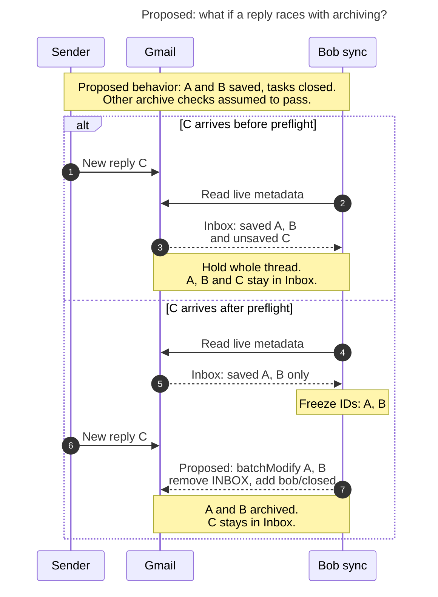

# Diagram proposals: Gmail archive on task close: consolidated design and recommendation

Proposals for the swarm linker, not a report. Each diagram restates only what the source
report says.

```yaml
source: research:202611/gmail_archive_on_task_close/gmail_archive_on_task_close__final.md
producer: research.4d.image
check: "mmdc 12.0.0 with the PDF-mirroring config rendered 1 of 1 Mermaid diagrams; retained Puppeteer --no-sandbox; negative parse check passed"
```

## reply-race-boundary

```yaml
anchor: |-
  preflight and the write simply isn't in the ID list and keeps the thread in the Inbox
question: |-
  What happens when a reply arrives just before versus just after preflight?
illustrates: |-
  An unsaved Inbox message at preflight keeps the whole thread in place, while a reply between preflight and the write stays outside the frozen ID list and remains in the Inbox.
caption: "Unsaved mail before preflight holds the thread; a reply after preflight stays in the Inbox because the write uses frozen saved IDs."
review: "643.5×866 px, fit 100.0%; question, source trace and visual checks passed; 0 visual revisions; 1 parse correction"
```


