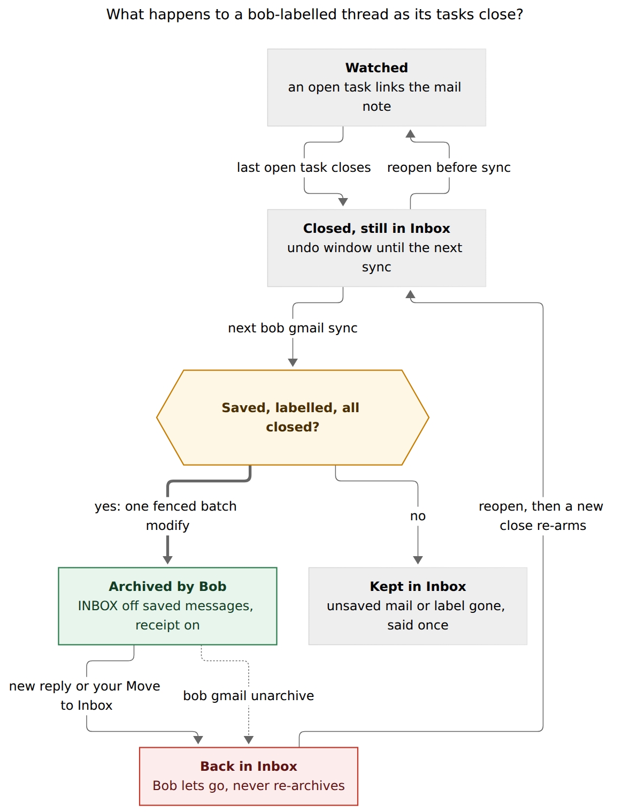
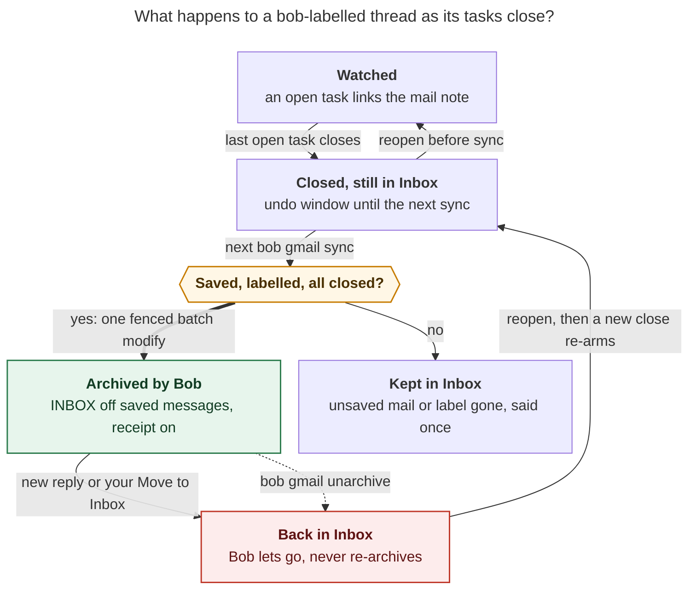

# Gmail archive on task close: consolidated design and recommendation

> **Research query.** Make `bob gmail sync` archive emails in Gmail automatically when
> appropriate: archive iff the email was labelled `bob` and its Obsidian task has been
> closed. Make it super clear to the user when this happens, since a silent archive can
> hide a live email (a recruiter's follow-up, for example). Lead the design — intuitive,
> reliable, beautiful. Critique the plan, call out justified requirement adjustments, and
> end with a recommended solution.

Consolidated by the lead researcher, 2026-11-12, from five independent reports —
`__cdx`, `__cld`, `__grk`, `__mus`, `__gem` in this directory — plus the lead's own
verification pass (repo greps of `docs/gmail.md`, `scan.rs`, `login.rs`, `config.rs`,
`vault_walk.rs`; live `gog` v0.44.0 help for `gmail batch modify` and `gmail archive`;
an audited read of bead `bob-cli-i4`). Research only: no code, config, vault, or Gmail
state was changed.

---

## Bottom line

**Build it — all five researchers independently said yes — but not as the literal
biconditional.** The safe, intuitive shape every report converged on is:

> **One-shot, opt-in inbox drain.** When every task linking a `bob`-labelled thread is
> positively closed, the next `bob gmail sync` on the Mac writer removes `INBOX` from
> exactly the messages Bob has already saved to the vault, once, signs its work with a
> `bob/closed` receipt label, and tells you in every place you'd look. A later reply
> brings the thread back (Gmail does this natively) and Bob never takes it back out.
> Undo is one explicit command.

The literal rule ("archive **iff** labelled and closed") is a standing invariant, and a
standing invariant is exactly the harm the request names: Gmail re-inboxes a thread when
someone replies to it, so an hourly "keep archived while closed" sweeper would archive
the recruiter's follow-up again within the hour, forever. The fix is to make the **close
transition** the trigger and journal it as consumed — not to re-derive the state every
run.

The need is real and small. cld's read-only census of the live account (2026-11-12): 18
threads carry `bob`, 15 still in the Inbox; 8 of the vault's 20 mail notes are linked
only by closed tasks, and 5 of those threads still sit in the Inbox. So enabling the
feature today archives ~5 threads, then roughly one per closed mail task after that.

## 1. Ground truth (verified in bob-cli and live tooling)

| Fact | Evidence | Consequence |
| --- | --- | --- |
| Sync is documented read-only: *"The label stays in Gmail: sync uses read-only access and never unlabels, archives, marks read, or changes a message."* | `docs/gmail.md:736` (lead-verified) | This feature reverses a documented promise: it needs a `feat(gmail)!:` subject, doc rewrites, and a new decision record. |
| Enrollment by `(account, thread_id)` is durable: removing the label, or closing/moving/merging/deleting the task, never un-enrolls. | `sync/enroll.rs`; `docs/gmail.md` | "Labelled `bob`" (live Gmail fact) and "enrolled" (Bob's memory) are different predicates; the design must pick explicitly. |
| A thread is watched while an open `#task` (`OPEN_STATUSES = [' ', '*', '/', '?']`) links its mail note on its own line or a direct link-only child. Closed = everything else; Done is `x`/`X`, Cancelled is `-`. | `sync/scan.rs:36` (lead-verified); `freshness/placement.rs` | "No open watcher" comes free; "a closed task exists" needs a sibling scan — absence alone conflates deletion with completion. |
| The vault walk excludes top-level `done/`; `bob task archive` moves closed rows there after a keep window (default 7 days). | `vault_walk.rs:5` (lead-verified); `docs/task-archive.md` | The closed-task scan must also read `done/`, or a collected row looks deleted. |
| `gmail.writer` pins live writes to one host (the Mac); dry-run works anywhere. Cron runs `bob gmail sync -q` hourly at `:07` on the Mac. Ledger Tools also runs `sync -q -f json` at daily-note creation. | `gmail/config.rs:26`; `docs/gmail.md:341,973` (lead-verified); bob-plugins `291g-plugin-gmail-sync.js` | Most archives will happen in an unattended quiet run — the terminal alone cannot be the receipt. |
| Reads go through gog with `--readonly --gmail-no-send --enable-commands <allowlist>` on the isolated `bob-gmail` client; send is a separate compose-scoped, digest-confirmed path (`-c DIGEST`). | `gmail/gog.rs`, `login.rs` (lead-verified) | There is a ready-made pattern for a narrowly fenced write path and for digest-bound confirmation. |
| gog v0.44.0 (Bob's floor, installed) has both primitives: `gmail batch modify <messageId>… --add/--remove` (explicit message IDs) and `gmail archive [--thread]`. | `gog … --help` (lead-verified this session) | No new transport is needed; the choice of primitive is a design decision, not a capability gap. |
| Journal events are body-free per host (`.bob/gmail/<host>.jsonl`): `gmail.filed`, `gmail.adopted`, `gmail.turn`, `gmail.gone`, `gmail.save`. | `gmail/journal.rs` | `gmail.archived` / `gmail.restored` / `gmail.kept` extend an existing discipline. |
| Bead `bob-cli-i4` (READY, large): opt-in **unlabel** of `bob` after a verified pull, so the phone's label view stays a to-file queue. | bead read this session | Direct conflict: i4 strips the very label this feature reads as live consent. One of them must yield (§7). |

**Gmail API facts** (Google reference, fetched by cdx/cld/grk):

- Archiving **is** removing the `INBOX` label; the thread stays in All Mail, search, and
  its other labels. Nothing is deleted.
- Labels live on **messages**; a thread "has" a label when any message does. New
  messages do **not** inherit a previously applied thread label — an old `bob` on
  message A is no evidence that new reply B was meant for Bob.
- `users.threads.modify` *"applies to all messages in the thread"*, including one that
  arrived a second ago. `users.messages.batchModify` takes up to 1,000 **explicit**
  message IDs.
- A reply to an archived conversation returns it to the Inbox
  ([Gmail Help 6576](https://support.google.com/mail/answer/6576)).
- Mutation requires `gmail.modify` (restricted scope; also permits read, compose, send,
  and trash — not skip-trash deletion). `gmail.labels` manages label *definitions* only
  and cannot touch messages. Never request `https://mail.google.com/` or gog's
  `--gmail-scope full` (which adds settings scopes).

## 2. Critique: is this a good idea?

**Yes.** It finishes a loop Bryan already runs by hand: label on the phone → Bob files a
task → work happens in Obsidian → close — and then the email sits in the Inbox as a
second, stale to-do list that disagrees with the vault. GTD says an inbox holds only
unprocessed items; once the task closes, the thread is reference material and Bob
already keeps an inert copy in the mail note. Archive is also the gentlest Gmail
mutation there is: reversible, search-preserving, and self-healing (a real reply
resurfaces on its own).

**But the literal rule is unsafe in specific, enumerable ways.** The consolidated hazard
list (every report found some subset; union below):

| # | Hazard | Concrete failure | Structural fix |
| --- | --- | --- | --- |
| H1 | **Close-then-reply race.** | Close at 10:00; recruiter replies at 10:30; the 11:07 sync archives the thread *including the unread reply*. | Archive per **message**, only messages Bob saved before seeing the close. An unsaved Inbox message holds the whole thread, reported once. |
| H2 | **Re-archive loop** (gem's "recruiter resurgence"). | Thread archived; new reply re-inboxes it; the task is still `[x]`, so the next hourly run buries the reply again — forever. | **One-shot**: journal `gmail.archived` as the tombstone; never re-archive until the task is reopened and closed again. |
| H3 | **Deleted ≠ closed.** | A deleted row, a botched merge, or an unreadable note makes "no open task" true with nothing closed. | Require **positive evidence**: ≥ 1 closed (`x`/`X`/`-`) linking `#task` in live notes or `done/`, *and* zero open ones. |
| H4 | **Several tasks, one thread.** | Task A closes while task B still links the same mail note; archiving hides B's email. | **All-closed** predicate across the whole vault scan. |
| H5 | **Ambiguous consent.** | Enrollment outlives the label; an adopted thread was never labelled; Bryan unlabelled one to keep Gmail untouched. | Require the **live `bob` label at archive time** — a visible per-thread opt-out/opt-in switch. |
| H6 | **Bulk-close incident.** | A plugin bug or bulk gesture closes 40 tasks; the Inbox empties overnight. | **Burst breaker**: over `archive_max`, archive none, warn, require a digest-bound confirm of the previewed set (the `send -c` pattern). |
| H7 | **Silent action at a distance.** | The mail vanishes from the phone; nothing anywhere says why. | Receipts in Gmail and Obsidian, quiet-breaking sync rows, desktop notification, morning notice (§5.4). |
| H8 | **Scope escalation.** | `gmail.modify` can also send and trash. | Opt-in config + explicit `-s modify` re-consent on the writer only; `--enable-commands-exact` fence; a label-diff contract that can only ever touch `INBOX` + the receipt label. |
| H9 | **Backlog surprise.** | First enable silently archives months of historically closed mail. | First-enable backlog requires `-d` preview + explicit confirm; only closes observed after enable archive automatically. |
| H10 | **Merge blind spot** (cdx). | A merge retires its source `[-]` and may carry the mail link deeper into the target's body than the scan sees; "no open watcher" then archives active work. | Hold merge-retired sources for review (or follow the merge relation when reliably resolvable). |

**Alternatives weighed and rejected** (consolidated): archive at filing time (hides mail
still being worked; changes the consent moment); a standing proposal queue (a daily
approval chore for a reversible action — its safety survives as the burst breaker);
per-close confirmation dialogs (repetitive, misses CLI/mobile edits; Apple HIG and NN/g
both favor visible undo over alert storms); mute (defeats Gmail's own reply-resurface
safety net); trash (converts the stated harm into real data loss); unlabelling `bob`
instead of archiving (doesn't empty the Inbox and burns the consent marker); a Gmail
filter `label:bob → skip inbox` (archives threads whose tasks are still open); two-way
mirror where archiving in Gmail closes the task (silent vault mutation from a mailbox
gesture).

## 3. Requirement adjustments (explicitly called out)

| # | As requested | Adjusted to | Why |
| --- | --- | --- | --- |
| A1 | Archive **iff** labelled + closed (standing invariant) | **One-shot on the close transition**, journaled and consumed. A reply that re-inboxes the thread stays; Bryan's own Move to Inbox makes Bob "let go". Re-armed only by reopen → new close. | H2. Unanimous across reports in substance. |
| A2 | "the corresponding task … closed" | **Every** linking `#task` is closed *and* at least one is positively closed (`x`/`X`/`-`), looked up in live notes and `done/`. Deleted/missing ≠ closed. Merge-retired sources hold for review. | H3, H4, H10. Four of five reports require positive evidence; grk's deletion-counts variant loses. |
| A3 | "labelled with `bob`" | Enrolled **and** still carrying the configured label in Gmail at archive time **and** still having `INBOX`. | H5. The live label becomes a per-thread consent switch; peeling it off in Gmail stops automation. (mus/gem preferred enrollment-only; the label gives the user a visible lever, so it wins 3–2 plus lead.) |
| A4 | "a corresponding email" | **Only the messages Bob already saved** to the mail note (frozen explicit IDs). Any unsaved Inbox message keeps the whole thread in place, reported once. | H1. Thread-level `threads.modify` sweeps in in-flight replies by construction. |
| A5 | "automatically" | **Opt-in, default off**: `gmail.sync.archive: on` + `bob gmail login -s modify` on the writer host. Cancelled `[-]` counts as closed (your "out of sight" parenthetical) — flagged as a question since a cancel is the one close that doesn't mean "handled". | H8, H9. Also honors the existing read-only contract until Bryan flips it. |
| A6 | "super clear … somehow" | A **receipt system**, not a log line: `bob/closed` label in Gmail, task chip + mail-note banner in Obsidian, quiet-breaking sync rows, desktop notification, morning notice, doctor rows (§5.4). | H7. Be visible where the absence is noticed. |
| A7 | (unspecified) undo | Explicit `bob gmail unarchive` restores `INBOX` to exactly the messages Bob archived and removes the receipt. **No auto-unarchive on reopen** — reopening to add a note must not bounce mail into the Inbox. Reopen re-arms eligibility and surfaces a restore hint. | Majority (cdx/grk/mus) over cld's full mirror; gem's auto-*reopen of vault tasks* from Gmail replies is rejected outright — it writes task state from a mailbox event, against the watch design that leaves closed rows untouched. |
| A8 | (unspecified) pace | No cooldown timer (gem's 30-min hysteresis rejected): the hourly `:07` cadence **is** the undo window, and frozen IDs + one-shot do the real safety work. No 4-mode `ask/notify/auto` config either — cron can't ask; one switch plus `-n`/`-c` covers every mode. | Simplicity; cdx explicitly argues a sleep is not a safety mechanism. |

## 4. The design in one figure

**Reader question:** What happens to a `bob`-labelled thread as its tasks close?



*Caption:* Closing the last linking task opens an undo window until the next sync; the
sync archives the saved messages once (one fenced batch modify, receipt label on) or
keeps the thread when unsaved mail arrived or the label is gone; any return to the Inbox
— a reply, your own move, or `bob gmail unarchive` — ends Bob's ownership, and only a
reopen followed by a new close re-arms archiving. (Rendered with mermaid-cli 12.0.0
under the PDF config: 785 × 1012 px, fit 83.2%.)



## 5. Recommended design

### 5.1 Eligibility (per enrolled thread, per run; first failure is the reported reason)

1. **Feature on:** `gmail.sync.archive: on`, live run, writer host, `gmail.modify`
   granted, `-n/--no-archive` not passed.
2. **Enrolled:** `gmail.filed` / `gmail.adopted` / legacy `gmail.pulled` exists.
3. **All tasks closed:** the watch scan finds zero open watchers **and** the new
   closed-task scan (same placement rules, plus `done/`) finds ≥ 1 closed linking
   `#task`. Merge-retired sources with an unresolved live target hold for review.
4. **Not already decided for this close:** the journal fold shows no `archived` /
   `kept` / `let_go` since the thread was last watched (one-shot, re-armed by becoming
   watched again).
5. **Live Gmail check** (one paced metadata read, at the apply boundary, not from a
   pre-fetch snapshot): still carries `bob`; nothing in `SPAM`/`TRASH`; set **A**
   (messages with `INBOX` *and* a saved card in the mail note) non-empty; set **U**
   (messages with `INBOX` and *no* card) empty — otherwise **kept**, reported once.
6. **Close observed after enable**, unless this run is the explicitly confirmed backlog.
7. **Burst:** eligible count ≤ `archive_max` (default 10), or the run carries a matching
   `-c <digest>`.

Because eligibility requires **U** to be empty, the frozen-ID batch never splits a
conversation (mus's objection to message-level archiving): either every Inbox message of
the thread is saved and goes together, or nothing moves. A reply landing *between*
preflight and the write simply isn't in the ID list and keeps the thread in the Inbox —
which is exactly the desired outcome of the race.

### 5.2 The mutation (exactly what Bob may change in Gmail)

One fenced call per thread, message-scoped, atomic add+remove:

```text
gog --no-input --json --color never --client bob-gmail --account EMAIL \
    --gmail-no-send --enable-commands-exact gmail.batch.modify \
    gmail batch modify <id>… --remove INBOX --add-label bob/closed
```

- **Label-diff contract** (a pure function, property-tested; every write must pass it):
  archive = remove `INBOX` + add receipt on set A; restore = remove receipt + add
  `INBOX` on the recorded IDs; let-go = remove receipt only; first use = `labels create`
  once. Nothing else is expressible: never trash, mute, mark read/unread, star, remove
  `bob`, or touch Spam/Trash/Drafts.
- The write path omits `--readonly`, keeps `--gmail-no-send`; every read path stays
  byte-identical to today. Tests assert argv via the existing fake gog.
- **Order inside the run:** discovery → filing/adoption → watch prepare/apply → archive
  phase last, after vault commits are durable. A thread filed this run has an open task
  and can never archive itself. A failed archive never fails committed filings; per-
  thread isolation; `invalid_grant` aborts all writes as today.
- **Receipt label = crash-safe record** (cld's design, adopted): if the Gmail call
  succeeds and the journal append doesn't, the next run reconciles any message carrying
  `bob/closed` with no matching journal event into a `gmail.archived` event
  (`recovered: true`). Re-runs are idempotent: set A is empty once archived; restore and
  let-go key on the receipt.
- **Scope:** `bob gmail login -s modify` adds `gmail.modify` on the isolated `bob-gmail`
  bucket, Mac only; agent hosts stay `readonly` by grant, not convention. Honest consent
  copy (Google's screen says read/compose/send): *"Bob uses this only to move threads
  whose tasks you've closed out of your Inbox and label them `bob/closed`. It cannot
  permanently delete mail and never sends without your confirmation."* `archive: on`
  without the grant is a setup error (exit 2) with the login hint.

### 5.3 Config, CLI, JSON

```yaml
gmail:
  sync:
    archive: off            # off | on — archive a bob-labelled thread when its last task closes
    archive_label: bob/closed   # receipt; default "<sync.label>/closed"; created on first use
    archive_max: 10         # burst breaker; above this, pause and require -c <digest>
```

```bash
bob gmail login  … [-s|--scope readonly|compose|modify]
bob gmail sync   … [-c|--confirm DIGEST] [-n|--no-archive]
bob gmail unarchive NOTE|THREAD... [-d|--dry-run] [-f|--format human|json]
```

`-n` mirrors `gkeep pull -n`; `-c` mirrors `send -c`; `unarchive` avoids colliding with
`bob task restore`. `-d` previews `would_archive` everywhere (including non-writer
hosts) with zero writes, locks, or journal entries. JSON stays schema 1, additive:
`archive[]` rows (`thread_id`, `note`, `action` ∈ `archived | would_archive | kept |
let_go | restored | paused`, `reason`, `messages`, `tasks[]`), `summary.archived`,
`recent_archive {since, count, items}`, and `archive_digest` when paused or dry. Never
reuse `watch[]` action verbs. Exit codes keep the 0/1/2 contract (paused burst = 1;
missing scope/setup = 2).

### 5.4 Making it super clear (the receipts)

The moment you notice an archive is when the email is *missing*, so visibility lives
where the absence is noticed — six layers, each on a channel Bob already has:

1. **In Gmail: the `bob/closed` receipt label.** The sidebar's `bob ▸ closed` lists
   everything Bob archived, newest first; every archived thread explains itself in
   search and All Mail. Undo needs no Bob at all: Move to Inbox, and Bob lets go.
2. **On the closed task** (bob-plugins mail-link marks): a quiet display-only chip,
   `⤓ archived Thu`, tooltip with time, message count, label, and how to bring it back.
3. **On the mail note**: a one-line banner above the first card — *"⤓ Archived from your
   Gmail Inbox · Thu Nov 12 · its task is closed — [Move back to Inbox]"* — the button
   runs `bob gmail unarchive`. Backed by one Bob-owned frontmatter field,
   `gmail_archived: <timestamp>`, the only new vault state. `mail.base` gains an
   "Archived by Bob" view.
4. **In the sync report**: `✉ archived Priya — Offer letter → bob/closed (task done
   Nov 12)` rows that **break `-q`** (an archive is news, not routine), plus `kept` /
   `back in inbox` rows; a desktop notification via the existing vault-sync
   `osascript`/`notify-send` helper with the undo command in the body.
5. **Morning notice** (Ledger Tools' existing daily-note sync): one calm line when
   `recent_archive` is non-empty — *"⤓ Bob archived 3 Gmail threads since yesterday —
   tasks you closed."*
6. **Doctor**: `scopes: readonly+compose+modify`, an archive row (on/off, label, count
   this week, kept count, limit), and a warning with the login hint when config and
   grant disagree.

Close-time is covered too (grk): when a managed Done lands on a row watching an enrolled
mail note, the plugin can show a no-network notice — *"✉ Offer letter leaves Gmail's
Inbox at the next Bob sync · reopen the task to keep it"* — the only receipt that
appears while you're still looking at the task.

## 6. Conformance vectors (the reliability contract)

Assume `archive: on`, modify grant, writer host, enrolled thread unless stated.

| # | Situation | Result |
| --- | --- | --- |
| C1 | Only linker `[x]`; `bob` present; all Inbox messages saved | Archive set A, add receipt, write `gmail_archived`, journal, row + notification. |
| C2 | C1 but the linker is `[-]` Cancelled | Same, reason "task cancelled". |
| C3 | Two linkers: one `[x]`, one `[ ]` | Nothing (still watched). |
| C4 | Task row deleted; no closed linker anywhere | Nothing, no row (H3). |
| C5 | C1 but the closed row already moved to `done/` | Same as C1. |
| C6 | C1 but `bob` was removed in Gmail | Kept (`no_label` in JSON); no human row. |
| C7 | C1 but Bryan already archived it himself | No-op (set A empty), no row, no falsely owned receipt. |
| C8 | C1 plus one unsaved Inbox message | Nothing archived; one `kept (new message)` row, said once. |
| C9 | Archived; a new reply arrives | Gmail re-inboxes; Bob lets go (removes receipt, clears frontmatter); never re-archives this close. |
| C10 | Archived; Bryan uses Move to Inbox | Let go, as C9. |
| C11 | Archived; task reopens | No Gmail write; eligibility re-armed; restore hint surfaced. |
| C12 | 14 threads eligible at once (limit 10) | None archived; `⚠ archive paused` + digest; exit 1; `-c <digest>` archives exactly that set. |
| C13 | First enable with historical backlog | `-d` preview + explicit confirm drains it; nothing silent. |
| C14 | Crash after `batchModify`, before journal append | Next run reconciles from the receipt label (`recovered: true`). |
| C15 | Message in Spam/Trash; `gmail.gone` thread; `never_save`/refused notes | Never candidates. |
| C16 | `archive: on` with read-only grant; or non-writer host | No Gmail write; warning + doctor hint (exit 2 for scope); filing and watch unaffected; `-d` still previews. |
| C17 | Merge-retired `[-]` source, target open or link moved deeper | Hold for review; never archive on source cancellation alone (H10). |
| C18 | Same-run new counted incoming move | Watch applies first; archive skips this run. |
| C19 | `-n`; `-d`; `-l 0` | Phase skipped and said; preview only; watch-only runs still archive (cheap next to watch's `threads.get`). |
| C20 | Hostile subject/task text | Inert display everywhere; never in argv as code; journals stay body-free. |

Tests ride the existing fake-gog transport: assert exact IDs and the `INBOX`+receipt
delta are the only expressible mutation; negative assertions that send, trash, delete,
and read-state changes are unavailable; `--readonly` present on every read and absent
only on the archive call; journal fold, crash reconcile, and the vectors above verbatim.

## 7. Rollout, conflicts, and docs

**Phase 0 — spike (S).** On a throwaway thread with a Mac modify grant: confirm
`label:bob` does not match `bob/closed` (reported in forums, unverified); confirm a
reply resurfaces a receipt-labelled archived thread; confirm `--enable-commands-exact
gmail.batch.modify` + `--gmail-no-send` behave together; audit gog's HTTP retry on the
mutation path (a transport auto-replay would undermine the one-shot); capture consent
wording.

**Phase 1 — bob-cli core (L).** Closed-task scan (incl. `done/`); eligibility fold +
events (`gmail.archived`, `gmail.kept`, `gmail.let_go`, `gmail.restored`); label-diff
contract; archive/let-go apply with receipt reconcile; `login -s modify` + doctor;
config, report rows, JSON, burst breaker with `-c`, `-n`; `feat(gmail)!:` subject.
Rewrite the "never archives" sentences in `docs/gmail.md` and the phone guide, keeping
them as the description of the `off` default. `just docs-gen` + `just docs-check`.

**Phase 2 — Obsidian receipts (M).** `bob gmail unarchive`; the task chip, mail-note
banner + button, `mail.base` view, morning notice (bob-plugins).

**Phase 3 — polish (S).** Close-time notice; optional `↩ new mail` chip on kept rows.

**Decision record** (via `/sase_memory_write`, when the epic is planned): *"Closing A
Task Archives Its Bob Mail Once"* — one-shot, positive-evidence all-closed predicate,
live-label consent, frozen saved-message IDs, receipt label, opt-in on the Mac writer,
explicit unarchive. It narrows the Gmail epic's invariant I1 ("Bob never writes to
Gmail except previewed drafts") for exactly this reversible label pair; record the
rejected alternatives from §2.

**Bead `bob-cli-i4`** (unlabel `bob` after pull) conflicts with the live-label consent
predicate: if i4 lands first, closed threads never archive. Recommendation: park or
close i4 as superseded by this design; a later nested-label scheme (`bob` to-file,
`bob/live` enrolled, `bob/closed` receipt) can serve i4's phone-queue goal without
breaking this one. Decide before Phase 1; do not build both as specified.

**Bryan's enable checklist:** `bob gmail login -s modify` on the Mac → `bob gmail
doctor` shows the scope → set `archive: on` → `bob gmail sync -d`, read the ~5 backlog
rows → confirm with `-c` (or leave the backlog) → close a test thread's task, wait for
`:07`, check the notification, try `bob gmail unarchive` → reply to an archived test
thread and confirm Bob leaves it in the Inbox.

## 8. Where the five reports disagreed, and how this report resolves it

| Question | Positions | Resolution |
| --- | --- | --- |
| Thread- or message-level mutation? | grk/mus/gem: thread-scoped; cdx/cld: frozen explicit message IDs | **Message-level `batchModify` on frozen saved IDs.** `threads.modify` applies to messages that arrived after the eligibility read — the H1 race by construction. The split-thread worry is void because eligibility requires every Inbox message to be saved (§5.1). gog v0.44.0 has the primitive (lead-verified). |
| Require the live `bob` label? | cdx/cld/grk: yes; mus/gem: enrollment + INBOX only | **Yes.** It is the one consent lever visible in Gmail itself and matches the request's literal wording; the cost (unlabelled adopted threads never archive) fails quiet and safe. |
| Gmail receipt label? | cld (and gem's `bob/done` variant): yes; cdx/grk/mus: no | **Yes — keep `bob`, add `bob/closed`.** It is the only explanation that lives where the absence is noticed, and it doubles as the crash-safe record. gem's remove-`bob`+`bob/done` transition is rejected: it burns the consent switch and enrollment discovery. cdx's clutter concern is noted; `archive_label` can be renamed, and the open question stands (§9). gem's 5,000-ID discovery-cap worry is ~a decade away at observed volume. |
| Auto-restore on task reopen? | cld: yes (mirror); cdx/grk/mus: no; gem: auto-reopen *tasks* on replies | **No auto-unarchive; explicit `bob gmail unarchive`;** reopen re-arms and hints. Reopens happen for reasons other than wanting mail back. gem's Gmail→vault task reopening is rejected: it writes task state from a mailbox event, against the watch design that never touches closed rows. cld's "let go" ownership semantics are kept — they are what makes one-shot truthful. |
| Positive closed evidence vs. "no open watchers"? | cdx/cld/mus/gem: positive; grk: absence suffices | **Positive evidence** (H3), plus cdx's merge-source hold (H10). |
| Cooldown / multi-mode config? | gem: 30-min cooldown, `ask/notify/auto`; others: no | **Neither.** The hourly cadence is the window; one switch + `-n` + `-c` covers the modes; cron cannot "ask". |

## 9. Open questions for Bryan

1. **Does Cancelled (`[-]`) archive?** Recommended yes (your "out of sight"
   parenthetical); a done-only config arm is cheap if you disagree.
2. **Receipt label name** — `bob/closed` (why it left), `bob/archived`, or `bob/done`?
   And is the label itself wanted, given cdx's clutter objection? Recommended: yes,
   `bob/closed`.
3. **Burst limit** — 10 (≈ two weeks of current volume) or 5 for the first month?
4. **Fate of bead `bob-cli-i4`** — close as superseded (recommended) or re-scope to the
   nested-label scheme later?
5. **Turn-awareness** — should a thread whose last counted move is theirs (ball in your
   court) resist archiving beyond the same-run skip? Recommended: not in v1; revisit if
   early runs feel hasty.

## 10. Recommended solution (one paragraph)

Ship **one-shot archive-on-close** as an opt-in final phase of `bob gmail sync` on the
Mac writer, behind a `gmail.modify` grant obtained by an explicit `login -s modify`:
when an enrolled thread still carries the `bob` label and `INBOX`, every linking task is
closed with at least one positively closed, and no unsaved message sits in the Inbox,
remove `INBOX` from exactly the messages Bob has already saved and add the `bob/closed`
receipt, in one fenced `batch modify` call per thread; journal it as consumed so Bob
never re-archives after Gmail resurfaces a reply or Bryan moves the thread back; pause
and ask (digest-bound) on bursts and on the first-enable backlog; and make every archive
legible in six places — the Gmail receipt label, the task chip, the mail-note banner
with its Move-back button, quiet-breaking sync rows plus a desktop notification, the
morning notice, and doctor. It is intuitive because the checkbox Bryan already clicks
becomes the archive button, delayed to the sync he already runs; reliable because every
piece (enrollment fold, watch scan, journal, fake-gog tests, writer pin, digest confirm)
extends an existing, tested shape; and beautiful because the Inbox becomes the list of
conversations whose tasks are still alive, every removal is signed, and nothing Bob does
is ever more than one label pair away from undone.

## 11. Sources

**Lead-verified this session:** `docs/gmail.md:736,341,973`; `src/native/gmail/sync/scan.rs:36`;
`src/native/gmail/{login,config}.rs`; `src/native/gmail/vault_walk.rs:5`; `gog gmail
batch modify --help` and `gog gmail archive --help` (v0.44.0 installed); audited read of
bead `bob-cli-i4`.

**From the five reports** (full citations in each sibling file): bob-cli
`src/native/gmail/sync/{command,mod,discover,enroll,scan,watch,watch_apply,watch_state,report,guard,retry,hold}.rs`,
`src/native/gmail/{gog,cli,journal,note/*}.rs`, `src/native/google/{profile,signin}.rs`,
`src/native/freshness/placement.rs`, `src/native/task_status_hooks/settings.rs`,
`docs/{gmail,gkeep,task-archive,task-merge,mail-link-marks,vault-git-sync}.md`,
`docs/guides/file-email-from-your-phone.md`, `docs/reference/json-outputs.md`;
bob-plugins `291g-plugin-gmail-sync.js`; gog upstream (`gh:openclaw/gogcli`)
`gmail_archive.go`, `gmail_batch.go`, `api.go`; `plan:202611/bob_gmail.md` (I1, I2, I7),
`plan:202611/gmail_sync_reply_watch.md`; `research:202611/bob_gmail_design/*`,
`research:202611/gmail_sync_reply_watch/*`; cld's read-only live census (counts only).

**Google (primary):**
[Gmail API scopes](https://developers.google.com/workspace/gmail/api/auth/scopes),
[users.messages.batchModify](https://developers.google.com/workspace/gmail/api/reference/rest/v1/users.messages/batchModify),
[users.threads.modify](https://developers.google.com/workspace/gmail/api/reference/rest/v1/users.threads/modify),
[labels guide](https://developers.google.com/workspace/gmail/api/guides/labels),
[Archive messages (Help 6576)](https://support.google.com/mail/answer/6576),
[sync guide](https://developers.google.com/workspace/gmail/api/guides/sync).
**UX guidance:** [Apple HIG on alerts](https://developer.apple.com/design/human-interface-guidelines/alerts),
[NN/g user control and freedom](https://www.nngroup.com/articles/user-control-and-freedom/).
**Unverified, spike items:** nested-label search exclusion
([gmailctl #324](https://github.com/mbrt/gmailctl/issues/324)); gog mutation-path HTTP
retry behavior.
