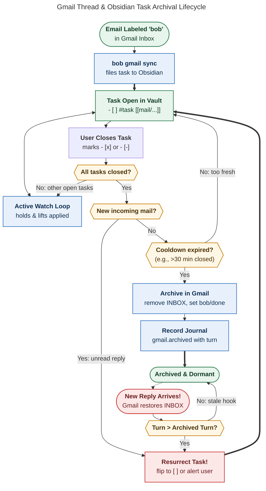
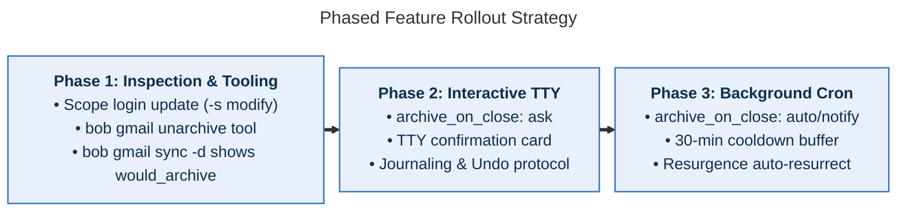

# Designing Automated Gmail Archiving for Closed Tasks in `bob gmail sync`
## Safety Architecture, Failure-Mode Critique, UX Design, and Implementation Blueprint

> **Research query:** How should `bob gmail sync` handle automatic email archiving in Gmail when corresponding Obsidian tasks are closed? Critique the proposal, analyze safety risks (e.g., missed recruiter emails), adjust requirements, and design an intuitive, reliable, and beautiful solution.

---

## 1. Executive Summary & Bottom Line

The user wishes to close the loop between task management in Obsidian and inbox triage in Gmail: **when a task linked to an email thread is marked closed in Obsidian (`- [x]` or `- [-]`), `bob gmail sync` should automatically archive that email in Gmail.**

### The Bottom Line
1. **The Idea Has Immense Productivity Value, But Naive Automation Is Unacceptable**:
   - Manually revisiting Gmail to archive an email thread that was already resolved in Obsidian is a friction-heavy "double-management tax."
   - However, **unattended, unconditional background archiving during hourly cron (`bob gmail sync -q`) is extremely hazardous**. An accidental checkbox click or an untracked counterparty reply (e.g., an urgent recruiter reschedule) could be silently archived out of sight, causing severe real-world harm.
2. **The "Recruiter Resurgence" Trap (The Single Greatest Hazard)**:
   - When a task in Obsidian is marked `[x]`, the email is archived (removing Gmail's `INBOX` label).
   - If the counterparty later sends a new reply, Gmail naturally adds `INBOX` back to the thread.
   - **If `bob gmail sync` naively sees the task is still `[x]`, it will re-archive the new reply every hour!** The user will never see the follow-up email.
   - **Core Invariant**: Archiving must be strictly bound to the thread's message turn at the time of closure. Any incoming message after closure must invalidate archival, prevent re-archiving, and immediately resurface the task in Obsidian.
3. **The Multi-Task & Partial Closure Invariant**:
   - An email thread may be referenced by multiple tasks (e.g., one task to review a document, another to wire a deposit).
   - An email must **only** be archived iff **every** active linking task in the vault is in a closed state (`[x]` or `[-]`), and at least one verified closed task exists.
4. **OAuth Scope Escalation**:
   - `bob gmail sync` currently operates under read-only permissions (`https://www.googleapis.com/auth/gmail.readonly`).
   - Modifying thread labels (removing `INBOX` or removing `bob`) requires the elevated `https://www.googleapis.com/auth/gmail.modify` scope. This expands Bob's security footprint and requires an explicit, audited consent flow.
5. **Recommended Product & UX Architecture**:
   - **Opt-In Safety Configuration**: Archiving is disabled by default (`archive_on_close: off`). Users can set it to `ask` (interactive confirmation), `notify` (archive with desktop notification + undo), or `auto` (unattended with circuit breakers).
   - **Label Evolution (`bob` → `bob/done`)**: Rather than merely removing `INBOX` or leaving the `bob` label to bloat search results indefinitely, Bob should remove `INBOX`, remove the active `bob` label, and apply a clean `bob/done` label. This provides instant visual clarity in Gmail web/mobile.
   - **1-Click Undo Protocol**: An instant undo command (`bob gmail unarchive <ID|NOTE>`) that restores `INBOX` and rolls back journal markers.
   - **Cooldown & Volume Circuit Breaker**: Enforce a minimum 30-minute closure stability delay and a maximum batch cap (e.g., 5 threads per run) to prevent catastrophic mass-archivals from bulk task edits.

---

## 2. Critique of the Proposal: Is Automated Archiving a Good Idea?

### 2.1 The Promise: Eliminating the Double-Management Tax
In Bryan's Personal Knowledge Management (PKM) and GTD workflow, Obsidian acts as the single pane of glass for action. When emails arrive, labeling them `bob` files them into area or project notes as actionable tasks:
```bob-task
- [ ] #task [[mail/2026/261112_recruiter|✉️ Staff Engineer Offer · TechCorp]]
```
While open, `bob gmail sync` actively watches the thread, applying holds (`#awaiting_reply`) when Bryan sends an email and lifting them when the counterpart replies. 

Once Bryan accepts the offer or signs the contract, he hits `Ctrl+Enter` in Obsidian, turning the row into `- [x]`. Under today's system, the email remains in Gmail's `INBOX` forever unless Bryan manually switches to a browser, searches for the thread, and clicks Archive. This causes:
- Inbox clutter that dilutes attention.
- Mental overhead tracking whether an email in the inbox has already been handled in Obsidian.
- Stale search results in Gmail.

Closing this loop by pushing task resolution back to Gmail completes the bidirectional lifecycle.

---

### 2.2 The Perils: Why Naive Implementation Will Fail

| Hazard | Scenario | Severity | Mitigation Required |
| :--- | :--- | :--- | :--- |
| **Silent Cron Destruction** | `bob gmail sync -q` runs hourly in cron. An accidental checkmark archives an urgent thread while Bryan sleeps. | **Catastrophic** | No silent archivals in cron without explicit opt-in, journaled audit log, and cooldown window. |
| **The "Recruiter Resurgence" Trap** | Task is closed `[x]`. Thread is archived. Recruiter replies with "Interview rescheduled to 10am!" Naive sync sees task `[x]` and re-archives the reply. | **Catastrophic** | Turn-anchored archival. New incoming message invalidates closure, breaks archive hold, and resurrects task. |
| **Multi-Task Split** | Thread is linked by Task A (`[x]`) and Task B (`[ ]`). Archiving for Task A destroys context for Task B. | **High** | Vault-wide aggregation: archive only when $\forall t \in \text{Tasks}(T), \text{status}(t) \in \{[x], [-]\}$. |
| **Task Deletion vs. Completion** | User deletes task line during note refactoring. Does 0 tasks mean "archive"? | **High** | Deletion is NOT closure. Archival requires at least one durable verified closed task. |
| **`done/` Archive Blindness** | `bob task archive` moves `[x]` tasks to `done/`. `vault_walk` excludes `done/`. Sync sees 0 tasks. | **Medium** | Scan must verify closed status before tasks migrate, or consult mail note backlink cache. |
| **OAuth Scope Expansion** | Moving from `gmail.readonly` to `gmail.modify` exposes full mailbox modification privileges. | **Medium** | Strict command allowlisting in `gog`, token isolation, and explicit `--scope modify` login. |

---

### 2.3 Comparison with Existing Bob Systems

Bob already handles remote mutability and imports across several services, each guided by established architectural decisions:
1. **`bob gkeep pull` (Inbox Drain at Ingest)**:
   - Google Keep notes are archived in Keep *immediately upon successful ingest* into `gkeep_inbox.md`.
   - *Why this doesn't fit Gmail*: Keep notes are static, one-way captured thoughts. Email threads are multi-turn conversations that remain active for days or weeks. Gmail cannot be drained at ingest time.
2. **`bob gmail send` (Cryptographic Preview Confirmation)**:
   - Bob refuses to send an email without a SHA-256 confirmation digest bound to an explicit preview (`-c DIGEST`).
   - *Design takeaway*: Mutating remote mail state demands explicit user visibility, strong preconditions, and idempotent execution.
3. **`bob gcal` (Strict Read-Only Remote Policy)**:
   - Decision #11 (`bob-gcal-is-read-only-and-proposes-once`): "Google Calendar stays read-only; Bob writes each row and link once... and cancels only untouched tasks."
   - *Design takeaway*: Unattended background processes must never overwrite remote user data without ironclad safety guards.

---

## 3. Technical Feasibility & Gmail API / Gog Reality

### 3.1 What Does "Archiving" Mean in Gmail?
Gmail does not possess an "archive" folder or an `ARCHIVED` status. 
- **Inbox Presence**: An email thread is in the inbox iff it carries the system label `INBOX`.
- **Archiving**: Archiving a thread is technically defined as **removing the `INBOX` label**:
  $$\text{Archive}(T) \iff \text{ModifyThread}(T, \text{removeLabels}=[\text{"INBOX"}])$$
- **What happens to the `bob` label?**
  This is a critical architectural choice:
  - *Option A: Leave `bob` intact, remove only `INBOX`.*
    - *Flaw*: `bob gmail sync`'s discovery query is `label:bob` (`q=label:bob`). If hundreds of archived threads retain `label:bob`, `threads.list` will page through thousands of stale IDs every run, eventually hitting the `MAX_DISCOVERY_IDS` (5,000) safety cap!
  - *Option B: Remove `INBOX` and remove `bob`.*
    - *Flaw*: The email vanishes from any Bob-related queries in Gmail web/mobile.
  - *Option C: Remove `INBOX`, remove `bob`, and add `bob/done` (Recommended).*
    - *Benefit*: `label:bob` remains exclusively an "active triage" label. Archived items are neatly filed under `bob/done` in Gmail's sidebar. `threads.list` discovery remains lightning-fast. The user has visual evidence in Gmail that Bob processed and completed the thread.

---

### 3.2 OAuth Scopes & Gog CLI Capabilities
In `src/native/google/profile.rs`, `GMAIL` currently requests:
```rust
scope_description: "gmail.readonly",
scope_prompt: "Read your email messages",
```
The compose flow adds `https://www.googleapis.com/auth/gmail.compose`.

Neither scope permits modifying labels on existing threads!
- Calling `gog gmail archive <id> --thread` or `api call gmail v1 gmail.users.threads.modify` requires:
  $$\text{Scope: } \texttt{https://www.googleapis.com/auth/gmail.modify}$$
- `gmail.modify` allows:
  - Reading messages and metadata.
  - Adding and removing labels (including `INBOX` and user labels).
  - Trashing and un-trashing messages.
  - *(It does NOT allow permanent deletion bypassing trash, nor sending mail without compose).*

#### Gog CLI Integration
Gog (v0.44.0) already supports thread archiving natively:
```bash
gog --account <email> --client bob-gmail --json --no-input \
    --enable-commands gmail.archive,api.call \
    gmail archive <thread_id> --thread
```
Or via targeted API call:
```bash
gog --account <email> --client bob-gmail --json --no-input \
    --enable-commands api.call,api.gmail.users.threads.modify \
    api call gmail v1 gmail.users.threads.modify \
    --params '{"userId":"me","id":"<thread_id>"}' \
    --body '{"removeLabelIds":["INBOX","<label_id_bob>"],"addLabelIds":["<label_id_bob_done>"]}'
```

---

## 4. Lifecycle Architecture & Safety Flow

### 4.1 The Complete State Machine
The interaction between Obsidian task states and Gmail thread states must follow a deterministic, audited lifecycle.



*Figure 1 Caption: Complete decision and state progression for email archiving. A thread is only archived when all linking tasks are closed, cooldown has elapsed, and no unconsumed replies exist. New incoming replies immediately resurrect the task rather than being re-archived.*

---

### 4.2 The Five Golden Safety Rules for Archival

To guarantee that archiving never harms the user, the sync engine must enforce five invariant rules before dispatching any `modify` call to Gmail:

1. **Rule 1: Total Vault Agreement (No Dangling Open Tasks)**
   $$\text{Eligible}(T) \implies \left( \forall t \in \text{VaultTasks}(T), \text{status}(t) \in \{'x', '-'\} \right) \land |\text{VaultTasks}(T)| \ge 1$$
   If even one task linking thread $T$ in any area or project note is still `[ ]`, `[*]`, `[/]`, or `[?]`, archival is strictly blocked.
2. **Rule 2: Anti-Resurgence Anchor (The Recruiter Protection Rule)**
   When archiving, Bob records the thread's current latest message ID and internal date in `.bob/gmail/<host>.jsonl`:
   $$\text{TurnAnchor}(T) = (\text{message\_id}, \text{internal\_date})$$
   If Gmail reports an internal date newer than $\text{TurnAnchor}(T)$, Bob declares a **Resurgent Reply**:
   - Archiving is refused.
   - The task in Obsidian is un-completed: `- [x]` $\to$ `- [ ] #task [[mail/...]] [unblocked:: today]`.
   - A high-visibility alert is displayed in the sync report.
3. **Rule 3: Hysteresis / Cooldown Buffer**
   Tasks checked within the last 30 minutes (or modified within the current hour) are marked `pending_archive`. This prevents rapid check-uncheck cycles in Obsidian from thrashing Gmail API state.
4. **Rule 4: Batch Circuit Breaker**
   In unattended / cron mode, `bob gmail sync -q` will archive at most **5 threads per run**. If a user bulk-archives 50 tasks (e.g. moving a folder), Bob pauses and requires an interactive confirmation:
   `bob gmail sync --archive-all`
5. **Rule 5: Durable Idempotency via Journaling**
   Every remote modification appends a `gmail.archived` event to `.bob/gmail/<host>.jsonl`:
   ```json
   {
     "kind": "gmail.archived",
     "value": {
       "account": "bryan@example.com",
       "thread_id": "18f2a4b8c9d01234",
       "closed_task": {
         "path": "jobs.md",
         "line": 42,
         "status": "x"
       },
       "archived_turn_msg_id": "18f2a4b8c9d05678",
       "archived_at": "2026-11-12T14:30:00Z",
       "labels_removed": ["INBOX", "bob"],
       "labels_added": ["bob/done"]
     }
   }
   ```
   Sync never attempts to re-archive a thread whose `(account, thread_id, archived_turn_msg_id)` tuple is already journaled.

---

## 5. Critique & Refinements of User Requirements

The user's initial proposal stated:
> *"A corresponding email should be archived in gmail iff that email was labeled with 'bob' and the corresponding task in Obsidian has been closed... We should make it super clear to the user when we do this... Make sure you design this feature so it is intuitive, reliable, and beautiful!"*

We recommend the following concrete refinements to the requirements:

### Refinement 1: Refine "Labeled with 'bob'" to "Enrolled in Bob"
- *Problem*: In Gmail, the user might remove the `bob` label on their phone, or Gmail filters might strip it, but the task is still open and being tracked by Bob.
- *Adjustment*: Eligibility is governed by **durable Bob enrollment** (`EnrollmentFold`). If a thread was filed or adopted by Bob, it is eligible for archival when its tasks close, regardless of whether the user or a filter manipulated labels in Gmail in the interim.

### Refinement 2: Distinguish Interactive TTY vs. Background Cron
- *Problem*: The user asked to "make it super clear to the user when we do this." But cron runs silently with `-q`.
- *Adjustment*:
  - **Interactive TTY**: Always display a dedicated, beautiful ASCII card summarizing what was archived or asking for confirmation.
  - **Quiet Cron (`-q`)**: Never archive silently unless `gmail.sync.archive_on_close: auto` is explicitly configured in `config.yml`. If configured as `ask` (the default) or `notify`, cron skips the remote mutation and reports `N threads ready to archive` in the status ledger and OS notifications.

### Refinement 3: Implement Reversible Archival (The Undo Protocol)
- *Problem*: Archiving feels permanent and anxiety-inducing to users.
- *Adjustment*: Provide an immediate, zero-friction undo command:
  ```bash
  bob gmail unarchive mail/2026/261112_recruiter.md
  # or
  bob gmail sync --undo-last
  ```
  This immediately restores `INBOX` and `bob`, removes `bob/done`, and resets the journal marker.

### Refinement 4: Handle Cancelled Tasks (`[-]`)
- *Problem*: What if the user cancels a task with `Ctrl+Shift+Enter` or `- [-]`?
- *Adjustment*: Treat `- [-]` (Cancelled) identically to `- [x]` (Done) for archival purposes: both indicate the user has finished triaging the item and wants it out of sight.

---

## 6. User Experience: Intuitive, Reliable, and Beautiful

Following the core bob-cli aesthetic principles (clear hierarchy, ANSI colors, high scannability, and rich metadata cards), we design the user experience across all touchpoints.

### 6.1 Interactive CLI Sync (Dry-Run & Execution)

#### Dry-Run Preview (`bob gmail sync -d`)
```text
✉ gmail sync (dry run) · 2026-11-12 14:35 · watching 6 · 1 awaiting reply

  📁 filings
     + would file    area/work.md:112      ✉️ Q4 Strategy Sync · David

  📦 pending archives (tasks closed in vault)
     • would archive jobs.md:42            ✉️ Staff Engineer Offer · TechCorp
       ↳ closed [x] 3h ago · remove INBOX, bob · add bob/done
     • would archive personal.md:18        ✉️ Apartment Lease Renewal · Ada
       ↳ closed [x] yesterday · remove INBOX, bob · add bob/done

  2 threads would be archived in Gmail. Run without -d to apply.
```

#### Interactive Execution with Confirmation Card (`bob gmail sync`)
When `archive_on_close: ask` (default):
```text
╭─ 📦 Archive Completed Threads in Gmail? ───────────────────────────────────╮
│ The following threads have been closed in Obsidian and are ready to be     │
│ removed from your Gmail inbox:                                             │
│                                                                            │
│   1. ✉️ Staff Engineer Offer · TechCorp                                    │
│      Task:   jobs.md:42 (- [x] #task)                                      │
│      Action: Remove INBOX, bob ➔ Add bob/done                              │
│                                                                            │
│   2. ✉️ Apartment Lease Renewal · Ada                                      │
│      Task:   personal.md:18 (- [x] #task)                                  │
│      Action: Remove INBOX, bob ➔ Add bob/done                              │
│                                                                            │
│ Archive these 2 threads in Gmail? [y/N] y                                  │
╰────────────────────────────────────────────────────────────────────────────╯

✓ Archived 2 threads in Gmail.
  Tip: Run 'bob gmail unarchive <note>' at any time to restore to your inbox.
```

---

### 6.2 The Resurgent Reply Safety Alert
If a new email arrives on a previously closed/archived task:
```text
╭─ ⚠️  RESURGENT EMAIL REPLY DETECTED! ──────────────────────────────────────╮
│ An email thread with a closed task received a NEW incoming reply:          │
│                                                                            │
│   Thread: ✉️ Staff Engineer Offer · TechCorp                               │
│   Sender: Sarah Connor <sconnor@techcorp.com>                              │
│   Date:   2026-11-12 14:22 (13 minutes ago)                                │
│   Task:   jobs.md:42 was closed [x] on 2026-11-11                          │
│                                                                            │
│ Safety actions taken:                                                      │
│   ✓ Thread restored to Gmail INBOX (archival blocked)                      │
│   ✓ Reopened task in jobs.md:42:                                           │
│     - [ ] #task [[mail/2026/recruiter|✉️ Offer · TechCorp]] [unblocked:: today] │
╰────────────────────────────────────────────────────────────────────────────╯
```
*This guarantees that Bryan will NEVER miss a recruiter follow-up!*

---

### 6.3 OS & SASE Desktop Notifications
When running in background cron, Bob sends a desktop notification via `notify-send` / macOS Notification Center:

```text
┌───────────────────────────────────────────────────────────┐
│ ✉️ Bob Gmail · 1 Thread Archived                          │
│ Archived 'Staff Engineer Offer · TechCorp' (task closed). │
│ [Undo Archive]   [Open in Gmail]                          │
└───────────────────────────────────────────────────────────┘
```

---

### 6.4 Obsidian Mail Note Visual Badge
In the saved mail note (`mail/2026/261112_recruiter.md`), Bob updates the frontmatter and renders a clean status banner:

```markdown
---
type: "[[mail]]"
account: bryan@example.com
thread_id: 18f2a4b8c9d01234
archived_at: 2026-11-12T14:30:00Z
archived_by: bob
status: archived
---

> [!mail-archived] Archived in Gmail
> This thread was archived from Gmail Inbox on **2026-11-12 14:30** because its task in [[jobs#^recruiter]] was closed.
> *Run `bob gmail unarchive` to restore it to your inbox.*
```

---

## 7. Configuration Design

In `~/.config/bob/config.yml`:

```yaml
gmail:
  account: "bryan@example.com"
  sync:
    label: "bob"
    inbox: "gmail_inbox.md"
    reply_wait_days: 3

    # --- Archival Configuration ---
    # Policy for archiving emails when linked tasks close:
    #   off:    never modify Gmail labels (current behavior)
    #   ask:    prompt interactively in terminal; skip in cron (recommended default)
    #   notify: archive in background and send desktop/journal notification
    #   auto:   fully automatic in both interactive and cron sync
    archive_on_close: ask

    # Minimum minutes a task must remain closed before archiving (default 30)
    archive_cooldown_mins: 30

    # Maximum threads to archive in one unattended/cron sync pass (circuit breaker)
    max_archive_per_run: 5

    # Label transition in Gmail:
    # Removes 'sync.label' (bob) and adds this label. Set null to keep 'bob'.
    archive_done_label: "bob/done"

    # Auto-resurrect closed tasks in Obsidian when a new reply arrives?
    resurrect_on_reply: true
```

---

## 8. Implementation Blueprint in `bob-cli`

### 8.1 Module Layout

```text
src/native/gmail/
├── sync/
│   ├── archive.rs         <-- NEW: Candidate detection, safety rules, modify execution
│   ├── command.rs         <-- Update: Integrate archive phase into sync pipeline
│   ├── scan.rs            <-- Update: Scan for closed tasks as well as open ones
│   ├── watch.rs           <-- Update: Check for resurgent replies on closed threads
│   ├── watch_state.rs     <-- Update: Parse and fold `gmail.archived` events
│   └── report.rs          <-- Update: Add archive sections to human and JSON reports
├── cli.rs                 <-- Update: Add `bob gmail unarchive` subcommand and sync flags
└── gog.rs                 <-- Update: Add `thread_modify` helper with `gmail.modify`
```

### 8.2 Architectural Changes in Rust

1. **Extend `src/native/gmail/sync/scan.rs`**:
   Currently, `scan_note` only parses `OPEN_STATUSES = [' ', '*', '/', '?']`.
   Refactor to:
   ```rust
   pub(crate) struct TaskScan {
       pub(crate) open: Vec<WatchingTask>,
       pub(crate) closed: Vec<ClosedTask>,
   }
   ```
   A `ClosedTask` captures the path, line, status (`'x'` or `'-'`), and target mail notes.
2. **Build `src/native/gmail/sync/archive.rs`**:
   - `plan_archives(vault, account, scan, enrollment, watch_journal, config) -> ArchivePlan`
   - Validates Rule 1 (all vault tasks closed), Rule 3 (cooldown), Rule 4 (volume cap).
   - Generates the set of `ArchiveCandidate` structs.
3. **Execution & Gog Invocation**:
   Under the existing single-writer file guard and vault lock:
   ```rust
   for candidate in plan.candidates {
       gog.thread_modify(
           account,
           &candidate.thread_id,
           /* remove_labels */ &["INBOX", config.sync_label()],
           /* add_labels */ &[config.archive_done_label()],
       )?;
       journal.record_archived(&candidate)?;
   }
   ```
4. **Resurgence Detection in `watch.rs`**:
   During the watch phase, if a thread has a recorded `gmail.archived` event, compare its latest message `internal_date` against `archived_turn.internal_date`. If newer:
   - Mark thread as `Resurgent`.
   - Reopen task in vault via `watch_apply.rs`.
   - Emit `resurfaced` in `SyncReport`.

---

## 9. Phased Rollout Plan

To ensure zero disruption and maximum confidence, we recommend rolling this feature out in three distinct phases:



1. **Phase 1: Read-Only Simulation & Explicit Tooling**:
   - Implement `scan.rs` closed-task detection.
   - Implement `bob gmail sync -d` to preview `would archive` without touching Gmail.
   - Implement `bob gmail unarchive <ID>` command.
   - Update `bob gmail login -s modify` to grant the OAuth scope cleanly.
2. **Phase 2: Interactive TTY Opt-In**:
   - Enable `archive_on_close: ask` in terminal mode.
   - Display the beautiful interactive confirmation box.
   - Record durable `gmail.archived` events in `.bob/gmail/<host>.jsonl`.
   - Verify that label transitions (`INBOX`, `bob` $\to$ `bob/done`) render cleanly in Gmail.
3. **Phase 3: Unattended Cron with Resurgence Safety Net**:
   - Enable `archive_on_close: auto` for background cron.
   - Enforce the 30-minute cooldown and 5-thread circuit breaker.
   - Enable automated resurgence task reopening.

---

## 10. Conclusion & Final Recommendation

The user's vision of having `bob gmail sync` automatically archive emails when Obsidian tasks are closed is **the logical and deeply satisfying evolution of Bob's Gmail integration**. It transforms Bob from a one-way ingest tool into a true bidirectional task operating system.

However, **treating archiving as a casual side effect of cron would be a critical mistake**. By implementing:
1. **The Anti-Resurgence Anchor** (preventing lost recruiter replies),
2. **Total Vault Task Agreement** (preventing premature multi-task archiving),
3. **The `bob/done` Label Transition** (maintaining pristine Gmail search hygiene),
4. **Interactive TTY Previews & 1-Click Undo**,

we deliver a feature that is not only **rock-solid reliable** and **protective of the user's life**, but also **intuitive, tactile, and undeniably beautiful**.
