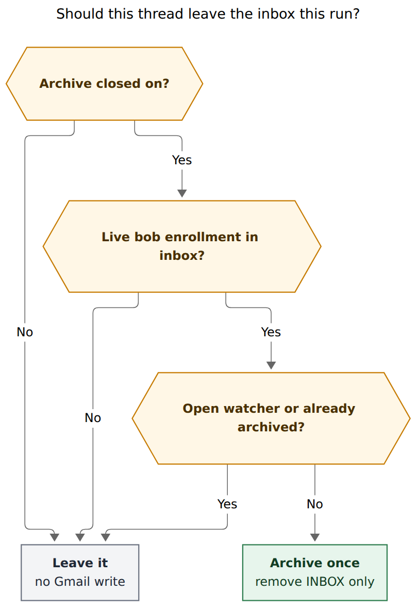
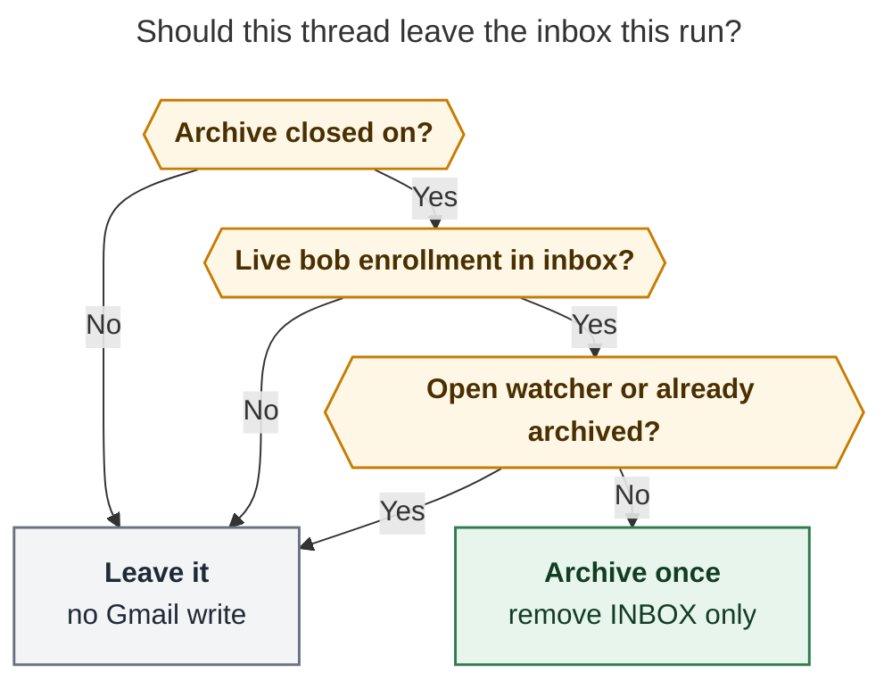
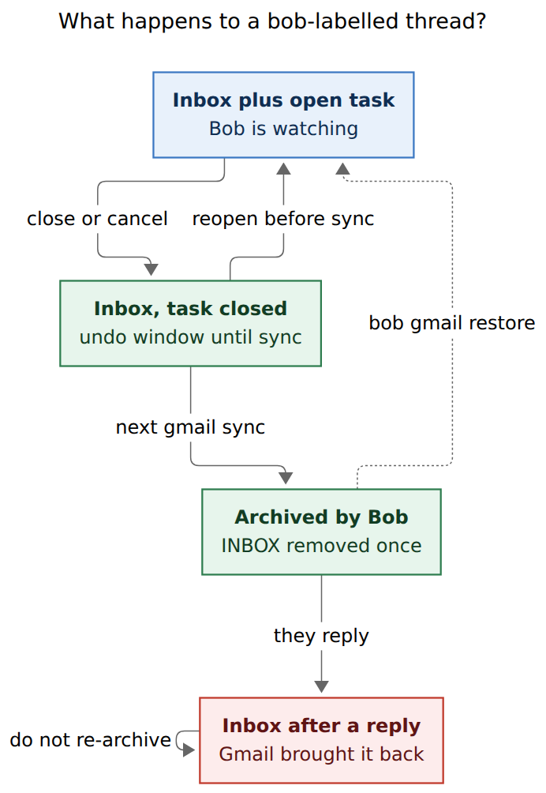
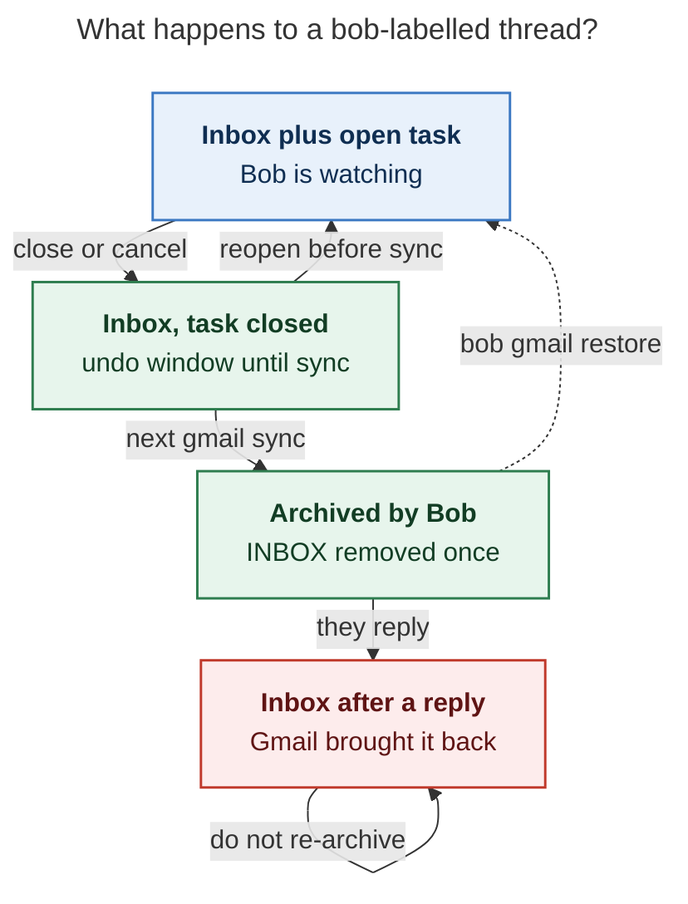

# Archive a Bob-managed Gmail thread once its task closes

> **Research query.** Make `bob gmail sync` archive a Gmail thread when that
> thread was labelled `bob` and its corresponding Obsidian task has been
> closed. Make the archive impossible to miss. Lead the design so it is
> intuitive, reliable, and beautiful. Critique the plan, call out justified
> requirement adjustments, and end with a recommended solution.

**Researcher.** `grk` (independent swarm report).
**Date.** 2026-11-12.
**Scope.** Research only. No bob-cli, plugin, chezmoi, vault, or memory
files were changed. This file is the deliverable. Peer swarm reports from
this invocation were not read.

**Primary evidence.**
`docs/gmail.md` (sync is Gmail-read-only; enrollment is durable; watch
ends when every linking task is closed, cancelled, or deleted; cron is
`bob gmail sync -q` hourly at `:07` on the Mac; quiet keeps filings and
failures; compose is a previewed, digest-bound mutation);
`docs/gmail.md` I1-era contract: "The label stays in Gmail: sync uses
read-only access and never unlabels, archives, marks read, or changes a
message";
`src/native/gmail/sync/{mod,command,scan,enroll,report}.rs` (open watchers
are `[ ]` `[*]` `[/]` `[?]`; enrollment is `gmail.filed` /
`gmail.adopted` / legacy `gmail.pulled`; archive is absent);
`src/native/gmail/{gog,login,cli,config}.rs` (read allowlist, compose as
the only mutation, `LoginScope::{Readonly,Compose}`, `--enable-commands-exact`
for drafts and send);
`src/native/freshness/placement.rs` (closed = `x` / `X` / `-`);
`docs/gkeep.md` (verify-then-archive, `-n/--no-archive`, journaled
`archived` events, never delete);
`docs/vault-git-sync.md` (Mac `bob-gmail-sync` at `:07`; vault-sync
notifies with `osascript` / `notify-send`);
`plan:202611/bob_gmail.md` invariant I1 and deferred "Unlabel after a
verified pull";
`plan:202611/gmail_sync_reply_watch.md` ("Bob never writes to Gmail";
mutations deferred to bead `bob-cli-i4`);
bead `bob-cli-i4` (opt-in *unlabel after pull*, still READY, needs
`gmail.modify`);
decisions `gmail-reply-wait-is-a-tagged-hold`,
`unblocked-tasks-are-offered`, `bob-gcal-is-read-only-and-proposes-once`;
`cli_rules.md`.

**External evidence.**
gog opened as `gh:openclaw/gogcli`: `gog gmail archive --thread` (since
v0.25.0, well below Bob's ≥ v0.44.0 floor) calls
`users.threads.modify` with `removeLabelIds: ["INBOX"]` and has
`--dry-run`; `gog gmail thread modify --add INBOX` is the restore;
`--gmail-scope` is `full|readonly|send|read-send` (`full` is
`gmail.modify` plus settings — too wide for Bob);
[Gmail API `threads.modify`](https://developers.google.com/workspace/gmail/api/reference/rest/v1/users.threads/modify)
(requires `gmail.modify` or `mail.google.com`; applies to every message
in the thread);
[Gmail API scopes](https://developers.google.com/workspace/gmail/api/auth/scopes)
(`gmail.modify` is restricted, same class as `gmail.readonly` and
`gmail.compose`; `gmail.labels` is non-sensitive and does **not** let you
put labels on messages);
[Gmail labels guide](https://developers.google.com/workspace/gmail/api/guides/labels)
(archive is the absence of `INBOX`; new messages do not inherit a
thread's labels);
[Archive Gmail messages](https://support.google.com/mail/answer/6576)
("If someone replies to a message you archive, it returns to your
inbox");
Keep's verify-then-archive as Bob's existing Google-archive pattern.

Live `label:bob` counts were not taken: this agent host has no
`bob-gmail` OAuth client (writer/compose stay on the Mac, as designed).

Mermaid CLI `@mermaid-js/mermaid-cli@12.0.0`. Decision figure 538×784 px,
fit 100%. Lifecycle figure 461×670 px, fit 100%.

---

## Bottom line

**Build it, but as a one-shot inbox drain with a loud receipt, not as a
continuous "keep archived iff the task is closed" loop.**

Closing a Bob-managed mail task is already the gesture that ends the
watch. Leaving the thread in Gmail's inbox after that is a second
done-pile. Archiving it — removing `INBOX`, keeping every other label,
keeping the mail note — is the Gmail-native way to say the same thing
the checkbox just said. Gmail's own Send & Archive, Keep's
verify-then-archive, and Bob's confirmed-send preview all rhyme: a
chosen object leaves the inbox after the vault has the work.

The requested biconditional is the part I would not ship. If Bob
re-archives every closed labelled thread on every hourly run, a
recruiter's follow-up that Gmail just put back in the inbox is gone
again within the hour. That is the harm the prompt names. The safe
shape is **archive once, on the close transition, then stop.** A later
reply is Gmail's job to unarchive. Bob does not fight that.

The close is consent. Sync is the executor. The hourly cron gap is the
undo toast. The notification, the sync row, and `bob gmail restore` are
the receipt.

---

## Is this a good idea?

Yes, with the adjustments below. The current Gmail loop is three-quarters
done:

1. Label `bob` (and an optional route) on the phone.
2. `bob gmail sync` files a task and watches the thread.
3. A send holds; a reply lifts; closing the task ends the watch.
4. **The email stays in the inbox anyway.**

Step 4 is why the request exists. You already treat the checkbox as
"I am done with this conversation." Gmail's archive is the matching
mailbox gesture: the thread remains searchable under All Mail and under
`bob`, and a real reply comes back on its own
([Gmail Help](https://support.google.com/mail/answer/6576)).

Where the request needs pushback:

| Concern | Why it matters | What I would do |
| --- | --- | --- |
| Continuous `iff` | Gmail puts a new reply back in the inbox. Re-applying archive on the next sync hides that reply. | One-shot: journal `gmail.archived`, never archive that thread again unless the task is reopened and closed again. |
| Close-time Gmail write | Capture and the plugins must not touch the network (`plan:202611/bob_gmail.md` I2). Close happens in many UIs, often offline, often off the writer host. | Close is consent only. `bob gmail sync` on the Mac writer is the only mutator. |
| Historical backlog | Enabling the feature against today's closed, still-labelled, still-inbox threads would archive a pile Bryan has not re-consented to. | Opt-in config, default off; the first live run after enable is a preview until an explicit confirm; only closes observed after enable, plus that confirmed backlog. |
| `gmail.modify` | Restricted scope. It can also trash, mark read, and retag anything. Compose cannot archive. `gmail.labels` cannot put labels on messages. | Third login scope `-s modify` on the Mac only; gog `--enable-commands-exact gmail.archive`; extra-scope `gmail.modify` only, never gog's `--gmail-scope full` (that also requests settings). |
| Bead `bob-cli-i4` | That bead unlabels `bob` after filing so the phone's `bob` view stays a to-file queue. The requested predicate uses the live `bob` label at close time. | Keep `bob` through archive in v1. Treat i4 as a sibling, not this feature. Nested `bob/live` / `bob/done` can unify them later. |
| Quiet hourly cron | `bob gmail sync -q` swallows ordinary rows. An archive that only prints in an unattended log is a silent mailbox mutation. | Archive rows break quiet, fire a desktop notification, and surface in the morning Ledger Tools JSON Notice. |
| Invariant I1 | The Gmail epic and the watch plan both say Bob never writes to Gmail except previewed drafts. This feature is the first inbox mutation. | A new decision record, a `feat(gmail)!:` subject, doctor that names the grant, and the same allowlist discipline send already uses. |

The idea is good because it extends a rule you already have — **a label
starts the watch; closing the task stops it** — one step into Gmail,
with Gmail's own reversible primitive. It is a bad idea as a silent
cron side effect or as a standing invariant that re-sweeps the inbox.

---

## Requirement adjustments

Each item changes or sharpens what you asked for.

| # | Requested | Adjusted to | Why |
| --- | --- | --- | --- |
| A1 | Archive **iff** labelled `bob` and the task is closed (a standing invariant) | **One-shot** on the close transition. Journal `gmail.archived`. Do not re-archive after Gmail returns a reply to the inbox. | Continuous iff is the recruiter-harm loop. Gmail Help: a reply to an archived thread returns it to the inbox. |
| A2 | "The corresponding task has been closed" | **No open watchers** on that thread: every linking `#task` is `[x]` / `[-]`, or the last linker was deleted. Several tasks: archive only when all of them have left the watch set. | Watch already derives membership this way (`scan.rs` `OPEN_STATUSES`). Scanning every closed row is extra and still misses deletions. |
| A3 | Live `bob` label as the only Gmail predicate | **Enrolled** (`gmail.filed` / `gmail.adopted` / legacy `gmail.pulled`) **and** the thread still carries `gmail.sync.label` **and** currently has `INBOX`. | Enrollment is the durable "Bob took this on." The live label is the remaining consent-to-automate signal: if you peeled `bob` off, Bob keeps its hands off the mailbox. Unenrolled closed mail is ignored. |
| A4 | Automatic, no extra gesture | Opt-in `gmail.sync.archive_closed` (default `false`). Login `-s modify` on the Mac writer. Closing the task is the per-thread consent; the config plus the grant is the policy consent. | Matches compose (grant is off until you ask) and Keep (`-n/--no-archive`). Protects the historical backlog. |
| A5 | Run inside `bob gmail sync` | Yes: **after** filing and watch apply on the writer host. Same run must not archive a thread it just filed. Dry-run plans `would_archive`. `-n/--no-archive` skips the phase. | Filing creates an open watcher, so order is free safety. Writer pin already gates live sync. |
| A6 | Super-clear when it happens | Three layers: (1) close-time Obsidian toast, no Gmail write; (2) sync row that quiet cannot swallow, plus a desktop notification and a morning Notice; (3) `bob gmail restore` for last batch or a named thread. | Cron has no TTY. Send already uses preview-plus-undo. Vault-sync already has `osascript` / `notify-send`. |
| A7 | Archive the "corresponding email" | **Thread-level** `gog gmail archive --thread <id>` (`users.threads.modify`, remove `INBOX` only). Do not mark read, mute, trash, or unlabel `bob`. | Gmail has no archive flag; archive is the absence of `INBOX`. Mute would hide the recruiter reply. Message-level archive can split a conversation. |
| A8 | (unspecified) reopen / undo | Reopen **before** the next sync cancels the pending archive for free (hourly `:07` window). After archive, restore is explicit. Reopen does not auto-unarchive. | Auto-unarchive on reopen dumps mail you closed on purpose. Gmail will still unarchive a real reply. |
| A9 | (unspecified) first enable | First live run after flipping the config **previews** the backlog (`would_archive`) and writes nothing until `bob gmail sync --archive-backlog` (or a TTY confirm). Later closes archive automatically. | The dangerous run is the first one. |
| A10 | (unspecified) recurring / `#awaiting_reply` / turn | Recurring rows that stay open still watch, so they never archive. A closed awaiting row archives: you closed it. A closed `turn: yours` row archives: you closed it. | The checkbox is the override. Skipping "ball in your court" second-guesses a close. |
| A11 | (implicit) same as unlabel-after-pull | **Separate** from bead `bob-cli-i4`. v1 keeps the `bob` label so All Mail + `label:bob` is still the Bob-owned set. | i4's live-label drain would make A3's predicate false at close time. |

---

## Recommended design

### The rule, in one sentence

When `gmail.sync.archive_closed` is on, the Mac writer is logged in with
`gmail.modify`, and `bob gmail sync` sees an enrolled thread that still
carries `bob`, still has `INBOX`, has no open watchers, and has no
`gmail.archived` journal event, it removes `INBOX` from every message in
that thread, once, and tells you.

**Reader question:** Should this thread leave the inbox this run?

**Caption:** Archive only a live, enrolled, still-labelled, still-inbox
thread with no open watcher, and only the first time. Every other case
is a no-op.



Rendered size: 538 × 784 px; fit scale: 100%.



"Live bob enrollment in inbox" means all three: a journal enrollment
event, the enrollment label still on the thread, and `INBOX` still on
the thread. "Already archived" means Bob's journal, not Gmail's All
Mail view — a thread you archived by hand stays out of Bob's way, and a
thread Gmail unarchived after a reply stays out of Bob's way too.

**Reader question:** What happens to a bob-labelled thread?

**Caption:** Closing the task opens an undo window until the next sync;
that sync archives once; a later reply returns the thread to the inbox
and Bob leaves it there.



Rendered size: 461 × 670 px; fit scale: 100%.



The dashed restore path is explicit. The red node is the safety valve,
not a failure: Gmail did the right thing, and Bob must not undo it.

### Why sync, not the close gesture

The Gmail epic's I2 still holds: capture parse, dry-run, and submit make
zero Gmail calls. Ctrl+Enter, a checkbox click, a Task Card commit, and
a capture close all happen in Obsidian, often on a host that must not
hold `gmail.modify`, often with the vault lock already busy. Sync
already has the writer pin, the per-account guard, the coordinated gog
runner, the enrollment fold, and the watch snapshot. Archive is a
fourth phase of that pipeline, after filing and watch apply so a thread
filed *this* run still has an open watcher and cannot archive itself.

The hourly `:07` job is the undo toast. Reopen the task before the next
run and the watcher comes back; the planner no-ops. That is the same
shape as Keep's "verify, then archive" and send's "preview, then
confirm," stretched to the cadence you already run.

### The Gmail primitive

Archive is not a folder and not a delete. It is `removeLabelIds:
["INBOX"]` on the thread
([`users.threads.modify`](https://developers.google.com/workspace/gmail/api/reference/rest/v1/users.threads/modify)).
gog already wraps that as a first-class command, with dry-run:

```text
gog --no-input --json --color never --client bob-gmail --account EMAIL \
    --gmail-no-send --enable-commands-exact gmail.archive \
    gmail archive --thread THREAD_ID
```

Pass only explicit thread ids. Never pass gog's `--query` archive; that
path can sweep an unbounded match. Restore is the inverse, equally
narrow:

```text
gog … --enable-commands-exact gmail.thread.modify \
    gmail thread modify THREAD_ID --add INBOX
```

Keep `--gmail-no-send`. Omit `--readonly`. Mirror send: there is no
general mutating gog runner. The fake gog in `tests/gmail_support/fake_gog.py`
gains `gmail archive --thread` and `gmail thread modify` recordings the
same way it records `gmail drafts send`.

Do not mark `UNREAD` gone. Do not add `TRASH`. Do not mute (mute is how
replies *stay* out of the inbox). Do not strip `bob`. Starred mail stays
starred and remains in Starred.

### Scope and login

| Grant | What it can do | Enough to archive? |
| --- | --- | --- |
| `gmail.readonly` | Read | No |
| `gmail.compose` | Drafts and send | No |
| `gmail.labels` | Create/edit label *definitions* | No |
| `gmail.modify` | Read, compose, send, label messages, trash (not skip-trash delete) | Yes |
| `mail.google.com` | Full, including skip-trash delete | Too much |

`bob gmail login -s modify` on the Mac requests
`https://www.googleapis.com/auth/gmail.modify` as an extra scope on the
isolated `bob-gmail` bucket, the way `-s compose` already adds
`gmail.compose`. Doctor `scopes` becomes `readonly`,
`readonly+compose`, or `modify` (modify covers read, compose, send, and
archive). Agent hosts stay read-only. Config `archive_closed: true`
without the grant is a setup error with the login hint, exit 2, and
zero Gmail writes.

Do not use gog `--gmail-scope full`. That mode also asks for
`gmail.settings.basic` and `gmail.settings.sharing`. Extra-scope only
`gmail.modify`.

`gmail.modify` is restricted, same class as the grants Bob already
holds. For a personal Desktop-app client this is the same unverified-app
story as compose.

### Config, CLI, and JSON

```yaml
gmail:
  sync:
    archive_closed: false  # default; true enables the phase
```

On `bob gmail sync`:

- `-n/--no-archive` skips the phase for one run (Keep's spelling).
- `--archive-backlog` is the one-time confirm that archives the
  previewed historical set after enable.
- `-d` plans `would_archive` / `would_restore` with no gog mutation.
- `-q` still prints archive rows and still notifies. Quiet is for "nothing
  new," and an archive is something new.

New subcommand, nested under the `gmail` noun:

```bash
bob gmail restore [NOTE|THREAD]...
bob gmail restore          # last batch, host-local, 24h window
```

Alphabetical with `reply` / `save` / `search` / `send` / `sync`. Give
`--dry-run` / `-d` and `--format` / `-f` as elsewhere.

JSON stays `schema_version: 1` with an additive `archive` array and
`summary.archived`, same way watch was added on top of pull:

```json
"archive": [
  {
    "thread_id": "1a0b9eb2cc26ab96",
    "note": "mail/2026/261103_lease_renewal.md",
    "status": "archived",
    "subject": "Lease renewal",
    "who": "Ada"
  }
],
"summary": { "watching": 4, "awaiting": 1, "archived": 2 }
```

Statuses: `archived`, `would_archive`, `already_archived`,
`pending_backlog`, `skipped`, `failed`. Subject and who are the same
inert mail-metadata already used in watch rows; bodies never enter the
document (I7).

Human header:

```text
✉ gmail sync · 14:07 · watching 4 threads · 1 awaiting reply · archived 2
```

Human row, success ink, same family as `filed`:

```text
  ✉ archived  Lease renewal · Ada
```

A failed archive is a warning with `kind` and a hint, and it does not
block filing or watch for other threads.

This is a contract break against today's "never archives" sentence in
`docs/gmail.md`. Subject: `feat(gmail)!: archive closed bob threads once`.

### Visibility: make it unmissable

Silent archive is the failure mode. Three layers, each using a channel
Bob already has.

**1. Close time (before any Gmail write).** When a managed Done or
cancel lands on a row that watches an enrolled mail note, Ledger Tools
shows a Notice:

```text
✉ Lease renewal leaves Gmail's inbox at the next Bob sync
Reopen the task to keep it · usually within the hour
```

No network. No writer pin. The plugin already knows the line is a mail
link (mail-link marks). This is the successor-offer pattern: the
consequential extra step is named at the gesture, and the gesture itself
still only writes the vault.

**2. Execution time (the mutation).** Even under `-q`:

- the archive rows print;
- `osascript` on macOS / `notify-send` on Linux, same helper
  vault-sync uses, title `Bob Gmail`, body
  `Archived 2 emails · Lease renewal · Ada, Recruiter · Jane · Undo: bob gmail restore`;
- Ledger Tools' existing morning `bob gmail sync -q -f json` decodes
  `archive[]` and shows a Notice on `archived > 0`.

**3. Durable receipt.**

- Journal event `gmail.archived` (identity, note path, host, ts — no
  subject in the journal, matching I7; the report can join subject from
  the mail-note index at print time).
- Mail-note frontmatter `archived: YYYY-MM-DD`, next to `turn` /
  `turn_since`. Display-only in `mail.base`: a "Cleared from inbox"
  filter.
- Host-local `$XDG_STATE_HOME/bob/gmail/last-archive.json` for
  last-batch restore.
- `bob gmail doctor` `sync` line: `archived 2 since yesterday` when
  the journal grew.

The beautiful part is the rhyme with Gmail itself: the thread still
shows under the `bob` label, still shows in All Mail, still has its
mail note, and the inbox is the list of conversations whose tasks are
still open.

### Planner details

Candidates are computed from data sync already has, plus one labels
read:

1. Enrollment fold: every enrolled key for this account.
2. Watch snapshot *after* apply: keys with zero open watchers.
3. Thread metadata already fetched for watch, plus a labels presence
   check (`INBOX` and the enrollment label). Unwatched enrolled threads
   are not currently fetched every run; the archive phase must fetch
   metadata (labels only, not bodies) for the unwatched-and-not-yet-
   archived subset. Bound it, pace it, reuse `CoordinatedRead`.
4. Journal: skip keys with `gmail.archived` (or a later
   `gmail.restored` followed by a *new* close — see reopen below).
5. Enable timestamp: skip closes that predate `archive_closed: true`
   unless `--archive-backlog`.

Reopen then re-close: a `gmail.restored` event, or a new open watcher
appearing after `gmail.archived`, clears the one-shot so a later close
may archive again. A reply that only adds `INBOX` does not.

Failures are per thread. Invalid grant aborts the archive phase and
leaves filing/watch results in place, the way an invalid grant already
aborts writes. Partial success journals only the threads that actually
lost `INBOX` (read labels back, or trust gog's per-id `success`).

Quota is not a v1 concern: `threads.modify` is cheap next to the
`threads.get` watch already does, and the closed-unwatched set is the
watch set's complement, small.

### What this is not

| Alternative | Why it loses |
| --- | --- |
| Close-time Gmail call | Breaks I2; wrong host; no guard; no dry-run pipeline. |
| Continuous re-archive | Hides the reply Gmail just restored. |
| Mute | Gmail's way to *keep* replies out of the inbox. |
| Trash | 30-day clock; the prompt's harm case becomes real data loss. |
| Unlabel `bob` instead of archiving | That is i4 (phone queue). The inbox still shows the thread. |
| Archive and unlabel together in v1 | Mixes two policies; loses `label:bob` as the Bob-owned set. |
| Per-thread confirm on cron | Cron cannot confirm. Close plus opt-in plus restore is the confirm. |
| Default on | First upgraded cron would archive the backlog. |
| Auto-unarchive on reopen | Reopening to add a note would bounce mail into the inbox. |
| Capture letter `=a` vs `=x` | Extra gesture. The request is automatic on close. A later alias can mean "close and keep in inbox." |
| Gmail filter `label:bob` → skip inbox | Would archive threads whose tasks are still open. |

---

## Conflict with bead `bob-cli-i4`

`bob-cli-i4` is READY, large, titled "Opt-in unlabel of the Gmail bob
label after a verified bob gmail pull." It wants the phone's `bob` label
to stay a *to-file* queue. The watch plan named "Gmail mutations of any
kind (unlabel, archive, a waiting label)" as that bead's bucket.

These are two different drains:

| Drain | Signal | Effect | Who it serves |
| --- | --- | --- | --- |
| i4 unlabel-after-file | Successful `gmail.filed` | Remove `bob` | Phone label view |
| This feature | Close / no open watchers | Remove `INBOX` | Desktop inbox |

If i4 lands first and this feature keys off the *live* `bob` label, closed
threads would never archive. If this feature keeps `bob` forever, i4's
phone queue still grows (archived labelled mail still appears under that
label in Gmail, which is normal and useful).

v1 of *this* feature keeps `bob` and archives. File a new bead; do not
overload i4. A later unifying design is nested labels:

- `bob` — capture / to-file (i4 can then unlabel the parent after file)
- `bob/live` — applied at enrollment, removed at archive
- `bob/done` — applied at archive, breadcrumb in Gmail

That unification is not required to ship inbox drain.

---

## Implementation plan

1. **Decision record** via `/sase_memory_write` when the epic is planned:
   "A closed mail task archives its Gmail thread once." Covers one-shot,
   live-label-plus-enrollment predicate, opt-in, Mac writer, exact
   allowlist, restore, and the I1 amendment. Rejected alternatives as
   in the table above. Cite this report, `docs/gmail.md`, gog
   `gmail archive --thread`, and Gmail Help on reply-unarchive.
2. **Login and doctor (S).** `LoginScope::Modify`, extra-scope
   `gmail.modify`, doctor `scopes` and a new `archive` check (config,
   grant, last-batch age). Docs: `guides/connect-google-mail.md`.
3. **Planner (M).** Pure function over enrollment + post-apply watch
   snapshot + label ids + journal + enable timestamp. Unit tests for
   every skip in the decision figure, multi-task threads, same-run
   filing, backlog gating, and restored-then-reclosed.
4. **Mutator (M).** `Gog::archive_thread` / `restore_thread` with the
   exact allowlist, `--gmail-no-send`, no `--readonly`, paced, per-id
   success. Fake gog coverage. Never `gmail archive --query`.
5. **Sync phase, report, JSON (M).** After watch apply. `-n`,
   `--archive-backlog`, quiet-breaking rows, header count. JSON
   `archive[]` + `summary.archived`. `feat(gmail)!:`. `just docs-gen`.
6. **Receipts (S).** `gmail.archived` / `gmail.restored` journal;
   mail-note `archived:` date; host-local last-batch file; doctor line.
7. **`bob gmail restore` (S).** Last batch or named note/thread. Dry-run.
   Adds `INBOX` back. Alphabetical help.
8. **Notify (S).** Reuse vault-sync's `osascript` / `notify-send`
   helper, Bob Gmail title, undo instruction, inert subject/who.
9. **Plugin (M, bob-plugins).** Close-time Notice on a mail-watching
   row; morning JSON Notice when `archive[]` is non-empty. Display-only
   otherwise. Tests with stubbed `bobSpawnJson`.
10. **Chezmoi (S).** `gmail.sync.archive_closed: false` in
    `config.yml` with a comment pointing at `docs/gmail.md`. Do not
    flip it on in the same change as the code; Bryan opts in after
    `login -s modify` and one `-d` run.
11. **Rollout checklist for Bryan.**
    1. `bob gmail login -s modify` on the Mac; tick the modify grant.
    2. `bob gmail doctor` until `scopes` is `modify`.
    3. Set `gmail.sync.archive_closed: true`.
    4. `bob gmail sync -d` and read `would_archive` (the backlog).
    5. Either `bob gmail sync --archive-backlog` for that set, or leave
       it; new closes archive on the next hourly run.
    6. Close a test `bob` thread's task, wait for `:07` or run sync,
       confirm the notification, then `bob gmail restore`.
    7. Send a reply to an archived test thread; confirm it returns to
       the inbox and the next sync leaves it there.

---

## Open questions

1. **Backlog confirm spelling.** `--archive-backlog` on sync (recommended:
   one command family) versus a dedicated `bob gmail archive --backlog`.
2. **Close-time Notice in v1.** Recommended yes: it is the only
   visibility that happens *while you are looking at the task*. If the
   plugin phase slips, ship CLI notify first; do not ship the mutator
   with only a quiet log line.
3. **Keep-in-inbox override.** A later `#keep_inbox` tag, or a capture
   close alias, for the rare "done in Bob, still want it in Gmail." Not
   v1. Reopen-before-sync and `restore` cover the mistake case.
4. **Unify with i4.** Nested `bob/live` + `bob/done` later, or leave
   `bob` on forever. I would not delay inbox drain on that discussion.

---

## Recommended solution

Ship **one-shot archive-on-close** as an opt-in fourth phase of
`bob gmail sync`, on the Mac writer, behind `gmail.modify`.

- **Consent.** Policy: `gmail.sync.archive_closed` plus `login -s modify`.
  Per thread: closing or cancelling the last open watcher. Historical
  backlog waits for `--archive-backlog`.
- **Execute.** After filing and watch apply, `gog gmail archive --thread`
  with an exact allowlist, `--gmail-no-send`, and no `--query`. Remove
  `INBOX` only. Keep `bob`. Keep unread. Keep the mail note.
- **Once.** `gmail.archived` is the tombstone. Gmail may put a reply
  back; Bob does not take it back out.
- **Undo.** Reopen before the next `:07` run, or `bob gmail restore`.
- **Show it.** Close-time Notice; quiet-breaking `✉ archived` rows;
  desktop notification; morning JSON Notice; doctor; `archived:` on the
  mail note.

It is **intuitive**: the checkbox you already click is the archive
button, delayed to the sync you already run. It is **reliable**:
enrollment, the watch snapshot, and a journaled one-shot are all
existing shapes; gog already has the primitive; failures stay per
thread; tests never touch Google. It is **beautiful**: the inbox
becomes the list of conversations whose tasks are still alive, the
`bob` label remains the Bob-owned set, a reply can still reach you, and
every archive leaves a receipt you can read in the same ✉ voice as
filing and awaiting-reply.

Do not ship a standing "keep archived iff closed" sweeper. That is how
a closed recruiter thread that just got a new message disappears again.

---

## Sources

**bob-cli.** `docs/gmail.md` (Sync, Watch, Security, Where it runs,
Commands); `docs/gkeep.md` (verify-then-archive, `-n/--no-archive`);
`docs/vault-git-sync.md` (Mac `bob-gmail-sync` `7 * * * *`,
`osascript` / `notify-send`); `docs/mail-link-marks.md`;
`docs/reference/json-outputs.md` (`bob gmail sync` schema 1);
`src/native/gmail/sync/{mod,command,scan,enroll,report}.rs`;
`src/native/gmail/{gog,login,cli,config,doctor}.rs`;
`src/native/freshness/placement.rs` (`x`/`X`/`-`);
`src/native/vault_sync.rs` (`send_sync_notification`);
`tests/gmail_support/fake_gog.py`.

**Plans, beads, memory.** `plan:202611/bob_gmail.md` I1, I2, I7, §6
unlabel follow-up; `plan:202611/gmail_sync_reply_watch.md` (never write
Gmail; mutations → `bob-cli-i4`); bead `bob-cli-i4`;
`research:202611/gmail_sync_reply_watch/gmail_sync_reply_watch.md`;
decisions `gmail-reply-wait-is-a-tagged-hold`,
`unblocked-tasks-are-offered`; `cli_rules.md`.

**gog (`gh:openclaw/gogcli`).**
`docs/commands/gog-gmail-archive.md`;
`internal/cmd/gmail_archive.go` (`Threads.Modify`, `RemoveLabelIds:
INBOX`, `--thread`, `--dry-run`);
`docs/commands/gog-gmail-thread-modify.md`;
`docs/commands/gog-auth-add.md` (`--gmail-scope full|readonly|send|read-send`);
CHANGELOG 0.25.0 / #752 (`gmail archive --thread`).

**Google.**
[threads.modify](https://developers.google.com/workspace/gmail/api/reference/rest/v1/users.threads/modify);
[scopes](https://developers.google.com/workspace/gmail/api/auth/scopes);
[labels](https://developers.google.com/workspace/gmail/api/guides/labels);
[Archive messages](https://support.google.com/mail/answer/6576).
