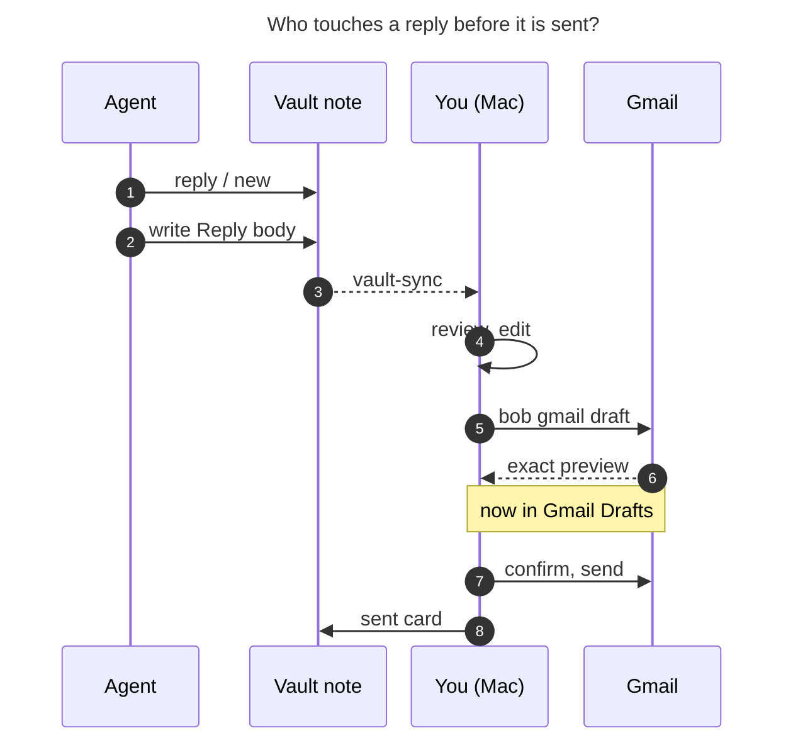

# Drafting the Dan and Sam replies with `bob gmail`: what you will see

_Snapshot of `bob` 0.4.0 on master `0869f792`, 2026-11-06. Epic `bob-cli-hg` is open:
`new`, `reply`, and `draft` have shipped. `send` (`bob-cli-hg.12.1.5`) and the Bob Mail
buttons (`bob-cli-hg.13`) are still in progress._

> This repo is public, so this report uses placeholders only. It contains no
> addresses, company names, or email text. The real reply text lives in the vault
> notes named in §5.

## TL;DR

- **An agent can write the reply, but only your Mac can turn it into a Gmail draft.**
  `bob gmail new` and `bob gmail reply` write vault notes and never contact Gmail.
  `bob gmail draft` needs the isolated `bob-gmail` grant with the **compose** scope,
  which by design exists only on the Mac (`docs/gmail.md` § Where it runs). Agent hosts
  have no Gmail write access at all.
- **Sam's reply** is a `## Reply` section at the bottom of his saved mail note, because
  his thread is already in the vault. **Dan's reply** is a standalone compose note,
  because his thread is not saved yet (see §5 for the threaded alternative).
- **Approval has two layers.** First, `bob gmail draft` reads the stored Gmail draft
  back and prints an exact preview, with a digest of its contents. The draft then shows
  in Gmail Drafts on every device. Second, the upcoming `bob gmail send` sends only after
  you answer `y` to that preview or pass its digest. Until `send` lands, you send from
  Gmail yourself.

## 1. What has shipped and what is still coming

| Piece                                                         | State                        | Bead                  |
| ------------------------------------------------------------- | ---------------------------- | --------------------- |
| `bob gmail new` / `reply`: local compose and Reply notes      | **Shipped** (installed)      | `bob-cli-hg.12.1.1`   |
| Markdown → email rendering, syntax refusals, attachments      | **Shipped**                  | `bob-cli-hg.12.1.2`   |
| `bob gmail draft`: create/update draft and show exact preview | **Shipped**                  | `bob-cli-hg.12.1.3`   |
| Recovery after a crashed or timed-out send                    | **Shipped**, internal only   | `bob-cli-hg.12.1.4`   |
| `bob gmail send`: confirmed send, sent card, note cleanup     | In progress                  | `bob-cli-hg.12.1.5`   |
| Bob Mail plugin: Reply, Save draft, Send modal with Undo      | In progress                  | `bob-cli-hg.13`       |

## 2. Who does what



_Figure 1. The agent's work ends at the vault note. Steps 5–6 run on your Mac today.
Steps 7–8 arrive with `bob gmail send`; until then, you send the draft from Gmail._

## 3. What you see, step by step

### 3.1 In Obsidian: the reply sits in the note

**Sam (reply to a saved thread).** `bob gmail reply` appends one section after the
managed conversation block. Nothing above that block changes, including `## Notes`.

```text
# <Sam's thread subject>
[Open in Gmail ↗] · Sam ↔ you · 2 messages · Nov 3 → Nov 6

## Notes                      ← yours; never sent
## Conversation
  ┌ Sam · Tue, Nov 3 ─────────────────────── (blue card, folded) ┐
  ┌ Sam · Fri, Nov 6 ─────────────────────── (blue card, open)   ┐
<!-- bob:gmail:end -->

## Reply                      ← the agent's draft; edit freely
Hi Sam, …
Best,
Bryan
```

**Dan (standalone compose note).** `bob gmail new` creates
`mail/2026/261106_<subject_slug>.md` and opens with frontmatter that you can edit:

```yaml
parent: "[[mail]]"
type: "[[mail]]"
cssclasses: [bob-mail]
status: draft
to: ["Dan <dan@example.com>"]
cc: []
bcc: []
subject: "Re: <Dan's thread subject>"
attachments: []          # vault paths, e.g. a CV PDF
```

Everything below the H1 is the message, except an authored `## Notes` section, which
never leaves the vault. Edit the Markdown as much as you like. Only §3.2 sends anything
to Gmail.

### 3.2 On the Mac: `bob gmail draft NOTE` (available now)

`bob gmail draft NOTE` renders the Markdown into plain-text and HTML parts, then creates
the Gmail draft (or updates the one already recorded). It reads the stored draft back
from Gmail and prints exactly what Gmail holds:

```text
$ bob gmail draft 261103_<sam_thread_slug>
Draft r-48213… · 9f3c1e…a07b            ← draft id · preview digest (illustrative)
From: Bryan Bugyi <bryan@…>
To: Sam <sam@…>
Subject: Re: <Sam's thread subject>

Hi Sam,

Thanks for reaching out …
…
Best,
Bryan
<your Gmail signature>                  ← gmail.signature: gmail (default)
```

After this command:

- **Gmail Drafts** shows the draft, in Sam's thread, on your laptop and phone. A reply
  draft is created from Sam's exact Gmail message ID, and Bob checks that Gmail kept it
  in his thread.
- **The note** records the draft ID. A Reply section gets a
  `<!-- bob:gmail:draft <id> -->` marker. A compose note gets `gmail_draft_id:` in its
  frontmatter. If you edit the note and run `draft` again, Bob updates **the same**
  draft rather than creating a second one.
- **Edits made in Gmail are protected.** If you change the draft in Gmail and then rerun
  `draft`, Bob reports a conflict. It does not overwrite your Gmail edit.

When the body uses syntax Bob won't send, the command refuses and names the problem
type and line number, without quoting any text. Refused syntax includes task
checkboxes, `^block-ids`, `[field:: value]`, Dataview/Tasks/Templater blocks, non-http
links, remote images, and undeclared embeds. `[[wikilinks]]` are sent as their plain
visible text, and the preview lists each one.

### 3.3 Sending

**Today (before `send` lands).** Open the draft in Gmail, on the web or your phone, and
press Send. Bob is not involved in that send. A later `bob gmail save NOTE` adds your
sent message to the conversation. Then delete the `## Reply` section yourself, or keep
it as a record.

**Soon: `bob gmail send NOTE` (`bob-cli-hg.12.1.5`).** The approval steps are designed
as follows:

```text
$ bob gmail send 261103_<sam_thread_slug>
  (updates the draft, prints the same exact preview as above)
Send this draft? [y/N] y
✓ sent                                  (illustrative; final wording may differ)
```

- **Terminal.** Only `y` sends. Enter, `N`, or end-of-input keep the draft.
- **Scripts and agents (no terminal).** A send needs `-c <digest>` matching the current
  preview. Without it, the command sends nothing: the draft stays, the command exits 2,
  and it prints the exact command to confirm. If you edited the note after the preview,
  the digest no longer matches. The send then stops with `confirmation_mismatch` and
  asks you to preview again.
- **`-d`** previews only and never sends.
- **After the send.** A green `[!mail-sent]` card appears in the conversation and the
  `## Reply` section is removed. A compose note like Dan's is turned into that thread's
  mail note at the same path.

**Soon: Bob Mail in Obsidian (`bob-cli-hg.13`).** This is the same flow behind buttons:

```text
┌─ Send email? ─────────────────────────────────────────┐
│ From     Bryan Bugyi                                  │
│ To       Sam                                          │
│ Subject  Re: <Sam's thread subject>                   │
│ ───────────────────────────────────────────────────── │
│ Hi Sam,                                               │
│ Thanks for reaching out …                             │
│ ───────────────────────────────────────────────────── │
│ Attachments: none · Flattened links: none             │
│                              [ Cancel ]  [ Send ]     │
└───────────────────────────────────────────────────────┘
          → toast: "Sending in 5s…  [Undo]"
```

Commands: **Reply**, **Reply all**, **New email**, **Save draft**, which runs
`bob gmail draft`, and **Send**. Send saves the note, then runs `send -d -f json`. It
renders that preview exactly as returned. Clicking Send starts a 5-second Undo countdown
(the `undoSeconds` setting). Only after that does it run `send -c <digest>`. If the
digest no longer matches, the modal shows a fresh preview instead of sending.
Double-clicks cannot start two sends.

## 4. The lifecycle and its safety stops

```mermaid
---
title: "What states does a reply pass through before it is sent?"
accTitle: "Reply section lifecycle"
accDescr: "A Reply section moves from authored Markdown to a recorded Gmail draft, to a digest-bound preview, to sending, to a sent card; edits invalidate the preview and ambiguous sends stop for review."
config:
  state:
    nodeSpacing: 30
    rankSpacing: 30
---
stateDiagram-v2
  state "Authored: Reply section in note" as AUTH
  state "Gmail draft: id marker in note" as DRAFT
  state "Previewed: exact text + digest" as PREV
  state "Sending: intent saved first" as SENDING
  state "Sent: card added, Reply removed" as SENT
  state "Outcome unknown: stop, never resend" as UNKNOWN
  [*] --> AUTH: bob gmail reply
  AUTH --> DRAFT: bob gmail draft
  DRAFT --> PREV: read back stored draft
  PREV --> AUTH: you edit the note
  PREV --> DRAFT: decline or EOF
  PREV --> SENDING: confirm y or matching digest
  SENDING --> SENT: Gmail acknowledges
  SENDING --> DRAFT: crash, draft still there
  SENDING --> UNKNOWN: no proof either way
  classDef focus fill:#E8F1FB,stroke:#3B78C2,stroke-width:1.5px,color:#0F2E52
  classDef outcome fill:#E7F5EC,stroke:#2E7D4F,stroke-width:1.5px,color:#123D24
  classDef risk fill:#FDECEC,stroke:#C0392B,stroke-width:1.5px,color:#5F1414
  class AUTH,DRAFT,PREV focus
  class SENT outcome
  class UNKNOWN risk
```



_Figure 2. Only a confirmed, still-current preview leads to Sending. Editing the note
cancels the preview. After a crash, Bob either returns to the draft, which needs a fresh
confirmation, or stops as "outcome unknown". It never resends on its own. The Sending
and Sent states arrive with `bob gmail send`._

Other guarantees, from `docs/gmail.md` and the compose plan:

- Bob sends only through `drafts send <recorded id>`. There is no direct-send path,
  no SMTP, and no option or environment variable that bypasses confirmation.
- The digest covers From, To, Cc, Bcc, subject, reply target, the exact plain text, a
  hash of the HTML, signature mode, and attachment names and hashes. A change to any of
  these, including an HTML-only change, makes the old confirmation invalid.
- Message bodies never appear in logs, error messages, journals, or command-line
  arguments. They are passed through private temporary files with 0600 permissions.

## 5. The plan for these two replies

| Who | Thread saved in vault? | What the agent creates (local only)                 | What you run on the Mac              |
| --- | ---------------------- | --------------------------------------------------- | ------------------------------------ |
| Sam | Yes                    | `bob gmail reply <Sam's note>` + body               | `bob gmail draft <Sam's note>`       |
| Dan | No                     | `bob gmail new -t Dan -s "Re: <subject>"` + body    | `bob gmail draft <Dan's compose note>` |

Before the first draft, check the Mac once:

1. `bob gmail login -s compose` adds the compose scope. A read-only grant fails `draft`
   with this same hint. Run `bob gmail doctor` in a local terminal. Over SSH, the macOS
   keychain is locked, so doctor reports the grant as missing.
2. Read both notes in Obsidian and edit them.
3. Run `bob gmail draft …` on each. Read the preview, then send from Gmail, or wait for
   `bob gmail send`.

**Dan's threading tradeoff.** A standalone compose note becomes a **new** Gmail
conversation. Dan sees the familiar subject, but the email is not attached to his
thread. To reply inside his thread instead, run these on the Mac:

1. `bob gmail save <Dan's thread URL>`. The Gmail link is already in the `job.md` task.
2. `bob gmail reply <new note>`.
3. Move the body into the new Reply section, then delete the compose note.

## Sources

- `docs/gmail.md` (§ Compose notes, Gmail drafts, Outgoing message rendering, Where it
  runs, Security). Also `bob gmail {new,reply,draft} --help` from the installed
  `bob` 0.4.0.
- `plan:202611/gmail_compose.md` §§ 3, 4.3–4.5 (preview, digest, durable send state,
  recovery table, the send command).
- `plan:202611/bob_gmail.md` § 2 "What Bryan experiences", § 5.12, and § 5.13 (Bob Mail
  Send modal, 5-second Undo, protection against two sends).
- `src/native/gmail/compose/draft.rs` (`report_success` preview layout;
  `require_compose_grant` runs before any write). `src/native/gmail/compose/mod.rs`
  (`append_reply`).
- Bead status: `bob-cli-hg`, `bob-cli-hg.12.1`, and `bob-cli-hg.13`, read 2026-11-06.
- `bob gmail doctor` on apollo (no `bob-gmail` grant) and on the Mac over SSH (keychain
  token unreadable).
