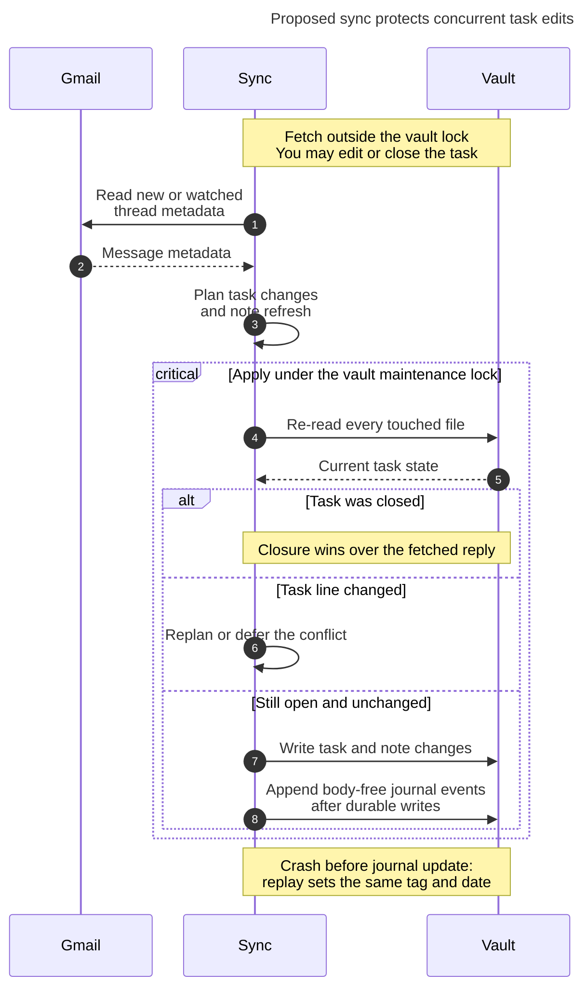

# Diagram proposals: Watching Gmail threads from Bob

Proposals for the swarm linker, not a report. Each diagram restates only what the source
report says.

```yaml
source: research:202611/gmail_sync_reply_watch/gmail_sync_reply_watch__final.md
producer: research.3m.image
check: "mmdc 12.0.0 with Puppeteer --no-sandbox and the PDF-mirroring config rendered 1 of 1 Mermaid diagrams"
```

## sync-concurrent-edits

```yaml
anchor: |-
  re-read every touched file and confirm
question: |-
  How does sync protect a task edited or closed during a Gmail fetch?
illustrates: |-
  Sync fetches outside the vault lock, then re-reads touched files under the vault maintenance lock so a task closed during the run wins over a fetched reply.
caption: "Sync rechecks task state under lock: closure wins, conflicts replan or defer, and journal events follow durable writes."
review: "695x1065 px, fit 83.8%; question, source-trace and visual checks passed; 0 revisions; batch rendered 1 of 1; deliberately broken chart exited nonzero"
```


