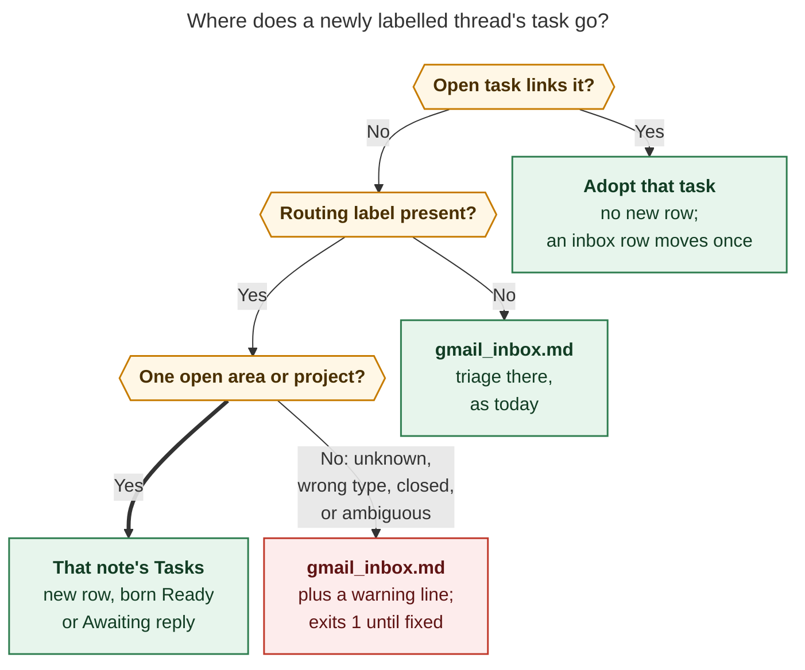
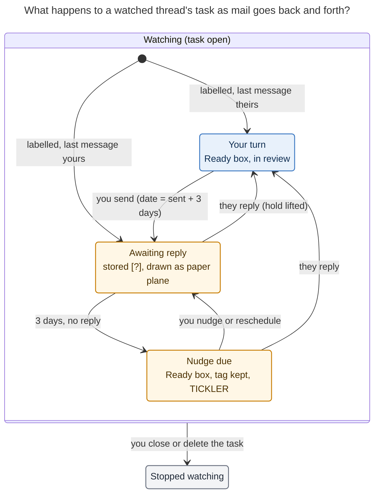

# Watching Gmail threads from Bob: `bob gmail sync`, routing labels, and the awaiting-reply hold

_Researcher: cld · 2026-11-07 · bob-cli, bob-plugins, chezmoi_

## Summary

The idea is sound, and most of the machinery already exists. Bob already turns a future
`[scheduled::]` date into a derived Blocked `[?]`, resurfaces recovered tasks as
TICKLERs in the morning walk, and draws the reason for a block inside the checkbox
(`docs/blocked-marks.md`). "Waiting for a reply" fits that system as one more blocking
reason. It doesn't need a new task status, a new review mode, or write access to Gmail.

The design rests on three rules:

1. **Label to start, close to stop.** `bob` plus an optional `#/area` or `+/project`
   label starts the watch. Closing (or deleting) the task stops it. Removing the Gmail
   label has no effect.
2. **The link is the wire.** A thread is watched by every open task whose line or direct
   child bullet links the thread's mail note. Watching therefore follows Ctrl+Shift+M
   moves and Task Merges, which Bryan already does with mail tasks (see
   [Evidence](#what-the-vault-already-shows)).
3. **Bob changes inputs on mail events, and you own them in between.** When you send a
   message, Bob adds a machine tag `#awaiting_reply` and sets
   `[scheduled:: sent + 3 days]`. When they reply, Bob removes both. Nothing is
   re-asserted between those events, so your reschedules and edits stand.

I recommend running sync **on athena every 15 minutes** (`7,22,37,52 * * * *`), not on
the Mac. During this research the Mac didn't answer SSH, and it's the only host that
currently holds a Bob Gmail grant. I also recommend 13 adjustments to the requirements,
listed under [Requirement adjustments](#requirement-adjustments). The biggest ones:

- `pull` becomes a permanent hidden alias of `sync`.
- A bad routing label still lands the thread in `gmail_inbox.md`, with a warning line,
  instead of dropping it.
- The "unique blocked icon" is a new rendered blocked-reason mark (a hollow paper plane)
  over a stored `[?]`, not a new stored checkbox symbol.

## What exists today

Verified in the code, config, vault, and hosts on 2026-11-07:

- **`bob gmail pull`** (`src/native/gmail/pull.rs`) searches `label:<gmail.pull.label>`
  (default `bob`, newest 20 threads by default, at most 500). It saves each new thread
  through the save path and appends `- [ ] #task <link>` to `## Tasks` in
  `gmail.pull.inbox` (default `gmail_inbox.md`, line 225). Idempotence comes from
  `gmail.pulled` events in `.bob/gmail/<host>.jsonl` plus a check for an existing inbox
  link. It is read-only toward Gmail and never re-reads a thread it has already pulled,
  so later replies never reach the vault (`gmail_thread_note_sync` report, "Gaps").
- **Pull's appender doesn't know about status groups.** `find_tasks_heading` (line 418)
  ends the `## Tasks` section at the next H1/H2 heading. In a grouped area note such as
  `job.md`, the new `[ ]` row would land at the bottom of `### Done & Canceled` until
  the Mac's next `bob task reconcile` regroups it. That's harmless in today's flat
  `gmail_inbox.md`, but wrong for routing into area notes. Routing should reuse
  capture's `@route` task writer, which already places rows correctly.
- **Gmail model.** Threads carry `historyId`, and messages carry `labelIds`,
  `internalDate`, and headers (`model.rs`). `HeaderKind` has no `Auto-Submitted`,
  `X-Autoreply`, or delivery-report handling yet. A card counts as "own" only when its
  `From` matches the account (`note/layout.rs:238`). That misses send-as aliases. The
  `SENT` label is the more reliable signal.
- **gog v0.44.0** offers `gmail history --since <historyId> [--all]`, `labels list`,
  `thread get --format metadata`, and paged `search --ids-only`. Everything this design
  needs is already in Bob's read-only allow-list, except `gmail.history`, which is
  optional.
- **Config.** The chezmoi `home/dot_config/bob/config.yml` has **no `gmail:` block**, so
  pull runs on defaults with no writer pin. `home/.chezmoidata.yaml` has
  `cron.jobs: []` while epic `bob-cli-ib` phase 6 (migrate) is still in progress. The
  enrolled machines are athena, apollo, and mac.
- **Hosts.** `gog auth list --client bob-gmail` shows no accounts on apollo or athena;
  only the Mac has written Gmail journal events. The Mac's journal files use two host
  labels (`kellys-macbook-pro-local`, `kellys-mbp`), so its host slug drifts. During
  this research the Mac didn't respond to SSH. athena is always on, uses
  `America/New_York`, runs `bob-vault-sync.service`, and has postfix/sendmail. Its cron
  mail does reach Gmail: the `Anacron job 'cron.daily' on athena` mail notes in `dev.md`
  are that mail.
- **Task-state rules that matter here** (decision records):
  - Blocked is derived from an open dependency or a future `scheduled` date
    ([[decisions:task-status-is-derived]]).
  - Lanes are sticky and don't survive Blocked. A "Submitted/Waiting status" was
    proposed and cancelled by Bryan ([[decisions:task-lanes-are-sticky]]).
  - Every automatic Blocked → Ready recovery writes `[unblocked:: today]`, which makes
    the task a TICKLER ([[decisions:unblocked-tasks-resurface-as-ticklers]]).
  - Blocked tasks keep no live Task Links ([[decisions:projects-block-from-prj-line]]).
  - Blocked-reason marks are display-only, and a stored `[>]` Deferred status was
    rejected (`docs/blocked-marks.md` → _Rejected alternatives_).
- **Prior work.** `bob_gmail_design` §6 item 6 deferred "Reply detection for linked open
  tasks ('Waiting for')" until it had a decision record. Bead `bob-cli-i1` (READY, large)
  carries it. That epic's invariant I1 ("nothing triggers on task completion or reply")
  is exactly what this feature amends.

### What the vault already shows

- In `dev.md`, two pulled anacron tasks were moved out of the inbox and **merged into**
  `^fix-anacron-errors`. Their `[[mail/…|✉️ …]]` links now sit as child bullets of
  the surviving task, and the source rows are cancelled. If a watch keyed on the original
  row, this ordinary workflow would end it. Keying on "an open task links the mail
  note" makes it follow the merge.
- In `job.md`, Bryan writes "Reply to Samuel Lam's email!" (with the mail link as a
  child bullet), completes it, then writes "Email Samuel Lam back!" as a follow-up. This
  is the hand-made back-and-forth that the watch automates. It also shows that he
  renames mail tasks into actions, so the title must stay his.

## Is this a good idea?

Yes. It closes a real GTD gap: Bryan has no Waiting For list today, and the vault shows
him rebuilding one by hand. The design spends almost nothing new: it reuses derived
Blocked, ticklers, blocked marks, inbox routing, the save path, the journal, and the
cron fleet.

Here is what I'd push back on or watch:

1. **Two triage surfaces.** `gmail_inbox.md` is already an inbox file. Ctrl+Shift+P and
   Alt+N on its rows already ask where the task goes. Labels move that decision into
   Gmail, which is worth it on the phone. But it means Gmail labels must mirror vault
   note names forever. The doctor should audit that mapping, and the inbox must stay
   the safe default.
2. **Your own message isn't always a question.** A closing "Thanks!" also blocks the
   task for three days. That costs one extra review touch (close it), which is cheaper
   than guessing intent. Don't try to classify message text.
3. **One task per thread versus action titles.** A long-lived task that alternates
   between "your turn" and "awaiting" replaces Bryan's chains of "Reply…" and "Email…
   back" tasks. That's simpler, but only if the title stays editable and Bob never
   rewrites it.
4. **The obvious host is the wrong host.** The Mac holds the grant but sleeps. If the
   watch runs there, it is only as reliable as the lid. See
   [Where and how often it runs](#where-and-how-often-it-runs).
5. **It changes the task-state model.** It amends Gmail invariant I1 and adds a fourth
   blocked reason. Write decision records before building, as `bob_gmail_design`
   already asked.
6. **Gmail threading is the limit of what can be watched.** A reply that Gmail files as
   a new thread (subject rewritten, or a forward-to-`+bob` copy) isn't on the watched
   thread. Label the original conversation, not a forward.

## Design principles

| Principle | What it means in practice |
| --- | --- |
| Label to start, close to stop | `bob` (plus an optional routing label) starts a watch once; a closed or deleted task ends it; unlabelling does nothing |
| The link is the wire | An open task watches a thread when its line or a direct child bullet links the thread's mail note; moves, merges, and renames keep watching |
| Bob changes inputs on edges | Writes happen only when a new message arrives; steady state writes nothing, so hand edits stand |
| Derived status stays derived | The hold is a tag plus `[scheduled::]`; `[?]` follows from the date exactly as today, and reconcile keeps the final word |
| Read-only toward Gmail | Same gog flags as today; no `gmail.modify`; Gmail state is never changed |
| Bodies stay in mail notes | Task notes gain tags, dates, and link labels only, never reply text |
| Truthful or neutral | When Bob can't prove whose turn it is (unknown sender, missing headers), it changes nothing and reports why |

## Routing labels

### Configuration and resolution

```yaml
gmail:
  sync:
    route_prefixes: ["#", "+"] # quote them: an unquoted # starts a YAML comment
```

- A prefix `P` matches Gmail labels named `P/<route>`, which is Gmail's nested-label
  syntax. `#/job` and `+/job` both mean route `job`. Bob doesn't treat the two prefixes
  differently, so Bryan can use `#` for areas and `+` for projects (the todo.txt habit)
  by convention.
- **Resolve labels by ID, not by search syntax.** Each run calls `labels list` once and
  maps every message's `labelIds` to names. The thread's labels are the union over its
  messages. That sidesteps Gmail's search quirks for `#` and `+` in label names. Search
  is used only for `label:bob`.
- `<route>` resolves through **the same resolver as capture's `@route`**, including note
  aliases (`job.md` has `aliases: [Job]`), so Gmail and capture always agree. A nested
  remainder (`+/job/acme`) gets whatever capture does with it, and capture's refusal
  means `unknown_route`.
- The target must be an open **area note** (`type: "[[area]]"`) or **project note**
  (`type: "[[project]]"`) whose `^prj` isn't closed. Anything else is a route problem:
  `unknown_route`, `not_area_or_project`, or `closed_project`.
- **Several routing labels:** if they form one ancestor chain (`#/job` plus
  `+/hiring`, where `hiring.md` has `parent: [[job]]`), the deepest note wins. That
  makes "area plus project" labelling just work. Otherwise it's `ambiguous_route`.

**No prefixes configured (my call):** treat every user label (not system labels and not
the trigger label) as a candidate route, but **ignore labels that don't resolve**. A bare
label like `Receipts` carries no routing intent, so it can't be an error. A prefixed
label does declare intent, so a prefixed label that fails to resolve is a loud failure.
This asymmetry is what keeps the no-prefix mode usable.

### Where a newly labelled thread goes



_Figure 1. A thread is adopted when an open task already links it. Otherwise one good
routing label files it into that note, no label sends it to the Gmail inbox, and a bad
label lands it in the inbox with a warning line until it's fixed._

Details behind the figure:

- **Adoption prevents duplicates.** If an open task already links the thread's mail note
  (for example, Bryan made "Reply to Ada" by hand and later labelled the thread), sync
  watches that task and files nothing. The existing pull already does a narrow version
  of this ("already filed").
- **Late routing labels move the row out of the inbox once.** On the phone, `bob` and
  `#/job` may arrive in separate actions, and a run can fall between them. While the
  row still sits in `gmail_inbox.md`, a routing label that appears later moves it
  (through the task-move engine) and journals `gmail.refiled`. Outside the inbox, Bob
  never moves a task; a conflicting label is reported once. This is the "follows Google
  until edited" pattern from gcal ([[decisions:gcal-root-follows-google-until-edited]]),
  where "untouched" means "still in the inbox".
- **Route problems are loud and lose nothing.** The row lands in `gmail_inbox.md` with a
  managed first child line:

  ```markdown
  - [ ] #task [[mail/2026/261107_kickoff|✉️ Kickoff · Lee]] [created:: 2026-11-07]
  	- ⚠️ **GMAIL ROUTE:** `#/jbo` matches no area or project note — fix the label or create `jbo.md`
  ```

  The run exits 1 with a typed error naming the label and the reason. When the label is
  fixed or the note is created, the next run moves the row and deletes the warning line.
  Because the row is unstamped, it shows up first in the next morning's NEW review.
- **Doctor audit.** `bob gmail doctor` gains a read-only `routes` row: prefixed labels
  that don't resolve, point at the wrong note type, or point at a closed project, with a
  count. This catches drift between labels and notes before it bites.

## The watch

### Which threads are watched

Watched set = threads that sync (or legacy pull) filed or adopted, according to the
journal, that have at least one open `#task` whose line or direct child bullet links the
thread's mail note. Tasks in `done/` don't count.

- The membership check is a local vault scan, the same scale as `bob task reconcile`'s
  scan, so stopping and resuming are derived each run. Reopening a closed task (while it
  is still in its note) resumes the watch.
- Closing, cancelling, or deleting every linking task ends the watch. Bob stops fetching
  the thread. A deleted row is never re-created (a tombstone, like gcal's).
- To stop one task from following a thread, delete its link. To re-watch a thread whose
  task is gone, link the mail note from any open task (capture, `bob gmail link`, or by
  hand).
- **One task, several threads** (the merged anacron task has two): the task holds only
  while it's **their turn on every thread it links**. A reply on any of them lifts the
  hold. In short: a task waits only when nobody is waiting on you.

### Change detection and cost

Each run:

1. Calls `labels list` once.
2. Runs a paged `search label:bob --ids-only` for discovery. Pull's default of 20 can
   miss an old thread that was just labelled, so page to the end, with a hard cap of
   5,000 and a warning.
3. Runs `thread get --format metadata` for each watched thread, then a full-body
   refresh through the existing save path only when its message ids differ from the
   note's `<!-- bob:gmail:msg … -->` cards.

With a few dozen open mail tasks that's about 30–40 gog calls per run, which is trivial
against the Gmail quota and only a few seconds of process time. `gog gmail history
--since <id>` can cut the per-thread fetches to one call later. Keep its cursor
host-local, with a full rescan when it's missing or expired. Treat it as an
optimization, not v1.

### Whose turn is it?

Turn is derived from the **latest conversational message**, scanned newest first:

| Message | Counts as | Reason |
| --- | --- | --- |
| Has the `SENT` label, or `From` is the account or a send-as alias | **your move** → hold | `SENT` catches aliases that the `From` check in `layout.rs` misses |
| From someone else | **their move** → lift | Any participant counts, including CCs and list replies |
| `Auto-Submitted` other than `no`, `X-Autoreply`, `X-Autorespond`, `Precedence: auto_reply` (RFC 3834) | ignored, logged | Vacation responders mustn't lift the hold |
| Delivery-status report (`multipart/report; report-type=delivery-status`, mailer-daemon) | **lift**, reason `bounced` | Nobody will answer a message that never arrived |
| `DRAFT` | ignored | Not sent (already excluded from mail notes) |

The mail note gains two Bob-owned frontmatter fields, written on every refresh:

- `turn: yours | theirs`
- `turn_since: <ISO time of that message>`

They make a "Waiting for reply" view in `mail.base` a one-line filter, and they feed the
optional reply badge below.

### Edges, not levels

Bob writes to a task only on an **edge**: the latest conversational message is newer
than the high-water mark Bob last applied for that (task, thread) pair. The mark is a
body-free `gmail.turn` journal event (`account`, `thread_id`, `message_id`, `turn`,
`task`), appended **after** the task write. If a crash lands between the two writes, the
next run re-applies the same edge, which is idempotent because it sets the same tag and
date. Journals are union-merged and vault-synced, so the state survives a change of
sync host.



_Figure 2. Your message puts the task on hold for three days. Their reply, or the date
arriving, returns it to review. Closing or deleting the task is the only way to stop
watching._

**Your move (you replied, or sent the first message):**

1. Add `#awaiting_reply` right after `#task`, where `#prj_is_blocked` goes.
2. Set `[scheduled:: D]`, where `D` = the local date of **your message's send time** + N
   (`reply_wait_days`, 3 for Bryan), in `gmail.timezone`. Using the send time rather
   than the time sync noticed means a sync outage never stretches the wait. Sending on
   Sat 2026-11-07 gives a nudge on Tue 2026-11-10.
3. If `D` is after today, set the box to `[?]` immediately. This is the same derived
   rule reconcile uses, so reconcile agrees. If `D` has already passed (an old message,
   or a long outage), leave the box Ready. The task is then "nudge due" and comes back
   in review.
4. The tag owns the date. An outbound edge replaces any existing future `scheduled`
   value, including a P-level deferral. You re-engaged with the thread, so the nudge is
   what you want (open question 3). Bob writes no Schedule Log entry, so automated waits
   never count as priority rolls for decay.
5. **Running-session guard.** If the task has a live Task Link under today's running
   Pomodoro, defer the edge until that session closes. Blocking would make reconcile
   consume the link, and the projects decision notes that consumption "may delete a
   running timed Pomodoro". A planned-but-unstarted link doesn't defer: you've done your
   part, so the task leaving today's plan is correct.

**Their move (someone replied):**

1. Refresh the mail note. The reply arrives as the newest, unfolded card.
2. If the task carries `#awaiting_reply`, remove the tag and the wait `[scheduled::]`,
   set `[?]` → `[ ]`, and write `[unblocked:: today]`. Under the existing tickler
   contract the task returns in TICKLER review ([details](#when-they-reply)).
3. If the task has no tag (you opted it out by deleting the tag), refresh the note and
   leave the task alone.

**Nudge due (the date arrived with no reply):** Bob does nothing; existing machinery
handles it. Reconcile flips `[?]` → `[ ]` because the date is no longer in the future.
The row is a scheduled tickler (`fresh < scheduled ≤ today`) and shows up in TICKLER
review with the tag still on. Bryan's three answers map onto existing gestures:

| He decides to… | Gesture | Result |
| --- | --- | --- |
| Nudge them | Reply in Gmail | Next sync sees your move: new date, back to awaiting |
| Wait longer | Ctrl+Shift+P reschedule | Tag kept, new date → awaiting again (his date stands until the next message) |
| Abandon | Ctrl+Enter or cancel | Closed → watching stops |

Alt+F (keep) also works and follows the decay ladder as usual. A long-ignored wait
eventually reaches the decay card, which is a reasonable "abandon?" prompt.

## What the task looks like

### Stored and rendered

```text
awaiting reply
  stored:   - [?] #task #awaiting_reply [[mail/2026/261107_lease_renewal|✉️ Lease renewal · Ada]] [created:: 2026-11-07] [scheduled:: 2026-11-10] ^lease-renewal
  rendered: [✈] ✉️ Lease renewal · Ada                                    Tue, Nov 10
  hover:    Awaiting reply from Ada · nudge Tue, Nov 10 · in 3 days
            Ctrl+Shift+P to wait longer · reply in Gmail to restart

nudge due (date arrived)
  stored:   - [ ] #task #awaiting_reply [[…|✉️ Lease renewal · Ada]] [created:: 2026-11-07] [scheduled:: 2026-11-10] ^lease-renewal
  rendered: [ ] ✉️ Lease renewal · Ada   ✈ no reply yet                    TICKLER in ]s

your turn (they replied)
  stored:   - [ ] #task [[…|✉️ Lease renewal · Ada]] [fresh:: 2026-11-07] [unblocked:: 2026-11-09] [created:: 2026-11-07] ^lease-renewal
  rendered: [ ] ✉️ Lease renewal · Ada  ↩ Ada · 2h                         TICKLER in ]s
```

### The new blocked-reason mark (bob-ledger-tools, `api.blockMarks`)

- **Key `awaiting`, family `waiting` (hollow).** The hold has a date, and Bryan
  shouldn't act on it. It should read quieter than `dep` and `prj`, which are held by
  his own work. The ink is the P1 anchor ink that hand dates use. The hue budget is
  spent, so the shape carries the meaning.
- **Glyph: a paper-plane mask** (`--bob-block-glyph-sent`, viewBox `0 0 16 16`, one
  stroked path with round joins, about 2 px stroke, matching the chevron mask). Not an
  envelope: the link label already starts with ✉️, so `[✉] ✉️` would stutter. A plane
  says "sent, in flight, waiting on them". It sits next to the existing glyphs `&`,
  chevron, `1`–`4`, `⟲`, and `?` without colliding with any of them.
- **Input:** an exact `#awaiting_reply` token plus a canonical future `[scheduled::]`.
  The classifier stays line-local. The "from Ada" in the tooltip comes from the linked
  mail note's `who` (one metadata-cache lookup); it's omitted when that's unknown, per
  "truthful or neutral".
- **Precedence:** own open prerequisite > project blocked > **awaiting** > date (with
  recurring > ladder > hand as today). The date under the tag belongs to the hold, so
  there's no `Also scheduled` pip for it. A losing `dep`/`prj` still shows as a pip.
- **Fold:** marked rows clip the `#awaiting_reply` tag pill, the way `prj` rows clip
  `#prj_is_blocked`. On a Ready row (nudge due) the tag stays visible, rendered through
  task-tag marks as a muted `✈ no reply yet` pill. That pill is the overdue signal.
- **Tasks query results** get one CSS cascade rule: a
  `.tag[data-tag-name="#awaiting_reply"]` row with a future `data-task-scheduled` shows
  the plane. It ranks after `prj` and before digits.
- **Conformance vectors** (today 2026-11-07):

| # | Input | Expected |
| --- | --- | --- |
| AW1 | `- [?] #task #awaiting_reply A [scheduled:: 2026-11-10]` | `awaiting` waiting · `Awaiting reply · nudge Tue, Nov 10 · in 3 days` · tag folded |
| AW2 | AW1 plus `[priority:: medium]` | `awaiting` (tag wins over the digit) · no pip |
| AW3 | AW1 plus open `[dependsOn:: x]` | `dep` held, more `awaiting` |
| AW4 | `- [?] #task #awaiting_reply A [scheduled:: 2026-11-07]` | `stale` (today doesn't block) |
| AW5 | `- [ ] #task #awaiting_reply A [scheduled:: 2026-11-05]` | no block mark; tag pill `✈ no reply yet` |
| AW6 | `- [?] #task #awaiting_reply_old A [scheduled:: 2026-11-10]` | not the token → `date` |

### Who owns each part of the row

| Part | Owner | Sync behavior |
| --- | --- | --- |
| Row existence | Bob once, then you | Created once per thread; deleted rows are tombstoned and never re-created |
| Residence (which note) | The label while the row is in `gmail_inbox.md`, then you | A routing label that appears later moves an inbox row once; rows elsewhere never move |
| Title and link label | You | Never rewritten, even when the Gmail subject changes |
| Checkbox | Derived; you close | Bob flips `[ ]` ↔ `[?]` only together with its own hold; never closes or reopens |
| `#awaiting_reply` | Bob on mail events, you in between | Added on your message, removed on their reply; your removal stands until your next message |
| `[scheduled::]` while tagged | Bob on mail events, you in between | Set to sent + N; your reschedule stands until the next message; removed with the tag |
| `[unblocked::]` | Bob, on a reply | Written when a reply lifts the hold; cleared by the next stamp as today |
| Child bullets | You | Never touched, except Bob's own `⚠️ GMAIL ROUTE:` line |
| Mail note | Bob's cards and metadata; you own Notes | The existing append-only refresh contract, plus `turn` and `turn_since` |

## When they reply

This was the part to think hardest about. The goal is that a reply is **impossible to
miss in Obsidian, cheap to act on, and leaves no residue Bob has to clean up later**.

**Recommended updates:**

1. **Lift the hold.** Remove the tag and the wait date, and set `[?]` → `[ ]`. Lanes
   don't survive Blocked, so the task returns to Ready, never to a remembered Next or
   Pending. That follows [[decisions:task-lanes-are-sticky]], which rejected a hidden
   pre-block status.
2. **Resurface through the existing contract.** Write `[unblocked:: today]`. Under
   [[decisions:unblocked-tasks-resurface-as-ticklers]] that makes the task a TICKLER in
   today's walk and keeps it out of the keep-streak count. One small, explicit contract
   extension: **a reply lifts the reply hold, and that counts as an unblock even if the
   nudge date had already turned the box Ready.** Without it, a task Bryan kept with
   Alt+F after the nudge date would stay FRESH and hide the reply. Document this in
   `docs/freshness.md` §10b. Optionally, add `returned_by: reply` later so the walk
   footer can say "Ada replied" instead of "unblocked".
3. **Put the reply where the link already points.** The refresh appends the new card,
   unfolded, at the bottom of the mail note. One click on the task link shows what they
   said.
4. **Polish: a reply badge (display-only).** On a task's mail link, show `↩ Ada · 2h`
   when the linked note says `turn: yours` and `turn_since` is newer than the task's
   `[fresh::]`. It disappears after the next stamp. This is in the spirit of
   `event-link-times`, and it writes nothing.

**Deliberately not done:**

- **No automatic Next.** "Recovering to Next would invent a lane" (the unblocked
  decision). Bryan picks up the task in review or links it to today himself.
- **No title rewrite** such as "Reply to Ada: …". The title is his, and he already
  renames mail tasks into actions.
- **No reply text in the area note.** The security contract keeps sender bodies, and
  even snippets, out of task notes. Subject and sender in the link label are already
  neutralized.
- **No Schedule Log entry or freshness stamp.** Automation never stamps, and automated
  waits must not feed priority roll counts.
- **No Gmail change.** The thread isn't marked read, archived, or unlabelled.

## `bob gmail sync`

```text
bob gmail sync [-b|--bob-dir DIR] [-d|--dry-run] [-f|--format human|json] [-l|--limit N] [-q|--quiet]
```

- **Reads.** The same read-only gog flags as today. Add `gmail.labels.list` and the
  metadata form of `thread.get` to the allow-list if they're missing, and
  `gmail.history` only when that optimization lands.
- **Writes** go under the vault maintenance lock, through the preimage-checked staged
  writer, all-or-nothing. Each run makes one path-scoped commit,
  `gmail: sync N threads`, and no commit when nothing changed. Journal events are
  appended after durable writes, as pull does now. New rows are written through
  capture's `@route` writer, so they land in the right status group with capture's row
  shape. Hold and lift writes use reconcile's line model and leave Today-link
  consumption to reconcile, which is the authority.
- **`-l` caps new filings per run** (default 50, maximum 500), so a mislabelled filter
  can't flood a note. Watching is never capped.
- **`-d` previews** filings, moves, holds, lifts, and problems, and writes nothing (no
  lock, no journal, no commit).
- **`pull` is a permanent hidden alias** with byte-identical behavior. That's the
  bob-cli CLI rule ("never hard-rename or remove a command"). Because `pull` gains
  watching through the alias, ship it as `feat(gmail)!`
  ([[decisions:bob-cli-releases-ride-a-daily-train]]). The JSON stays a superset of
  pull's (`pulled`, `results[].{thread_id, note, link, status}`, plus `watch[]`,
  `problems[]`, `warnings[]`).
- **Exit status:** `0` clean (a vault-busy skip counts as clean), `1` a runtime failure
  or any unresolved route problem, `2` a setup error (not the sync host, bad config, or
  not logged in). A **staleness alarm** also turns a run into `1` when the last
  successful sync is more than 2 hours old, so repeated lock skips or a silent outage
  can't go unnoticed.

Human output, for an interactive run without `-q`:

```text
✉ gmail sync · 14:07 · watching 6 threads, 2 awaiting reply
  + filed      ✉️ Lease renewal · Ada        → job.md
  ⇢ adopted    ✉️ Q3 invoice · Billing        → cash.md (existing task)
  ✈ awaiting   ✉️ Contractor quote · Sam      → nudge Tue, Nov 10
  ↩ your turn  ✉️ Visa appointment · Consulate → travel.md
  ⚠ route      ✉️ Kickoff · Lee               label #/jbo matches no area or project → gmail_inbox.md
```

The doctor gains three rows: `sync` (the host pin, plus the last run's age on the sync
host from `$XDG_STATE_HOME/bob/gmail/sync.json`), `routes` (the label audit above), and
`config` (prefixes and wait days).

## Where and how often it runs

**Host: athena, pinned by a new `gmail.sync.host`.**

- **Why athena.** It's always on, already the nightly maintenance host, runs NY time,
  has a stable host slug, and its cron mail reaches Gmail. The Mac is often asleep (it
  was unreachable during this research), and its host slug drifts.
- **Why a separate pin.** `gmail.writer` gates every write (save, draft, send).
  Pointing it at athena would break Bob Mail on the Mac. `sync.host` authorizes sync's
  own saves and refuses sync elsewhere. Two hosts syncing at once would create
  duplicate rows before vault-sync converges.
- **Cost.** A one-time read-only `bob gmail login` on athena, using the paste flow over
  SSH. Agent hosts already read Gmail through gog's `default` bucket, so this adds no
  new class of exposure. Make sure the OAuth consent screen is **published**: a Testing
  screen issues 7-day tokens, which would kill the watch weekly.

**Interval: every 15 minutes, at `7,22,37,52`.**

- 15 minutes matches Bob's other unattended jobs (reconcile, projects sync, highlights).
  It is far inside GTD latency: a label becomes a task, and a reply lifts a hold, within
  a quarter hour.
- The offset avoids athena's `:00` `pass-git-sync`. It also lands three minutes before
  the Mac's documented `:10/:25/:40/:55` reconcile, so the Mac reconciles fresh state
  when it's awake.
- Faster runs wouldn't help the review-driven workflow, and they'd multiply transient
  network failures.

The chezmoi changes for Bryan, made after epic `bob-cli-ib` phase 6 lands so the two
don't edit `cron.jobs` at the same time:

```yaml
# home/dot_config/bob/config.yml
# `bob gmail sync` files bob-labelled Gmail threads as tasks and watches each one
# until its task closes; see "Sync" in bob-cli docs/gmail.md. Only `sync.host`
# runs it (cron: bob-gmail-sync). Route labels are Gmail nested labels:
# `#/job` and `+/job` both file into job.md.
gmail:
  account: bryanbugyi34@gmail.com
  sync:
    host: athena
    label: bob # trigger label (was pull.label; still read as a fallback)
    inbox: gmail_inbox.md # unrouted threads (was pull.inbox)
    route_prefixes: ["#", "+"] # must be quoted
    reply_wait_days: 3 # after you send, nudge in N days unless they reply
```

```yaml
# home/.chezmoidata.yaml, under cron.jobs
- name: bob-gmail-sync
  machines: [athena]
  schedule: "7,22,37,52 * * * *"
  description: File bob-labelled Gmail threads as tasks and watch them for replies
  enabled: false # flip to true once bob ships `gmail sync` and athena is logged in
  command: bob gmail sync -q
```

**Alerting.** `cronrun` mails on every failing run, so an unresolved route problem would
mail Bryan every 15 minutes. That's exactly the kind of noise behind his current task
"Fix anacron errors in emails!". Add a small, generic `cronrun` policy that every job
benefits from: mail when a job **starts** failing, at most once a day while it keeps
failing, and once when it recovers. Sync stays honest in its exit codes, and cronrun
decides how loud to be. The in-vault warning row is the main loud signal; mail is the
backstop.

## Failure modes and how each is handled

| Failure | Behavior |
| --- | --- |
| Token expired or revoked (`invalid_grant`), or a Testing-mode 7-day token | Exit 1 (cronrun mails once); doctor names the fix; nothing is written |
| Vault lock busy (for example `bob nightly` at 03:30) | Skip quietly; the next run catches up; the staleness alarm fires after 2 hours |
| Crash between the task write and the journal | The edge is re-applied on the next run; it's idempotent |
| Crash between the note write and the task write | The note has the card, but the high-water mark hasn't moved, so the edge still applies |
| Two hosts run sync | `sync.host` refuses the second; cron runs only on athena |
| A thread was deleted in Gmail | Reported once per thread; the task is untouched; that one fetch error doesn't fail the run (cf. bug `bob-cli-ic`) |
| A label typo or missing note | Inbox row plus `⚠️ GMAIL ROUTE:` line, exit 1 until fixed, then the row moves |
| A vacation auto-reply | Ignored; the hold stays |
| A bounce | Hold lifted (`bounced`), so Bryan sees that the message never arrived |
| The task is in the running Pomodoro when you send | Hold deferred until the session closes |
| Vault-sync conflict on a task note | Same-point insertions union-merge (the latest vault-sync fix); other conflicts follow `_conflicts/` recovery |

## Alternatives considered

| Alternative | Why not |
| --- | --- |
| Run sync on the Mac | It sleeps, it was unreachable during research, and its host slug drifts; the watch would be only as reliable as the lid |
| Gmail-side state (unlabel `bob` on close, or add a "waiting" label) | Needs `gmail.modify`, which breaks the read-only posture every Gmail decision so far has kept |
| Push notifications (`users.watch` plus Pub/Sub) | Cloud infrastructure for latency nobody needs at GTD cadence |
| A stored Waiting status (`[w]`, `[>]`) | Bryan cancelled a Submitted/Waiting status, blocked-marks rejected `[>]`, and it would touch reconcile, the Tasks registry, and every writer |
| A Depends-On link to a synthetic "reply" task | A fake task to maintain, and it would show up in every dependency surface |
| Level-triggered reconcile (re-assert the hold every run) | Fights Bryan's reschedules and tag removals every 15 minutes |
| Copy the reply snippet into the task | Breaks "bodies only in mail notes", and sender text in area notes reaches Dataview |
| Auto-promote a replied task to Next | Invents a lane; rejected by the unblocked-ticklers decision |
| Drop a thread whose label doesn't resolve | Silent from the vault's point of view; if mail delivery fails, the thread is lost |
| Area labels alone as the trigger (no `bob`) | Mixes filing intent with general mail organization; Bryan chose `bob` plus a prefix |
| One nested label (`bob/job`) | One label fewer on the phone, but area labels stop being reusable; possible later sugar (a prefix equal to the trigger label could imply it) |
| Keep `pull` and `sync` as separate commands | Two commands with overlapping state; the CLI rule makes `pull` an alias |

## Requirement adjustments

Each item changes or sharpens what was asked. All are recommendations for Bryan to
accept or reject.

| ID | Requested | Adjusted to | Why |
| --- | --- | --- | --- |
| ADJ-1 | `sync` may obsolete `pull` | `sync` is canonical; `pull` is a permanent hidden alias; `gmail.sync.*` config falls back to `gmail.pull.*` | bob-cli CLI rule: never remove a command; existing setups keep working |
| ADJ-2 | Cron every ~15 minutes (machine unstated) | athena, `7,22,37,52 * * * *`, pinned by `gmail.sync.host`, shipped `enabled: false` until bob ships `sync` and athena is logged in | Reliability (the Mac sleeps); avoids duplicate filing; avoids failing every run before the release |
| ADJ-3 | Fail loudly when a route is bad | Land the row in `gmail_inbox.md` with a `⚠️ GMAIL ROUTE:` line, exit 1 until fixed, move the row once fixed; cronrun mails on change, then daily | Loud where Bryan works, and nothing is lost if mail doesn't arrive |
| ADJ-4 | No prefix configured → check all labels | All user labels are candidates, but labels that don't resolve are ignored; only prefixed labels can fail | A bare label carries no routing intent; otherwise `Receipts` would be an error |
| ADJ-5 | Watch until the task is closed | Watch follows any open task linking the mail note (moves, merges, renames); deleting the row also stops it; unlabelling has no effect | The vault shows merges moving mail links into child bullets |
| ADJ-6 | Route by label at filing | A routing label added later moves a row still in `gmail_inbox.md` once; never moves rows elsewhere | Fixes the race between two label actions on the phone without fighting Bryan's moves |
| ADJ-7 | Several labels, unstated | An ancestor chain picks the deepest note; anything else is `ambiguous_route` | Makes area-plus-project labelling intuitive |
| ADJ-8 | Schedule N days in the future | N days from **your message's send date**, in Bob's timezone; auto-replies ignored; bounces lift the hold; `SENT` label decides "you" | Outages don't stretch waits; vacation responders don't fake replies |
| ADJ-9 | Unique blocked icon inside the brackets | Stored `[?]` plus `#awaiting_reply` and `[scheduled::]`; rendered as a hollow paper-plane blocked-reason mark | Fits derived Blocked and the marks contract; avoids the stored status Bryan already cancelled |
| ADJ-10 | Update the task appropriately on a reply | Lift the hold, Ready plus `[unblocked:: today]` (TICKLER), refreshed note, optional reply badge; no auto-Next, no title or body changes | Resurfacing through existing review rules, with no new lane or residue |
| ADJ-11 | (new) | Never put a task on hold while it's in the running Pomodoro; defer until the session closes | Link consumption can delete a running session |
| ADJ-12 | (new) | Mail notes gain `turn` and `turn_since`; `mail.base` gains a "Waiting for reply" view | A real GTD Waiting For list for free |
| ADJ-13 | (new) | A doctor `routes` audit and a staleness alarm (no successful run for 2 hours → exit 1) | Label and note drift and silent outages are the realistic long-term failures |

## Recommended solution

Build `bob gmail sync` as the label-routed, edge-triggered watcher described above:

- **Route:** `bob` plus `#/x` or `+/x` labels, resolved by label ID through capture's
  `@route` resolver, into open area or project notes, with the Gmail inbox as the
  fallback and the place where problems land.
- **Wire:** an open task linking the mail note, which follows moves and merges.
- **Hold:** your message adds `#awaiting_reply` and `[scheduled:: sent + 3 days]`, which
  makes the stored box `[?]`, drawn as a hollow paper plane.
- **Lift:** their reply removes both, sets Ready with `[unblocked:: today]`, and appends
  the card to the mail note.
- **Run** read-only on athena every 15 minutes.

Suggested epic, in order:

1. **Decision records first**, through `/sase_memory_write` when the epic is planned:
   - "Gmail labels route at birth; label to start, close to stop; the link is the wire"
     (amends Gmail invariant I1).
   - "Awaiting reply is a tagged schedule hold, drawn as a blocked-reason mark".
2. **bob-cli: sync core** (medium–large). `gmail.sync.*` config with the pull fallback,
   `sync.host`, routing and resolution, adoption, inbox refile, route problems, the
   `pull` alias, the capture-writer integration, dry-run, JSON, the doctor `routes` and
   `sync` rows, and docs. Fake-gog scenarios: route ok, unknown, wrong type, closed,
   and ambiguous; ancestor chain; adoption; late label; problem fixed; filing cap.
3. **bob-cli: watch** (large). Metadata fetches, turn derivation (`SENT`, RFC 3834, DSN),
   the `turn` and `turn_since` fields, edge application with the `gmail.turn`
   high-water mark, hold and lift writes through reconcile's line model, the
   running-session guard, multi-thread tasks, the staleness alarm, and the freshness
   §10b note. Tests: the full lifecycle, hand reschedule and tag removal respected,
   moved and merged tasks followed, closed tasks not fetched, crash-replay idempotence,
   an auto-reply ignored, a bounce lifting the hold.
4. **bob-plugins: marks** (medium). `awaiting` in `api.blockMarks` with the plane mask,
   tooltip, tag fold, Tasks CSS rule, AW1–AW6 vectors, and the contrast test. Then the
   `✈ no reply yet` tag pill. Optional: the reply badge and the `mail.base` Waiting view.
5. **chezmoi** (small). The config block above; the `bob-gmail-sync` job as
   `enabled: false`; the cronrun failure-streak mail policy. Bryan runs
   `bob gmail login` on athena, then
   `cronctl run bob-gmail-sync --machine athena` and `cronctl logs`, then flips the job
   to `enabled: true`.
6. Close bead `bob-cli-i1` as implemented by this epic. Fix `bob-cli-ic` (per-row
   tolerant remote reads) along the way; sync needs the same tolerance.

Open questions for Bryan:

1. Will you do the one-time read-only `bob gmail login` on athena, and is the Google
   consent screen published (not Testing)?
2. Calendar days (recommended) or business days for `reply_wait_days`?
3. When you reply on a task that was P-level deferred, should the nudge date replace
   the deferral (recommended), or only apply when it's sooner?
4. Ship the reply badge in v1, or leave it as polish?

## Sources and method

- **bob-cli code:**
  - `src/native/gmail/pull.rs` (search 99, append 225, `find_tasks_heading` 418)
  - `src/native/gmail/config.rs`, `journal.rs`, `model.rs`, `note/layout.rs:238`
  - `src/native/gmail/gog.rs` (search, labels, metadata)
- **bob-cli docs:** `docs/gmail.md`, `docs/gcal.md` ("Who owns each part of a row"),
  `docs/blocked-marks.md`, `docs/task-status-hooks.md` (status grouping, derived
  Blocked, unblock writes), `docs/capture.md` (`@route`).
- **Decision records:** task-status-is-derived, task-lanes-are-sticky,
  projects-block-from-prj-line, ready-is-freshness-gated,
  unblocked-tasks-resurface-as-ticklers, gcal-root-follows-google-until-edited,
  bob-cli-releases-ride-a-daily-train.
- **Glossary terms:** Area Note, Project Note, Inbox File, Task Drawer, Task Freshness,
  Schedule Log. Also memory note `cli_rules.md`.
- **Plans and beads:** plan `plan:202611/crontab_as_code.md` and epic `bob-cli-ib`;
  bead `bob-cli-i1`.
- **Prior research:** `research:202611/bob_gmail_design/bob_gmail_design.md` (§6 item
  6) and `research:202611/gmail_thread_note_sync/gmail_thread_note_sync.md`.
- **chezmoi:** `home/dot_config/bob/config.yml` and `home/.chezmoidata.yaml` at
  `102e8238`.
- **Live checks (read-only):**
  - `gog --version` (v0.44.0); `gog gmail history --help`
  - `gog auth list --client bob-gmail` on apollo and athena (both empty)
  - SSH to the Mac timed out
  - athena: MTA present, timezone, `bob-vault-sync` active
  - vault: `gmail_inbox.md`, `job.md`, `dev.md`, and `.bob/gmail/` journal kinds and
    host files
- **Figures:** rendered with `@mermaid-js/mermaid-cli` 12.0.0 using the research-PDF
  config. Measured fit: Figure 1 (routing) 793×812 px, 82.3%; Figure 2 (lifecycle)
  657×1155 px, 77.3%. PNG export failed in this environment (Puppeteer
  `ConnectionClosedError`, then a timeout on retry), so I didn't inspect the figures
  visually. They are checked only by successful SVG renders, measured dimensions, and
  tracing every node and edge to the design text above.
