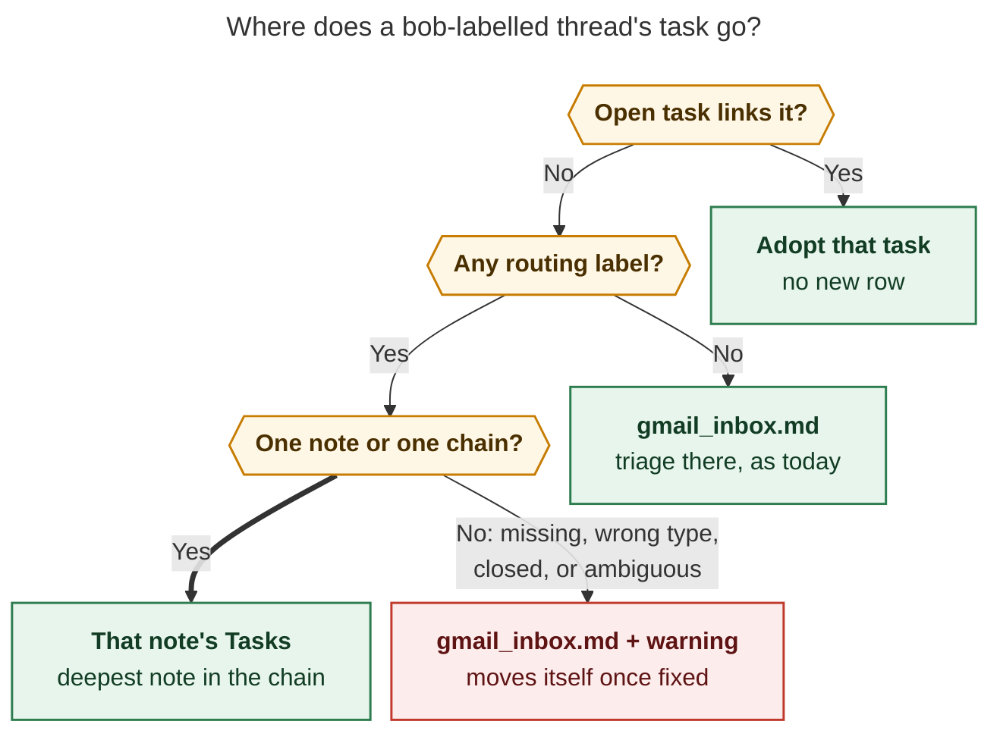
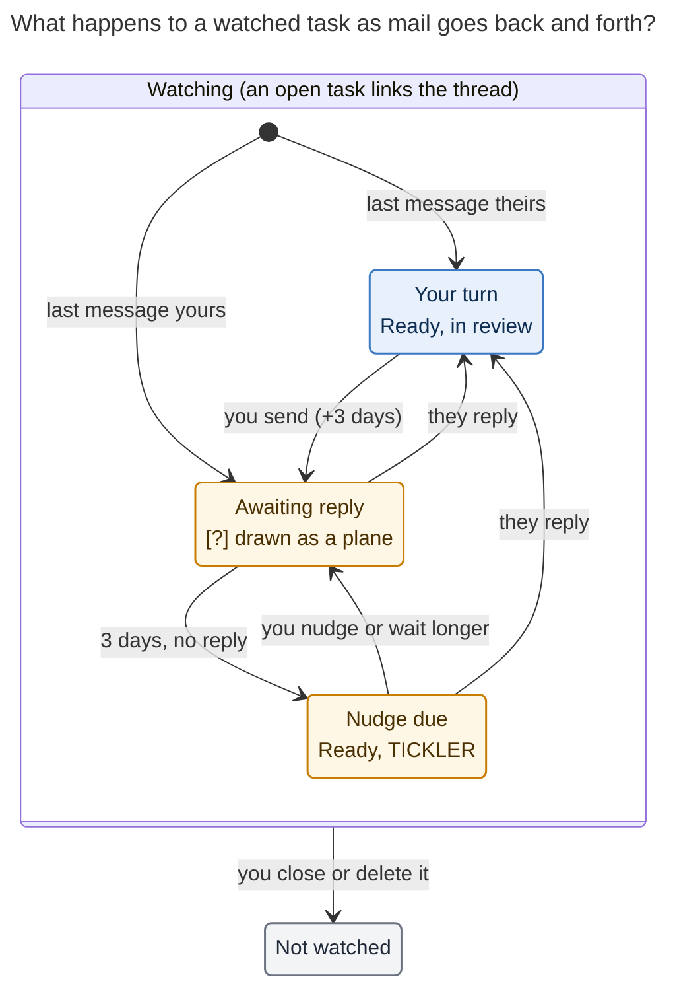

# Watching Gmail threads from Bob: `bob gmail sync`, routing labels, and the awaiting-reply hold

_Consolidated report · 2026-11-07 · lead researcher, merging
[cdx](gmail_sync_reply_watch__cdx.md), [cld](gmail_sync_reply_watch__cld.md),
[grk](gmail_sync_reply_watch__grk.md), [mus](gmail_sync_reply_watch__mus.md), and
[gem](gmail_sync_reply_watch__gem.md), plus new live checks of the vault, Gmail, the
Mac, chezmoi, and the bob-cli source at `30841c29`._

> **Research query.** Bob can already turn Gmail threads into Obsidian mail notes, but
> nothing watches a thread you care about, such as one where you're waiting for a reply.
> Use `#/…` and `+/…` Gmail labels (configurable prefixes) to file `bob`-labelled threads
> into area and project notes, failing loudly when the note is wrong. Add
> `bob gmail sync`, run it from the new chezmoi crontab, and watch each thread until its
> task closes. When you reply, schedule the task N days out (3 for you), mark it as
> waiting with a unique blocked icon in the checkbox, and unblock it sensibly when they
> answer. Critique the plan, adjust it, and recommend a solution.

## Bottom line

**Build it. This is the missing half of `bob gmail`.** Filing a labelled thread works
today. Staying subscribed until the task closes, and putting the task back in front of
you when the other side answers or goes quiet, is the GTD Waiting For loop that the
Gmail epic deliberately deferred (`plan:202611/bob_gmail.md` §6, bead `bob-cli-i1`).
All five researchers reached the same verdict. Most of the machinery already exists:
derived Blocked, scheduled ticklers, the `[unblocked::]` return, blocked-reason marks,
capture's route resolver and task writer, the mail-note save path, and the new cron
fleet.

The design rests on three rules:

1. **A label starts the watch; closing the task stops it.** `bob` enrolls a thread.
   One optional `#/note` or `+/note` label picks where its task lives. Completing,
   cancelling, or deleting the task ends the watch. Removing the Gmail label changes
   nothing, and Bob never writes to Gmail.
2. **The link is the wire.** An enrolled thread is watched by every open task whose own
   line, or a direct link-only child bullet, links the thread's mail note. Because of
   that, a watch follows Ctrl+Shift+M moves and Task Merges, which you already do with
   mail tasks.
3. **Bob changes the task only when a new message arrives; between messages, it's
   yours.** When you send, Bob adds `#awaiting_reply` and sets
   `[scheduled:: send date + 3]`. The box is stored as `[?]` and drawn as a hollow
   paper plane. When they reply, Bob removes both and records `[unblocked:: today]`, so
   the task comes back as a TICKLER in your next review. Between messages, your own
   edits stand.

Run it **every 15 minutes at `7,22,37,52` on the Mac** through the new `cron.jobs`
data. First, fix one precondition: **the Mac's hostname drifts**. Today's vault
commits come from both `kellys-macbook-pro-local` and `kellys-mbp`, so any
`gmail.writer` pin would fail part of the time. Three of the five reports proposed a
pin that matches neither name.

The rest of this report covers the evidence, how I resolved the researchers'
disagreements, the full design, the requirement adjustments (all collected in one
table), and a phased plan.

## Is this a good idea?

Yes, for conversations that have already earned a task. The vault shows you building
this loop by hand: in `job.md`, "Reply to Samuel Lam's email!" is completed and then
followed by "Email Samuel Lam back!". There is no Waiting For list today, and a sent
email drops out of mind until something goes wrong. Automating that loop removes the
remembering and checking, at the cost of a few task-state rules.

Where the request needs pushback:

| Concern | Why it matters | What I'd do |
| --- | --- | --- |
| Message traffic is not resolution | A "Thanks!" still starts a 3-day wait. A reply may not answer the question. | Bob reports "they replied", never "resolved", and never closes anything. Closing a task is the only way to opt out. |
| A new stored checkbox symbol | Tasks allows exactly one Blocked symbol (`?`, `ON_HOLD`). A `[w]` would fork reconcile, queries, chips, and every writer. You already cancelled a Waiting status (`decisions:task-lanes-are-sticky`). | Keep `[?]` in storage and draw the unique icon at render time. That's what blocked-reason marks are for. |
| "Fail loudly" in a 15-minute unattended job | Aborting the run strands every other thread. Cron mail from the Mac isn't proven to reach Gmail (no relay host; mail is delivered to the local mailbox). | Fail per thread. Make it loud where you work: a warning row in `gmail_inbox.md`, the run summary, and `doctor`. Alert once. |
| "No prefix → check all labels" | Your mailbox has `@/NEXT`, `@/OVERFLOW`, `@/VACATION`, a flat `Job`, and system labels. | Check only the thread's own user labels. Route only exact note matches, and ignore labels that don't resolve. |
| Two filers of one label | `pull` and `sync` would both file `bob` threads with different routing and drift apart. | `sync` becomes canonical. `pull` becomes its permanent hidden alias. |
| The obvious mechanics fight Bob | Lanes don't survive Blocked. Automation never stamps `[fresh::]`. Blocking consumes Today links. | Fit the wait into these rules: a tagged schedule hold, a TICKLER return, and a guard for running sessions. |
| Gmail threading limits what can be watched | A forward to `+bob`, or a reply with a rewritten subject, can land in a different thread. | Label the original conversation. Doctor and docs say so. |

## Evidence that shaped the design

Verified on 2026-11-07 unless marked as a researcher's claim.

| Finding | Source | Design consequence |
| --- | --- | --- |
| **Your Gmail already has the nested taxonomy.** Five `#/…` labels (`body`, `cash`, `dad`, `home`, `job`) and eleven `+/…` labels (`black`, `dresser`, `home`, `home/build`, `home/law`, `home/mortgage`, `home/utilities`, `rent`, `trip`, `trip/miami`, `wedding`). | grk's read-only `labels list`; I reconfirmed `#/job` by search | `#` and `+` are the right prefixes. `+` is your legacy project prefix. |
| **Only `#/body`, `#/cash`, and `#/job` resolve today.** `dad.md` doesn't exist (`family.md` does). `home.md` is a zorg-generated legacy note with no `type:`. None of the eleven `+/…` remainders has a project note. | Vault frontmatter scan (17 areas, ~100 projects) | Doctor must audit label↔note drift, and a one-time cleanup comes before you rely on routing. |
| **Gmail search is unreliable for these labels.** `label:#/job` returns 66 threads, but grk counted about 201 by label ID. `label:"#/job"`, `label:#-job`, `label:+/home`, and `label:+-home` return 0. | My searches; grk's API count | Route by label IDs from thread metadata. Search only for the plain `bob` label. |
| **Quota is real.** A few hydrated searches hit `403 rateLimitExceeded`: "Units per minute per user". Google's current table lists 6,000 units per user per minute, with `threads.get` at 40 units (120 for full format). | My run; [Gmail usage limits](https://developers.google.com/workspace/gmail/api/reference/quota) | Discover with paged `--ids-only` and fetch details only for unseen or watched threads. Pace requests and back off. `pull` hydrates every search result, which won't scale as `bob` threads accumulate (labels are never removed). |
| **Only 2 threads carry `bob` today.** No open task links a mail note. | My search; vault | v1 starts clean, so migration is small. |
| **The Mac's hostname drifts.** `scutil --get HostName` is not set; `hostname` prints `Kellys-MacBook-Pro.local` on some networks and `kellys-mbp` on others. Today's commits come from both slugs, and the Gmail journal has two host files. | SSH to the Mac; vault `git log`; `.bob/gmail/` | Pin the hostname before setting `gmail.writer` (existing bug `bob-cli-ew`). cdx, grk, and gem proposed `writer: kellys-macbook-pro`, which matches neither current slug. The chezmoi cron `machines:` map (`mac: [Kellys-MacBook-Pro]`) may hit the same drift. |
| **The live Mac crontab is three plain `*/15` jobs**, not the documented `:00/:05/:10` stagger. | `ssh mac crontab -l` | The `bob-cli-ib` phase-6 cutover (decision `mac_schedule = documented`) introduces the stagger. Slot sync relative to that. |
| **`pull` would misfile into area notes.** Its appender ends `## Tasks` at the next H1 or H2 heading, so in `job.md` a new row lands under `### Done & Canceled`. | `src/native/gmail/pull.rs:418`; `job.md` headings | New rows must go through capture's route writer (cld). |
| **`parent_notes::resolve_parent` is the right resolver.** It covers root areas, non-terminal projects, and inboxes; matches stems and aliases; rejects terminal, non-parent, and ambiguous notes; and gives near-miss hints. | `src/native/parent_notes.rs` | Routing reuses it, so "fail loudly" gets good error messages for free. |
| **Project chains exist.** `job_2026_apply_29` → `job_2026` → `job` (area). | Frontmatter | Labels `#/job` plus `+/job_2026_apply_29` should mean "file in the deepest note". |
| **Merges move mail links into child bullets.** `dev.md`'s two anacron rows were merged into `^fix-anacron-errors`. **Prose links exist too:** `bob.md:314` mentions a mail note inside a sentence. | Vault | A watch follows the line or a *link-only* child bullet, never a prose mention. |
| **The `[unblocked::]` tie rule already covers same-day review.** `returned_on` uses `unblocked` when `fresh ≤ unblocked ≤ today`. | `docs/freshness.md` §4 | A reply that arrives after you pressed Alt+F that morning still resurfaces. cdx's proposed `[mail_update::]` field isn't needed. |
| **Lanes don't survive Blocked.** | `decisions:task-lanes-are-sticky` (Cost) | A held task comes back Ready, not Next or Pending. grk's claim that lanes survive is incorrect. |
| **Blocking consumes Today links, and that can delete a running timed Pomodoro.** An entry is deleted when consumption empties it, "including a running timed entry". | `docs/task-dependencies.md` §13.5 (PDL9) | Hold back the hold while the task is linked under the running Pomodoro (cld). |
| **Tasks query results expose tags (`data-tag-name`) and their own date and priority attributes**, which the existing Blocked CSS cascade keys on. | `docs/blocked-marks.md` (Tasks contract) | A tag marker can paint the icon in Tasks query results. An inline field like `[wait:: reply]` has no attribute to key on (gem's `[data-field]` CSS has nothing to match). |
| **The vault syncs only by git among athena, apollo, and the Mac.** Obsidian Sync is retired. | `docs/vault-git-sync.md`, `obsidian.md` memory | You review tasks on the Mac, so a sleeping Mac also means nobody is reviewing. |
| **Gmail invariant I1** ("Google changes only through explicit, previewed drafts … nothing triggers on task completion") and **I7** (no bodies outside the mail note) | `plan:202611/bob_gmail.md` | Both still hold. That rules out gem's reply-snippet child bullets. |

## Where the researchers disagreed, and how I resolved it

| Question | Positions | Resolution |
| --- | --- | --- |
| Which host runs sync | Mac (cdx, grk, mus, gem) · athena (cld) | **Mac in v1, after pinning its hostname.** It matches the gcal decision ("the Mac is the single writer"), it's the only host with a Bob Gmail grant, and it's where you review. athena is the documented fallback (see [Host and schedule](#host-and-schedule)). |
| `pull` vs `sync` | Keep `pull` separate (cdx, mus) · hidden alias (cld, grk, gem) | **Hidden alias.** Two commands filing the same label with different routing would drift. CLI rule: "never hard-rename or remove a command". Ship as `feat(gmail)!`. |
| Bad route | Skip the thread and log it (cdx, grk, mus, gem) · inbox row with a warning (cld) | **Inbox row with a managed `⚠️ GMAIL ROUTE` line, alert once**, then refile automatically once fixed. Loud where you work, nothing lost, and no dependence on cron mail. |
| Empty prefix list | Disable routing (cdx, grk) · default to `#,+` (gem) · bare labels on the thread (cld, mus) | **Bare labels on the thread, exact matches only.** This follows your instinct within bounds: a bare label carries no intent, so it can't be an error. |
| Must `#` mean area and `+` mean project? | Enforced (grk) · either (others) | **Either.** Your habit is a convention. Rejecting `+/job` would be pedantic. |
| Nested remainders (`+/home/build`) | Reject (cdx, mus) · fold `/` to `_` (grk) · whatever capture does (cld) | **Reject with a hint in v1.** Vault stems are flat, and no nested label resolves today. |
| Several routing labels | Reject (cdx) · deepest of one chain (cld) · longest remainder (grk) · first wins (mus, gem) | **Same note, or one ancestor chain → deepest note; otherwise ambiguous.** Supported by the `job_2026_apply_29` → `job` chain. |
| Where the wait lives | `[mail_wait_until::]` (cdx) · tag + `scheduled` (cld) · `[wait:: reply]` (grk) · `[waiting:: reply]` (gem) · `scheduled` + journal (mus) | **`#awaiting_reply` + `[scheduled::]`.** Tasks results can see a tag. It follows the `#prj_is_blocked` precedent ("blocked.md and JS paths need a stored token"). Ctrl+Shift+P, date marks, and scheduled ticklers work unchanged. |
| Icon | Envelope (cdx, gem) · paper plane (cld) · solid ↩ (grk) · plain hollow `?` (mus) | **Hollow paper plane** in the `waiting` family. Mail links already begin with ✉️, so an envelope box would repeat it. ↩ is saved for the "they replied" badge. Hollow means "returns on its own date". |
| Mark precedence | dep > prj > awaiting > date (cld) · dep > awaiting > prj > date (grk) | **dep > prj > awaiting > date.** By contract, held (solid) reasons outrank waiting (hollow) ones. |
| Nudge date basis | Send date + N (cdx, cld) · today + N (grk, gem, mus) | **Send date + N, in Bob's timezone.** An outage or a sleeping Mac must not stretch the wait. |
| What starts a wait | Any sent message (cld, mus, gem) · only after someone else has written (grk) · sent to an external recipient (cdx) | **A non-draft message from you to at least one address that isn't yours.** grk's guard would break the core case: you write first and wait for an answer. |
| What a reply writes | Lift + `[unblocked::]` (cld, grk) · lift only (mus) · snippet child bullet (gem) · new `[mail_update::]` (cdx) | **Lift + `[unblocked:: today]`, plus a display-only ↩ badge.** The existing tie rule covers cdx's edge case, and snippets break I7. |
| Removing the tag by hand | Your removal stands (cld) · Bob re-adds it (grk) | **It stands until your next message.** Bob writes only when a new message arrives (the same "follows Google until edited" spirit as gcal). |
| Watch membership | Any linking task (cld, grk, gem) · a canonical token (cdx) · per (thread, note) (mus) | **The `bob` label enrolls; the link picks which tasks**, and only via the task's own line or a link-only child bullet. |
| Discovery | `label:bob` search (pull, mus, gem) · paged ids-only (cdx, cld) | **Paged ids-only**, fetching details only for unseen threads. The quota evidence decides it. |

## Recommended design

### Routing a newly labelled thread

**Reader question:** Where does a `bob`-labelled thread's task go?



_Figure 1. A thread an open task already links is adopted. Otherwise, routing labels
that resolve to one note (or one parent chain) file the task there. No routing label
means `gmail_inbox.md`. A bad or ambiguous label also lands in `gmail_inbox.md`, with a
warning line, until it's fixed. Rendered with Mermaid CLI 12.0.0 at 782 × 760 px, 83.4%
fit._

Rules:

- **Prefixes.** `gmail.sync.route_prefixes: ["#", "+"]`. Quote them: an unquoted `#`
  starts a YAML comment. A label `P/<stem>` matches prefix `P`. Strip `P/` once; the
  remainder is the route. `#` and `+` behave the same.
- **Resolve by label ID.** Call `labels list` once per run. Map each message's
  `labelIds` to names, and treat the thread's labels as the union across its messages.
  Don't route with name-based search. Never treat a bare `#` or `+` parent label as a
  route.
- **Resolve with `parent_notes::resolve_parent`**, the same resolver capture's `@route`
  uses. It matches exact stems first, then aliases (`job.md` has `aliases: [Job]`),
  case-insensitively. Valid targets are root areas, non-terminal projects, and inboxes.
  An unknown, terminal (`status: done`), non-parent, or ambiguous-alias note is a route
  problem, reported with the resolver's near-miss hint ("did you mean `family`?").
- **Nested remainders** (`+/home/build`) are a route problem in v1: `nested_route`,
  with the hint "use one label per note".
- **Several routing labels.** If they resolve to the same note, or form one `parent:`
  chain, the deepest note wins: `#/job` + `+/job_2026_apply_29` files into
  `job_2026_apply_29.md`. Anything else is `ambiguous_route`. Any prefixed label that
  doesn't resolve also makes the thread a route problem. In Gmail you can only apply
  labels that already exist, so an unresolved label almost always means a missing or
  renamed note, which is exactly the "fail loudly" case.
- **No prefixes configured** (key absent or `[]`): every user label on the thread
  except the enrollment label is a candidate. A label that resolves routes the thread.
  A label that doesn't resolve is ignored, not an error. Two that resolve are
  `ambiguous_route`. Bob never scans the account's whole label list for routing.
- **Adoption.** If an open task already links the thread's mail note (for example, you
  wrote "Reply to Ada" and then labelled the thread), sync watches that task and files
  nothing.
- **Route problems are loud and lose nothing.** The row lands in `gmail_inbox.md` with
  a managed first child:

  ```markdown
  - [ ] #task [[mail/2026/261107_kickoff|✉️ Kickoff · Lee]] [created:: 2026-11-07]
  	- ⚠️ **GMAIL ROUTE:** `+/trip` matches no area or project note — create `trip.md` or remove the label
  ```

  The run that first sees the problem exits 1 with a typed error naming the thread,
  label, and reason. Later runs keep reporting it in output and `doctor` without
  failing again. Once you fix the label or create the note, the next run moves the
  row (through the task-move engine) and deletes the warning line. The row is
  unstamped, so it also appears in the next morning's NEW review.
- **A routing label added later moves an inbox row once.** On the phone, `bob` and
  `#/job` may be two separate taps, and a run can fall in between. While the row is
  still in `gmail_inbox.md`, a routing label that appears later refiles it once.
  Outside the inbox, Bob never moves a task; a conflicting label is reported once.
  Your moves win (cld, following `decisions:gcal-root-follows-google-until-edited`).
- **New rows** go through capture's route writer, so they land in the right status
  group, with pull's line shape and no `[fresh::]`:
  `- [ ] #task [[mail/…|✉️ Subject · Who]] [created:: …]`. Bob never creates an area or
  project note.

### Which threads are watched

- **Enrollment** = threads that sync (or legacy pull) filed or adopted, according to
  the vault-synced journal `.bob/gmail/<host>.jsonl`.
- **Watching tasks** = open `#task` rows (`[ ]`, `[*]`, `[/]`, `[?]`) outside `done/`
  whose own line links the mail note, or which have a direct child bullet that is
  link-only for the mail note (the PDL "link-only bullet" notion). Prose mentions, like
  `bob.md:314`, don't count.
- **Stop** when no watching task is open. Bob stops fetching the thread. A deleted row is
  tombstoned and never re-filed, and leaving `bob` on a closed conversation does
  nothing.
- **Resume** by reopening the task, or by linking the mail note from any open task
  (capture, `bob gmail link`, or by hand). Membership is derived on every run.
- **One task linking several threads** (the merged anacron task links two): the task is
  held only while you're waiting on *every* thread it links. A reply on any of them
  lifts the hold.
- **One thread linked by several open tasks:** each one follows the thread. Sync
  reports the count, and doctor lists it as a notice.

### Whose turn is it?

Classify each message from metadata, newest first by Gmail `internalDate`, using
Gmail's thread order to break ties.

| Message | Counts as | Effect |
| --- | --- | --- |
| Not a draft; has `SENT` or `From` is your account or a send-as alias; at least one recipient isn't you | **Your move** | Starts or restarts the hold |
| From someone else, not automated | **Their move** | Lifts the hold and resurfaces the task |
| `Auto-Submitted` other than `no`, `X-Autoreply`, `X-Autorespond`, `Precedence: auto_reply` ([RFC 3834](https://www.rfc-editor.org/rfc/rfc3834)) | Automated | Appended to the mail note; the hold stays |
| Delivery-status report (`multipart/report; report-type=delivery-status`, mailer-daemon) | Bounce | Lifts the hold with reason `bounced`, since nobody will answer a message that never arrived |
| `DRAFT`, or a note to yourself | Ignored | Nothing |

When several messages arrived between runs, fold them in order and apply only the net
result. Your send followed by their reply means "their move" (the task resurfaces)
without briefly blocking and unblocking it. If metadata can't establish direction or
order, change nothing and report why ("truthful or neutral").

The mail note gains two Bob-owned frontmatter fields, written on every refresh:
`turn: yours | theirs` and `turn_since: <ISO time>`. They feed the reply badge and make a
"Waiting for reply" view in `mail.base` a one-line filter: a real GTD Waiting For list
at no extra cost.

### The lifecycle

**Reader question:** What happens to a watched task as mail goes back and forth?



_Figure 2. Your message puts the task on hold for three days. Their reply, or the nudge
date arriving, brings it back to review as a TICKLER. Closing or deleting the task is
the only way to stop watching. Rendered with Mermaid CLI 12.0.0 at 578 × 1095 px, 81.5%
fit._

**When you send** (your move is newer than the last move Bob applied):

1. Add `#awaiting_reply` right after `#task`, where `#prj_is_blocked` goes.
2. Set `[scheduled:: D]`, where `D` is the local date of your message's send time plus
   `reply_wait_days` (3), in Bob's `timezone`. A send on Sat 2026-11-07 gives a nudge on
   Tue 2026-11-10. While the tag is on the row, it owns the date: an existing future
   date is replaced, because re-engaging with the thread means the nudge is what you
   want (open question 1). Bob writes no Schedule Log entry, so automated waits never
   count as priority rolls.
3. If `D` is after today, set `[?]` immediately, using the same rule reconcile applies.
   If `D` has already passed (an old send, or a long outage), leave the box Ready: the
   task is already due for a nudge.
4. **Running-session guard.** If the task has a live Task Link under today's *running*
   timed Pomodoro, wait to apply the hold until that session closes. Otherwise,
   reconcile would consume the link and could delete the running entry (PDL9). A
   planned but unstarted link doesn't wait: you've done your part, so dropping the task
   from today's plan is correct.
5. `bob gmail send` applies the same rule in its finalize pass, so a send from Obsidian
   puts the task on hold right away. Polling covers sends from the phone, the web, and
   Bob Mac Capture.

**Between messages, you own the row.** If you reschedule with Ctrl+Shift+P, the new
date stands. If you delete `#awaiting_reply`, the task stops waiting until your next
message. Bob writes nothing when the state hasn't changed.

**When the nudge date arrives with no reply:** Bob does nothing, because existing
machinery handles it. Reconcile flips `[?]` → `[ ]`. The row is a scheduled tickler
(`fresh < scheduled ≤ today`) and shows up in TICKLER review, still tagged:

| You decide to… | Gesture | Result |
| --- | --- | --- |
| Nudge them | Reply in Gmail (or Bob Mail) | Next sync sees your move: a new date, back to awaiting |
| Wait longer | Ctrl+Shift+P | Tag kept, new date, awaiting again |
| Abandon | Ctrl+Enter or cancel | Closed, so the watch stops |
| Handle it another way | Delete the tag | The task is an ordinary task until your next message |

Alt+F (keep) also works and follows the decay ladder as usual. A wait you keep
ignoring eventually reaches the decay card, which is a fair "abandon?" prompt.

### When they reply

This is the step to get right. A reply should be **impossible to miss in Obsidian,
cheap to act on, and leave nothing Bob has to clean up later.**

Do:

1. **Refresh the mail note.** The reply arrives as the newest card, one click from the
   task's link. Your Notes and Reply sections are untouched.
2. **Lift the hold.** Remove `#awaiting_reply` and the date it owns. Recompute the box
   from whatever reasons remain: `[ ]` if nothing else holds it, or still `[?]` when a
   dependency, project block, or your own later schedule remains. In that case the
   tooltip says "Also: Ada replied". Lanes don't survive Blocked, so the task returns
   as Ready, never as a remembered Next or Pending.
3. **Resurface it.** Write `[unblocked:: today]` under the existing write-skip rules (no
   `[fresh::]` means it's already NEW; a Next or Pending lane is covered by that lane's
   own walk). Write it **even when the box was already Ready because the nudge date
   passed, and even after a review earlier that day.** The `fresh ≤ unblocked ≤ today`
   tie rule then makes it a TICKLER. An inbound message on a watched task that wasn't
   held (it was already your turn) resurfaces it the same way: new mail from them is
   news.
4. **Show who answered, without writing it.** A display-only badge on the task's mail
   link, `↩ Ada · 2h`, reads `turn`, `turn_since`, and `who` from the linked note. It
   disappears after your next stamp. Later, `returned_by: reply` can let the walk
   footer say "Ada replied" instead of "unblocked".

Don't:

- **Auto-promote to Next or link to today.** That invents a lane and spends your plan
  budget (`decisions:unblocked-tasks-resurface-as-ticklers`,
  `decisions:unblocked-tasks-are-offered`).
- **Rewrite the title.** You already rename mail tasks into actions; the title is yours.
- **Copy reply text into the area note.** I7 keeps bodies and snippets in the mail note.
  A growing history of child bullets would also churn notes and invite vault-sync
  conflicts.
- **Stamp `[fresh::]`, close, or touch Gmail.** Automation never stamps, and only you
  decide a conversation is done.

### What the task looks like

```text
awaiting reply
  stored:   - [?] #task #awaiting_reply [[mail/2026/261107_lease_renewal|✉️ Lease renewal · Ada]] [created:: 2026-11-07] [scheduled:: 2026-11-10] ^lease-renewal
  rendered: [✈] ✉️ Lease renewal · Ada                                  Tue, Nov 10
  hover:    Awaiting reply from Ada · nudge Tue, Nov 10 · in 3 days
            Ctrl+Shift+P to wait longer · reply in Gmail to restart

nudge due
  stored:   - [ ] #task #awaiting_reply [[…|✉️ Lease renewal · Ada]] [fresh:: 2026-11-05] [created:: 2026-11-07] [scheduled:: 2026-11-10] ^lease-renewal
  rendered: [ ] ✉️ Lease renewal · Ada   ✈ no reply since Sat, Nov 7      TICKLER

they replied
  stored:   - [ ] #task [[…|✉️ Lease renewal · Ada]] [fresh:: 2026-11-05] [unblocked:: 2026-11-09] [created:: 2026-11-07] ^lease-renewal
  rendered: [ ] ✉️ Lease renewal · Ada   ↩ Ada · 2h                       TICKLER
```

These are sketches; `[✈]` stands for the drawn mark, not a stored symbol.

**The new blocked-reason mark** (`docs/blocked-marks.md` + `api.blockMarks` in
bob-ledger-tools):

- **Key `awaiting`, `waiting` family (hollow).** Like a dated defer, the task comes back
  on its own (on a reply or the nudge date), so it should read quieter than `dep` and
  `prj`, which are held by your own work. It uses the P1 anchor ink, the same as hand
  dates. The color budget is spent, so the shape carries the meaning.
- **Glyph: a hollow paper-plane mask** (`--bob-block-glyph-sent`, viewBox `0 0 16 16`,
  one stroked path with round joins, about 2 px stroke, matching the chevron mask). It
  says "sent, in flight". It doesn't collide with `&`, the chevron, `1`–`4`, `⟲`, or `?`,
  and it doesn't repeat the ✉️ the link label starts with. Plane for "sent", ↩ for "they
  replied" is the visual pair.
- **Input:** an exact `#awaiting_reply` token (not `#awaiting_reply_old`) plus a
  canonical future `[scheduled::]`. Classification stays line-local. "From Ada" in the
  tooltip comes from one metadata-cache lookup of the mail note's `who`, and is omitted
  when unknown.
- **Precedence:** own open prerequisite > project blocked > **awaiting** > date (and
  within dates, recurring > ladder > hand, as today). The date under the tag belongs to
  the hold, so it gets no `Also scheduled` pip. A `dep` or `prj` that loses still shows
  as a pip.
- **Folds:** a marked row clips its `#awaiting_reply` pill, the way `prj` rows clip
  `#prj_is_blocked`. On a Ready (nudge-due) row, the tag shows as a muted
  `✈ no reply since …` pill through task-tag marks. That pill is the overdue signal.
- **Tasks query results:** one cascade rule. A row with
  `.tag[data-tag-name="#awaiting_reply"]` and a future `data-task-scheduled` shows the
  plane, ranked after `prj` and before digits.
- **Accessibility and plugin-off:** the tooltip doubles as the checkbox's
  `aria-label`. Without the plugin, you see a plain `[?]`, a readable tag, and a date.
  Nothing breaks.

Conformance vectors to add (with "today" = 2026-11-07):

| # | Input | Expected |
| --- | --- | --- |
| AW1 | `- [?] #task #awaiting_reply A [scheduled:: 2026-11-10]` | `awaiting` waiting · `Awaiting reply · nudge Tue, Nov 10 · in 3 days` · tag folded |
| AW2 | AW1 + `[priority:: medium]` | `awaiting` (wins over the digit) · no pip |
| AW3 | AW1 + an open `[dependsOn:: x]` | `dep` held, more `awaiting` |
| AW4 | `- [?] #task #awaiting_reply A [scheduled:: 2026-11-07]` | `stale` (a date of today doesn't block) |
| AW5 | `- [ ] #task #awaiting_reply A [scheduled:: 2026-11-05]` | no block mark · `✈ no reply …` pill |
| AW6 | `- [?] #task #awaiting_reply_old A [scheduled:: 2026-11-10]` | not the token → `date` |
| AW7 | Tasks row: `#awaiting_reply` tag + future `data-task-scheduled` + `data-task-priority="medium"` | CSS plane (beats the digit) |

### Who owns each part of the row

| Part | Owner | Sync behavior |
| --- | --- | --- |
| The row's existence | Bob once, then you | Created once per thread; a deleted row is tombstoned |
| Which note it lives in | The label while the row is in `gmail_inbox.md`, then you | A late routing label refiles an inbox row once; rows elsewhere never move |
| Title and link label | You | Never rewritten, even when the subject changes |
| Checkbox | Derived; you close it | Bob flips `[ ]` ↔ `[?]` only together with its own hold; never closes or reopens |
| `#awaiting_reply` and its `[scheduled::]` | Bob on new messages; you in between | Set on your send, removed on their reply; your edits stand until the next message |
| `[unblocked::]` | Bob, on a reply | Cleared by your next stamp, as today |
| Child bullets | You | Never touched, except Bob's own `⚠️ GMAIL ROUTE:` line |
| Mail note | Bob's cards and metadata; you own Notes and Reply | The existing append-only refresh, plus `turn` and `turn_since` |

### `bob gmail sync`

```text
bob gmail sync [-b|--bob-dir DIR] [-d|--dry-run] [-f|--format human|json] [-l|--limit N] [-q|--quiet] [-r|--retry-timeout SECONDS]
```

One run:

1. Resolve config, the writer pin, gog's version, and the account. Take a per-account
   sync guard so a manual run and cron can't race (cronrun's overlap guard covers only
   cron).
2. Call `labels list` once.
3. **Discover:** paged `search label:<label> --ids-only` to the last page (warn above a
   hard cap of 5,000). Ids already in the journal (filed, adopted, or tombstoned) are
   done. Only unseen ids are fetched. `-l` caps new filings per run (default 50), so a
   bad Gmail filter can't flood a note; watching is never capped.
4. **Watch set:** a local vault scan (the same scale as reconcile) finds enrolled
   threads with an open watching task.
5. **Fetch** `thread get --format metadata` for new and watched threads, *outside* the
   vault lock. Pace well under the per-user quota (about 100 metadata reads per minute)
   and back off with jitter on `403 rateLimitExceeded` or `429`. Fetch full bodies
   through the existing save path only when a thread's message ids differ from the
   note's `<!-- bob:gmail:msg … -->` cards. Apply `never_save` on refresh too. Isolate
   per-thread errors, including threads deleted in Gmail (cf. bug `bob-cli-ic`).
6. **Plan** each thread: route (new threads), new-message changes (watched threads), and
   note refresh.
7. **Apply** under the vault maintenance lock: re-read every touched file and confirm
   the task is still open and the line unchanged, then replan or defer conflicts. A task
   you closed during the run always wins over a fetched reply. Write new rows through
   capture's route writer, and holds and lifts through reconcile's line model (leave
   Today-link consumption to reconcile). Append body-free journal events (`gmail.filed`,
   `gmail.turn` with account, thread, message id, turn, and task identity) *after* the
   durable writes. Make one path-scoped commit, `gmail: sync N threads`. A run with no
   changes writes and commits nothing. A crash between steps replays the same change
   safely, because it sets the same tag and date.

`-d` previews filings, moves, holds, lifts, and problems with no lock, journal, or
commit. JSON (`schema_version: 1`) is a superset of `pull`'s (`pulled`,
`results[].{thread_id, note, link, status}`) plus `watch[]`, `problems[]`, and
`warnings[]`.

**Exit status:** `0` clean (including a vault-busy skip); `1` a runtime failure, a route
problem seen for the first time, or the staleness alarm (no successful run for 2 hours);
`2` a setup error (not the writer, bad config, or not logged in).

Human output for an interactive run:

```text
✉ gmail sync · 14:07 · watching 6 threads, 2 awaiting reply · last checked 14:07
  + filed      ✉️ Lease renewal · Ada         → job.md
  ⇢ adopted    ✉️ Q3 invoice · Billing        → cash.md (existing task)
  ✈ awaiting   ✉️ Contractor quote · Sam      → nudge Tue, Nov 10
  ↩ replied    ✉️ Visa appointment · Consulate → body.md · TICKLER
  ⚠ route      ✉️ Kickoff · Lee               +/trip matches no area or project → gmail_inbox.md
```

**`pull`** becomes a permanent hidden alias of `sync`, with byte-identical behavior and
no deprecation output, per the CLI rules. Help, logs, and commit subjects say `sync`.
Because `pull` gains routing and watching, ship it as `feat(gmail)!`
(`decisions:bob-cli-releases-ride-a-daily-train`).

**`doctor`** gains three rows: `sync` (the pin, this host, and the last successful run),
`routes` (every prefixed Gmail label that doesn't resolve, points at the wrong type, or
names a closed project), and `config` (prefixes and wait days).

### Configuration and cron (chezmoi)

```yaml
# home/dot_config/bob/config.yml
# `bob gmail sync` files bob-labelled Gmail threads as tasks and watches each one
# until its task closes; see "Sync" in bob-cli docs/gmail.md. Routing labels are
# Gmail nested labels: `#/job` and `+/job` both file into job.md.
gmail:
  account: bryanbugyi34@gmail.com
  writer: kellys-macbook-pro-local # only after pinning the Mac's HostName (bead bob-cli-ew); confirm with `bob gmail doctor`
  sync:
    label: bob # enrollment label (falls back to pull.label)
    inbox: gmail_inbox.md # unrouted threads and route problems (falls back to pull.inbox)
    route_prefixes: ["#", "+"] # must be quoted
    reply_wait_days: 3 # after you send, nudge in N calendar days unless they reply
```

Validation: `route_prefixes` entries must be distinct and non-empty, with no `/`.
`reply_wait_days` must be an integer ≥ 1. Wrong types are setup errors that name the
key. Changing `reply_wait_days` doesn't reschedule existing waits.

```yaml
# home/.chezmoidata.yaml → cron.jobs (merge after bob-cli-ib phase 6 lands)
- name: bob-gmail-sync
  machines: [mac]
  schedule: "7,22,37,52 * * * *"
  description: File bob-labelled Gmail threads as tasks and watch them for replies
  enabled: false # flip to true once bob ships `gmail sync` and doctor passes on the Mac
  command: bob gmail sync -q -r 120
```

**Why every 15 minutes at `:07`:** it's the cadence of Bob's other unattended jobs. It
lands two minutes after `projects sync` (`:05`) and three before `task reconcile`
(`:10`) in the documented stagger, so reconcile tidies the same rows minutes later. It
stays clear of the `:00` jobs. Faster runs wouldn't help a review-driven workflow and
would only multiply transient failures. Push notifications (Pub/Sub plus a `watch` that
needs renewal at least every 7 days) aren't worth it for a laptop that sleeps.

**Alerting:** `cronrun` currently mails on every failed run, so a stuck failure would
mail every 15 minutes. Two complementary fixes: sync alerts once per new route problem
(above), and a small generic `cronrun` policy (mail when a job starts failing, at most
once a day while it keeps failing, and once when it recovers) helps every job. On the
Mac, cron mail delivery to Gmail is unverified (no relay host; mail goes to the local
mailbox), so the loud channel that matters is in the vault and in `doctor`.

### Host and schedule

**Recommendation: the Mac in v1.** Reasons:

- It's the only host with a Bob Gmail grant.
- It already writes Gmail and Google Calendar (`decisions:bob-gcal-is-read-only-and-proposes-once`:
  "the Mac is the single writer").
- It runs reconcile.
- You review the vault there. The vault reaches no other screen, so when the Mac sleeps,
  nobody is reviewing anyway.

The reliability gaps are real but each one is fixable:

| Gap | Fix |
| --- | --- |
| Hostname drift breaks the writer pin | `sudo scutil --set HostName Kellys-MacBook-Pro.local`, as existing bug bead `bob-cli-ew` recommends. That keeps today's majority slug `kellys-macbook-pro-local` and chezmoi's `Kellys-MacBook-Pro` match (the text before the first dot). Then run `bob gmail doctor`. The same fix unblocks the gcal writer pin. |
| Cron doesn't catch up after sleep | Ledger Tools runs `bob gmail sync -q -f json` once when today's daily note is created, exactly as it already does for `bob gcal sync`, so overnight replies land before the morning walk. The `last checked` line shows staleness. |
| A 7-day token in OAuth "Testing" mode | Confirm the consent screen is published (cld). Doctor names the fix on `invalid_grant`. |

**Switch to athena (cld's choice) if** morning reviews still show stale mail, or if
Google sync moves to an always-on host as a whole. That move costs a read-only
`bob gmail login` on athena, a separate `gmail.sync.host` pin (because `gmail.writer`
also gates drafts and sends on the Mac), and an accepted risk: a cross-host vault-sync
conflict on a row you're editing.

### Failure modes

| Failure | Behavior |
| --- | --- |
| Token expired or revoked | Exit 1, nothing written; doctor names the fix |
| Rate limit (`403 rateLimitExceeded`, `429`) | Back off; finish the threads already planned; the rest catch up next run |
| Vault lock busy | Quiet skip; the staleness alarm fires after 2 hours |
| Crash between the note and task writes, or between the task write and the journal | The last-applied marker hasn't moved, so the same change reapplies with the same result |
| Two hosts run sync | The writer pin refuses the second; cron targets only the Mac |
| Thread deleted or trashed in Gmail | Reported once; the task is untouched; never treated as completion |
| Label typo, missing note, closed project | Inbox row + `⚠️ GMAIL ROUTE` line; alert once; refile when fixed |
| Vacation auto-reply | Ignored; the hold stays |
| Bounce | Hold lifted (`bounced`) so you see the message never arrived |
| Task in the running Pomodoro when you send | The hold waits until the session closes |
| Vault-sync conflict on a task note | Same-point insertions union-merge; other conflicts follow `_conflicts/` recovery |

## Requirement adjustments

Each item changes or sharpens what you asked for. All are recommendations for you to
accept or reject.

| # | Requested | Adjusted to | Why |
| --- | --- | --- | --- |
| A1 | `sync` may extend or obsolete `pull` | `sync` is canonical; `pull` is a permanent hidden alias; `gmail.sync.*` keys fall back to `gmail.pull.*` | One filer per label; CLI rule |
| A2 | "Fail loudly" for a bad route | Fail per thread: inbox row + `⚠️ GMAIL ROUTE` line, exit 1 the first time, refile once fixed; doctor `routes` audit | Loud where you work; Mac cron mail is unproven; nothing lost; other threads keep syncing |
| A3 | `~/bob/<label>.md` | The vault from Bob's config (`BOB_DIR`); stem or alias via capture's resolver; root areas, non-terminal projects, and inboxes; nested remainders rejected in v1 | Same answers as `@route`; aliases; closed projects refused |
| A4 | No prefix → check all labels | The thread's own user labels; exact matches route, the rest are ignored; never the account's label list | Your instinct, bounded; a bare label can't be an error |
| A5 | (unspecified) several labels | Same note or one parent chain → deepest; anything else is ambiguous | `#/job` + `+/job_2026_apply_29` just works |
| A6 | Watch while labelled `bob` | `bob` enrolls once; open linking tasks keep the watch; unlabelling does nothing; closing or deleting ends it | Labels apply to messages, not future replies; the task is your commitment |
| A7 | Schedule N days in the future | N calendar days from your message's send date, in Bob's timezone; drafts, notes to yourself, and auto-replies don't count; bounces lift the hold | Outages don't stretch waits; robots don't fake replies |
| A8 | Unique blocked icon inside the brackets | Stored `[?]` + `#awaiting_reply` + `[scheduled::]`, drawn as a hollow paper plane (`awaiting` mark) | Tasks has one Blocked symbol; marks are display-only by contract |
| A9 | Update the task appropriately on a reply | Lift the hold, Ready + `[unblocked:: today]` (TICKLER), refresh the note, a display-only ↩ badge; no auto-Next, title edits, snippets, or stamps | Resurface through existing review rules with nothing left to clean up |
| A10 | (new) | Don't apply the hold while the task is in the running Pomodoro | Link consumption can delete a running session |
| A11 | (new) | Mail notes gain `turn` and `turn_since`; `mail.base` gets a "Waiting for reply" view | A Waiting For list for free |
| A12 | Cron every 15 minutes | Mac, `7,22,37,52`, shipped `enabled: false`; Ledger Tools morning sync; pin the Mac's HostName first | Lands before reconcile; avoids failing before the release; fixes slug drift |
| A13 | (new) | Before relying on routing, clean up labels that don't resolve (`#/dad`, `#/home`, the eleven `+/…`): rename them, create the notes, or leave them off `bob` threads | Today 13 of 16 prefixed labels would fail |

## Alternatives rejected

| Alternative | Why not |
| --- | --- |
| A stored Waiting status (`[w]`, `[>]`) | You cancelled one; blocked-marks rejected `[>]`; it would fork every parser and writer |
| A separate wait-date field (cdx) | Tasks queries, Ctrl+Shift+P, date marks, and ticklers would all need to learn it; the tag already says who owns `scheduled` |
| An inline `[wait:: reply]` field (grk, gem) | Tasks query results can't see it, so the icon can't be drawn there |
| A dependency on a synthetic "reply from X" task | A fake task that shows up in every dependency view |
| Re-asserting the hold on every run | Fights your reschedules and tag removals every 15 minutes |
| Watching every saved mail note | Reference threads would poll forever; the open task is the subscription |
| Gmail-side state (unlabel on close, a "waiting" label, snooze) | Needs `gmail.modify` and breaks I1; that's opt-in bead `bob-cli-i4` |
| Push (`users.watch` + Pub/Sub) | Cloud setup and weekly renewal for latency a GTD loop doesn't need |
| `history.list` in v1 | The watch set is tiny; add it as an optimization above ~100 watched threads, with a full rescan when the history id expires |
| Copying reply snippets into the task | Breaks I7; Dataview would index sender text |
| Scheduling on both the Mac and athena | Duplicate filing before vault-sync converges |

## Implementation plan

1. **Decision records first** (through `/sase_memory_write` when the epic is planned;
   plan §6 asks for one):
   - "A Gmail watch starts with a label and ends when its task closes; the link is the
     wire." Covers routing at filing time and the one-time inbox refile.
   - "Awaiting reply is a tagged schedule hold, drawn as a hollow plane."
   - "A reply on a watched thread is a return." This amends the writers and trigger in
     `decisions:unblocked-tasks-resurface-as-ticklers` and `docs/freshness.md` §10b.
2. **bob-cli: sync core (M–L).** `gmail.sync.*` config with the `pull` fallback;
   ids-only discovery; label-ID routing through `resolve_parent`; adoption; capture
   writer; inbox problem rows and refile; tombstones; the `pull` alias; dry-run, JSON,
   and human output; alert-once exits; doctor `sync`, `routes`, and `config`; docs and
   command catalog.
3. **bob-cli: watch (L).** Paced metadata fetches; turn classification (`SENT`,
   aliases, RFC 3834, delivery reports) with an adapter contract test for gog's header
   coverage; `turn` and `turn_since`; the `gmail.turn` last-applied marker; holds and
   lifts through reconcile's line model; the running-session guard; multi-thread tasks;
   the `send` finalize hook; the staleness alarm. Tests: the full lifecycle, hand edits
   respected, moves and merges followed, closed tasks not fetched, crash replay,
   auto-reply, bounce, same-day review then reply, and both an inbound and an outbound
   message arriving between runs.
4. **bob-plugins (M).** The `awaiting` mark, plane mask, precedence, tooltip, fold,
   Tasks CSS rule, AW1–AW7, and the contrast test; the `✈ no reply since …` pill; the ↩
   badge; Ledger Tools' daily-note sync trigger; the `mail.base` view.
5. **chezmoi (S).** The config block and the cron job as `enabled: false`; optionally
   the cronrun failure-streak mail policy. Merge after `bob-cli-ib` phase 6 so the two
   don't both edit `cron.jobs`.
6. **Your rollout checklist:**
   1. Pin the HostName and confirm with `doctor`.
   2. Confirm the consent screen is published.
   3. Clean up labels from doctor's `routes` list.
   4. Run `bob gmail sync -d`, then one real run.
   5. Run `cronctl run bob-gmail-sync --machine mac` and check `cronctl logs`.
   6. Flip the job to `enabled: true`.
   7. Try it live: label a test thread `bob` + `#/job`, reply from the phone, and
      confirm the plane, then the TICKLER after their reply.
7. Close bead `bob-cli-i1` as implemented by this epic. Fix `bob-cli-ic` (remote reads
   that tolerate one bad row) along the way, since sync needs the same tolerance.

**Open questions for you:**

1. When you reply on a task you had deferred further out, should the nudge date
   replace that deferral (recommended) or apply only when it's sooner?
2. Calendar days (recommended) or business days for `reply_wait_days`?
3. The Mac with the three fixes (recommended), or athena from day one?
4. Ship the ↩ badge and the `mail.base` view in v1, or leave them as polish?

## Recommended solution

Build **`bob gmail sync`** as a read-only, label-routed Gmail watcher that writes only
when a new message arrives, with `pull` as its hidden alias:

- **Enroll** with `bob`. **Route** with `#/<note>` or `+/<note>` through capture's
  resolver into open area or project notes. Several labels resolve to the deepest note
  of one chain. Without a routing label, the thread goes to `gmail_inbox.md`, which is
  also where route problems land, with a loud warning line that clears itself.
- **Watch** while an open task links the mail note (its line or a link-only child), so
  watches survive moves and merges. Closing or deleting the task ends the watch.
  Labels and Gmail are never changed.
- **Hold:** your message adds `#awaiting_reply` and `[scheduled:: send date + 3]`. The
  box is stored as `[?]` and drawn as a hollow paper plane, quieter than work-held
  rows. The hold waits while the task is in your running Pomodoro.
- **Lift:** their reply removes both, recomputes the box, records
  `[unblocked:: today]` so the task returns as a TICKLER even after a same-day review,
  shows `↩ Ada · 2h`, and appends the card to the mail note. No auto-Next, no title
  changes, no snippets.
- **Nudge:** when the date arrives, existing machinery puts the still-tagged task in
  TICKLER review. Reply to nudge, Ctrl+Shift+P to wait, or close to abandon.
- **Run** every 15 minutes at `7,22,37,52` on the Mac from chezmoi `cron.jobs`, plus a
  morning sync from Ledger Tools. Pin the Mac's HostName first. Discover with ids only,
  pace under Gmail's quota, and alert once per new problem.

It's **intuitive**: label it in Gmail, find the task where the work lives, and a
checkbox shows a plane in flight. It's **reliable**: writes happen only on new messages,
replays are safe, failures are isolated per thread, status stays derived, and quota is
respected. And it's **beautiful**: one new hollow mark in an existing family, a ↩ badge
that writes nothing, clean task lines, and full conversations kept in the mail notes
where they belong.

## Sources

**Input reports.** [cdx](gmail_sync_reply_watch__cdx.md) (separate wait field,
review-event semantics, recovery and acceptance matrix);
[cld](gmail_sync_reply_watch__cld.md) (tag hold, link-as-wire, inbox problem rows,
running-session guard, athena host); [grk](gmail_sync_reply_watch__grk.md) (live label
taxonomy, search unreliability, writer pin, resolver reuse);
[mus](gmail_sync_reply_watch__mus.md) (direction from message metadata, schedule
ownership, quiet storage); [gem](gmail_sync_reply_watch__gem.md) (cron stagger,
per-item failure, mark CSS sketch). Corrections to inputs: grk's claim that lanes
survive Blocked; gem's reply snippets (I7), Next-on-reply, `[data-field]` CSS, and
"already staggered" Mac crontab; the `kellys-macbook-pro` writer pin in cdx, grk, and gem
(it matches neither current slug).

**bob-cli (`30841c29`).** `src/native/gmail/{pull,gog,config}.rs` (`find_tasks_heading`
at `pull.rs:418`, `check_writer` at `pull.rs:580`, `search_page --ids-only` in
`gog.rs`), `src/native/vault_sync.rs` (`hostname_slug`), `src/native/parent_notes.rs`
(`resolve_parent`); `docs/blocked-marks.md`, `docs/freshness.md` (§4, §10b),
`docs/task-dependencies.md` (§13.5 PDL9), `docs/gmail.md`, `docs/gcal.md`,
`docs/vault-git-sync.md`.

**Decisions and memory.** `task-status-is-derived`, `task-lanes-are-sticky`,
`unblocked-tasks-resurface-as-ticklers`, `unblocked-tasks-are-offered`,
`projects-block-from-prj-line`, `bob-gcal-is-read-only-and-proposes-once`,
`gcal-root-follows-google-until-edited`, `bob-cli-releases-ride-a-daily-train`;
`cli_rules.md`, `tailnet.md`, `obsidian.md`.

**Plans and beads.** `plan:202611/bob_gmail.md` (I1, I7, §6),
`plan:202611/crontab_as_code.md`; epic `bob-cli-ib` (phase 6 in progress), `bob-cli-i1`,
`bob-cli-i4`, `bob-cli-ic`, and `bob-cli-ew` (the Mac's HostName is unset; this report adds
corroboration).

**chezmoi (linked checkout at `16701bfa`).** `home/.chezmoidata.yaml` (`cron.jobs: []`,
`mac: [Kellys-MacBook-Pro]`), `home/dot_config/bob/config.yml` (no `gmail:` block; gcal
`writer: kellys-macbook-pro` comment), `home/bin/executable_cronrun` (mails the last 40
log lines on every failure).

**Live checks (read-only, 2026-11-07).** Gmail through gog: `label:bob` (2 threads),
name-based searches for `#/job` and `+/home` spellings, and a `403 rateLimitExceeded`
from hydrated searches. Vault: area and project frontmatter, `job.md` headings, mail
links in `job.md`, `dev.md`, and `bob.md`, `.bob/gmail/` host files, commit host slugs.
Mac over SSH: `hostname`, `scutil` names, `crontab -l`, `/var/mail`.

**Google and standards.** [Gmail usage limits](https://developers.google.com/workspace/gmail/api/reference/quota)
(6,000 units per user per minute; `threads.get` 40, or 120 for full);
[labels](https://developers.google.com/workspace/gmail/api/guides/labels);
[search and filtering](https://developers.google.com/workspace/gmail/api/guides/filtering);
[synchronization](https://developers.google.com/workspace/gmail/api/guides/sync);
[push](https://developers.google.com/workspace/gmail/api/guides/push);
[RFC 3834](https://www.rfc-editor.org/rfc/rfc3834).
