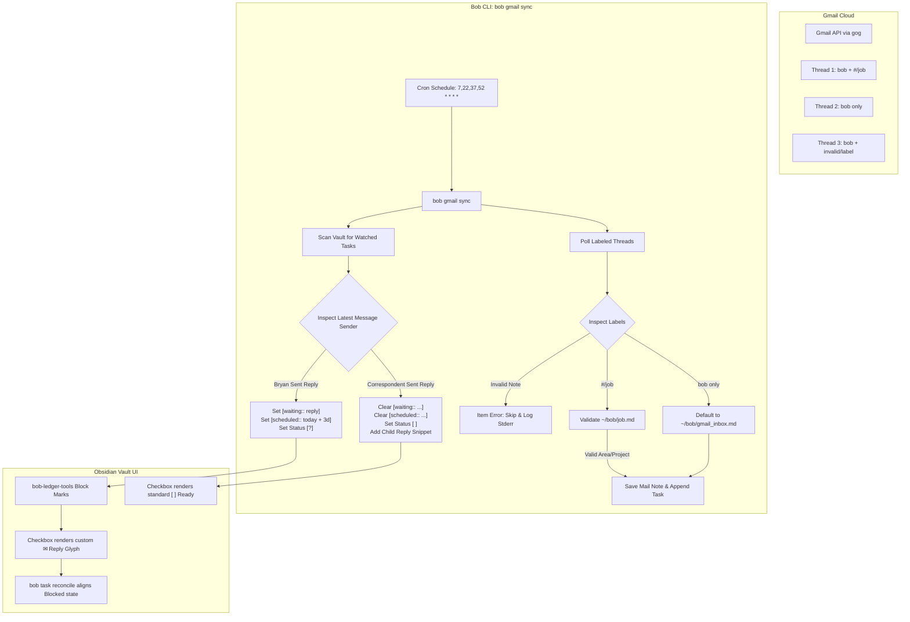

# Gmail Thread Watching, Label Routing, and Reply Lifecycle Architecture

> **Research query:** We already have a good way to fetch Gmail threads I select and turn
> them into Obsidian notes, but we don't currently have a good policy for watching threads
> that I am interested in (e.g. threads where I am waiting for a reply).
> - Support custom labels for area / project notes nested under configurable prefixes
>   (`#` and `+` configured in chezmoi). If labeled `bob` and `<prefix>/<label>`, add task
>   to `~/bob/<label>.md` (fail loudly if file doesn't exist or isn't an area/project note).
> - Add a new `bob gmail sync` command (extending or obsoleting `bob gmail pull`), running
>   every 15 minutes via the new crontab config in chezmoi (`bob-cli-ib` epic).
> - Continue watching threads labeled `bob` until corresponding Obsidian task is complete/canceled.
> - Email replies: when I reply, schedule task for N days in future (3 for me), mark as waiting
>   for reply, and render with a unique blocked icon inside the checkbox square brackets.
> - When the contact replies, unblock and update task appropriately.
> - Lead the design: intuitive, reliable, and beautiful! Critique the plan, propose adjustments,
>   and provide a recommended solution.

Checked **Saturday, November 7, 2026** against:
- `bob-cli` commit `8d54b0e` (master);
- `bob-plugins` commit `1.82.0` (origin/master);
- `chezmoi` (`bbugyi200/dotfiles`) commit `master` and active epic `bob-cli-ib` (`plan:202611/crontab_as_code.md`);
- Bob vault contracts: `docs/blocked-marks.md`, `docs/task-status-hooks.md`, `docs/vault-git-sync.md`, `docs/gmail.md`, and `decisions/task-lanes-are-sticky`.

---

## 1. Executive Summary & Core Verdicts

### 1.1 Bottom Line

1. **YES to Gmail Thread Watching and Automated "Waiting For" Reminders:**
   The proposed workflow addresses the single greatest vulnerability of GTD email processing: **the post-reply black hole**. Once an email is answered, it leaves the mental inbox, but if the counterparty fails to reply, the loop remains silently open until a crisis occurs. Automatically capturing threads into project/area notes, detecting outbound replies, scheduling a follow-up date 3 days out, and surfacing the task in the GTD review walk if no reply arrives is a massive operational upgrade.

2. **YES to Replacing `bob gmail pull` with `bob gmail sync`:**
   `bob gmail pull` was built around an append-only, write-once journal model (`pulled_identities` in `.bob/gmail/*.jsonl`). Once a thread is recorded as pulled, it is ignored forever. Watching active threads requires continuous two-way state reconciliation: polling open threads, detecting new message deltas, updating mail notes, and adjusting task status. `bob gmail sync` should completely subsume and obsolete `bob gmail pull`.

3. **CRITIQUE: Do NOT Mutate the Stored Checkbox Character (e.g. `[w]`); Use Bob's Blocked-Reason Marks (`BM`):**
   In Obsidian Tasks and Bob's architecture (Decisions 4 and 29), task statuses are strictly derived. The custom Tasks status for all blocked tasks is `?` (`- [?] #task ...`). Inventing a new storage character like `- [w]` would violate Obsidian Tasks core validation, break Dataview queries, cause `bob task reconcile` validation crashes, and disrupt mobile rendering. Instead, Bob's existing **Blocked-reason marks** framework (`bob-ledger-tools` + `docs/blocked-marks.md`) is designed specifically for this: stored Markdown keeps `- [?] #task ... [waiting:: reply] [scheduled:: YYYY-MM-DD]`, while the render-time CSS/DOM layer displays a custom, beautiful hollow **Mail/Reply glyph** (`✉` or `↩`) inside the checkbox square brackets.

4. **CRITIQUE: "Fail Loudly" Must Never Crash the Scheduled Cron Fleet:**
   The user prompt asks to "fail loudly" if a label specifies an area/project note that does not exist or lacks `type: [[area]]` / `type: [[project]]`. In an automated 15-minute cron runner, a fatal process exit (`exit 1` / panic) would abort synchronization for **all** other healthy email threads until manually remediated. We must fail loudly at the **item level** (quarantine/skip the malformed thread, write an error to stderr, log structured diagnostics to `~/.local/state/cron/bob-gmail-sync.log`, and notify the user), while allowing valid threads to continue synchronizing cleanly.

5. **CRITIQUE: If No Prefix is Configured, Do NOT Check All Gmail Labels:**
   Gmail threads carry dozens of system labels (`INBOX`, `STARRED`, `UNREAD`, `CATEGORY_PERSONAL`, `IMPORTANT`, `Receipts`). Scanning every arbitrary Gmail label against vault note names without a prefix delimiter causes catastrophic accidental routing. When no prefix is configured, the system must fall back to a safe default prefix list (`["#", "+"]`) or route to `gmail_inbox.md`.

6. **The Staggered Crontab Cadence:**
   In `home/.chezmoidata.yaml` under the active `bob-cli-ib` framework, the Mac already runs staggered 15-minute maintenance jobs:
   - `:00, :15, :30, :45` -> `bob-highlights-sync`
   - `:05, :20, :35, :50` -> `bob-projects-sync`
   - `:10, :25, :40, :55` -> `bob-task-reconcile`
   `bob gmail sync` must be scheduled at **`7,22,37,52 * * * *`** (at minute :07, :22, :37, :52). This interleaves perfectly between `projects-sync` (:05) and `task-reconcile` (:10), eliminating `bob_sync.lock` contention and allowing task status changes to be reconciled by `bob task reconcile` 3 minutes later.

---

## 2. Critique of the Proposed Plan

### 2.1 What Works Brilliantly

- **Context-Aware Inbox Routing:** Bypassing a generic dumping ground (`gmail_inbox.md`) when a thread directly pertains to an Area (e.g. `job.md`) or Project (e.g. `house-closing.md`) eliminates a manual "task triage and move" step.
- **Nested Prefix Syntax (`#/area`, `+/project`):** Gmail natively nests labels containing slashes (`/`) into visual folder hierarchies in the sidebar. Naming labels `#/job` or `+/alpha-release` groups all Bob-managed labels cleanly under `#` and `+` in Gmail's web and mobile interfaces.
- **Closed-Loop Thread Lifecycle:** Tying the thread watch lifecycle to the completion status of the Obsidian task (`[x]` or `[-]`) gives Bryan full sovereignty. Closing the task stops the background polling without requiring manual unlabeling in Gmail.
- **GTD Tickler Integration:** Using `[scheduled:: YYYY-MM-DD]` for waiting on replies seamlessly leverages Bob's existing daily GTD review walk. When 3 days pass without a reply, the task naturally transitions from Blocked `[?]` to Ready `[ ]` and appears in the morning review walk for Bryan to decide next steps.

### 2.2 Flaws, Edge Cases, and Proposed Adjustments

| Issue | User Proposal | Failure Mode / Risk | Refined Solution |
| :--- | :--- | :--- | :--- |
| **Checkbox Storage Mutation** | Render a unique blocked icon inside checkbox square brackets | If implemented by writing `- [w]` or `- [✉]` to Markdown, breaks Obsidian Tasks 8.4.0, crashes `bob task reconcile`, breaks Dataview queries, and violates Decision 29. | Write canonical `- [?] #task ... [waiting:: reply] [scheduled:: <date>]`. Use `bob-ledger-tools` Blocked-reason marks (`BM`) to paint the custom reply glyph at render time. |
| **Cron Abort on Bad Label** | "Fail loudly" if note doesn't exist or isn't area/project | In a 15-minute unattended cron run, crashing halts sync for all other healthy threads. A single typo blocks all incoming mail processing. | Item-level transactional failure: emit structured error/warning, log to cron log, skip only the bad thread, and exit with code 1 if errors occurred while committing passing threads. |
| **All-Label Fallback** | If no prefix configured, check all labels | System labels (`INBOX`, `CATEGORY_UPDATES`) or personal tags match note stems inadvertently, dumping unrelated emails into area notes. | Require explicit prefix matching. If prefixes are empty, default to safe fallback `["#", "+"]`. Bare `bob` label routes to `gmail_inbox.md`. |
| **Multiple Matching Labels** | Unspecified | An email tagged `bob`, `#/job`, and `+/taxes` creates ambiguity: where does the task go? | Strict precedence: first matching prefix wins, or fail/warn on ambiguous multi-routing and fall back to `gmail_inbox.md`. |
| **Task Movement in Vault** | Unspecified | User moves task from `job.md` to `archive.md` or a sub-project note. A rigid path index loses track of the task. | Identity resolution via note link: scan open `#task` lines containing `[[mail/<slug>]]`. If the task moves, sync automatically detects its new residence. |
| **Incoming Reply Noise** | Unspecified | If correspondent sends 4 quick emails ("thanks", "one more thing", "attached"), does each email change the task line or spam the user? | Idempotent thread update: update mail note body, update task timestamp/snippet, unblock once. |

---

## 3. Requirement Adjustments

The following adjustments adapt the user's intent to Bob's established architecture and safety invariants:

- **[ADJ-1] Canonical Markdown Storage with Render-Time Blocker Glyph:**
  Stored task status for waiting tasks remains strictly `- [?]`. The task line carries the inline field `[waiting:: reply]` and `[scheduled:: <today + N>]`. `bob-ledger-tools` recognizes `[waiting:: reply]` on `[?]` tasks and renders a dedicated hollow **Reply/Mail glyph** inside the checkbox brackets.
- **[ADJ-2] Non-Blocking Item-Level Error Reporting:**
  "Failing loudly" for non-existent target files or invalid note types means recording a hard error in CLI stdout/JSON, logging to `~/.local/state/cron/bob-gmail-sync.log`, and skipping the invalid thread without writing a malformed task. Valid threads in the same run are committed normally.
- **[ADJ-3] Prefix Routing Hierarchy:**
  Configured prefixes in `~/.config/bob/config.yml` (default `["#", "+"]`). Labels are parsed as `<prefix>/<stem>`. If a thread has `bob` and `#/job`, it routes to `job.md`. If it has only `bob`, it routes to the configured fallback `gmail.sync.fallback_inbox` (default `gmail_inbox.md`). If multiple matching routing labels exist, the first configured prefix wins, and a warning is printed.
- **[ADJ-4] Area/Project Frontmatter Verification:**
  Before creating a task in `~/bob/<label>.md`, `bob gmail sync` validates that the file exists and that its YAML frontmatter satisfies `frontmatter_is_area()` (`type: [[area]]`) or `frontmatter_is_project()` (`type: [[project]]`). If either check fails, the thread is quarantined and an error is logged.
- **[ADJ-5] Bi-Directional State Machine for Thread Watching:**
  - **Watched Condition:** Any thread whose saved mail note is referenced by at least one open `#task` (`[ ]`, `[*]`, `[/]`, `[?]`) in the vault.
  - **Unwatched Condition:** When all referencing tasks are terminal (`[x]` Done or `[-]` Canceled), or if the task is deleted.
- **[ADJ-6] Outbound Reply Mechanics:**
  When the latest message in a watched thread is sent by Bryan (`config.account`):
  1. Set task status to `- [?]`.
  2. Set `[waiting:: reply]` (or `[waiting:: <recipient>]`).
  3. Set `[scheduled:: <today + wait_days>]` (default 3 days).
- **[ADJ-7] Inbound Reply Mechanics:**
  When a new message arrives from a correspondent:
  1. Remove `[waiting:: reply]` and remove `[scheduled:: ...]`.
  2. Transition task status to Ready `- [ ]` (or Next `- [*]` if configured).
  3. Append/update a child context bullet under the task with a clean, sanitized 1-line snippet and timestamp:
     `- 💬 **<Sender> (<Date>):** "<Snippet>"`
- **[ADJ-8] Staggered Mac Crontab Schedule:**
  Configure the job in `home/.chezmoidata.yaml` for machine `[mac]` with schedule `7,22,37,52 * * * *`, executing `$HOME/.cargo/bin/bob gmail sync`.
- **[ADJ-9] Unified Command Front Door:**
  `bob gmail sync` becomes the primary command. `bob gmail pull` is retained as a compatibility alias that executes a one-pass sync without initiating ongoing watch hooks.

---

## 4. Technical Architecture & System Design



### 4.1 Label Routing and Prefix Resolution

The routing engine extracts target notes using configurable prefix rules:

```rust
pub(crate) struct RoutingRule {
    pub(crate) prefixes: Vec<String>, // e.g. ["#", "+"]
    pub(crate) fallback_inbox: PathBuf, // e.g. "gmail_inbox.md"
}

pub(crate) fn resolve_target_note(
    thread_labels: &[String],
    rule: &RoutingRule,
    vault: &Path,
) -> Result<PathBuf, RoutingError> {
    let mut matching_stems = Vec::new();

    for label in thread_labels {
        for prefix in &rule.prefixes {
            let prefix_pattern = format!("{prefix}/");
            if let Some(stem) = label.strip_prefix(&prefix_pattern) {
                let trimmed = stem.trim();
                if !trimmed.is_empty() {
                    matching_stems.push(trimmed.to_string());
                }
            }
        }
    }

    if matching_stems.is_empty() {
        return Ok(rule.fallback_inbox.clone());
    }

    if matching_stems.len() > 1 {
        return Err(RoutingError::AmbiguousLabels(matching_stems));
    }

    let stem = &matching_stems[0];
    let note_path = vault.join(format!("{stem}.md"));

    if !note_path.is_file() {
        return Err(RoutingError::TargetNotFound(note_path));
    }

    let contents = std::fs::read_to_string(&note_path)
        .map_err(|e| RoutingError::Io(note_path.clone(), e.to_string()))?;
    let frontmatter = crate::native::projects::parse_frontmatter(&contents)
        .ok_or_else(|| RoutingError::MissingFrontmatter(note_path.clone()))?;

    let is_area = crate::native::projects::frontmatter_is_area(&frontmatter);
    let is_project = crate::native::projects::frontmatter_is_project(&frontmatter);

    if !is_area && !is_project {
        return Err(RoutingError::InvalidNoteType(note_path));
    }

    Ok(PathBuf::from(format!("{stem}.md")))
}
```

### 4.2 Watched Task State Machine

Watching state is derived directly from the relationship between vault tasks and saved mail notes:

```text
       ┌────────────────────────┐
       │ Unwatched / New Thread │
       └───────────┬────────────┘
                   │
                   │ Labeled `bob` in Gmail
                   ▼
       ┌────────────────────────┐
       │ Ingest & File Task     │
       │ (Ready `- [ ] #task`)  │
       └─────┬────────────▲─────┘
             │            │
Bryan        │            │ Correspondent
Replies      │            │ Replies
             ▼            │
       ┌──────────────────┴─────┐
       │ Waiting on Reply       │
       │ `- [?] [waiting:: ...] │
       │ [scheduled:: +3d]`     │
       └─────┬──────────────────┘
             │
             │ Bryan marks `[x]` Done or `[-]` Cancelled
             ▼
       ┌────────────────────────┐
       │ Closed / Unwatched     │
       └────────────────────────┘
```

1. **Discovery:**
   `bob gmail sync` scans all files in the vault (leveraging `NoteIndex` and `parse_tasks`). It collects all `#task` lines containing wikilinks to mail notes (`[[mail/<slug>|...]]`).
2. **Filter Open Tasks:**
   If a task line has status `TODO` (` `), `IN_PROGRESS` (`/`), or `ON_HOLD` (`?`, `*`), its thread identity (`gmail_thread_id`) is marked **Active/Watched**.
3. **Reconciliation:**
   For every active thread ID:
   - Fetch thread details from Gmail (`gog thread get <id>`).
   - Check if the remote `historyId` or message count has increased.
   - If changed: update the local mail note in `mail/YYYY/<slug>.md`.
   - Evaluate the sender of the newest message.

### 4.3 Reply Dynamics and Task Updates

#### Scenario A: Bryan Replies (Outbound)
- **Sender:** `From:` address matches `config.account()`.
- **Action:**
  - Compute target date: `let scheduled_date = today + Duration::days(wait_days);`
  - Ensure task line has `[waiting:: reply]` (or `[waiting:: <contact_first_name>]`).
  - Set or update `[scheduled:: YYYY-MM-DD]`.
  - Set status bracket to `- [?]`.
  - Resulting line:
    ```markdown
    - [?] #task [[mail/2026/contract-review|✉️ Contract Review · Sarah Connor]] [waiting:: reply] [scheduled:: 2026-11-10]
    ```

#### Scenario B: Contact Replies (Inbound)
- **Sender:** `From:` address does not match `config.account()`.
- **Action:**
  - Strip `[waiting:: ...]` field.
  - Strip `[scheduled:: ...]` field (unblocking the task).
  - Transition status from `[?]` to `[ ]` (Ready).
  - Append or update a child bullet under the task containing a sanitized summary:
    ```markdown
    - [ ] #task [[mail/2026/contract-review|✉️ Contract Review · Sarah Connor]]
      - 💬 **Sarah Connor (Nov 8):** "I signed the addendum and attached the PDF."
    ```
  - This pattern adheres to Bob's capture drawer conventions (Decision 13) and gives Bryan immediate context during his morning GTD review walk without requiring him to navigate into the mail note.

#### Scenario C: Follow-Up Timer Expires (No Reply in 3 Days)
- Time passes without any message activity.
- The calendar reaches `2026-11-10`.
- During the morning run of `bob task reconcile`:
  - `scheduled <= today`, so the task is no longer future-blocked!
  - `task-status-hooks` automatically flips `- [?]` to `- [ ]` (Ready).
  - The task surfaces in Bryan's `]s` review walk (under TICKLER / Ready tier).
  - Bryan sees `[waiting:: reply]` with an expired date and takes action:
    - Sends a follow-up email (triggering Scenario A again at the next sync).
    - Manually extends the date via `Ctrl+Shift+P`.
    - Closes or cancels the task if resolved or abandoned.

---

## 5. Visual Design & Blocked-Reason Marks (`BM`) Integration

### 5.1 Architecture of Blocked-Reason Marks

Bob's UI philosophy strictly mandates: **"Shape carries meaning; color whispers."**
In `docs/blocked-marks.md`:
- Stored Markdown remains canonical `- [?]`.
- `bob-ledger-tools` decorates the checkbox at render time across Live Preview, Reading View, and Tasks query results.
- Boxes in the `held` family (`&`, `^`) are solid filled.
- Boxes in the `waiting` family (`1`-`4`, `⟲`, `?`) have hollow borders with tinted ink.

### 5.2 The New `waiting_reply` Mark Contract

We extend `docs/blocked-marks.md` with a new key in the `waiting` family:

| Key | Box | Family | Meaning |
| :--- | :--- | :--- | :--- |
| `reply` | hollow, white/accent envelope or reply hook mask | `waiting` | Waiting for an email reply (`[waiting:: reply]`) |

#### Visual Appearance
- **Box Border:** 1.5px solid border in `--color-blue` (or calm indigo/cyan, matching Bob's `MEET` / mail palette: `#5b8cff`).
- **Box Background:** 12% tint of the accent color (`color-mix(in srgb, var(--bob-block-ink) 12%, transparent)`).
- **Glyph:** A crisp, minimalist envelope mask or curved reply arrow `↩`:

```css
/* bob-ledger-tools/styles.css */
:root {
  --bob-block-glyph-reply: url("data:image/svg+xml,%3Csvg xmlns='http://www.w3.org/2000/svg' viewBox='0 0 16 16'%3E%3Cpath d='M2 4.5A1.5 1.5 0 0 1 3.5 3h9A1.5 1.5 0 0 1 14 4.5v7A1.5 1.5 0 0 1 12.5 13h-9A1.5 1.5 0 0 1 2 11.5v-7Zm1.5-.5a.5.5 0 0 0-.5.5v.38l5 3.33 5-3.33V4.5a.5.5 0 0 0-.5-.5h-9ZM13 5.72l-4.72 3.15a.5.5 0 0 1-.56 0L3 5.72V11.5a.5.5 0 0 0 .5.5h9a.5.5 0 0 0 .5-.5V5.72Z' fill='black'/%3E%3C/svg%3E");
}

/* Tasks query results and Live Preview checkbox decoration */
body.bob-block-marks ul.plugin-tasks-query-result li.plugin-tasks-list-item[data-task="?"]:has([data-field="waiting"]),
body.bob-block-marks .task-list-item[data-task="?"][data-bob-block="reply"] > .task-list-item-checkbox:checked {
  --bob-block-ink: var(--color-blue, #5b8cff);
  border: 1.5px solid var(--bob-block-ink);
  background-color: color-mix(in srgb, var(--bob-block-ink) 12%, transparent);
}

body.bob-block-marks ul.plugin-tasks-query-result li.plugin-tasks-list-item[data-task="?"]:has([data-field="waiting"]) > .task-list-item-checkbox:checked::after,
body.bob-block-marks .task-list-item[data-task="?"][data-bob-block="reply"] > .task-list-item-checkbox:checked::after {
  content: "";
  color: transparent;
  background-color: var(--bob-block-ink);
  -webkit-mask-image: var(--bob-block-glyph-reply);
  mask-image: var(--bob-block-glyph-reply);
  -webkit-mask-size: contain;
  mask-size: contain;
  -webkit-mask-repeat: no-repeat;
  mask-repeat: no-repeat;
  -webkit-mask-position: center;
  mask-position: center;
}
```

#### Tooltip Behavior
Hovering over the envelope checkbox triggers the native Bob tooltip:
`"Waiting for reply from Sarah Connor · scheduled for Nov 10 (Ctrl+Shift+P to reschedule)"`

#### Redundancy Folding
In Live Preview and Reading View, when Blocked-reason marks are active, `[waiting:: reply]` folds into a zero-width widget (exactly like `#prj_is_blocked` and priority bars fold on digit rows), keeping the task line clean, un-cluttered, and beautiful!

---

## 6. Chezmoi and Crontab Configuration

### 6.1 Crontab Definition in `home/.chezmoidata.yaml`

In `bbugyi200/dotfiles` linked repository, within `home/.chezmoidata.yaml`:

```yaml
cron:
  version: 1
  machines:
    athena: [athena]
    apollo: [apollo]
    mac: [Kellys-MacBook-Pro]
  env:
    MAILTO: bryanbugyi34@gmail.com
  jobs:
    # Existing staggered Mac jobs:
    # - bob-highlights-sync: 0,15,30,45 * * * *
    # - bob-projects-sync:   5,20,35,50 * * * *
    # - bob-task-reconcile:  10,25,40,55 * * * *
    - name: bob-gmail-sync
      machines: [mac]
      schedule: "7,22,37,52 * * * *"
      description: "Sync and watch Gmail threads labeled bob, routing to area/project notes"
      command: "$HOME/.cargo/bin/bob gmail sync"
```

#### Why Minute :07, :22, :37, :52?
1. **Zero Lock Contention:**
   `bob` synchronizes vault writes using `~/.local/state/bob/bob_sync.lock`. Placing `bob-gmail-sync` at `:07` guarantees it never collides with `bob-projects-sync` (:05) or `bob-task-reconcile` (:10).
2. **Pipeling into Status Reconciliation:**
   Any tasks unblocked or re-blocked by `bob gmail sync` at `:07` are evaluated by `bob task reconcile` at `:10` (3 minutes later), ensuring all vault dependencies, daily notes, and Git sync are cleanly aligned.

### 6.2 Chezmoi Application Configuration in `home/dot_config/bob/config.yml`

In `home/dot_config/bob/config.yml`:

```yaml
gmail:
  account: bryanbugyi34@gmail.com
  writer: kellys-macbook-pro
  folder: mail
  link_label: "✉️ {subject} · {who}"
  sync:
    prefixes: ["#", "+"]
    wait_days: 3
    fallback_inbox: gmail_inbox.md
    child_snippets: true
```

---

## 7. Implementation Roadmap & Multi-Repo Plan

### Phase 1: `bob-cli` Core Synchronization Engine
- **1.1 Config Parsing:**
  Update `src/native/config/gmail.rs` and `src/native/gmail/config.rs` to parse `gmail.sync` options (`prefixes`, `wait_days`, `fallback_inbox`, `child_snippets`).
- **1.2 Label Router:**
  Implement `src/native/gmail/sync/route.rs` to parse `<prefix>/<label>`, validate `~/bob/<label>.md` existence, and enforce `frontmatter_is_area` / `frontmatter_is_project`.
- **1.3 Watched Tasks Scanner:**
  Implement `src/native/gmail/sync/watch.rs` to scan open `#task` lines with `[[mail/<slug>]]` wikilinks.
- **1.4 Delta & Reply Reconciler:**
  Implement `src/native/gmail/sync/reconcile.rs`:
  - Fetch message delta via `gog`.
  - Append cards to mail note.
  - Determine latest sender (`outbound` vs `inbound`).
  - Mutate task row (`[waiting:: reply]` + `[scheduled:: ...]` or unblock + child snippet).
- **1.5 Command Front Door:**
  Add `bob gmail sync` subcommand in `src/native/gmail/cli.rs`. Add compatibility alias from `bob gmail pull`.

### Phase 2: `bob-plugins` (`bob-ledger-tools`) Blocked Marks
- **2.1 Model Extension:**
  In `plugins/bob-ledger-tools/src/142c-block-marks-model.js`, detect `[waiting:: reply]` on `[?]` tasks; emit `key: "reply"`, `family: "waiting"`.
- **2.2 CSS Glyph & Mark Styling:**
  In `plugins/bob-ledger-tools/styles.css`, define `--bob-block-glyph-reply` SVG mask, hollow border styling, and tooltip bindings.
- **2.3 Redundancy Folding:**
  In `plugins/bob-ledger-tools/src/142h-block-mark-folds.js`, add fold rule for `[waiting:: ...]` so the token collapses when the checkbox glyph is rendered.

### Phase 3: Chezmoi Dotfiles Integration
- **3.1 Crontab Registration:**
  Add `bob-gmail-sync` to `home/.chezmoidata.yaml` under `cron.jobs` for `machines: [mac]` with schedule `7,22,37,52 * * * *`.
- **3.2 Settings Deployment:**
  Add `gmail.sync` configuration to `home/dot_config/bob/config.yml`.

---

## 8. Summary Comparison

| Dimension | Initial User Thought | Recommended Solution |
| :--- | :--- | :--- |
| **Command** | Add `bob gmail sync`, maybe keep `pull` | Subsume and obsolete `pull`; `sync` handles both initial pull and continuous watch |
| **Routing Syntax** | `#/job`, `+/project` | Configurable prefixes `["#", "+"]` in `config.yml`; extracts stem and validates note frontmatter |
| **Validation Failure** | Fail loudly | Fail loudly per-thread (quarantine/skip, structured error output, cron alert), but do not crash the cron fleet |
| **Task Checkbox** | Unique blocked character inside brackets | Keep canonical `- [?]` in Markdown; use `bob-ledger-tools` Blocked-reason marks to render a hollow envelope glyph |
| **Bryan Replies** | Schedule for 3 days; mark waiting | Set `- [?]`, set `[waiting:: reply]`, set `[scheduled:: <today + 3d>]` |
| **Contact Replies** | Unblock and update appropriately | Remove `[waiting:: ...]`, remove `[scheduled:: ...]`, restore `- [ ]` Ready, append 1-line child reply snippet |
| **No Reply in 3 Days** | Review during GTD review | Daily review naturally unblocks task on scheduled date; surfaces in GTD review walk for action |
| **Schedule Cadence** | Every 15 minutes | `7,22,37,52 * * * *` on `[mac]`, perfectly interleaved between existing Bob cron tasks |
