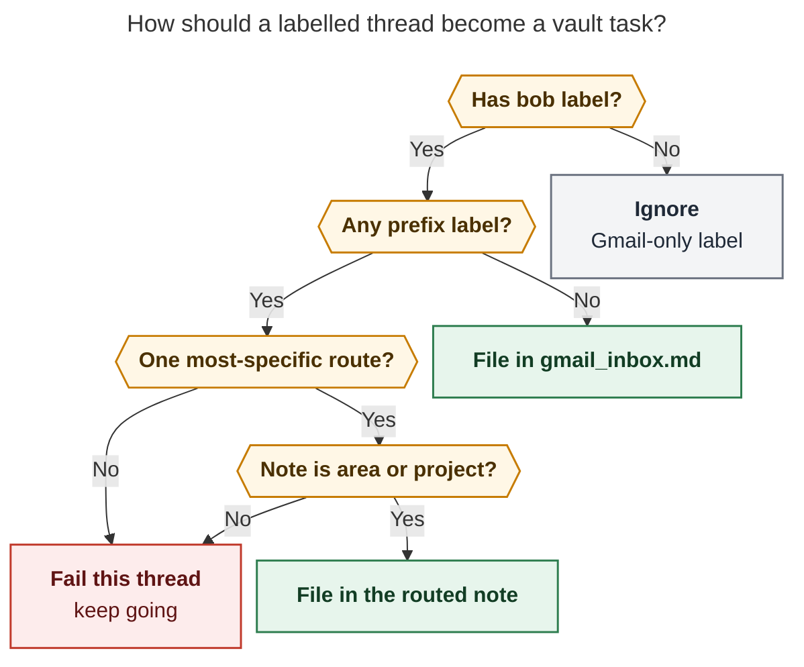
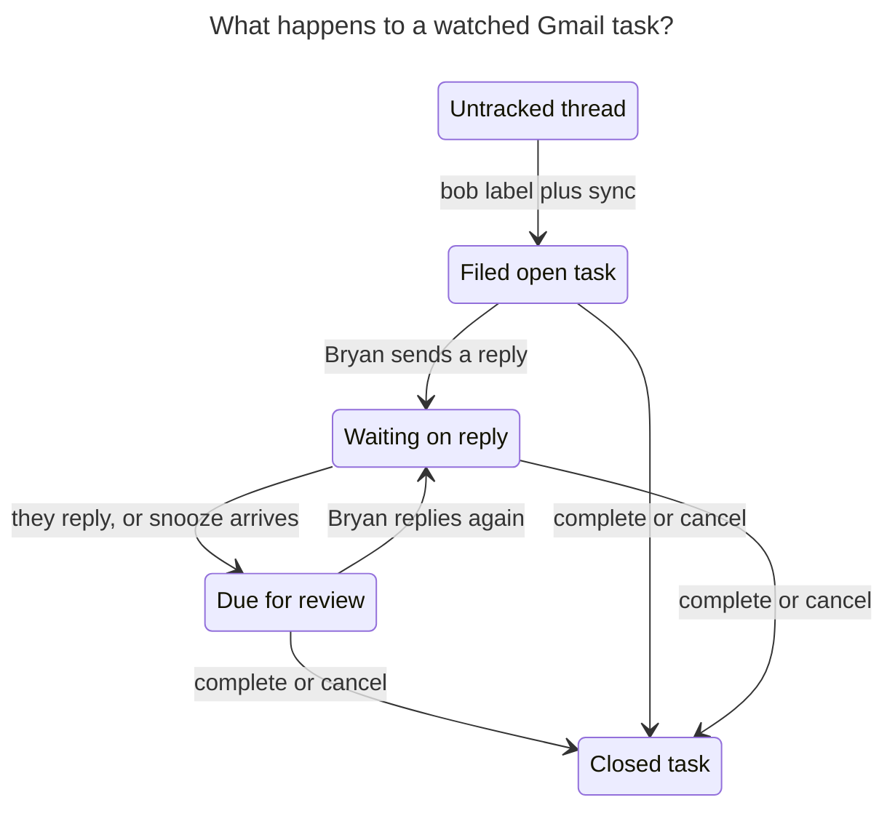

# Watch labelled Gmail threads until their Obsidian tasks close

> **Research query:** How should Bob watch Gmail threads Bryan is waiting on — using
> nested area/project labels under configurable prefixes, a new `bob gmail sync`
> command, a 15-minute chezmoi cron job, and a waiting-for-reply loop with a unique
> blocked checkbox icon — so the design is intuitive, reliable, and beautiful? Critique
> the request, call out justified requirement changes, and end with a recommended
> solution.

*Independent report · researcher `grk` · 2026-11-07 · account `bryanbugyi34@gmail.com`*

Checked against bob-cli (this workspace), `plan:202611/bob_gmail.md`,
`plan:202611/crontab_as_code.md`, beads `bob-cli-i1` / `bob-cli-i4` / `bob-cli-ib` /
`bob-cli-ic`, prior research `research:202611/gmail_thread_note_sync/gmail_thread_note_sync.md`
and `research:202611/blocked_reason_marks/blocked_reason_marks.md`, chezmoi
`home/.chezmoidata.yaml` and `home/dot_config/bob/config.yml`, and a **read-only**
Gmail labels/search/API check. No message bodies are quoted.

## Bottom line

**Build this. It is the missing half of `bob gmail`.** Filing a labelled thread is
already good; staying subscribed until the corresponding task closes is the GTD
Waiting-For loop the current stack deliberately deferred (`plan:202611/bob_gmail.md` §6,
bead `bob-cli-i1`).

The request's instincts are right: a `bob` label as the opt-in, extra nested labels as
the filing destination, a scheduled `sync` on the Mac, and a snoozed wait after Bryan
replies. Several of the concrete mechanics need to change so the feature fits Bob's
task model and Bryan's already-existing Gmail taxonomy.

**The recommended shape:**

1. **`bob gmail sync`** becomes the canonical writer. **`bob gmail pull` stays as a
   permanent hidden alias** with byte-identical behavior (CLI rule: never hard-rename).
2. **The open Obsidian task is the watch subscription.** The Gmail `bob` label is only
   the intake gesture. Completing or cancelling the task ends the watch. Gmail stays
   read-only (invariant I1).
3. **Route with capture-targets, not `~/bob/<label>.md`.** Prefix `#` means area, prefix
   `+` means project, remainder is a route. Fail closed, per thread, when the note is
   missing, ambiguous, or the wrong kind.
4. **Waiting-for-reply is a new *derived* Blocked reason**, stored as `[?]` plus
   `[wait:: reply]` and a future `[scheduled::]`. The unique icon is a **display-only**
   solid `↩` mark. Markdown, Tasks, and reconcile keep a single Blocked symbol.
5. **A reply resurfaces the task as a TICKLER.** It does not raise Next, stamp
   `[fresh::]`, or invent a Waiting lane.
6. **Cron on the Mac only**, every 15 minutes at `7,22,37,52`, so sync writes land
   *before* `bob task reconcile` at `:10/:25/:40/:55`.

## Is this a good idea?

**Yes, for correspondence that already earned a task.** Bryan's Gmail app is the
mailbox. Bob should notice when a watched conversation moves, park the task while a
reply is outstanding, and put it back on the morning walk when the other person answers
or the snooze expires.

That is a small, sharp product:

- The phone gesture stays one or two labels.
- The vault keeps one task per watched thread, in the note that owns the work.
- The mail note stays the readable snapshot (`[!mail]` / `[!mail-sent]` cards).
- Review stays `]s`, with a checkbox that *looks* like "waiting on a person".

It is a bad idea if it tries to become an inbox client, a second Gmail label mirror, or
a new authored task status. Those are the failure modes this design refuses.

### What already exists (and what does not)

| Surface | Today |
| --- | --- |
| Choose a thread | Picker, paste-to-link, capture URL, `bob gmail save` |
| Phone intake | `bob` label → `bob gmail pull` → `gmail_inbox.md` task, no freshness stamp |
| Refresh a note | Manual `save`, Bob Mail refresh, link, or a confirmed `send`. **Nothing polls.** |
| See drift | `bob gmail list -r` (count-only; one gone thread fails the whole listing, `bob-cli-ic`) |
| Reply from Obsidian | `## Reply` → draft → confirmed send; send already refreshes the note |
| Watch until the task closes | **Missing.** Pull skips already-filed threads. Completing a task does nothing in Gmail. |
| Waiting-for-reply | **Missing.** Deferred as `bob-cli-i1` because it touches the task-state model. |
| Cron | `cron.jobs: []` in chezmoi while epic `bob-cli-ib` migrates. The Mac still has three hand-installed `*/15` jobs. |

Vault snapshot, 2026-11-07: **4** notes contain `[[mail/…]]` links, **0** open `#task`
lines link a mail note, **2** closed task lines do, `gmail_inbox.md` exists with **0**
task rows. The watch set is empty. This feature starts clean.

## Live Gmail evidence that should change the design

Bryan **already has** the nested labels the request describes. Read-only
`gog gmail labels list` on 2026-11-07 returned **48** labels, including:

| Prefix | Nested labels present |
| --- | --- |
| `#` | `#/body`, `#/cash`, `#/dad`, `#/home`, `#/job` |
| `+` | `+/black`, `+/dresser`, `+/home`, `+/home/build`, `+/home/law`, `+/home/mortgage`, `+/home/utilities`, `+/rent`, `+/trip`, `+/trip/miami`, `+/wedding` |
| `@` | `@/NEXT`, `@/OVERFLOW`, `@/VACATION` |
| watch | `bob` |

Plus a flat `Job` label that is a different object from `#/job`.

Counts that matter:

- `label:bob` search: **2** threads (the current pull queue).
- Gmail API `users.threads.list` with `#/job`'s opaque id `Label_750103471840070989`:
  **~201** threads.
- Gmail *search* `label:#/job`: **66** threads — the wrong set. Gmail search strips
  `#` and treats `/` poorly, so name-based queries cannot be the routing engine.

Vault notes that already match the `#` remainder as areas: `body.md`, `cash.md`,
`job.md`. Several `+/…` remainders (`black`, `dresser`, `trip/miami`, …) have **no**
matching project note. A silent `~/bob/<label>.md` write would either miss nested
projects or create the wrong file.

The `@` nest is a Gmail-side GTD lane (`NEXT` / `OVERFLOW` / `VACATION`), not a vault
route. Scanning every label when prefixes are empty would try to file those.

**Takeaway:** `#` and `+` as prefixes are already Bryan's taxonomy. `bob` AND a prefix
label is the right AND-gate: two `bob` threads versus two hundred `#/job` threads. The
implementation must use **label ids**, then map ids back to names through
`gmail.labels.list` (already in Bob's read-command allowlist).

**Reader question:** How should a labelled thread become a vault task?

**Caption:** `bob` is the watch opt-in. A prefix label is the destination. The parent
`#` or `+` label alone never routes.



Rendered size: 769.3 × 958 px; fit scale: 84.9%. Mermaid CLI 12.0.0. PNG export on this
host failed after SVG succeeded (`ConnectionClosedError` on `page.close`); the SVG is
the reviewable figure.



**Figure 1.** `bob` is the watch opt-in. A prefix label is the destination. The parent
`#` or `+` label alone never routes.

## Critique of the request

The request is a strong product brief with six mechanics that would fight Bob if taken
literally.

### 1. `~/bob/<label>.md` is too small a lookup

Bryan's `+` labels are nested (`+/home/build`, `+/trip/miami`). Capture already resolves
area/project routes through `parent_notes::resolve_parent` (`sase`, `sase.md`,
`[[sase]]`, aliases; exact stem wins; unknown/ambiguous/terminal fail with hints). Sync
should call that resolver.

**Adjustment ADJ-1.** After stripping a configured prefix plus `/`, treat the remainder
as a **capture route**. Try the remainder as written, then with `/` folded to `_`
(`home/build` → `home_build`). `#` must resolve to an **area**. `+` must resolve to a
**project**. A missing file, a note that exists with the wrong `type:`, a closed
project, or two incomparable prefix labels fails that thread out loud.

The parent labels `#` and `+` are containers. They never file.

When several prefix labels apply, pick the **longest remainder** (`+/home/build` beats
`+/home`). Two remainders where neither is a prefix of the other (`#/job` and
`+/wedding`) fail as ambiguous.

### 2. Empty prefixes must not mean "all labels"

The request left this call to the researcher. **Scanning every label is unsafe.** This
mailbox already has `@/NEXT`, `@/OVERFLOW`, `@/VACATION`, a flat `Job`, `later`, and
`taxes`. Those are Gmail organization, not vault routes.

**Adjustment ADJ-2.** Empty `gmail.sync.label_prefixes` disables area/project routing.
`bob`-only threads still file in `gmail.pull.inbox`. Prefixes for Bryan: `["#", "+"]`.
Do not add `@`.

### 3. Do not store a new checkbox character

"Unique blocked icon inside the checkbox square brackets" is a **render** requirement.
`docs/task-status-hooks.md` and `src/native/task_status_hooks/settings.rs` require
exactly one Tasks Blocked status: symbol `?`, type `ON_HOLD`.
`research:202611/blocked_reason_marks` already designed display-only marks on top of
stored `[?]`: solid `&` / `^` for held-by-work, hollow `1`–`4` / `⟲` / `?` for
date-waits.

A new stored symbol would fork reconcile, the cycler, chips, capture, `blocked.md`, and
the Tasks registry. Bryan cancelled a Submitted/Waiting *lane*
(`decisions:task-lanes-are-sticky`).

**Adjustment ADJ-3.** Keep `[?]` in Markdown. Add BlockReason `waiting_reply`. Render a
**solid `↩`** (reply arrow) in the checkbox, same family as `&` (waiting on a person).
Tooltip: `Waiting on a reply · snoozed until Fri, Nov 10`.

### 4. The watch key is the open task, not the Gmail label

"Continue to watch until I mark the corresponding Obsidian task complete" is the right
stop condition. Driving the watch set from the `bob` label would keep refreshing
threads whose tasks Bryan already closed, and would drop threads whose labels he
cleaned up while the work was still open.

**Adjustment ADJ-4.**

- **Intake** = threads that currently carry `bob` and are not yet filed.
- **Watch** = every **open** `#task` whose line (or a direct child) wikilinks a saved
  mail note.
- **Stop** = the task is completed or cancelled.
- Gmail labels are left untouched (I1). Bead `bob-cli-i4` (opt-in unlabel after a
  verified pull) stays a later, scoped mutation with `gmail.modify`.

Capture-created mail links are watched too. That is the `bob-cli-i1` promise, and with
four saved notes today the cost is tiny.

### 5. A reply should tickle, not plan the day

Auto-promoting to Next would silently spend the Next cap. Automation must not stamp
`[fresh::]` (`decisions:unblocked-tasks-resurface-as-ticklers`). Sticky lanes already
say: if the task was Next or Pending, the lane survives Blocked recovery.

**Adjustment ADJ-5.** On an inbound reply:

1. Refresh the mail note (append the new card).
2. Clear `[wait:: reply]`.
3. Clear `[scheduled::]` when this wait owned it (the wait field was present).
4. Stamp `[unblocked:: today]` so the next `]s` walk visits it as TICKLER.
5. Append one child bullet: `↩ YYYY-MM-DD · <who> replied`.
6. Leave Next / Pending / Ready as they are.

Bryan still chooses whether this is today's work.

### 6. Fail per thread, then keep going

`bob gmail list -r` already fails the whole listing on one gone thread (`bob-cli-ic`).
A cron job that dies because `#/dad` has no `dad.md` would strand the rest of the watch
set.

**Adjustment ADJ-6.** "Fail loudly" means a red, named error for that thread (id, labels,
route, hint), a non-zero exit if any thread failed, and MAILTO via `cronrun`. Other
threads still file, refresh, and update wait state. A routing failure never falls back
to `gmail_inbox.md`; that would hide the mislabel.

### 7. `pull` should become `sync`, not live beside it

Two writer commands would drift. CLI rules forbid deleting `pull`.

**Adjustment ADJ-7.** `bob gmail sync` is the canonical verb, modelled on `bob gcal
sync`. `bob gmail pull` is a hidden alias with identical behavior. Help, logs, and
commit subjects say `sync`. Command Mode grows a `gmail-sync` row; `gmail-pull` keeps
working.

### 8. Fifteen minutes, Mac only, slotted before reconcile

The Mac already staggers 15-minute jobs at `:00` (highlights), `:05` (projects), `:10`
(reconcile). Sync writes `[scheduled::]` that reconcile must turn into `[?]`.

**Adjustment ADJ-8.** One chezmoi `cron:` job, `machines: [mac]`, schedule
`7,22,37,52 * * * *`, command `bob gmail sync -q --retry-timeout 120`. That is two
minutes after projects and three minutes before reconcile. Do not schedule it on
athena or apollo: `gmail.writer` should pin the Mac. Gmail push/Pub/Sub is out of
scope (GCP topic, 7-day `watch` renewal) for one laptop that sleeps.

Epic `bob-cli-ib` is in-progress and `cron.jobs` is still `[]`. Add this job through
that `cron:` block, not `crontab -e`. Until migrate lands, the line can sit in data
ready for the Mac cutover.

### 9. Pin `gmail.writer` as part of shipping this

Live `~/.config/bob/config.yml` has **no** `gmail:` block, so any logged-in host may
write. A 15-minute writer on the Mac without a pin invites a second host to file the
same thread.

**Adjustment ADJ-9.** In chezmoi `home/dot_config/bob/config.yml`, set `gmail.account`,
`gmail.writer` to the Mac's vault-sync hostname slug (`kellys-macbook-pro` in the
commented gcal example; confirm with `bob gmail doctor` on the Mac), plus the sync
keys below.

## Recommended design

### Mental model

One Gmail thread ↔ one mail note ↔ one open task.

- **Label `bob`** means "file this and watch it."
- **Label `#/<area>` or `+/<project>`** means "the task lives in that note."
- **The open task** means "keep the note current and run the wait loop."
- **Closing the task** means "I am done with this conversation."

**Reader question:** What happens to a watched Gmail task?

**Caption:** Ping-pong continues until Bryan closes the task. Sync is the reconciler;
an Obsidian send may enter Waiting in the same write.



Rendered size: 619.1 × 782 px; fit scale: 100%. Mermaid CLI 12.0.0.



**Figure 2.** Ping-pong continues until Bryan closes the task. Sync is the reconciler;
an Obsidian send may enter Waiting in the same write.

### Command: `bob gmail sync`

**Membership.** Verb under the `gmail` noun: it rewrites vault notes from Gmail, like
`save` / `pull`. Options alphabetical with short aliases. JSON `schema_version: 1`.
Exit 0 / 1 / 2 as gcal. `-d` plans every step without writing.

One run, in order, all Gmail fetches **before** `bob_sync.lock`:

1. Resolve config, writer pin, gog, account.
2. `labels.list` → id↔name map.
3. **Intake.** `threads.list` (or today's working `label:bob` search) for
   `gmail.pull.label`. Skip identities already in the pull journal or already linked
   from an open/closed task.
4. **Watch refresh.** From the mail-note index plus vault backlinks, every open `#task`
   that links a mail note. `save` each note (existing no-op when unchanged). Isolate
   per-thread errors.
5. **Wait-state machine** on those tasks, using the refreshed cards (see below).
6. Under the lock: write mail notes, append or update task lines, commit
   `gmail: sync …`, journal `gmail.pulled` / `gmail.wait` / `gmail.replied` events with
   identities only (I7: no bodies).

Human output is a colored table: `filed`, `routed`, `refreshed +N`, `waiting`,
`replied`, `unchanged`, `error`. Quiet mode for cron prints a one-line summary plus
errors on stderr.

### Configuration (chezmoi)

```yaml
gmail:
  account: bryanbugyi34@gmail.com
  writer: kellys-macbook-pro # confirm with `bob gmail doctor` on the Mac
  pull:
    inbox: gmail_inbox.md
    label: bob
  sync:
    label_prefixes: ["#", "+"]
    wait_days: 3
```

- `pull.label` / `pull.inbox` keep today's names so existing docs and tests stay
  coherent; sync reads them.
- `label_prefixes` longest-match first. Empty list → inbox-only intake (ADJ-2).
- `wait_days` integer ≥ 1. Bryan: **3**.
- Unknown keys remain ignored; wrong types are setup errors that name the key.

### Filing the task

Reuse pull's task line, which is already the right shape:

```markdown
- [ ] #task [[mail/2026/261105_lease_renewal|✉️ Lease renewal · Dana]]
```

No `[fresh::]`, so it lands in NEW until Bryan confirms. Append under `## Tasks` of the
routed note, creating that section if needed. Never create an area/project note.

`gmail_inbox.md` remains the no-prefix fallback and is created as today if missing.

Idempotence stays `(account, thread_id)` via the journal **and** an existing wikilink
to that mail note anywhere in the vault, so a Ctrl+Shift+M off the inbox does not get a
second task on the next sync.

### Wait-state machine

Detect **own** vs **other** the same way mail cards already do
(`note/layout.rs`): `From` equals `gmail.account`, case-insensitive. Own cards are
`[!mail-sent]`. Bulletin / list / `noreply` mail never enters wait (reuse
`is_bulletin`).

Cursor per task: the last processed importable message id, stored in the journal (not
on the task line) so a hand-edited card cannot desync the machine.

| Event | Task writes |
| --- | --- |
| New own message, and the thread has had at least one other-person message | `[wait:: reply]`, `[scheduled:: today + wait_days]` in Bob's timezone, child bullet `⏳ YYYY-MM-DD · waiting on <who> · +3d` |
| New other-person message while `[wait:: reply]` is set | ADJ-5 (clear wait, clear our snooze, `[unblocked:: today]`, `↩` bullet) |
| Snooze date arrives, still waiting, no new other-person mail | Clear nothing. Future `scheduled` no longer blocks, so reconcile recovers to Ready and the unblocked-tickler rule applies. Keep `[wait:: reply]` so the row still reads as a follow-up. |
| Bryan completes or cancels | Stop watching. Leave Gmail alone. |

Obsidian `bob gmail send` should apply the "own message" row **in the same
finalize pass** that already refreshes the note, so the wait does not wait for cron.
Sync remains the authority for phone replies and for anything the send path missed.

`[wait:: reply]` is machine-owned, like `#prj_is_blocked`. Hand-deleting it is
undone on the next sync if the cursor still says we are waiting; completing the task
is the supported way out.

Reconcile gains `BlockReason::WaitingReply`. It contributes Blocked **only while
`[scheduled::]` is strictly after today**. That gives the unique icon during the
snooze and a normal Ready/TICKLER row when the snooze lapses — exactly the GTD
review the request wants.

Blocked-reason mark precedence, extending the existing own-dep > project > date
order:

**own prerequisite > waiting-reply > project > own date**

Waiting-reply is solid ink, same red family as `&`. A corner pip still signals an
extra reason (usually the snooze date).

### Cron (chezmoi `cron:`)

```yaml
- name: bob-gmail-sync
  machines: [mac]
  schedule: "7,22,37,52 * * * *"
  description: Watch labelled Gmail threads and waiting-for-reply tasks
  command: bob gmail sync -q --retry-timeout 120
```

`cronrun` already overlaps, logs to `~/.local/state/cron/bob-gmail-sync.log`, and
mails failures only. The Mac sleeping means a burst of catch-up on wake; save is a
no-op for unchanged notes. Quota: `threads.get` is 40 units under the May 2026 table;
a few dozen watched threads per tick sits far under 6,000 units/user/minute. Skip
Gmail `history.list` for v1; revisit if the watch set grows into hundreds.

Do not add a second interval on athena. Agent hosts stay read-only.

### Invariants this must keep

| Invariant | How sync honours it |
| --- | --- |
| I1 Gmail is the system of record | Read-only. No label, archive, or read-state writes. Nothing mutates Gmail on task completion. |
| I3 bob is the only vault writer | Plugins render. Cron calls `bob`. |
| I4 Never destroy information | Per-thread isolate. Unroutable threads stay in Gmail. Old cards stay. |
| I5 Sender content is data | Refresh goes through the existing inert save path. |
| I7 No bodies outside the note | Journal events hold account, thread id, note path, wait kind. |
| Capture offline (I2) | Sync is a network command, never called from capture-parse. |
| Status derived | Writers change `wait` + `scheduled`; reconcile owns `[?]`. |
| Automation never stamps `fresh` | Unblock uses `[unblocked::]`. |
| Sticky lanes | A reply never raises Next. |

### Docs and surfaces

- `docs/gmail.md`: new Sync section; Pull becomes "hidden alias of sync".
- `docs/guides/file-email-from-your-phone.md`: apply `bob` plus `#/job` (or `+/…`).
- `docs/blocked-marks.md` (when that lands) / ledger-tools: add the `↩` mark.
- `docs/task-status-hooks.md`: `waiting_reply` in the reason table.
- `docs/vault-git-sync.md`: Mac job list, after `bob-cli-ib` migrate.
- Glossary `inbox-file` already names `gmail_inbox.md`; keep it as the no-prefix
  fallback.
- Decision records, once accepted:
  - *Gmail watch follows the open task.*
  - *Waiting-for-reply is a derived Blocked reason with a display-only `↩`.*
  - *Inbound replies resurface as ticklers.*

## Alternatives considered

| Alternative | Why it loses |
| --- | --- |
| Gmail snooze / Boomerang / FollowUpThen | Leaves Bob's review walk; two systems to check. |
| Watch every saved mail note | Reference threads would poll forever. The open task is the subscription. |
| Fake Depends-On on a phantom "reply from X" | Pollutes the dependency graph and BLOCKS lines. |
| New Waiting lane or stored `[W]` | Bryan cancelled Waiting-as-status; Tasks allows one Blocked symbol. |
| Push notifications | GCP Pub/Sub, 7-day watch renewal, and a always-on receiver for a laptop that sleeps. |
| `history.list` as v1 | Extra gog command and cursor expiry; the watch set is tiny. |
| Unlabel on complete in v1 | Needs `gmail.modify` and breaks I1; that is `bob-cli-i4`. |
| Auto-Next on reply | Spends the plan cap without consent. |
| File prefix labels without `bob` | Would ingest ~201 `#/job` threads. |

## Implementation sketch

A single epic, smaller than `bob-cli-hg`, building on it.

1. **Config + routing (S).** Parse `gmail.sync.*`. Resolve prefix labels via
   `labels.list` + `resolve_parent`. Tests with fake gog label lists and temp vaults
   covering ADJ-1/2/6.
2. **`sync` command (M).** Generalize `pull.rs`: intake + watched saves + JSON/human
   report + hidden `pull` alias + catalog row. Per-thread errors.
3. **Wait reason (M).** `[wait:: reply]` parse/write; `BlockReason::WaitingReply`;
   reconcile JSON; blocked-reason `↩` in bob-ledger-tools (or a short CSS override
   until that epic lands). Send finalize enters wait.
4. **Reply recovery (S).** Cursor in the journal; ADJ-5 writes; unblocked tickler
   coverage.
5. **Chezmoi (S).** Config keys + `bob-gmail-sync` job on `mac`. Depends on
   `bob-cli-ib` data being the crontab source.
6. **Docs (S).** Sync guide, phone guide, `just docs-gen` / `docs-check`.

Gates: `just check`, fake-gog tests, no live `~/bob` and no real send (I8). Bryan's
live "Try it": label one test thread `bob` + `#/job`, wait for one cron tick, reply
from the phone, confirm the `↩` mark and the later tickler.

## Risks

- **`#` in Gmail search is unusable.** Intake should prefer `users.threads.list` with
  the `bob` label id. Today's `label:bob` search happens to work because that name has
  no special characters; keep it as a fallback only.
- **Nested Gmail labels vs vault stems.** `+/home/build` needs a project whose route is
  `home/build` or `home_build`. Until that note exists, sync must yell, not invent it.
- **Writer pin and Mac sleep.** First-run after a week away refreshes every watched
  thread. Save's unchanged no-op makes that cheap.
- **Lock contention** with vault-sync's 15-second LaunchAgent and reconcile. The
  120s retry timeout is the same answer those jobs already use.
- **`↩` vs `^`.** Both are invented glyphs. `↩` reads as "reply" in this context;
  if it fails in a week, swap the mask without touching storage.
- **Bulletin false positives.** A labelled newsletter plus an accidental reply from
  Bryan must not start a 3-day wait. The "at least one other-person non-bulletin
  message" guard is required.

## Recommended solution

Ship **`bob gmail sync` as a vault-driven watch reconciler** on the Mac:

- **Intake.** Threads labelled `bob` become one task. With `#/<area>` or `+/<project>`
  they file in that existing area or project note via capture-targets. With `bob`
  alone they file in `gmail_inbox.md`. Bad routes fail that thread and continue.
- **Watch.** Every open task that links a mail note is re-saved on a 15-minute Mac
  cron slot at `7,22,37,52`. Closing the task ends the watch. Gmail is never mutated.
- **Wait.** Bryan's reply sets `[wait:: reply]` and snoozes `[scheduled::]` by
  `gmail.sync.wait_days` (3). The checkbox stays `[?]` and **renders solid `↩`**.
  Their reply, or the snooze arriving, returns the task to the TICKLER walk. The loop
  repeats until he completes or cancels.
- **`pull` remains**, hidden, identical to `sync`.
- **Chezmoi** holds the prefixes, the wait, the writer pin, and the cron job.

That is intuitive (label in Gmail, task where the work lives, checkbox that looks like
waiting on a person), reliable (idempotent, per-thread, lock-aware, derived status),
and beautiful (existing mail cards, Bob's managed-line grammar, one new solid mark in
the blocked-reason family).

It is also the design record `bob-cli-i1` asked for, with filing and cron included so
the feature is usable from the phone on day one.

## Sources

**bob-cli (this workspace).**
`src/native/gmail/{pull,list,config,cli,gog,journal,model,note/layout,body/render}.rs`;
`src/native/parent_notes.rs`; `src/native/project_dependencies/blocking.rs`;
`src/native/task_status_hooks/settings.rs`; `src/native/catalog/table.rs`;
`docs/gmail.md`; `docs/guides/file-email-from-your-phone.md`;
`docs/task-status-hooks.md`; `docs/vault-git-sync.md` (Mac stagger);
`sase/memory/cli_rules.md`.

**Plans and beads.**
`plan:202611/bob_gmail.md` (I1–I10, pull contract, §6 deferred reply detection);
`plan:202611/crontab_as_code.md`; `bob-cli-i1`, `bob-cli-i4`, `bob-cli-ib`,
`bob-cli-ic`.

**Prior research.**
`research:202611/gmail_thread_note_sync/gmail_thread_note_sync.md` (no poller;
pull skips already-filed);
`research:202611/blocked_reason_marks/blocked_reason_marks.md` (display-only
marks; keep stored `[?]`);
`research:202611/bob_gmail_design/bob_gmail_design.md` (accepted R1–R8).

**Decisions.**
`task-status-is-derived`, `task-lanes-are-sticky`,
`unblocked-tasks-resurface-as-ticklers`, `task-deps-are-depends-on-links`,
`mac-capture-is-a-thin-client`, `bob-cli-releases-ride-a-daily-train`.

**Chezmoi.**
`home/.chezmoidata.yaml` (`cron.jobs: []`);
`home/dot_config/bob/config.yml` (no live `gmail:` block; gcal writer comment
`kellys-macbook-pro`).

**Live Gmail (read-only, 2026-11-07).**
`gog gmail labels list` (48 labels; nested `#`, `+`, `@`, `bob`);
search `label:bob` (2 threads);
`api call gmail v1 users.threads.list` with `#/job` id (resultSizeEstimate 201);
search `label:#/job` (66 — unsafe).

**Google.**
[Gmail search operators](https://support.google.com/mail/answer/7190) (special
characters, nested labels searched as hyphenated names);
[users.history.list](https://developers.google.com/workspace/gmail/api/reference/rest/v1/users.history/list)
(historyId ~1 week);
[Push](https://developers.google.com/workspace/gmail/api/guides/push) (7-day
watch renewal);
[Quota](https://developers.google.com/workspace/gmail/api/reference/quota)
(threads.get 40 units after May 2026).
