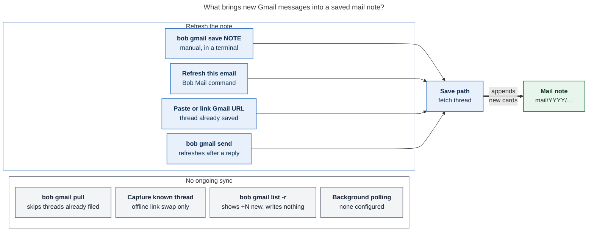
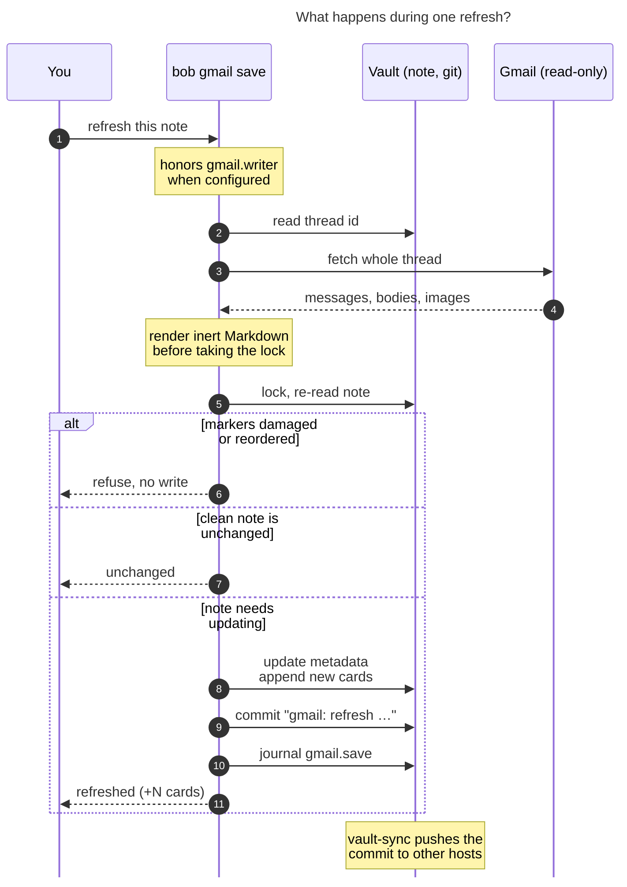
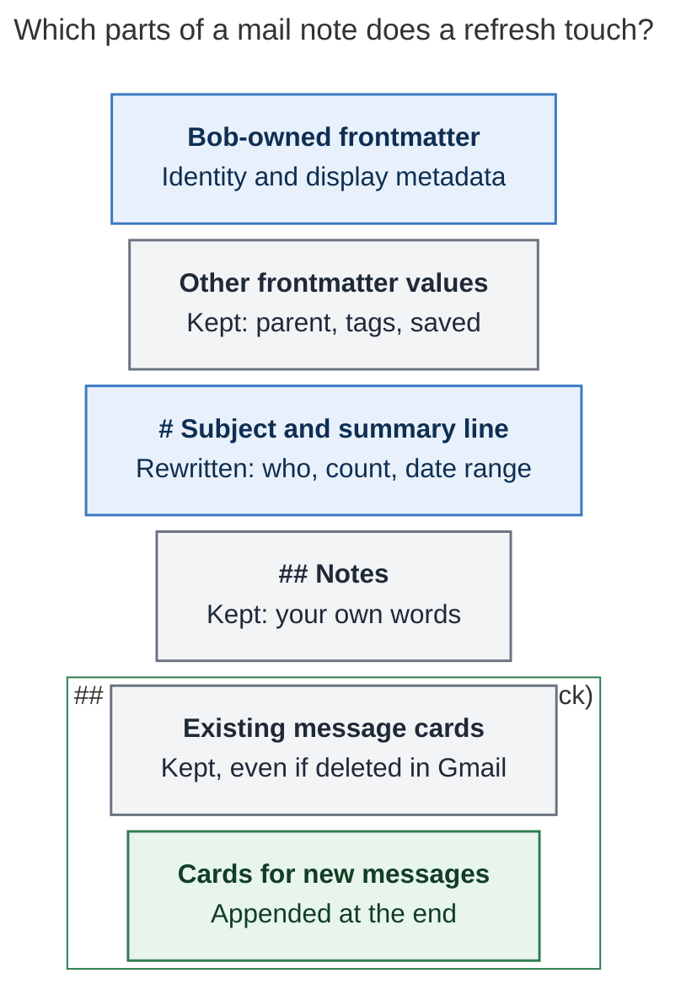

# How do tracked Gmail threads stay in sync with their Obsidian notes?

> **Research query:** Help me understand how Gmail threads that I am tracking are kept in
> sync with their corresponding Obsidian notes, if at all.


_Checked 2026-11-07 against bob-cli `63836395`, bob-plugins `2563c789`, and chezmoi
`a2c680bc`. Vault counts below are the cld draft's aggregate snapshot, not a new
measurement. No live Gmail access was used for this revision._

## Answer

**They are not kept in sync automatically.** A saved mail note is a snapshot of a Gmail
thread. It catches up only when you, or one of a few Bob gestures, ask for a refresh.

- **Refresh is one way: Gmail → note.** Fetching mail uses read-only access. Your Notes,
  card edits, and task completion do not sync back. Explicit draft and confirmed-send
  commands are the separate path to Gmail.
- **Refresh means "save it again".** `bob gmail save <note>`, or **Bob Mail: Refresh this
  email** in Obsidian, fetches the whole thread and appends one card per new message.
  Your text stays.
- **Nothing polls Gmail.** The inspected code has no recurring refresh service, and
  chezmoi's `cron.jobs` is empty. Capture has a one-shot link worker, explained below.
- **One command checks counts but does not refresh.** `bob gmail list -r` (also
  `bob gmail -r`) shows `+N new` when Gmail's message count has grown. It writes nothing
  and cannot detect every stale note.
- **Other machines get changes through git.** Changed notes are committed locally and
  distributed by `bob vault-sync`. Setting `gmail.writer` restricts writes to that
  host; an unchanged, clean note normally needs no commit.

## When does a note refresh?



**Figure 1.** Any of these refresh gestures can fetch new cards. A saved mail note is
not a subscription to future replies.

Three distinctions matter:

- **Pasting a Gmail URL in Obsidian**, with Bob Mail paste-to-link enabled, runs
  `bob gmail save <url>`. The **Link email…** picker also saves its selection.
  `bob gmail link` saves threads behind raw URLs it finds in notes.
- **Capture itself is offline.** A URL recognized as a saved thread (`known`) becomes
  its existing note link without a refresh. URLs needing resolution (`decoded` or
  `search`) can start a one-shot `bob gmail link` worker after capture commits. These
  are not necessarily unsaved threads: a message URL can resolve to an existing note.
- **`pull` skips threads already filed**, using its journal or an existing inbox task
  link. Its first filing still runs the save path and can refresh a note saved earlier
  by another route. Later pulls do not keep that thread current.

## What happens during one refresh?



**Figure 2.** A normal refresh fetches before locking. Under the lock it re-reads and
validates the note, then updates it only if needed. Broken markers or reordered
surviving cards cause refusal.

- **Zero new cards is not necessarily a no-op.** Bob also checks metadata, heading,
  and summary before deciding whether to write. Without `-R`, no new IDs and passing
  those checks leave the note byte-identical. A clean, complete save then adds no
  commit or journal row; a retry can still finish an earlier uncommitted write.
- **Bad inputs stop a batch before writing.** If one input cannot be fetched or
  validated, a multi-note `save` writes none of them. A later Git commit failure is
  different: files may already be written, and Bob asks you to retry.
- **`-d` previews the change.** It lists structural changes such as new card IDs, never
  message text, and writes nothing.

## Which parts of the note does it touch?



**Figure 3.** A normal refresh preserves authored body text and existing cards while
updating Bob-owned fields and appending new messages. User frontmatter *values* survive,
but YAML formatting and comments need not: the mapping is reserialized.

Bob owns `type`, `cssclasses`, `title`, `who`, `started`, `updated`, `messages`,
`gmail_account`, `gmail_thread_id`, `gmail_url`, and `content`. Other keys, including
`parent`, `tags`, and the original `saved` timestamp, are preserved.

- **The previous open card may collapse when new cards arrive.** Bob folds its
  `[!mail+]` or `[!mail-sent+]` header only if it still matches Bob's expected header
  and the message is still in Gmail. An edited header is left alone.
- **`bob gmail save -R` is the exception.** It rebuilds existing cards from Gmail, so
  edits made *inside* a card are lost. Cards for messages Gmail no longer returns are
  still kept.

## What happens when one side changes?

| In Gmail… | …the mail note |
| --- | --- |
| A new reply arrives | Nothing until you refresh. Then one card is appended. |
| A message disappears from the fetched thread | Its old card stays. `messages:` updates to the current fetched count, so it can be lower than the number of cards. |
| The thread is no longer retrievable | Refresh fails, for example with `gone`. The note stays as it was. |
| You read, archive, star, or relabel | Not recorded. Notes store no labels or read state. |
| You remove the `bob` pull label | The inbox task stays. `pull` only ever adds tasks. |

| In the vault… | …Gmail |
| --- | --- |
| You write in `## Notes`, edit a card, or finish the task | Nothing is synced back to Gmail. |
| You add a `## Reply`, then run `draft` and a confirmed `send` | The one path back: a Gmail draft, then that exact draft is sent. |

## Why it works this way

The Gmail epic chose this on purpose (`plan:202611/bob_gmail.md` §3):

- **I1, Gmail is the system of record.** Bob changes Google only through previewed
  drafts, and nothing triggers on task completion. Mail-note refresh never mutates
  Gmail labels, read state, or message content.
- **I2, capture never touches the network.** That is why capturing a saved thread's URL
  only swaps in its link when recognized locally; any network linking happens later
  in the detached worker.
- **Reply detection was deferred** (§6). Resurfacing a task when its thread gets a reply
  changes the task-state model, so it needs its own decision record first. It is filed as
  `bob-cli-i1` (ready, large).

## Snapshot (2026-11-07)

The cld draft reported **4 saved mail notes**, holding **1–4 messages each**, and
**0 `gmail: refresh` commits** (versus 2 `save`, 2 `link`, 1 `pull`, 1 `compose`,
2 `reply`, and 4 `draft`). These are historical aggregate observations, not proof
that no note was refreshed: a mixed create/refresh batch is named `save`, linking
uses `link`, and an unchanged refresh leaves no commit.

**Live drift remains unmeasured.** The draft reported a gog read error on apollo.
This revision made no live Gmail call. Check on a signed-in host with
`bob gmail list -a -r`, subject to the count and error limitations below.

## Gaps worth knowing

1. **Notes can fall behind without telling you.** There is no automatic reply alert or
   task resurfacing. Check Gmail, inspect remote counts, or refresh before acting.
2. **`bob gmail -r` is all-or-nothing.** One unreadable thread, such as one deleted in
   Gmail, fails the whole listing, because every row's count fetch passes its error up
   (`src/native/gmail/list.rs:103-113`). Filed as bug `bob-cli-ic`. It compares counts,
   not message IDs: one removed message plus one new reply can produce zero growth,
   shown with **no `+N new` badge**, even though a refresh would append a card.
3. **Repeat pulls skip already-filed threads.** A later reply stays absent until another
   refresh gesture (`src/native/gmail/pull.rs:116`).
4. **Doc nit.** The `-r|--remote` paragraph sits under "Link" in `docs/gmail.md` (line
   574), not under "List".

## If you want it automatic

An optional scheduled job on the writer host could re-save each note individually,
without changing bob's source. A normal unchanged save is a no-op; metadata changes
or unfinished writes can also cause commits. For example:

```bash
bob gmail list -a -f json | jq -r '.threads[].path' |
  while IFS= read -r note; do bob gmail save "$note" -q || true; done
```

- Run one `save` per note, not one call with every note, so a single deleted thread
  cannot block the rest.
- Add it as a `mac` job in chezmoi's `cron:` block (`cron.jobs` is empty today).
  Before relying on it, confirm that `bob gmail doctor` passes in the cron environment.
- Cost: a thread fetch per saved note per run, plus any needed body and inline-image
  requests. No schedule was installed for this research.

Refreshing snapshots and resurfacing tasks are separate: the latter remains the
larger deferred `bob-cli-i1` feature.

## Sources

Verified locally at the revisions named above:

- [Merge and no-op checks](https://github.com/bobs-org/bob-cli/blob/63836395ab3351a14a7644f8edd615d33c2ae9cd/src/native/gmail/note/merge.rs#L11):
  append-only cards, order validation, conditional folding, and `-R`.
  [Owned metadata](https://github.com/bobs-org/bob-cli/blob/63836395ab3351a14a7644f8edd615d33c2ae9cd/src/native/gmail/note/parse.rs#L208):
  exact rewritten keys.
- [Save](https://github.com/bobs-org/bob-cli/blob/63836395ab3351a14a7644f8edd615d33c2ae9cd/src/native/gmail/save.rs#L450):
  `plan_prepared_saves`, result statuses, commit naming (`:390`), and recovery.
  [Link commit](https://github.com/bobs-org/bob-cli/blob/63836395ab3351a14a7644f8edd615d33c2ae9cd/src/native/gmail/link.rs#L1320)
  and [send finalization](https://github.com/bobs-org/bob-cli/blob/63836395ab3351a14a7644f8edd615d33c2ae9cd/src/native/gmail/compose/finalize.rs#L188).
- [Pull](https://github.com/bobs-org/bob-cli/blob/63836395ab3351a14a7644f8edd615d33c2ae9cd/src/native/gmail/pull.rs#L110):
  already-filed skips and first-filing save.
  [Capture verdicts](https://github.com/bobs-org/bob-cli/blob/63836395ab3351a14a7644f8edd615d33c2ae9cd/src/native/gmail/capture.rs#L65),
  [worker kick](https://github.com/bobs-org/bob-cli/blob/63836395ab3351a14a7644f8edd615d33c2ae9cd/src/native/capture/mod.rs#L410),
  and [one-shot worker](https://github.com/bobs-org/bob-cli/blob/63836395ab3351a14a7644f8edd615d33c2ae9cd/src/native/gmail/worker.rs#L74).
- [Remote counts](https://github.com/bobs-org/bob-cli/blob/63836395ab3351a14a7644f8edd615d33c2ae9cd/src/native/gmail/list.rs#L103):
  count subtraction and per-row error propagation.
- Bob Mail [refresh and paste](https://github.com/bobs-org/bob-plugins/blob/2563c7898644d1f784c13f3eefa698285ae4a381/plugins/bob-mail/src/050-plugin.js#L198)
  (`:198`, `:485`) and [picker save](https://github.com/bobs-org/bob-plugins/blob/2563c7898644d1f784c13f3eefa698285ae4a381/plugins/bob-mail/src/030-picker-modal.js#L81).
  Chezmoi [empty cron job list](https://github.com/bbugyi200/dotfiles/blob/a2c680bce7eb4b912d8d58453fee858672df0310/home/.chezmoidata.yaml#L40).
- [Gmail command reference](https://github.com/bobs-org/bob-cli/blob/63836395ab3351a14a7644f8edd615d33c2ae9cd/docs/gmail.md);
  `plan:202611/bob_gmail.md` §3 (I1–I2) and §6 (deferred follow-ups);
  beads `bob-cli-i1` (reply detection) and `bob-cli-ic` (remote listing bug).
- [Original cld draft](gmail_thread_note_sync__cld.md): source of the aggregate snapshot.

## Changes from the cld draft

- Added the generated infographic; corrected and re-rendered all three Mermaid figures
  with Mermaid CLI 12.0.0, each fitting the PDF text area above 75% scale.
- Qualified pull/capture exceptions and distinguished the one-shot worker from polling.
- Corrected no-op, commit-failure, card-folding, and frontmatter-preservation claims.
- Removed the unsupported inference from commit counts; marked the snapshot as inherited.
- Clarified count-only drift detection, zero-growth display, and the explicit send exception.

