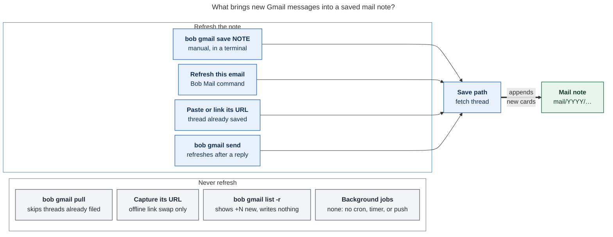
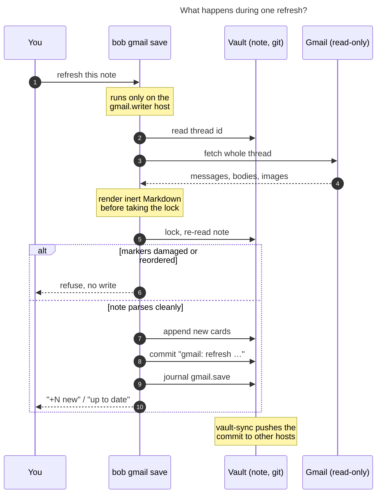
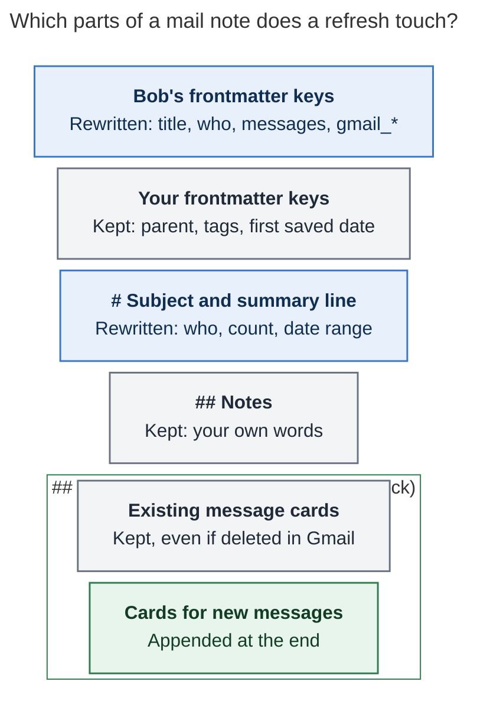

# How do tracked Gmail threads stay in sync with their Obsidian notes?

> **Research query:** Help me understand how Gmail threads that I am tracking are kept in
> sync with their corresponding Obsidian notes, if at all.

_Checked 2026-11-07 against bob-cli `master` (v0.5.0, `63836395`), the Bob Mail plugin in
bob-plugins, and the chezmoi crontab config. Vault numbers are an aggregate snapshot
taken on apollo._

## Answer

**They are not kept in sync automatically.** A saved mail note is a snapshot of a Gmail
thread. It catches up only when you, or one of a few Bob gestures, ask for a refresh.

- **One way only: Gmail → note.** Bob reads Gmail with a read-only grant. Nothing in the
  note (your Notes, your edits, a finished task) ever flows back to Gmail. The only
  things Bob writes to Gmail are drafts and sends that you confirm.
- **Refresh means "save it again".** `bob gmail save <note>`, or **Bob Mail: Refresh this
  email** in Obsidian, fetches the whole thread and appends one card per new message.
  Your text stays.
- **Nothing runs in the background.** No cron job, timer, webhook, or push watches Gmail.
  `bob gmail pull` files each labelled thread once and never revisits it.
- **One command shows drift but does not fix it.** `bob gmail -r` prints `+N new` beside
  each stale thread and writes nothing.
- **Other machines get refreshes through git.** Each refresh is a commit on the
  `gmail.writer` host, and `bob vault-sync` carries that commit to the other hosts.

## When does a note refresh?



**Figure 1.** Only four gestures refresh a note, and you start every one of them. Nothing
refreshes a note on its own.

Two of these are easy to miss:

- **Pasting a Gmail URL in Obsidian** runs `bob gmail save <url>`. If that thread is
  already saved, its note is refreshed as a side effect. `bob gmail link` does the same
  for raw URLs it finds in notes.
- **Capturing the same URL** (`bob capture`, Bob Mac Capture) does *not* refresh. Capture
  swaps the URL for the saved note's link offline. It starts the background link worker
  only for threads that are not saved yet.

## What happens during one refresh?



**Figure 2.** A refresh finishes its network work first, then edits the note under the
vault lock. If the note's message markers do not line up with Gmail, it refuses instead
of guessing.

- **Nothing new means nothing written.** An unchanged thread gives a byte-identical note:
  no write, no commit, no journal row.
- **A batch passes or fails as one.** If one input in a multi-note `save` fails, nothing
  in that call is written.
- **`-d` previews the change.** It lists structural changes such as new card IDs, never
  message text, and writes nothing.

## Which parts of the note does it touch?



**Figure 3.** A refresh rewrites only what Bob owns (frontmatter keys, heading, summary
line) and appends new messages. Everything you wrote stays as it was.

- **The previous newest card collapses.** Its callout changes from open (`[!mail+]`) to
  folded (`[!mail-]`), so only the newest message is shown open.
- **`bob gmail save -R` is the exception.** It rebuilds existing cards from Gmail, so
  edits made *inside* a card are lost. Cards for messages Gmail no longer returns are
  still kept.

## What happens when one side changes?

| In Gmail… | …the mail note |
| --- | --- |
| A new reply arrives | Nothing until you refresh. Then one card is appended. |
| A message is deleted | Its card stays. `messages:` drops to Gmail's count at the next refresh. |
| The whole thread is deleted | Refresh fails with `gone`. The note stays as it was. |
| You read, archive, star, or relabel | Not recorded. Notes store no labels or read state. |
| You remove the `bob` pull label | The inbox task stays. `pull` only ever adds tasks. |

| In the vault… | …Gmail |
| --- | --- |
| You write in `## Notes`, edit a card, or finish the task | Nothing. Vault text never leaves the vault. |
| You add a `## Reply`, then run `draft` and a confirmed `send` | The one path back: a Gmail draft, then that exact draft is sent. |

## Why it works this way

The Gmail epic chose this on purpose (`plan:202611/bob_gmail.md` §3):

- **I1, Gmail is the system of record.** Bob changes Google only through previewed
  drafts, and nothing triggers on task completion. So nothing in the vault can drive
  Gmail.
- **I2, capture never touches the network.** That is why capturing a saved thread's URL
  only swaps in its link and never refreshes the note.
- **Reply detection was deferred** (§6). Resurfacing a task when its thread gets a reply
  changes the task-state model, so it needs its own decision record first. It is filed as
  `bob-cli-i1` (ready, large).

## Snapshot (2026-11-07)

- **4 saved mail notes** in the vault, holding 1–4 messages each.
- **0 `gmail: refresh` commits** in vault history (compared with 2 `save`, 2 `link`,
  1 `pull`, 1 `compose`, 2 `reply`, and 4 `draft`). No refresh through `save` or the Bob
  Mail command has changed a note yet.
- **Live drift was not measured.** `bob gmail -r` failed on apollo with a gog read error,
  so this report does not say how far behind any note is. To check, run it on the Mac.

## Gaps worth knowing

1. **Notes can fall behind without telling you.** You only learn a tracked thread got a
   reply if you run `bob gmail -r` or open Gmail.
2. **`bob gmail -r` is all-or-nothing.** One unreadable thread, such as one deleted in
   Gmail, fails the whole listing, because every row's count fetch passes its error up
   (`src/native/gmail/list.rs:103-113`). Filed as bug `bob-cli-ic`. It also compares
   counts only, so one deleted message plus one new reply shows as `+0`.
3. **`pull` never refreshes.** A labelled thread that gets a reply after it was filed
   stays behind (`src/native/gmail/pull.rs:116`).
4. **Doc nit.** The `-r|--remote` paragraph sits under "Link" in `docs/gmail.md` (line
   574), not under "List".

## If you want it automatic

The smallest change needs no code: a scheduled job on the Mac (the writer host) that
re-saves each note one at a time. An unchanged thread is a no-op, so the job commits
only when Gmail actually changed:

```bash
bob gmail list -a -f json | jq -r '.threads[].path' |
  while read -r note; do bob gmail save "$note" -q || true; done
```

- Run one `save` per note, not one call with every note, so a single deleted thread
  cannot block the rest.
- Add it as a `mac` job in chezmoi's `cron:` block (`cron.jobs` is empty today).
  Before relying on it, confirm that `bob gmail doctor` passes in the cron environment.
- Cost: one full thread fetch per saved note per run.

The cleaner long-term fix would be a built-in "refresh stale threads" command that skips
unreadable threads and reports them. Making a reply resurface the linked task is the
separate, larger `bob-cli-i1` feature.

## Sources

Paths are in bob-cli unless noted.

- `src/native/gmail/note/merge.rs:11`: append-only merge. It returns `None` (no write)
  for a byte-identical refresh, and `validate_order` (`:113`) refuses reordered markers.
- `src/native/gmail/note/parse.rs:208`: the frontmatter keys Bob owns and rewrites.
- `src/native/gmail/save.rs:560-680`: an existing note is merged and marked `refreshed`
  or `unchanged`. At `:390`, the commit action is `save` or `refresh`.
- `src/native/gmail/pull.rs:116`: already-pulled threads are skipped.
- `src/native/gmail/capture.rs:79` and `src/native/capture/mod.rs:415`: saved threads
  link offline, and only unsaved URLs start the link worker (`worker.rs:74`).
- `src/native/gmail/list.rs:103-113`: the `-r` live count comparison.
- bob-plugins `plugins/bob-mail/src/050-plugin.js:198` (Refresh this email) and `:485`
  (paste runs `gmail save`).
- chezmoi `home/.chezmoidata.yaml:40`: `cron.jobs: []`.
- `docs/gmail.md`: Save, Pull, List, and Writing and sending sections.
- `plan:202611/bob_gmail.md` §3 (invariants I1–I2) and §6 (deferred follow-ups).
- Beads `bob-cli-i1` (reply detection, deferred feature) and `bob-cli-ic` (the `list -r`
  bug found here).
