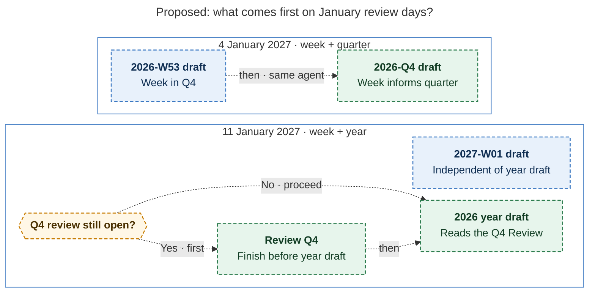

# Diagram proposals: Checklist stages and period-review prep for the morning GTD walk

Proposals for the swarm linker, not a report. Each diagram restates only what the source
report says.

```yaml
source: research:202611/gtd_checklist_stages_and_period_prep/gtd_checklist_stages_and_period_prep__final.md
producer: research.3h.image
check: "mmdc 12.0.0 with --no-sandbox and the PDF-mirroring config rendered 1 of 1 Mermaid diagrams"
```

## january-overlap-dependencies

```yaml
anchor: |-
  2027-01-04 is the weekly plus quarterly Monday. The just-ended week,
question: |-
  On January overlap days, which period comes first?
illustrates: |-
  On January 4 one agent drafts W53 then Q4; on January 11 the W01 draft is independent, while the year draft can read the Q4 Review either immediately if finished or after completing the still-open Quarterly review.
caption: "Proposed: draft week 53 before quarter four; start the year draft once Q4 Review is finished. Week 1 is independent."
review: "626.996x930 px, fit 96.0%; question, source trace and visual checks passed; 1 revision across 2 look rounds; batch check passed; broken-diagram negative check exited nonzero"
```


