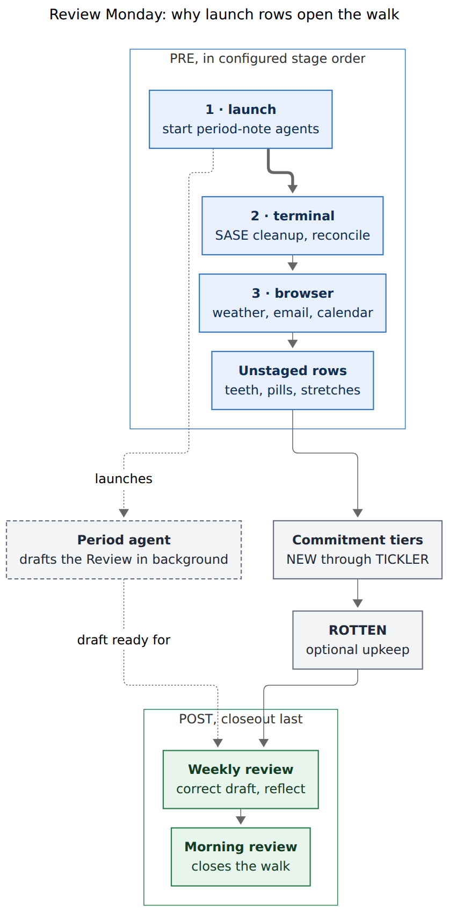

# Checklist stages: ordering PRE/POST rows and starting period-review drafts first

> **Research query (paraphrased).** Add new recurring pre-GTD (`#gtd #pre`) tasks to
> `gtd_daily.md` that come due on the same day as each period's review task and remind Bryan to
> launch agents that update the period notes. Also add a way to put some PRE (and/or POST)
> rows ahead of others in the `]s` morning walk. The requested order is: the new period-agent
> rows first, then "Clean up SASE agents", then the three browser chores (weather, email,
> calendar), then everything else. Critique the plan, flag any changed requirements, and end
> with a recommended design that is intuitive, reliable, and beautiful.
>
> Researcher: **cld** (one of five independent researchers). Evidence date: 2026-11-05.

---

## TL;DR

- **The plan is sound and worth doing.** Today PRE rows walk in *file order* (`path ↑, line ↑`).
  That order is set by the Tasks plugin and the status grouper, not by you, so it reshuffles
  almost every day. For example, "Clean up SASE" was the 1st, 5th, 3rd, 2nd, 1st, then 5th row
  on successive snapshots. Starting the period-note agents at the top of PRE lets their drafts
  run while you walk, instead of making you wait at the end of the walk.
- **Don't call it "priority" and don't use `[priority::]`.** In Bob, `[priority::]` already
  means the P1–P4 deferral ladder (Alt+P rolls, decay steps, "no priority = P0, do it now").
  About 700 vault rows use it that way.
- **Recommended mechanism: *checklist stages*.**
  - A stage is a plain tag on the row, placed right after `#pre`/`#post`: `#periods`,
    `#terminal`, `#browser`.
  - Stage order lives in two new config keys: `freshness.pre_stages` and
    `freshness.post_stages`.
  - Inside PRE/POST, the shared queue sorts by **stage rank, then path, then line**. Unstaged
    rows go last.
  - Because `]s`, Ctrl+Enter's in-group advance, the status-bar footer, and
    `bob freshness list` all read that one queue, one comparator change reorders all of them
    together.
  - The footer and toasts name the stage (`PRE 4/9 · BROWSER 1/3`), and the stage tag renders
    as a small label after the ☀ glyph.
- **Add three PRE rows tagged `#periods`**, one per period kind (week, quarter, year). Each copies
  its review row's recurrence rule (plus `when done`), so they come due on the same Mondays.
  Week and quarter coincide on 2027-01-04; week and year coincide on 2027-01-11.
- **Flagged adjustments** (§3):
  - Use the same mechanism for POST, so the Weekly review comes *before* the Morning-review
    closeout.
  - Optionally move "Run `task reconcile` + `gcal sync` + `gkeep pull`" into the SASE stage,
    renamed `#terminal`.
  - Keep the Quarterly and Yearly reviews as ordinary RECURRING rows (the earlier design chose
    this on purpose).
  - Check whether "update SASE on all machines" disturbs running agents. If it does, swap the
    first two stages.



*Figure 1. On a review Monday, the `#periods` launch row is the first PRE row. The period agent
drafts in the background through the terminal and browser stages, the commitment tiers, and
upkeep, so the draft is waiting when the Weekly review comes due in POST. The unstaged Morning
review closes the walk. (Source: `pre_post_checklist_stages__cld_walk.mmd`; rendered with
mermaid-cli 12.0.0, 557 × 1132 px, 78.9% PDF fit.)*

---

## 1. What exists today (findings)

| # | Finding | Evidence |
| --- | --- | --- |
| F1 | **PRE and POST rows are ordered only by `path ↑, line ↑`.** The Rust and JS evaluators share this comparator, and NEW uses it too. | `docs/freshness.md` §4 tier table; `src/native/freshness/state.rs:928`; bob-plugins `bob-ledger-tools/src/110-freshness-queue.js:70-76` |
| F2 | **Every open `#gtd #pre`/`#post` row lives in `gtd_daily.md`**, so the walk order is that file's line order. | Vault grep, 2026-11-05: 8 PRE rows and 2 POST rows, all in `gtd_daily.md` |
| F3 | **That file order changes almost every day.** | Vault git history (table below) |
| F4 | **Cause of F3.** Tasks inserts each new occurrence *above* the completed line (`recurrenceOnNextLine: false`). The status grouper then moves blocks between Open / Blocked / Done in document order, in whatever batches the 15-minute hooks happen to catch. Rows completed in walk order come back the next day in reverse-batch order. | `.obsidian/plugins/obsidian-tasks-plugin/data.json`; `src/native/task_status_groups/emit.rs:23-59` |
| F5 | **`[priority::]` already has a meaning: P-levels.** P1 = `high` (roll 3–8 days) … P4 = `lowest`; no priority means "P0, do it now". It drives Alt+P, Ctrl+Enter rolls, and the decay ladder, and the footer shows an Alt+P preview on any open row that has a priority. About 700 rows use it (325 medium, 245 high, 125 low, 4 lowest, 1 highest). | `~/.config/bob/config.yml` `properties: priority`; glossary *Task Decay* and *Morning GTD Review Footer*; vault census |
| F6 | **A new inline field is a parsing hazard.** Tasks parsers read trailing inline fields right to left and stop at the first one they don't recognize, so an invented field can hide `[scheduled::]`, `[repeat::]`, `[id::]` and `[dependsOn::]`. | Comment in the `properties:` block of `~/.config/bob/config.yml` |
| F7 | **Only the Weekly review is `#post`.** The Quarterly and Yearly reviews are *ordinary* calendar-anchored rows that walk in RECURRING, by design ("so a long review never blocks the POST closeout"). They have no `when done`. In POST today, Morning review (line 15) comes before Weekly review (line 24). | `research:202611/period_note_tree_and_stats_strips/period_note_tree_and_stats_strips.md` (proposed rows; rrule verification); `gtd_daily.md` |
| F8 | **Drafting currently happens inside the POST Weekly review** ("no Review yet? launch an agent …"), so you wait at the end of the walk. W44's Review was drafted Tue 2026-11-03, the day after its Monday. | `gtd_daily.md`; `2026/2026-W44.md` frontmatter `review_drafted: 2026-11-03` |
| F9 | **One shared queue drives everything.** `]s` jumps, the Ctrl+Enter in-group advance (`liveGroup.after`), group-end notices, the footer, and the CLI all read it, so changing the comparator reorders every surface at once. | bob-plugins `bob-navigation-hotkeys/src/535-plugin-review-checklist-walk.js:340-395`; `120-freshness-footer.js:212-219` |
| F10 | **You already tried batching the browser chores by merging them.** On 2026-11-04 around 11:45, a single "WWW: Read email + ch…" / "In a web browser…" row with child bullets briefly replaced them, and the three separate rows were restored within the hour. | Vault commits `b82ec8cc3`, `cbd350f33`, `706d933b6` |
| F11 | **Tag census.** `#sase` already appears 1,559 times in the vault. `#periods`, `#browser` and `#terminal` are unused, and `#launch` appears once. | Vault grep |
| F12 | **Older bob versions ignore unknown config keys**, so new keys can ship before the code that reads them. | `src/native/config/freshness.rs` test `parses_freshness_overrides_and_ignores_unknown_keys` |
| F13 | **Checklist rows lint when `repeat` lacks `when done`** (`checklist_repeat_not_when_done`). | `src/native/freshness/scan.rs:388-393` |
| F14 | **Stats are tag-safe.** The `habits` stat (`#gtd #pre` chores met ÷ due) identifies a chore by its description with tags, inline fields and block ids stripped, so adding a stage tag keeps each chore's habit history. `review_closed` matches `#gtd #post` + "Morning review", so tagging the Weekly review leaves it alone. | `src/native/stats/metrics.rs:1191` (`chore_identity`); `src/native/stats/registry.rs:577-579, 612` |

**F3 evidence: open PRE rows across recent snapshots** (vault git, `gtd_daily.md`):

| Snapshot | Walk order (1 → n) | SASE position | Browser rows (positions) |
| --- | --- | --- | --- |
| 10-28 09:59 | SASE · weather · teeth · pills · calendar · email · import · stretches | 1 | 2, 5, 6 |
| 10-29 12:48 | pills · calendar · email · import · SASE · weather · teeth · stretches | 5 | 2, 3, 6 |
| 11-01 07:45 | email · import · SASE · weather · teeth · pills · calendar · stretches | 3 | 1, 4, 7 |
| 11-02 06:44 | calendar · SASE · weather · teeth · email · import · pills · stretches | 2 | 1, 3, 5 |
| 11-03 15:45 | SASE · weather · teeth · email · import · pills · calendar · stretches | 1 | 2, 4, 7 |
| 11-05 07:09 | calendar · weather · teeth · email · SASE · reconcile · pills · stretches | 5 | 1, 2, 4 |

The browser chores were never all next to each other, and the SASE cleanup wandered through
the list. Nobody chose this order; it falls out of completion history.

---

## 2. Critique: is this a good idea?

**Yes. Three of the four ideas are clearly right, and the fourth is right for now.**

1. **An explicit order for PRE is overdue (F3).** A fixed sequence turns PRE into a habit chain:
   one step cues the next, and the same order every morning removes a decision. Today you
   re-plan the order each morning, or follow whatever order the file happens to be in.
2. **Batching the browser chores is standard GTD "contexts".** Doing every task that needs the
   same tool together avoids switching back and forth. F10 shows you already want this but
   rejected the "merge into one row" route. Ordering keeps per-chore rows (each with its own
   check-off and completion history) and still makes them adjacent.
3. **Starting the agents first is pipelining, and the evidence supports it (F8).** Agent
   drafting is the slowest, most automatable step of a period review, and it currently runs
   serially at the very end of the walk. Starting it first hides that wait behind 20–60
   minutes of other review work.
4. **The reminder rows are right for now. Full automation is the likely end state.** The draft
   step is deterministic (`bob periods brief` → `bob periods draft`), only touches `## Review`,
   and refuses to overwrite your edits. That makes it a good candidate for an unattended Monday
   agent, launched through SASE's launch-approval gate, later on. Reminders are still the right
   first step: they're free, they keep you choosing the model and timing, and they show whether
   launching is a real decision or a rubber stamp (see the reopen triggers in §5.9).

**Where the plan as written would go wrong:**

- **"Priority" is the wrong word and `[priority::]` is the wrong tool (F5).** Putting
  `[priority:: high]` on "Clean up SASE" would make Bob read it as "P1: roll 3–8 days". The
  footer would offer an Alt+P roll on a daily chore, and the decay ladder would treat the row
  as a deferral rung. This is an ordering of rituals, not urgency, so it needs its own name.
- **A new inline field such as `[order:: 1]` or `[stage:: browser]` risks breaking Tasks parsing
  (F6).** The tag-based design avoids that.
- **The Quarterly and Yearly reviews are not post-GTD rows (F7).** The PRE rows can still pair
  with them by *date*, which is all the request needs. Making them `#post` would undo a
  deliberate earlier choice and let a 1–2-hour review block the daily closeout.
- **Two stage orders in the request deserve a second look.** See A2 and A8 in §3.

---

## 3. Requirement adjustments (flagged)

| ID | Adjustment | Why | Cost if you reject it |
| --- | --- | --- | --- |
| **A1** | Call the feature **checklist stages**, not priority. Don't touch `[priority::]`. | F5: avoids a clash with P-levels, Alt+P, and decay. | Silent semantic clash on 700+ rows' worth of vocabulary. |
| **A2** *(optional)* | Name the second stage **`#terminal`** and also give it **"Run `task reconcile` + `gcal sync` + `gkeep pull`"**. | It's the same context as SASE cleanup (a shell). `#sase` is already an overloaded tag (F11). | Use `pre_stages: [periods, sase_cleanup, browser]` and leave reconcile unstaged. |
| **A3** | Also order **POST**: `post_stages: [periods]`. The Weekly review gets `#periods`; Morning review stays unstaged, so it's **last**. | Morning review is the closeout (it feeds the `review_closed` stat, and nav's "review closed" toast fires on the last POST row). Today it sorts first on Mondays (F7). | On Mondays the walk "closes" before the weekly review. |
| **A4** | Use **one launch row per period kind** (three rows), not one combined "launch whatever's due" row. | The calendar works out which periods are due. On a combined day, two adjacent `#periods` rows appear. A single row would need you to compute ISO quarters in your head, or would need a new CLI. | — |
| **A5** | Order *inside* a stage stays file order. | The stages are what you asked for. Making in-stage order stable means changing the status grouper or adding a text tie-break (see §5.9). | The three browser chores may swap places day to day, but always stay together. |
| **A6** | Edit the Weekly review row: drafting moves to PRE, and "launch one now" becomes the fallback. | Otherwise the row tells you to do something PRE already did. | Stale instruction text. |
| **A7** | Keep the Quarterly and Yearly reviews as ordinary RECURRING rows (no `#post`). | Honors the earlier decision (F7). Pairing by date still works. | — |
| **A8** *(verify)* | Find out whether "update SASE on all machines" restarts or disturbs running agents. If it does, swap the first two stages (`[terminal, periods, browser]`). | Launching first gains about 10 minutes of agent runtime, but the PRE→POST gap is already 20–60 minutes, so a draft started 10 minutes later is still ready in time. It's a one-line config change either way. | A draft agent could be cut off mid-run by an update. |

---

## 4. Options considered for "which row first"

| Option | Intuitive | Reliable | Beautiful | Verdict |
| --- | --- | --- | --- | --- |
| **Stage tags + ordered config list** (recommended) | ✓ The tag says *why* the row is grouped ("browser"); the config says the order. | ✓ Tags are description text, so recurrence copies them. Whole-token match, the same idiom as `#pre`, `#hide`, `#off`. Unknown keys and tags are inert. | ✓ Renders as a stage label; the footer names the stage. | **Adopt** |
| `[priority::]` | ✗ Collides with P-levels | ✗ Turns on Alt+P rolls and decay | ✗ Footer shows a roll hint | Reject (F5) |
| New inline field `[order:: N]` / `[stage:: x]` | ~ Numbers don't explain themselves; renumbering is a chore | ✗ Tasks stops parsing at an unknown trailing field (F6) | ✗ Field noise on every row | Reject |
| File order (reorder lines by hand, or stage subheadings under `## Tasks`) | ~ | ✗ The grouper reshuffles rows daily (F3/F4). Subheadings would each grow their own Blocked / Done groups (8+ extra headings). | ✗ | Reject |
| Nested tags `#pre/browser` | ~ | ✗ The membership rule says nested tags are *not* `#pre` (rejected in `decisions:review-walk-is-tiered`). Changing that reopens a settled contract. | ~ | Reject |
| Merge the browser chores into one row with child bullets | ✓ | ~ Loses per-chore check-off and completion history | ~ | Reject; already tried and reverted (F10) |
| Config list of text patterns | ✗ Renaming a task silently breaks the match | ✗ | — | Reject |
| Stage order in `gtd_daily.md` frontmatter | ✓ Lives next to the rows | ~ The walk covers the whole vault, while frontmatter is per note; all other walk-shaping keys live in `freshness:` | ~ | Reject (consistency) |
| `[dependsOn::]` chains between PRE rows | ✗ | ✗ Dependency-blocked rows leave the checklist entirely, so one skipped chore would hide everything after it | ✗ | Reject |
| A computed "launch" row (bob generates it, no task line) | ✓ | ✗ Walk rows must be real task lines for Ctrl+Enter, and recurrence can't hold a moving period id | ~ | Reject |
| Automate drafting now (scheduled agent) | ✓ | ✓ | ✓ | **Later** (§5.9 reopen trigger) |

---

## 5. Recommended design

### 5.1 Concept

> **A checklist stage is a named, ordered batch of PRE or POST rows.** You put a row in a
> stage by tagging it. Config sets the stage order. Stages walk in that order, ahead of
> unstaged rows. Stages change *order only*: they never change membership, status, dates,
> freshness, priority, or counts.

It's one idea with one place to look in each direction:

- **Row → stage:** the tag on the line.
- **Stage → position:** the config list.
- **What you see:** the stage label in the editor, footer, toasts, and CLI.

### 5.2 Authoring

Tag the row right after its checklist tag. The stage tag then reads as part of the row's identity
run, and Tasks recurrence copies it like any other description text:

```markdown
- [ ] #task #gtd #pre #browser Check [weather](https://google.com/search?q=weather)  [repeat:: every day when done]  …
```

Config (`~/.config/bob/config.yml`, next to the existing walk keys):

```yaml
freshness:
  # PRE/POST checklist stages (docs/freshness.md §4). Each name is a tag. A #gtd #pre
  # (or #gtd #post) row carrying one walks in that stage; stages walk in this order,
  # ahead of rows that carry none. Absent or [] keeps file order. Write names without
  # '#' — YAML treats '#' as a comment.
  pre_stages: [periods, terminal, browser]
  post_stages: [periods]
```

Validation rules:

- Each entry is a tag name: the tag grammar `[\p{L}\p{N}_/-]+`, optionally with a leading `#`
  if quoted. Matching is case-insensitive.
- Entries must be unique within a list, and may not be `task`, `gtd`, `pre` or `post`.
- An invalid list is **ignored as a whole** (that tier falls back to file order) and produces one
  `freshness_stages_invalid` diagnostic. The rest of `freshness:` keeps working, so a typo can
  never break the walk.

### 5.3 Evaluator contract (an addition to `docs/freshness.md` §4)

```text
stages(k)     = freshness.pre_stages (k = pre) | freshness.post_stages (k = post);
                ordered tag names, lowercased, '#' stripped; absent/invalid ⇒ []
stage(t)      = for a row in checklist_scope with kind k: the FIRST name in stages(k)
                that t carries as an exact whole-token tag (same tokenizer as #pre);
                none otherwise. Rows outside PRE/POST: always none.
stage_rank(t) = index of stage(t) in stages(k); +∞ when none
Order within pre and post: stage_rank ↑, path ↑, line ↑
Lint          = checklist_stage_conflict when an open checklist row carries ≥ 2 names from
                its kind's list (the earliest-listed stage wins; the row is still walked)
Unchanged     = membership, checklist_scope, tier order, counts, by_tier, due/state/bucket,
                decide, keeps, Ctrl+Enter semantics, the PRE/POST boundary rule
```

Machine output:

- **bob-cli freshness JSON schema 16 (additive).** Queue rows gain `stage` (string or null).
  `config` echoes `pre_stages` and `post_stages`.
- **bob-ledger-tools.** `api.freshness` goes to namespace v14, which advertises `checklistStages`.
  Queue entries gain `stage`, `stageRank`, and `stageIndex`/`stageTotal` (stage-local positions,
  like the existing `tierRank`/`tierTotal`).

Conformance vectors to add (Rust and JS run the same set):

| Vector | Setup | Expect |
| --- | --- | --- |
| CS1 staged first | Unstaged row at line 1; `#browser` row at line 9 | `#browser` row ranks first |
| CS2 config order wins | Row A `#browser` at line 1, row B `#terminal` at line 2; config `[terminal, browser]` | B before A (config order, not line order or tag spelling) |
| CS3 two stages | Row carries `#terminal #browser` | stage `terminal`; lint `checklist_stage_conflict` |
| CS4 no config | Stages absent | Exactly today's `path, line` order (regression) |
| CS5 whole token | `#Browser` ✓; `#browsers`, `#browser/x`, `#web/browser` ✗ | Case-insensitive exact match |
| CS6 per kind | `#periods` in both lists; PRE and POST rows | Ranked independently per tier |
| CS7 inert elsewhere | `#browser` on a non-checklist Ready row | Same tier/state/order as without it; no lint |
| CS8 invalid list | `pre_stages: [gtd]` | List ignored, file order, one diagnostic |

### 5.4 Surfaces

The aim is that every place you already look tells you which batch you're in, without adding a
new place to look.

- **Editor.** The `#task #gtd #pre` run already renders as one teal ☀ sunrise. Render the stage
  tag directly after it as a small-caps label in the same tier colour. Hover text:
  `PRE stage 3 of 3 · browser · after terminal`.

  ```text
  before: - [ ] ☀ #browser Check weather
  after:  - [ ] ☀ BROWSER  Check weather
  ```

  A mistyped stage (`#brower`) keeps an ordinary tag pill. The wrong look is the typo
  warning, so no extra lint is needed.
- **Footer** (the status-bar review item). On a staged row, the stage label replaces the generic
  word `checklist` (or `closeout`), with a stage-local count when the stage has two or more rows:

  ```text
  ⟳ Review 1/38 · PRE 1/9 · PERIODS · Ctrl+Enter done · ]s skip
  ⟳ Review 4/38 · PRE 4/9 · BROWSER 1/3 · Ctrl+Enter done · ]s skip
  ⟳ Review 7/38 · PRE 7/9 · checklist · Ctrl+Enter done · ]s skip      (unstaged)
  ```
- **Toasts.** Landing toasts name the stage (`PRE 5/9 · BROWSER 2/3 · Read email`). When
  Ctrl+Enter finishes the *last* row of a stage, the done line gains a quiet tick:
  `✓ Done · Review next week in Google Calendar · BROWSER ✓`. The walk never stops at a stage
  boundary, because stopping would add friction and the PRE/POST boundary rule is enough.
- **CLI.** `bob freshness list` prints the stage in a dim column, in walk order (line numbers
  illustrative):

  ```text
  PRE · 9
    periods   gtd_daily.md:16  Start last week's review draft
    terminal  gtd_daily.md:21  Clean up SASE agents on athena and apollo
    terminal  gtd_daily.md:22  Run `task reconcile` + `gcal sync` + `gkeep pull`
    browser   gtd_daily.md:18  Check weather
    browser   gtd_daily.md:20  Read email
    browser   gtd_daily.md:17  Review next week in Google Calendar
              gtd_daily.md:19  Brush teeth
              …
  ```

### 5.5 The new period-review launch rows

Add these three rows. They mirror their review rows' recurrence exactly, plus `when done` so the
checklist lint (F13) stays quiet:

```markdown
- [ ] #task #gtd #pre #periods **Start last week's review draft**: launch an agent with "Update YYYY/YYYY-Www.md" for the week that just ended — it drafts while you walk; the Weekly review corrects it.  [repeat:: every week on Monday when done]  [created:: <today>]  [scheduled:: 2026-11-09]
- [ ] #task #gtd #pre #periods **Start last quarter's review draft**: launch an agent with "Update YYYY/YYYY-Qn.md" (one agent may do the week first, then the quarter) — the Quarterly review corrects it.  [repeat:: every 3 months on the 1st Monday when done]  [created:: <today>]  [scheduled:: 2027-01-04]
- [ ] #task #gtd #pre #periods **Start last year's review draft**: launch an agent with "Update YYYY.md" for the ISO year that just ended — the Yearly review corrects it.  [repeat:: every January on the 2nd Monday when done]  [created:: <today>]  [scheduled:: 2027-01-11]
```

Write them as `[ ]` with a future `scheduled`. The task-status hooks flip them to `[?]` (Blocked)
within 15 minutes, the same as the other rows.

How the dates line up:

| Monday | PRE `#periods` rows due | Review rows due | Notes |
| --- | --- | --- | --- |
| 2026-11-09 | week (2026-W45) | Weekly review (POST) | Every Monday from here on |
| 2027-01-04 | week (2026-W53) + quarter (2026-Q4) | Weekly (POST) + Quarterly (RECURRING) | Launch the week agent first, or use one agent for "W53, then Q4", so the Q4 brief sees W53's Headline |
| 2027-01-11 | week (2027-W01) + year (2026) | Weekly (POST) + Yearly (RECURRING) | The yearly row comes a week later on purpose, after the Q4 review |

Why the twin rows can't drift apart:

- **Weekly.** Both rows are anchored to the weekday ("on Monday … when done"). A late
  completion still lands on next Monday.
- **Quarterly and yearly.** These use rrule with the completion day as the start. Completing
  anywhere inside the month the row came due gives exactly the review row's next date
  (2027-01-04 → 04-05 → 07-05 …; 2027-01-11 → 2028-01-10).
  - The rows would only drift if completion slipped into the *next* month. A PRE row nags every
    morning, so that won't happen in practice.
  - Before going live, verify the rule on a scratch fixture in the installed Tasks 8.6.0,
    including a late completion. The earlier period research gave the same advice.
- **Known quirk, unchanged.** "1st Monday of the month" is either the first or the second
  Monday of the new ISO quarter: the first in about 61% of quarters, the second in about 39%
  (earlier research: 247/404 vs 157/404 quarters over 2000–2100). The launch row inherits this, so it
  never fires *before* the period has closed.

Optional refinement, not required: accept relative period ids such as `last-week`,
`last-quarter` and `last-year` in `bob periods brief|draft|show`. The rows could then hold an
exact, paste-ready prompt ("Update the `last-week` period note"). That's a small CLI change and
would follow `cli_rules`.

### 5.6 Edits to existing rows (`gtd_daily.md`)

| Row | Change |
| --- | --- |
| Clean up SASE agents on athena and apollo | add `#terminal` after `#pre` |
| Run `task reconcile` + `gcal sync` + `gkeep pull` | add `#terminal` *(A2, optional)* |
| Check weather · Read email · Review next week in Google Calendar | add `#browser` |
| Brush teeth · Take fish oil + L-tyrosine · Do morning stretches | unchanged (unstaged, walk last) |
| Weekly review (`#post`) | add `#periods`; replace "no Review yet? launch an agent with "Update YYYY/YYYY-Www.md", correct its draft, and write the Reflection" with "correct the draft the PRE row started (none yet? launch one now), and write the Reflection" *(A3, A6)* |
| Morning review (`#post`) | unchanged and unstaged, so last. Optionally reword "then ]S and complete this" to "then ]S, finish POST, and complete this last" |
| Quarterly / Yearly review | unchanged *(A7)* |

Edit only the open rows (the first occurrence of each). Leave the completed copies alone, and
don't rewrite the Done history.

### 5.7 Resulting walk (review Monday 2026-11-09, with A2 and A3)

| Position | Tier · stage | Row |
| --- | --- | --- |
| 1 | PRE · PERIODS | Start last week's review draft |
| 2–3 | PRE · TERMINAL | Clean up SASE agents · Run reconcile/gcal/gkeep |
| 4–6 | PRE · BROWSER | Weather · Email · Calendar (in file order) |
| 7–8 | PRE | Brush teeth · Fish oil + L-tyrosine (stretches return 11-11) |
| … | NEW → … → TICKLER, then ROTTEN | unchanged |
| last − 1 | POST · PERIODS | Weekly review: correct the draft, which is now ready |
| last | POST | Morning review: closes the walk |

### 5.8 Rollout

Config keys and tags are both inert on older code (F12; tags carry no meaning on their own), so
the steps below can land in any order. The walk changes only once the code and config are both
present.

1. **bob-cli (one medium change).** Add `pre_stages`/`post_stages` parsing and validation
   (`src/native/config/freshness.rs`). Add a stage resolver and the comparator key
   (`src/native/freshness/state.rs::queue`). Add the lint (`scan.rs`), JSON schema 16, and the
   human stage column (`cli.rs`). Update `docs/freshness.md` §4 (contract, CS1–CS8) and the
   rollout log, with tests. JSON changes are additive, so this is not a breaking (`!`) change.
2. **bob-ledger-tools (medium).** Mirror the config parse (`090-freshness-config.js`) and the
   comparator and fields (`110-freshness-queue.js`). Add the footer stage detail
   (`120/121-freshness-footer*.js`) and the stage label mark
   (`138-checklist-task-marks.js` + `styles.css`). Bump the namespace to v14 with
   `checklistStages`. Add the CS vectors to the JS tests. Then `npm run build`, `npm test`, and
   `bob plugins sync`.
3. **bob-navigation-hotkeys (small).** Add the stage label to landing toasts and the `· STAGE ✓`
   tick (`535-…checklist-walk.js`, `538-review-walk-identity.js`). Older nav keeps working; it
   simply doesn't print the stage.
4. **Config and vault (minutes).** Add the two keys to `~/.config/bob/config.yml` in its source
   of truth. Edit `gtd_daily.md` as in §5.5–5.6. Check the result with
   `bob freshness list -f json | jq '.queue[] | select(.tier=="pre") | {stage, line}'` and a
   `]s` walk.
5. **Decision record.** Write a new `decisions:` record, for example "Checklist stages order PRE
   and POST", that partly supersedes the PRE/POST comparator in
   `decisions:review-walk-is-tiered` (`path ↑, line ↑` → `stage ↑, path ↑, line ↑`). Use
   `/sase_memory_write`.

### 5.9 Costs and reopen triggers

**Costs:**

- One more config concept.
- Two evaluators to keep in sync, with eight more vectors.
- A mistyped stage tag silently drops the row to the end. The missing label is the only signal,
  by design.
- Order inside a stage still drifts (A5).
- Three more recurring rows. On review Mondays the launch rows count as due chores in the
  `habits` ratio. Existing chores keep their history, because chore identity ignores tags (F14).

**Reopen when:**

- **The launch rows are rubber stamps.** If you complete the `#periods` PRE row without making a
  real choice on most review Mondays (for example 8 of 10), automate drafting: a Monday
  scheduled agent behind the launch-approval gate. Drop the rows or turn them into "approve the
  drafts".
- **In-stage reshuffling bothers you.** Then pick one of two fixes:
  - Add a tie-break by task text inside a stage. This is cheap but alphabetical.
  - Change the status grouper to append moved blocks at the *end* of their destination group.
    File order would then settle to match walk order, but every note's Done list would flip to
    oldest-first.
- **Stage lists grow past about 5 entries, or start appearing in other tiers.** At that point
  stages are turning into a scheduler; step back and reconsider.
- **A whole stage gets `]s`-skipped on most mornings.** That stage's chores don't belong in PRE.
  This is the same trigger the tiered-walk decision already uses for PRE skips.

---

## 6. Open questions for Bryan

1. **A8:** Does "update SASE on all machines" restart or disturb agents that are already running?
   If yes → `pre_stages: [terminal, periods, browser]`.
2. **A2:** Should the reconcile/gcal/gkeep row join the SASE cleanup as `#terminal`? (Recommended.)
3. Is `~/.config/bob/config.yml` the same on apollo, athena, and the Mac? Stages, like the
   intervals, change the walk per machine if the files differ. A `chezmoi managed` check timed
   out on the loaded host, so this is unverified.
4. Do you want the order *inside* a stage to be stable (see §5.9)?

---

## 7. Recommended solution

1. **Build checklist stages, not "priority".**
   - Rows join a stage with a plain tag right after `#pre`/`#post`.
   - `freshness.pre_stages` / `freshness.post_stages` list the stage order.
   - The shared PRE/POST comparator becomes **stage rank ↑ (unstaged last), path ↑, line ↑** in
     both evaluators, pinned by vectors CS1–CS8, with additive JSON (schema 16, namespace v14).
   - Nothing else changes: membership, counts, Ctrl+Enter semantics, and the PRE/POST boundary
     all stay the same.
2. **Make it visible.** Show a small-caps stage label after the ☀ glyph, `PRE 4/9 · BROWSER 1/3`
   in the footer, stage names in toasts plus a `· BROWSER ✓` tick when a batch finishes, and a
   stage column in `bob freshness list`.
3. **Configure** `pre_stages: [periods, terminal, browser]` and `post_stages: [periods]`.
4. **Add three `#gtd #pre #periods` launch rows** (week / quarter / year), copying each review
   row's rule plus `when done`, starting 2026-11-09, 2027-01-04 and 2027-01-11. Tag SASE cleanup
   (and, recommended, the reconcile/gcal/gkeep row) `#terminal`, the three browser chores
   `#browser`, and the Weekly review `#periods`. Leave Morning review unstaged so it stays the
   closeout.
5. **Verify** the quarterly and yearly `when done` rules on a Tasks fixture, and the SASE-update
   question (A8), before relying on the order.
6. **Revisit automation** once the launch rows show whether launching is a real decision.
