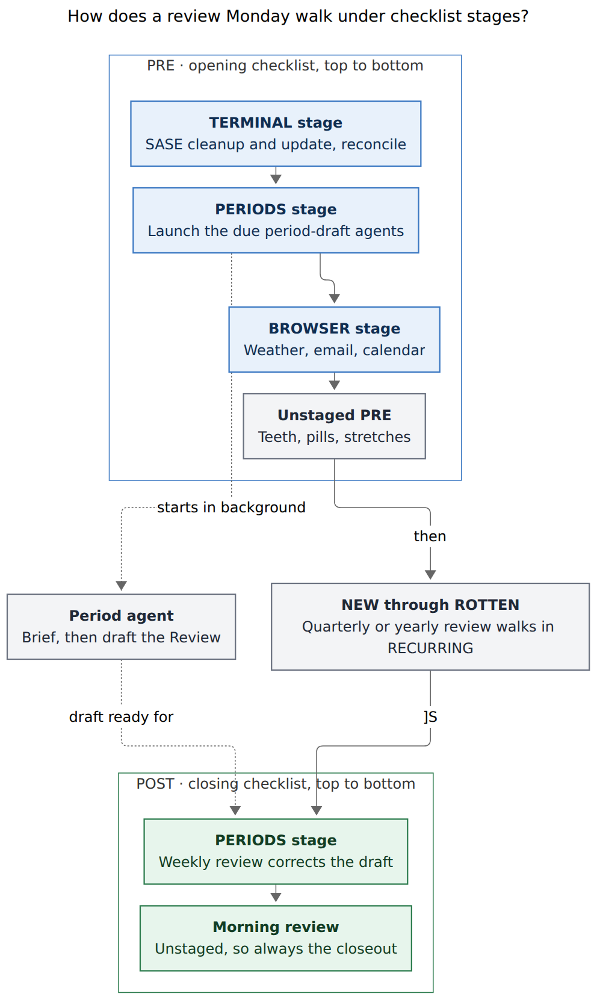

# Checklist stages and period-review prep for the morning GTD walk

> **Research request (paraphrased).** Add recurring pre-GTD (`#gtd #pre`) tasks to
> `~/bob/gtd_daily.md` that come due on the same day as each period's review and remind Bryan
> to launch agents that update the period notes. Let some PRE (and/or POST) rows walk ahead of
> others in the `]s` morning review. Requested PRE order: the new period-agent rows, then "Clean
> up SASE agents", then the browser chores (weather, email, calendar), then everything else.
> Lead the design (intuitive, reliable, beautiful), critique the plan, call out justified
> requirement changes, and end with a recommended solution.

**Lead researcher:** consolidated from five independent reports (cdx, cld, grk, mus, gem) plus
my own verification. **Date:** 2026-11-05. **Code pinned:** bob-cli `82f6cb9b`, bob-plugins
`9d24e42`, Obsidian Tasks 8.6.0 (installed). Nothing in the vault, config, or code was changed.

---

## 0. Bottom line

The plan is good. It fixes a real problem: today's PRE order is an accident of Tasks
bookkeeping and changes almost every day. I recommend building it in a slightly different form
from the request.

1. **Build *checklist stages*, not "priority".** Put a row in a stage by tagging it right after
   its checklist tag (`#gtd #pre #browser`). Set the stage order with two config keys
   (`freshness.pre_stages`, `freshness.post_stages`). Inside PRE and POST, the shared queue
   sorts by **stage rank, then path, then line**, and unstaged rows walk last. Every surface
   reads that one queue: `]s`, Ctrl+Enter's in-group advance, the footer, toasts, and
   `bob freshness list`. One comparator change in each evaluator therefore reorders all of
   them together.
2. **Do not use `[priority::]` or any new inline field.** In Bob, `[priority::]` is the P1–P4
   deferral and decay ladder. A new trailing field can silently hide `scheduled` and `repeat`
   from Tasks; cdx reproduced this. Tags have neither problem.
3. **Walk SASE cleanup before the launches. This changes your requested order.** On apollo
   today, `sase update -n` warns: *"4 agent runner(s) are running from this checkout and a swap
   now can break their deferred imports."* The cleanup row ends with "update SASE on all
   machines", so a period agent launched first is exposed to exactly that break. Doing the
   cleanup first costs a few minutes of overlap. The draft still has the rest of the walk to
   finish.
4. **Configure:** `pre_stages: [terminal, periods, browser]` and `post_stages: [periods]`.
   - `#terminal`: SASE cleanup, plus the `task reconcile` + `gcal sync` + `gkeep pull` row, so
     the agents brief a freshly synced vault.
   - `#periods`: the three new launch rows, plus the Weekly review in POST.
   - `#browser`: weather, email, calendar.
   - Teeth, pills, and stretches stay unstaged. Morning review stays unstaged in POST, so it is
     always the closeout.
5. **Add three launch rows**, one each for the week, quarter, and year. Each copies its review
   row's recurrence (plus `when done`) and its next date: 2026-11-09, 2027-01-04, 2027-01-11.
   You complete a launch row when its agent is running, not when the draft is finished.
6. **Keep the Quarterly and Yearly reviews as ordinary RECURRING rows.** That was a deliberate
   design choice on 2026-11-03, so a multi-hour review never blocks the POST closeout. The
   launch rows pair with them by date, which is all the request needs.



*Figure 1. On a review Monday the terminal stage readies SASE and the vault, and the periods
stage starts the draft agent. The draft then runs in the background through the rest of the
walk, until the Weekly review corrects it. The unstaged Morning review always closes the walk.
Quarterly and yearly reviews keep walking in RECURRING. (Source:
`gtd_checklist_stages_and_period_prep__final_walk.mmd`; Mermaid CLI 12.0.0, 660.8 × 1108 px,
80.6% PDF fit.)*

---

## 1. Is this a good idea?

**Yes. Each of the request's three ideas holds up.**

- **An explicit PRE order is overdue.** PRE and POST sort by `path ↑, line ↑`
  (`src/native/freshness/state.rs:928`, mirrored in bob-ledger-tools `110-freshness-queue.js`).
  The line order is not something you choose:
  - Tasks inserts each new occurrence above the completed line (`recurrenceOnNextLine: false`).
  - The 15-minute status grouper then moves blocks between Open, Blocked, and Done in whatever
    batches it catches.

  I sampled vault git history for the open PRE rows:

  | Snapshot | PRE walk order today (first 9 chars of each row) |
  | --- | --- |
  | 10-29 12:02 | Take fish · Review Ca · Read Emai · Import in · Clean up · Check wea · Brush tee · Do mornin |
  | 11-01 08:00 | Clean up · Check wea · Brush tee · Read Emai · Import in · Take fish · Review Ca · Do mornin |
  | 11-02 06:44 | Review Ca · Clean up · Check wea · Brush tee · Read Emai · Import in · Take fish · Do mornin |
  | 11-04 17:03 | Run `task · Take fish · Review ne · Check [we · Brush tee · Read emai · Clean up · Do mornin |
  | 11-05 07:09 | Review ne · Check [we · Brush tee · Read emai · Clean up · Run `task · Take fish · Do mornin |

  SASE cleanup wanders between positions 1 and 7, and the browser chores are never adjacent.
  Nobody chose this order. A fixed sequence turns PRE into a habit chain, where each step cues
  the next.
- **Batching the browser chores is GTD "contexts".** You already tried batching by merging them:
  a single "In a web browser…" row on 2026-11-04 was reverted within the hour (vault commits
  around 11:45). Stages make the chores adjacent while keeping one row per chore, each with its
  own check-off and habit history.
- **Launching drafts early is pipelining.** Drafting is the slowest, most automatable part of a
  period review. Today it happens inside the POST Weekly review, at the very end of the walk;
  W44 was drafted the day *after* its Monday (`review_drafted: 2026-11-03`). Starting the agent
  in PRE hides that wait behind the rest of the walk.

**Where the plan as written goes wrong:**

| Problem | Evidence | Fix |
| --- | --- | --- |
| "Priority" already means something | `~/.config/bob/config.yml`: P1 = `high` rolls `scheduled` 3–8 days ahead; "a task with no priority field is implicitly P0: do it now"; `freshness.decay.enter: P1`. The footer shows an `Alt+P` roll preview on any open task with a priority (glossary *Morning GTD Review Footer*). | Name the feature *checklist stages*. Leave `[priority::]` alone. |
| Launch-first races the SASE update | `sase update -n` (apollo, 2026-11-05) warns that a swap can break running agents' deferred imports, and auto-restarts each broken agent only once. | Walk `terminal` before `periods`. |
| Quarterly/Yearly are not POST rows | `gtd_daily.md` lines 25–26 are `#task #gtd` with no `#post`. Prior research made them ordinary RECURRING rows "so a long review never blocks the POST closeout". | Pair the launch rows with them by date; keep them RECURRING. |
| POST already closes in the wrong order on Mondays | Morning review (line 15) sorts before Weekly review (line 24). Nav's "Review closed" toast fires on whichever POST row completes last (`535-plugin-review-checklist-walk.js:427-441`). | Stage the Weekly review; Morning review stays unstaged, so it is always last. |
| "Tasks that require my browser" can't be inferred | Email and calendar rows carry no URL. The reconcile row also uses the network but isn't a browser chore. | Membership is an explicit tag. |

**Two smaller cautions:**

- The SASE cleanup row (restart, dismiss, review inboxes, update every machine) is the PRE row
  most able to swallow the morning. Keep it bounded, and capture real maintenance as separate
  tasks.
- "Read email" can grow without limit; "Triage email" names the GTD intent. This is optional.
  Rewording a PRE chore starts a new habit series, because `chore_identity` keys on the
  normalized description (`src/native/stats/metrics.rs:1191`).

---

## 2. Verified facts that decide the design

I re-checked every fact the reports disagreed on. Facts marked **(new)** came from my own
verification rather than from a researcher.

| # | Fact | Evidence | Consequence |
| --- | --- | --- | --- |
| F1 | The queue is PRE → NEW → PROJECTS → PENDING → NEXT → RECURRING → TICKLER → ROTTEN → POST. PRE, POST, and NEW share one `path, line` comparator arm. | `state.rs:891-930`; `decisions:recurring-occurrences-walk-when-due` | The change must split PRE/POST out of the arm shared with NEW, leaving NEW byte-identical. |
| F2 | Membership is exact whole-token `#gtd` + `#pre`/`#post`. Membership by "file path, block ID, inline field, or nested tag" was explicitly rejected. | `decisions:review-walk-is-tiered` | Stage tags must never affect membership; they only order rows that are already members. |
| F3 | File order is unstable (§1 table). | Vault git history | Rules out "just reorder the file" (mus §5.1) as a mechanism. |
| F4 | Bob's Tasks parser reads trailing fields until it meets an unknown one. The config.yml comment says Obsidian Tasks and the dash behave the same way. In cdx's scratch vault, `[review_order:: 10]` placed after the suffix made Bob's installed native Tasks query report `isRecurring: false, scheduled: null`. | `src/native/dataview/tasks/task.rs:621`; the config.yml `priority` comment; cdx scratch-vault experiment | Inline-field designs (cdx `[review_order::]`, grk `[band::]`, mus `[order::]`) carry a silent, row-breaking authoring hazard. Tags carry none. |
| F5 (new) | `sase update` swaps the installed package under running agents, and its dry run warns that this can break them. | `sase update -n` on apollo: "⚠ 4 agent runner(s) are running from this checkout and a swap now can break their deferred imports. ↻ … sase restarts it once automatically." | SASE cleanup (which includes the update) belongs before the launches. |
| F6 | The 15-minute hooks turn `[?]` back into `[ ]` once a row's date arrives, so a due Quarterly/Yearly row walks in RECURRING. | `decisions:recurring-occurrences-walk-when-due` ("The 15-minute hooks restore `[ ]` after the date arrives") | Refutes mus §2.1's claim that Quarterly/Yearly "never walk". They do, in RECURRING. |
| F7 (new) | Quarterly/Yearly were made RECURRING on purpose: "Add two **ordinary** recurring rows: no `#pre` or `#post`, so a long review never blocks the POST closeout … link one to Today and do it in a PLAN Pomodoro." | `research:202611/period_note_tree_and_stats_strips/period_note_tree_and_stats_strips__final.md` (2026-11-03) | Keep them. Making them `#post` (cdx, grk, mus) would reverse a two-day-old choice for no new reason. |
| F8 (new) | bob-ledger-tools reads `freshness:` straight from `~/.config/bob/config.yml`, and that file is chezmoi-managed (`~/.local/share/chezmoi/home/dot_config/bob/config.yml`). | `090-freshness-config.js:428`; `chezmoi source-path` | A config-held stage order is the same on every host once `chezmoi apply` runs. This settles cld's open question 3. |
| F9 (new) | `bob periods brief` with no id briefs the *current* (open) ISO week. `draft` refuses an open period (`refused_open`) and an `edited`/`reflected` Review. | `docs/periods.md:186-205` | Launch rows must name the closed period; the refusals are the safety net if they don't. |
| F10 (new) | Installed Tasks 8.6.0 computes `when done` occurrences from the completion day (`dtstart = completion`, next occurrence after end of that day). | `obsidian-tasks-plugin/main.js` `nextReferenceDateFromToday` | `every 3 months on the 1st Monday when done`, completed anywhere in its due month, gives the same next date as the RECURRING review row. It drifts only if completion slips into the next month. |
| F11 (new) | The PRE identity run already renders as a teal sunrise ☀, and a name label beside the glyph has precedent (TI5: "sunrise plus `GTD` name"). | `docs/task-tag-marks.md:318-371, 517` | A stage label after ☀ extends an existing visual pattern instead of inventing one. |
| F12 | Habit stats key each chore on its description with tags and fields stripped. | `metrics.rs:1191` | Adding stage tags keeps every chore's habit history. |
| F13 | Checklist rows whose `repeat` lacks `when done` raise the `checklist_repeat_not_when_done` lint. | `scan.rs:359-393` | New launch rows should carry `when done`. |

---

## 3. Mechanism options and verdict

| Option | Proposed by | Intuitive | Reliable | Beautiful | Verdict |
| --- | --- | --- | --- | --- | --- |
| **Stage tags + ordered config list** | cld | ✓ The tag says *why* the row is grouped; the config says the order | ✓ No parser hazard. Recurrence copies tags. Inert in old code and outside PRE/POST. Config is chezmoi-synced (F8). | ✓ Small label after ☀; the footer names the stage | **Adopt** |
| Named `[band:: x]` field + baked catalog | grk | ✓ Names read as a script | ✗ Field placement hazard (F4) | ~ | Reject. The catalog idea survives as the config list, but defaults baked into the evaluator would put Bryan's personal policy in code. |
| Numeric `[review_order:: N]` / `[order:: N]` | cdx, mus (later) | ~ Numbers don't explain themselves | ✗ Field placement hazard (F4); cdx itself calls placement a release blocker | ~ A quiet number | Reject. Keep as a fallback only if names prove insufficient. |
| Reuse `[priority::]` | gem | ✗ Inverts Bob's P0 = "do it now" | ✗ Alt+P roll previews; decay ladder; `[priority:: high]` on a chore reads as "P1, roll 3–8 days" | ✗ P-level bars on daily chores | Reject |
| Reorder lines in `gtd_daily.md` | mus (now) | ✓ | ✗ Reshuffles daily (F3) | ✓ | Reject as the mechanism. Harmless as a one-time tidy. |
| Sub-tiers (PRE_HIGH …) or a new walk tier | none | ✗ | ✗ Multiplies Ctrl+Enter boundaries, schema, and footer groups | ✗ | Reject |
| `dependsOn` chains between rows | none | ✗ | ✗ Dependency-blocked rows leave the checklist, so one skipped chore hides the rest | ✗ | Reject |

Why tags plus config beats a per-row number:

- Moving the browser batch ahead of terminal is one config edit, not three row edits.
- The stage name is what the footer, toasts, and CLI can show.
- Typos fail visibly: an unknown tag stays a plain pill instead of becoming a label.

---

## 4. Requirement adjustments (flagged)

| ID | You asked for | I recommend | Why | Cost if you reject it |
| --- | --- | --- | --- | --- |
| **A1** | "Prioritize" PRE/POST rows | Call it **checklist stages**. Don't touch `[priority::]`. | F4; P-levels mean deferral and decay | A semantic clash with Alt+P, decay, and roughly 700 P-level rows |
| **A2** | Period launches first, SASE cleanup second | **SASE cleanup first, launches second** | F5: the SASE update can break freshly launched agents. Cleanup also dismisses and restarts agents. | An occasional broken or auto-restarted draft agent on review Mondays |
| **A3** | Reconcile/sync/pull among "all other" PRE tasks | Move it into the first stage, `#terminal`, after SASE cleanup | Same context (a shell). Period briefs read the vault's ledger and stats, so syncing first makes the brief current (gem, grk). | A Monday brief may miss Sunday's late events or pomodoro fixes |
| **A4** | Pair with "the corresponding post-GTD review task for each period" | Only the **Weekly** review is POST. Quarterly/Yearly stay RECURRING; the launch rows pair with them **by date**. | F6, F7 | Making them POST would let a 1–2 hour review hold the daily closeout |
| **A5** | PRE and/or POST | **Use stages in POST too:** Weekly review `#periods`; Morning review unstaged, so last | Fixes today's Monday inversion (§1) | The walk "closes" before the weekly review on every Monday |
| **A6** | Reminders to run agents | A launch row is done when the agent is **running**, or when the Review is already drafted or edited. POST/RECURRING still owns correcting the draft and writing the Reflection. | Waiting for the draft inside PRE would block the rest of the walk | — |
| **A7** | (implied) | Reword the Weekly review: drafting moves to PRE, and "launch one now" becomes the fallback | Otherwise two rows tell you to launch the same agent | Stale instruction text |
| **A8** | "Tasks that require my browser" | Explicit `#browser` tags on the three named rows; no inference | Reliability | — |
| **A9** | (not asked) | Inside a stage, order stays file order | Not requested; within-stage order doesn't matter for these batches | The three browser chores may swap places day to day, but always stay together |
| **A10** | Reminders | No auto-launch yet | The review is still the human's decision; see the reopen triggers (§8) | — |

The Keep note behind this task (`gkeep_inbox#^pre-gtd-period-agents`, merged into
`bob#^prioritize-pre-gtd`) said "Give internet tasks … the highest priority!". The request
puts launches first instead. I follow the request's cluster idea, adjusted by A2.

---

## 5. Recommended design

### 5.1 Concept

> **A checklist stage is a named, ordered batch of PRE or POST rows.** You put a row in a stage
> by tagging it, and config sets the stage order. Stages walk in that order, ahead of unstaged
> rows. Stages change *order only*: never membership, status, dates, freshness, priority,
> counts, or the PRE/POST Ctrl+Enter boundary.

There is one place to look in each direction:

- **Row → stage:** the tag on the line.
- **Stage → position:** the config list.
- **What you see:** the stage label in the editor, footer, toasts, and CLI.

### 5.2 Authoring

Tag the row right after its checklist tag. The stage then reads as part of the row's identity,
and Tasks copies it into every new occurrence like any other description text:

```markdown
- [ ] #task #gtd #pre #browser Check [weather](https://google.com/search?q=weather)  [repeat:: every day when done]  …
```

Edit the config in its chezmoi source, then `chezmoi apply` on each host:

```yaml
freshness:
  # PRE/POST checklist stages (docs/freshness.md §4). Each name is a tag. An open
  # #gtd #pre (or #gtd #post) row carrying one walks in that stage. Stages walk in
  # list order, ahead of rows that carry none. Absent or [] keeps file order.
  # Write names without '#' (YAML treats '#' as a comment).
  pre_stages: [terminal, periods, browser]
  post_stages: [periods]
```

Validation:

- An entry follows the tag grammar `[\p{L}\p{N}_/-]+` and matches case-insensitively.
- Entries are unique within a list and may not be `task`, `gtd`, `pre`, or `post`.
- An invalid list is ignored **as a whole**: that tier falls back to file order and emits one
  `freshness_stages_invalid` diagnostic. A typo can never break the walk.

### 5.3 Evaluator contract (an addition to `docs/freshness.md` §4)

```text
stages(k)     = freshness.pre_stages (k = pre) | freshness.post_stages (k = post);
                lowercased, '#' stripped; absent/invalid ⇒ []
stage(t)      = for a row in checklist scope with kind k: the FIRST name in stages(k)
                that t carries as an exact whole-token tag (same tokenizer as #pre);
                none otherwise. Always none outside PRE/POST.
stage_rank(t) = index of stage(t) in stages(k); +∞ when none
Order (pre, post) = stage_rank ↑, path ↑, line ↑
NEW           = path ↑, line ↑ (unchanged; split out of the shared arm)
Lints         = checklist_stage_conflict  (an open row carries ≥ 2 listed stages; the earliest-listed wins)
                freshness_stages_invalid  (config list rejected; file order)
                checklist_stage_unused    (a listed stage has no open member row at all: a typo on one side)
Unchanged     = membership, scope, tier order, by_tier counts, due/state/bucket, decide,
                keeps, Ctrl+Enter semantics, and the PRE/POST boundary
```

Machine output (additive, so not a `!` break under the release-train rule):

- **bob-cli freshness JSON schema 16.** Each queue row gains `stage` (a string or null), and
  `config` echoes both lists.
- **bob-ledger-tools.** `api.freshness` moves to namespace v14 and advertises
  `checklistStages: true`. Entries gain `stage`, `stageRank`, `stageIndex`, and `stageTotal`,
  the stage-local counterparts of `tierRank`/`tierTotal`. A nav build without the capability
  keeps today's order, the same degrade path `checklistTiers` uses.

Conformance vectors (Rust and JS run the same set):

| Vector | Setup | Expect |
| --- | --- | --- |
| CS1 | Unstaged row at line 1; `#browser` row at line 9 | The `#browser` row ranks first |
| CS2 | A `#browser` at line 1, B `#terminal` at line 2; `[terminal, browser]` | B before A: config order wins over line order |
| CS3 | Row carries `#terminal #browser` | Stage `terminal`; lint `checklist_stage_conflict` |
| CS4 | No stage config | Exactly today's `path, line` order everywhere (regression) |
| CS5 | `#Browser` ✓; `#browsers`, `#browser/x`, `#web/browser` ✗ | Case-insensitive exact whole-token match |
| CS6 | `#periods` in both lists; PRE and POST rows | Ranked independently per tier |
| CS7 | `#browser` on a non-checklist Ready row | Same tier, state, and order as without it; no lint |
| CS8 | `pre_stages: [gtd]` | List ignored; file order; one diagnostic |
| CS9 | Staged row with a future `scheduled` | Still absent from PRE: order never overrides eligibility |
| CS10 | NEW rows alongside staged PRE rows | NEW order is byte-identical to the old comparator |

### 5.4 Surfaces: where it gets beautiful

The rule: every place you already look tells you which batch you're in. Nothing new to look
at, and no new keys.

- **Editor.** A stage tag directly after the identity run renders as a quiet small-caps label
  in the identity teal, the same way a type name already sits beside the sunrise (F11). Hover:
  `PRE stage 1 of 3 · terminal · walks before periods`. Touching the label reveals the raw tag,
  as with the glyph. An unknown or mistyped stage (`#brower`) stays an ordinary pill, and that
  plain look is itself the typo signal.

  ```text
  before: - [?] ☀ Clean up SASE agents on athena and apollo: …
  after:  - [?] ☀ TERMINAL  Clean up SASE agents on athena and apollo: …
          - [?] ☀ PERIODS   Start last week's review draft: …
          - [?] ☀ BROWSER   Check weather
          - [?] ☀ Brush teeth
          - [?] ⚑ PERIODS   Weekly review: …
          - [?] ⚑ Morning review: …
  ```
- **Footer.** On a staged row, the stage replaces the generic `checklist`/`closeout` detail
  (`120-freshness-footer.js:212-219`). It shows a stage-local count when the stage holds two
  or more rows:

  ```text
  ⟳ Review 1/38 · PRE 1/9 · TERMINAL 1/2 · Ctrl+Enter done · ]s skip
  ⟳ Review 3/38 · PRE 3/9 · PERIODS · Ctrl+Enter done · ]s skip
  ⟳ Review 7/38 · PRE 7/9 · checklist · Ctrl+Enter done · ]s skip        (unstaged)
  ⟳ Review 38/38 · POST 2/2 · closeout · Ctrl+Enter done · closes the review
  ```
- **Toasts.** Landing toasts name the stage: `PRE 4/9 · BROWSER 1/3 · Check weather`.
  Finishing the last row of a stage adds a quiet tick: `✓ Done · Read email · BROWSER ✓`. The
  walk never pauses at a stage boundary; the PRE/POST boundary rule stays the only checklist
  stop.
- **CLI.** `bob freshness list` prints the stage in a dim column, in walk order. JSON carries
  `stage`.
- **Restraint.** No chips, counters, progress bars, colors per stage, or new tiers. The one
  hue stays the PRE/POST teal. Small caps and a stable left edge carry the hierarchy.

### 5.5 The three launch rows

Write them as `[ ]` with a future `scheduled`. The task-status hooks derive `[?]` within 15
minutes, like every other row. Put the fuller instructions in the row text, not in nested
children, so the walk landing shows them:

```markdown
- [ ] #task #gtd #pre #periods **Start last week's review draft**: launch an agent with "Update YYYY/YYYY-Www.md" for last ISO week (today's note → week link → ‹) · done once it runs, or the Review is already drafted/edited.  [repeat:: every week on Monday when done]  [created:: 2026-11-05]  [scheduled:: 2026-11-09]
- [ ] #task #gtd #pre #periods **Start last quarter's review draft**: launch an agent with "Update YYYY/YYYY-Qn.md" for the quarter that just ended; if last week's row is due too, use one agent for both: week first, then quarter · done once it runs.  [repeat:: every 3 months on the 1st Monday when done]  [created:: 2026-11-05]  [scheduled:: 2027-01-04]
- [ ] #task #gtd #pre #periods **Start last year's review draft**: launch an agent with "Update YYYY.md" for the ISO year that just ended (it reads the Q4 Review, so finish the Quarterly review first if it is still open) · done once it runs.  [repeat:: every January on the 2nd Monday when done]  [created:: 2026-11-05]  [scheduled:: 2027-01-11]
```

Notes on these rows:

- **Recurrence.** The weekly rule is identical to the Weekly review's. The quarterly and yearly
  rules add `when done` to the RECURRING rows' anchors. Because Tasks re-anchors at the
  completion day (F10), completing them in their due month yields the review row's next date
  (2027-01-04 → 04-05 → 07-05 …; 2027-01-11 → 2028-01-10). The check-off doesn't need to
  match the review rows' rule text, and the rows stay lint-clean (F13). A PRE row nags every
  morning, so a month-long slip is unlikely.
  - Fallback if drift is ever observed: mirror the anchors exactly without `when done`, and
    narrow the lint to exempt rules anchored to the 1st/2nd weekday of a month (cdx, mus).
- **What "same day" promises.** The pair share a calendar and a seed date. They are still two
  independent series:
  - Completing the PRE row Nov 9 makes the next one Nov 16.
  - A Weekly review finished late on Nov 17 makes its next one Nov 23 (cdx).

  Documentation must not promise lockstep. If strict coupling is ever needed, it requires one
  shared period-series authority, a much larger feature. Don't build it without evidence of
  drift.
- **Text never names a concrete period.** Tasks copies the description into every occurrence
  forever (cdx). Rows say "last week/quarter/year" and point at the navigation already in the
  Weekly review's text. `bob periods draft` refusing open periods and edited Reviews (F9) is
  the safety net.
- **Overlap days.** 2027-01-04 is the weekly plus quarterly Monday. The just-ended week,
  2026-W53, belongs to 2026-Q4, so the quarter brief benefits from the week's draft. One agent
  doing "W53, then Q4" covers both rows, and you Ctrl+Enter each.

  2027-01-11 is the weekly plus yearly Monday. The weekly target is 2027-W01, which belongs to
  the new year, so no ordering is needed. This makes order *within* the `periods` stage
  irrelevant (A9).
- **Optional small CLI refinement (cld).** Accept relative ids such as `last-week`,
  `last-quarter`, `last-year` in `bob periods brief|draft|show`. The rows could then carry an
  exact, paste-ready prompt and drop the "→ ‹" navigation. Follow `cli_rules` if built.

| Monday | PRE `#periods` rows due | Review rows due |
| --- | --- | --- |
| 2026-11-09 and every Monday | week (2026-W45 first) | Weekly review (POST) |
| 2027-01-04 | week (2026-W53) + quarter (2026-Q4) | Weekly (POST) + Quarterly (RECURRING) |
| 2027-01-11 | week (2027-W01) + year (2026) | Weekly (POST) + Yearly (RECURRING) |

### 5.6 Edits to existing rows in `gtd_daily.md`

Edit only the open (first) occurrence of each row; leave the Done history alone.

| Row | Change |
| --- | --- |
| Clean up SASE agents on athena and apollo | Add `#terminal` after `#pre` |
| Run `task reconcile` + `gcal sync` + `gkeep pull` | Add `#terminal` (A3) |
| Check weather · Read email · Review next week in Google Calendar | Add `#browser` |
| Brush teeth · fish oil + L-tyrosine · morning stretches | Unchanged (unstaged; stretches keep their 2026-11-11 date) |
| Weekly review (`#post`) | Add `#periods` after `#post`. Replace "no Review yet? launch an agent with "Update YYYY/YYYY-Www.md", correct its draft, and write the Reflection" with "correct the draft PRE started (still empty? launch "Update YYYY/YYYY-Www.md" now) and write the Reflection" (A5, A7) |
| Morning review (`#post`) | Unchanged and unstaged, so it is always last |
| Quarterly / Yearly review | Tier unchanged (A4). Same rewording as the Weekly review: correct the draft PRE started; launch only if it's still empty. Don't tag them: stages are inert outside PRE/POST. |

### 5.7 The resulting walk on Monday 2026-11-09

| Position | Tier · stage | Row |
| --- | --- | --- |
| 1–2 | PRE · TERMINAL | Clean up SASE agents (incl. update) · Run reconcile/gcal/gkeep, in file order |
| 3 | PRE · PERIODS | Start last week's review draft (2026-W45). The agent drafts from here on. |
| 4–6 | PRE · BROWSER | Weather · Email · Calendar, in file order |
| 7–8 | PRE | Brush teeth · Fish oil + L-tyrosine (stretches return 11-11) |
| … | NEW → … → TICKLER, then ROTTEN | Unchanged. On quarter/year Mondays the Quarterly/Yearly review appears in RECURRING (link it to Today). |
| last − 1 | POST · PERIODS | Weekly review: correct the now-ready draft, write the Reflection |
| last | POST | Morning review: closes the walk, and the "Review closed" toast fires here |

---

## 6. Rollout and verification

Tags and config keys are inert on older code: bob-cli's freshness config test
`parses_freshness_overrides_and_ignores_unknown_keys` covers unknown keys, and tags carry no
meaning by themselves. The steps below can therefore land in any order. The walk changes only
once code and config are both present.

1. **bob-cli (medium).**
   - Parse and validate `pre_stages`/`post_stages` (`src/native/config/freshness.rs`).
   - Add the stage resolver and the PRE/POST comparator arm (`state.rs::queue`, with NEW split
     out).
   - Add the lints (`scan.rs`), JSON schema 16, and the stage column (`cli.rs`).
   - Update `docs/freshness.md` §4 and add vectors CS1–CS10 to `state_tests.rs`.
   - Ships through the daily release train; additive, so no `!`.
2. **bob-ledger-tools (medium).**
   - Mirror the config parse (`090`) and comparator plus fields (`110`).
   - Add the footer stage detail (`120`/`121`) and the stage label mark (`138` + `styles.css`).
   - Bump to namespace v14 with `checklistStages`; add the JS copy of CS1–CS10.
   - Update `docs/task-tag-marks.md` with the label spec and test rows.
   - Then `npm run build`, `npm test`, and `bob plugins sync`.
3. **bob-navigation-hotkeys (small).** Add stage names to landing toasts and the stage-end tick
   (`535-…`, `480-…`). Older nav keeps working without them.
4. **Config and vault (minutes).**
   - Add the keys in the chezmoi source, then `chezmoi apply` on apollo, athena, and the Mac.
   - Edit `gtd_daily.md` per §5.5–5.6.
   - Verify with `BOB_NOW=2026-11-09T07:00:00 bob freshness list -f json | jq '.queue[] | select(.tier=="pre" or .tier=="post") | {tier, stage, line}'`, then walk `]s` once.
5. **Decision record.** Add a new `decisions:` record, e.g. *Checklist stages order PRE and
   POST*, that partly supersedes the PRE/POST comparator in `decisions:review-walk-is-tiered`
   (`path ↑, line ↑` becomes `stage ↑, path ↑, line ↑`). Use `/sase_memory_write`.

Acceptance checks beyond the vectors:

- A real Tasks completion copies the stage tag into the next occurrence, both when the new
  occurrence is inserted above the completed row and below it.
- Ctrl+Enter auto-advance follows queue order when the next staged row sits *above* the cursor
  (`[s`, `]S`, undo, a stale cache after a line shift).
- The footer and labels are legible in light and dark themes and on red Blocked `[?]` rows.

---

## 7. How the five reports were reconciled

| Question | cdx | cld | grk | mus | gem | Resolution |
| --- | --- | --- | --- | --- | --- | --- |
| Mechanism | `[review_order:: N]` | stage tags + config | `[band::]` + baked catalog | file order now; `[order:: 1–4]` later | `[priority::]` | **Stage tags + config** (F3, F4, F8; footer glossary) |
| First stage | launches | launches (flags the SASE-update risk) | SASE + reconcile | launches | launches (flags risks) | **SASE + reconcile first** (F5 verified) |
| Reconcile row | rest | `#terminal` (optional) | `sase` band | rest | elevate | **`#terminal`** |
| Quarterly/Yearly | add `#post` | keep RECURRING | `#post` + `when done` | add `#post` ("never walk") | keep RECURRING | **Keep RECURRING** (F6 refutes "never walk"; F7) |
| POST order | periods before Morning | Weekly before Morning | Morning (`close`) **before** `period` | unchanged | Weekly before Morning | **Morning review last.** grk's catalog contradicts its own text and the closeout toast. |
| `when done` on new rows | no (mirror) | yes | yes | no (accept lint) | no | **Yes** (F10, F13), with the mirror-plus-lint-exemption fallback |
| Launch rows | 3 | 3 | 3 | 3 | 3 | **3** (unanimous) |
| Auto-launch | no | later | no | — | later | **No; reopen trigger** |

Weak or wrong claims I did not carry forward:

- gem: `[priority::]` is "zero fragility" and "visually beautiful". It isn't: P1–P4 semantics,
  Alt+P previews, and the decay ladder all apply.
- gem: agent drafting takes "30–90 seconds" (unmeasured).
- mus: reordering the file is enough (F3), and Quarterly/Yearly never walk (F6).
- grk: putting `close` before `period` in POST.

---

## 8. Costs, risks, and reopen triggers

**Costs.**

- One more config concept, and ten more vectors kept in sync across two evaluators.
- A mistyped stage tag silently drops its row to the end of its tier. The missing label (and
  `checklist_stage_unused` when the whole stage is empty) are the signals.
- Order inside a stage still drifts (A9).
- On review Mondays the launch rows count as due chores in the `habits` ratio. Existing chores
  keep their history (F12).
- Launching moves a few minutes later than requested (A2).

**Reopen when:**

- **The launch rows become rubber stamps.** Say 8 of 10 review Mondays, the row is completed
  with no real choice. Then automate: a Monday scheduled agent behind SASE launch approval, with
  the rows dropped or turned into "approve the drafts".
- **Within-stage reshuffling starts to bother you.** Either add a tie-break on normalized task
  text (cheap but alphabetical, and both evaluators must normalize identically), or make the
  status grouper append moved blocks at the end of their destination group (this stabilizes the
  file, but flips every Done list to oldest-first).
- **SASE cleanup routinely runs long enough to starve the drafts.** Split "update SASE on all
  machines" into its own first `#terminal` row and move the inbox review later.
- **A stage list grows past about five entries, or stages are wanted in other tiers.** Stages
  are turning into a scheduler; step back.
- **A whole stage is `]s`-skipped on most mornings.** Those chores don't belong in PRE. This is
  the same trigger `review-walk-is-tiered` uses.
- **A new unstaged POST row starts walking after Morning review.** Then allow a "rest" slot in
  `post_stages` (for example `[periods, …, closeout]`). Today POST has only two rows, so this is
  deliberately deferred.

---

## 9. Open questions for Bryan

1. **A2.** Do you accept SASE-first? If you'd rather keep launch-first, the alternative is to
   split the update into its own row that walks *before* the launches.
2. **A3.** Should reconcile/gcal/gkeep join the terminal stage? (Recommended.)
3. **A4.** Keep Quarterly/Yearly in RECURRING (recommended), or deliberately make them POST?
4. Are the stage names right: `terminal`, `periods`, `browser`?
5. Do you want stable order *inside* a stage now, or only if it bothers you (§8)?

---

## 10. Recommended solution

1. **Build checklist stages in both evaluators.**
   - A row joins a stage with a plain tag right after `#pre`/`#post`.
   - `freshness.pre_stages` and `freshness.post_stages` list the order.
   - PRE/POST sort by **stage rank ↑ (unstaged last), path ↑, line ↑**. NEW and every other
     tier stay unchanged.
   - Add the vectors CS1–CS10, additive JSON (schema 16), namespace v14 `checklistStages`, and
     three small lints.
   - Membership, counts, Ctrl+Enter, and the PRE/POST boundary don't change.
2. **Make it visible and quiet.**
   - A small-caps stage label after ☀ or ⚑.
   - The stage name in the footer detail slot, with a stage-local count.
   - Stage names in toasts, plus a `· STAGE ✓` tick when a batch finishes.
   - A dim stage column in `bob freshness list`.
   - Nothing else new.
3. **Configure** `pre_stages: [terminal, periods, browser]` and `post_stages: [periods]` in the
   chezmoi-managed `config.yml`.
4. **Tag the vault.**
   - `#terminal`: SASE cleanup and the reconcile row.
   - `#browser`: weather, email, calendar.
   - `#periods`: the Weekly review (POST).
   - Leave the body chores and Morning review unstaged.
5. **Add three `#gtd #pre #periods` launch rows** (week, quarter, year).
   - Each copies its review row's anchor plus `when done`, seeded 2026-11-09, 2027-01-04, and
     2027-01-11.
   - Each is done when the agent is running.
   - Reword the review rows so launching there is only the fallback.
   - Keep Quarterly/Yearly in RECURRING.
6. **Verify, then revisit.**
   - Prove tag preservation through real Tasks completion and the walk advance before relying
     on the order.
   - Reconsider automation once the launch rows show whether launching is a real decision.

---

## Sources

**Researcher reports (this directory).**

- `gtd_checklist_stages_and_period_prep__cdx.md`: Review-order field; the parser-placement
  experiment; recurrence-drift analysis.
- `__cld.md`: Checklist stages; vault reshuffle history; habit-identity safety.
  - Figure: `pre_post_checklist_stages__cld_walk.*` (launch-first variant).
- `__grk.md`: Bands; SASE-first ordering; live Friday walk.
  - Figures: `fig-*.{mmd,svg,png}`.
- `__mus.md`: The `when done` versus anchored trade-off; file-order baseline.
- `__gem.md`: The reconcile-dependency critique; the POST inversion; the `[priority::]`
  proposal (rejected).

**Own verification (2026-11-05, apollo).**

- **bob-cli `82f6cb9b`:**
  - `src/native/freshness/state.rs:891-960` (queue comparator).
  - `src/native/freshness/scan.rs:359-393, 515-530` (checklist lints).
  - `src/native/dataview/tasks/task.rs:621` (trailing-field parser).
  - `src/native/stats/metrics.rs:1191` (`chore_identity`).
  - `docs/freshness.md` §4 (CL12).
  - `docs/periods.md:180-215`.
  - `docs/task-tag-marks.md:312-372, 510-520`.
- **bob-plugins `9d24e42`:**
  - `bob-ledger-tools/src/090-freshness-config.js` (reads `~/.config/bob/config.yml`).
  - `120-freshness-footer.js:205-225`.
  - `138-checklist-task-marks.js`.
  - `bob-navigation-hotkeys/src/535-plugin-review-checklist-walk.js:48-62, 395-445`.
- **Config:** `~/.config/bob/config.yml` (`properties.priority` levels P1–P4, `freshness.decay`).
  Its chezmoi source is `~/.local/share/chezmoi/home/dot_config/bob/config.yml`.
- **Vault:**
  - `~/bob/gtd_daily.md` (open rows, lines 15–26).
  - `~/bob/bob.md#^prioritize-pre-gtd` and `~/bob/gkeep_inbox.md#^pre-gtd-period-agents`.
  - `git log -- gtd_daily.md` sampled 2026-10-29 … 2026-11-05.
  - `.obsidian/plugins/obsidian-tasks-plugin` 8.6.0 (`main.js` recurrence code; `data.json`).
- **CLI:**
  - `sase update -n` (dry run; agent-runner swap warning).
  - `sase axe routine list` (no bob sync routines on apollo).
  - `bob periods --help`, `bob periods brief --help`, `bob periods list -p -f json`.
- **Memory:**
  - `decisions:review-walk-is-tiered`, `decisions:recurring-occurrences-walk-when-due`,
    `decisions:answering-advances-the-walk`.
  - `glossary:morning-gtd-review-footer`, `glossary:period-note`.
- **Prior research:**
  - `research:202611/period_note_tree_and_stats_strips/period_note_tree_and_stats_strips__final.md`:
    Quarterly/Yearly as ordinary RECURRING rows.
