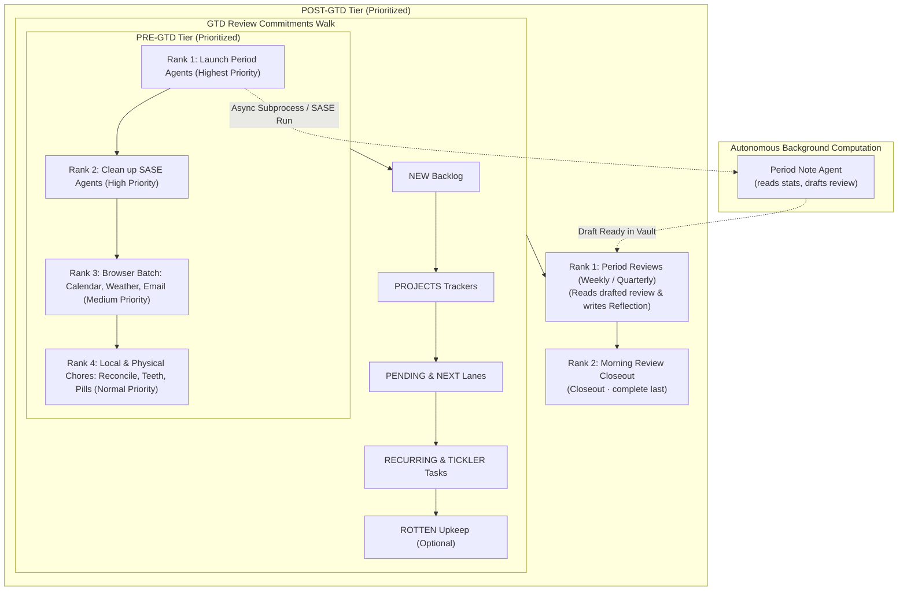
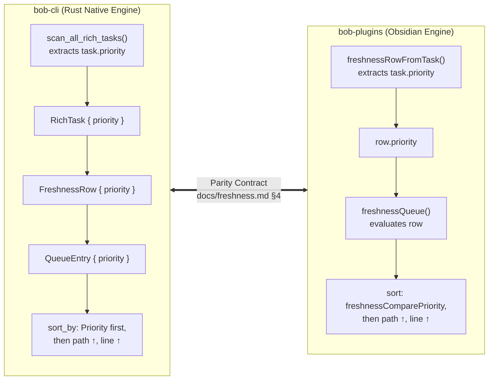

# Architectural Research: Prioritized GTD Review Groups and Period Note Agent Workflows

**Author**: Researcher `gem` (5-Researcher Swarm)  
**Date**: November 5, 2026  
**Status**: Completed Research & Proposed Specification  
**Target Repository**: `bob-cli` / `bob-plugins` / Bob Vault (`~/bob/`)  

---

## 1. Executive Summary

Bryan's personal knowledge and task management vault (`~/bob/`) governs his daily operational execution through a Getting Things Done (GTD) morning review walk. This walk is driven by a dual-engine architecture: the native Rust CLI (`bob freshness`) and companion Obsidian plugins (`bob-ledger-tools` and `bob-navigation-hotkeys`). The review walk visits tasks across nine strictly ordered tiers:
$$\text{PRE} \longrightarrow \text{NEW} \longrightarrow \text{PROJECTS} \longrightarrow \text{PENDING} \longrightarrow \text{NEXT} \longrightarrow \text{RECURRING} \longrightarrow \text{TICKLER} \longrightarrow \text{ROTTEN} \longrightarrow \text{POST}$$

The opening checklist tier (**PRE**) and the closing checklist tier (**POST**) consist of checklist chores defined in `~/bob/gtd_daily.md`. Under current system behavior, both engines sort tasks within the `PRE` and `POST` tiers strictly by physical file line order (`path ↑, line ↑`).

The user has proposed two coordinated enhancements:
1. **Recurring Pre-GTD Period Note Agent Reminders**: Introduce new recurring pre-GTD tasks scheduled on the exact same days as the corresponding post-GTD period review tasks (Weekly, Quarterly, Yearly). These tasks remind Bryan to launch autonomous background agents to update the respective period notes (`YYYY/YYYY-Www.md`, `YYYY/YYYY-Qn.md`, `YYYY.md`) so that completed draft reviews are ready when he reaches his post-GTD review rituals.
2. **Review Group Intra-Tier Prioritization**: Add support for prioritizing tasks within the `PRE` and `POST` review groups, establishing the following morning review execution hierarchy:
   - **Rank 1 (Top Priority)**: Period Note Agent Launch tasks (so background agents start immediately).
   - **Rank 2**: Clean up SASE agents on athena and apollo.
   - **Rank 3**: Browser-dependent pre-GTD tasks (Weather, Email, Calendar), batched so Bryan opens and navigates his web browser in a single, focused session.
   - **Rank 4 (Standard)**: All remaining pre-GTD physical and local maintenance chores (oral hygiene, vitamins/supplements, morning stretches, and task/calendar reconcile).

### Core Research Findings & Architectural Recommendations

1. **Physical Line Order is Structurally Fragile**: Relying on line position in `gtd_daily.md` fails because Obsidian Tasks rewrites recurring rows upon completion (`Ctrl+Enter`), causing line positions to scatter over time. Furthermore, tasks recurring on different cadences (daily vs. weekly vs. quarterly) interleave unpredictably when evaluated dynamically.
2. **The Ideal Prioritization Mechanism is Native Tasks Priority**: Rather than inventing ad-hoc tags (`#p1`, `#browser`) or non-standard inline fields (`[order:: 1]`), intra-tier prioritization should leverage standard Obsidian Tasks `[priority:: <highest|high|medium|low|lowest>]` fields.
   - Both `bob-cli` and `bob-plugins` already understand Tasks priority: `bob-ledger-tools` features `api.priorityMarks`, which renders priority fields as elegant monochrome signal-bar staircase glyphs.
   - Updating the queue comparator in `src/native/freshness/state.rs` and `plugins/bob-ledger-tools/src/110-freshness-queue.js` to sort by `priority` first and tie-break by `path ↑, line ↑` provides robust, beautiful, and backward-compatible prioritization.
   - Normal priority tasks (Rank 4) require **no priority field at all**, keeping the Markdown clean and uncluttered.
3. **Crucial Workflow Critique (The Reconcile Dependency)**:
   - Period review agents depend on `bob periods brief`, which reads pomodoro minutes, task completions, and daily stats.
   - If Bryan launches period review agents in Rank 1 *before* running `Run task reconcile + gcal sync + gkeep pull` (currently placed in Rank 4), Sunday's pomodoro sessions and calendar events may remain unfiled or unreconciled, causing agents to draft reviews on stale or incomplete data.
   - **Recommended Adjustment**: Bryan should run `task reconcile` and `gcal sync` *before* or *in conjunction with* launching period note agents, or establish Sunday evening reconcile as a standard habit.
4. **Resolution of the POST-GTD Walk Inversion**:
   - In `~/bob/gtd_daily.md`, `Morning review` is currently located on line 15 with explicit instructions stating `Closeout · complete last`. However, `Weekly review` resides on line 24.
   - Because `POST` currently sorts by `line ↑`, the morning review walk lands on `Morning review` *before* `Weekly review` on Mondays!
   - Introducing priority sorting solves this bug immediately: assigning `[priority:: high]` to period reviews ensures they are walked and completed *before* `Morning review` (default priority / `lowest`), guaranteeing that morning review truly closes out last.

---

## 2. Analysis of Current State & Mechanics

### 2.1 The Vault Baseline: `~/bob/gtd_daily.md`

`~/bob/gtd_daily.md` serves as the operational hub for GTD daily habits and review rituals. It is typed as an `[[area]]` under parent `[[gtd]]`. Tasks are divided into active instances under `### Blocked` and completed instances under `### Done & Canceled`.

The current active tasks under `### Blocked` are structured as follows:

```markdown
### Blocked

- [?] #task #gtd #post **Morning review**: PRE chores done or knowingly skipped · walked to Commitments done (NEW never capped or skipped; lanes: keep Alt+Shift+F, today Ctrl+Shift+Enter, release Alt+N; tickler not-now is a priority roll, not Alt+F; recurring: Ctrl+Enter done, Ctrl+Shift+Enter today, or reschedule — never Alt+F) · [[crowded|CROWDED]] at 0 (split, sequence, defer, drop) · highlight chosen (≤3 themes, highlight first) · [[rotten|ROTTEN]] upkeep until 0, budget, or you stop — then ]S and complete this.  [repeat:: every day when done]  [created:: 2026-11-05]  [scheduled:: 2026-11-06]
- [?] #task #gtd #pre Review next week in Google Calendar  [repeat:: every day when done]  [created:: 2026-11-05]  [scheduled:: 2026-11-06]
- [?] #task #gtd #pre Check [weather](https://google.com/search?q=weather)  [repeat:: every day when done]  [created:: 2026-11-05]  [scheduled:: 2026-11-06]
- [?] #task #gtd #pre Brush teeth  [repeat:: every day when done]  [created:: 2026-11-05]  [scheduled:: 2026-11-06]
- [?] #task #gtd #pre Read email  [repeat:: every day when done]  [created:: 2026-11-05]  [scheduled:: 2026-11-06]
- [?] #task #gtd #pre **Clean up SASE agents on athena and apollo**: Restart failed agents, dismiss agents from yesterday, review inboxes, update SASE on all machines!  [repeat:: every day when done]  [created:: 2026-11-05]  [scheduled:: 2026-11-06]
- [?] #task #gtd #pre Run `task reconcile` + `gcal sync` + `gkeep pull`  [repeat:: every day when done]  [created:: 2026-11-05]  [scheduled:: 2026-11-06]
- [?] #task #gtd #pre Take fish oil pills + Take L-tyrosine pills  [repeat:: every day when done]  [created:: 2026-11-05]  [scheduled:: 2026-11-06]
- [?] #task #gtd #pre Do morning stretches [created::2026-07-06] [scheduled:: 2026-11-11]  [repeat:: every day when done]
- [?] #task #gtd #post **Weekly review**: close last week — from today's note open the week link, then ‹; no Review yet? launch an agent with "Update YYYY/YYYY-Www.md", correct its draft, and write the Reflection · open this week's note, re-read the quarter's Outcomes (↑), and set ≤3 Intentions · prune: release [[dash#NEXT Tasks|NEXT]] to ≤15 and [[dash#PENDING Tasks|PENDING]] to ≤10 with Alt+N, promote from [[dash#READY Tasks|READY]], defer with P-levels, clear leftover [[rotten|ROTTEN]] or lengthen that note's task_refresh.  [repeat:: every week on Monday when done]  [created:: 2026-11-02]  [scheduled:: 2026-11-09]
- [?] #task #gtd **Quarterly review**: close the quarter that just ended — every week reviewed? · launch an agent with "Update YYYY/YYYY-Qn.md", correct its draft, write the Reflection · prune [[projects]]: close, pause, or recommit each open ^prj · set ≤3 Outcomes in the new quarter's note.  [repeat:: every 3 months on the 1st Monday]  [created:: 2026-11-03]  [scheduled:: 2027-01-04]
- [?] #task #gtd **Yearly review**: after the Q4 review — launch an agent with "Update YYYY.md", correct its draft, write the Reflection · revisit [[h3_goal]] and [[h4_vision]] · set the new year's Theme and ≤3 Outcomes.  [repeat:: every January on the 2nd Monday]  [created:: 2026-11-03]  [scheduled:: 2027-01-11]
```

### 2.2 CLI Review Queue Mechanics (`bob-cli`)

In `bob-cli`, task evaluation and review walk queue assembly are governed by `src/native/freshness/state.rs` and `docs/freshness.md` §4. Tasks carrying `#gtd #pre` are mapped to `Tier::Pre`, while tasks carrying `#gtd #post` (without `#pre`) are mapped to `Tier::Post`.

In `src/native/freshness/state.rs`, the comparator inside `evaluate_freshness_queue` defines sorting within tiers:

```rust
entries.sort_by(|a, b| {
    let tier_order = a.tier.cmp(&b.tier);
    if tier_order != std::cmp::Ordering::Equal {
        return tier_order;
    }
    match a.tier {
        Tier::Pre | Tier::Post | Tier::New => {
            a.path.cmp(&b.path).then(a.line.cmp(&b.line))
        }
        Tier::Recurring => a
            .due_on
            .cmp(&b.due_on)
            .then(a.path.cmp(&b.path))
            .then(a.line.cmp(&b.line)),
        Tier::Projects | Tier::Pending | Tier::Next => {
            a.due_on
                .cmp(&b.due_on)
                .then(compare_created(a.created, b.created, false))
                .then(a.path.cmp(&b.path))
                .then(a.line.cmp(&b.line))
        }
        Tier::Tickler => a
            .due_on
            .cmp(&b.due_on)
            .then(a.path.cmp(&b.path))
            .then(a.line.cmp(&b.line)),
        Tier::Rotten => a
            .interval_days
            .cmp(&b.interval_days)
            .then(a.due_on.cmp(&b.due_on))
            .then(compare_created(a.created, b.created, true))
            .then(a.path.cmp(&b.path))
            .then(a.line.cmp(&b.line)),
    }
});
```

As explicitly documented in `docs/freshness.md` §4:
```text
| Tier | Order within the tier |
| --- | --- |
| pre | path ↑, line ↑ |
| new | path ↑, line ↑ |
...
| post | path ↑, line ↑ |
```
Within `PRE` and `POST`, sorting is strictly determined by file path and line number.

### 2.3 Plugin Review Queue Mechanics (`bob-plugins`)

In `bob-plugins`, the client-side mirror lives in `plugins/bob-ledger-tools/src/110-freshness-queue.js`:

```javascript
entries.sort((left, right) => {
  const tierOrder =
    (FRESHNESS_TIER_ORDER[left.tier] ?? 99) -
    (FRESHNESS_TIER_ORDER[right.tier] ?? 99);
  if (tierOrder !== 0) {
    return tierOrder;
  }
  if (
    left.tier === "pre" ||
    left.tier === "new" ||
    left.tier === "post"
  ) {
    return freshnessComparePathLine(left, right);
  }
  // ... other tiers
});
```
`freshnessComparePathLine` returns:
```javascript
function freshnessComparePathLine(left, right) {
  const pathOrder = String(left.path || "").localeCompare(String(right.path || ""));
  if (pathOrder !== 0) return pathOrder;
  return (left.line || 0) - (right.line || 0);
}
```

The resulting sorted queue is consumed by `bob-navigation-hotkeys` (`plugins/bob-navigation-hotkeys/src/535-plugin-review-checklist-walk.js`). Pressing `]s` lands the editor cursor on the first due row in the queue. When on a checklist row, pressing `Ctrl+Enter` marks the item completed via Tasks (`[x]`) and advances to the next item within that checklist group without crossing into later tiers until the group is cleared.

### 2.4 The POST-GTD Walk Inversion Bug

An important bug currently exists in the POST tier due to pure line ordering:
- Line 15: `Morning review`: `... then ]S and complete this ... Closeout · complete last`
- Line 24: `Weekly review`: `close last week — from today's note open the week link...`

When Monday arrives, both `Morning review` and `Weekly review` are due in the `POST` tier. Because `line 15 < line 24`, the walk lands on **Morning review first** and **Weekly review second**! Completing `Morning review` first violates its own mandate ("complete last") and closes the morning review before the weekly review has been initiated. Introducing intra-tier priority sorting resolves this issue.

---

## 3. Critical Evaluation & Plan Critique

### 3.1 Is Prioritizing Pre-GTD Tasks a Good Idea?

**Verdict: Yes, with strong architectural justification.**

1. **Context Batching (Cognitive Flow)**:
   Switching between application contexts incurs cognitive switching costs. In Bryan's current pre-GTD list:
   - Google Calendar (browser)
   - Weather (browser)
   - Oral hygiene (physical bathroom)
   - Read email (browser)
   - Clean up SASE agents (terminal / SSH)
   - Reconcile + sync (terminal)
   - Vitamins (physical kitchen)
   - Stretches (physical floor)
   Without prioritization, a user walking `]s` moves from browser to bathroom, back to browser, to terminal, to kitchen, and to the floor. Grouping all browser-dependent tasks together (Weather, Email, Calendar) allows Bryan to open his browser, execute all web checks in one focused session, close the browser, and transition cleanly to local or physical routines.

2. **Asynchronous Parallelism (Agent Concurrency)**:
   Launching an autonomous LLM agent to inspect weekly logs, calculate stats, and draft a period review note takes time (typically 30–90 seconds of compute and API calls). If Bryan triggers the agent at the beginning of pre-GTD (Rank 1), the agent runs concurrently in the background while Bryan cleans up SASE agents, reviews his browser tabs, brushes his teeth, and completes his morning review walk. By the time he reaches POST-GTD, the draft review is waiting for him.



*Figure 1: Concurrency model of the prioritized morning review walk. Triggering period agents in Rank 1 overlaps autonomous LLM execution with manual checklist items and commitments review.*

---

### 3.2 Critique 1: Concurrency vs. Data Integrity (The Reconcile Conflict)

**The Conflict**:
Bryan requested:
- Rank 1: Period Note Agent Launch tasks.
- Rank 2: Clean up SASE agents.
- Rank 3: Browser tasks.
- Rank 4: All other pre-GTD tasks, which includes:
  `- [?] #task #gtd #pre Run task reconcile + gcal sync + gkeep pull`

**The Risk**:
Period note agents draft reviews using `bob periods brief <PERIOD>` and `bob periods draft <PERIOD>`. According to `docs/periods.md` §CLI, `bob periods brief` executes a full day-grouped `bob stats` pass across every daily note in the period (for example, the 7 days of the previous week).
If Bryan went to bed on Sunday night without running `task reconcile` or `gcal sync`:
- Sunday's Pomodoro sessions may remain unfiled or misattributed.
- Sunday's Google Calendar events may not have been synced into Sunday's daily note.
- If the period note agent launches in Rank 1 on Monday morning, it reads **stale, unreconciled ledger data** from Sunday! The drafted review numbers will be inaccurate.

**Recommendations**:
- **Adjustment A (Operational Habit)**: Ensure Sunday daily closeout includes reconcile. If Sunday is fully reconciled before bed, Monday's Rank 1 agent launch is 100% safe.
- **Adjustment B (Queue Re-sequencing)**: Elevate `Run task reconcile + gcal sync + gkeep pull` to Rank 1 (or Rank 0, paired with SASE cleanup). Reconciling takes $\sim 5$ seconds. Once the ledger is clean, launching the period note agent is guaranteed to operate on pristine data.
- **Adjustment C (Agent Self-Check)**: Ensure the period note agent instructions include running `bob task reconcile --dry-run` or checking ledger health before generating the brief.

---

### 3.3 Critique 2: SASE Environment Stability vs. Early Launch

**The Conflict**:
Bryan's proposed sequence is:
1. Launch period note agent (SASE / LLM).
2. Clean up SASE agents on athena and apollo (restart failed agents, dismiss agents from yesterday, review inboxes, update SASE).

**The Risk**:
If the period note agent is launched as a SASE agent *before* cleaning up SASE agents and updating SASE on all machines:
- If SASE on the target host (`athena` or `apollo`) has hung processes, stale workspace locks, or outdated binaries, launching a new agent into that environment may fail or produce errors.
- If Bryan immediately proceeds to "update SASE on all machines", updating SASE while a freshly launched period agent is initializing could interrupt or restart the runner process.

**Assessment & Recommendation**:
If the period agent is launched via the local CLI directly (e.g. `bob periods brief` inside a local terminal or standard subagent), it is unaffected by remote SASE machine state. However, if it runs on `athena` or `apollo` via SASE, cleaning up SASE agents and verifying daemon health is logically prior to launching new workloads.  
Bryan's preference for Rank 1 is understandable because it maximizes background overlap. We should clearly articulate this trade-off: **Rank 1 agent launch is optimal for speed, provided the SASE host environment is healthy; if SASE updates or host restarts are required on Monday morning, SASE cleanup must precede agent launching.**

---

### 3.4 Critique 3: Manual Pre-GTD Reminders vs. Full Automation (Cron / Systemd)

**The Question**: Why remind Bryan to launch agents manually? Why not run a scheduled cron or systemd timer at 05:00 UTC on Monday to automatically run the agent?

**Analysis**:
1. **Vault Concurrency & Locks**: `bob periods draft` acquires the vault write lock. If an automated cron triggers while Obsidian is open or while another sync process is active, lock contention can occur.
2. **Human Intent & Timing**: Bryan may wake up at varying times, or may need to record late Sunday journal entries before drafting the week's summary. An autonomous timer risks drafting prematurely before the week is truly closed.
3. **Token & Budget Oversight**: Running SASE swarms or LLM agents costs API tokens. A conscious trigger during morning review preserves human-in-the-loop governance.
4. **Conclusion**: Keeping agent launch as a pre-GTD reminder task is the correct, reliable architecture for this stage. Full daemonization can be considered once period drafting reaches complete zero-touch maturity.

---

### 3.5 Critique 4: The Status of Quarterly and Yearly Reviews (`#post` vs. `RECURRING`)

In `~/bob/gtd_daily.md`, lines 25 and 26:
```markdown
- [?] #task #gtd **Quarterly review**: close the quarter that just ended ... [repeat:: every 3 months on the 1st Monday]
- [?] #task #gtd **Yearly review**: after the Q4 review ... [repeat:: every January on the 2nd Monday]
```
These lines carry `#task #gtd` but **do not carry `#post`**.  
As established in earlier SASE research (`period_note_tree_and_stats_strips--7efe6b72f145/source.md`), they were left as ordinary recurring tasks walking in `RECURRING` (tier 6) so that an intensive multi-hour quarterly or yearly review would not block the completion of the daily morning review closeout (`POST`).

However, the user request states:
> "The new recurring pre-GTD tasks I would like to add should trigger on the same day as the corresponding post-GTD review task for each period (i.e. to review one or more period notes)."

This reveals that Bryan conceptually considers Quarterly and Yearly reviews as post-GTD review tasks.
With intra-tier prioritization enabled in `POST`:
- If `Quarterly review` and `Yearly review` are tagged `#post`, they will walk in `POST` ahead of `Morning review`.
- However, if Bryan does not intend to finish a 3-hour annual review during his 20-minute morning GTD routine, tagging them `#post` would prevent him from checking off the morning review closeout until the annual review is complete!
- **Recommendation**:
  - Keep `Weekly review` as `#post` (it takes $\sim 10$–15 minutes and naturally concludes the Monday morning review).
  - For `Quarterly review` and `Yearly review`, either:
    - **Option 1 (Recommended)**: Keep them in `RECURRING` as dedicated deep-work sessions linked to Today, with their pre-GTD agent launch tasks triggering on the 1st Monday of the quarter / 2nd Monday of January.
    - **Option 2**: Add `#post` to them, but ensure Bryan understands that on Quarter/Year review days, `POST` will hold those reviews before `Morning review`.

---

## 4. Architectural Design: Prioritized Review Groups

### 4.1 Evaluation of Priority Mechanisms

How should tasks within `PRE` and `POST` express priority? We evaluate four candidate architectures:

| Candidate Mechanism | Syntax Example | Integration with Tasks | Visual Presentation | Fragility / Maintenance |
| :--- | :--- | :--- | :--- | :--- |
| **A. Native Tasks Priority** *(Recommended)* | `[priority:: high]` | **Native**: Parsed by Tasks, preserved on recurrence | Uses Bob's signal staircase glyphs (`api.priorityMarks`) | **Zero**: Immune to line movement; standard Tasks field |
| **B. Tag-Based Sub-Groups** | `#pre/agent`, `#pre/browser` | **None**: Treated as plain tags | Clutters task title with ad-hoc tags | Moderate: Introduces non-standard taxonomy |
| **C. Custom Inline Order Field** | `[order:: 1]`, `[rank:: 2]` | **None**: Custom inline Dataview field | Requires custom CSS and new rendering pipeline | High: Manual integer management across tasks |
| **D. Strict Physical Line Order** | *(Position in file)* | **Native**: Implicit | None (no visual cues) | **Critical**: Broken by Tasks completion rewrites |

### 4.2 The Winning Design: Native Tasks Priority

Candidate A is decisively superior. It leverages existing data structures and visual conventions already implemented across `bob-cli` and `bob-plugins`.

#### Priority Scale Mapping
Obsidian Tasks supports five priority levels, plus default (normal / no field):
1. `highest` (urgent: 🔺 / solid rounded square with knocked-out `!`)
2. `high` (P1: ⏫ / 4 signal bars)
3. `medium` (P2: 🔼 / 3 signal bars)
4. *None / Normal* (P0: no field / standard display)
5. `low` (P3: 🔽 / 2 signal bars)
6. `lowest` (P4: ⏬ / 1 signal bar)

We map Bryan's requested pre-GTD hierarchy onto this canonical scale:

```text
┌────────────────────────────────────────────────────────────────────────────┐
│                      PRE-GTD Priority Architecture                         │
├────────┬──────────────────┬───────────────────────┬────────────────────────┤
│ Rank   │ Category         │ Tasks Field           │ Bob Visual Mark        │
├────────┼──────────────────┼───────────────────────┼────────────────────────┤
│ Rank 1 │ Period Agents    │ [priority:: highest]  │ Urgent Square [!]      │
│ Rank 2 │ SASE Cleanup     │ [priority:: high]     │ 4 Signal Bars (P1)     │
│ Rank 3 │ Browser Batch    │ [priority:: medium]   │ 3 Signal Bars (P2)     │
│ Rank 4 │ Local / Chores   │ (No field / Normal)   │ Clean (No Mark)        │
└────────┴──────────────────┴───────────────────────┴────────────────────────┘
```

#### Why This Mapping is Beautiful & Intuitive
1. **Visual Hierarchy Without Noise**:
   - The top-priority agent launch task stands out with the prominent urgent `!` square mark.
   - SASE cleanup displays 4 signal bars.
   - Browser tasks display 3 signal bars.
   - All standard morning chores (teeth, pills, stretches, reconcile) have **no priority field at all**. They remain completely clean, idiomatic Markdown.
2. **Preservation on Recurrence**:
   When Bryan presses `Ctrl+Enter` to complete a recurring task, the Obsidian Tasks engine automatically generates the next scheduled instance while **faithfully copying all metadata fields, including `[priority:: ...]`**. The priority remains permanently attached across recurring generations.
3. **Resilience Against File Editing**:
   Whether tasks are rearranged in `gtd_daily.md`, separated by blank lines, or moved between headings, the review walk comparator sorts by `priority` first. Physical line number only acts as a stable tie-breaker among tasks with identical priority.
4. **POST-GTD Parity**:
   Applying the same comparator to `Tier::Post`:
   - `Weekly review` carries `[priority:: high]`.
   - `Morning review` carries no field (normal) or `[priority:: lowest]`.
   - The walk guarantees `Weekly review` is reviewed and completed *before* `Morning review` closes the session.

---

## 5. Specification for New Recurring Tasks in `~/bob/gtd_daily.md`

### 5.1 Determining Period Note Review Cadences

In ISO 8601 and `bob periods` (`docs/periods.md`), periodic notes exist for **weeks**, **quarters**, and **years** (months are intentionally omitted from review rolls; see Section 3.4 of research note `period_note_tree_and_stats_strips__gem.md`).

The recurring period review tasks are:
1. **Weekly Review**: Recurs every Monday (`[repeat:: every week on Monday when done]`).
2. **Quarterly Review**: Recurs every 3 months on the 1st Monday (`[repeat:: every 3 months on the 1st Monday]`).
3. **Yearly Review**: Recurs every January on the 2nd Monday (`[repeat:: every January on the 2nd Monday]`).

### 5.2 The New Pre-GTD Agent Launch Tasks

For each period review, we define a corresponding pre-GTD agent launch task scheduled on the exact same recurrence rule:

1. **Weekly Agent Launch**:
   ```markdown
   - [?] #task #gtd #pre [priority:: highest] **Update weekly note**: Launch agent with "Update last week's note (YYYY/YYYY-Www.md)" via `bob periods brief` / `bob periods draft`  [repeat:: every week on Monday when done]  [scheduled:: 2026-11-09]
   ```
2. **Quarterly Agent Launch**:
   ```markdown
   - [?] #task #gtd #pre [priority:: highest] **Update quarterly note**: Launch agent with "Update last quarter's note (YYYY/YYYY-Qn.md)" via `bob periods brief` / `bob periods draft`  [repeat:: every 3 months on the 1st Monday]  [scheduled:: 2027-01-04]
   ```
3. **Yearly Agent Launch**:
   ```markdown
   - [?] #task #gtd #pre [priority:: highest] **Update yearly note**: Launch agent with "Update last year's note (YYYY.md)" via `bob periods brief` / `bob periods draft`  [repeat:: every January on the 2nd Monday]  [scheduled:: 2027-01-11]
   ```

*Note on dynamic note names*: In Obsidian Tasks, `[repeat:: ...]` rules copy task text literally; they do not evaluate Templater syntax. Using descriptive instructions (`"Update last week's note (YYYY/YYYY-Www.md)"`) matches the exact convention already established in Bryan's existing `Weekly review` chore line 24.

---

### 5.3 Complete Proposed `~/bob/gtd_daily.md` Task Block

Below is the complete, prioritized task block for `~/bob/gtd_daily.md`:

```markdown
## Tasks
[`⚪ 0 open`](#Tasks) · `🔵 0 next/wip` · [`🔴 15 blocked`](#Tasks#Blocked) · [`🟢 15 done/canceled`](#Tasks#Done%20&%20Canceled)

### Blocked

%% --- Rank 1: Pre-GTD Period Note Agent Launch (Trigger on Review Days) --- %%
- [?] #task #gtd #pre [priority:: highest] **Update weekly note**: Launch agent with "Update last week's note (YYYY/YYYY-Www.md)" via `bob periods brief` / `bob periods draft`  [repeat:: every week on Monday when done]  [created:: 2026-11-05]  [scheduled:: 2026-11-09]
- [?] #task #gtd #pre [priority:: highest] **Update quarterly note**: Launch agent with "Update last quarter's note (YYYY/YYYY-Qn.md)" via `bob periods brief` / `bob periods draft`  [repeat:: every 3 months on the 1st Monday]  [created:: 2026-11-05]  [scheduled:: 2027-01-04]
- [?] #task #gtd #pre [priority:: highest] **Update yearly note**: Launch agent with "Update last year's note (YYYY.md)" via `bob periods brief` / `bob periods draft`  [repeat:: every January on the 2nd Monday]  [created:: 2026-11-05]  [scheduled:: 2027-01-11]

%% --- Rank 2: Pre-GTD SASE Environment Health --- %%
- [?] #task #gtd #pre [priority:: high] **Clean up SASE agents on athena and apollo**: Restart failed agents, dismiss agents from yesterday, review inboxes, update SASE on all machines!  [repeat:: every day when done]  [created:: 2026-11-05]  [scheduled:: 2026-11-06]

%% --- Rank 3: Pre-GTD Browser Batch (Calendar, Weather, Email) --- %%
- [?] #task #gtd #pre [priority:: medium] Review next week in Google Calendar  [repeat:: every day when done]  [created:: 2026-11-05]  [scheduled:: 2026-11-06]
- [?] #task #gtd #pre [priority:: medium] Check [weather](https://google.com/search?q=weather)  [repeat:: every day when done]  [created:: 2026-11-05]  [scheduled:: 2026-11-06]
- [?] #task #gtd #pre [priority:: medium] Read email  [repeat:: every day when done]  [created:: 2026-11-05]  [scheduled:: 2026-11-06]

%% --- Rank 4: Pre-GTD Local Maintenance & Physical Chores --- %%
- [?] #task #gtd #pre Run `task reconcile` + `gcal sync` + `gkeep pull`  [repeat:: every day when done]  [created:: 2026-11-05]  [scheduled:: 2026-11-06]
- [?] #task #gtd #pre Brush teeth  [repeat:: every day when done]  [created:: 2026-11-05]  [scheduled:: 2026-11-06]
- [?] #task #gtd #pre Take fish oil pills + Take L-tyrosine pills  [repeat:: every day when done]  [created:: 2026-11-05]  [scheduled:: 2026-11-06]
- [?] #task #gtd #pre Do morning stretches [created:: 2026-07-06] [scheduled:: 2026-11-11]  [repeat:: every day when done]

%% --- POST-GTD Review Rituals (Prioritized over Morning Closeout) --- %%
- [?] #task #gtd #post [priority:: high] **Weekly review**: close last week — from today's note open the week link, then ‹; no Review yet? launch an agent with "Update YYYY/YYYY-Www.md", correct its draft, and write the Reflection · open this week's note, re-read the quarter's Outcomes (↑), and set ≤3 Intentions · prune: release [[dash#NEXT Tasks|NEXT]] to ≤15 and [[dash#PENDING Tasks|PENDING]] to ≤10 with Alt+N, promote from [[dash#READY Tasks|READY]], defer with P-levels, clear leftover [[rotten|ROTTEN]] or lengthen that note's task_refresh.  [repeat:: every week on Monday when done]  [created:: 2026-11-02]  [scheduled:: 2026-11-09]
- [?] #task #gtd [priority:: high] **Quarterly review**: close the quarter that just ended — every week reviewed? · launch an agent with "Update YYYY/YYYY-Qn.md", correct its draft, write the Reflection · prune [[projects]]: close, pause, or recommit each open ^prj · set ≤3 Outcomes in the new quarter's note.  [repeat:: every 3 months on the 1st Monday]  [created:: 2026-11-03]  [scheduled:: 2027-01-04]
- [?] #task #gtd [priority:: high] **Yearly review**: after the Q4 review — launch an agent with "Update YYYY.md", correct its draft, write the Reflection · revisit [[h3_goal]] and [[h4_vision]] · set the new year's Theme and ≤3 Outcomes.  [repeat:: every January on the 2nd Monday]  [created:: 2026-11-03]  [scheduled:: 2027-01-11]
- [?] #task #gtd #post [priority:: lowest] **Morning review**: PRE chores done or knowingly skipped · walked to Commitments done (NEW never capped or skipped; lanes: keep Alt+Shift+F, today Ctrl+Shift+Enter, release Alt+N; tickler not-now is a priority roll, not Alt+F; recurring: Ctrl+Enter done, Ctrl+Shift+Enter today, or reschedule — never Alt+F) · [[crowded|CROWDED]] at 0 (split, sequence, defer, drop) · highlight chosen (≤3 themes, highlight first) · [[rotten|ROTTEN]] upkeep until 0, budget, or you stop — then ]S and complete this.  [repeat:: every day when done]  [created:: 2026-11-05]  [scheduled:: 2026-11-06]
```

---

## 6. Technical Implementation Plan & Code Modifications

To realize this design, both `bob-cli` (Rust) and `bob-plugins` (TypeScript/JavaScript) must be updated to ensure exact parity in review queue ordering.



*Figure 2: Dual-engine parity architecture. Both Rust and JavaScript evaluators extract standard Tasks priority and sort PRE/POST tiers with identical priority-first semantics.*

---

### 6.1 Changes to `bob-cli`

#### 1. Add `priority` to `RichTask` (`src/native/dataview/tasks/mod.rs`)
In `src/native/dataview/tasks/mod.rs`:
```rust
pub(crate) struct RichTask {
    pub(crate) path: String,
    pub(crate) line: u32,
    pub(crate) status_symbol: String,
    pub(crate) status_type: String,
    pub(crate) original_markdown: String,
    pub(crate) text: String,
    pub(crate) created: Option<NaiveDate>,
    pub(crate) scheduled: Option<NaiveDate>,
    pub(crate) due: Option<NaiveDate>,
    pub(crate) start: Option<NaiveDate>,
    pub(crate) is_recurring: bool,
    pub(crate) is_blocked: bool,
    pub(crate) tags: Vec<String>,
    pub(crate) block_id: Option<String>,
    pub(crate) priority: super::task::Priority, // <-- ADDED
}
```
In `scan_all_rich_tasks`, populate `priority: task.priority`.

#### 2. Propagate to `FreshnessRow` (`src/native/freshness/scan.rs` & `state.rs`)
In `src/native/freshness/state.rs`:
```rust
pub(crate) struct FreshnessRow {
    // ... existing fields ...
    pub(crate) priority: Priority, // <-- ADDED
}
```
In `src/native/freshness/scan.rs`:
```rust
pub(crate) fn freshness_row(&self, lane_visible: bool) -> FreshnessRow {
    FreshnessRow {
        // ... existing fields ...
        priority: self.task.priority,
    }
}
```

#### 3. Update `Priority` Ordering (`src/native/dataview/tasks/task.rs`)
Verify that `Priority` derives `PartialOrd, Ord`:
```rust
#[derive(Debug, Clone, Copy, Default, PartialEq, Eq, PartialOrd, Ord, Serialize)]
pub(crate) enum Priority {
    Highest,
    High,
    Medium,
    #[default]
    Normal,
    Low,
    Lowest,
}
```
Since `Highest` is declared first, Rust's derived `Ord` naturally produces:
$$\text{Highest} < \text{High} < \text{Medium} < \text{Normal} < \text{Low} < \text{Lowest}$$

#### 4. Update the Queue Comparator (`src/native/freshness/state.rs`)
In `src/native/freshness/state.rs`, update `QueueEntry`:
```rust
pub(crate) struct QueueEntry {
    // ... existing fields ...
    pub(crate) priority: Priority, // <-- ADDED
}
```
In `evaluate_freshness_queue`, update the sort logic for `Tier::Pre` and `Tier::Post`:
```rust
match a.tier {
    Tier::Pre | Tier::Post => a
        .priority
        .cmp(&b.priority)
        .then(a.path.cmp(&b.path))
        .then(a.line.cmp(&b.line)),
    Tier::New => a.path.cmp(&b.path).then(a.line.cmp(&b.line)),
    // ... other tiers unchanged
}
```

#### 5. Update Documentation (`docs/freshness.md` §4)
Update the comparator table in `docs/freshness.md`:
```markdown
| Tier | Order within the tier |
| --- | --- |
| pre | priority ↑, path ↑, line ↑ |
| new | path ↑, line ↑ |
| projects | never-confirmed first, due_on ↑, created ↑, path ↑, line ↑ |
| pending | never-stamped first, due_on ↑, created ↑, path ↑, line ↑ |
| next | same as pending |
| recurring | due_on ↑, path ↑, line ↑ |
| tickler | due_on ↑, path ↑, line ↑ |
| rotten | interval ↑, due_on ↑, created ↓, path ↑, line ↑ |
| post | priority ↑, path ↑, line ↑ |
```

---

### 6.2 Changes to `bob-plugins`

#### 1. Extract Priority in `freshnessRowFromTask` (`plugins/bob-ledger-tools/src/160-widgets-and-row.js`)
In `freshnessRowFromTask`:
```javascript
let priority = "normal";
if (task.priority !== undefined && task.priority !== null) {
  priority = String(task.priority).toLowerCase();
} else {
  const canonical = priorityMarkCanonicalField(rawLine);
  if (canonical && canonical.value) {
    priority = canonical.value;
  }
}
// Add to returned row object:
return {
  // ...
  priority,
};
```

#### 2. Implement Priority Comparison in `plugins/bob-ledger-tools/src/110-freshness-queue.js`
Define the canonical priority rank order:
```javascript
const FRESHNESS_PRIORITY_ORDER = {
  highest: 0,
  high: 1,
  medium: 2,
  normal: 3,
  none: 3,
  "": 3,
  low: 4,
  lowest: 5,
};

function freshnessComparePriority(leftPriority, rightPriority) {
  const leftRank = FRESHNESS_PRIORITY_ORDER[leftPriority] ?? 3;
  const rightRank = FRESHNESS_PRIORITY_ORDER[rightPriority] ?? 3;
  return leftRank - rightRank;
}
```

In `freshnessQueue(rows, todayText, config)`:
```javascript
if (left.tier === "pre" || left.tier === "post") {
  const priorityOrder = freshnessComparePriority(left.priority, right.priority);
  if (priorityOrder !== 0) {
    return priorityOrder;
  }
  return freshnessComparePathLine(left, right);
}
```

---

## 7. Recommended Solution & Execution Roadmap

### 7.1 Summary of Recommendations

1. **Adopt Tasks Priority (`[priority:: ...]`) as the Sorting Key**:
   - Update `bob-cli` and `bob-plugins` to sort `PRE` and `POST` tiers by `priority` first, then `path`, then `line`.
   - Maintain full backward compatibility: tasks lacking a priority field default to `normal` and sort after elevated tasks while retaining their relative line order.
2. **Implement the 4-Tier Pre-GTD Priority Structure**:
   - **Rank 1 (`[priority:: highest]`)**: Pre-GTD period note agent launch tasks (Weekly on Mondays, Quarterly on 1st Monday, Yearly on 2nd Monday of Jan).
   - **Rank 2 (`[priority:: high]`)**: SASE agent cleanup on athena and apollo.
   - **Rank 3 (`[priority:: medium]`)**: Browser batch tasks (Calendar, Weather, Email).
   - **Rank 4 (Default / No Field)**: Local chores (Reconcile, Teeth, Pills, Stretches).
3. **Fix the POST-GTD Morning Review Closeout**:
   - Assign `[priority:: high]` to `Weekly review`.
   - Assign `[priority:: lowest]` (or leave default normal) to `Morning review`.
   - Guarantees that `Weekly review` is walked and completed *before* `Morning review` closes the session.
4. **Address the Reconcile Sequence Risk**:
   - Document the operational requirement that Sunday daily closeout must include reconcile so that Monday morning's Rank 1 agent launch executes against complete, accurate ledger data.

### 7.2 Phased Execution Roadmap

```text
Phase 1: bob-cli Engine Core
  ├── Add priority to RichTask, FreshnessRow, and QueueEntry
  ├── Update evaluate_freshness_queue comparator in state.rs
  ├── Add unit tests to state_tests.rs covering PRE/POST priority ordering
  └── Update docs/freshness.md §4 comparator specification

Phase 2: bob-plugins Parity
  ├── Extract priority in freshnessRowFromTask (bob-ledger-tools)
  ├── Implement freshnessComparePriority in freshnessQueue (bob-ledger-tools)
  ├── Run plugin test suites (test-ledger-tools-lane-walk.cjs)
  └── Deploy plugins to vault via bob plugins sync

Phase 3: Vault GTD Configuration
  ├── Update ~/bob/gtd_daily.md with the three new recurring pre-GTD agent tasks
  ├── Apply [priority:: highest/high/medium] marks to pre-GTD tasks
  ├── Apply [priority:: high/lowest] marks to post-GTD tasks
  └── Verify queue ordering with bob freshness -b ~/bob and Obsidian ]s walk
```
