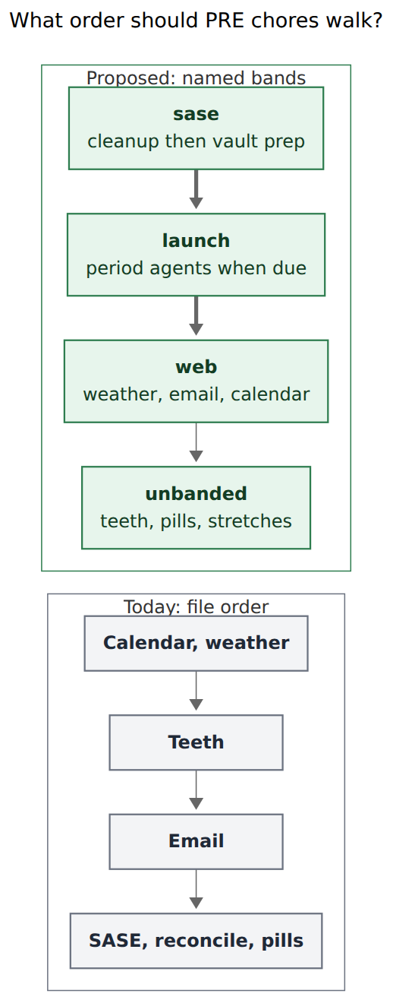
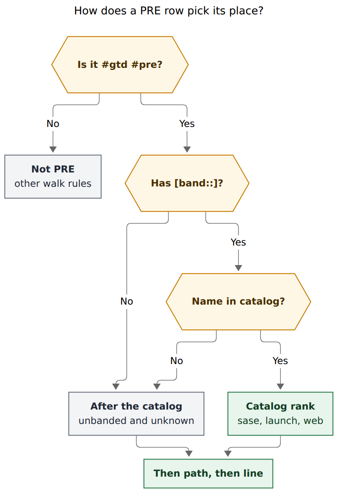
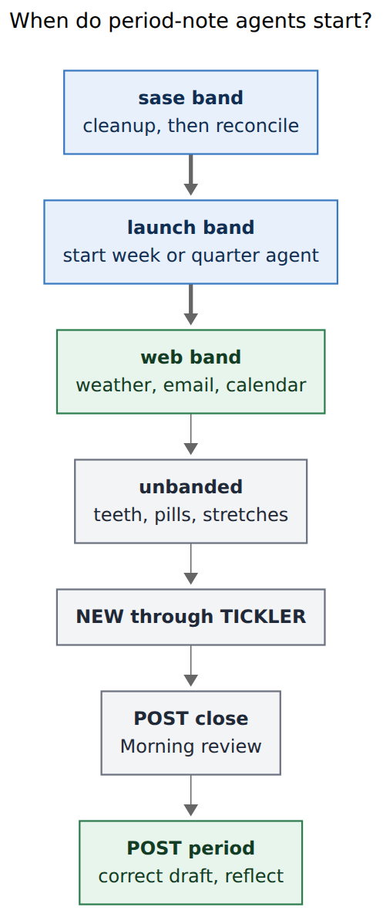

# PRE checklist bands and period-note launch tasks

> **Research request (paraphrased):** Add recurring pre-GTD tasks that fire on the same day as each period's post-GTD review, so Bryan can launch agents to draft those period notes. Prioritize those launch tasks first in PRE, then "Clean up SASE agents", then the browser chores (weather, email, calendar), then the rest. Also add a general way to prioritize some PRE and POST checklist tasks above others during the `]s` morning walk. Lead the design. Critique the plan. Call out justified requirement changes. Recommend a solution.

**Researcher:** grk (independent swarm report).
**Date:** 2026-11-05.
**Inputs:** live vault `~/bob/gtd_daily.md`, `bob.md#^prioritize-pre-gtd`, `gkeep_inbox.md#^pre-gtd-period-agents`; `docs/freshness.md` schema 15; `docs/periods.md`; `src/native/freshness/{state,scan,cli}.rs`; `src/native/task_status_groups/{mod,emit}.rs`; `src/native/periods/{cli,instructions,note}.rs`; bob-ledger-tools `110-freshness-queue.js`, `120-freshness-footer.js`, `138-checklist-task-marks.js`, `170-plugin-lifecycle.js` (freshness namespace v13); bob-navigation-hotkeys `480-review-jump-and-nav-api.js`, `535-plugin-review-checklist-walk.js`; Obsidian Tasks `data.json` (`recurrenceOnNextLine: false`); live `bob freshness list` and `bob periods list`; decisions `review-walk-is-tiered`, `recurring-occurrences-walk-when-due`, `answering-advances-the-walk`; prior research `research:202610/gtd_pre_post_checklist_tiers/gtd_pre_post_checklist_tiers__final.md` and `research:202611/period_note_tree_and_stats_strips/period_note_tree_and_stats_strips__grk.md`. bob-cli `dd3cfd8c`, bob-plugins `7b7c52f`. Nothing in any repo or the vault was changed except this report.

Renderer: `@mermaid-js/mermaid-cli` 12.0.0 with the Highlights PDF-mirroring config (`--no-sandbox` on this host).

---

## 0. Bottom line

**Build named checklist bands in the shared PRE/POST comparator, and add three launch rows that share each period POST task's recurrence. Swap the requested launch-first order for SASE-first.**

This is a good idea in a narrower, more reliable form than "put some chores higher."

1. **Do not sort PRE/POST by file order.** The comparator today is `path ↑, line ↑`. Ready chores live in intake; Blocked chores live later in the file; Tasks inserts the next `when done` occurrence *above* the completed line (`recurrenceOnNextLine: false`). Line numbers move every morning. A priority that lives on the line survives that.
2. **Do not reuse Tasks `[priority::]` / P-levels.** Those values (`highest` / `high` / `medium` / `low` / `lowest`) drive Alt+P windows and the decay ladder. Mixing "walk this chore first" into that field would make a SASE cleanup look like a P1 deadline.
3. **Do not add new walk tiers.** PRE and POST stay the opening and closing checklist tiers. Bands are a comparator key inside those two tiers. Ctrl+Enter still stops at the PRE/POST boundary, not at a band boundary.
4. **Name the bands.** Default PRE catalog: `sase`, `launch`, `web`. Default POST catalog: `close`, `period`. Unbanded and unknown names sort last, then path and line. Config can replace a catalog; an empty list is the kill switch.
5. **Launch after SASE cleanup.** The SASE chore restarts failed agents, dismisses yesterday's agents, and updates SASE on every machine. Launching period-note agents first would hand those new runs to a cleanup that is allowed to dismiss and restart them. Vault prep (`task reconcile`, `gcal sync`, `gkeep pull`) rides the same `sase` band so `bob periods brief` reads a reconciled vault.
6. **Three authored launch tasks**, one per period, with the same `repeat` as the matching POST row, `#gtd #pre`, and `[band:: launch]`. Complete them when the agent is *started*. POST still owns "correct the draft and write the Reflection." Do not auto-run agents. Do not synthesize PRE rows from `bob periods list` review state.

Ship the dual-evaluator comparator (schema 16, freshness namespace v14, capability `checklistBands`) and the vault rows in one cutover. Fields are inert until the comparator reads them, so the walk stays as it is until both land.

---

## 1. Is this a good idea?

**Yes, because the current PRE order fights the morning, and the period-note draft is the one PRE chore that benefits from a long overlap.**

### Why it earns a place

- **The live Friday walk is already the wrong ritual.** With `BOB_NOW=2026-11-06T08:00:00`, `bob freshness list` reports seven PRE rows in file order:

  | Rank | Line | Task |
  | --- | --- | --- |
  | 1 | 16 | Review next week in Google Calendar |
  | 2 | 17 | Check weather |
  | 3 | 18 | Brush teeth |
  | 4 | 19 | Read email |
  | 5 | 20 | Clean up SASE agents |
  | 6 | 21 | Run `task reconcile` + `gcal sync` + `gkeep pull` |
  | 7 | 22 | Take fish oil pills + Take L-tyrosine pills |

  Weather and calendar are split by teeth. Email is a fourth hop. SASE cleanup, the thing every other machine chore depends on, sits fifth. Stretches are future-dated (`2026-11-11`) and correctly absent. POST is only Morning review (rank 45). Weekly review waits until Monday 2026-11-09.

- **Period drafts already have an engine, and they are slow.** `bob periods brief` / `draft`, review states (`empty` / `drafted` / `edited` / `reflected`), and the in-note agent callouts are live. Last complete week `2026-W44` is `drafted`. This week `2026-W45` is still `empty`, as are `2026-Q4` and `2026`. A Monday agent that writes `## Review` through `bob periods draft` takes minutes. Starting it during PRE is the only way the draft can exist by POST.

- **The Keep note and the in-progress task already asked for both halves.** `gkeep_inbox#^pre-gtd-period-agents` (cancelled, merged) and `bob#^prioritize-pre-gtd` (WIP) ask for recurring PRE tasks that start enrichment agents, and for the internet chores to cluster. The walk is the right surface: PRE is the commitment tier that Ctrl+Enter completes, and `]s` is still the only morning chord.

- **A general band is cheaper than a one-off sort.** Bryan will add another clustered PRE chore (a second browser pass, a `body` band, a `prep` split). Hard-coding "SASE then weather then email" in the evaluator would rot the first time the vault text changes.

### Where the request as written goes wrong

| Risk | Evidence | What the design does |
| --- | --- | --- |
| Launch-first vs SASE cleanup | The SASE row's own text: "Restart failed agents, dismiss agents from yesterday, review inboxes, update SASE on all machines." | Walk `sase` before `launch`. |
| File-order priority | PRE/POST comparator is `path ↑, line ↑` (`docs/freshness.md` §4; Rust `queue`; JS `freshnessQueue`). Ready tasks emit into intake; recovered Blocked tasks append (`emit_intake`). | Sort key on the line. |
| Recurrence insert | Tasks `recurrenceOnNextLine: false` in `~/bob/.obsidian/plugins/obsidian-tasks-plugin/data.json`. Prior PRE/POST research F8: the next occurrence is inserted above the completed line and shifts every later line by one. | Bands ignore that shift. Nav identity is already text-first (`planReviewJump`), so the remaining risk is *order*, not skipped identity. |
| P-level collision | Priority marks read only `highest\|high\|medium\|low\|lowest` (`135-priority-marks.js`). Decay `enter` is a priority label. | New field `[band::]`. |
| Extra tiers | Decision `review-walk-is-tiered` keeps a small structural list. Footer already lists nine groups. | Comparator only. |
| Auto-running agents | Period-note research rejected nightly prose and auto-agents. Callouts already say stop when the period is open or the Review is `edited` / `reflected`. | Human PRE row: launch, then Ctrl+Enter. |
| Quarterly/yearly sitting in RECURRING | Those two rows are `#task #gtd` with no `#post`. A non-checklist recurring task whose date has arrived walks in RECURRING, between NEXT and TICKLER. On 2027-01-04 that would interrupt lane review. | Tag them `#post`, add `when done`, give them `[band:: period]`. |
| POST scramble | Morning review is "then `]S` and complete this." If weekly review walked first, the closer would certify a walk that had not happened. File order currently happens to put Morning review at line 15 and weekly at line 24; status-group moves can invert that. | POST catalog `close` then `period`. |
| Same-morning week and quarter | 2027-01-04 is the 1st Monday (quarterly) and a weekly Monday. Quarterly brief treats an unreviewed last week as "not reviewed" and must not invent a headline. | Three tasks, week then quarter then year inside `launch` (file order within the band). Quarter/year text waits for last week's draft or relaunches. Complete PRE on launch, not on draft. |
| `dependsOn` from POST to PRE | Checklist scope excludes dependency-blocked rows. A blocked Weekly review would vanish from POST. | Independent recurrences with matching `repeat`. |

### Would I take a different approach?

I would still add the three launch tasks and a general PRE/POST ordering feature.

I would **not** launch period agents before SASE cleanup. Overlap is the right instinct; the cleanup row is allowed to dismiss and restart agents, so overlap starts *after* the machine is quiet.

I would **not** invent a fourth walk tier, a numeric `[walk:: N]`, or a vault-wide priority that Tasks already owns.

I would **not** derive PRE membership from `bob periods list`. Review state is the right catch-up for POST ("no Review yet? launch an agent"). PRE is the ritual-day optimistic start.

I would still rewrite the Weekly review POST text so "launch an agent" is a fallback, not the primary verb. The primary POST verb becomes "correct the draft and write the Reflection."

---

## 2. Explicit requirement adjustments

Call these out as changes to the request.

| # | You asked for | I recommend | Why |
| --- | --- | --- | --- |
| **A1** | Period-launch PRE tasks above every other PRE task | **Second band, after SASE cleanup.** | Cleanup dismisses and restarts agents and updates SASE. Launching first races that. |
| **A2** | Then SASE, then browser, then the rest | **Bands `sase` → `launch` → `web` → unbanded.** Reconcile/sync/pull rides `sase`, after the cleanup row. | Period briefs read the vault. A dirty vault is a bad brief. |
| **A3** | "Support for prioritizing" PRE and/or POST | **Named `[band::]` field plus a per-tier catalog.** Same mechanism for both tiers. | General, visible, copyable by Tasks recurrence, independent of line number. |
| **A4** | (implied) reorder `gtd_daily.md` or use P-levels | **Leave P-levels and file order as they are.** | File order is unstable. P-levels are the decay/schedule ladder. |
| **A5** | New recurring PRE tasks matching each period POST | **Three authored rows** with the same `repeat` as weekly / quarterly / yearly, `#gtd #pre`, `[band:: launch]`, and `when done`. | One smart daily row would fire on days with nothing to draft. Computed rows from review state would nag mid-week. |
| **A6** | (implicit) quarterly and yearly are already POST | **Add `#post` and `when done` to both.** Give them `[band:: period]`. Give Morning review `[band:: close]`. | Today they are `#gtd` only, so they would walk in RECURRING. Lint `checklist_repeat_not_when_done` will fire once they become checklist members. |
| **A7** | Launch agents from PRE | **Complete the PRE row when the agent is started.** Keep POST as the draft-correction closeout. Quarter/year PRE text: wait until last week's Review is `drafted`, or relaunch. | Waiting for the draft inside PRE would block teeth, email, and the rest of the walk. |
| **A8** | (new) POST weekly text still says "launch an agent" | **Slim it.** Primary: open last week, correct the draft, write Reflection, set this week's Intentions, prune. Fallback: "Review still empty? launch now." | Two launch reminders on the same Monday is noise. |
| **A9** | (new) Do not `dependsOn` POST on PRE | **Independent rows.** | Dependency-blocked checklist rows leave the walk. |
| **A10** | (new) Do not auto-run, cron, or `bob nightly` the agents | **Human launch only.** | Period-note research already rejected auto-prose. The callout refuses open periods and `edited`/`reflected` Reviews. |
| **A11** | (new) Band boundary is not a Ctrl+Enter fence | **Keep the PRE/POST boundary as the only checklist stop.** | One extra press already must not close Morning review. Band hops inside PRE should be cheap. |
| **A12** | Keep-note "internet tasks highest" vs this prompt's launch-first | **Follow this prompt's cluster, with A1's SASE-first swap.** | The Keep note is merged into `^prioritize-pre-gtd`. The walk prompt is the later, more specific ritual. |

---

## 3. What exists today (verified)

| # | Fact | How verified | Consequence |
| --- | --- | --- | --- |
| **F1** | Walk order is PRE → NEW → PROJECTS → PENDING → NEXT → RECURRING → TICKLER → ROTTEN → POST. | `docs/freshness.md` §4; `Tier` enum; JS `FRESHNESS_TIER_ORDER` | Bands stay inside PRE and POST. |
| **F2** | PRE membership is exact `#gtd` plus `#pre`. POST is `#gtd` plus `#post` without `#pre`. Nested `#gtd/pre` is not membership. | Decision `review-walk-is-tiered`; `checklist_from_tags`; JS `freshnessChecklistForTags` | Do not encode bands as `#pre/launch`. |
| **F3** | PRE/POST resolve by completion through Tasks, never by a freshness stamp. Ctrl+Enter done · `]s` skip. Ctrl+Enter does not cross the PRE/POST boundary. | Decision `answering-advances-the-walk`; nav notices; `freshnessReviewEntryView` | Launch rows are chores, like teeth. |
| **F4** | Within PRE and POST the comparator is `path ↑, line ↑`. | `docs/freshness.md` table; `state.rs` `queue`; `110-freshness-queue.js` | Today's order is "wherever the line sits after grouping." |
| **F5** | Ready tasks emit to intake. Blocked `[?]` stay in Blocked. Recovered tasks append onto intake. | `StatusBucket::destination`; `emit_intake` | A newly unblocked launch row can land at the *end* of the open list. |
| **F6** | Tasks inserts the next occurrence above the completed line. | `recurrenceOnNextLine: false`; prior F8 | Line-based priority reshuffles during the walk and overnight. |
| **F7** | Nav identity after that insert is text-first. | `planReviewJump`: "Identity is text-first so a recurrence insert above the cursor cannot make `]s` skip the next chore." | Remaining bug is order, not skipped chores. |
| **F8** | Checklist lints: `checklist_tag_incomplete`, `checklist_tag_conflict`, `checklist_repeat_not_when_done`. | `scan.rs` `checklist_lints`; CL5–CL6, CL12 | New quarterly/yearly `#post` rows need `when done`. Add `checklist_band_unknown`. |
| **F9** | Dual evaluators, schema 15, freshness namespace v13, capability `checklistTiers: true`. | `cli.rs` `SCHEMA_VERSION`; `170-plugin-lifecycle.js` | Additive `checklistBands`, schema 16, namespace v14, CL13+ vectors on both sides. |
| **F10** | Footer context is `PRE 2/7`. Landing notice detail for PRE is `checklist`. | `120-freshness-footer.js`; `buildReviewJumpNotice` | Band can ride that slot: `PRE · sase 1/1`. |
| **F11** | PRE glyph already folds `#gtd #pre`. | `138-checklist-task-marks.js`; `docs/task-tag-marks.md` | v1 can leave `[band::]` visible; folding is a follow-up mark. |
| **F12** | Live `gtd_daily.md` PRE set (all `[?]` until tomorrow, `repeat:: every day when done` except stretches' later schedule). POST: Morning review daily, Weekly review Monday when done. Quarterly `every 3 months on the 1st Monday` (no `#post`, no `when done`). Yearly `every January on the 2nd Monday` (same). | vault file; Friday freshness JSON | Launch rows copy those cadences. |
| **F13** | 2027-01-04 is Monday, ISO `2027-W01`, and the quarterly date. 2027-01-11 is the yearly date (`2027-W02`). Last week of 2026 is `2026-W53` (Dec 28 – Jan 3). | `datetime.isocalendar` | Week + quarter overlap on the 1st Monday. Year overlaps the 2nd Monday's weekly row. |
| **F14** | Period notes hold no tasks. Agents save only through `bob periods draft`. Review state first-match: `reflected` > `drafted` > `edited` > `empty`. | `docs/periods.md`; `note.rs` | Ritual stays on `gtd_daily.md`. |
| **F15** | `bob periods list -f json` on 2026-11-05: 54 notes, 35 `empty`, 19 `drafted`. `2026-W44` drafted, `2026-W45` / `2026-Q4` / `2026` empty. | live CLI | Monday 2026-11-09 launches last week `2026-W45`. |
| **F16** | JSON contract for list rows has no `band`. Human list prints one heading per tier. | `freshness/cli.rs` `human_list` | Additive field and optional subheads. |
| **F17** | Capture already excludes GTD checklist rows from similar-task matching. | `capture_related/corpus.rs` `is_gtd_checklist` | No capture grammar for `[band::]` in v1. Author the rows in `gtd_daily.md`. |

---

## 4. The general mechanism: named checklist bands



*Figure 1. Today's PRE walk follows file order and splits the browser cluster with teeth. Named bands walk SASE prep, then period launches, then weather/email/calendar together, then body chores. Rendered 344.8 × 878 px, fit 100%.*

### 4.1 Membership stays tags; order becomes a field

`#gtd #pre` / `#gtd #post` remain the only way a row enters the checklist tiers. That rule is load-bearing (exact whole-token tags, PRE wins a `#pre #post` conflict, nested `#gtd/pre` is inert). Do not overload it.

Order inside the tier reads one Bob inline field:

```text
[band:: sase]
[band:: launch]
[band:: web]
[band:: close]
[band:: period]
```

Grammar: same scanner as `[fresh::]` / `[root::]` (`task_fields.rs`). Key exactly `band`. Value a lowercase token `[a-z][a-z0-9_-]{0,31}`. Duplicate fields on one line: first valid wins, lint `checklist_band_duplicate`. Empty value: treat as unbanded, lint `checklist_band_empty`.

Place it with the other Bob fields, before the Tasks suffix, so Tasks copies it into the next occurrence along with `#gtd #pre` and `repeat`.



*Figure 2. Checklist membership stays the `#gtd` and `#pre` tags. A band field only orders inside PRE. Known names use the catalog rank; missing and unknown names sort last, then path and line. Rendered 563.5 × 824 px, fit 100%.*

### 4.2 Catalog

Default, baked into both evaluators so a vault with fields and no config still walks correctly:

```yaml
freshness:
  checklist_bands:
    pre: [sase, launch, web]
    post: [close, period]
```

Rules:

- Present list replaces the default for that tier.
- `pre: []` / `post: []` disables bands for that tier (path, line only). Kill switch.
- Unknown names in config are a config error (same family as a bad `pending_interval`).
- Unknown names *on a task* are a row lint `checklist_band_unknown`; the row still walks, after the catalog.
- Unbanded rows sort after every known band, then path, line.
- Within a band, path, line as today. Keep same-band rows in the intended relative order in the file (week launch above quarter launch above year launch).

Comparator for PRE/POST becomes:

```text
band_rank(t)  = index in that tier's catalog, or +∞ if missing/unknown
order         = band_rank ↑, path ↑, line ↑
```

NEW and every other tier keep their current comparators.

### 4.3 Surfaces

| Surface | v1 | Follow-up |
| --- | --- | --- |
| `bob freshness list -f json` | Each queue row gains `"band": "sase" \| null`. Schema 16. | — |
| Human list | Optional italic subhead per non-empty band under PRE/POST (`sase`, `launch`, `web`, then unbanded). | — |
| Footer / landing | Context `PRE · sase 1/1` when the landed row has a known band; otherwise today's `PRE 2/7`. Detail can stay `checklist` / `closeout`. | — |
| PRE/POST glyph tooltip | Append ` · sase` when banded. | Fold `[band:: sase]` like `[type::]`. |
| Capture | No new sigil. | Later, if capture starts authoring GTD rows. |
| Mac idle agenda | Ignore `band` until a consumer exists. | — |

Capability `checklistBands: true` on `api.freshness` (namespace v14). Nav without it keeps path/line order. That is the same degrade path `checklistTiers` already uses.

### 4.4 Why this is the beautiful one

- **Short names that match the chores.** `sase`, `launch`, `web`, `close`, `period` read as a morning script.
- **The field is data, the catalog is policy.** Reordering "web before launch" is a config edit, not a code change.
- **The walk still feels like one PRE group.** Footer stays `N pre`. Bands are a sort, not a new ritual.
- **Adding `body` later is `[band:: body]` plus one catalog entry.** No evaluator fork.

---

## 5. The new PRE launch tasks

Author three rows in `gtd_daily.md`. Do not put `#task` on period notes (period-note rule; freshness would walk them).

**Weekly** — same cadence as Weekly review:

```bob-task
- [ ] #task #gtd #pre [band:: launch] **Draft last week's period note**: launch an agent with "Update YYYY/YYYY-Www.md" (last ISO week from today's note, then ‹). It reads `bob periods brief` and writes `## Review` through `bob periods draft`. Complete this when the agent is running.  [repeat:: every week on Monday when done]
```

**Quarterly** — same cadence as Quarterly review, plus `when done`:

```bob-task
- [ ] #task #gtd #pre [band:: launch] **Draft last quarter's period note**: after last week's Review is drafted (or launch that first), launch "Update YYYY/YYYY-Qn.md". Complete this when the agent is running.  [repeat:: every 3 months on the 1st Monday when done]
```

**Yearly** — same cadence as Yearly review, plus `when done`:

```bob-task
- [ ] #task #gtd #pre [band:: launch] **Draft last year's period note**: after the Q4 Review is drafted, launch "Update YYYY.md". Complete this when the agent is running.  [repeat:: every January on the 2nd Monday when done]
```

Seed `scheduled::` to the next matching POST date (weekly 2026-11-09, quarterly 2027-01-04, yearly 2027-01-11) so the pairs cannot drift at birth.

Within `launch`, keep week above quarter above year in the file. On a quarter-start Monday the walk is week-agent, then quarter-agent. Completing the week row leaves one launch row, so within-band line shift cannot skip the quarter row.

Existing PRE rows get fields:

| Task | Band |
| --- | --- |
| Clean up SASE agents… | `sase` |
| Run `task reconcile` + `gcal sync` + `gkeep pull` | `sase` (after the cleanup row) |
| Check weather | `web` |
| Read email | `web` |
| Review next week in Google Calendar | `web` |
| Brush teeth; pills; stretches | unbanded |

POST:

| Task | Band |
| --- | --- |
| Morning review | `close` |
| Weekly / Quarterly / Yearly review | `period` |

---

## 6. POST pairing and the Monday split



*Figure 3. SASE cleanup runs first so it cannot dismiss the new agents. Period launches come next so drafts cook during the browser cluster, body chores, and the rest of `]s`. POST Morning review still closes the walk; POST period review reads and corrects the draft. Rendered 330.3 × 790 px, fit 100%.*

Weekly POST, slimmed:

```bob-task
- [ ] #task #gtd #post [band:: period] **Weekly review**: close last week — from today's note open the week link, then ‹; correct the Review draft (still empty? launch "Update YYYY/YYYY-Www.md" now) and write the Reflection · open this week's note, re-read the quarter's Outcomes (↑), and set ≤3 Intentions · prune: release NEXT to ≤15 and PENDING to ≤10 with Alt+N, promote from READY, defer with P-levels, clear leftover ROTTEN or lengthen that note's task_refresh.  [repeat:: every week on Monday when done]
```

Quarterly and yearly POST keep their current close-out verbs (prune projects, set Outcomes, Theme) and gain `#post`, `when done`, and `[band:: period]`. Drop "launch an agent" from the primary clause the same way; keep it as the empty-Review fallback.

Catch-up: if Monday is skipped, `when done` slides both the PRE launch and the POST closeout together. If PRE was completed (agent started) and POST was not, POST still walks the next morning with the fallback launch. That is the right split.

---

## 7. Alternatives considered

| Approach | Verdict | Why |
| --- | --- | --- |
| Reorder lines in `gtd_daily.md` only | Reject | F4–F6. Intake vs Blocked and `recurrenceOnNextLine: false` reshuffle lines. |
| Tasks `[priority:: high]` / 🔺 | Reject | Decay ladder and Alt+P own those values. A chore is not a P1. |
| Numeric `[walk:: 10]` | Reject as default | Flexible, mute. Named bands are the morning script. Config already gives numeric order to names. |
| Extra walk tiers LAUNCH / SASE / WEB | Reject | Footer and schema already carry nine groups. Ctrl+Enter boundary would multiply. Decision keeps the structural list small. |
| Tags `#pre/launch` or `#band/web` | Reject | `#gtd/pre` is already a documented non-member. Nested tags invite that footgun. Fields are the Bob sort-key style (`[refresh::]`, `[fresh::]`). |
| Config map of block ids | Reject | Invisible, breaks when a row has no `^id`, fights recurrence copies. |
| One daily PRE "launch whatever is due" | Reject | Fires on Tuesdays with nothing to draft, or needs engine synthesis. |
| Synthesize PRE from `review_state == empty` | Reject | Mid-week nag; open weeks are *supposed* to be empty. POST already catches a missed draft. |
| `dependsOn` POST → PRE | Reject | Dependency-blocked checklist rows leave the walk. |
| Auto-agent on `bob nightly` | Reject | Period-note research; callouts refuse open/`edited`/`reflected`. |
| Launch-first as specified | Reject | SASE cleanup is allowed to dismiss and restart agents. |
| Wait in PRE until the draft lands | Reject | Blocks the browser cluster and body chores, which was the point of launching early. |
| Keep quarterly/yearly in RECURRING | Reject | They are closeout rituals. RECURRING sits between NEXT and TICKLER. |

---

## 8. Implementation sketch

Cutover in one daily train (additive JSON, vault fields inert until both sides read them).

**bob-cli**

- Parse `freshness.checklist_bands.{pre,post}` in `config/freshness.rs`. Default catalogs as in §4.2.
- Parse `[band::]` on checklist rows in `freshness/scan.rs`. New lints: `checklist_band_unknown`, `checklist_band_duplicate`, `checklist_band_empty`.
- Comparator in `state.rs` `queue` for `Tier::Pre` and `Tier::Post`: `band_rank ↑, path ↑, line ↑`.
- JSON schema 16: `band` on each queue row (`string` or `null`). Human list subheads optional but worth doing in the same PR.
- Vectors CL13–CL18 in `docs/freshness.md` and `state_tests.rs`: known band order, unbanded last, unknown last with lint, POST `close` before `period`, empty catalog kill switch, Tasks-suffix copy does not need a vector (document it).
- `just docs-gen` only if CLI help grows a sentence about bands. Behavior lives in the freshness contract and a new decision record (`checklist-bands-order-pre-and-post`), linking `review-walk-is-tiered`.

**bob-plugins**

- Mirror the comparator and config in `090-freshness-config.js` + `110-freshness-queue.js`.
- Namespace v14, `checklistBands: true`.
- Footer / `reviewEntryView`: `PRE · sase 1/1` when banded.
- Parity tests beside `test-ledger-tools-freshness-*.cjs` and `test-navigation-checklist.cjs`.
- Glyph tooltip can mention the band in the same PR; folding the field is optional.

**vault** (after or with the code, same morning)

- Add the three launch rows (§5).
- Stamp `[band::]` on the existing PRE/POST rows (§5 table).
- Add `#post` and `when done` to quarterly and yearly.
- Slim Weekly review POST text (§6).
- Seed `scheduled::` to the next POST dates so the pairs start in lockstep.

**Out of scope**

- Capture grammar for bands.
- Mac agenda.
- Auto-launch.
- Band-aware Ctrl+Enter fences.
- Putting tasks on period notes.
- Changing Tasks `recurrenceOnNextLine`.

---

## 9. Recommended solution

Keep PRE and POST as the only checklist tiers. Inside each tier, order by a named `[band::]` field against a small baked catalog (`sase`, `launch`, `web` for PRE; `close`, `period` for POST), then path and line. Unbanded and unknown names sort last. Config can replace a catalog or empty it.

Add three `#gtd #pre [band:: launch]` rows that share the weekly, quarterly, and yearly POST recurrences, and complete them when the agent starts. Walk SASE cleanup and vault prep first so cleanup cannot dismiss those agents and so `bob periods brief` sees a reconciled vault. Cluster weather, email, and calendar under `web`. Leave teeth, pills, and stretches unbanded. Tag quarterly and yearly reviews `#post` with `when done` and `[band:: period]` so they close the walk with Weekly review, after Morning review (`[band:: close]`).

That is intuitive (the band names *are* the morning), reliable (the sort key survives line shifts and status-group moves), and beautiful (one short field, a tiny catalog, a footer that can say `PRE · launch 1/1` on the one Monday it matters).

---

## 10. Sources

### Vault and live CLI

- `~/bob/gtd_daily.md` (open PRE/POST set, repeats, schedules)
- `~/bob/bob.md#^prioritize-pre-gtd`, `~/bob/gkeep_inbox.md#^pre-gtd-period-agents`
- `~/bob/.obsidian/plugins/obsidian-tasks-plugin/data.json` (`recurrenceOnNextLine: false`)
- `BOB_NOW=2026-11-06T08:00:00 bob freshness list -f json` (7 PRE in file order, 1 POST Morning review)
- `bob periods list -f json` (54 notes; `2026-W44` drafted; `2026-W45`, `2026-Q4`, `2026` empty)
- `bob freshness list -f json` on 2026-11-05 (PRE 0, POST 0: all `gtd_daily` rows scheduled 2026-11-06)

### bob-cli `dd3cfd8c`

- `docs/freshness.md` §4 comparators, schema 15, CL1–CL12
- `docs/periods.md` (review state, brief/draft, no tasks on period notes)
- `src/native/freshness/{state,scan,cli}.rs`
- `src/native/config/freshness.rs`
- `src/native/task_status_groups/{mod,emit}.rs`
- `src/native/periods/{cli,instructions,note}.rs`
- `src/native/task_fields.rs`

### bob-plugins `7b7c52f`

- `plugins/bob-ledger-tools/src/090-freshness-config.js`
- `plugins/bob-ledger-tools/src/110-freshness-queue.js`
- `plugins/bob-ledger-tools/src/120-freshness-footer.js`
- `plugins/bob-ledger-tools/src/138-checklist-task-marks.js`
- `plugins/bob-ledger-tools/src/170-plugin-lifecycle.js` (namespace v13, `checklistTiers`)
- `plugins/bob-navigation-hotkeys/src/480-review-jump-and-nav-api.js` (text-first identity)
- `plugins/bob-navigation-hotkeys/src/535-plugin-review-checklist-walk.js`

### Decisions and prior research

- `decisions:review-walk-is-tiered`
- `decisions:recurring-occurrences-walk-when-due`
- `decisions:answering-advances-the-walk`
- `research:202610/gtd_pre_post_checklist_tiers/gtd_pre_post_checklist_tiers__final.md` (F8 recurrence insert, dual evaluators, complete-through-Tasks)
- `research:202611/period_note_tree_and_stats_strips/period_note_tree_and_stats_strips__grk.md` (ritual-gated enrichment, no auto-agents, no tasks on period notes)

### Figures

| File | Reader question | Measured |
| --- | --- | --- |
| `fig-pre-order.{mmd,svg,png}` | What order should PRE chores walk? | 344.8 × 878 px, fit 100% |
| `fig-band-compare.{mmd,svg,png}` | How does a PRE row pick its place? | 563.5 × 824 px, fit 100% |
| `fig-monday-split.{mmd,svg,png}` | When do period-note agents start? | 330.3 × 790 px, fit 100% |
