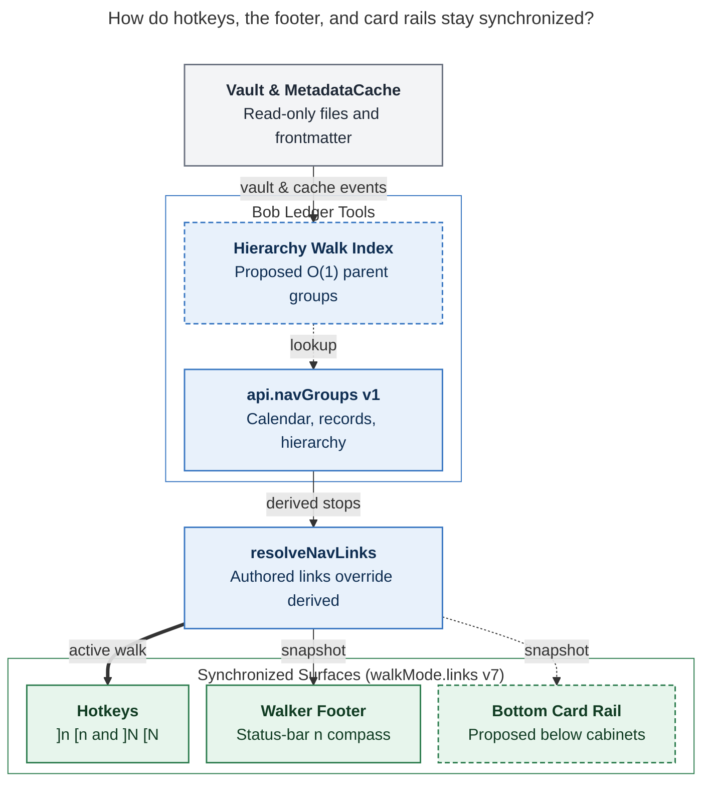
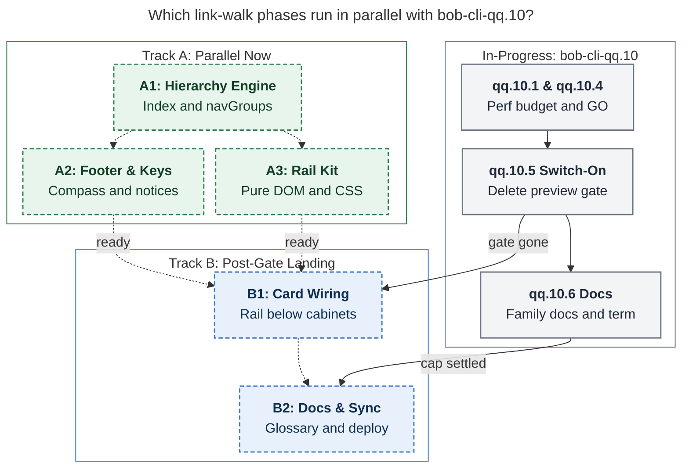

# Hierarchy Link Walks (`]n` / `]N`) and Unified Bottom Property Card Rails

**Scope:** Adding read-time link walk support (`]n` / `[n` and `]N` / `[N`) to **Area notes**, **Project notes**, **Notebooks**, and **Prose notes**; standardizing the Property Card walk widget strictly at the bottom of every walkable card (below all cabinets); drafting the `glossary:link-walk` strand; and sequencing delivery safely in parallel with the in-progress `bob-cli-qq` (Property Card Cabinets) epic.

**Governing decisions consulted:** `decisions:prose-notes-are-owned-prose`, `decisions:notebook-routes-write-notes`, `decisions:bank-hub-is-path-canonical-never-area`, `decisions:bob-cli-releases-ride-a-daily-train`, `decisions:mac-capture-is-a-thin-client`, `decisions:decision-rules-are-read-at-planning-time` (and pending `decisions:cabinets-absorb-catalogs-at-render-time` in `bob-cli-qq.10.6`).

---

## 1. Executive Summary

Adding link walk support to Area, Project, Notebook, and Prose notes is a **high-value, architecturally natural fit**—and can be shipped cleanly without writing Markdown walk lines into notes, without touching `bob-cli`'s runtime binary, and without blocking on `bob-cli-qq` to start.

Four evidence-backed findings shape the design:

1. **Derive everything at read time inside `bob-ledger-tools` (`api.navGroups`).** `bob-navigation-hotkeys`'s `resolveNavLinks` already falls back from authored Markdown links to `api.navGroups` for both step stops (`prev` / `next`) and group stops (`prevGroup` / `nextGroup`). Zero of the 160 Area, Project, Notebook, and Prose notes in `~/bob` have authored nav links today, and `decisions:prose-notes-are-owned-prose` explicitly forbids Bob from adding structural chrome to Prose notes. Computing parent groups from Obsidian's in-memory `vault` + `metadataCache` through a lazily rebuilt, O(1)-lookup index yields zero vault churn, zero stale-walk states, zero `bob` subprocess spawns, and zero release-train coupling.
2. **Resolve the prompt's core tension with a Two-Gear Parent-Grouped Walk.** Keeping `]n` / `[n` strictly within the current parent note (wrapping with `↺`) preserves the requested mental model ("only notes of the same type that share the same parent"), while `]N` / `[N` jumps to the first member of the next/previous **non-empty parent group of the same note type in canonical vault tree pre-order (DFS)**. This makes `]N` universally intuitive across all four species and rescues the **31% of notebooks (12/39)** and **11% of projects (11/102)** that are singletons under their parent. (Switching `]n` to cross parent boundaries like Calendar Days and `walk_by` Records is a 5-line policy choice if Bryan prefers unified crossing.)
3. **Partition Project walks by lifecycle (open vs. closed) and match each species' catalog sort order.** In `~/bob` today, **58% of all projects (59/102)**—and **62% of `sase.md`'s subprojects (38/61)**—are closed (`done` / `canceled`). Mixing closed projects alphabetically into active WIP walks would land `]n` on dead projects nearly two-thirds of the time. Keeping open projects in an open-only walk and closed projects in a closed-only walk makes `]n` sharp for active work while still letting archived projects walk their closed peers. Likewise, sorting Areas & Projects by case-insensitive filename stem and Notebooks & Prose by display title preserves 1:1 order parity with their parent Cabinets.
4. **Enforce "walk rail always below all cabinets" as a Property Card Kit invariant—and parallelize via a two-track seam split beside `bob-cli-qq.10`.** Our audit uncovered an existing Live Preview vs. Reading view bug on Record Cards (rail above cabinets in Live Preview, below in Reading) caused by `propertyCardCabinetsAssemble` unconditionally calling `card.appendChild(stack)`. Making the walk rail the last direct child of every walkable card fixes that bug globally. Because `bob-cli-qq` is already on its final four finishing phases (`qq.10.1` → `10.4` → `10.5` → `10.6`), the walk engine, `api.navGroups` extension, Links Walker Footer polish, and standalone rail kit can ship **immediately in parallel (Track A, zero file overlap)**, while card mounting and the below-cabinets invariant land cleanly in a thin **Track B** right after `qq.10.5` removes the `cabinetsPreview` gate.

---

## 2. Current Architecture Audit

Bob's link walk already has a clean, shared pipeline split across two plugins in `bob-plugins`.

### 2.1 Navigation & Resolver Pipeline

- **Authoritative resolver (`bob-navigation-hotkeys/src/483-nav-group-links.js:76–117`):** `resolveNavLinks(plugin, { path, content })` queries `bob-ledger-tools`'s synchronous, read-only `api.navGroups.resolve({ path, content })` (`296f-plugin-nav-groups-api.js:129–145`) and merges it with any authored body links (`prev`, `next`, `‹ X`, `X ›`, and link-only `«` / `»` lines):
  - Authored links win **per role** (`prev`, `next`, `prevGroup`, `nextGroup`).
  - Missing roles fall back directly to `provider.step[role]` and `provider[prevGroup|nextGroup]`.
  - Group metadata (`group: { noun, label, position, size, members, atStart, atEnd, enteringPrev, enteringNext }`) and `groupNone` pass through unchanged.
- **Consumers of `resolveNavLinks` / `api.walkMode.links` v7 (`482-walk-mode-nav-api.js:119`):**
  1. **Hotkeys:** `]n` / `[n` (`openLabeledBodyLink` in `670-plugin-project-files.js:155–165`), `]N` / `[N` (`openGroupLink` in `483-nav-group-links.js:120–145`), and bracket repeats `]]` / `[[` and `]}` / `[{` (`546-plugin-bracket-repeat.js`). All navigate via `openNavLinkStop` with `<C-o>` jump-list preservation.
  2. **Links Walker Footer (`124-links-walker-footer.js`):** Renders the `n` status-bar compass with step arms, outer skip-mark group arms, context (`linksWalkerFooterContextText`, `L274`), and `]}` / `]n` hints (`linksWalkerFooterHintNoun`, `L260`).
  3. **Property Card Rails:** Day/Period cards (`296ca-plugin-intention-card-group-rail.js`) and Record cards (`242va-plugin-record-walk-group-rail.js`) read `walkMode.links` v7 (falling back to `api.navGroups`) so clicks, tooltips, footer, and keymaps never disagree.
- **Current `api.navGroups` coverage (`296f-plugin-nav-groups-api.js:129–141`):** Only dispatches to **Record walks** (`296g-plugin-nav-groups-records.js`) and **Calendar notes** (`296e-plugin-nav-groups-calendar.js`). Areas, Projects, Notebooks, and Prose all fall through to `{ ok: false, reason: "unsupported" }`.

### 2.2 Property Card Rail & Cabinet Placement Audit

Inspection of every Property Card host revealed an **existing DOM-ordering inconsistency** between cards and view modes:

| Card Family | Current Walk Rail Component | Live Preview Position vs. Foot / Cabinets | Reading View Position vs. Foot / Cabinets | Source |
| :--- | :--- | :--- | :--- | :--- |
| **Day / Period** | `.bob-property-card-rail` (`propertyCardBuildRail`) | **Above** foot / cabinets | **Above** foot / cabinets | `296b-plugin-intention-card-dom.js:369–373` |
| **Record** | `.bob-record-walk-rail` + `propertyCardBuildGroupRow` | **Above** foot / cabinets | **Below** foot / cabinets *(inconsistent!)* | `242k:671–681` vs. `242kb:166,213` + `242v:130` |
| **Area / Project** | None | — | — | `249c` / `249d` / `249e` |
| **Notebook** | None | — | — | `249h` / `249i` / `249j` |
| **Prose** | None | — | — | `249m` / `249n` / `249o` |

**Why this happened:**
- `propertyCardCabinetsAssemble` (`240wl-plugin-cabinet-stack.js:309`) unconditionally calls `card.appendChild(stack)`, pushing `.bob-property-card-cabinets` to the bottom whenever it runs after rail creation.
- In Record Reading view, `recordWalkPaintReading` (`242v:130`) runs *after* `recordSheetAppendFoot` and calls `sheet.appendChild(rail)`, placing the rail below cabinets—while Live Preview builds the rail inside `recordSheetBuildMounted` *before* `recordSheetAppendFoot`, placing it above cabinets.
- Tellingly, `.bob-record-sheet > .bob-record-walk-rail` (`styles.css:12970`) already carries `border-radius: 0 0 8px 8px` (rounded bottom corners), and `.bob-property-card-rail` (`styles.css:13978`) already carries `border-block-start: 1px solid var(--background-modifier-border)`. Both were visually styled to anchor the bottom edge of a card.
- Note that `scripts/test-ledger-tools-intention-card-title-block.cjs:534,563` explicitly asserts `["...", "bob-property-card-rail", "bob-property-card-foot"]`. Moving rails strictly below all cabinets will require updating those two DOM-order assertions to the new kit invariant.

### 2.3 Existing Kit Primitives We Already Own

`bob-ledger-tools` already has almost every building block needed:
- **Species classifier:** `propertyCardNoteSpecies` (`240t-plugin-property-card-note-species.js:188`) resolves exact precedence (`bank` → excluded paths → `album` → `record` → `area`/`project` → temporal → `notebook` → `prose` [both `[[prose]]` and legacy `[[article]]`] → `ref` → `null`).
- **Parent link parser:** `homeCardParentTarget` (`249b:196`) and `notebookCardParentTarget` (`249g:94`) normalize wikilink `parent:` fields identically.
- **Rail primitives:** `propertyCardBuildRail` (`240g:290–334`) renders a 3-column step row (`prev` | `parent` | `next`) plus an optional `spec.group` row via `propertyCardBuildGroupRow` (`240l:239–271`), which already supports `prev`/`next` group arms with wrap glyphs (`↺`), tick tracks up to `PROPERTY_CARD_GROUP_TICK_LIMIT = 21`, and automatic fallback to a continuous bar + thumb above 21 members. Better yet, `240g:303` **already omits the step row when no step items exist and a group row is present**.

---

## 3. Empirical Audit of Bryan's Vault (`~/bob`)

Testing design assumptions against real vault topology surfaced three critical facts that are invisible from toy examples alone:

| Species | Total Notes | Authored Nav Links | Distinct Parents | Group Size Distribution | Singleton Groups (Size = 1) | Special Topology Findings |
| :--- | ---: | ---: | ---: | :--- | :--- | :--- |
| **Area** | 18 | 0 | 5 | `[6, 5, 4, 2, 1]` | 1 / 5 groups (1 note, 6%) | 3 levels deep (`area.md` sentinel → top areas → sub-areas → `gtd → inbox → *_inbox`); `bank.md` excluded by path |
| **Project** | 102 | 0 | 21 | `[61, 7, 4, 4, 3, 3, 3, 2, 2, 2, 1×11]` | 11 / 21 groups (11 notes, 11%) | **59 / 102 closed (58%!)**: `51 done`, `8 canceled`, `42 wip`, `1 none`. `sase.md` has **61 total (23 open, 38 closed)**; `bob.md` has **7 (3 open, 4 closed)** |
| **Notebook** | 39 | 0 | 20 | `[9, 5, 3, 2, 2, 2, 2, 2, 1×12]` | **12 / 20 groups (12 notes, 31%)** | Multi-parent types: 26 under areas, 1 under project, **12 under other notebooks** (`lang`: 5, `dog`: 2, `dev_tools`: 1, `linux`: 1) |
| **Prose** | 1 | 0 | 1 | `[1]` | 1 / 1 group (1 note, 100%) | Currently `sase_blog_contents.md` under `sase_blog.md`; prose-section extraction (`bob-cli-qj.5.1`) will create multi-child prose trees under projects and parent prose notes |

Three design consequences jump straight off this table:

1. **Zero migration friction:** 0 of 160 notes have hand-authored `prev`/`next`/`«`/`»` links, so read-time derivation works cleanly from day one while still respecting any future authored override.
2. **Closed projects cannot be blindly mixed with active WIP projects:** On `sase.md`—the single most heavily nested project in the vault—38 of 61 children are closed. Alphabetical mixing turns `]n` into a graveyard tour.
3. **Singletons are common, not edge cases:** Nearly a third of all notebooks (12/39) and over half of all notebook and project parent groups (12/20 and 11/21) have size 1. Both the `]N` design and the card rail's singleton aesthetics must treat size-1 groups as a first-class case.

---

## 4. Critique of the Proposed Plan & Justified Adjustments

Overall, **the plan is sound and fills a clear ergonomic gap** in Bob's navigation model. However, examining the prompt's requirements against the codebase and real vault data reveals five tensions worth addressing explicitly before writing code.

| # | Original Requirement | Critique / Tension Found | Proposed Adjustment |
| :--- | :--- | :--- | :--- |
| **1** | *"only include notes of the same type that share the same parent"* + *"group members by their parent"* + *"support `]N`"* | If the entire walk contains only one parent, there is only 1 group and `]N` has nowhere to go; 31% of notebooks and 11% of projects become dead-end singletons. | **Adopt a Two-Gear Walk:** `]n` / `[n` wraps strictly within the current parent (honoring the sibling-only mental model), while `]N` / `[N` hops between all non-empty parent groups of the same note type in canonical vault tree pre-order (DFS). *(Alternative: unified crossing `]n` like Records/Days—a 5-line switch if preferred.)* |
| **2** | Include all same-type siblings under the same parent (no status filter stated) | 58% of vault projects (59/102) and 62% of `sase`'s children (38/61) are `done` or `canceled`. Mixing them makes `]n` noisy during active work. | **Partition Project walks by lifecycle cohort:** Open projects walk open siblings (and `]N` visits parent groups with open projects); closed (`done` / `canceled`) projects walk closed siblings under the same parent (with a quiet `closed` cohort label). |
| **3** | Jump to the *"next (alphabetically)"* sibling (`bar.md` → `baz.md`) | Areas & Projects catalogs (`bob areas`, `bob projects`, Cabinets) sort A–Z by **filename stem**, while Notebooks (`bob notebooks`, Notebooks Cabinet) and Records sort A–Z by **display title**. Diverging from the parent's Cabinet order makes `]n` feel scrambled. | **Match each species' canonical Bob sort key:** case-insensitive **stem** (path tie-break) for Areas and Projects; case-insensitive **display title** (`title:` → first alias → H1 → stem, path tie-break) for Notebooks and Prose. |
| **4** | *"always shown at the very bottom of the property card (below all cabinets)"* | **Great call—and bigger than the 4 new species.** Day/Period cards currently mount rails *above* cabinets; Record cards mount *above* in Live Preview and *below* in Reading. Also, rendering a heavy rail on a lone 1-of-1 note with no other groups (like today's sole Prose note) adds visual clutter. | **Make below-cabinets a universal kit invariant across all 6 walkable families** (Day/Period, Record, Area, Project, Notebook, Prose), fixing Record's view mismatch—and apply **progressive disclosure** so lone singletons with no other groups omit the rail, while singletons with other groups render only the compact 1-row group bar. |
| **5** | *"implement this work in parallel with the in-progress `bob-cli-qq` epic"* | `bob-cli-qq` is in its final 4 phases (`qq.10.1` perf → `10.4` GO → `10.5` delete `cabinetsPreview` gate → `10.6` docs/memory). Touching `240r`/`240wl`/`242kc`, `paintHomeCardReading`, or `bob-ledger-tools.md` before `qq.10.5`/`10.6` guarantees rebase conflicts, perf noise on `qq.10.1`, and deploy-guard blocks. | **Seam-split parallel execution (Track A now, Track B post-`qq.10.5`):** Ship the zero-overlap walk engine, `api.navGroups`, Links Footer, hotkeys, and pure rail kit immediately in parallel; sequence card mounting and below-cabinets placement cleanly right after `qq.10.5` removes the gate. |

**One scope check (intentionally kept out of scope):**
- **Album notes (`[[album]]`)** share `parent:` semantics and could reuse this exact hierarchy walk engine in a tiny future follow-up if Bryan adds more albums.
- **Ref notes (`[[ref]]` under `ref/`)** and **Bank hub/month notes** should stay excluded—Refs belong to `bob ref` / Reading Board without parent trees, and Bank already owns the `b` Bank walk (`]b` / `]B`).

---

## 5. Feature Design

### 5.1 Architecture: Read-Time Derived Walks (Zero Vault Writes, Zero `bob-cli` Spawns)

Unlike Record walks—where `bob albums sync` writes Markdown walk lines into each record note so they remain legible in Source mode or without plugins—Area, Project, Notebook, and Prose walks should be **100% derived at read time inside `bob-ledger-tools`**.

Why read-time derivation beats stored walk lines here:
- **Prose contract compliance:** `decisions:prose-notes-are-owned-prose` explicitly forbids Bob from adding structure or chrome to Prose notes.
- **Instant freshness:** Creating a new subproject, reparenting a notebook, or marking a project `done` updates `]n` / `]N` immediately on the next metadata cache event—no `sync` command, no stale-walk warning badges, no git churn across 160 notes.
- **Zero `bob-cli` coupling:** No CLI contract changes, no daily release-train wait (`decisions:bob-cli-releases-ride-a-daily-train`), and zero impact on Bob Mac Capture (`decisions:mac-capture-is-a-thin-client`).

**Figure 1:** *One cached hierarchy index inside Bob Ledger Tools feeds `api.navGroups`, which Bob Navigation Hotkeys merges with authored links so hotkeys, the Links Walker Footer, and every bottom card rail always agree without writing to vault files.*



*(Note: Figure 1 verified with `@mermaid-js/mermaid-cli@12.0.0` using PDF-mirroring config: `753.4×1114 px`, fit `80.1%`.)*

**Exact `api.navGroups` dispatch order (`296f-plugin-nav-groups-api.js:129–144`):**
1. Record walk (`navGroupsRecordResolve`)
2. Calendar walk (`navGroupsCalendarResolve`) — matches path patterns (`YYYY/YYYYMMDD.md`, `YYYY-Www`, `YYYY-Qn`, `YYYY.md`, `all_time.md`)
3. **Hierarchy walk (`navGroupsHierarchyResolve`, new fragment `296h-plugin-nav-groups-hierarchy.js`)** — matches `propertyCardNoteSpecies` ∈ `{"area", "project", "notebook", "prose"}`

Because `api.navGroups` stays `v1` and additive (returning the exact same frozen `{ ok, family, step, prevGroup, nextGroup, group, groupNone }` contract), **`bob-navigation-hotkeys` already supports `]n`, `[n`, `]N`, `[N`, `]]`, `[[`, `]}`, `[{`, and `walkMode.links` v7 with virtually no contract changes!**

---

### 5.2 Walk Membership, Parent Resolution, Lifecycle & Sorting

#### Species Classification & Exclusions
Reuse `propertyCardNoteSpecies({ path, frontmatter })` (`240t:188`) as the sole eligibility gate:
- Eligible species: `"area"`, `"project"`, `"notebook"`, `"prose"`.
- Automatically excludes `_templates/`, `_conflicts/`, `done/`, `ref/`, `area.md`, `project.md`, `bank.md` (`decisions:bank-hub-is-path-canonical-never-area`), and mixed-type notes.
- Automatically unifies `[[prose]]` and legacy `[[article]]` under the single `"prose"` species (`noteCardIsProseKind`).

#### Canonical Parent Resolution & Edge Cases
- Extract the raw parent link via `homeCardParentTarget(frontmatter.parent)` (`249b:196`).
- Resolve to a canonical vault path using Obsidian's `metadataCache.getFirstLinkpathDest(rawTarget, file.path)` (same resolution as `homeCardWalkAncestry` and `notebookCardLocalParent`), normalized with forward slashes and lowercase lookup key.
- **Sentinel `area.md`:** Top-level areas (`body`, `cash`, `dev`, `gtd`, `job`, `love`) have `parent: "[[area]]"`, resolving to `"area.md"`. That forms a valid parent group keyed by `"area.md"` with display label `"Top-level"` (and `parentNavigable: false` so clicking doesn't open the untyped sentinel note). `area.md` itself is excluded from walking.
- **Missing or broken `parent:`:** Notes with no `parent:` or an unresolved wikilink target are excluded from parent groups (`{ ok: false, reason: "no-parent" }`) rather than silently dumped into a phantom `"none"` group.
- **Parent cycles:** Tree-order traversal maintains a `visited` set and appends any disconnected or cyclic parent nodes deterministically at the end in alphabetical path order—never loops, never throws.

#### Project Lifecycle Cohorting
Inspect `frontmatter.status` using the same normalization as `homeCardLifecycle` (`249b:416`):
- **Closed cohort:** `status` ∈ `{"done", "canceled"}` (case-insensitive, plus legacy `"cancelled"` if encountered).
- **Open cohort:** everything else (`wip`, `next`, `ready`, missing, etc.).
- **Walk partitioning:**
  - An **open** project walks only **open** projects sharing its parent, and `]N` / `[N` jumps only across parent groups that contain at least one **open** project.
  - A **closed** project walks only **closed** projects sharing its parent, and `]N` / `[N` jumps across parent groups that contain at least one **closed** project. Its group label carries a subtle qualifier (`sase · closed`) so the user always knows why the cohort is closed.
- *Impact on `~/bob`:* `sase.md` drops from 61 mixed projects to a crisp **23 open projects** during active work (and 38 closed projects when inspecting history); `bob.md` becomes **3 open** vs. **4 closed**.

#### Sorting Key & Display Labels
Match each species' canonical Bob catalog order so a note's sibling sequence always matches its parent's Cabinet list:

| Species | Sibling Sort Key | Tie-Break | Rail Label | Tooltip Detail |
| :--- | :--- | :--- | :--- | :--- |
| **Area** | Case-insensitive filename stem | Lowercase path | Concise title (or stem if diverging) | `Next area: <Title> (<stem>.md) · ]n` |
| **Project** | Case-insensitive filename stem | Lowercase path | Concise title (or stem if diverging) | `Next project: <Title> (<stem>.md) · ]n` |
| **Notebook** | Case-insensitive display title (`title:` → alias → H1 → stem) | Lowercase path | Display title | `Next notebook: <Title> · ]n` |
| **Prose** | Case-insensitive display title (`title:` → alias → stem) | Lowercase path | Display title | `Next prose: <Title> · ]n` |

*(Wait-and-check nuance: On Area/Project cards, if a note's H1 title starts with a different word than its stem—e.g., `dev_plex_hack_patch.md` titled `Plex Hack Patch`—displaying the stem on the rail chip guarantees visual alphabetical order matches the visible label, whereas displaying the title looks friendlier. Recommending **stem for Area/Project rail labels**—matching `bob areas`/`bob projects` links—and **display title for Notebook/Prose rail labels** keeps visible text 100% consistent with sort order!)*

---

### 5.3 Deep Dive: How `]N` / `[N` Grouping Should Work

The user explicitly asked us to think hard about how grouping should work so `]N` / `[N` feels genuinely intuitive.

#### Why Naïve Grouping Schemes Fail on Real Vault Data

We tested five candidate grouping models against `~/bob`'s actual trees:

| Candidate `]N` Model | How It Works | Verdict on `~/bob` |
| :--- | :--- | :--- |
| **1. Cousin-only groups** *(parents sharing the same grandparent)* | From `bar` (under `foo` under `pig`), `]N` jumps to children of `foo`'s sibling under `pig`. | **Fails on 40%+ of real trees.** Top-level areas (`area.md`) have no grandparent → `]N` dead. `inbox`'s children (`gkeep_inbox`, …) have grandparent `gtd`, whose only other child `gtd_daily` has no area children → `]N` dead on 10 of 18 areas! Deep singleton subprojects/notebooks get stranded whenever their parent's siblings are leaves. |
| **2. Same Root-Parent groups** | `]N` hops between parent groups sharing the same `[[root-parent]]`. | **Fails on top-level areas and small roots.** Top-level areas have no root parent; roots with only one occupied parent (`cash`, `body`) get dead `]N`. |
| **3. Flat alphabetical parent order** | Sort all occupied parent groups A–Z by parent stem. | **Breaks mental map.** Scatters subtrees: `abby`, `area`, `bob`, `cash`, `dev`, `dev_tools`, `dog`, `gtd`, `inbox`, `job`, `kelly`, `lang`, `linux`, `love` mixes `love`'s children with `dev`'s children instead of following the vault hierarchy. |
| **4. Within-parent buckets** *(initial letter or status)* | Group siblings inside one parent by A–Z initial or status. | **Unusable for 95% of groups.** Only `sase.md` has >9 children; every other group has 1–9 notes, so initial-letter groups degenerate into 1-item buckets. |
| **5. All occupied parent groups of the same species, ordered in canonical vault tree pre-order (DFS)** | Walk the vault parent tree top-down (DFS pre-order, sorting children at each level by canonical order), keeping every parent that has ≥1 child of the active species (and cohort for projects). `]N` / `[N` jumps to the **first child** of the next/previous parent group, wrapping as a ring. | **Clear winner.** Works on **100% of multi-group species**, keeps related subtrees adjacent, mirrors `bob areas` / `bob projects` / `bob notebooks` indentation order, and rescues every singleton! |

#### Concrete Vault Walkthrough of Model 5 (Tree Pre-Order DFS)

Tracing Model 5 directly on Bryan's live `~/bob` vault:

- **Areas (`5` parent groups, ring):**
  1. `Top-level` (`area.md`, 6): `body`, `cash`, `dev`, `gtd`, `job`, `love`
  2. `cash` (1): `recur`
  3. `gtd` (2): `gtd_daily`, `inbox`
  4. `inbox` (4): `gkeep_inbox`, `gmail_inbox`, `mac_inbox`, `meet_inbox`
  5. `love` (5): `abby`, `family`, `fun`, `kelly`, `vacation`
  - Pressing `]N` cycles cleanly: `body` (Top-level) → `recur` (`cash`) → `gtd_daily` (`gtd`) → `gkeep_inbox` (`inbox`) → `abby` (`love`) → `↺ body` (Top-level). Notice how `inbox`'s children follow `gtd`'s children immediately—matching the vault hierarchy!
- **Projects — Open Cohort (example subtree under `dev`):**
  - `dev` (`bob`, `dev_plex_hack_patch`, `sase`) → `bob` (3 open) → `sase` (23 open) → `sase_art` (2 open) → `sase_blog` (...) → `sase_memory` (...) → `gtd` (...) → `job` (...) → `↺ dev`.
  - From `bar.md` under `foo.md` under `pig.md`:
    - `]n` jumps to `baz.md` (next open project under `foo.md`), wrapping back to `foo.md`'s first open project with `↺`.
    - `]N` jumps to the first open project of the next occupied project-parent in tree pre-order (a child of `foo.md` if `foo.md` has subprojects with grandchildren, otherwise `foo.md`'s next sibling's subprojects under `pig.md`, and so on around the tree).
- **Notebooks (`20` parent groups, rescuing 12 singletons):**
  - `cash` (3) → `dev` (9) → `dev_tools` (1: `git`) → `lang` (5: `java`..`shell`) → `linux` (1: `athena`) → … → `love` (2) → `abby` (1) → `dog` (2) → `fun` (1) → `kelly` (2) → `↺ cash`.
  - Standing in `git.md` (the only notebook under `dev_tools`), `]N` hops directly into `java.md` (`lang`) and `[N` hops back to `dev`'s notebooks!
- **Prose:**
  - Today (1 note total): `]N` has no other group (`groupNone: { reason: "only-group" }`), rail omitted.
  - Once prose extraction creates section notes under `sase_blog`, `sase_blog/intro`, and `bob_guide`: `]n` walks sibling prose notes sharing a parent; `]N` hops between prose parent groups in tree order.

#### The One Policy Choice for Bryan: `]n` at Parent Boundary

Model 5 supports two clean boundary policies for `]n` / `[n` at the end of a parent group:

1. **Option A — Two-Gear Walk (Recommended):**
   - `]n` / `[n` **wraps within the current parent** (`bar` → `baz` → `↺ alpha`, showing `↺`). On a singleton (1/1), `]n` does not jump parents and shows a helpful notice: `"Only notebook under dev_tools — use ]N for next parent (lang)"`.
   - `]N` / `[N` **switches parent groups** in tree DFS order (landing on the first member of the next/previous parent group, wrapping with `↺`).
   - *Why recommended:* Directly honors the user's stated invariant (*"the walk should only include notes of the same type that share the same parent note"*). Spamming `]n` while triaging `sase`'s subprojects never silently dumps you into `sase_art` or `gtd`.
2. **Option B — Unified Grouped Walk (Calendar & `walk_by` Record Parity):**
   - `]n` / `[n` crosses from the last sibling of `foo` into the first sibling of the next parent group (with the existing Links Walker Footer cue `]n enters <Next Parent>`), wrapping at the end of the last parent group in the tree; `]N` / `[N` fast-forwards group-head to group-head.
   - *Why worth noting:* Matches Calendar Days-in-Weeks (`Sun` → `Mon` of next week) and `walk_by` Records (`last of Intro` → `first of Body`) identically, and makes `]n` work even on singletons.
   - *Implementation cost to change:* Literally **5 lines** inside `navGroupsHierarchyResolve` (wrap step index modulo `group.members.length` vs. advance to `nextGroup.members[0]`). Nothing else in the architecture changes!

---

### 5.4 Visual & Interaction Design: The Unified Bottom Walk Rail

#### Universal Card Stack Order (Below All Cabinets)

Every Property Card with a walk rail follows one deterministic vertical stack in **both Live Preview and Reading view**:

```text
┌───────────────────────────────────────────────────────────┐
│  [Title Block: Glyph · Kicker Breadcrumbs · H1 · Pill]    │
│  [Body / Metrics / Intentions / Chips (collapsible)]      │
├───────────────────────────────────────────────────────────┤
│  ▸ Sub-areas (2)                                      1   │
│  ▸ Projects (23)                                      2   │  ← .bob-property-card-cabinets
│  ▸ Notebooks (5)                                      3   │     (all content + Properties
│  ▸ Properties                                         -   │      cabinets live here)
├───────────────────────────────────────────────────────────┤
│  ‹ sase_actstat        ↑ sase         sase_blog ›         │  ← .bob-property-card-rail
│  ⏮ bob        2 of 23  [━━●━━━━━━━━━]        sase_art ⏭   │     ALWAYS last child!
└───────────────────────────────────────────────────────────┘
```

**Enforcing the invariant permanently:**
1. Add a tiny kit helper `propertyCardMountWalkRail(card, railEl)` that removes any stale direct-child walk rail and appends `railEl` as the **last direct child** of `card`.
2. Update `propertyCardCabinetsAssemble` (`240wl-plugin-cabinet-stack.js:309`) from `card.appendChild(stack)` to insert `stack` **immediately before** any existing direct-child `.bob-property-card-rail` or `.bob-record-walk-rail` (falling back to `appendChild` when no rail is present). Even if a cabinet stack refreshes asynchronously, it can never leapfrog beneath the walk rail.
3. Update Day/Period (`296b`) and Record (`242k` / `242kb` / `242v`) cards to mount their walk rails after `intentionCardAppendFoot` / `recordSheetAppendFoot` via the same contract—permanently fixing Record Card's Live Preview vs. Reading mismatch.
4. Keep the rail **outside** `.bob-home-card-collapsible` so collapsing card details or toggling cabinets always leaves navigation anchored at the bottom.
5. **Day/Period caveat to note explicitly:** Day/Period cards render their child-chip strip (e.g., `Mon..Sun` on Week cards) inside `.bob-property-card-rail`. Because the Properties cabinet is collapsed by default (one thin hairline row), placing `.bob-property-card-rail` below it keeps the card visually tight while honoring "below all cabinets" uniformly across all 6 walkable families.

#### Two-Row Widget Anatomy & Visual Craft

Reuse `propertyCardBuildRail` (`240g:290`) and `propertyCardBuildGroupRow` (`240l:239`) with three small, clean kit refinements:
- Add optional `wraps: true` (`↺` micro-glyph matching `240l`'s group arms) and `tooltip` support on existing `propertyCardKitRailItem` (`240g:239`) so wrapping step items clearly signal ring boundaries (`↺ alpha ›` / `‹ omega ↺`).
- Allow `propertyCardBuildGroupRow` (`240l:244`) to display a quiet `center` label without a tick track when `center.showSingleton === true` (`size === 1` and at least one group arm exists), so singleton cards still name their current parent group cleanly.
- Tint the active tick, progress thumb, and hover highlight with the card's existing root-parent hue (`--bob-card-accent` / `--bob-root-hue`), falling back to `--text-accent` when untinted—making every card's rail feel native to its Area/Project palette.

**All four visual states (progressive disclosure, zero clutter):**

1. **Multi-sibling, multi-group (common case, ≤21 siblings — e.g., `kelly.md` under `love.md`):**
   ```text
   ‹ fun                  ↑ love              vacation ›
   ⏮ inbox       4 of 5   ▮ ▮ ▮ ■ ▮            ↺ Top-level ⏭
   ```
   - Clicking `‹ fun` or `vacation ›` opens the sibling (preserving `<C-o>` jump history via `bob-navigation-hotkeys` when installed, or `openLinkText` fallback).
   - Clicking `↑ love` jumps up to the parent note—especially handy at the bottom of a tall expanded cabinet without scrolling back to the top kicker! (For top-level areas under `area.md`, the center shows muted non-clickable `Top-level areas`.)
   - Hovering any step or group arm reveals its exact landing note and keymap hint (e.g., `]N · next area group: Top-level → body`).

2. **Large parent group (>21 siblings — e.g., `sase.md`'s 23 open projects):**
   ```text
   ‹ sase_actstat         ↑ sase             sase_blog ›
   ⏮ bob        4 of 23   ━━━●━━━━━━━━━━━     sase_art ⏭
   ```
   - `propertyCardBuildGroupRow` automatically switches from discrete ticks to the smooth track + thumb above `PROPERTY_CARD_GROUP_TICK_LIMIT = 21` (`240l:21`), preventing dense tick soup.

3. **Singleton with other parent groups (`size === 1`, ≥2 groups — e.g., `git.md` under `dev_tools.md`):**
   ```text
   ⏮ dev              ↑ dev_tools · 1/1            lang ⏭
   ```
   - `propertyCardBuildRail` (`240g:303`) automatically omits the empty step row, collapsing cleanly to a single compact bar so `]N` / `[N` is immediately visible and clickable without dead prev/next whitespace.

4. **Lone singleton (`size === 1`, only 1 parent group — e.g., today's sole prose note `sase_blog_contents.md`):**
   - **Rail omitted completely.** Zero vertical footprint until another prose note exists.

5. **Narrow panes (`@container (max-width: 28rem)`):**
   - Step row compacts long labels with `text-overflow: ellipsis` (preserving `‹` / `›` glyphs and `↺` wrap cue); group row hides parent arm labels behind tooltips or compacts to `⏮ 4/23 ⏭` matching existing `@container` rules in `styles.css:14050–14350`.

#### Links Walker Footer (`124-links-walker-footer.js`) & Hotkey Refinements

Four small, surgical polish items make the status-bar `n` compass and keymaps airtight:
1. **Guard `createEligible` on derived non-creatable stops (`124-links-walker-footer.js:160–175`):** Currently treats any `!exists && !albumRecord` step stop as `createEligible`; check `link.state === "creatable"` instead so non-calendar derived stops never show dashed `+` creation styling.
2. **Helpful `group.noun` for `]}` hint (`124-links-walker-footer.js:260`):** Set `group.noun = "parent"` (or `"group"`) so the footer hint reads `]} next parent` / `]n next`.
3. **Invalidate Links Footer on hierarchy index updates:** Subscribe the Links Walker Footer to the hierarchy index's change emitter (mirroring `linksWalkerFooterSubscribeAlbum` at `124:141–157`) so reparenting or closing a project updates the `n` status bar immediately.
4. **Informative singleton notice in `bob-navigation-hotkeys` (`670-plugin-project-files.js:155–165`):** When `resolveNavLinks` returns `stepNone` (e.g., singleton under Option A), show `snapshot.stepNone.message` (such as `"Only notebook under dev_tools — press ]N for lang"`) instead of the generic `"No next link found"`.

---

### 5.5 Performance & Reactivity (Zero Regression on `bob-cli-qq.10.1`)

`bob-cli-qq.10.1` is actively tuning a razor-thin 2× Reading perf budget on 64-row Projects cards. Adding an uncached vault scan on every card paint would be a serious mistake.

**Design of `HierarchyWalkIndex` (inside `296h-plugin-nav-groups-hierarchy.js`):**
- **Lazy, generation-stamped cache:** Follows the exact pattern of `navGroupsAdoptedYearsCache` (`296f:12–35,83–108`).
- **Single-pass build (< 2 ms for ~500 notes):** Iterates `vault.getMarkdownFiles()` + `metadataCache.getFileCache(file)` purely in memory (zero disk I/O, zero `bob` spawns), partitions into per-species/cohort maps (`area`, `project:open`, `project:closed`, `notebook`, `prose`), resolves canonical parent paths, sorts siblings, builds the cycle-safe DFS parent-group ring, and caches a `Map<lowercasePath, ResolvedEntry>` for **`O(1)` lookup (< 0.02 ms per card mount)**.
- **Event invalidation inside `workspace.onLayoutReady`:** Listens to `vault.on("create" | "delete" | "rename")` and `metadataCache.on("changed" | "resolved")` (per `bob-plugins/docs/develop/plugin-apis.md:205`). On event, simply marks `cache = null` and bumps `generation += 1` (lazy—zero work during rapid multi-file sync bursts until a card or hotkey actually queries it!), then notifies lightweight listeners (Links Walker Footer + mounted cards if their stop signature actually changed).

---

### 5.6 Draft Glossary Term: `glossary:link-walk`

Ready-to-adopt strand for `sase/memory/glossary/link-walk.md` (matching the structure, conciseness, and cross-link conventions of `sase/memory/glossary/`):

```markdown
---
name: Link Walk
description:
  Sibling and group note navigation on the `n` bracket walk (`[n`/`]n`, `[N`/`]N`),
  combining authored body links with read-time derived stops across calendar notes,
  album records, and parent-grouped hierarchy notes.
aliases:
  - n walk
  - link navigation
  - walk rail
---

# Link Walk

A **link walk** is the `n` bracket walk for moving across ordered notes and groups of
notes in Obsidian via `[n` / `]n` (step), `[N` / `]N` (group), and their repeats
`[[` / `]]` and `[{` / `]}`. Every surface—hotkeys, the `n` [[walker-footer]], and
the bottom walk rail on each [[property-card]]—reads one unified snapshot from
`bob-navigation-hotkeys`'s `resolveNavLinks` (`api.walkMode.links` v7).

## Where stops come from

1. **Authored links win per role.** Explicit rendered body links (`prev`, `next`,
   `‹ X`, `X ›`, or link-only `«` / `»` lines) always override derived stops for that
   direction.
2. **Derived stops fill the rest** synchronously from `bob-ledger-tools`'s read-only
   `api.navGroups` without writing to the vault:
   - **Calendar notes** ([[day-and-period-card]]): steps move by day/week/quarter/year;
     groups jump across weeks, quarters, and years.
   - **Album records** ([[record-note]], [[record-card]]): authored walk lines maintained
     by `bob albums sync` drive steps; `walk_by` album fields drive group jumps.
   - **Hierarchy notes** ([[area-note]], [[project-note]], [[notebook]], [[prose-note]]):
     steps walk same-species siblings sharing the same parent note (projects partitioned
     into open vs. closed cohorts); groups (`[N` / `]N`) jump across occupied parent
     groups of the same species in canonical vault tree pre-order.

## Card widget placement

When a note participates in a link walk (and has at least one sibling or another parent
group), its [[property-card]] renders the walk rail strictly at the **very bottom of
the card, below all cabinets**—keeping navigation anchored even when details or
cabinets fold or expand.

## Not a …

- **Not a task or attention walk:** Unlike the `s` (Review), `w` (Lanes), and `b`
  (Bank) bracket walks, a link walk never carries attention badges and never appears in
  `bob walks`.
- **Not a vault writer:** Hierarchy link walks never write Markdown walk lines into
  notes (preserving `decisions:prose-notes-are-owned-prose`).
```

---

## 6. Parallel Implementation Strategy Alongside `bob-cli-qq`

### 6.1 Live State of `bob-cli-qq`

Inspecting the live beads and plans (`bob-cli-qq`, `bob-cli-qq.10`, `plan:202611/property_card_cabinets.md`, `plan:202611/finish_property_card_cabinets.md`) clarifies the exact window we are coordinating with:

- **Already landed on `bob-plugins` `master`:** Phases `qq.1`–`qq.7`, plus `qq.10.2` and `qq.10.3` (gated behind `cabinetsPreview` in `240w-plugin-cabinet-gate.js`).
- **Remaining 4 phases in `bob-cli-qq.10`:**
  1. `qq.10.1` (*in progress*): Resolve intermittent 2× Reading perf failure on 64-row Projects cards (`240wj`, `240wl`, `test-ledger-tools-cabinets-perf.cjs`).
  2. `qq.10.4` *(blocked on 10.1)*: Rerun Cabinets acceptance checklist to GO.
  3. `qq.10.5` *(blocked on 10.4 — `switch-on`)*: Delete `240w-plugin-cabinet-gate.js`, strip every `propertyCardCabinetsGateLive()` branch across `240o`, `240r`, `240s`, `240wl`, `242kc`, convert tests, deploy via `bob plugins sync`.
  4. `qq.10.6` *(blocked on 10.5 — `docs-memory`)*: Rewrite family docs, trim `bob-ledger-tools.md` under its 6000-word cap, update `glossary:property-card` / `area-card` / `project-card`, add `glossary:cabinet` and `decisions:cabinets-absorb-catalogs-at-render-time`.
- **Also queued behind `bob-cli-qq`:** `bob-cli-r5` (descriptor-driven species lists in `240f`/`240o`/`240r`/`240s`).

### 6.2 File-Level Collision Matrix

| Surface / File Group | Touched by `bob-cli-qq.10`? | Safe in Parallel Now? | Notes |
| :--- | :--- | :--- | :--- |
| New `296h-plugin-nav-groups-hierarchy.js` + 3-line dispatch in `296f` | **No** | **YES (Track A)** | Zero overlap; immediately enables `]n` / `]N` keymaps |
| `124-links-walker-footer.js` + `bob-navigation-hotkeys` (`483`, `670`) | **No** | **YES (Track A)** | Zero overlap; lights up `n` compass + singleton notice |
| `240g` / `240l` small polish + new `240lb-plugin-property-card-walk-rail.js` + pure unit tests | **No** | **YES (Track A)** | Neither `240g` nor `240l` is touched by `qq.10.1`–`10.5` |
| `240r`, `240wl`, `242kc` (foot adapter, cabinet stack, record foot) | **YES (`qq.10.1` & `qq.10.5`)** | **NO — wait for `qq.10.5`** | `qq.10.5` deletes every `cabinetsPreview` branch here |
| Card hosts (`249c`/`d`, `249h`/`i`, `249m`/`n`, `296b`, `242k`/`kb`/`v`) + `styles.css` + `main.js` bundle | **Indirect (`qq.10.1` perf + `qq.10.5` bundle/deploy)** | **NO — wait for `qq.10.5`** | Avoids perf noise on `qq.10.1` and double-branching gate on/off |
| `bob-plugins/docs/*` (`bob-ledger-tools.md`, family docs) + `glossary:property-card` | **YES (`qq.10.6`)** | **NO — wait for `qq.10.6`** | `qq.10.6` rewrites family docs & enforces 6000-word cap |
| `sase/memory/glossary/link-walk.md` | **No** *(but `sase memory init` regenerates `AGENTS.md`)* | **Draft in Track A; publish in Track B2** | Cleanest to run `sase memory init` once right after `qq.10.6` |

### 6.3 Comparing Parallelization Strategies

- **Why NOT naive full-parallel (with a second feature flag like `qq` used beside `qm`/`qp`)?**
  `qq` ran for weeks across 10 phases alongside other multi-week card epics. Today `qq` is at the 90% finish line (`qq.10.1` → `10.5`). Adding a second gate or writing dual `cabinetsPreview` on/off branches in `240r`/`240wl`/`242kc` just to delete them days later creates unnecessary churn, guarantees merge conflicts with `qq.10.5`, risks perturbing `qq.10.1`'s Reading perf test, and collides on `bob-plugins`'s `bob plugins sync` deploy guard (`bob-plugins/AGENTS.md:15`).
- **Why NOT wait completely for `bob-cli-qq` to close?**
  Waiting blocks ~65% of the work (the entire walk engine, `api.navGroups` hierarchy provider, Links Walker Footer integration, hotkey singleton notices, and standalone rail DOM/CSS/tests) for zero technical reason.
- **Recommended: Two-Track Seam-Split Parallelism (Figure 2).**

**Figure 2:** *The walk index, `api.navGroups` provider, Links Walker Footer, and standalone rail builder have zero file overlap with `bob-cli-qq.10` and can ship immediately, while card mounting and below-cabinets placement sequence cleanly after `qq.10.5` removes the `cabinetsPreview` gate.*



*(Note: Figure 2 verified with `@mermaid-js/mermaid-cli@12.0.0` using PDF-mirroring config: `846.7×868 px`, fit `77.1%`.)*

**Coordination rules needed (minimal and concrete):**
1. **Branch discipline:** Develop Track A on its own branch (or merge `A1`–`A3` only if `bob-plugins` `main.js` rebuilds won't force `qq.10.5` to rebase—keeping Track A on a clean PR branch or landing `A1`–`A3` cleanly with unit tests and waiting to run `bob plugins sync` until `qq.10.5` deploys avoids the deploy guard completely).
2. **`bob-cli-r5` compatibility:** Because Track B touches `240wl` and the card hosts rather than `240f`/`240o` species-list plumbing, it does not block or conflict with `bob-cli-r5`.
3. **Single `bob plugins sync` handoff:** Never deploy `bob-ledger-tools` concurrently with `qq.10.5`. Rebase Track B onto `master` after `qq.10.5` deploys, run full unit + Obsidian E2E + perf checks, then deploy once.

---

## 7. Recommended Solution & Implementation Roadmap

### Recommended Design Summary

1. **Read-time derived hierarchy walk** via a lazily cached, O(1)-lookup `HierarchyWalkIndex` inside `bob-ledger-tools` (`296h-plugin-nav-groups-hierarchy.js`), wired into `api.navGroups` v1 (`296f`). Zero Markdown walk lines written; zero `bob-cli` runtime changes.
2. **Two-Gear Parent-Grouped Walk** (with a 5-line toggle to Unified Grouped crossing if preferred):
   - **`]n` / `[n`:** Wraps (`↺`) within same-species siblings sharing the same canonical parent note.
   - **`]N` / `[N`:** Jumps to the first member of the next/previous non-empty parent group of the same species in **canonical vault tree pre-order (DFS)**, wrapping cleanly as a ring.
3. **Project lifecycle cohorts:** Open projects walk open siblings (and `]N` visits parent groups with open projects); closed (`done` / `canceled`) projects walk closed siblings with a quiet `closed` cue.
4. **Catalog-parity ordering:** Case-insensitive filename stem for Areas & Projects; case-insensitive display title for Notebooks & Prose.
5. **Universal bottom walk rail invariant:** Always mounted as the last direct child of `.bob-property-card` / `.bob-record-sheet`, strictly **below `.bob-property-card-cabinets`**, across all 6 walkable card families (Day/Period, Record, Area, Project, Notebook, Prose) in both Live Preview and Reading view—with progressive disclosure for singletons (group-bar-only when other groups exist; omitted when truly alone).
6. **Glossary & docs:** Add `sase/memory/glossary/link-walk.md` and cross-link with `property-card`, `walker-footer`, and `cabinet` right after `qq.10.6`.

### Phased Roadmap

| Phase | Track | Deliverables & Verification |
| :--- | :--- | :--- |
| **Phase 1: Hierarchy Engine** | **Track A** *(parallel now)* | `296h-plugin-nav-groups-hierarchy.js` (`HierarchyWalkIndex` + cycle-safe DFS + project lifecycle cohorts + species sort parity), 3-line dispatch in `296f`, unit tests (`test-ledger-tools-nav-groups-hierarchy.cjs`) covering Areas, Projects (open/closed), Notebooks, Prose (`[[prose]]` + `[[article]]`), `area.md` sentinel, `bank.md` exclusion, singletons, orphans, cycles, and cache invalidation. |
| **Phase 2: Footer & Hotkeys** | **Track A** *(parallel now)* | Harden `createEligible` check & subscribe hierarchy invalidation in `124-links-walker-footer.js`; set `group.noun = "parent"`; surface `stepNone.message` in `bob-navigation-hotkeys/src/670-plugin-project-files.js`; unit tests for footer and hotkeys. |
| **Phase 3: Unified Rail Kit** | **Track A** *(parallel now)* | Add `wraps` (`↺`) and `tooltip` on `propertyCardKitRailItem` (`240g`), singleton center support in `propertyCardBuildGroupRow` (`240l`), new `240lb-plugin-property-card-walk-rail.js` builder + responsive CSS + root-hue accenting + pure DOM unit tests. |
| **Phase 4: Below-Cabinets Card Wiring** | **Track B** *(after `qq.10.5`)* | Add `propertyCardInsertBeforeWalkRail` in `240wl`; move Day/Period (`296b`) and Record (`242k`/`242kb`/`242v`) rails strictly below cabinets; mount hierarchy walk rails on Area/Project (`249c`/`d`), Notebook (`249h`/`i`), and Prose (`249m`/`n`); update `test-ledger-tools-intention-card-title-block.cjs` and add live Obsidian E2E + Reading perf verification. |
| **Phase 5: Glossary, Docs & Deploy** | **Track B** *(after `qq.10.6`)* | Add `sase/memory/glossary/link-walk.md`, cross-link glossary strands via `sase memory init`, update `bob-plugins/docs/` (respecting `bob-ledger-tools.md`'s 6000-word cap), and ship via a single coordinated `bob plugins sync`. |

### Three Quick Decisions to Confirm Before Implementation

1. **`]n` at the end of a parent group:** Confirm **Option A (Two-Gear: `]n` wraps within current parent, `]N` jumps parent groups)** vs. **Option B (Unified: `]n` crosses into the next parent group like Calendar Days and `walk_by` Records)**.
2. **Closed projects:** Confirm **lifecycle cohorts (open walks open; closed walks closed)** vs. **open first then closed in one walk** vs. **all mixed alphabetically**.
3. **Area/Project rail labels:** Confirm **filename stem** (100% visually alphabetical with sort order and parent Cabinets) vs. **display title** (prettier, occasionally diverges from stem alphabetical order).
