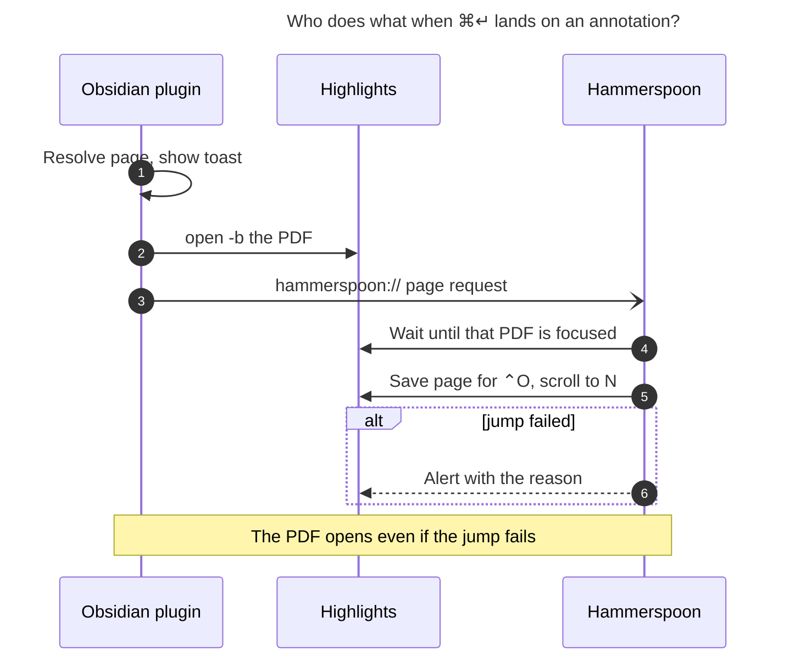

# ⌘↵ on a ref-note annotation → Highlights at that page

_Researcher: cld · 2026-11-08 · Scope: bob-plugins (`bob-navigation-hotkeys`), chezmoi
(Hammerspoon), bob-cli docs. Read-only research; no code was changed._

## TL;DR

- **The idea is good, and it fits the existing feature.** Today ⌘↵ on a reading task
  opens the PDF wherever you last left off. On an annotation it should open the PDF
  _at that annotation's page_. One rule covers both: **⌘↵ opens the source of whatever
  is under the cursor.** The original plan
  (`plan:202610/ref_pdf_highlights_keymap.md`) explicitly left "Opening at a specific page or
  annotation" out of scope, so this is the expected follow-up.
- **Don't jump to the page with `highlights://` links.** Highlights finds the document
  for those links by file name, through its stored bookmarks. The library already has a
  duplicate name (`harness_engineering.pdf` is in both `blogs/` and `papers/`), and the
  page-keys investigation of 2026-11-03 concluded "Do not use them."
- **Use the Accessibility page runner that already ships in Hammerspoon.** Since
  2026-11-03, Hammerspoon has `highlights_pages.lua` and `highlights_tab_keys.lua`,
  which jump Highlights to page N by Accessibility. They also land-check the result,
  fall back to a second method, and keep ⌃O/⌃I history. Obsidian opens the PDF as it
  does today, then sends `hammerspoon://bob-highlights-page?path=…&page=N`. Hammerspoon
  waits until that exact PDF is in front, then runs its existing `goto`. A bonus:
  **⌃O in Highlights returns you to the page you were reading before.**
- **Read the page from the ref note itself.** Every annotation already sits under a
  `### Page N` caption or carries `[!quote|Page N]` piece metadata. In Bryan's library
  the label number always equals the physical page: **0 mismatches across 373 linked
  page headings in 182 sidecars.** bob-cli needs no change.
- **Show availability with an inline end-of-line "⌘↵ Highlights · p. 4" hint** on the
  cursor line. It appears only when ⌘↵ will open Highlights, and it also appears on
  reading tasks, Task Links, and managed embeds. It is computed by the same resolver the
  key uses, so the hint can never promise something the key won't do.
- **Show a rich toast at once, on the key press,** before Highlights takes focus. It
  uses the existing `.bob-nh-notice` card with a yellow accent, the Highlights icon, a
  `p. 4` receipt, the ref title, and a one-line quote snippet. It updates in place if
  something fails. Failures of the page jump itself are announced inside Highlights by
  Hammerspoon, because that is where your eyes are by then.
- **Requirement adjustments** are in [§5](#5-requirement-adjustments-called-out). The
  main one: also make ⌘↵ work on the 🔖 annotation-task line itself, so you don't need
  to hop to the ref note first.

---

## 1. What exists today (verified)

| Area | Fact | Where |
| --- | --- | --- |
| Command | `open-reference-pdf-in-highlights` is a plain `callback` with no default hotkey. The vault binds `Meta+Enter` in `.obsidian/hotkeys.json` (confirmed in `~/bob/.obsidian/hotkeys.json`). A default hotkey would lose to Obsidian's built-in `Mod+Enter` | `plugins/bob-navigation-hotkeys/src/490-plugin-lifecycle.js:83-88` |
| Resolver | `resolveReferencePdfAtCursor` handles: a `#task #ref` line; a Task Link or bare block-link/embed line whose target is a reading task; otherwise it delegates to `editor:open-link-in-new-leaf`. Inside a ref note, non-task lines delegate (the `ref_note_scope = task_lines` branch) | `src/677-plugin-ref-pdf-open.js:149-211` |
| Opener | Validates the path, checks it exists, requires the desktop app and macOS, then runs `execFile("/usr/bin/open", ["-b","net.highlightsapp.universal",abs])` and retries with `-a Highlights`. The notice is plain text: `Opened <basename> in Highlights`. No vault writes | `src/677-plugin-ref-pdf-open.js:272-359` |
| Reuse | The nav api exposes `openReferencePdf(path)` for the Reading Board | `src/480-review-jump-and-nav-api.js:905-948` |
| Toast system | `.bob-nh-notice` card: 4px level-colour left rule, header with chips and a receipt. The lane walk replaces its previous toast instead of stacking | `src/543-lane-walk-notice.js`, `styles.css:1299+` |
| Editor-extension precedent in nav | An `EditorView.updateListener` tracks selection. `bobOpenNotesLandingFlashField` is a transient decoration. The `[[ s w n ]]` status-bar indicator is nav's own key affordance | `490-plugin-lifecycle.js:495-513`, `547-bracket-mode-indicator.js` |
| Ref-note body | The managed region sits between `<!-- highlights:begin/end -->`. Annotations are callouts (`[!quote]`, `[!quote] Image`, `[!note]`) followed by a trailing `^h-<id>` line. They sit under `### Page N` headings, or `#### Page N` inside sections. `<` continuation groups use `### Pages 11–12` with per-piece `[!quote\|Page 11]` metadata. Section cards are `[!summary\|section]` with `^s-<slug>`. `### Removed highlights` holds tombstones and `[!info] Grouped highlight` redirect stubs | bob-cli `docs/highlights-ref-sync.md` "Generated Body Contract", "Continuation highlights", "Sections"; real notes `ref/blogs/gas_town_emergency_user_manual.md`, `ref/chat/sase_blog_writers_block_task_plan.md` |
| Annotation tasks | Each carries `[[ref/x#^h-…\|🔖]]`, or `[[#^h-…\|🔖]]` for a same-note v1 task, plus `[h:: …]`. Some 🔖 lines are plain bullets, not tasks. The vault has 27 🔖 backlink lines, including `done/` | bob-cli docs "Tasks"; vault grep |
| Page index | bob parses `page_index` from the sidecar's `highlights://<stem>#page=N` but renders only the **label** (`Page 12`) into the note. `bob ref show -f json` also exposes only `page_label` | bob-cli `src/native/highlights_ref/sidecar_render.rs:2671-2730`, `docs/ref.md:496` |
| Page-label format elsewhere | Bob Mac Capture shortens labels to `p. 12` and `pp. 11–12` ("Copied Highlight · p. 12") | bob-mac-capture `Sources/RefsCore/RefsCopy.swift:1104` |
| Hammerspoon page runner | The pure `HighlightsPages.run` reads `page_info()` from the window title, pushes jump history, tries a scroll-bar `AXValue` set and then `AXScrollToVisible`, and verifies `landed(n)`. Alerts: out-of-range, `Couldn't jump to page N: …`. No success alert. History is per document | chezmoi `home/dot_hammerspoon/highlights_pages.lua` (404 lines), `highlights_tab_keys.lua:536-640, 875-920`; commits `846e1165`, `504f9b9b` |
| Hammerspoon URL events | None are bound today (`hs.urlevent.bind` is unused) | chezmoi `home/dot_hammerspoon/*` |

## 2. Key external and empirical findings

| # | Finding | Source |
| --- | --- | --- |
| E1 | Highlights is **not scriptable** ("Is Highlights scriptable? No, not yet."). It has no `.sdef`, and it has no Go-to-Page command | Highlights FAQ; `research:202610/highlights_tab_switcher/highlights_tab_switcher__final.md`; `plan:202611/highlights_page_keys.md` |
| E2 | Highlights' URL scheme dates from v1.2 (2015): `highlights://Users/test.pdf` and `highlights://Users/test.pdf#page=3`. In v1.2.3, "If a PDF-file is moved, the URL-scheme bookmark for the file is updated", so the scheme runs on stored bookmarks. 2023.2 "Improved handling of highlights:// links" | [Highlights Mac changelog](https://highlightsapp.net/changelog/mac/) |
| E3 | Inspection of the binary on 2026-11-03 found that it looks bookmarks up by **file name** ("Get FileBookmark with name"). "PDFs with the same name are ambiguous and a jump could open the wrong document. Do not use them." | `plan:202611/highlights_page_keys.md` Findings |
| E4 | `~/bob/lib` holds 618 PDFs with **1 duplicate basename** (`harness_engineering.pdf`). Bob's sidecars use the stem form `highlights://<stem>#page=N` | apollo vault scan; `research:202610/highlights_quick_open_refs_panel/…__final.md` |
| E5 | **Label equals index:** 182 sidecars hold 373 linked page headings, and none has a label number that differs from its `#page=` index or is non-numeric | apollo vault scan of `lib/**/*.md` |
| E6 | 93 ref notes carry `^h-` blocks | apollo vault scan |
| E7 | Each PDF page is an `AXPage` element (0-based `AXPageIndex`) under an `AXSharedDocumentContainer`. The window title reads `… – Page N of M`, and `AXDocument` is the file URL, which gives an exact-path identity | `plan:202611/highlights_page_keys.md`; tab-switcher research |

## 3. Critique — is this a good idea?

**Yes, with a tighter framing.**

- **Value.** An annotation task such as "Should sase run like claude code with … mayor?!"
  is often unclear without the surrounding pages. Today the path is: follow 🔖, scroll
  up to the managed embed, press ⌘↵, then type `4g` in Highlights. The new path is
  ⌘↵ once. The volume is modest (27 🔖 lines and 93 annotated notes), but it grows with
  every annotated read. Retrieval friction is also the thing that decides whether you
  go back to the source at all.
- **Framing.** Treat it as one principle, not a pile of special cases: _⌘↵ opens the
  source of the thing under the cursor. A link opens in a new tab, a reading task
  resumes its PDF, and an annotation opens its page._ That principle decides the edge
  cases below and gives the hint and toast copy one voice.
- **Real risks.**
  1. **⌘↵ overload.** It already means three things depending on context. The hint
     chip is the answer: it makes the context-dependent meaning visible before you
     press.
  2. **Cross-app fragility.** The chain is Obsidian → `open` → Highlights → Hammerspoon
     → Accessibility, and each link can fail. Design for graceful degradation: **the PDF
     always opens.** The page jump is an enhancement that reports its own failure.
  3. **Page-level precision only.** You land at the top of the page, not on the
     highlight. That is fine for normal pages. Precise landing is a later bob-cli
     project (see §6.6).
  4. **Coupling to the generated-body grammar.** The plugin will parse page captions
     that bob-cli renders. Document that as a client contract in bob-cli's docs, and
     test it against golden renders copied from bob-cli tests.
- **What I'd avoid.**
  - Making ⌘↵ anywhere in a ref note open the PDF (the rejected
    `ref_note_scope = whole_note`). Precision is what makes the hint trustworthy.
  - Letting cursor position *within a line* change the meaning ("on a link → open the
    link, elsewhere → PDF"). The hint would flicker as you move horizontally, and the
    reading-task precedent already ignores the column.
  - Changing reading state. Opening is retrieval (R8 from the Refs panel research).

## 4. Design

### 4.1 Landing on the page — options

| Option | How | Verdict |
| --- | --- | --- |
| A. `highlights://<stem>#page=N` (the sidecar form) | `open` the URL after opening the file | ✗ Resolves by file name (E3, E4), so it can open the wrong PDF. It depends on Highlights' bookmark DB and records no ⌃O history |
| B. `highlights://Users/…/x.pdf#page=N` (the documented absolute form) | Same | ✗ for now. Undocumented whether the lookup is by path or by name (E3 says name); untested on 2026.x; may open a second window. Revisit only after a Mac spike proves path resolution |
| **C. Hammerspoon over Accessibility (recommended)** | Plugin opens the PDF, then `open -g -b org.hammerspoon.Hammerspoon "hammerspoon://bob-highlights-page?path=<abs>&page=N"`. Hammerspoon waits for the focused `AXDocument` to be that exact file, then calls the shipped `goto` runner | ✓ Exact identity by path, ideally compared by inode. Reuses landed, spec-tested code with a fallback and a land check. **Feeds ⌃O/⌃I history.** Accessibility is already granted to Hammerspoon. Cost: one URL handler plus specs in chezmoi |
| D. Obsidian drives Accessibility itself (JXA through System Events) | `osascript` from the plugin | ✗ Gives Obsidian Accessibility and Automation grants and duplicates the Hammerspoon runner. Jumps would not enter ⌃O history |
| E. Bob Mac Capture URL scheme | New `bobcapture://` handler, native AX | ✗ for now. The app has no URL scheme and no page runner, and changes are gated on macOS CI. A fair consolidation target later if Mac-side Highlights automation moves into the app |



_Figure 1. The plugin owns resolution, opening, and the Obsidian toast. Hammerspoon owns
the page jump and reports problems inside Highlights. A failed jump never blocks
opening the PDF._

**Hammerspoon handler contract (`bob-highlights-page`).**

- **Params.** `path` must be absolute and end in `.pdf`. `page` must be an integer from
  1 to 999999. Validate both in a pure `parse_page_request(params)` in
  `highlights_pages.lua`.
- **Latest wins.** A new request cancels any request still waiting.
- **Wait.** Poll about every 0.1 s, for up to about 8 s (allowing a cold launch), until
  all of these hold:
  - Highlights is frontmost;
  - the focused window's document is the requested file — compare
    `hs.fs.attributes(path).ino` (plus `dev`) so Unicode normalization (NFC/NFD) and
    symlinks can't cause a false mismatch, with a decoded-path compare as the fallback;
  - `page_info()` parses;
  - `find_pdf_view` sees `AXPage` children.
- **Jump.** Call the existing `dispatch_page({ kind = "goto", target = N })`. It pushes
  history, lands with the fallback, and alerts on out-of-range or failure.
- **Timeout.** Alert `Couldn't jump to page N: the PDF didn't come to the front`.
- **Cancel.** If Highlights stops being frontmost while waiting (you moved on), cancel
  silently and log one line.
- **Privacy.** Follow the existing convention: never log paths or titles.
- **Polish, recommended.** For URL-initiated jumps only, when history actually recorded
  a different page, alert `Page 4 of 44 · ⌃O back to p. 30`. It confirms the landing
  and teaches the back key. Keyboard `g` jumps stay silent, as today.

### 4.2 Where the page number comes from

| Option | Verdict |
| --- | --- |
| **Parse the ref note's own captions (recommended)** | ✓ Synchronous and zero-cost, which the hint needs. Uses the piece's `[!quote\|Page N]`, else the block's nearest `### / #### Page N` or `Pages A–B` heading, and takes the first integer. E5 shows label = index in practice. If the label is non-numeric, open without a jump and say so in the toast |
| Shell out to `bob ref show <note> -f json` on press | ✗ Still only `page_label`. Adds a process spawn per press, and can't drive a per-cursor hint |
| Read the sidecar's `#page=` index from the plugin | ✗ Duplicates bob's sidecar parser in JavaScript. Absorbed and grouped pieces make the block-to-sidecar mapping non-trivial |
| bob renders the physical index into the note | Not needed today (0 mismatches). Make it a follow-up only if a PDF with front-matter page labels shows up. The hammerspoon out-of-range alert would surface such a mismatch |

### 4.3 What counts as "selected" — target grammar

Rules are checked in order. "Line" means the cursor line. The cursor column never
matters.

| Cursor on | Today | Proposed |
| --- | --- | --- |
| `#task #ref` reading task (any checkbox) | PDF, resume position | Unchanged, plus hint and new toast |
| Task Link, or managed `![[…#^ref-…]]` embed → reading task | PDF | Unchanged, plus hint and new toast |
| **Any list line carrying a 🔖 backlink** `[[…#^h-…\|🔖]]` (annotation task or bullet, any note including `done/`) | Delegate | **PDF at that annotation's page** (adjustment A1) |
| **Any line of an annotation block** in a managed ref note's region, from the callout's first line through the blank line to its `^h-` line | Delegate | **PDF at the page of the piece under the cursor** |
| Page caption heading `### Page 12`, `#### Page 12`, `### Pages 11–12` | Delegate | PDF at 12, or 11 for a range (A2) |
| Section heading or `[!summary\|section]` card (`^s-…`) | Delegate | PDF at the section's first member page (A2) |
| `[!info] Grouped highlight` redirect stub | Delegate | Follow the stub's `[[#^h-…]]` to the group head's page (A4). Old tasks link here |
| `[!warning] Removed highlight` tombstone | Delegate | **Delegate.** There is no page and no hint |
| `## Highlights`, `### Other highlights`, `### Removed highlights`, H1, your own notes, outside the region, inside code fences | Delegate | Delegate |
| Task Link → an annotation task | Delegate | **Delegate (deliberate).** The task, not the PDF, is that line's object; keep new-tab |

**Pure locator `locateRefAnnotation(lines, lineIndex)`** (new fragment):

1. **Region.** Require the cursor to be between the begin and end markers and not in a
   fence.
2. **Heading lines.** If the cursor is on a heading, a page caption yields its page and
   a section heading yields its first member's page. Any other heading returns null.
3. **Block.** Scan down to the first `^\^(h|s)-[A-Za-z0-9-]+\s*$` line. Fail if a
   heading or the end marker comes first. Scan up to the previous block-ID line,
   heading, or the region start. Those bounds are the block.
4. **Classify** the block by its first callout header: quote, image, or note →
   annotation; `summary|section` → section; `info` "Grouped highlight" → stub;
   `warning` "Removed highlight" → tombstone.
5. **Page.** Take the nearest line at or above the cursor inside the block matching
   `^(>\s*)+\[!quote\|(Pages?|pp?\.)\s*…\]`. Otherwise use the head callout's metadata,
   then the nearest preceding page-caption heading.
6. **Snippet.** Take that piece's quote text with `**` and callout syntax stripped and
   whitespace collapsed, cut to about 72 characters plus `…`. A note block uses its note
   text; an image block uses "Image". Fall back to the comment.
7. **Result.** `{ blockId, kind, pageLabel, page|null, snippet }`. The resolver adds
   `source_pdf` and `title` from frontmatter through `isManagedRefNote`.

A 🔖 line uses the same function: parse the backlink, resolve the note (same-note
`[[#^h-…]]` too), read it with `readLinkPickerNoteContent` (live buffer first), find the
`^h-…` line, and run the locator with the cursor set on that line.

### 4.4 Making ⌘↵ discoverable — the hint

| Option | Verdict |
| --- | --- |
| **Inline end-of-line hint on the cursor line (recommended)** | ✓ Sits where your eyes already are, shows only when it applies, and states the result (`p. 4`). This is the familiar "ghost text at end of line" pattern (GitLens-style) |
| Status-bar item | ✗ Too far from focus. The status bar is crowded (review footer, `[[ s w n ]]`, Keep inbox), and the review footer's hint slot already belongs to `Alt+P` |
| Tinting the whole annotation block | ✗ Live Preview swaps callout widgets for source when the cursor enters, so the tint would be inconsistent. Noisy while scrolling with j/k |
| Hover buttons on rendered callouts (Reading view) | Optional later. It's a mouse affordance; ⌘↵ doesn't run in Reading view anyway |

**Spec (`677c-ref-pdf-hint.js`, a CodeMirror 6 ViewPlugin in nav):**

- **Content.** A keycap `⌘↵`, then "Highlights", then a muted ` · p. 4`. A reading task
  shows `⌘↵ Highlights` with no page. The tooltip (`title`/`aria-label`) reads
  `Open “Gas Town Emergency User Manual” at page 4 in Highlights (⌘↵)`.
- **Look.** Use `var(--font-ui-smaller)` in `--text-faint`. The keycap is a 1px
  `--background-modifier-border` box with 4px radius and `0 4px` padding. A 6px
  `--color-yellow` dot precedes "Highlights", the same yellow as the underline-emphasis
  ink in the `ref-highlights` snippet. Leave 0.75em before the hint and set `nowrap`.
- **Behaviour.**
  - Show only in the focused editor, only in source or Live Preview mode, and only on
    macOS (`Platform.isMacOS`). Elsewhere ⌘↵ cannot open Highlights, and the hint must
    not promise it.
  - Appear after 120 ms of cursor stillness, with a 120 ms opacity fade (none under
    `prefers-reduced-motion`).
  - Hide on `docChanged` until the next cursor move, so it never chases your typing.
  - Clicking it runs the same command, which also makes it a mouse affordance.
- **Single source of truth.** Use the same resolver in a dry mode: no notices, no
  `exec`. In-note cases (reading-task line, ref-note block) are synchronous. Cross-note
  cases (Task Link, managed embed, 🔖 line) resolve asynchronously through a cache keyed
  by (target path, mtime, block id). A miss shows nothing until it resolves.
- **Toggle.** Add a `Toggle ⌘↵ Highlights hint` session command, matching Bob's other
  mark toggles.

Mock (cursor on the quote line in Live Preview source):

```text
> [!quote] **You technically only need the Mayor.** Running with just the Mayor…   ⌘↵ ● Highlights · p. 4
```

### 4.5 The toast

Show the toast **synchronously when the key press resolves**, before `open` runs. That
way it is visible during the roughly 100–300 ms before Highlights takes focus, and it
is still there as a receipt when you come back to Obsidian.

- **Card.** Use `.bob-nh-notice.bob-nh-highlights` with
  `--bob-nh-level-color: var(--color-yellow)`.
- **Header.** The Lucide `highlighter` icon (`setIcon`) and the label **Highlights**,
  with the receipt `p. 4` right-aligned (`pp.` is never shown; the target page is one
  page).
- **Line 2.** The ref title from frontmatter `title`, falling back to the basename, at
  weight 600 on one line with an ellipsis.
- **Line 3.** The quote snippet in italic `--text-muted`, in curly quotes, clamped to
  two lines. A section shows `§ cards · 2 highlights`. A reading task shows
  `Picks up where you left off`, which also says clearly that there is no page jump.
- **Lifecycle.** One Highlights toast at a time: the new one replaces the old (the
  lane-walk pattern). Durations are 5 s for success and 8 s for failure. Keep a
  plain-text `aria-label` and a plain-text fallback for tests.

| State | Accent | Line 3 |
| --- | --- | --- |
| Opening, with a page | yellow | “quote…” |
| Label not numeric | yellow | `No page number on this highlight — opens where you left off` |
| Hammerspoon not installed (the `open -b org.hammerspoon.Hammerspoon` call fails) | yellow | `Opened — jumping to p. 4 needs Hammerspoon` |
| Unsafe path, missing PDF, not desktop, not macOS, or open failed | `--color-red` | The existing messages, kept verbatim as the reason (`Reference PDF not found: lib/…`, `Highlights is macOS-only: …`, `Could not open … in Highlights: …`) |

Mock:

```text
┃ [highlighter] HIGHLIGHTS                                  p. 4
┃ Gas Town Emergency User Manual
┃ “You technically only need the Mayor. Running with just…”
```

Upgrade the reading-task toast to the same card ("do the same thing when a ref task is
selected"). The jump's own success or failure appears inside Highlights through the
Hammerspoon alert.

## 5. Requirement adjustments (called out)

| # | Adjustment | Why |
| --- | --- | --- |
| **A1** | ⌘↵ also works on any **🔖 line** (annotation task or bullet, including in `done/`). It opens that annotation's page directly | You said these blocks are reached from tasks. Skipping the hop to the ref note is the bigger win, and it matches how Task Links already reach reading tasks in one hop. Separable: ship it in the same release or right after |
| A2 | Page captions and section cards are targets too | Both name a page. Pressing ⌘↵ on `### Page 12` and getting a new-tab no-op would feel broken |
| A3 | In a `<` continuation group, use the page of the **piece under the cursor** | `Pages 11–12` groups span pages. The piece's `[!quote\|Page 12]` is right there |
| A4 | Redirect stubs follow to their group; tombstones are not targets | Old tasks link to stubs, so "task → 🔖 → ⌘↵" must survive grouping. Tombstones have no page, so they get no hint and keep the normal behaviour |
| A5 | **No** extension to Task Links that point at annotation tasks | On those lines the task, not the PDF, is the object. Keep new-tab |
| A6 | The availability hint covers **every** ⌘↵→Highlights context, and appears only on macOS | One affordance and one meaning. It never advertises a key that would only show "macOS-only" |
| A7 | The page jump goes through Hammerspoon, not `highlights://` | E3 and E4 |
| A8 | Opening still never writes the vault or changes reading, lane, or freshness state | Same guarantees as today (R8) |

## 6. Recommended solution

### 6.1 Phase 0 — Mac checks (Bryan, about 10 minutes, before merging the plugin half)

1. In Live Preview, does j/k into a `[!quote]` callout reveal its source lines? The
   hint assumes yes. If not, the hint still shows on the `^h-` line, and in-callout
   hints need the reveal.
2. Does `open -b net.highlightsapp.universal <already-open pdf>` select that existing
   tab?
3. After phase 1 lands: with a PDF in front, does
   `open -g "hammerspoon://bob-highlights-page?path=…&page=3"` land on page 3? Test both
   cold (Highlights quit) and warm.

### 6.2 Phase 1 — chezmoi / Hammerspoon (land first; harmless alone)

- `highlights_pages.lua` (pure):
  - `parse_page_request`;
  - `wait_ready(state)` predicates;
  - message copy, including the timeout alert and the optional `· ⌃O back to p. N`
    success line for URL-initiated jumps.
- `highlights_tab_keys.lua` (runtime):
  - call `hs.urlevent.bind("bob-highlights-page", …)` in `start()` and unbind in
    `stop()`;
  - write a waiting runner on `after_fn` with latest-wins cancellation;
  - compare by inode;
  - reuse `dispatch_page` with an `origin = "url"` flag;
  - respect the existing busy guards.
- Add specs in `tests/hammerspoon/` for parsing, the wait, timeout, cancel on
  deactivate, latest wins, inode match versus a same-name file in another directory,
  and history pushed so ⌃O returns.
- Add a README sentence to "Highlights page keys".

### 6.3 Phase 2 — bob-plugins / `bob-navigation-hotkeys`

- **New pure fragment `677a-ref-annotation-locator.js`:**
  - `locateRefAnnotation(lines, lineIndex)`;
  - `parseRefPageLabel` (`Page 12`, `Pages 11–12`, `p. 12` → 12 or 11; non-numeric →
    null);
  - `parseBookmarkBacklink(lineText)`;
  - `refAnnotationSnippet`.

  Add the new fragments after `677` in `fragments.json`.
- **Extend `677-plugin-ref-pdf-open.js`.** The resolver returns
  `{ kind: "pdf", path, page?, title, snippet, origin }`. Branch order: reading task →
  🔖 line → Task Link or embed → ref-note block → delegate. `openReferencePdfPath(path,
  { page })` keeps its test seams. After a successful open with an integer page, call
  `execFile("/usr/bin/open", ["-g","-b","org.hammerspoon.Hammerspoon", url])` (argv
  only, never a shell; URL-encode the path).
- **Re-entry lock.** Add a short (about 400 ms) lock so a double press doesn't stack two
  requests (the walk precedent).
- **New `677b-ref-pdf-notice.js`** for the card and its states.
- **New `677c-ref-pdf-hint.js`** for the ViewPlugin, cache, and toggle command.
- **CSS** in `styles.css`: `.bob-nh-highlights` and `.bob-nh-hl-hint`.
- **Command name.** Rename it to `Open in Highlights — reading task, annotation page, or
  link in new tab`, keeping the id. The vault binding is unchanged.
- **Nav API.** `openReferencePdf(path, { page })` becomes an additive option so the
  Reading Board, or later the Refs panel, can reuse it. `version` is unchanged.
- **Tests.**
  - Add `scripts/test-navigation-hotkeys-ref-annotation.cjs`. Golden fixtures are copied
    from bob-cli render tests: the gas-town continuation group, a sectioned note, an
    image block, a standalone note, a stub, a tombstone, a cursor on each line class,
    and non-numeric labels.
  - Extend `test-navigation-hotkeys-ref-pdf.cjs` with the Hammerspoon argv, no request
    for reading tasks, toast models for every state, the 🔖 same-note and cross-note
    lines, no vault writes, and that Task Link → annotation task delegates.
  - Add pure hint-eligibility tests, including "hint ⇔ key opens".
- **Release.** Bump the manifest; update `docs/highlights.md`, the README row,
  `npm run build`, `npm test`, `npm run validate`, and `npm run docs:check`; run
  `bob plugins sync`.

### 6.4 Phase 3 — bob-cli docs

- In `docs/ref.md`, extend the ⌘↵ sentence to cover annotations and 🔖 lines.
- In `docs/highlights-ref-sync.md` "Generated Body Contract", add: "Page captions and
  `[!quote|Page N]` piece metadata are a client contract. bob-navigation-hotkeys reads
  them for ⌘↵ page jumps."

### 6.5 Decision record (after you accept)

"Highlights page jumps go through Hammerspoon Accessibility by exact file identity,
never `highlights://` name links." Add it through `/sase_memory_write`. Reopen it if
Highlights ships scripting or a path-exact URL form.

### 6.6 Follow-ups (not in this change)

- **Precise in-page landing.** bob reads the annotation's `/Rect` from the PDF
  (lopdf is already used in `pdf_dests.rs` and `pdf_links.rs`) and records a y-fraction.
  Hammerspoon then scrolls to the page top plus that offset.
- The Bob Refs inspector gets "open at page" through the same URL contract.
- An intake guard against duplicate PDF basenames.
- bob renders the physical index when a label disagrees with it (no cases today).

**Effort:** chezmoi about half a day; plugin about 1–1.5 days with tests; docs about an
hour.

## 7. Risks and open questions

- **Hammerspoon not running.** `open -b org.hammerspoon…` launches it, but the URL may
  arrive before the config binds. In that case the PDF opens without the jump, which is
  acceptable. Hammerspoon is always running on Bryan's Mac today.
- **Two quick presses on different annotations.** The plugin's re-entry lock and
  Hammerspoon's latest-wins rule leave the last one in effect.
- **Dense Task Link lines** already carry several ledger-tools marks. The hint is faint,
  appears only on the cursor line, and can be toggled off.
- **Questions for Bryan:**
  1. Adopt A1 (🔖 lines) now? I recommend yes.
  2. Show the URL-jump success alert `Page 4 of 44 · ⌃O back to p. 30`? I recommend yes.
  3. Should the hint be on by default? I recommend yes, with the session toggle.

## Sources

- bob-plugins: `plugins/bob-navigation-hotkeys/src/677-plugin-ref-pdf-open.js`,
  `490-plugin-lifecycle.js`, `480-review-jump-and-nav-api.js`,
  `543-lane-walk-notice.js`, `styles.css`, `docs/highlights.md`; commit `c10a588`.
- chezmoi: `home/dot_hammerspoon/highlights_pages.lua`, `highlights_tab_keys.lua`;
  commits `846e1165`, `504f9b9b`.
- bob-cli: `docs/highlights-ref-sync.md`, `docs/ref.md`,
  `src/native/highlights_ref/sidecar_render.rs`,
  `src/native/highlights_ref/tests/continuations.rs`.
- bob-mac-capture: `Sources/RefsCore/RefsCopy.swift`,
  `Sources/RefsCore/RefsHighlightPicker.swift`.
- Plans and research: `plan:202610/ref_pdf_highlights_keymap.md`,
  `plan:202611/highlights_page_keys.md`,
  `research:202610/highlights_quick_open_refs_panel/highlights_quick_open_refs_panel__final.md`,
  `research:202610/highlights_tab_switcher/highlights_tab_switcher__final.md`,
  `research:202610/highlights_open_pdf_coordinated_marker_writes/highlights_open_pdf_coordinated_marker_writes__final.md`.
- Vault (apollo, read-only): `~/bob/.obsidian/hotkeys.json`, `~/bob/ref/**`,
  `~/bob/lib/**` sidecars.
- Web: [Highlights Mac changelog](https://highlightsapp.net/changelog/mac/),
  [Highlights FAQ](https://highlightsapp.net/faq/),
  [Protocol Launcher — Highlights](https://protocol-launcher.vercel.app/apps/highlights.html).
