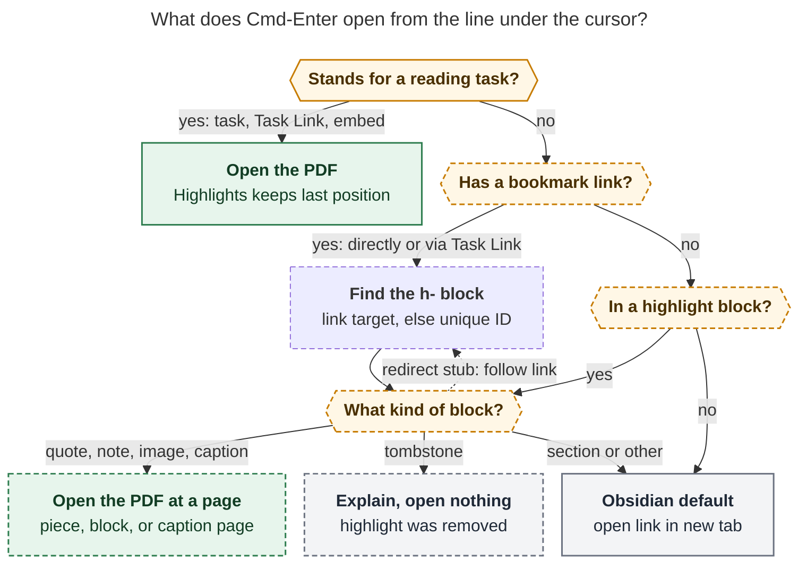
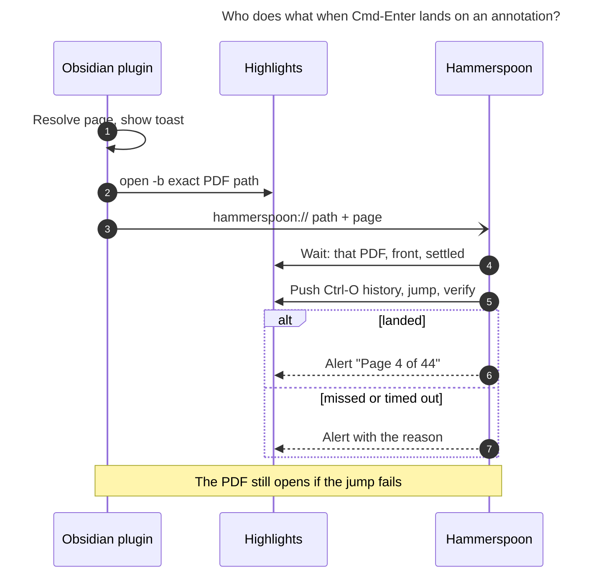

# ⌘↵ from a highlight to its page in Highlights

Consolidated research report · lead researcher · 2026-11-08

**Request.** `⌘↵` (`Meta+Enter`) already opens a reading task's PDF in Highlights. Make
it also work when the cursor is on a quote or annotation in a reference note — the
blocks that `#task`-from-annotation follow-ups link to through `🔖`. It should open
Highlights at the annotation's page. Make it visible when the key is available,
including on reading tasks. Show a toast so it is clear what is happening. Critique the
plan, adjust the requirements where that is justified, and recommend a solution.

**Inputs.** Five independent reports, kept beside this file as
`highlights_annotation_page_jump__{cdx,cld,grk,mus,gem}.md`. grk's figures stay in
`annotation_cmd_enter_highlights_jump__grk_assets/` so its image links still work. I
also did my own research, focused on the points where the reports disagreed. That
included read-only checks of the Highlights app on the Mac and counts taken from the
vault on apollo. Inspected revisions: bob-cli `572ce974`, bob-plugins `aaece06`,
chezmoi `95c31d09`. I changed no product code and no vault content.

---

## 1. Recommendation in brief

**Build it.** It is a good idea, and one rule covers both the old and the new cases:
**⌘↵ opens the source of whatever the cursor is on.** A reading task opens its PDF
wherever you left off. An annotation, or a task that bookmarks one, opens the PDF at
that annotation's page.

The five design decisions that matter:

1. **The page jump goes through Hammerspoon, not `highlights://` links.** The plugin
   opens the exact PDF by path, as it does today. It then hands
   `hammerspoon://bob-highlights-page?path=…&page=N` to Bryan's Hammerspoon. Hammerspoon
   already ships a page-jump runner for Highlights (`gg`, `G`, `<N>g`, ⌃O and ⌃I). That
   runner checks it landed on the right page and keeps back/forward history. Four of the
   five researchers recommended `highlights://…#page=N`, but none tested it. The
   Highlights binary shows those links are looked up **by file name**. The vault already
   has two different PDFs both named `harness_engineering.pdf` (§3.1).
2. **Read the page number from the generated ref note.** The plugin uses page captions
   (`### Page 12`, `#### Page 12`, `### Pages 11–12`) and per-piece metadata
   (`[!quote|Page 12]`). bob-cli needs no runtime change in v1. Two counts make this
   safe: none of the 181 annotated PDFs has PDF page labels, and none of 368 linked
   sidecar headings has a label that differs from its page index (§3.2). A bob-cli guard
   for books with front matter is a follow-up.
3. **Work wherever the annotation is referenced.** ⌘↵ works on the annotation block in
   the ref note. It also works on any `🔖` line (task or bullet, in any note, including
   `done/`) and on Task Links to annotation tasks. When a same-note `🔖` link no longer
   resolves, fall back to a vault-wide lookup of the unique `^h-` ID. 4 of the 17 live
   `🔖` tasks need that today (§3.3).
4. **Show availability with a status-bar chip and a faint target rail.** The chip reads
   `Highlights · p. 4 ⌘↵`. The rail is a thin highlighter-ink line beside exactly the
   lines that ⌘↵ will act on. Reading tasks get the same chip and rail without a page.
   The `📖` mark's tooltip also gains a short mention of ⌘↵.
5. **Show one toast at the moment of the key press.** It reuses Bob's existing notice
   card (`.bob-nh-notice`) with a "Highlights" header, a `p. 4` receipt, the reference
   title, and a quote snippet. It appears *before* Highlights takes focus, and the same
   card updates in place if something fails. The page jump reports its own result
   inside Highlights, where you are looking by then.

---

## 2. Where the reports agreed, and where they did not

**Agreed by all five.** Keep the command ID `open-reference-pdf-in-highlights` and the
vault-only `Meta+Enter` binding; never register `Mod+Enter`. Reading tasks keep opening
the PDF at its last position. Opening the PDF never writes to the vault and never
changes reading, lane, freshness, or review state. Scope is Source and Live Preview;
Reading view comes later. The resolver that powers the key must also power the
availability signal, so the two can never disagree. AppleScript and System Events GUI
scripting from Obsidian are rejected.

| Question | Positions | Resolution |
| --- | --- | --- |
| Page-jump transport | cdx, grk, mus, gem: `highlights://<path>#page=N`, gated on a Mac test. cld: Hammerspoon over Accessibility, because those links resolve by name | **Hammerspoon.** New binary evidence confirms the name lookup, and a duplicate basename exists today (§3.1). `highlights://` becomes an optional spike, not the plan |
| Source of the page number | cdx: store the true page index in the managed region (a bob-cli change); the others: parse captions | **Parse captions in v1.** No current PDF has page labels (§3.2). cdx's projection becomes a follow-up, triggered by the first labelled PDF |
| ⌘↵ on `🔖` task lines | cld, grk, mus, gem: yes. cdx: no; keep the two-step "follow 🔖, then ⌘↵" | **Yes.** Today ⌘↵ there only opens a link if the cursor happens to sit on one. Clicking `🔖` and `gf` still jump inside Obsidian |
| Task Link → annotation task | cld: delegate on purpose; the others did not address it | **Include it.** A Task Link to a reading task already opens the PDF, so a Task Link to an annotation task should open its page. The resolver composes these hops for free |
| Availability signal | cdx, grk, gem, mus: status-bar chip (mus adds a gutter tick, gem a callout class). cld: inline end-of-line hint | **Chip plus a target rail.** Quote source lines are long (p90 is 297 characters), so an end-of-line hint lands after a wrapped paragraph, away from the cursor, and on task lines it competes with ledger-tools marks (§3.4) |
| Link under the cursor inside a quote | cdx, gem: the link wins. cld: the column never matters | **Column-agnostic**, matching today's reading-task behavior and keeping the chip steady. Only 4 of 744 callout lines contain a link |
| Tombstones (`Removed highlight`) | grk: eligible. cld: delegate silently. mus, cdx: refuse with a notice | **Notice, no launch.** Tombstones carry no page (verified), and 3 live `🔖` links point at one |
| Section cards | cld: open the first member's page. cdx, grk: not eligible | **Not eligible in v1.** There is one section card in the whole vault, and a section has no single page |
| Toast | cld: rich card. cdx: "Opening…" before dispatch. grk, mus, gem: plain `Notice` text | **Rich card, shown before dispatch, with honest "Opening" copy** |
| Frozen archives (`ref_history/`) | Raised only by cdx | **Handle explicitly.** Use `annotated_pdf`; never fall back to the live PDF (§3.5) |

Two claims in the inputs were corrected:

- mus says the request's "(do the same thing when a ref task is selected)" rests on a
  false memory of an existing affordance. It is better read as "apply the signal to
  reading tasks too". mus is right that no affordance exists before the press today, so
  one has to be built for both cases.
- gem states that Highlights uses 1-based pages, "reliably" scrolls through `open -b`,
  and opens in about 80 ms. None of that was tested. Treat it as unsupported.

---

## 3. New evidence from the consolidation

### 3.1 `highlights://` links are looked up by file name

These are read-only checks over SSH against the Mac's Highlights 2026.1.2 on macOS 26.5.

- `Info.plist` registers exactly one URL scheme: `highlights`.
- `strings` on the app binary shows **`Get FileBookmark with name: %@`** and
  **`Get FileBookmark with DOI: %@`** as the lookups. It shows no path-based lookup.
  Highlights' own export template is `#### [Page %@](highlights://%@#page=%lu)`: a
  display label (`%@`), a document **name**, and a separate numeric index.
- It also shows **`Set page number for FileBookmark with URL: … using pageNumber:`**.
  Highlights stores and restores the last-viewed page for each file. That explains why
  today's file-open "resumes where you left off". It is also a race any page jump must
  survive (§5.3).
- This confirms the 2026-11-03 finding in `plan:202611/highlights_page_keys.md` ("PDFs
  with the same name are ambiguous… Do not use them"). The 2015 changelog's
  `highlights://Users/test.pdf#page=3` form may survive as a name lookup on the last
  path component. Either way, the URL does not name an exact file.
- The ambiguity is real today. `lib/papers/harness_engineering.pdf` (annotated, with a
  sidecar) and `lib/blogs/harness_engineering.pdf` share a basename, and two ref notes'
  `source_pdf` values end in `harness_engineering.pdf`.

By contrast, `open -b net.highlightsapp.universal <absolute path>` names an exact file,
and Hammerspoon can check the front window's `AXDocument` against that path. The
Hammerspoon modules exist (`highlights_pages.lua`, 404 lines; `highlights_tab_keys.lua`;
commits `846e1165` and `504f9b9b`). Hammerspoon is running on the Mac, and no
`hs.urlevent` handler is bound yet.

### 3.2 Page labels match physical pages in Bryan's library

- `mutool show <pdf> trailer/Root/PageLabels` returns `null` for **all 181** PDFs that
  have a Highlights sidecar. So Highlights' "Page N" label is the physical page.
- Sidecar headings of the form `[Page X](highlights://…#page=N)` number **368**, with
  **0** where X ≠ N and **0** non-numeric labels. That makes the index 1-based, which is
  also how Hammerspoon's `goto N` counts.
- cdx is right in principle. bob's parser keeps `page_label` and `page_index` apart
  (`sidecar_render.rs`), and a regression test parses `[Page 12](…#page=99)`. A book
  with roman-numeral front matter would make the label wrong. That is a future risk,
  not a present one, so it is a follow-up with a clear trigger (§7).

### 3.3 Where `🔖` links actually point

Census of the 25 `[[…#^h-…|🔖]]` links outside `lib/` (17 of them on task lines):

| Target | Count | Implication |
| --- | ---: | --- |
| Live quote or note block | 16 | The normal path |
| Tombstone (`Removed highlight`) | 3 | Needs a clear "removed" result |
| `Merged emphasis` redirect stub | 1 | Follow the stub; both stub kinds exist |
| **Same-note link `[[#^h-…\|🔖]]` on a task moved out of its ref note** | 5 | Literal resolution fails. Every ID exists exactly once, in `ref/docs/sase_AGENTS_v2.md` |

The five dangling links are in `sase_memory.md` (2), `sase.md`,
`done/sase_memory_done.md`, and a `_conflicts/` copy. They date from a 2026-08-29 vault
commit, which predates `bob task move`'s same-note link qualification (now covered by
`task_move/tests.rs`). A resolver that only follows links literally would fail on
roughly a quarter of real `🔖` tasks. **A unique-ID fallback over `ref/` and
`ref_history/` makes them work.** Obsidian's `metadataCache` already indexes block IDs.

### 3.4 The shape of managed regions

Counts across `ref/`: 489 `^h-` blocks, 64 tombstones, 10 continuation groups, 1
section card, 1 image annotation, and 1 grouped-highlight stub. Callout header lines
have a median of 94 characters and a p90 of 297. 4 of 744 contain a link. Vim mode is
on. The status bar is visible and already holds items from five plugins (bob-articles,
command-mode, ledger-tools freshness, the Keep inbox, and bracket mode).

### 3.5 Frozen archives need their own branch

`ref_history/blogs/the_ai_native_sdlc_playbook__2026-10-28.md` holds 4 `^h-` blocks. It
has `annotated_pdf: '[[ref_history/…__annotated.pdf]]'` (a wikilink) and **no
`source_pdf`**, and it sits outside `ref/`. Today's `isManagedRefNote` requires both
`ref/` and `source_pdf`, so it rejects the note. That fails safe, but nothing opens. An
annotated overwrite rewrites inbound `#^h-` links onto the archive, so `🔖` tasks will
land there. The right PDF is the archived one. **Never** substitute the live PDF.

---

## 4. Critique: is this a good idea?

**Yes.** The loop is: highlight in Highlights → `#task` comment → follow-up with `🔖` →
review the task → want the surrounding pages. Today the last step is: follow `🔖`,
scroll up to the reading task, press ⌘↵, then type `4g` in Highlights. After this
change, it is one key. The volume is modest (17 `🔖` tasks, 489 blocks), but it grows
with every annotated reading. Low friction is what decides whether Bryan returns to the
source at all.

Four risks need deliberate handling:

1. **False precision.** A confident `p. 4` that lands on the wrong page, the wrong
   document, or the live PDF instead of the archived one is worse than no feature. That
   is why the design uses exact-path identity, landing checks, an explicit archive
   branch, and honest "page unknown" states.
2. **⌘↵ now means several things.** It already does three. The chip states, before you
   press, what this press will do.
3. **A chain across apps.** Obsidian → `open` → Highlights → Hammerspoon → Accessibility.
   Degrade gracefully: **the PDF always opens**, and the page jump is an enhancement
   that reports its own failure.
4. **Coupling to bob's generated grammar.** The plugin parses captions that bob
   renders. Declare them a client contract in bob-cli's docs and test against fixtures
   copied from bob-cli's render tests.

What I would not do: make ⌘↵ open the PDF from *anywhere* in a ref note (precision is
what makes the signal trustworthy). I would also not add a second key, a picker or
confirmation step, buttons repeated on every callout, writes into notes, or a
`bob ref open` subprocess on every keypress or cursor move.

### Requirement adjustments (called out)

| # | Adjustment | Why |
| --- | --- | --- |
| A1 | "Selected" means **the cursor's line** (the head line of a selection), in Source and Live Preview | Matches the current resolver and Vim; Reading view has no cursor line |
| A2 | Also fire on **`🔖` lines and Task Links to annotation tasks**, in any note | The follow-up is where Bryan works; this skips a hop without taking anything away |
| A3 | Use a **unique `^h-` ID fallback** when a `🔖` link dangles | 4 of 17 live tasks need it (§3.3) |
| A4 | In continuation groups, use the page of the **piece under the cursor**. Page captions are targets; ranges use their first page | `Pages 11–12` is two pages |
| A5 | Redirect stubs (`Grouped highlight`, `Merged emphasis`) **follow their link**. Tombstones **explain and open nothing**. Section cards are **not eligible** | Old tasks point at stubs and tombstones (§3.3) |
| A6 | Frozen `ref_history/` notes open their **`annotated_pdf`**, never the live PDF | §3.5 |
| A7 | The availability signal is **new and shared**: chip, rail, and `📖` tooltip | Nothing exists today for either context |
| A8 | The page jump goes through **Hammerspoon**, which is a dependency in chezmoi | §3.1 |
| A9 | When no numeric page is known, **open the PDF anyway and say so**. Never claim a page | Honesty over failing with nothing |
| A10 | Opening stays **read-only** for the vault and for task, lane, freshness, and review state | Same guarantee as today |

---

## 5. Design

### 5.1 What the key does on each line



_Figure 1. One command routes by the cursor's line. Solid outlines are today's
behavior; dashed outlines are new. Reading tasks keep their last position. Bookmark
lines, Task Links to annotation tasks, and highlight blocks resolve to one `^h-` block
and open its page. Redirect stubs are followed (bounded, with a cycle check), removed
highlights say so, and everything else keeps Obsidian's new-tab behavior._

### 5.2 Locating the block and its page

This is one pure function, `locateRefAnnotation(lines, lineIndex)`, in a new fragment
(for example `677a-ref-annotation-locator.js`). Each fragment must stay at or below 1000
lines; `677` has 368 today.

1. **Region.** The cursor must sit between `<!-- highlights:begin -->` and
   `<!-- highlights:end -->`, outside fenced code. User-written `### Page 12` headings
   elsewhere never qualify.
2. **Caption rule (mirror `region.rs`).** In an unsectioned region, page captions are
   H3. In a sectioned region (one with a `[!summary|section]` card plus `^s-`), captions
   are H4 and every H3 resets them. Labels accept `Page N`, `Pages A–B`, `p. N`, and
   `pp. A–B`, with an en dash or hyphen; the target is the first integer. If the label
   is not numeric, the page is unknown.
3. **Caption lines.** A cursor on a caption heading targets that page.
4. **Block bounds.** Scan down to the next line that is only `^h-…`, and fail if a
   heading or the end marker comes first. Scan up to the previous block-ID line or
   heading. The block includes the callout, nested comments, the blank line, and the ID
   line — the last matters because following `🔖` lands on it.
5. **Classify** by the first callout header: `quote`, `note`, or `quote] Image` is an
   annotation; `info] Grouped highlight` or `Merged emphasis` is a stub (follow its
   `[[#^h-…]]`, at most 3 hops, with a cycle check); `warning] Removed highlight` is a
   tombstone; `summary|section` is a section.
6. **Page.** Use the nearest `[!quote|Page N]` piece header at or above the cursor in
   the block. Otherwise use the block's governing caption. If neither exists (a block
   before the first caption), the page is unknown.
7. **Snippet** for the toast: the piece's quote with callout syntax and `**` removed,
   collapsed to about 72 characters. For a note block, use the note text; for an image,
   use "Image".

**PDF path.** For `ref/` notes, use `source_pdf` from frontmatter, as today. For
`ref_history/` notes, use the `annotated_pdf` wikilink target, normalized and checked
with the same rules (no `..`, no absolute paths, `.pdf` only).

**`🔖` and Task-Link hops.** Parse `[[target#^h-id|🔖]]` (`[[#^h-id|🔖]]` means the same
note). Read the target with `readLinkPickerNoteContent`, which prefers the live buffer.
Find the ID line and run the locator on it. If the block is missing, look the ID up in
`metadataCache` blocks across `ref/` and `ref_history/`. Exactly one match wins; zero or
several matches produce the notice "Can't find highlight h-…". A Task Link goes through
the existing `parseRefPdfBlockLinkLine` hop to its task line and then applies the
reading-task rule or the `🔖` rule.

### 5.3 Landing on the page



_Figure 2. The plugin owns resolution, the exact-path open, and the Obsidian toast.
Hammerspoon owns the page jump and reports the result inside Highlights. A failed jump
never stops the PDF from opening._

| Transport | Verdict |
| --- | --- |
| **Hammerspoon `bob-highlights-page` URL handler (recommended)** | Exact file identity through `AXDocument`. Reuses the shipped `goto` runner, which tries a scroll-bar jump, falls back to `AXScrollToVisible`, and checks the landing. Feeds ⌃O/⌃I history. Hammerspoon already has the Accessibility grant. Cost: one handler plus specs in chezmoi |
| `highlights://<name or path>#page=N` | Name-based bookmark lookup (§3.1), so it is ambiguous with today's duplicate. It depends on Highlights' bookmark database, records no ⌃O history, and is untested on 2026.1.2. Keep it as an optional spike only |
| Obsidian drives Accessibility itself (JXA or `osascript`) | Grants Obsidian Accessibility and duplicates the runner. Rejected |
| A new `bobcapture://` URL in Bob Mac Capture | No URL scheme exists today and macOS CI gates every change. A reasonable home later if Mac-side Highlights automation consolidates there |

None of this conflicts with `decisions:open-pdf-writes-are-coordinated`. That decision
forbids *bob* from pressing keys or granting itself Accessibility in order to *write*
PDFs. This feature writes nothing, and the navigation runs in Hammerspoon, which
already drives Highlights' pages this way.

**Handler contract (chezmoi).** Bind `hs.urlevent.bind("bob-highlights-page", …)` in
`highlights_tab_keys.start()` and unbind it in `stop()`. Keep parsing and waiting logic
pure in `highlights_pages.lua`.

- **Parameters.** `path` must be absolute and end in `.pdf`. `page` must be an integer
  from 1 to 999999. Validate both in `parse_page_request`.
- **Wait.** Poll about every 0.1 s for up to about 8 s (enough for a cold launch) until
  all of these hold:
  - Highlights is frontmost.
  - The focused window's document is the requested file. Compare inode and device with
    `hs.fs.attributes`, so Unicode normalization (NFC/NFD) and symlinks cannot cause a
    false mismatch; fall back to comparing decoded paths.
  - The window title parses.
  - The PDF view is found.
  - **New:** the title's page number holds steady for two polls, so Highlights' own
    last-page restore (§3.1) finishes before the jump instead of undoing it.
- **Jump.** Call the existing `dispatch_page({kind = "goto", target = N})` with an
  `origin = "url"` flag. About 0.4 s after landing, check the page once more and
  re-jump once if a late restore moved it.
- **Feedback.** On success, show `Page 4 of 44`, which matches the page keys' existing
  success alert. When history recorded a different page, add `· ⌃O back to p. 30`; it
  teaches the back key. On timeout, show `Couldn't jump to page 4: the PDF didn't come
  to the front`. Out-of-range pages and failures reuse the existing messages.
- **Cancel and order.** If Highlights stops being frontmost while waiting, cancel
  silently. The latest request wins. Respect the existing busy guards. Never log paths
  or titles.

**Plugin side.** Pass `openReferencePdfPath(path, { page })` an options bag, keeping
today's test seams. After `open -b` succeeds and a page is known, run
`execFile("/usr/bin/open", ["-g", "hammerspoon://bob-highlights-page?path=" +
encodeURIComponent(abs) + "&page=" + n])` as an argument array, never through a shell.
Reading tasks send no page request. Add a re-entry lock of about 400 ms so a double
press does not send two requests. The additive API becomes
`api.openReferencePdf(path, { page }?)`, and the API version stays the same.

### 5.4 Making ⌘↵ visible — chip and rail

All three surfaces read the same resolver in a dry mode: no notices and no `exec`. They
never promise something the key would not do.

```text
Reading task           ▍- [ ] #task #ref [[lib/papers/x.pdf]] …      [▮ Highlights  ⌘↵]
Annotation             ▍> [!quote] You technically only need the…   [▮ Highlights · p. 4  ⌘↵]
Continuation piece     ▍> > [!quote|Page 12] session startup…       [▮ Highlights · p. 12  ⌘↵]
🔖 follow-up           ▍- [ ] #task Compare with appendix [[…|🔖]]   [▮ Highlights · p. 4  ⌘↵]
No numeric page                                                     [▮ Highlights  ⌘↵]
PDF missing                                                         [PDF missing]
Ineligible, off macOS, Reading view                                 (nothing)
```

(`▍` marks the rail and `▮` the highlighter icon; the bracketed text is the chip in the
status bar.)

- **Chip** (status bar, next to `[[ s w n ]]`). Contents: a Lucide `highlighter` icon in
  the same ink as `ref-highlights.css`'s underline
  (`color-mix(var(--color-yellow) 65%, var(--color-orange))`), the word "Highlights"
  in `--text-muted`, ` · p. 4` with tabular numerals, and a keycap with a 1px
  `--background-modifier-border` outline and 4px radius. Use the `p. 12` and
  `pp. 11–12` grammar that Bob Mac Capture already uses. Show the vault's real binding;
  an unbound command shows no keycap.
  - Clicking runs the same command with the target that was resolved before the click.
  - The tooltip and accessible name read "Open *Gas Town Emergency User Manual* at page
    4 in Highlights (⌘↵)". A reading task says "…resumes where you left off".
  - The chip is hidden, not left empty, when there is no target. It appears after
    about 120 ms of cursor stillness with a 120 ms fade, and with no fade under reduced
    motion. It updates only when the target changes.
- **Rail.** A 2px inset line-decoration in the same ink, at about 55% opacity, on
  exactly the source lines ⌘↵ acts on. That is the whole annotation block, only the
  current piece in a continuation group, or the single task or `🔖` line. It answers
  "which highlight?" right where you are looking, without adding text or shifting
  layout. Moving with j/k makes it a quiet reading cursor. It follows the precedent of
  the plugin's existing transient decoration (`bobOpenNotesLandingFlashField`).
- **`📖` tooltip** (ledger-tools `REF_TASK_MARK_TOOLTIP`): change it to
  `#task #ref · reference reading task · ⌘↵ Highlights`.
- **Toggle.** A "Toggle Highlights hints" command hides the chip and rail for the
  session. Both are on by default.
- **Cost.** Read the active note through `editor.getValue()` and cache annotation
  ranges by document version. Cross-note hops (Task Links, `🔖`) resolve asynchronously
  through a cache keyed by (target path, mtime, block ID), and show nothing until they
  resolve. Check PDF existence synchronously with `vault.getAbstractFileByPath`. Use no
  subprocess, PDF parsing, or vault-wide scan on cursor moves; the unique-ID fallback
  runs only on cache misses. Remove listeners and DOM on unload. Respect pop-out
  windows through the owning view's document.

Why not cld's end-of-line hint? Quote source lines are long (p90 297 characters), so in
Live Preview the hint lands after a wrapped paragraph, often several visual lines from
the cursor. On task lines it piles onto ledger-tools marks. The rail keeps the location
cue, and the chip carries the words.

### 5.5 The toast

Create **one** card the moment the key press resolves, *before* running `open`. It is
visible in the roughly 100–300 ms before Highlights takes focus, and it is still there
as a receipt when you come back. Reuse the `.bob-nh-notice` structure, with a
`.bob-nh-highlights` modifier and the highlighter ink as `--bob-nh-level-color`.

```text
┃ ▮ Opening in Highlights                                   p. 4
┃ Gas Town Emergency User Manual
┃ “You technically only need the Mayor. Running with just…”
```

| Situation | Line 3 or change | Duration |
| --- | --- | --- |
| Annotation with a page | The quote snippet in italic `--text-muted`, clamped to two lines | 4 s |
| Reading task | `Resumes where you left off` (no receipt) | 4 s |
| No numeric page, or a block before the first caption | `No page number on this highlight — opens where you left off` | 4 s |
| Archived reading | Receipt plus `Archived copy · replaced 2026-10-28` | 4 s |
| Hammerspoon request failed to dispatch | Updates in place: `Opened — jumping to p. 4 needs Hammerspoon` | 8 s |
| Removed highlight | `This highlight was removed in Highlights — no page to open`; nothing launches | 4 s |
| Highlight not found (dangling, no unique ID) | `Can't find highlight h-…`; nothing launches | 8 s |
| Missing or unsafe PDF, off macOS, launch failure | Red accent; today's messages kept verbatim as the reason | 8 s |

Show one Highlights card at a time: a new card replaces the old one, as in the lane-walk
notice. Use "Opening", never "Opened at page 4", because Obsidian cannot see where
Highlights landed; Hammerspoon's alert confirms it. Give the card a plain-text
`aria-label` and a text fallback for tests. Ineligible lines delegate silently, as they
do today.

---

## 6. Recommended solution

**Extend the existing command into "open the source of what's under the cursor".**
Resolve one annotation block, from the ref note, a `🔖` line, or a Task Link, to an
exact PDF path and caption page. Open that path in Highlights as today, then let
Hammerspoon's verified page runner land the page. Announce it with one card before the
app switch. Show availability through one chip and one rail, both driven by the same
resolver. Ship nothing that claims a page it cannot deliver.

**Phase 0 — Mac checks (Bryan, about 15 minutes, before merging the plugin).**

1. Does `open -b net.highlightsapp.universal <already-open pdf>` select its existing
   tab?
2. Once phase 1 lands, does `open -g "hammerspoon://bob-highlights-page?path=…&page=3"`
   land on page 3? Test cold (Highlights quit) and warm, and test a PDF whose last
   position is page 30, which exercises the restore race.
3. Do j/k into a Live Preview callout reveal its source lines, so the rail and chip
   show inside callouts?
4. Optional, to settle the transport question for good: try
   `highlights://Users/…/lib/papers/harness_engineering.pdf#page=2` and see whether it
   opens the papers copy or the blogs copy.

**Phase 1 — chezmoi (Hammerspoon). Harmless on its own; land it first.**

- Add the handler, pure request and wait helpers, and copy, as in §5.3.
- Add specs for parsing, waiting, the settle rule, timeout, cancel on deactivate, latest
  wins, an inode match against a same-named file in another directory, history pushed
  so ⌃O returns, and the post-landing re-check.
- Add a README line under "Highlights page keys".

**Phase 2 — bob-plugins (`bob-navigation-hotkeys`, plus one tooltip in
`bob-ledger-tools`).**

- New fragments: the locator (§5.2), the toast card, and the chip-and-rail
  `ViewPlugin`. Extend `677` with the resolver order: reading task → `🔖` line → Task
  Link or embed → managed block → delegate. Add the page option and the Hammerspoon
  request, the re-entry lock, and the CSS.
- Rename the command to "Open in Highlights (reading task, highlight page, or link in
  new tab)" and keep the ID.
- Tests: extend `scripts/test-navigation-hotkeys-ref-pdf.cjs` and add a locator
  harness. Use golden fixtures copied from bob-cli render tests, plus the real shapes
  found in §3.3–3.5: a dangling same-note `🔖`, a tombstone target, a `Merged emphasis`
  stub, and a `ref_history` archive. Add "hint ⇔ key" equivalence tests.
- Run `npm run build`, `npm test`, `npm run validate`, and `npm run docs:check`; update
  `docs/highlights.md`; then run `bob plugins sync`.

**Phase 3 — bob-cli docs only.** In `docs/highlights-ref-sync.md` ("Generated Body
Contract"), declare page captions and `[!quote|Page N]` piece metadata a client
contract that `bob-navigation-hotkeys` reads. Extend the ⌘↵ sentence in `docs/ref.md`.
No version or CHANGELOG edits; the release train handles those. After Bryan accepts the
design, record the decision through `/sase_memory_write`: "Highlights page jumps go
through Hammerspoon by exact file identity, never name-resolved `highlights://` links."
Reopen it if Highlights ships scripting or a path-exact URL form, or if the Phase 0
item 4 test shows the path form is exact.

**Acceptance matrix (essentials).**

| Layer | Cases |
| --- | --- |
| Locator | Cursor on a callout line, nested comment, blank line, `^h-` line, caption, `Pages A–B` caption, each continuation piece, an H4 caption in a sectioned note, a section card (delegates), a fence (delegates), outside the region (delegates), a non-numeric label (page unknown) |
| Hops | Same-note and routed `🔖`; a dangling same-note link with a unique ID elsewhere; zero or duplicate IDs; Task Link → annotation task; stub → group; stub cycle; tombstone; `ref_history` archive using `annotated_pdf` |
| Launch | Exact-path argument array; special characters in paths; Hammerspoon request only when a page is known; re-entry lock; off macOS; no vault writes (the existing throwing stubs cover the new paths) |
| UI | Chip states; rail range per context; hidden off macOS and in Reading view; unbound or remapped key; click keeps its target; light and dark themes; narrow window; reduced motion |
| Mac | Cold and warm launch; restore race; the duplicate-basename pair; already-open tab; ⌃O returns to the previous page; caret and scroll unchanged in Obsidian on return |

**Effort.** chezmoi about half a day; plugin about 1–1.5 days with tests; docs about an
hour.

---

## 7. Follow-ups (not in this change)

- **Guard against labels that differ from physical pages.** When bob's `page_index`
  differs from the label's number, render it into the note (the smallest form of cdx's
  projection), and have the plugin prefer it. Trigger: the first annotated PDF with
  `/PageLabels`.
- **Repair dangling `🔖` links.** A doctor check, or a one-time fix, that rewrites the
  same-note `🔖` links in §3.3 to `[[ref/docs/sase_AGENTS_v2#^h-…|🔖]]`. Clicking `🔖` on
  those tasks fails today too.
- **Reading-view click target** on captions and callouts, using the same resolver.
- **Bob Refs inspector "open at page"** through the same Hammerspoon URL contract.
- **Precise in-page landing** using the annotation's `/Rect` (lopdf is already used in
  bob).
- **Duplicate-basename warning at intake**, which protects any future name-based
  Highlights feature.

## 8. Open questions for Bryan

1. Accept Hammerspoon as the page-jump dependency? Recommended: yes. It is already
   where Highlights page navigation lives.
2. ⌘↵ on `🔖` lines and Task Links goes straight to Highlights (A2)? Recommended: yes.
3. Rail on by default alongside the chip? Recommended: yes, with the session toggle.

## Sources

- Researcher reports: `highlights_annotation_page_jump__cdx.md`, `__cld.md`,
  `__grk.md`, `__mus.md`, `__gem.md` (this directory).
- bob-plugins `aaece06`: `plugins/bob-navigation-hotkeys/src/677-plugin-ref-pdf-open.js`,
  `210-rename-and-line-context.js` (`isManagedRefNote`), `490-plugin-lifecycle.js`,
  `543-lane-walk-notice.js`, `547-bracket-mode-indicator.js`, `styles.css`
  (`.bob-nh-notice`); `plugins/bob-ledger-tools/src/138-task-tag-marks.js`;
  `AGENTS.md` (fragment limit, `bob plugins sync`).
- bob-cli `572ce974`: `docs/highlights-ref-sync.md` (generated body, continuation
  groups, redirect stubs, tombstones, annotated-overwrite archives);
  `src/native/highlights_ref/sidecar_render.rs`; `src/native/task_move/tests.rs`.
- chezmoi `95c31d09`: `home/dot_hammerspoon/highlights_pages.lua`,
  `highlights_tab_keys.lua`; commits `846e1165`, `504f9b9b`.
- Plans and decisions: `plan:202611/highlights_page_keys.md`;
  `decisions:open-pdf-writes-are-coordinated`,
  `decisions:code-copy-reads-render-time-catalog`,
  `decisions:mac-capture-is-a-thin-client`.
- Mac, read-only (2026-11-08): `/Applications/Highlights.app` 2026.1.2 `Info.plist`
  and binary strings; macOS 26.5; running processes.
- Vault on apollo, read-only (2026-11-08): `lib/**` sidecars and PDFs (`mutool`),
  `ref/**`, `ref_history/**`, `🔖` census, `.obsidian/app.json` (Vim mode),
  `.obsidian/snippets/ref-highlights.css`.
- Web: [Highlights Mac changelog](https://highlightsapp.net/changelog/mac/) (v1.2 URL
  scheme; 2023.2 "Improved handling of highlights:// links"),
  [Highlights FAQ](https://highlightsapp.net/faq/) ("Is Highlights scriptable? No, not
  yet.").
