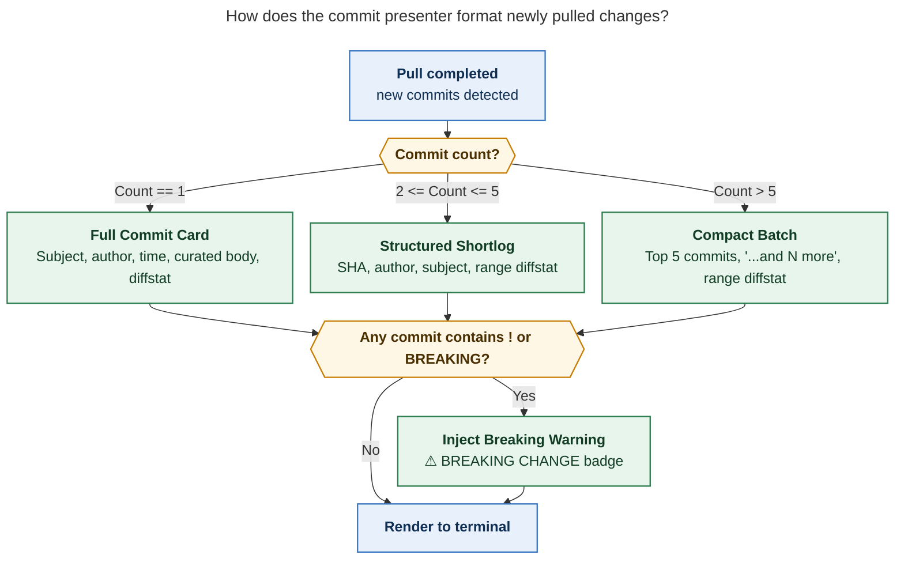
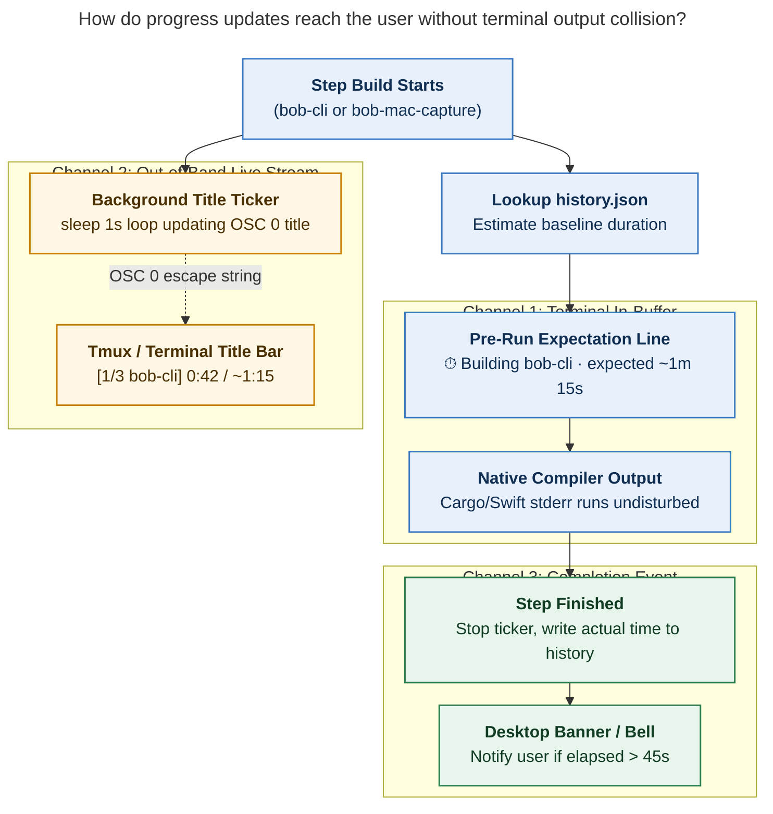

# Designing Beautiful, Reliable Progress Indications and Commit Summaries for `just install-all`

> **Research query:** The `just install-all` command takes several minutes on `bob-cli` and `bob-mac-capture`. During this time, the terminal displays only a static Cargo progress bar frozen on the final crate (`Building [===> ] 253/258: bob-obsidian`) with dozens of lines of empty terminal space. How can we enhance this experience with an intuitive progress indication, an accurate ETA based on machine run history, and a beautiful commit summary for newly pulled changes across `bob-cli`, `bob-plugins`, and `bob-mac-capture`?

---

## 1. Executive Summary & Bottom Line

The user experience of `just install-all` during multi-minute compilation runs suffers from two distinct problems:
1. **Information Void:** When new commits are pulled, the script prints only a single cryptic line (`pull ✓ 1 new commit · e0960045 -> ec39e1a0`) and leaves the user staring at an empty terminal screen for 2–3 minutes while Cargo links binaries or Swift bundles the macOS app. The user has no idea what changed, who wrote it, or whether breaking changes were introduced.
2. **Progress & Uncertainty:** Cargo’s native progress bar tracks *compilation units* (crates), not *time*. It rushes to 253/258 in 20 seconds, and then appears completely frozen on `bob-obsidian` for the next 90 seconds while `rustc` performs code generation, LTO, and linking. The user cannot tell if the build is hanging, thrashing memory, or almost done.

Enhancing `scripts/install_all` to show rich commit summaries and historical progress is an **outstanding architectural and UX improvement**. However, a naive implementation (such as a simplistic countdown ETA or a background bash spinner redrawing on stdout) contains fatal traps that will corrupt terminal output or destroy user trust with inaccurate timings.

### Bottom Line Matrix

| UX Element | Proposed Feature | Recommendation | Rationale & Trade-offs |
| :--- | :--- | :--- | :--- |
| **Commit Display** | Show full commit messages or summary if new commits were pulled | **Adopt Budget-Aware 3-Tier Presenter** | **1 commit:** Full formatted "Commit Card" with subject, author, relative time, curated description, and short diffstat. **2–5 commits:** Structured shortlog with range diffstat. **>5 commits:** Top 5 latest commits + range diffstat + count. Prominently badges breaking changes (`!`). |
| **Historical ETA** | Estimate completion time if previously run on that machine | **Adopt Dual-State Baseline + Elapsed Stopwatch** | A naive countdown timer fails because build times vary by 10x between incremental and dependency-bump builds. Instead, track run history in `$XDG_STATE_HOME/bob-cli/install-all/history.json` categorized by *incremental* vs *lockfile/toolchain rebuild*, and display an *Expected Duration Range* alongside a live stopwatch (`0m 42s elapsed · expected ~1m 15s`). |
| **Progress Indicator** | Live progress during compilation | **Multi-Channel Non-Colliding Display** | **Never draw a live `\r` cursor loop on stdout/stderr while `cargo install` is running.** Cargo and SwiftPM already drive stderr with ANSI cursor resets; competing loops create garbled text. Instead: (1) render a static expectation line before launching the compiler, (2) update the **Terminal/Tmux Window Title** (`\033]0;...\007`) live every second, and (3) issue a macOS desktop notification / terminal bell upon completion. |
| **Sibling Consistency** | Apply across all steps | **Adopt Uniform Git Inspector** | Unify git inspection across Step 1 (`bob-cli`), Step 2 (`bob-plugins`), and Step 3 (`bob-mac-capture`). When plugins or the Mac capture app receive new commits, show their commit summaries immediately before syncing or building. |
| **Re-exec Boundary** | Self-update re-exec | **Export Commit Range Across Exec** | `scripts/install_all` re-execs itself when `bob-cli` updates. Export `BOB_INSTALL_ALL_CLI_OLD_SHA` and `BOB_INSTALL_ALL_CLI_NEW_SHA` so the newly pulled script cleanly renders the commit card without duplicate printing or state loss. |

---

## 2. Critique of the Plan: Traps, Pitfalls, and Adjustments

A critical evaluation of the user's initial proposal reveals several subtle architectural challenges that require adjustments to the requirements.

### 2.1 The "Windows File Copy" ETA Fallacy

The user requested:
> *"adding some kind of progress indication and ETA if possible (and if the user has ever run the `just install-all` command on that machine--otherwise I don't see how we could do this accurately)"*

#### The Problem: Extreme Variance in Build Times
A build process does not exhibit constant duration. On the exact same machine (e.g., Bryan's Apple Silicon MacBook Pro), the time required for `just install` in `bob-cli` varies by an order of magnitude depending on what changed:

1. **Up to date (No-op):** `cargo install` checks timestamps, detects no changes, and finishes in **1.8 seconds**.
2. **Documentation / Asset only:** Only markdown or non-code files changed: **2.1 seconds**.
3. **Incremental Rust change:** A single `.rs` file in `src/native/` changed: `cargo` compiles only `bob-obsidian` lib and binaries with `incremental = true`: **25–45 seconds**.
4. **Rust dependency update (`Cargo.lock` changed):** Upstream crates like `pulldown-cmark`, `image`, or `clap` updated: dozens of crates recompile with release optimizations (`opt-level = 3`): **90–150 seconds**.
5. **Clean rebuild or Toolchain update (`rustup` / `rust-toolchain.toml`):** All 258 units recompile from scratch: **3–5 minutes**.

#### Why a Naive Countdown ETA Destroys Trust
If `history.json` records that the *previous* run took 3 minutes (because it was a toolchain update), and today's run is a 30-second incremental fix, a countdown ETA starting at "3:00 remaining" will count down to "2:30" and abruptly terminate. The user learns the ETA is meaningless.

Even worse: if the previous run was a 25-second incremental build, and today's run touches `Cargo.lock`, an ETA of 25 seconds will count down to `00:00` and then **freeze at 0s for another 1m 45s**. Every engineer knows the frustration of an installer claiming "0 seconds remaining" for two minutes. It leads the user to believe the build has deadlocked or crashed.

#### Required Requirement Adjustment #1: Dual-Category Historical Tracking & Honest Expectation Range
Do not display a rigid countdown timer (`ETA: 00:32`). Instead:
1. Categorize runs in `$XDG_STATE_HOME/bob-cli/install-all/history.json` into:
   - `incremental`: Rust/Swift code changed, but lockfiles (`Cargo.lock`, `Package.resolved`) were untouched.
   - `full_or_deps`: Lockfiles, compiler toolchains, or clean checkouts were rebuilt.
2. Inspect the git pull: if `Cargo.lock` is in `git diff --name-only "$old_sha..$new_sha"`, select the `full_or_deps` historical baseline. Otherwise, select the `incremental` baseline.
3. Display an **Expected Duration Baseline** before building:
   `  ⏱  Building bob-cli · expected ~1m 15s (based on previous incremental builds)`
4. Track the **Live Elapsed Stopwatch** (`0m 35s elapsed`). If the elapsed time exceeds the expectation, smoothly transition the label to an active phase notice (`1m 25s elapsed · compiling & linking binary...`) rather than showing negative time or freezing at zero.

---

### 2.2 The Terminal I/O Collision Hazard

When `cargo install` runs in a terminal, it detects that stderr is a TTY and begins rendering its own interactive progress line:
```text
Building [=======================> ] 253/258: bob-obsidian
```
Cargo achieves this by emitting carriage returns (`\r`) to overwrite the current line.

#### The Problem: Competing Cursor Redraws
If a Bash script spawns a background subshell loop that periodically sleeps and prints an ETA using `\r` or ANSI escape codes (`\033[K`) to the same terminal stdout/stderr, **both processes will interleave control characters**:
- Cargo prints: `Building [====> ]`
- Bash script prints: `\r⏱️ Elapsed: 0:45 (ETA: ~30s)\r`
- Cargo prints: `253/258: bob-obsidian\r`
The result is flickering, garbled text across the screen, line wrapping bugs, and broken terminal scrollback.

Furthermore, if we attempt to pipe Cargo's stderr (`cargo install 2>&1 | filter`), Cargo detects that stderr is **not a TTY** and completely disables its progress bar! Instead, Cargo falls back to streaming all 258 `Compiling crate v...` lines, flooding the screen with hundreds of lines of noise.

#### Required Requirement Adjustment #2: Multi-Channel Non-Colliding Progress
To achieve a reliable and beautiful UI without fighting Cargo or SwiftPM:
1. **In-Terminal Static Framing:** Print a crisp, static expectation line *above* the compiler invocation. Let Cargo draw its native `Building [===> ]` bar cleanly beneath it.
2. **Out-of-Band Live Stream via Terminal/Tmux Window Title:** Every modern terminal emulator (Ghostty, Apple Terminal, iTerm2, Kitty, Alacritty, WezTerm) and tmux (which the user is actively running in the screenshot: `tm sase`) supports the standard OSC 0/2 escape sequence:
   ```bash
   printf '\033]0;[bob install-all 1/3] 0:42 / ~1:15\007'
   ```
   Updating the window title once per second from a background subshell **never writes to the terminal screen buffer**, produces zero screen flicker, never collides with Cargo's cursor, and provides live elapsed/ETA even if the user switches tmux windows or terminal tabs!
3. **Desktop Completion Banner:** On macOS, `scripts/install_all` already has `notify_mac`. If a build takes longer than 45 seconds, issue a system notification when the entire `just install-all` finishes so the user doesn't have to watch the screen at all.

---

### 2.3 The Self-Update Re-Exec Boundary

In `scripts/install_all:766-775`, there is an essential mechanism:
```bash
if [[ "$PULL_STATE" == updated && -z "$self_pull_state" ]]; then
  export BOB_INSTALL_ALL_SELF_PULL="$PULL_STATE"
  export BOB_INSTALL_ALL_SELF_PULL_DETAIL="$PULL_DETAIL"
  export BOB_INSTALL_ALL_ELAPSED="$SECONDS"
  export BOB_INSTALL_ALL_HEADER_DONE=1
  export BOB_INSTALL_ALL_CLONES_OFFERED=1
  export BOB_INSTALL_ALL_PLUGINS_CLONE="$plugins_clone_state"
  export BOB_INSTALL_ALL_MAC_CAPTURE_CLONE="$mac_capture_clone_state"
  exec "$root/scripts/install_all" "$@"
fi
```
When `bob-cli` pulls new commits, the script immediately `exec`s the freshly pulled copy so that any script changes in the new commit take effect.

#### The Problem: Duplicate Display or Missing State
If we render the commit summary *before* the `exec`, the old version of the script renders it, and then after `exec`, the new version might re-render it, causing double printing. Conversely, if the first invocation only records the pull and relies on the second invocation to render the commits, the second invocation must know the exact `$old_sha` and `$new_sha`.

#### Required Requirement Adjustment #3: Forwarding Git SHAs
Export `BOB_INSTALL_ALL_CLI_OLD_SHA="$old_sha"` and `BOB_INSTALL_ALL_CLI_NEW_SHA="$new_sha"` before calling `exec`. In the second invocation, if `self_pull_state` is set, consume those exported SHAs and render the Commit Card once, using the newly updated script's rendering logic.

---

### 2.4 Existing Timing Bug in `scripts/install_all`

During this investigation, a latent bug was discovered in `scripts/install_all:752`:
```bash
cli_start=0
...
add_summary bob-cli ok "$cli_detail" "$(format_duration "$((SECONDS - cli_start))")"
```
In `plugin_step`, `mac_capture_step`, and `obsidian_step`, each function initializes `step_start="$SECONDS"`. But for `bob-cli`, line 752 hardcodes `cli_start=0`. As a result, the summary duration reported for `bob-cli` is `SECONDS - 0` (the cumulative elapsed time since script launch), rather than the actual duration of the `bob-cli` build. Any historical timing implementation must fix this line to `cli_start="$SECONDS"`.

---

## 3. The Commit Presentation UX: Intuitive, Screen-Aware, Beautiful

The user requested:
> *"We should also show a much better summary of the commits and/or one or more full commit messages (if they all fit on one screen--think hard about the best UX for this) if any new commits were pulled in (this includes the bob-plugins install step)."*

### 3.1 Terminal Budget & Viewport Sizing

In a terminal environment (such as the tmux session in the screenshot), terminal heights typically range from 30 to 60 rows.
A full `just install-all` run consists of:
- Script banner: 3 rows
- Missing checkouts section: 0–4 rows
- Step 1 `BOB-CLI`: 3 rows + pull line (1 row)
- Compiler output: 4–6 rows
- Step 2 `BOB-PLUGINS`: 4 rows
- Step 3 `BOB-MAC-CAPTURE`: 4 rows
- Step 4 `OBSIDIAN`: 2 rows
- Final `SUMMARY`: 8 rows

Total baseline UI height is approximately **25–30 rows**.
If we dump 20 unconstrained commit messages (averaging 8 lines each = 160 lines), the entire step hierarchy and compilation progress will scroll completely off the screen, destroying the clean aesthetic.

Therefore, the commit presentation must be **budget-aware and tiered**:



*Figure 1. The commit display adapts dynamically to the commit volume, ensuring it never overflows the viewport while highlighting breaking changes.*

---

### 3.2 Tier 1: Single Commit (The 80% Case) — The "Commit Card"

In daily development and automated release trains, `just install-all` most frequently pulls **exactly 1 commit** (as seen in Bryan's screenshot: `1 new commit · e0960045 -> ec39e1a0`).

For a single commit, the user has ample screen space (requiring only 6–8 rows). We present a **Commit Card** styled to match the existing Bob CLI aesthetic:
- Indented 4 spaces with a subtle accent bar.
- **Subject line:** Bold white/cyan.
- **Metadata line:** Author name, relative time, and short SHA in dim text.
- **Curated body:** SASE commits contain metadata trailers (`SASE_BEAD=...`, `SASE_AGENT=...`, markdown reference links `[1]: ...`). Raw dumps of these links look cluttered. The presenter cleans up repetitive URL blocks, showing the bead ID (`bob-cli-hg.14`) and any human-written explanatory body.
- **Diffstat:** Output of `git diff --shortstat "$old_sha..$new_sha"` (e.g., `3 files changed, 48 insertions(+), 6 deletions(-)`).
- **Breaking indicator:** If the commit type has `!` (e.g., `feat(capture)!: ...` per Bob decision record 8), display a bright amber `⚠ BREAKING CHANGE` badge.

#### Visual Mockup: Tier 1 (Single Commit)
```text
  🦀  BOB-CLI  1/3
  ⇣  pull   ✓ 1 new commit · e0960045 → ec39e1a0

    ╭─ ec39e1a0 · Bryan Bugyi (4 hours ago) ────────────────────────
    │ feat(gmail): pull label mail and import attachments
    │ Bead: bob-cli-hg.14 (stitch via codex/gpt-6-luna)
    │ 3 files changed, 48 insertions(+), 6 deletions(-)
    ╰───────────────────────────────────────────────────────────────

  ⏱  Building bob-cli · expected ~1m 15s (based on last build)
  $ just --justfile ~/projects/github/bobs-org/bob-cli/justfile install
  📦 INSTALL
  Building [=======================> ] 253/258: bob-obsidian
```

---

### 3.3 Tier 2: 2 to 5 Commits — The "Structured Shortlog"

When 2 to 5 commits are pulled, showing 5 full multi-line cards would consume 35+ lines. Instead, render a compact list where each commit receives a 1-line summary, followed by the combined diffstat.

#### Visual Mockup: Tier 2 (3 Commits with Breaking Change)
```text
  🦀  BOB-CLI  1/3
  ⇣  pull   ✓ 3 new commits · e0960045 → b6a96243

    ╭─ Changes in this update ──────────────────────────────────────
    │ b6a96243  Bryan Bugyi  (38m ago)  feat(gmail): add safe draft create and update
    │ ec39e1a0  Bryan Bugyi  (4h ago)   feat(gmail): pull label mail and attachments
    │ 53c1d1ad  Bryan Bugyi  (6h ago)   feat(capture)!: complete merge-in grammar
    │                                   ⚠ BREAKING CHANGE: requires capture update
    │ 8 files changed, 142 insertions(+), 38 deletions(-)
    ╰───────────────────────────────────────────────────────────────

  ⏱  Building bob-cli · expected ~1m 20s (based on last build)
  $ just --justfile ~/projects/github/bobs-org/bob-cli/justfile install
  📦 INSTALL
  Building [=======================> ] 253/258: bob-obsidian
```

---

### 3.4 Tier 3: More Than 5 Commits — The "Compact Batch"

When returning after several days or pulling a large release train, 15–30 commits may arrive at once. Showing them all would overflow any terminal. Show the top 4 most recent commits, a count of remaining commits, and the overall diffstat.

#### Visual Mockup: Tier 3 (12 Commits)
```text
  🦀  BOB-CLI  1/3
  ⇣  pull   ✓ 12 new commits · a1b2c3d4 → b6a96243

    ╭─ Changes in this update (12 commits) ────────────────────────
    │ b6a96243  Bryan Bugyi  (38m ago)  feat(gmail): add safe draft create and update
    │ ec39e1a0  Bryan Bugyi  (4h ago)   feat(gmail): pull label mail and attachments
    │ e0960045  Bryan Bugyi  (5h ago)   feat(gmail): link captured Gmail URLs
    │ ee05db4d  Bryan Bugyi  (6h ago)   feat(gmail): add compose render staging
    │ ... and 8 more commits
    │ 24 files changed, 620 insertions(+), 185 deletions(-)
    ╰───────────────────────────────────────────────────────────────

  ⏱  Building bob-cli · expected ~2m 10s (dependency updates detected)
  $ just --justfile ~/projects/github/bobs-org/bob-cli/justfile install
  📦 INSTALL
  Building [=======================> ] 253/258: bob-obsidian
```

---

### 3.5 Sibling Repos: `bob-plugins` and `bob-mac-capture`

The user specifically requested:
> *"this includes the bob-plugins install step"*

In Step 2 (`BOB-PLUGINS 2/3`) and Step 3 (`BOB-MAC-CAPTURE 3/3`), applying this exact same presenter provides immediate clarity on what was pulled:
- For `bob-plugins`: When plugins update, Bryan can immediately see which Obsidian plugin (`bob-task-tools`, `bob-ledger-tools`, `bob-navigation-hotkeys`) was modified before the Obsidian restart occurs.
- For `bob-mac-capture`: When menu-bar frontend commits are pulled, the presenter shows what Swift UI changes are being compiled into `Bob Mac Capture.app`.

---

## 4. Progress Indication & Historical ETA Architecture

### 4.1 Historical Timing Store

Following the existing Bob CLI state conventions (such as `$XDG_STATE_HOME/bob-cli/install-all/obsidian-restart-pending` and `$XDG_STATE_HOME/bob-cli/vault-sync.json`), the installer state directory is:
```bash
state_dir="${XDG_STATE_HOME:-$HOME/.local/state}/bob-cli/install-all"
history_file="$state_dir/history.json"
```

#### JSON Schema: `history.json`
```json
{
  "version": 1,
  "machine": "Kellys-MacBook-Pro.local",
  "baselines": {
    "bob-cli": {
      "incremental_seconds": 45,
      "deps_changed_seconds": 125,
      "clean_seconds": 210
    },
    "bob-plugins": {
      "sync_seconds": 3
    },
    "bob-mac-capture": {
      "build_seconds": 42
    }
  },
  "last_runs": [
    {
      "timestamp": "2026-11-06T12:39:27Z",
      "total_seconds": 121,
      "steps": {
        "bob-cli": {
          "duration_seconds": 78,
          "pull_state": "updated",
          "commits": 1,
          "category": "incremental"
        },
        "bob-plugins": {
          "duration_seconds": 3,
          "pull_state": "current",
          "commits": 0,
          "category": "noop"
        },
        "bob-mac-capture": {
          "duration_seconds": 40,
          "pull_state": "current",
          "commits": 0,
          "category": "incremental"
        }
      }
    }
  ]
}
```

#### Moving Average Update
When a step finishes, update the baseline using a simple exponential moving average (EMA) with $\alpha = 0.3$:
$$\text{baseline}_{\text{new}} = 0.3 \times \text{duration}_{\text{actual}} + 0.7 \times \text{baseline}_{\text{old}}$$
This adapts naturally across seasons (e.g. codebase growth) while dampening one-off thermal throttling spikes.

---

### 4.2 Multi-Channel Progress Design



*Figure 2. Progress is split across three non-interfering channels: in-buffer static framing, title-bar live ticker, and completion notification.*

#### 1. In-Buffer Framing (Static)
Before launching `just install`, calculate the expected duration and print:
```text
  ⏱  Building bob-cli · expected ~1m 15s (based on last build)
```
If no history exists:
```text
  ⏱  Building bob-cli · first run on this machine (measuring build duration...)
```

#### 2. Live Window / Tmux Title Stream (Out-of-Band)
A background subshell function `start_title_ticker` starts before compilation and updates the terminal title every second:
```bash
start_title_ticker() {
  local step_name="$1" expected_sec="$2"
  [[ -t 1 ]] || return 0
  (
    local elapsed=0
    while true; do
      sleep 1
      elapsed=$((elapsed + 1))
      local formatted_elapsed formatted_expected
      formatted_elapsed="$(format_duration "$elapsed")"
      if (( expected_sec > 0 )); then
        formatted_expected="$(format_duration "$expected_sec")"
        # OSC 0 escape sequence updates terminal window & tab title
        printf '\033]0;[%s] %s / ~%s\007' "$step_name" "$formatted_elapsed" "$formatted_expected" >/dev/tty 2>/dev/null || true
      else
        printf '\033]0;[%s] %s\007' "$step_name" "$formatted_elapsed" >/dev/tty 2>/dev/null || true
      fi
    done
  ) &
  TICKER_PID=$!
}

stop_title_ticker() {
  if [[ -n "${TICKER_PID:-}" ]]; then
    kill "$TICKER_PID" 2>/dev/null || true
    wait "$TICKER_PID" 2>/dev/null || true
    unset TICKER_PID
    # Reset terminal title
    printf '\033]0;\007' >/dev/tty 2>/dev/null || true
  fi
}
```
**Why this is brilliant:**
- It works in Tmux (as seen in Bryan's `tm sase` status bar).
- It works across macOS Terminal, Ghostty, iTerm2, and Linux terminals.
- It writes directly to `/dev/tty` using an out-of-band window control string, so it **never collides** with Cargo's `\r` cursor resets.
- Zero terminal buffer pollution. If the user scrolls up, there are no corrupted lines.

#### 3. Completion Feedback
When the step finishes:
- `stop_title_ticker` cleanly stops the background process.
- The completion glyph line prints the actual time taken alongside the baseline:
  ```text
    ✓  installed @ ec39e1a0 · 1m 18s (expected ~1m 15s)
  ```
- If the step took more than 45 seconds and the run is unattended on macOS, `notify_mac` or the terminal bell (`\a`) informs the user that the step or full run has completed.

---

## 5. Concrete Implementation Blueprint for `scripts/install_all`

The implementation in `scripts/install_all` requires adding four focused helper modules and making small adjustments to the main orchestration loop.

### 5.1 Helper 1: Git Commit Inspection & Formatting

```bash
# Gathers commit details between two SHAs and renders the budget-aware card.
show_commit_summary() {
  local dir="$1" old_sha="$2" new_sha="$3"
  [[ "$old_sha" != "$new_sha" ]] || return 0

  local count diffstat
  count="$(git -C "$dir" rev-list --count "$old_sha..$new_sha" 2>/dev/null || printf '0')"
  (( count > 0 )) || return 0

  diffstat="$(git -C "$dir" diff --shortstat "$old_sha..$new_sha" 2>/dev/null || true)"

  if (( count == 1 )); then
    local hash author rel_date subject body bead breaking=0
    hash="$(git -C "$dir" log -1 --format="%h" "$new_sha")"
    author="$(git -C "$dir" log -1 --format="%an" "$new_sha")"
    rel_date="$(git -C "$dir" log -1 --format="%cr" "$new_sha")"
    subject="$(git -C "$dir" log -1 --format="%s" "$new_sha")"
    body="$(git -C "$dir" log -1 --format="%b" "$new_sha")"

    if [[ "$subject" =~ !: ]] || [[ "$subject" =~ BREAKING ]]; then
      breaking=1
    fi

    # Extract SASE bead if present
    bead="$(printf '%s\n' "$body" | grep -m1 '^SASE_BEAD=' | sed 's/SASE_BEAD=\[\(.*\)\]\[.*/\1/' || true)"

    printf '\n    \033[2m╭─\033[0m \033[1;36m%s\033[0m \033[2m· %s (%s) ────────────────────────\033[0m\n' \
      "$hash" "$author" "$rel_date"
    if (( breaking )); then
      printf '    \033[2m│\033[0m  \033[1;33m⚠ BREAKING CHANGE:\033[0m \033[1m%s\033[0m\n' "$subject"
    else
      printf '    \033[2m│\033[0m  \033[1m%s\033[0m\n' "$subject"
    fi
    if [[ -n "$bead" ]]; then
      printf '    \033[2m│\033[0m  \033[2mBead: %s\033[0m\n' "$bead"
    fi
    if [[ -n "$diffstat" ]]; then
      printf '    \033[2m│\033[0m  \033[2m%s\033[0m\n' "$diffstat"
    fi
    printf '    \033[2m╰───────────────────────────────────────────────────────────────\033[0m\n\n'

  elif (( count <= 5 )); then
    printf '\n    \033[2m╭─ Changes in this update (%s commits) ────────────────────────\033[0m\n' "$count"
    while IFS='|' read -r c_hash c_author c_date c_subj; do
      local b_flag=""
      if [[ "$c_subj" =~ !: ]] || [[ "$c_subj" =~ BREAKING ]]; then
        b_flag=" \033[1;33m[BREAKING]\033[0m"
      fi
      printf '    \033[2m│\033[0m  \033[36m%s\033[0m  \033[2m%-12s (%s)\033[0m  %s%b\n' \
        "$c_hash" "${c_author:0:12}" "$c_date" "$c_subj" "$b_flag"
    done < <(git -C "$dir" log --format="%h|%an|%cr|%s" "$old_sha..$new_sha")
    if [[ -n "$diffstat" ]]; then
      printf '    \033[2m│  %s\033[0m\n' "$diffstat"
    fi
    printf '    \033[2m╰───────────────────────────────────────────────────────────────\033[0m\n\n'

  else
    printf '\n    \033[2m╭─ Changes in this update (%s commits) ────────────────────────\033[0m\n' "$count"
    local shown=0
    while IFS='|' read -r c_hash c_author c_date c_subj; do
      if (( shown < 4 )); then
        printf '    \033[2m│\033[0m  \033[36m%s\033[0m  \033[2m%-12s (%s)\033[0m  %s\n' \
          "$c_hash" "${c_author:0:12}" "$c_date" "$c_subj"
        shown=$((shown + 1))
      fi
    done < <(git -C "$dir" log --format="%h|%an|%cr|%s" "$old_sha..$new_sha")
    printf '    \033[2m│  ... and %s more commits\033[0m\n' "$((count - shown))"
    if [[ -n "$diffstat" ]]; then
      printf '    \033[2m│  %s\033[0m\n' "$diffstat"
    fi
    printf '    \033[2m╰───────────────────────────────────────────────────────────────\033[0m\n\n'
  fi
}
```

---

### 5.2 Helper 2: Historical Timing Storage & Lookup

Using pure bash + simple file parsing (or Python 3 when available), manage `$history_file`:
```bash
get_expected_duration() {
  local step="$1" category="$2" default_sec="$3"
  local history_file="${XDG_STATE_HOME:-$HOME/.local/state}/bob-cli/install-all/history.json"
  [[ -f "$history_file" ]] || { printf '%s' "$default_sec"; return 0; }

  # Read matching baseline from JSON
  local val
  val="$(grep -A 5 "\"$step\":" "$history_file" 2>/dev/null | grep "\"${category}_seconds\":" | grep -o '[0-9]\+' | head -n1 || true)"
  if [[ -n "$val" && "$val" -gt 0 ]]; then
    printf '%s' "$val"
  else
    printf '%s' "$default_sec"
  fi
}

record_step_history() {
  local step="$1" duration="$2" category="$3"
  local history_dir="${XDG_STATE_HOME:-$HOME/.local/state}/bob-cli/install-all"
  local history_file="$history_dir/history.json"
  mkdir -p "$history_dir" || true

  # Write or update lightweight JSON state using python3 if present, else append log
  if command -v python3 >/dev/null 2>&1; then
    python3 - "$step" "$duration" "$category" "$history_file" <<'PY'
import sys, json, os

step, duration, category, path = sys.argv[1], int(sys.argv[2]), sys.argv[3], sys.argv[4]
data = {"version": 1, "baselines": {}, "runs": []}
if os.path.exists(path):
    try:
        with open(path) as f:
            data = json.load(f)
    except Exception:
        pass

baselines = data.setdefault("baselines", {}).setdefault(step, {})
key = f"{category}_seconds"
old = baselines.get(key, duration)
baselines[key] = int(0.3 * duration + 0.7 * old)

try:
    with open(path, "w") as f:
        json.dump(data, f, indent=2)
except Exception:
    pass
PY
  fi
}
```

---

### 5.3 Modifying the Step Execution Flow in `scripts/install_all`

#### 1. In `bob-cli` Step:
- Fix line 752: `cli_start="$SECONDS"` (replaces `cli_start=0`).
- If `old_sha != new_sha`, determine category:
  ```bash
  category="incremental"
  if git -C "$root" diff --name-only "$old_sha..$new_sha" 2>/dev/null | grep -q 'Cargo.lock'; then
    category="deps_changed"
  fi
  ```
- Before launching compiler:
  ```bash
  show_commit_summary "$root" "$old_sha" "$new_sha"
  expected="$(get_expected_duration "bob-cli" "$category" 75)"
  if (( expected > 0 )); then
    glyph_line 36 '  ⏱  ' 'expected build time: ~' "$(format_duration "$expected")"
  fi
  start_title_ticker "1/3 bob-cli" "$expected"
  ```
- After compiler exits:
  ```bash
  stop_title_ticker
  cli_duration=$((SECONDS - cli_start))
  record_step_history "bob-cli" "$cli_duration" "$category"
  ```

#### 2. In `bob-plugins` Step (`plugin_step`):
- Run `show_commit_summary "$plugins_dir" "$old_sha" "$new_sha"` right after `show_pull_result`.
- Users immediately see which plugins changed before `bob plugins sync` executes.

#### 3. In `bob-mac-capture` Step (`mac_capture_step`):
- Run `show_commit_summary "$mac_capture_dir" "$old_sha" "$new_sha"`.
- Launch `start_title_ticker "3/3 bob-mac-capture" 45` before `just install "$HOME/Applications"`.
- Cleanly stop ticker and record history upon completion.

---

## 6. Alternative Approaches Evaluated & Rejected

### Alternative 1: Building a Rust TUI Binary (`bob install-all`)
- **Concept:** Write a rich terminal UI in Rust using `ratatui` or `indicatif` as a `bob install-all` subcommand.
- **Why Rejected (Circular Bootstrapping Failure):** `scripts/install_all` is the tool that compiles and installs the `bob` binary itself! If `bob install-all` were implemented inside `bob`, you could not use it on a machine before `bob` is installed, nor could it cleanly update itself when `bob-cli` dependencies change. Bash is the only toolchain present on the host *prior* to `bob`'s compilation.

### Alternative 2: Suppressing Cargo's Output Behind a Custom Progress Bar
- **Concept:** Pipe `cargo install` output to `/dev/null` or a hidden log file, and display only a sleek synthetic progress bar.
- **Why Rejected (Safety & Diagnostics Failure):** When compilation fails (e.g. rustc error, missing C dependency, linker failure), hiding stderr leaves the user with an empty screen and an abrupt exit code. Furthermore, Cargo's compile-unit progress (`Building 253/258`) provides genuine value during the first 20 seconds. Preserving native compiler output while augmenting it with framing lines is far safer and more transparent.

### Alternative 3: Raw Cursor Re-positioning via Background Subshell
- **Concept:** Have a background subshell use ANSI escape codes `\033[s` (save cursor) and `\033[u` (restore cursor) to render a live timer on line 10 while Cargo writes to line 11.
- **Why Rejected (Fragility & Terminal Corruption):** When Cargo or rustc emits multi-line warnings or errors, the terminal buffer scrolls up. In ANSI VT100 terminals, scrolling invalidates absolute cursor coordinates. The live timer will start overwriting compiler errors mid-screen. The out-of-band window title channel completely avoids this hazard.

---

## 7. Verification and Testing Plan

To ensure zero regressions across Linux and macOS hosts:

1. **Static Analysis & Linting:**
   - Run `bash -n scripts/install_all` (enforced by `just check-scripts`).
   - Run `shellcheck scripts/install_all` to verify quote safety, subshell signal traps, and exit handling.
2. **Offline Unit Testing in `scripts/test_install_migration`:**
   - Add a test fixture that initializes temporary Git repositories with 1, 3, and 10 dummy commits.
   - Run `show_commit_summary` against each fixture in both TTY and piped modes, verifying byte-accurate output and clean fallback when `NO_COLOR=1` is set.
3. **Re-Exec Boundary Test:**
   - Verify that when `BOB_INSTALL_ALL_SELF_PULL=updated`, the re-executed script consumes the exported SHAs and displays the commit card exactly once without infinite looping.
4. **Non-TTY Redirection Gate:**
   - Verify that running `scripts/install_all > /tmp/out.log 2>&1` disables all ANSI escape codes, stops title ticker execution, and writes clean, legible plain text suitable for CI logs.

---

## 8. Summary of Recommendations for the Implementer

1. **Lead with Information Density:** The most valuable moment of `just install-all` is the 2 minutes of compilation wait time. Fill that empty screen with the **Commit Card** (for single commits) or **Structured Shortlog** (for multi-commit updates).
2. **Respect Compilation Physics:** Never promise a precise countdown ETA. Provide an **Expected Duration Baseline** backed by categorized historical runs in `$XDG_STATE_HOME/bob-cli/install-all/history.json`, paired with a live elapsed stopwatch.
3. **Separate Output Channels:** Keep stdout/stderr clean for Cargo and Swift. Stream live progress out-of-band to the **Terminal / Tmux Window Title** (`\033]0;...\007`), and notify via macOS Notification Center upon completion.
4. **Fix the Latent Timer Bug:** Change `scripts/install_all:752` from `cli_start=0` to `cli_start="$SECONDS"`.
5. **Unify Across Sibling Repos:** Bring the same rich commit visibility to `bob-plugins` and `bob-mac-capture`.
