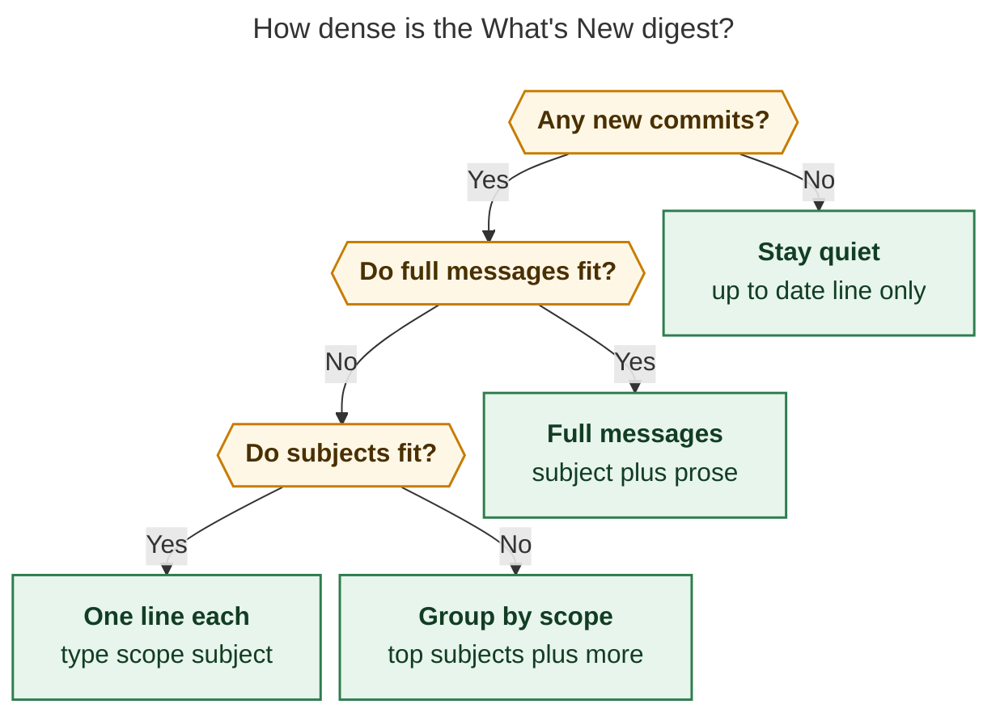
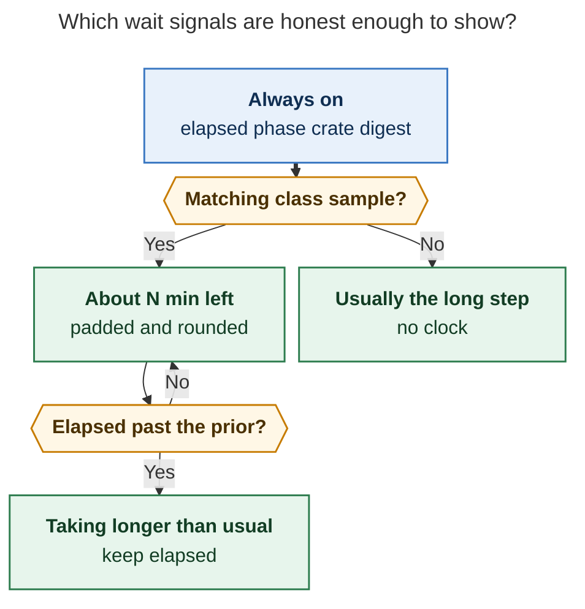

# Install-all wait chrome and What's New digest

- **Researcher:** grk
- **Date:** 2026-11-06
- **Question:** How should `just install-all` show progress, an ETA, and the commits it just pulled so a several-minute cargo / Swift wait feels honest, calm, and worth watching?
- **Verdict:** Build it. Treat the long compile as a **reading surface plus a live wait line**, not as a clock bolted onto today's `1/3` counter. Show a fit-to-screen What's New digest the moment a pull lands, keep elapsed and crate liveness visible while rustc sits on `bob-obsidian`, and offer a clock ETA only after this machine has a matching *phase-and-class* sample.

---

## Bottom line

The screenshot is a successful installer that fails as a wait. `scripts/install_all` already has banners, glyphs, a pull line, and a summary. The minutes in the middle are cargo's `73/288: bob-obsidian` bar on an otherwise empty tmux pane, under a SHA range that does not say what changed.

Do this, in this shape:

1. **Spend the wait on What's New.** After each successful pull, print a digest of those commits *before* `just install` / Mac Capture `just install` starts, and print a compressed replay in the final `SUMMARY`. One commit with a real prose body gets the full message. Dozens of stitches get grouped by conventional-commit scope. SASE trailers never appear.
2. **Prove the process is alive while the crate bar stalls.** Cargo's unit count freezes for minutes on `bob-obsidian`. That stall, not the missing clock, is why the pane looks hung. Always show elapsed time, the current phase, and (when a wrapper is available) how long the current crate has been compiling.
3. **Estimate remaining time from classified history, never from "has this machine ever run install-all".** A cold compile, a 12-second incremental noop, and a 288-unit rebuild after a gmail stitch are different jobs. Store per-phase samples in `~/.local/state/bob-cli/install-all/history.jsonl`. Say "about 3 min left" only for a matching class. Pad, round, and drop remaining rather than count into the negative.
4. **Keep the existing visual language.** Same 48-character rules, same `paint` palette, same glyphs. No alternate-screen TUI, no `less` pager in the middle of an install, no new cargo plugin.

The plan as stated is the right product instinct. A literal reading of it (last-run wall clock + dump of `git log` bodies) would be an unreliable and ugly implementation.

---

## Is this a good idea

**Yes.** A source install that routinely takes several minutes is already past Nielsen's 10-second threshold, where a spinner is malpractice and a percent-done indicator is the default ([Nielsen, 2026](https://www.uxtigers.com/post/progress-indicators); Myers, CHI 1985). Bryan is watching this in tmux on a MacBook, with enough empty rows to read a short changelog, and the current pull line already admits that new commits exist.

Maister's waiting-line laws map onto this pane one-for-one:

| Law | Today's pane | Fix |
| --- | --- | --- |
| Occupied time feels shorter | ~15 empty rows under cargo | Put What's New in that space |
| Uncertain waits feel longer | SHA range, then a stalling crate bar | Elapsed + "about N min" when honest |
| Unexplained waits feel longer | `73/288: bob-obsidian` with no gloss | "usually the long step · rustc is in the large crate" |
| Anxious waits feel longer | Looks hung | Heartbeat on the current crate |

Buell and Norton's *labor illusion* (Management Science, 2011) is the same insight from the other direction: people grant patience when they can see real work. The digest is that work in user units ("what landed"), and the crate timer is that work in machine units ("rustc is still in `bob-obsidian`, 48s").

### Where the request as written goes wrong

1. **"ETA if they have ever run install-all."** One boolean is the wrong prior. `just install` uses the `local-install` profile (`Cargo.toml`: release optimizations plus `incremental = true`). The second run on a quiet tree is often seconds. The run in the screenshot is 288 cargo units after one commit. Averaging those, or replaying the last wall clock, produces the Windows-copy-dialog folklore Nielsen warns about: remaining time that seesaws and then betrays.
2. **"Full commit messages if they all fit."** In the last 80 bob-cli commits, **59 have no prose body** after SASE trailers are stripped. The bodies are `SASE_BEAD` / `SASE_TYPE` / `SASE_AGENT` / `SASE_MODEL` plus beads/agents footnote URLs. Showing "full messages" naively dumps stitch plumbing. The subject lines are already the product: conventional commits, median 60 characters, `feat`/`fix`/`docs` with a scope.
3. **Volume.** This tree landed **62 bob-cli commits in the last day**, 107 in two, 346 in seven. Plugins and Mac Capture add more. A morning `install-all` after a quiet evening can be one commit (the screenshot). A morning after a missed day cannot fit 62 full messages, and cannot even fit 62 subjects on a 30-row tmux pane. Fit-to-screen is the requirement; "full messages" is one density, not the only one.
4. **`1/3` as progress.** `BOB-CLI 1/3` counts repos. Step 1 is most of the wall clock. Plugins are seconds. Mac Capture is the other long compile. A third of the steps is not a third of the wait. GNOME's progress HIG is explicit: the bar should track remaining *time*, and stages should collapse into one composite estimate ([GNOME HIG](https://developer.gnome.org/hig/patterns/feedback/progress-bars.html)).
5. **Progress only on `install-all`.** The minutes live in `just install` (cargo) and in Mac Capture's `Scripts/bundle.sh` → `swift build --configuration release`. People run `just install` without the orchestrator. The wait chrome belongs on those compiles; `install-all` adds the digest, the weighted overall line, and the summary replay.

### The strongest objection

A clock ETA that is often wrong is worse than no ETA. Harrison's participants rated **stalls** the worst progress-bar sin, and a remaining-time that jumps from 2 min to 8 min is a stall in words. The screenshot already has a determinate bar (`73/288`). The missing piece is liveness while that fraction is frozen, plus a changelog. Those two do not require history. History is how a clock ETA earns the right to exist.

That objection changes the sequence. Ship digest + elapsed + stall copy + crate heartbeat first. Turn the clock on when the history file has a matching class. Do not block the first three on the fourth.

---

## Requirement adjustments

These change the wording of the request. They are deliberate.

| # | Request | Recommendation | Why |
| --- | --- | --- | --- |
| **A1** | Progress indication | A live wait line: elapsed, phase name, cargo/Swift unit fraction, current crate and how long it has been compiling. Overall fill weighted by historical phase duration once samples exist. | Cargo's bar already exists and then stalls. Liveness is the gap. |
| **A2** | ETA if install-all has ever been run on this machine | ETA if this *phase* has a sample in the same *class* (`cold` / `noop` / `small` / `large`). First run: elapsed + "usually the long step", no clock. | Incremental vs cold vs 288-unit rebuilds differ by an order of magnitude. |
| **A3** | Accurate ETA | Honest ETA: round to minutes, prefix "about", pad ~15%, never move the overall bar backwards, drop remaining and say "taking longer than usual" once elapsed exceeds the prior. | Nielsen: finishing early delights; finishing late betrays. GNOME: overestimate, then pause on "almost done". |
| **A4** | Full commit messages if they fit on one screen | Fit-to-screen density: full prose (trailers stripped) → one subject line each → group by `type(scope)` → scope histogram. Always keep count + SHA range. | 74% of recent bob-cli bodies are SASE-only. Daily volume is tens to hundreds of stitches. |
| **A5** | Show new commits from the pull, including plugins | Show them **twice**: a reading digest between pull and compile, and a compressed replay in `SUMMARY`. Include bob-cli, bob-plugins, and bob-mac-capture independently. | The compile will scroll the first copy off a 30-row pane. The summary is what remains in scrollback. |
| **A6** | Beautiful | Stay inside today's banner/glyph language. Fill the empty rows. Dim SHAs, bold subjects, color `feat`/`fix`/`docs`. No alternate screen, no extra emoji vocabulary. | The installer already looks like Bob. A TUI would throw away scrollback and fight cargo. |
| **A7** | Reliable | Non-TTY and `NO_COLOR` stay plain. Missing `python3` falls back to native cargo/Swift output plus the static stall sentence. A failed pull still shows no fake digest. History is append-only JSONL under XDG state. | Bootstrap path must keep working. |
| **A8** | *(implied)* only `install-all` | Share wait chrome with `just install`. Wrap Mac Capture's Swift build from `install_all` without waiting on a mac-capture PR. | The long steps are the compiles. |
| **A9** | *(new)* completion cue | After a run longer than ~60s, post the existing macOS banner style (`notify_mac`) with "ALL INSTALLED · 4m 55s" (or the warning/fail equivalent). | Nielsen: past a minute the user has left the pane. The script already knows how to notify. |

---

## What the screenshot actually shows

File: `~/tmp/screenshots/20261106_123927.png`. Host: `Kellys-MacBook-Pro.local`, tmux session `sase`, zsh, `just install-all`.

Visible structure, top to bottom:

1. `🚀 INSTALL ALL` plus `from` / `then` chrome.
2. `🦀 BOB-CLI 1/3`.
3. Dim `$ git -C … pull --ff-only --no-rebase`.
4. `⇣ pull ✓ 1 new commit · e0960045 → ec39e1d0`.
5. Dim `$ just --justfile …/justfile install`.
6. Nested `📦 INSTALL` banner from the `just install` recipe.
7. Cargo: `Installing` / `Updating crates.io index` / `Compiling bob-obsidian v0.4.0`.
8. Cargo progress: `Building [=================>     ] 73/288: bob-obsidian`.
9. The rest of the pane is empty.

The pull in that shot is the gmail stitch `e0960045` → `ec39e1d0` (`feat(gmail): pull label mail and import attachments`). That commit's body is SASE trailers only. The *previous* commit on master (`e0960045`, URL linking) is one of the minority with a real prose paragraph. The installer currently has no way to tell those two cases apart, so it prints a SHA range for both.

`73/288` means cargo still has 215 units in the graph, but the named crate is `bob-obsidian`, the workspace package `just install` is actually building (`cargo install --path . --locked --profile local-install`). That crate dominates remaining time. Unit fraction is ~25% complete; time fraction is unknown and likely much further along, or much less, depending on whether rustc has entered codegen. **The bar is determinate and still a stall.** Harrison 2007: pauses are the most negatively perceived progress behavior.

---

## How install-all works today

`just install-all` is one line: `@scripts/install_all`. The script is a hand-rolled TTY orchestrator with a coherent visual system already:

- Banners via `banner` (48-character rule, kept in sync with the justfile).
- Dim command previews via `command_line`.
- Pull state via `pull_repo` / `show_pull_result`: `cloned` / `updated` / `current` / `warn`.
- Per-step `add_summary` + `print_summary` with glyphs `✓ ⚠ ✗ – ↻`.
- Durations via `SECONDS` and `format_duration`.
- Self-reexec after a bob-cli pull so the new `scripts/install_all` is the one that compiles: `BOB_INSTALL_ALL_SELF_PULL*` env vars carry the human pull string across `exec`.
- Restart marker at `~/.local/state/bob-cli/install-all/obsidian-restart-pending` (directory exists in the docs; on this Linux host it was absent, which is expected).

`just install` then:

- Calls `bob_prepare_install_root` (uninstalls a previous path/git `bob-cli` package; refuses a crates.io `bob-cli`).
- Sets `RUSTC_WRAPPER=` so sccache / sase-rustc-wrapper cannot strip `-C incremental`.
- Runs `cargo install --path . --locked --profile "$profile" --root "$root"` with `BOB_INSTALL_PROFILE` defaulting to `local-install`.
- Installs shell completion.

Mac Capture's long step is `Scripts/install.sh` → `Scripts/bundle.sh` → `xcode-swift.sh build --configuration release --product BobMacCapture`, then a second `swift build` for `BobMacCaptureInstallHelper`. SwiftPM draws its own `[n/m] Compiling …` bar. There is no elapsed, no ETA, no commit digest on that path either.

Plugins are `bob plugins sync --no-pull --repo`. That step is fast. It still pulls commits first, so it still needs a digest.

`scripts/install_all` is syntax-checked by `just check-scripts` (`bash -n`) and has no behavioral tests.

---

## The wait is 1–10 minutes of unexplained empty space

Nielsen's feedback ladder (2026 restatement of the 1993 limits):

| Delay | User | Correct feedback |
| --- | --- | --- |
| < 1 s | Direct manipulation | Nothing |
| 1–10 s | Attention strains | Spinner |
| 10 s – 1 min | Task-switching begins | Percent-done + honest estimate |
| 1–10 min | User leaves the screen | Persistent status + interim results |
| > 10 min | Supervision is episodic | Step list + notification |

`just install-all` after a pull lives in the 1–10 minute band on a MacBook, sometimes longer on a cold `target/`. The screenshot is already in "user may leave" territory. Two consequences:

- **Interim artifact:** the changelog of what was just pulled. That is the one inspectable result available *during* rustc.
- **Completion call:** reuse `notify_mac` so a walk-away run taps the shoulder. Linux can stay with the summary line; the Obsidian path already special-cases Darwin.

Cargo's own bar is a percent-done indicator in *compiler units*, which is the right unit for rustc and the wrong unit for a human who wants minutes. GNOME: "If the time remaining is an estimate, use the word 'about'." Never "1:47".

Do not wrap the wait in an alternate-screen TUI. Scrollback of rustc errors and of the digest is part of the product. Progress windows are what the GNOME HIG retired.

---

## Naive last-run ETA will lie

Three facts about this tree make a single "last install-all took T seconds" prior unusable.

**1. Incremental compilation is the point of `local-install`.** Docs (`docs/start/install.md`) already promise that later reinstalls from the same checkout recompile only what changed. The first install after a clean, and a rebuild that dirties `bob-obsidian` plus a lockfile bump, are different classes.

**2. Cargo units are not minutes.** `--timings` defines a unit as one compiler invocation ([Cargo book, timings](https://doc.rust-lang.org/cargo/reference/timings.html)). The screenshot's 288 units match a lockfile of 262 packages plus build scripts and extra rustc invocations. The last named crate is often the largest. A linear map `elapsed / (73/288)` will under- or over-shoot by minutes while rustc sits on `bob-obsidian`.

**3. `--unit-graph` is nightly-only.** cargo-pretty and similar tools get a perfect denominator from `cargo build --unit-graph -Z unstable-options`. That flag is gated on nightly ([tracking issue #8002](https://github.com/rust-lang/cargo/issues/8002)). bob-cli pins a stable toolchain. Do not take a nightly dependency for an installer. Parse cargo's own `Building [==>] n/m: crate` line instead; it is already on screen.

Stable JSON (`--message-format json`) emits `compiler-artifact` when a crate *finishes*, including a `fresh` boolean, and does not emit a begin-compile event ([cargo#12864](https://github.com/rust-lang/cargo/issues/12864), closed into the broader JSON redesign). Start times live on stderr as `Compiling foo`. A wrapper that wants a crate timer must read both streams. That is what cargo-chronoscope does; it is the right architecture and the wrong crate to add as an install-time dependency.

**Class heuristic** (store one JSONL row per finished phase):

| Class | How we know | Typical duration |
| --- | --- | --- |
| `cold` | no `target/local-install` (bob-cli) or no `.build` (mac-capture) at start | longest, first-run |
| `noop` | phase returns in < 15 s, or cargo reports essentially all-fresh | seconds |
| `small` | < 20 units compiled, or duration < 60 s | about a minute |
| `large` | everything else, including the 288-unit screenshot | several minutes |

Match the next ETA on `(phase, class)` for this machine. Keep an exponential moving average of the last five hits in that bucket. Blend toward live `elapsed / unit_frac` only after unit_frac is past ~0.2, and even then treat it as a prior, not a stopwatch. If elapsed exceeds 140% of the prior, stop quoting remaining time.

First run on a host: **no clock**. Print elapsed, unit fraction, and one honest sentence: "first compile on this machine · often several minutes". A baked "5–15 min on Apple Silicon" number would still be a guess about someone else's disk cache; keep it qualitative.

---

## Commit messages are not changelog text

Measured on this checkout, last 80 commits per repo:

| Repo | Prose body after stripping SASE / footnote lines | SASE-only body | Empty body | Subject length min / med / max |
| --- | --- | --- | --- | --- |
| bob-cli | 21 | 59 | 0 | 39 / 60 / 92 |
| bob-plugins | 32 | 48 | 0 | 42 / 65 / 111 |
| bob-mac-capture | 31 | 48 | 1 | 39 / 60 / 110 |

Types on bob-cli in that window: `feat` 56, `fix` 11, `docs` 10, `refactor` 2, `test` 1. Subjects are already a scannable changelog.

`git interpret-trailers` / `%(trailers:only)` does **not** harvest `SASE_BEAD=…`. Git 2.43 on this host returned an empty trailer block for a stitch whose body is exactly those four `SASE_*` lines plus markdown footnotes. The keys use `=` and the footnote lines (`[1]: https://…`) confuse the trailer parser. Strip with a small explicit filter:

- drop lines matching `^SASE_[A-Z0-9_]+=`
- drop lines matching `^\[[0-9]+\]:`
- collapse leftover blank lines
- if nothing remains, the message *is* the subject

Pass `git log --reverse` only if we ever want chronological changelog order. What's New is newest-first.

Do not read `CHANGELOG.md` for this. The daily release train writes version-level notes; `install-all` is a source pull of stitches between versions. `git log $old..$new` is the right set. After the self-reexec, HEAD is already `$new`, so the old SHA must travel across `exec` as structured env (`BOB_INSTALL_ALL_SELF_PULL_OLD` / `_NEW`), not only as the human `PULL_DETAIL` string.

Commits in recent windows (this host, 2026-11-06):

| Window | bob-cli | bob-plugins | bob-mac-capture |
| --- | --- | --- | --- |
| 1 day | 62 | 19 | 17 |
| 2 days | 107 | 29 | 36 |
| 3 days | 170 | 40 | 45 |
| 7 days | 346 | 140 | 85 |

The screenshot's "1 new commit" is what happens when `install-all` is already a habit. The digest has to be beautiful in both regimes.



*Caption: Fit the digest to the live terminal. Full messages are the first density that still fits; scope groups are how a 62-commit morning stays on one screen.*

**Budget.** `available_rows = LINES - chrome`. Chrome is roughly 14–18 rows (two banners, pull line, command line, wait line, padding). On the screenshot pane that leaves about 12 rows for What's New. On a 60-row Terminal.app window it leaves about 40. Measure `LINES` and `COLUMNS` at print time; wrap subjects to `COLUMNS-12`; never let a line overflow.

**Full-message rule (the request, made precise).** Use full messages when every pulled commit, after trailer stripping, fits in `available_rows` including blank-line separators. In practice that is: one commit with a short prose body, or two or three commits whose remaining prose is a handful of lines. Otherwise step down. Never paginate with `less`. Never print 62 bodies "because the user asked for full messages".

**Grouping rule.** Parse `type(scope): subject`. Sort scopes by count descending. Show up to three subjects per group, then `· … 38 more`. If even the group headers overflow, print a histogram (`gmail 41 · capture 9 · docs 4`) and the SHA range.

**Color.** Reuse `paint`: `feat` 32, `fix` 33, `docs` 36, everything else 2 (dim). SHAs dim. The What's New title is plain, not another 48-character banner, so the compile banners stay the visual spine.

---

## Recommended product

One sentence: **while rustc (or SwiftPM) works, the pane shows what landed and that the compile is alive; when history allows, it also says about how long.**

### The wait as a reading surface

Print What's New *after* `show_pull_result` and *before* the compile command. That is the empty canvas in the screenshot. The digest stays in scrollback above cargo's moving bar. After every component, the `SUMMARY` repeats a compressed form so a user who skipped the wait still sees what changed.

Up to date: do not invent a What's New block. The existing `up to date · $sha` line is enough.

### Progress and ETA



*Caption: Elapsed, phase, crate heartbeat, and the digest are always honest. A clock ETA is a privilege of a matching sample, and it yields to "taking longer" rather than going negative.*

Always-on wait line (one or two rows, last rows of the pane when a wrapper owns the TTY; otherwise a static sentence plus cargo's native bar):

```text
  wait  elapsed 1m 08s  ·  about 2 min left  ·  usually the long step
  ▰▰▰▰▰▰▰▰▱▱▱▱▱▱▱  73/288  bob-obsidian  48s
```

Rules for that line:

- Elapsed ticks every second. That is the anti-stall. Harrison: keep the bar moving; if work stalls, say why in words.
- Current crate + per-crate seconds. This is the screenshot fix. `73/288` frozen with `bob-obsidian 48s` counting up is alive; `73/288` frozen alone looks dead.
- Remaining time, when shown, is `about N min` (under 90s: `about 1 min`). Never `1:47`. Never `1 second remaining` for a minute.
- Overall fill is time-weighted once we have phase samples; until then, cargo's unit fill is the bar, and we do **not** pretend `1/3` is 33% of the wait. Keep `1/3` as a subtitle if it helps orientation (`BOB-CLI  1/3 · compiling`), not as a progress widget.
- Never move the overall fill backwards. If cargo's unit count is revised, skip ahead (GNOME: underestimation skips; overestimation pauses on "almost done").
- Errors and rustc diagnostics stay in scrollback. The wait line is a footer, not a replacement for cargo.

When `python3` is missing, print the static sentence and leave cargo/Swift's native bar alone. The digest still prints. Install still works.

Optional ambient liveness: OSC 0 window title / tmux pane name `install-all · 1m 12s · bob-obsidian`. Cheap, does not fight cargo's `\r` bar, helps if Bryan looks at the tmux tab strip. Restore the title on exit. Fail open if not a TTY or if tmux `allow-rename` is off.

### Visual language

Stay in the family the screenshot already speaks:

| Element | Keep |
| --- | --- |
| Section banners | icon, bold colored title, 48-character rule, TTY vs pipe |
| Commands | dim `$ …` |
| Pull / sync results | `⇣` + glyph + detail |
| Summary | two-space indent, 16-character name column, duration suffix |
| Color | 32 ok, 33 warn, 31 fail, 36 restart, 2 skip/dim |

Add:

| Element | How |
| --- | --- |
| What's New | untitled block under the pull line, hanging indent, no new icon vocabulary |
| Wait line | one dim label `wait` plus the live fields |
| Bar | cargo-like `=` / Unicode `▰` on TTY; `[73/288]` ASCII when `NO_COLOR` or non-TTY |
| Nested `📦 INSTALL` | skip the inner justfile banner when `BOB_INSTALL_NESTED=1`, so `BOB-CLI` remains the heading for the wait |

Drop the inner banner. In the screenshot it costs three rows and restates "we are installing" under a heading that already said that.

### Annotated mocks

**One new commit, prose body, history present** (the happy screenshot):

```text
🚀  INSTALL ALL
────────────────────────────────────────────────
  from     ~/projects/github/bobs-org
  then     restart Obsidian if the plugin sync changes the vault
  last     4m 12s on this Mac · typical after a pull  3–6 min

🦀  BOB-CLI  1/3 · compiling
────────────────────────────────────────────────
  $ git -C ~/projects/github/bobs-org/bob-cli pull --ff-only --no-rebase
  ⇣  pull   ✓  1 new commit · e0960045 → ec39e1d0

  What's new
  feat(gmail)  link captured Gmail URLs without blocking capture

  Add grammar 16 Gmail spans and offline previews, reuse
  saved-thread links within capture batches, and queue
  unresolved URLs for a detached single-flight linker
  after commit.

  $ just --justfile ~/projects/github/bobs-org/bob-cli/justfile install
  wait  elapsed 1m 08s  ·  about 2 min left  ·  usually the long step
  ▰▰▰▰▰▰▰▰▱▱▱▱▱▱▱  73/288  bob-obsidian  48s
```

**One new commit, SASE-only body** (the actual `ec39e1d0` case): print the subject, skip an empty body. Do not print `SASE_BEAD`.

**62 commits after a missed day:**

```text
  ⇣  pull   ✓  62 new commits · a1b2c3d4 → b6a96243

  What's new  ·  62 commits  ·  6 scopes
  gmail     41
    · add safe draft create and update flow
    · pull label mail and import attachments
    · link captured Gmail URLs without blocking capture
    · … 38 more
  capture    9
    · land x= segment suffix docs and restore ~ in the shell-tilde refusal
    · … 8 more
  … 4 more scopes
```

**End summary** (durable copy):

```text
✨  SUMMARY
────────────────────────────────────────────────
  ✓  bob-cli           1 new commit · installed @ ec39e1d0     3m 41s
  ✓  bob-plugins       up to date · 12/12 plugins in sync      2s
  ✓  bob-mac-capture   3 new commits · installed ~/Applications/Bob Mac Capture.app  1m 08s
  ↻  obsidian          restarted                               4s

  What's new
  bob-cli        feat(gmail)  pull label mail and import attachments
  mac-capture    feat(capture)  show Gmail links in the panel
                 · reopen Pull-In verdicts after offer-close refusal
                 · render merge-in bands and pending states

  ✓  ALL INSTALLED · 4m 55s
```

The summary What's New is one line per repo when `n==1`, a few bullets when `n` is small, and `gmail 41 · capture 9 · …` when it is not. The wait-time digest may have scrolled away; this one does not.

---

## Architecture

Keep orchestration in bash. That matches `scripts/install_all`, survives the self-reexec, and does not require the `bob` being compiled.

```text
scripts/install_all                  orchestration, banners, summary, notify
scripts/lib/install_digest.sh        trailer strip, density picker, paint
scripts/lib/install_history.sh       JSONL append, class, EMA, format "about N min"
scripts/lib/cargo_wait.py            optional: wrap cargo, footer, pass diagnostics
justfile install                     BOB_INSTALL_NESTED, call wrapper when present
```

**History file:** `~/.local/state/bob-cli/install-all/history.jsonl`, next to the existing restart marker. One object per finished phase:

```json
{"ts":"2026-11-06T12:39:27-05:00","phase":"bob-cli.cargo","class":"large","seconds":247,"units":288,"units_compiled":288,"sha":"ec39e1d0"}
```

No source snippets. SHAs and durations only. Append-only. Cap reads at the last ~50 rows. Hosts do not share this file.

**Cargo wrapper.** `python3` plus the stdlib. Spawn `cargo install … --message-format json-render-diagnostics --color always`. Merge stdout JSON (`compiler-artifact`, `compiler-message`) with stderr (`Compiling …`, `Building [==>] n/m`). Reprint rustc diagnostics as they arrive. Draw the two-line footer on `\r` with a 0.5s heartbeat even when no line has arrived (the stall case). Exit with cargo's status. Do not `--quiet`. Do not `--unit-graph`.

`just install` calls the wrapper when `python3` is on `PATH` and stdout is a TTY; otherwise raw cargo, as today.

**Mac Capture.** v1 wraps the `just --justfile … install` child from `install_all` with the same wait-line idea, parsing SwiftPM's `[n/m] Compiling Foo.swift`. No mac-capture PR required. A later mac-capture change can reuse the helper for standalone `just install` on that repo.

**Self-reexec.** Add `BOB_INSTALL_ALL_SELF_PULL_OLD` and `_NEW`. Rebuild the digest after `exec` from those SHAs. Carry `SECONDS` as today.

**Tests.** Extract digest + class + remaining-time formatters and cover them from `just check-scripts` the way `scripts/test_install_migration` already covers `bob_prepare_install_root`. Fixtures: SASE-only body, prose+SASE, 1/3/8/62 commit lists, `LINES=30` vs `LINES=60`, remaining-time rounding, "taking longer" once elapsed exceeds the prior.

**Docs.** One short section on `docs/guides/install-everything.md`: what the wait line means, that What's New is the pulled range, that the first compile on a machine has no clock. This is a behavior change to a guide-level command, not a new `bob` subcommand, so `cli_rules.md` applies only as craft (colored TTY, scannable help if we ever add flags; v1 has none).

---

## Alternatives considered

| Alternative | Verdict |
| --- | --- |
| Last-run wall clock as the ETA | Rejected. Mixes noop and large rebuilds. |
| Baked "8 min on M-series" first-run clock | Rejected as a number. Qualitative "often several minutes" is enough. |
| Dump `git log` bodies | Rejected. 74% SASE trailers; volume exceeds one screen. |
| `CHANGELOG.md` delta | Rejected. Release-train document, not a stitch digest. |
| Full-screen TUI / alternate screen | Rejected. Loses rustc scrollback and the digest. |
| `cargo-pretty` / cargo-chronoscope as a dependency | Rejected. Circular (`cargo install` to decorate `cargo install`) and nightly `--unit-graph` in the pretty-build case. |
| Steal cargo's TTY in bash with `tput cup` | Rejected. Fights cargo's last-line `\r` bar, breaks in tmux splits. |
| Only decorate `install-all`, leave `just install` ugly | Rejected. The minutes live in `just install`. |
| Nightly `--unit-graph` for a perfect denominator | Rejected. Toolchain is stable. Cargo's `n/m` line is enough. |
| `less` / a pager for long digests | Rejected. An installer must not block on a pager. Fit-to-screen instead. |
| Percent from `1/3` repo steps | Rejected as a progress widget. Keep it as a subtitle. |
| Silent inner `cargo --quiet` plus our bar | Rejected. Hides `Updating crates.io index` and diagnostics unless we reimplement them. Wrapper must forward diagnostics. |

---

## Implementation sequence

One PR can land the whole product. If it needs to split, split on honesty, not on chrome:

1. **Digest + summary replay + structured reexec SHAs.** Highest value, no history required, fixes "what changed?". Tests for trailer strip and density. Skip the nested `📦 INSTALL` banner when nested.
2. **History JSONL + classified "about N min" + elapsed printed before cargo.** Fixes "how long?" for the second large rebuild. First run stays qualitative.
3. **`cargo_wait.py` footer with crate timer.** Fixes the hung-looking `73/288`. Fallback is native cargo.
4. **Wrap the Mac Capture child; `notify_mac` on completion.** Same wait line on the other long compile; tap the shoulder if Bryan left the pane.
5. **Docs sentence on `install-everything.md`.**

Do not ship 3 without 1. A prettier hung bar that still hides the gmail stitch is the screenshot with nicer cells. Do not ship 2 without the class split; that is the lying ETA.

---

## Risks

- **Wrapper hides a rustc error.** Mitigate with `json-render-diagnostics` and a fallback path that execs cargo directly. Test a forced compile failure.
- **ETA still lies on a lockfile bump classified as `large` but twice as slow as the last `large`.** Mitigate with "taking longer than usual" rather than a climbing remaining time.
- **62-commit digest still feels noisy.** Mitigate with the histogram step-down; tune the "three subjects per scope" cap on Bryan's real morning pulls.
- **Python on the install path.** Document the fallback. Bryan's machines have 3.12. The published install guide lists Git, rustup, and just; python3 stays optional.
- **Self-reexec loses the digest.** Structured old/new SHAs in the env block that already exists.
- **Two `install-all` runs at once.** JSONL append is safe; the wait line is per process. Do not add locking.
- **Beauty regressions in pipes / CI.** Every painter already has a `use_color` / `-t 1` gate. Keep it. Non-TTY prints the digest as plain lines and skips the footer.

---

## Sources

### This tree

- `scripts/install_all` — banners, pull detail, self-reexec, summary, `notify_mac`, restart marker.
- `justfile` `install` / `install-all` — `local-install` profile, nested `📦 INSTALL` banner, `RUSTC_WRAPPER=`.
- `Cargo.toml` `[profile.local-install]` — `inherits = "release"`, `incremental = true`.
- `docs/start/install.md`, `docs/guides/install-everything.md` — user-visible install story.
- `sase/repos/linked/bob-mac-capture/Scripts/install.sh`, `bundle.sh`, `xcode-swift.sh` — SwiftPM release build is the other long wait.
- Git corpora measured 2026-11-06: last 80 commits per repo; 1/2/3/7-day `rev-list --count`.
- Screenshot `~/tmp/screenshots/20261106_123927.png` — `73/288: bob-obsidian` after `1 new commit · e0960045 → ec39e1d0`.

### External

- Brad Myers, CHI 1985, percent-done progress indicators (86% preference, no actual speedup).
- Jakob Nielsen, "Progress Indicators Ease the Wait", 2026-08-08, [uxtigers.com](https://www.uxtigers.com/post/progress-indicators). 10-second rule, "about" estimates, never move backwards, elapsed always, remaining only when honest, stalls as the cardinal sin.
- Chris Harrison, Brian Amento, Stacey Kuznetsov, Robert Bell, "Rethinking the Progress Bar", 2007; Harrison, Yeo, Hudson, "Faster Progress Bars", CHI 2010 (stalls worst; decelerating ribbing −11% perceived duration).
- David Maister, "The Psychology of Waiting Lines", 1985 (occupied / certain / explained / calm waits).
- Ryan Buell and Michael Norton, "The Labor Illusion", *Management Science*, 2011.
- [GNOME HIG: Progress Bars](https://developer.gnome.org/hig/patterns/feedback/progress-bars.html) — time-weighted bar, "about", skip-ahead vs pause-at-100%, avoid activity mode for long tasks, no progress windows.
- [Cargo book: JSON messages](https://doc.rust-lang.org/cargo/reference/external-tools.html), [timings](https://doc.rust-lang.org/cargo/reference/timings.html), [cargo install --message-format](https://doc.rust-lang.org/cargo/commands/cargo-install.html).
- [rust-lang/cargo#12864](https://github.com/rust-lang/cargo/issues/12864) — JSON has finish, not start; parse stderr `Compiling`.
- [rust-lang/cargo#8002](https://github.com/rust-lang/cargo/issues/8002) — `--unit-graph` nightly-only.
- Git 2.43 `%(trailers:only)` on this host does not parse `SASE_*=` stitch trailers.

---

## Recommended solution

Ship a fit-to-screen What's New digest (trailers stripped, density stepped down from full message to scope groups) immediately after each pull, replay it in `SUMMARY`, and put a live wait line on the cargo and Swift compiles: elapsed, unit fraction, current crate timer, and an "about N min" ETA only from a matching `(phase, class)` history sample on this machine. Keep the existing banner language. Skip the nested `📦 INSTALL` banner. Notify on Darwin after a long run. Fallback to native compiler output when `python3` is missing. Do not use last-run wall clock, nightly cargo flags, an alternate-screen TUI, or raw SASE commit bodies.
