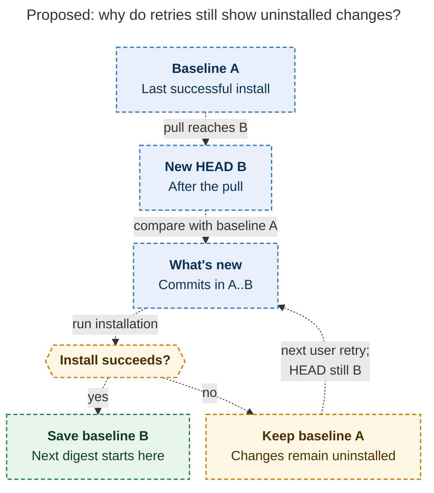
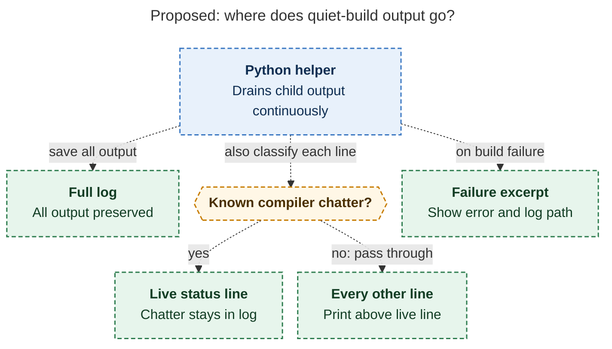

# Diagram proposals: `just install-all`: a wait worth sitting through

Proposals for the swarm linker, not a report. Each diagram restates only what the source
report says.

```yaml
source: research:202611/install_all_wait_and_whats_new/install_all_wait_and_whats_new__final.md
producer: research.3j.image
check: "mmdc 12.0.0 with the PDF-mirroring config rendered 2 of 2 Mermaid diagrams; Puppeteer --no-sandbox; malformed-diagram control exited nonzero"
```

## retry-watermark

```yaml
anchor: |-
  From the `installed.json` watermark to the post-pull HEAD;
question: |-
  Why do retries still show changes that were not installed?
illustrates: |-
  For a valid stored watermark, installed.json advances only after a successful install or drift-free plugin sync, so a failed build leaves its changes visible on the next retry.
caption: "With a valid baseline, failed installs preserve the digest on retry; successful installs or drift-free plugin syncs advance it."
review: "524.531x892 px, fit 100.0%; question and visual checks passed; all nodes and edges traced to source; 0 visual revisions"
```



## quiet-output-routing

```yaml
anchor: |-
  Lines that are recognizably Cargo or SwiftPM status
question: |-
  Where do output, notices, and errors go during a quiet build?
illustrates: |-
  The helper saves full output to a log while hiding only known compiler chatter, passing every other line above the live line, and showing an excerpt with the log path on failure.
caption: "All output reaches the log; only known chatter is hidden, every other line stays visible, and failures add an excerpt and log path."
review: "815.788x564 px, fit 80.0%; question and visual checks passed; all nodes and edges traced to source; 0 visual revisions"
```



