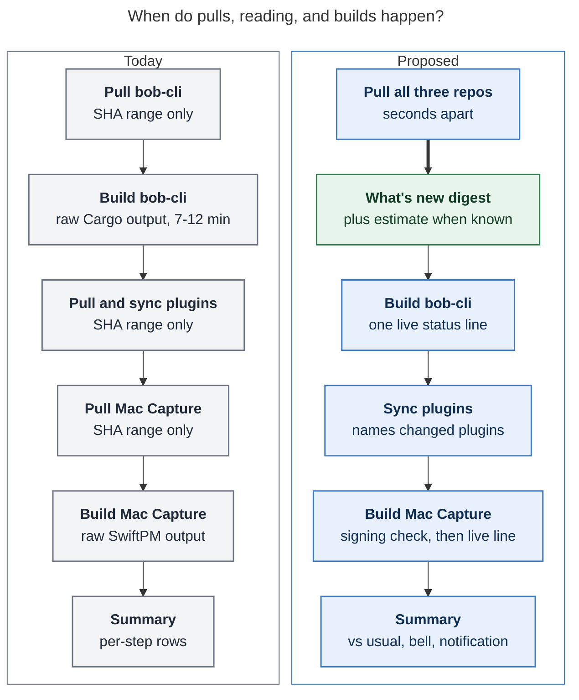
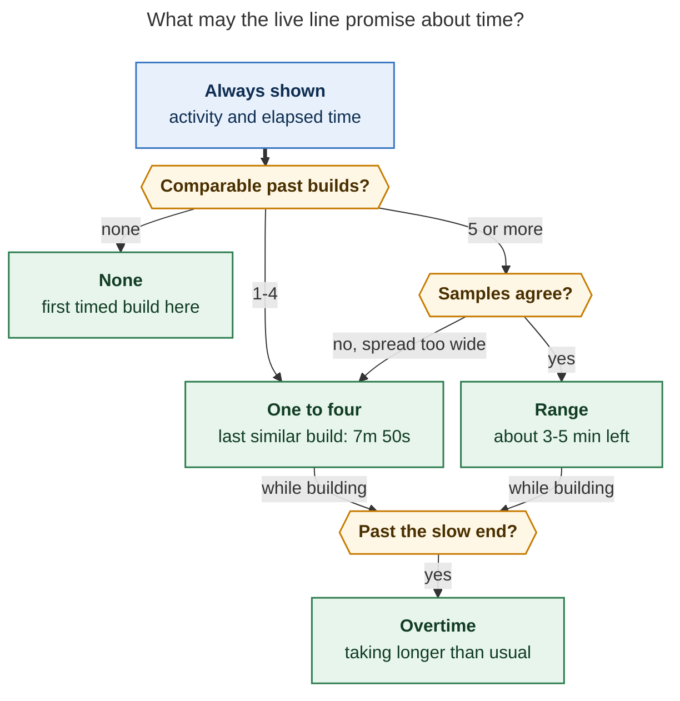

# `just install-all`: a wait worth sitting through

*Consolidated report · 2026-11-06 · lead researcher, merging five independent reports
(cdx, cld, grk, mus, gem) with new measurements from Bryan's Mac · bob-cli @ `0869f792`,
bob-plugins @ `5fbe82a`, bob-mac-capture @ `11dcba7`*

## Question

`just install-all` can sit for minutes on the bob-cli and bob-mac-capture builds. The
screenshot (`~/tmp/screenshots/20261106_123927.png`) shows `BOB-CLI 1/3`, one pull line
(`1 new commit · e0960045 → ec39e1a0`), a nested `📦 INSTALL` banner, and Cargo's
`Building [=====> ] 253/258: bob-obsidian`. The other ~70 rows of the pane are empty.
Bryan asked for three things:

1. Progress indication, plus an ETA when this machine has run the command before.
2. A much better summary of newly pulled commits in all three repos, with full messages
   when they all fit on one screen.
3. A design that is intuitive, reliable, and beautiful.

He also asked for a critique of the plan, with any requirement changes called out.

## Answer in brief

- **Build it.** The case is stronger than any of the five reports assumed. Bryan ran
  `install-all` on the Mac **226 times in the last 21 days** (about 10 per active day).
  On that 8 GB M1, a real-commit rebuild of the one big crate takes **7–12 minutes**,
  not the 3½ minutes measured on apollo. That adds up to something on the order of an hour of
  compile per day. Progress and a changelog make that time readable. They do not make
  it shorter, so speed should be a separate, measured project (see
  [Critique](#critique-is-this-a-good-idea)).
- **Bryan's "full messages if they fit" instinct holds up against the data.** A
  typical run pulls **3 commits across all three repos** (p90 16). After SASE trailers
  are stripped, full messages fit a 45-row budget in **80% of runs that pulled
  anything**, and subject lines fit in 97%. Two reports designed around 40–65-commit
  daily pulls; that is the rare first run of the morning, not the common case.
- **Pull all three repos first, then print one "What's new" digest, then build.** The
  digest fills the wait with something worth reading. It also narrows the gap between
  the bob-cli and Mac Capture source snapshots from about 10 minutes to seconds.
- **Replace raw compiler output with one live status line**, owned by a small
  stdlib-only Python helper. It shows the activity, elapsed time, and a time-based ETA
  from *comparable* per-host history. Full output goes to a log. Failures print an
  excerpt. Unknown lines (Mac Capture's Accessibility and signing notices) pass through.
  `-v/--verbose` restores today's raw stream.
- **ETA honesty ladder:** no comparable history → elapsed only; 1–4 samples → "last
  similar build 7m 50s"; ≥5 consistent samples → "about 3–5 min left", with the bar
  anchored to the slow end so the usual outcome is finishing early. If a build runs past
  that slow end, the line says "taking longer than usual". It never counts to zero or
  below.
- **End with a signal.** Ring the terminal bell; Bryan's tmux already flags bell windows.
  On macOS, also post the existing `notify_mac` banner after long runs.

## New evidence (gaps the five reports could not close)

### What the screenshot actually shows

The screenshot reads `253/258: bob-obsidian` and `ec39e1a0`. grk quoted `73/288` and
`ec39e1d0`; those are misreads, and its "25% complete" argument does not apply. Cargo
claims 98% done while the step that takes nearly all the time is just starting (cld).
The pane is about **260 columns × 79 rows**, so a whole-run "one screen" story is
realistic there. The prompt line shows the Mac is `Kellys-MacBook-Pro.local` with
memory at 87%.

### How often the command runs, and how long it really takes on the Mac

I read the Mac's zsh history (`extended_history` timestamps; durations are not recorded
because `share_history` writes the line at start). I also read the bob-cli lib crate's
rustc incremental session directories under `target/local-install/incremental/`. Their
names encode the session start, and the directory mtime marks the finish.

| Fact | Value | Source |
| --- | --- | --- |
| Hardware | Apple M1, 8 cores, **8 GB RAM**; `target/local-install` is 18 GB | `sysctl`, `du` on `mac` |
| `install-all` runs, last 21 days | **226** (10.3 per active day), median gap **51 min** (p25 21, p75 116) | `~/.zsh_history` |
| bob-cli lib compile, real commits | **416 s, 487 s, 508 s, 710 s** (6m 56s to 11m 50s) | incremental session dirs, today |
| bob-cli lib compile, one fast case | **126 s**: the 19:04 UTC run that pulled `0869f792 feat(capture)!: rewrite relation directions` | same |
| Slowest two samples | 508 s and 710 s: each was the first build after a `Cargo.toml`/`Cargo.lock` change (`2a37f8ce`, `ee05db4d`) started a new metadata hash | session dir names vs `git log -- Cargo.lock` |
| apollo, same crate (cld) | 209–235 s for real one-commit deltas; 30 s for a one-line edit | cld's `--timings` runs |
| apollo usage | 58 plain `just install` runs, **0** `install-all` runs in 21 days | apollo `~/.zsh_history` |

Three consequences:

1. The wait on the Mac is long enough that Bryan leaves the pane. A completion signal is
   necessary, not a nice extra.
2. Variance is real: ±25% within the slow mode, plus a fast mode that the diff does not
   predict. A small capture-grammar rewrite built in 2 minutes; a gmail feature took 8.
   Any ETA has to be a range, anchored to the slow end, with early finishes treated as
   normal.
3. At ~10 runs a day, history accumulates in hours. Bryan's "only if it has run before"
   condition costs one day of learning at most.

### How many commits a run pulls

I bucketed each repo's first-parent commits into the windows between the real Mac runs:

| Repo | Commits per run: median | p90 | max | Runs with no new commits |
| --- | ---: | ---: | ---: | ---: |
| bob-cli | 2 | 9 | 37 | 40 / 225 |
| bob-plugins | 0 | 5 | 16 | 116 / 225 |
| bob-mac-capture | 0 | 3 | 10 | 113 / 225 |
| **All three** | **3** | **16** | **59** | 30 / 225 |

cld's "a daily run pulls about 65 commits" and grk's 62-commit mock are accurate for a
daily cadence. Bryan's real cadence is hourly, so the big digest only happens on the
first run of the morning.

### What the messages look like (last 300 commits per repo)

| Repo | Prose body after stripping SASE trailers | Prose rows at 72 cols, p50 / p90 / max | Raw body rows p50 | `!` subjects | With a `BREAKING CHANGE:` footer |
| --- | ---: | --- | ---: | ---: | ---: |
| bob-cli | 42% | 6 / 14 / 30 | 9 | 32 | 12 |
| bob-plugins | 40% | 4 / 12 / 23 | 10 | 6 | 0 |
| bob-mac-capture | 47% | 5 / 12 / 21 | 10 | 7 | 1 |

Every commit carries a 7-line SASE block (`SASE_BEAD=`, `SASE_TYPE=`, `SASE_AGENT=`,
`SASE_MODEL=`, plus `[n]: https://…` references). `git interpret-trailers` does not
parse it (grk), so stripping needs a narrow explicit recognizer. Most breaking commits
have **no** footer: today's `79709fed feat(capture)!: …` has no body at all. "Always
show the BREAKING CHANGE text" (cld) is therefore necessary but not sufficient; the
badge itself must carry the warning. Many bodies end with a `Verified: cargo fmt …`
paragraph, which is useful provenance but low-value reading.

### Will full messages fit?

I simulated the digest for each of the 195 real runs that pulled at least one commit.
The model counts a 2-row header per changed repo, 1 row per subject, wrapped prose at
72 columns, and 1 blank row between commits with bodies. The table shows the share of
runs whose richest fitting level is each option:

| Row budget for the digest | Full messages | Lead paragraph | Subjects | Grouped |
| --- | ---: | ---: | ---: | ---: |
| 20 rows (small split pane) | 51% | 10% | 27% | 10% |
| 30 rows (cld's Mac estimate) | 69% | 8% | 16% | 5% |
| 45 rows (Bryan's 79-row pane minus run chrome) | **80%** | 6% | 10% | **2%** |

So the four-level digest (cld) is the right structure. Its normal output is full
messages, not the grouped fallback.

### Environment facts that shape the implementation

- **Python:** `/usr/bin/python3` is **3.9.6** (Command Line Tools) on a non-interactive
  Mac PATH; the interactive shell has Homebrew 3.12. Target 3.9: no `match`, no `X | Y`
  types (cld).
- **Bash:** `/bin/bash` on the Mac is **3.2**. `scripts/install_all` already uses
  3.2-safe idioms (`arr[${#arr[@]}]=`), so any new bash must stay 3.2-safe. That is
  another reason to put layout and statistics in Python, not shell.
- **tmux** (`chezmoi: dot_config/tmux/tmux.conf`): `monitor-bell on`, `bell-action any`,
  `automatic-rename off`; no `set-titles`. **kitty:** `enable_audio_bell yes`. Bryan
  already rings bells deliberately (`bin/tmux_ring_bell`). So a bell is a native,
  visible cue in his setup. gem's window-title ticker would mostly be invisible:
  window names do not follow pane titles, and the outer window title shows `tm sase`.
- **Cargo:** `CARGO_TERM_PROGRESS_WHEN=always` fails with `"always" progress requires a
  width key`. With `CARGO_TERM_PROGRESS_WIDTH` set, Cargo emits `\r` progress frames
  into a pipe (verified on cargo 1.95). The helper can read the `n/m` counter as
  decoration during a dependency rebuild.
- **Plugin sync JSON** lists `plugins[].files[].action`
  (`src/native/plugins/tests.rs:258`), so the digest can name the plugins that change.
- **Mac Capture** has `just signing-check`, which offers a keychain unlock only when
  `[[ -t 0 ]]` (`Scripts/install.sh:167,175`). It also prints user-facing notices during
  install that must never be hidden in a log: `Cleared the Accessibility grant because
  the code signature changed…`, the ad-hoc signing `WARNING`, and
  `The first signed install may show a codesign keychain prompt; choose Always Allow.`
- `cli_start=0` (`scripts/install_all:752`) is deliberate, not quite the bug gem called
  it. The bob-cli row covers everything since launch, including the header, any
  interactive clone offer, and the pull. That is wrong for ETA training, so the history
  must time phases itself.

## Critique: is this a good idea?

**Yes.** The command runs about ten times a day, blocks for 7–12 minutes on a screen
that looks hung, and throws away information it already has. Waiting research (Maister;
Buell & Norton's labor illusion; Nielsen's response-time bands, cited by grk) points to
four fixes: show that work is happening, say how long it will take only when that is
known, give the person something to read, and signal when it ends. Every report agreed
on the verdict. They disagreed on the shape, and these were the decisive calls:

| Disagreement | Positions | Resolution and why |
| --- | --- | --- |
| Hide compiler output, or keep it? | Hide behind one line + log (cld, cdx); keep Cargo and add a footer (grk); keep it untouched and add static framing (mus, gem) | **Hide by default.** Warm-build Cargo output is four lines plus a bar that does not move for 7+ minutes, so it is the thing that looks frozen, and it scrolls the digest away. gem's collision worry is real only when two processes write the terminal; with one owner it disappears. gem's diagnostics worry is solved by an error excerpt, a log path, and `-v`. **Exception:** unknown lines pass through, which keeps Mac Capture's notices visible. |
| When to show commits | After each pull (cdx, grk, mus, gem); pull everything first (cld) | **Pull all first.** It is the only placement where plugin and Mac Capture changes are on screen *during* the long wait. It also shrinks cross-repo source skew from ~10 min to seconds, which matters because bob-mac-capture follows bob-cli's JSON contracts and the three repos land about 65 commits a day. |
| ETA statistics | Median of 5 per (step, phase, kind) (cld); quantile band after ≥5 (cdx); EMA (grk, gem); per-step median (mus) | **cld's keys + cdx's staged display.** Medians and quantiles shrug off one slow sample; EMA does not. cdx's ladder stops the estimate from claiming more than the data supports. gem's timing tiers (1.8 s / 25–45 s / 90–150 s) were not measured, and the Mac data contradicts them. |
| Range of "new" commits | This pull (most); since last successful install (cld); both, kept separate (cdx) | **Since the last successful install, labelled as such; the pull line still reports the pull.** A retry after a failed build otherwise says "up to date" while installing code you never saw. |
| Implementation language | Python helper (cdx, cld, grk partly); pure bash (mus); bash + optional Python (gem) | **Stdlib Python 3.9 helper; bash stays the orchestrator.** Bash 3.2 on macOS, cell-width wrapping, JSONL statistics, and child-process draining are each a reason. A missing or failing helper means today's exact behavior. |
| Live channel | In-pane line (cld, cdx, grk); window title (gem) | **In-pane line plus bell.** Bryan's tmux makes the title invisible and the bell visible. |
| Digest density | Fixed tiers by count: 1 / 2–5 / >5 (gem, mus); fit-to-screen levels (cld, grk, cdx) | **Fit to screen.** Count tiers would deny full bodies to a 3-commit run that fits easily, which is the common case. |

What I would do differently from the request as written:

- **Do not turn "has it run before" into a single flag.** Cold, dependency-changing,
  ordinary, and no-op builds differ by up to 200×. History must be *comparable*
  history.
- **Do not make `1/3` a progress percentage.** Step 1 is most of the wall clock.
- **Treat speed as the bigger long-term lever.** On an 8 GB M1 that compiles a
  667k-line crate (cld) several times an hour, memory pressure is likely part of the
  7–12 minutes. cld's apollo data says profile tweaks buy little (`opt-level=1`:
  −12%). The real levers are splitting the crate, keeping the Mac from rebuilding what
  apollo already compiled, or overlapping the Swift build. The Swift overlap could
  backfire on 8 GB. None of these belong in this change, but at about an hour a day
  the speed question deserves its own `cargo build --timings` session on the Mac.

## Requirement adjustments (called out explicitly)

| # | Original | Adjusted | Why |
| --- | --- | --- | --- |
| R1 | ETA if the command has ever run on this machine | ETA from per-host history of the **same step, phase, and change kind**; a range only after ≥5 consistent samples | Mac rebuilds span 126–710 s; a single prior run would mislead. |
| R2 | Progress indication | One live line: activity, elapsed time, ETA when earned, and a time-based bar. **Compiler output moves to a log**; failure prints an excerpt; `-v/--verbose` restores the raw stream; unknown lines pass through. | Raw output is what looks frozen and pushes the digest off screen. |
| R3 | Show newly pulled commits | Show commits **since the last successful install of each repo on this host**, falling back to the pull range. The pull line still reports what the pull did. | Covers retries after failed builds and manual pulls. |
| R4 | Full messages if they all fit | Four fit-to-screen levels (full → lead paragraph → subjects → grouped), one level per digest, with SASE trailers stripped. Breaking commits are always badged and never folded into "+N more". | Full fits 80% of real runs; the levels handle the morning catch-up. |
| R5 | (implied) commits shown per step | **Pull all three repos first**; one digest before the first build. | Reading time overlaps the wait; the source snapshots stay consistent. |
| R6 | (new) | A completion cue: terminal bell for runs ≥ 60 s; on macOS, the existing Notification Center banner for runs ≥ 2 min. | The wait is long enough that Bryan leaves the pane. |
| R7 | (implied) `install-all` only | Plain `just install` in bob-cli gets the same live line and feeds the same history. | apollo never runs `install-all` (0 runs) but runs `just install` about 3×/day. |
| R8 | (implied) make it faster | Out of scope; a separate measured investigation on the Mac. | Different risks; needs Mac `--timings` data first. |

## The design

### Run shape



*Pulling everything first puts all three repos' changes on screen before the 7–12
minute build starts, so reading time overlaps waiting time.*

The self re-exec keeps working: bob-cli is still pulled first, and the re-exec'd script
pulls the two siblings. Plugin sync still uses the freshly installed `bob` after the CLI
build. Clone offers and Git authentication stay outside any live line, as today.

### Screens

The mocks use today's real commits; durations are illustrative but follow the Mac data.
Colors follow the existing `paint` palette.

**A. A typical run (3 commits plus 1), during the bob-cli build**

```text
🚀  INSTALL ALL
────────────────────────────────────────────────
  from     ~/projects/github/bobs-org
  then     restart Obsidian if the plugin sync changes the vault
  ⇣  bob-cli           ✓  3 new commits · b6a96243 → 8935148f
  ⇣  bob-plugins       ✓  up to date · 5fbe82a
  ⇣  bob-mac-capture   ✓  1 new commit · a2aab30 → 5b0dca6

📰  WHAT'S NEW
────────────────────────────────────────────────
  bob-cli · 3 commits since your last install 51m ago
  ⚠ feat!  capture  glue start and past timing to Pomodoro names         79709fed
                    breaking · the commit has no migration note
    feat   gmail    add durable send-recovery engine for compose drafts  8935148f
                    Implements versioned gmail_send frontmatter, file locks,
                    digests and journal helpers; persist-sending, pre-dispatch
                    recheck, draft-id-only dispatch, three-outcome recovery with
                    injectable transport plus 16 fault tests. Internal only, no
                    public send command.
                    Verified: cargo fmt --check clean, clippy gate exit 0, …
    fix    capture  repair successor verdict landing behavior            86b2501b

  bob-mac-capture · 1 commit since your last install 51m ago
    fix    mac-capture  reopen Pull-In verdicts after offer-close refusal  5b0dca6
                    Ask the footer contract for closeSupported when asserting
                    Done/Cancel hints. Dismiss a stale Pull-In commit instead of
                    arming two-step Esc.

  ⏱  usually 9–12 min on this Mac · done by about 14:16

🦀  BOB-CLI  1/3
────────────────────────────────────────────────
  $ just --justfile ~/projects/github/bobs-org/bob-cli/justfile install
  ⠼ compiling bob-obsidian  ━━━━━━━━━━━━━━━━━━╸───────────  4:52 · about 2–4 min left
```

Details that make it read well:

- **One header, one rule.** Pull results move into the `INSTALL ALL` header as aligned
  rows, and the nested `📦 INSTALL` banner disappears under `BOB_INSTALL_ALL=1` (every
  report agreed). The step banners stay the visual spine.
- **Type, scope, subject, SHA columns.** `feat` green, `fix` yellow, `perf` cyan,
  `revert` magenta, breaking bold red with `⚠`, scope dim and aligned per repo, SHA dim
  at the right edge. The SHA is the first thing dropped on narrow panes.
- **A readable measure.** Bodies wrap at `min(COLUMNS − 20, 80)` columns. On Bryan's
  260-column pane, full-width prose would be unreadable. The live line and summary also
  stay within ~100 columns.
- **Dim what is provenance.** Paragraphs that start with `Verified:` render dim, not
  removed; trailers are removed. The text stays honest and the eye lands on the change.
- **Order:** Breaking → Added (`feat`) → Fixed (`fix`) → Performance → Reverted →
  other, mirroring `release-plz.toml`, newest first within each group (cld).
- **Plugins** name what will change, using the sync dry-run:
  `bob-plugins · 2 commits · will update bob-mail, navigation`.

**B. The live line, in its states**

```text
  ⠼ updating crates.io index · 0:03
  ⠼ compiling dependencies 87/235 · 1:12 · Cargo.lock changed — expect a longer build
  ⠼ compiling bob-obsidian · 4:52 · first timed build on this Mac
  ⠼ compiling bob-obsidian · 4:52 · last similar build 7m 50s
  ⠼ compiling bob-obsidian  ━━━━━━━━━━━━━━━━━━╸───────────  4:52 · about 2–4 min left
  ⠼ compiling bob-obsidian  ━━━━━━━━━━━━━━━━━━━━━━━━━━━━━━  11:40 · taking longer than usual (8–10 min)
  ⠼ waiting for another build to release the target directory · 0:14
  ⠼ building Bob Mac Capture app  ━━━━━━━━━━━━╸──────  0:48 · about 1 min left
  ⠼ signing and installing Bob Mac Capture · 0:06 · a keychain dialog may appear
```

When the step finishes, the live line becomes a permanent row such as
`✓ installed @ 8935148f · 2m 06s · faster than usual`.

**C. Finished**

```text
✨  SUMMARY
────────────────────────────────────────────────
  ✓  bob-cli           3 new commits · installed @ 8935148f           8m 12s
  ✓  bob-plugins       up to date · 21/21 in sync                        3s
  ✓  bob-mac-capture   1 new commit · installed ~/Applications/…      1m 41s
  –  obsidian          no restart needed

  ✓  ALL INSTALLED · 10m 05s · about usual (9–12 min)
```

Then the bell, and on macOS a `notify_mac` banner: `ALL INSTALLED · 10m 05s`.

The summary does **not** repeat the digest when the digest is still on screen; on a
79-row pane the whole run, digest included, fits. It adds a compact one-line-per-repo
replay only when the digest has scrolled off. The helper knows this from the rows it has
printed and `LINES`. grk's always-replay would double the commit text on tall panes;
never replaying would lose it on short ones.

**D. Failure** (the excerpt starts at the first `error` line, capped at ~40 lines):

```text
  ✗ build failed after 3:12 · cargo exit 101
      error[E0308]: mismatched types
        --> src/native/gmail/send.rs:212:17
      …
      error: could not compile `bob-obsidian` (lib) due to 1 previous error
      full log  ~/.local/state/bob-cli/install-all/logs/20261106-140412-bob-cli.log
```

**E. The first run of the morning (37 + 12 + 10 commits): grouped level**

```text
  bob-cli · 37 commits since your last install yesterday 23:31
  ⚠ feat!  capture  rewrite relation directions                          0869f792
  ⚠ feat!  capture  glue start and past timing to Pomodoro names         79709fed
    feat   gmail    add durable send-recovery engine for compose drafts
    feat   gmail    add safe draft create and update flow
    fix    capture  repair successor verdict landing behavior
    + 32 more · feat 21 (gmail 12 · capture 5 · 4 other) · fix 6 · docs 5
      git -C ~/projects/github/bobs-org/bob-cli log --oneline 1a2b3c4d..0869f792
```

**F. Not a TTY** (piped, CI, an agent): no `\r`, no color under `NO_COLOR`, the digest
as plain subject lines capped at 60, and phase start and end lines. Heartbeat lines
appear only with `BOB_PROGRESS=1`, matching bob's existing convention in
`src/native/spinner.rs` and `src/native/style.rs`.

### The ETA model



*A clock estimate is earned by comparable history and gives way to plain words once the
build outlasts it; elapsed time and the current activity are always true.*

**What is recorded.** One JSONL row per finished phase:

| Step | Phases (boundary signal) |
| --- | --- |
| bob-cli | `index` (`Updating crates.io index`) → `deps` (other `Compiling` lines) → `crate` (`Compiling bob-obsidian` → `Finished`) → `finish` (install + `bob completion install`) |
| bob-plugins | `sync` |
| bob-mac-capture | `app` (first SwiftPM build) → `helper` (second build) → `install` (sign, verify, swap, restart) |
| obsidian | `restart` |

Each row carries `{v, ts_wall, secs_monotonic, host, step, phase, kind, ok, toolchain,
profile, incremental, slept}`.

**Change kind, predicted before the build from local Git state** (cld):

| Kind | bob-cli | bob-mac-capture |
| --- | --- | --- |
| `noop` | HEAD equals the install watermark, clean tree, binary present | HEAD equals the watermark |
| `cold` | no `target/local-install`, or the rustc version changed | no `.build/release` |
| `deps` | `Cargo.lock`, `Cargo.toml`, or `rust-toolchain.toml` changed in the range | `Package.swift` changed |
| `rebuild` | anything else | anything else |

The Mac data backs the `deps` split: both new-metadata-hash builds were the slowest
samples, at 508 s and 710 s. After a `crate` phase finishes in under a third of the
current `rebuild` median, it is re-labelled `quick` and excluded from `rebuild` estimates
(cld). The diff cannot predict the fast mode, so the estimate tracks the common slow mode
and fast builds simply finish early.

**Estimator** (cdx's ladder with cld's keys). Use the last 10 successful samples within
60 days for the same key: host, step, phase, kind, toolchain, profile, and incremental
flag. Agent shells export `CARGO_INCREMENTAL=0` (cld), and those runs must not train the
interactive estimate.

- 0 samples: elapsed only, with "first timed build on this Mac".
- 1–4: "last similar build 7m 50s", no countdown.
- ≥5 with p80/p20 ≤ 1.6: remaining = `[p20 − e, p80 − e]`, rounded to whole minutes
  above 2 minutes, and "under a minute" at the end. With today's four slow samples the
  ratio is about 1.2, so a range would show.
- Bar fill = `e / p80`, capped at 97%, never moving backwards. Anchoring to the slow end
  means the usual finish jumps from about 80% to done. GNOME's guidance is to
  overestimate; Nielsen's is that finishing early delights and finishing late betrays
  (grk).
- Once `e > p80`: stop filling and say "taking longer than usual (8–10 min)". Never
  "0s remaining", never negative.
- **Whole-run plan line** ("usually 9–12 min · done by about 14:16") appears only when
  every remaining enabled phase has a range. The rough sum is labelled "usually", not
  presented as a confidence interval (cdx).

**Exclusions.** Failed, interrupted (Ctrl-C), lock-waiting, and prompt-waiting time stay
out of training data but remain in history for diagnostics. Laptop sleep matters too:
`time.monotonic()` on macOS does not advance during sleep, so record wall and monotonic
time and mark the sample `slept` when they differ by more than 30 s.

**Storage**, beside the existing restart marker in
`${XDG_STATE_HOME:-~/.local/state}/bob-cli/install-all/`. It is per host and never
vault-synced:

- `runs.jsonl`: single `O_APPEND` writes; malformed lines are ignored; trimmed to 500
  lines via temp-file-and-rename.
- `installed.json`: per repo, the full SHA, time, and dirty flag of the last successful
  install. For plugins, that means a sync with no remaining drift. This is the digest
  watermark and the `noop` signal.
- `logs/<stamp>-<step>.log`: the last 10 runs, with private permissions.

A corrupt or unwritable state directory removes estimates. It never fails an install.

### The "What's new" digest

- **Range.** From the `installed.json` watermark to the post-pull HEAD; if there is no
  watermark, from the pre-pull HEAD. If the watermark is not an ancestor of HEAD, fall
  back to the pull range and say so. A first clone says "initial checkout @ sha" and
  never dumps history. A failed pull shows the warning and no invented list. A dirty
  tree adds "installing with uncommitted changes in 3 files" (cld, cdx).
- **Extraction.** Use full SHAs carried across the re-exec as
  `BOB_INSTALL_ALL_SELF_PULL_OLD/_NEW` (grk, gem, cdx), plus `git log --no-color -z` with
  a unit-separated `%H %s %B` format, read in Python. All three repos are linear (bob-cli
  and bob-plugins had 0 merges in 21 days; Mac Capture had 2), so first-parent and
  all-commit counts agree in practice. Use the all-commit count as the authoritative
  number (cdx).
- **Trailer stripping.** A narrow recognizer removes only the *trailing* block of
  `SASE_[A-Z0-9_]+=` lines and the `[n]: https://…` definitions that block alone uses.
  It never strips `BREAKING CHANGE:` or other prose, and it leaves malformed or mixed
  blocks alone (cdx).
- **Levels**, the richest that fits, applied uniformly: full → lead paragraph (≤ 4
  rows) → subjects → grouped. The grouped level shows breaking commits, then top
  subjects by group until the budget runs out, then a `+N more` line with counts by type
  and scope and a copyable `git log` command. `docs`, `test`, and `refactor` commits
  appear normally at the full and subjects levels and fold into the count line at the
  grouped level.
- **Breaking commits** are always shown: the badge, plus the footer if present, else
  the lead paragraph, else "the commit has no migration note". They are never folded
  into `+N more` and may exceed the budget.
- **Budget** = `LINES` − reserved rows (header and pulls ≈ 8, plan line 2, ≈ 4 per step
  section, summary ≈ 6 + steps, 2 for the next prompt), clamped to [8, 60% of `LINES`].
  That gives about 45 rows on Bryan's 79-row pane. Measure in terminal cells, not
  bytes. Escape control characters in commit text so a message cannot move the cursor
  or forge rows (cdx).
- **No pager, ever.** The full original messages remain one `git log` away. cdx's
  `changes.txt` file is an optional extra; the copyable range command is enough for v1.

### Rendering mechanics (where reliability comes from)

- **One writer.** During a build the helper owns the terminal. The child runs with
  stdout and stderr piped and `stdin=/dev/null`, so an unexpected prompt fails fast
  instead of hanging behind a spinner. The helper redraws one line at most 10 times a
  second with `\r…\033[K`, truncated to `cols − 1` so it can never wrap. Elapsed time
  updates at 1 Hz and the ETA at most every 10 s. A heartbeat timer keeps the line
  moving when the child is silent. Output is drained continuously so a chatty child
  never blocks on a full pipe.
- **Hide only known chatter.** Lines that are recognizably Cargo or SwiftPM status
  (`Installing`, `Updating`, `Locking`, `Downloading`, `Compiling`, `Finished`,
  `Replacing`, `[n/m] …`, `Building for production…`, `Build complete!`, and similar) go
  to the log only. **Every other line is printed above the live line as it arrives.**
  That keeps rustc warnings, Mac Capture's Accessibility and ad-hoc notices, and the
  "choose Always Allow" hint visible. Inverting the rule, so that only known-important
  lines show, would silently swallow the next new notice.
- **Prompts get the real terminal.** Before the captured Mac Capture install, run
  `just signing-check` attached to the TTY. It is the existing recipe that offers the
  keychain unlock when `-t 0`. Exit codes 72, 77, and 78 keep today's remedies. A GUI
  codesign dialog can still appear, so the signing phase says so in words. Git pulls and
  clone offers never run under the live line.
- **Signals.** The helper ignores SIGINT and waits for the child, which receives it from
  the foreground process group. Then it clears the line, restores the cursor, prints
  "interrupted after 4:12", records the phase as interrupted, and exits 130.
  `install_all` stops on 130. SIGTERM runs the same cleanup. SIGWINCH redraws at the
  new width; earlier scrollback is never repainted. Test Ctrl-C from a real PTY (cdx).
- **Fallback is today's behavior.** The helper is used only when stdout is a TTY, `TERM`
  is not `dumb`, `python3` ≥ 3.9 is present, and `-v`/`BOB_INSTALL_VERBOSE=1` is not
  set. If the helper crashes before the child starts, the shim runs the command
  directly. A display failure never re-runs a successful install.
- **Concurrency.** Two overlapping runs are plausible: the median gap is 51 min and
  builds take up to 12. Cargo's own build lock serializes them; the helper shows it as
  "waiting for another build" and excludes the wait from timing. Per-run log names and
  `O_APPEND` history writes make concurrent appends safe.
- **Re-exec.** Before `exec`, export the run ID and the full old and new SHAs. The first
  upgrade from today's script will only find the legacy formatted `PULL_DETAIL`.
  Resolve both short SHAs from it and verify the range, else print "changes unavailable
  for this upgrade" once. Never guess from the reflog (cdx).

## Architecture and implementation plan

```text
scripts/install_all            bash 3.2-safe orchestrator: pulls, banners, steps, summary, bell
scripts/lib/install_ui.py      stdlib Python 3.9: `digest`, `run`, `estimate`, `record`
scripts/lib/test_install_ui.py unittest, run from `just check-scripts`
justfile `install`             routes cargo through `install_ui.py run` when eligible
justfile `install-all *args`   passes -v/--verbose through
```

The helper is not part of the `bob` binary: it must work before Bob exists and while
Bob is being replaced (gem, cld). Do not rewrite `install_all`; its 827 lines encode
exit codes 72/77/78, the restart marker, the re-exec, and clone offers (cld, mus).

**Phase 1: What's new and completion cues** (highest value, no terminal-ownership risk)

1. Full-SHA capture in `pull_repo`/`fresh_clone_result`, structured re-exec SHAs, and
   pull-all-first ordering.
2. `installed.json` watermarks, written on successful install or drift-free sync.
3. `install_ui.py digest`: the levels, the trailer recognizer, breaking handling, the
   budget, and the release-plz grouping. Plugin names come from the dry-run JSON.
4. The pull rows move into the header; the nested banner is skipped; the bell and
   `notify_mac` fire at the end.
5. Tests, extending the fake-binary style of `scripts/test_install_migration` (cld,
   gem): temporary repos with 0/1/3/16/59 commits; SASE-only, prose, and footer bodies;
   `!` without a footer; control bytes; `LINES` = 24/40/79; `COLUMNS` = 40/80/260; first
   clone; failed pull; a missing watermark object; the legacy re-exec.

**Phase 2: The live line and history**

1. `install_ui.py run --step --phase-parser cargo|swiftpm --log … -- CMD…`, with the
   chatter filter, the excerpt, signals, and records.
2. Wrap the Cargo call inside `just install` (R7). Wrap Mac Capture's `just install`
   from `install_all` after the TTY signing preflight. No bob-mac-capture change is
   needed for v1; explicit phase markers in `Scripts/install.sh` can follow as a
   versioned opt-in contract (cdx).
3. Show elapsed time, learning text, and "last similar build"; record every phase.
4. Tests: a fake clock, a fake terminal, captured Cargo and SwiftPM fixtures including
   `\r` frames and lock waits, partial lines, floods, silence, and Ctrl-C under `script`.

**Phase 3: Earned ranges.** Turn on the range, the bar, and the plan line once Phase 2
has collected ≥5 comparable samples on the Mac (about a day). Log predicted versus
actual for a week and tune the 1.6 dispersion gate and the p20/p80 choice against real
runs.

**Docs** (`sase/memory/docs.md` routing: a behavior change updates only the guide steps
it made wrong). Refresh `docs/guides/install-everything.md`, whose sample summary
already shows rows (`installed`, `synced`) the script no longer prints (cld). Note the
quieter output and `-v` in `docs/start/install.md`. `-v/--verbose` is a script option,
not a `bob` subcommand, so `just docs-gen` does not apply. It still follows
`cli_rules.md`: it has a short alias, `-h` and `-v` are sorted, and the help is clear.

Estimated size (cld): about 450–550 lines of Python, 300 lines of tests, and 150 changed
lines of bash and just.

## Alternatives considered and rejected

| Alternative | Verdict |
| --- | --- |
| Cargo's `n/m` counter (or `1/3` steps) as the progress source | Rejected. It reads 98% when the step that takes 100% of a warm rebuild starts. The counter is kept only as decoration during `deps`. |
| Last-run wall clock, or EMA baselines, as the ETA | Rejected. It mixes 126 s and 710 s builds; EMA lets one outlier drag the estimate. |
| A baked first-run number ("5–15 min on Apple Silicon") | Rejected. The first run says it is learning (grk). |
| Static framing only, keeping raw Cargo output (mus, gem) | Rejected as the end state. It leaves the frozen bar and pushes the digest off screen. |
| Window or tmux title ticker (gem) | Rejected as the primary channel: `automatic-rename off` and no `set-titles` make it invisible here. It could be an optional extra. |
| A pinned footer via a DECSTBM scroll region, or a multi-line live region | Rejected. Two writers, resize breakage, and a broken terminal if killed (cld). |
| PTY passthrough around each child | Rejected. The signing preflight plus `/dev/null` stdin solves prompts more simply. |
| Full-screen TUI (Rich/Textual/ratatui), or a `bob install-all` subcommand | Rejected. Lost scrollback, new dependencies, and a bootstrap circularity. |
| Commit cards with author, relative time, and diffstat (gem) | Rejected for v1. Every author is Bryan (agents commit as him); diffstat does not say what changed. The bead ID stays one `git log` away. |
| Fixed count tiers (1 / 2–5 / >5) for the digest (gem, mus) | Rejected. They would hide full bodies on the common 3-commit run that fits. |
| `CHANGELOG.md` deltas | Rejected. The release train writes version notes; this is a source pull between versions (grk). |
| A pager or "press Enter to see changes" | Rejected. It blocks an installer. |
| OSC 9;4 native terminal progress | Not now. kitty support is unverified, and tmux sits in between (cld). |
| Concurrent Swift prebuild during rustc (cld phase 3) | Defer to the speed investigation. On 8 GB RAM it may slow both builds. |

## Open questions for Bryan

1. **Hide compiler output by default?** The design keeps it in a log, prints an excerpt
   on failure, passes unknown lines through, and offers `-v` for the raw stream.
2. **Completion cue:** bell for runs ≥ 60 s, plus a macOS banner for runs ≥ 2 min. Too
   much, or just right?
3. **`Verified:` paragraphs:** dim (recommended), show normally, or fold to one dim
   line?
4. **A stdlib Python 3.9 helper in `scripts/lib/`?** The repo already uses Python for
   `tools/release` and `scripts/dev`.
5. **Start a separate Mac build-speed investigation?** At about an hour of compile a
   day, it is the larger long-term win.

## Recommended solution

Keep `scripts/install_all` as the bash 3.2-safe orchestrator and add one stdlib Python
3.9 helper, `scripts/lib/install_ui.py`, behind a shim that falls back to today's exact
behavior. Then:

1. **Pull all three repos first, then print a fit-to-screen "What's new" digest** of
   commits since each repo's last successful install on this host. Strip SASE trailers
   with a narrow recognizer. Group and color by Conventional Commit type in
   `release-plz.toml` order. Show full messages whenever they fit, which is about 80% of
   real runs on Bryan's pane, and step down to lead paragraph, subjects, then grouped.
   Always badge breaking commits.
2. **Run each long build behind one live status line.** It shows a Braille spinner, the
   current activity, elapsed time, and an ETA that history must earn: learning →
   "last similar build" → a p20–p80 range with a bar anchored to the slow end →
   "taking longer than usual". History is keyed by host, step, phase, change kind,
   toolchain, and incremental flag. Send compiler chatter to a log, pass every unknown
   line through, print an excerpt on failure, and keep `-v/--verbose` for the raw
   stream. Run Mac Capture's signing check on the real terminal first. Apply the same
   line to plain `just install` so apollo benefits too.
3. **Finish with a signal.** Show "about usual (9–12 min)" in the summary, replay the
   digest only if it scrolled away, ring the bell, and post the macOS banner after long
   runs.

Ship it in three phases: digest and completion cues first, then the live line with
history recording, then earned ranges after a day of Mac samples. Treat build speed on
the 8 GB M1 as its own measured project; that is where the next hour a day lives.

## Appendix: method and provenance

- **Mac measurements** (2026-11-06, read-only over Tailscale SSH): zsh history start
  timestamps; `sysctl`; `du`; `stat -f "%B %m"` on
  `target/local-install/incremental/bob_cli-*/s-*`. Session-name timestamps, decoded as
  base-36 microseconds, match the birth times. The 126 s sample finished 16 s before
  measurement. Commit-to-run attribution uses committer time on `origin/master`, which
  approximates push time.
- **Commit-volume and fit simulation:** first-parent `git log --format=%ct` per repo
  bucketed between consecutive Mac run starts over 21 days; shape over the last 300
  commits; prose wrapped at 72 columns with Python's `textwrap`. These scripts lived in
  `/tmp` and were not committed.
- **Cargo check:** `CARGO_TERM_PROGRESS_WHEN=always` with and without
  `CARGO_TERM_PROGRESS_WIDTH` on a scratch crate, cargo 1.95.0.
- **Researcher contributions kept:** cld's apollo timings, bimodality, change kinds,
  `quick` exclusion, four digest levels, release-plz grouping, signing preflight,
  `CARGO_INCREMENTAL=0` caveat, and R7. cdx's comparable-history ladder, quantile band,
  narrow trailer recognizer, cell-width budgeting, failure and lifecycle contracts,
  legacy re-exec migration, and control-character escaping. grk's waiting-psychology
  framing, "about" and overestimate guidance, the observation that git's trailer parser
  misses `SASE_*=`, and the nested-banner removal. mus's per-step history, never-page
  rule, and the observation that the plugins pull currently shows no message text.
  gem's re-exec SHA export, completion-notification idea, and the `cli_start=0`
  observation, reframed here as a measurement trap rather than a display bug.
- **Corrections to individual reports:** grk misread the screenshot (`73/288`,
  `ec39e1d0`). gem's build-time tiers were not measured and conflict with the Mac data.
  cld's and grk's daily-volume framing does not match Bryan's hourly cadence. mus's "the
  screen is not truly frozen" is technically true, but a warm build's bar shows the same
  frame for minutes.
