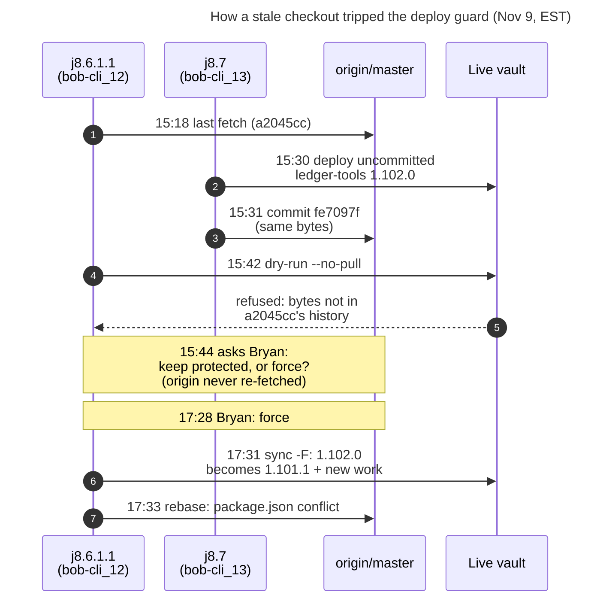
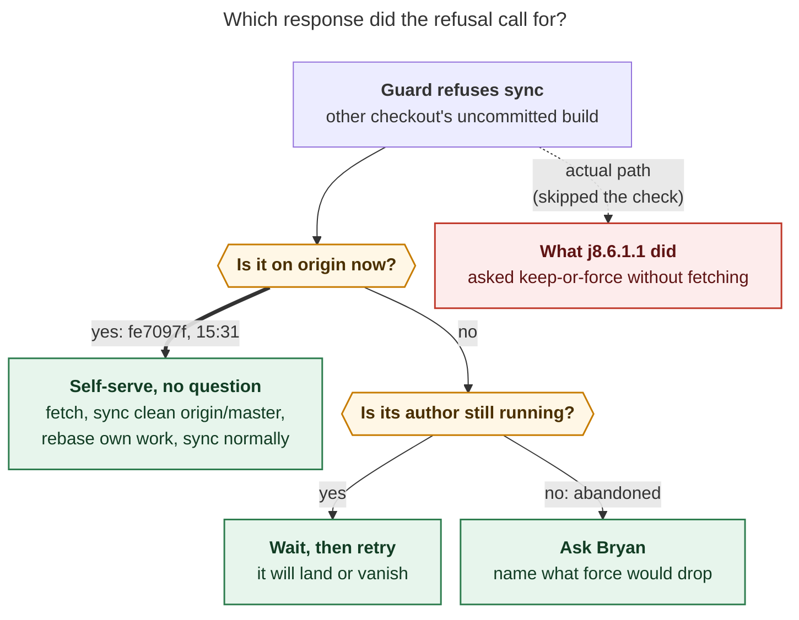

# Why `bob-cli-j8.6.1.1` Stopped to Ask About a Force-Sync, and Whether It Needed To

**Date:** 2026-11-09 (all times EST) · **Subject agent:** `bob-cli-j8.6.1.1--0` (codex/gpt-6-luna),
resumed as `--1` · **Bead:** `bob-cli-j8.6.1.1`, *Notebook report cache and debounced catalog sync*

## Short answer

| Question | Answer |
| --- | --- |
| **Why did it block?** | `bob plugins sync` refused to overwrite `bob-ledger-tools` because the vault held another checkout's **uncommitted** build. The agent wouldn't bypass a safety guard on its own, so it asked: *"Keep protected"* or *"Force this plugin"*? |
| **Was the question needed?** | **No.** The "uncommitted" build had been committed as `fe7097f` (by agent `bob-cli-j8.7`) **11 minutes before** the agent's dry run, with byte-identical bundles. The agent's checkout was last fetched at 15:18, and it synced with `--no-pull`. A `git fetch` would have shown this. The documented reconcile path then deploys **without `--force` and without asking you**. |
| **What did it cost?** | About **1 h 44 m** of idle time (15:44 → 17:28). Worse, the "Force" answer **rolled the live vault's `bob-ledger-tools` back from 1.102.0 to 1.101.1** (plus the new cache). That dropped j8.7's `api.notebooks` v1, which the deployed `bob-navigation-hotkeys` 2.77.0 needs for *Create notebook here*. This was still the case at 17:36. |
| **What did it get right?** | It refused to force a protected deploy on its own authority. The failures were in **investigation** (it never checked origin) and **framing** (it offered two options and left out the correct third one). |

## What happened

*Figure 1. Two agents shared one base commit (`a2045cc`). j8.7 deployed and then committed its work.
j8.6.1.1 never looked at origin again, so the guard's refusal read to it as an unresolved
conflict.*

The refusal (step 5) covered three plugins: `block-id-prompt`, `bob-ledger-tools`, and
`bob-navigation-hotkeys`. That is exactly the set j8.7 bumped in `fe7097f`. j8.6.1.1 only
needed `bob-ledger-tools`, so it asked about that one.

## The guard was right; the checkout was stale

The protected vault build and the committed `fe7097f` are the same bytes:

| Plugin `main.js` | Vault bytes before the force-sync | `fe7097f` committed bytes | Same? |
| --- | --- | --- | --- |
| `block-id-prompt` | `bc4dbedd…` (deploy stamp, 15:30:28) | `bc4dbedd…` | ✅ |
| `bob-navigation-hotkeys` | `130c7507…` (deploy stamp, 15:30:28) | `130c7507…` | ✅ |
| `bob-ledger-tools` | `bdb95940…` (force-sync backup, 17:31:17) | `bdb95940…` | ✅ |

For another checkout's dirty stamp, the guard allows a sync only when the incoming tree is clean
**and** some commit reachable from `HEAD` holds the stamped bundle byte for byte
(`find_inclusion_proof` in `src/native/plugins/deploy.rs`). j8.6.1.1's `HEAD` was still
`a2045cc` and its tree was dirty, so the guard had to refuse. Once `fe7097f` was in `HEAD`, the
documented path would have worked. From bob-plugins `docs/develop/deployment.md`:

> After an uncommitted fix is committed and present in a clean checkout of the same bytes, a
> real sync reconciles the stamp without `--force`; a later descendant can then update normally.

**Why the agent saw only two options:** the refusal text offers just two remedies, a dry-run
preview or `… -F` (`refuse_message`, `deploy.rs:1279`). It never says "pull first". The
question inherited that framing and called the build "uncommitted". The stamp said so, but the
claim had been stale since 15:31. The resumed `--1` agent didn't catch it either: its
`sase repo open` did not fast-forward the dirty checkout, so it force-synced from `a2045cc` too.

## Was the question needed?

*Figure 2. A question is warranted only on the bottom-right branch. Here the first check would
have answered "yes", so no human was needed. The right-hand branches are recommended policy, not
existing written rules.*

The self-serve path, run from the agent's bob-plugins checkout:

1. `git fetch && git log --oneline HEAD..origin/master -- plugins/bob-ledger-tools` shows `fe7097f` (j8.7).
2. `git stash -u && git rebase origin/master`, then `bob plugins sync --repo "$PWD" --no-pull -p bob-ledger-tools`.
   The vault bytes equal the clean tree, so this only rewrites the stamp to *clean @ fe7097f*.
3. `git stash pop`, then rebuild (the `package.json` conflict now being fixed belongs here). Then
   run a normal `bob plugins sync … -p bob-ledger-tools`. `fe7097f` is now an ancestor of `HEAD`, so the
   guard allows it, and the vault gets **both** changes.

## What the "Force" answer changed

| Vault `bob-ledger-tools` | Before (15:30 → 17:31) | After (17:31 → now) |
| --- | --- | --- |
| Version | **1.102.0** (`fe7097f`) | **1.101.1** + uncommitted notebook cache |
| `api.notebooks` v1 (j8.7) | present | **absent**: *Create notebook here* in nav 2.77.0 reports "Bob Ledger Tools is not running" |
| Deploy stamp | dirty @ bob-cli_13, bytes = `fe7097f` | dirty @ bob-cli_12 @ `a2045cc`, bytes in **no** commit |

The new stamp is a trap: no commit will ever hold these exact bytes. A later sync from any
other checkout will hit the same refusal and need `-F` again. The one exception is bob-cli_12
after its rebase, which the same-checkout ancestor rule allows. At 17:36 the `--1` agent had
closed the bead and was resolving the rebase conflict. Nothing showed a planned redeploy.

## Recommendations

1. **Repair the vault now.** Once j8.6.1.1's commit lands on top of `fe7097f`, redeploy
   `bob-ledger-tools` from that clean commit. `-F` is legitimate here, because the landed
   commit supersedes both builds. Then confirm the vault manifest is 1.102.0 or later and that
   *Create notebook here* works.
2. **Teach the guard the third remedy** (bob-cli `src/native/plugins/deploy.rs`). When refusing a
   dirty stamp from another checkout, say "if that work has landed, pull and sync from a clean
   checkout; no `-F` needed". Better still, look for a proving commit in the already-fetched
   `origin/*` refs and name it, for example "`fe7097f` on origin/master holds these bytes, so
   rebase onto it".
3. **Tighten agent guidance** (bob-plugins `AGENTS.md` / `docs/develop/deployment.md`). Before
   asking to force, run `git fetch` and check `HEAD..origin/master` for the plugin. Ask only
   when the build is unlanded and its author is gone. The question must name what the force
   would remove from the vault: here, ledger-tools 1.102.0 and its notebooks API.

---

**Sources:** chat transcripts `gh_bobs_org__bob_cli-ace_run-bob_cli_j8_6_1_1__0-261109_151627`
and `…__gate-20261109154459`; run artifacts `ace-run/202611/09/20261109151627` (tool call
`item_57`: dry-run refusal; `item_61`: question) and `…/20261109172827` (`item_17`: force-sync;
`item_23`: bead close); j8.7 run `…/20261109121216` (`commit_result.json`: `fe7097f`); vault
`.bob-deploy.json` stamps and the backup `plugin-backups/20261109-173117`; bob-plugins
`git log` / `git show fe7097f`; bob-cli `src/native/plugins/deploy.rs`.
