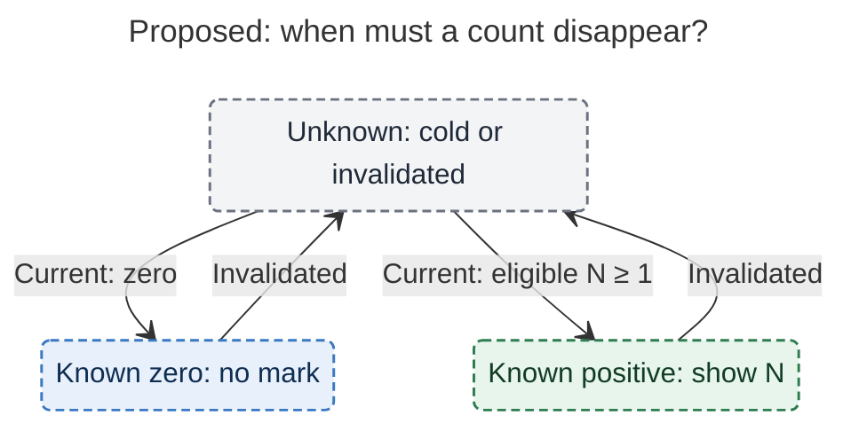

# Diagram proposals: Keep-moving marks on ledger Task Links

Proposals for the swarm linker, not a report. Each diagram restates only what the source
report says.

```yaml
source: research:202611/keep_moving_link_marks/keep_moving_link_marks__final.md
producer: research.44.image
check: "mmdc 12.0.0 with --no-sandbox and the PDF-mirroring config rendered 1 of 1 Mermaid diagrams"
```

## cache-count-lifecycle

```yaml
anchor: |-
  Never show a stale positive
question: |-
  When must a visible count disappear while fresh inputs are loading?
illustrates: |-
  Unknown and known-zero stay distinct internally while both render as nothing, and invalidation prevents stale positive numbers from remaining visible.
caption: After invalidation, hide the mark until current inputs support a new count; unknown and known zero remain distinct.
review: "538.531x370 px, fit 100.0%; reader question, labels, arrowheads, crossings, source trace and visual checks passed; 1 revision, 2 look rounds"
```


