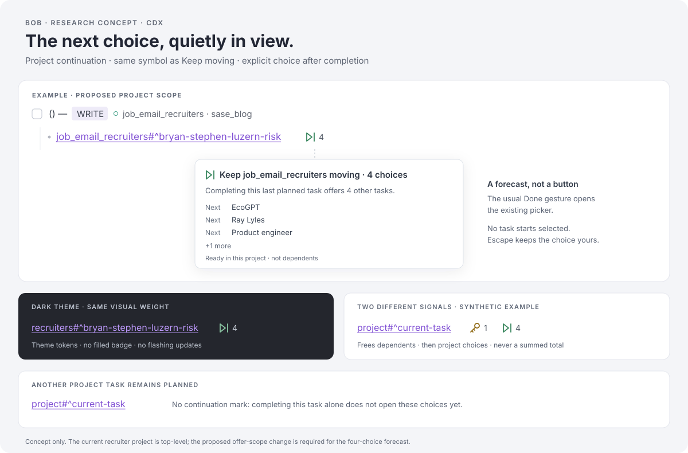

# Project continuation badges: a useful idea with one important scope correction

Independent research by **cdx**, 2026-11-11. No peer swarm reports, transcripts, summaries, or findings were consulted. This is a design recommendation; no product or vault files were changed.

**Recommendation:** add a small **⏭ 4** continuation mark next to the existing **🔑 n** mark. Make its count the selectable **Keep moving** choices for completing that task, and display it only when that completion would exhaust the project's currently planned work. To satisfy the supplied recruiter example, broaden continuation eligibility to recognized active project notes, including top-level projects. Keep Bob's existing “leaf project” definition unchanged for reporting.

The scope change matters: **the example has four eligible unplanned residents, but the current successor planner offers zero because this project is not a leaf under Bob's definition.** A badge-only implementation promising four offers would be incorrect.

## What I verified

I inspected the supplied screenshot, the relevant CLI and plugin implementation, the accepted successor contract and memory, and a repository checkout of the vault opened through `sase repo open`. The checkout is a synced snapshot, not the Mac's unsaved editor state. Its daily note already contains changes after the screenshot, but the recruiter project and its single live link still establish the requested example.

| Evidence | Finding |
| --- | --- |
| `job_email_recruiters.md` | `type: [[project]]`, `status: wip`, `parent: [[job]]`; one open, hidden `^prj`; five Next resident tasks. |
| `job.md` | `type: [[area]]`. Consequently the recruiter project is top-level and its own reporting root. |
| `2026/20261111.md`, open WRITE entry | One recruiter link: `[[job_email_recruiters#^bryan-stephen-luzern-risk]]`. |
| Four other residents | `^ecogpt`, `^ray-lyles`, `^product-engineer-dan-dowd`, `^senior-rust-java-engineer`. None has a live link in today's Pomodoros. |
| Existing leaf predicate | Returns **false** for the recruiter project. A project directly below an area is explicitly excluded by LP2/LP5. |
| Existing successor planner, simulated Done | **0** keep-moving offers with actual leafness; **4** when only the injected scope predicate is changed to admit this project. |

That last check used the existing JS harness and real checked-out note text, with the predecessor changed to Done **in memory**, `selection: []`, and the date pinned to 2026-11-11. The four resulting IDs exactly matched those above; the planner produced zero edits and zero placements. This isolates the scope gate without changing the vault or claiming an end-to-end production trial. The probe explicitly enabled keep-moving and used the relevant local task snapshot; the running Mac's configuration, plugin versions, and unsaved caches were not inspected.

I also ran the existing `test-ledger-tools-frees-marks.cjs` and `test-task-status-cycler-keep-moving.cjs` suites: **35 tests passed, 0 failed, 0 skipped**. This verifies the researched baseline, not the proposed feature.

Source snapshots: bob-cli `d0ada555a8b60c74933f9ce4eb3aa8c0469b0d64`; bob-plugins `66841b1cc1d973fc70671ff650b0f449d0ce8a10`; vault `e9ca2b81e31b7f0b9bf7bf273b24b86f4ad5e012`.

## Is the idea good?

Yes. The badge answers a practical question at the point of work: “If I finish this, is there another useful step in this project?” It can reduce trips into project notes and make the existing successor picker less surprising. The screenshot already establishes a compact trailing-count vocabulary, so this can feel like a small extension rather than another dashboard.

Three risks deserve explicit treatment:

1. **A backlog count can impersonate an offer forecast.** Four unplanned tasks do not imply that completing this task opens four choices: another task from the same project might remain planned, the project might be ineligible, or some residents might be hidden, blocked, or scheduled later.
2. **More choices can look like more obligations.** A red notification bubble, a persistent zero, or a badge on every repeated project link would turn optional continuation into pressure. The interface should say “choices,” keep selection empty, and preserve Esc.
3. **An attractive wrong number will lose trust quickly.** This feature depends on daily-note structure, task identity, project state, dependencies, settings, and cache timing. Most implementation effort belongs in that shared meaning, not in drawing the icon.

The existing key is also narrower than “the number of offers.” It counts last-blocker dependents from the BLOCKS model; it can include a project task and hidden dependents. Project recovery may then offer residents, while relation successors form another group. **Do not sum the key count and continuation count into a promised total.** [C1, C3]

## Requirements I would adjust

These are deliberate changes to the request, not descriptions of behavior already shipped.

| Request or ambiguity | Recommended contract | Why |
| --- | --- | --- |
| Only “leaf projects”; example must show 4 | Use **recognized active project notes**, including top-level and `root: true` projects, for both continuation offers and this mark. | The example is excluded by today's leaf definition. Continuation is useful by task residence regardless of how time rolls up. |
| A mark beside qualifying project links | Show it only where the ordinary managed Done action would yield a nonempty keep-moving group. | It then predicts a concrete choice rather than a dormant backlog. |
| No Task Links anywhere in today's file | Exclude tasks with **live planning links under today's open Pomodoros**. | A struck link, historical closed session, relation, or prose mention is not a current commitment. |
| Ready/Pending/Next count | Apply the actual offer eligibility rules, closure set, group precedence, and deduplication. | Checkbox state alone overcounts. Ready here means the lane, not the freshness-filtered READY dashboard bucket. |
| “How many tasks will appear in the successor offer” | Promise the **Keep moving group count**, not the entire picker. | Dependency, relation, recovered-project, and project-finished offers have separate meanings. |
| Missing mark | Means “no confirmed continuation mark,” not a claim that the project has no work. | Disabled, non-triggering, zero, and unknown states must stay distinct internally. |

**Do not rename or redefine Leaf Project globally.** It currently means a project that is not its own reporting root, and it can itself have child projects. Replacing that with “a node without children” would couple a small UI feature to reporting and hierarchy behavior. Keep `HomeResolver`, root chips, and time aggregation unchanged. Give this feature the narrower product name **Project continuation**. [C2]

Broadening project scope also makes valid orphan/root projects eligible if the ordinary project-recognition and safety rules admit them. It does not admit areas, daily notes, inboxes, archived notes, terminal projects, or malformed project surfaces. A `root: true` flag controls reporting, not a separate work-continuation preference. Existing project blocking still applies.

This is a real successor-behavior change and should be reviewed as such, alongside the badge. If broader scope is declined, the coherent fallback is to preserve the existing leaf-only planner **and omit the badge from this recruiter example**. I would not move the user's project or change `job` from an area simply to make an icon appear.

## The count and display rule

For a displayed link to task **T** in project note **N**, calculate a read-only preview of the normal managed Done gesture on T. Use the same completion closure **C** as that gesture, including any embedded subtasks it completes. Preserve the pre-gesture daily text for the last-planned test and use the projected post-gesture task states for offers.

Conceptually:

```text
preview = previewManagedDone(T, immutableSnapshot)
rows = preview.selectableOffers
              .where(group == keep_moving && project == N)
count = number of distinct offer identities in rows
show = currentDailyLiveTaskLink(T) && preview.known && count > 0
```

This is a contract sketch, not a proposal to run `bob capture --dry-run` for every visible row.

Retain the existing K1 and K3–K8 rules, changing only K2's project-scope restriction:

- N must be recognized, active, outside archives, and have the expected single open `^prj`.
- T must be a normal resident, with its own live planning link; the project's `^prj` does not get this mark.
- No other open N resident outside C may have a live link on the baseline. The `^prj` counts if linked. Child-project residents do not count as residents of N.
- The project's task must remain open and unblocked, without a future project schedule or inherited project block.
- Empty-project completion uses the existing project-finished path. Do not manufacture a continuation mark for it.
- Both `plan.link_unblocked` and `plan.keep_moving` must be enabled, and the supported completion UI must be available.
- Count only selectable Pending, Next, and Ready residents after blocking, scheduling, hiding, group priority, and identity deduplication. Preserve Pending → Next → Ready, then note-line ordering in the preview list.

Count candidates without dependency `[id::]` fields and candidates without block IDs. Existing offers can mint a block ID **after selection**; rendering never mints one. The current key mark requires an owner dependency ID, so copying its eligibility test is unsafe. Use its presentation and unique-link-resolution patterns, not its dependency-specific gate. [C1, C3]

Scheduled today qualifies; scheduled tomorrow does not. New and rotten Ready tasks remain eligible unless an existing offer rule excludes them. Reference tasks, eligible recurring occurrences, and nested residents follow the existing classifier. Use whole-token `#hide`, not a substring match. A hidden `^prj` alone does not hide all its residents; the example's root is hidden and should still allow the four choices under the broadened scope. [C2, C3]

**Identity and special cases:**

- Resolve to canonical note path plus block ID for linked tasks. An alias, extension difference, or short link must not create another task. Ambiguous resolution is unknown.
- Repeated live links to the same T are one task for the last-planned decision. Displaying the same mark at its repeated positions is acceptable; completing T must preview the same closure and retire its links through existing behavior.
- Scan the whole day's planning structure even when rendering only the viewport. Another link below the screen can suppress the mark.
- A task mentioned in LINKS, LINKED FROM, Depends-On, notes, or completed Pomodoros is not thereby planned today.
- A whole-session close can produce offers even when individual links have no mark because that gesture closes several tasks. The mark describes completing **this task**, not every possible multi-task gesture.
- Cancellation, parking, raw checkbox edits, and hooks do not acquire keep-moving behavior. They retain their existing contracts.
- A task offered through a higher-priority relation or dependency group must not be counted again in Keep moving. The authoritative group order is hand-off → relation → project → project-finished → keep-moving.

## Visual design



Durable concept-sheet snapshot: `file:explicit:1f361472de5b3a08909d3d0b`.

*Concept illustration, not a screenshot of an implemented plugin. The recruiter row assumes the recommended project-scope change. Preview placement and color values in the drawing are illustrative; production uses theme tokens.*

Use **Lucide `skip-forward` + an integer**, the same symbol already specified for Keep moving and used in its picker. The plain-text equivalent is **⏭ 4**. Its established meaning is more valuable than inventing a leaf, folder, sprout, or stacked-pages symbol. A leaf would reinforce the very hierarchy ambiguity this investigation found; a folder would suggest total contents. [C2, E1]

The appearance should borrow the key mark's proportions: approximately `0.8em` interface font, tabular digits, inline baseline alignment, about `0.4em` separation from the link, and a small gap between icon and numeral. Keep the icon/count together on wrapping. Order trailing marks as **link → 🔑 dependents → ⏭ continuation**, consistently in Live Preview and Reading view.

Use `var(--task-status-next, var(--color-green))` for the continuation glyph, matching the existing Keep moving palette, and a readable muted foreground for the number. No permanent filled capsule, border, red dot, or saturated count background. A subtle hover surface may match the key mark. Show exact positive counts; omit zero and do not cap the value at `9+` or `99+`. Do not animate the number on ordinary cache updates or initial paint. [C1, C2]

The screenshot already has purple links, coloured task types, progress glyphs, event chips, and root dots. A single small mark using an established color and shape fits that visual density. More lane chips and a second row of text belong in the preview, not in the ledger line.

Suggested accessible summary and hover/focus content for the example:

> Keep job_email_recruiters moving · 4 choices  
> Completing this last planned task offers 4 other tasks.  
> Next · EcoGPT  
> Next · Ray Lyles  
> Next · Product engineer  
> +1 more  
> Ready in this project · not dependents

The sentence must describe the supported managed completion gesture; the help text can name Ctrl+Enter in Obsidian. For one candidate, use singular copy. Show at most three cleaned task titles in the compact preview, with `+N more`; optionally show the existing blocked/scheduled/hidden fold counts beneath, omitting zero parts. The number excludes those folded rows.

Keep the mark informational. Hover or focus explains it; completing the task opens the existing selector with nothing preselected. Clicking the mark must not finish, link, stamp, or silently pick anything. In Live Preview, retain normal caret placement and modifier navigation. In Reading view, associate its text alternative and preview with the link's focus. In the editor, make equivalent information available through the existing task-details interaction when the line has keyboard focus; do not create a new Tab stop on every decoration. These keyboard paths need explicit acceptance testing rather than assuming an `aria-label` solves all access.

Use an accessible description such as “4 project continuation choices on completion”; hide the decorative SVG from assistive technology and avoid an `aria-live` stream on every cache refresh. A custom hover/focus preview must be dismissible, hoverable, and persistent enough to read; Escape should dismiss it. Meet 4.5:1 contrast for the small count text and 3:1 for a meaningful icon, including dark themes and forced colors. If a theme's Next color fails, use a higher-contrast text token for the icon. [E2–E4]

## Implementation approach

**Render in `bob-ledger-tools`; keep classification owned by successor planning.** The existing frees-mark core and mixin already provide CM6 widgets, Reading-view postprocessing, today's-note gating, unique task resolution, memo use, and invalidation patterns. Reuse those seams and establish stable ordering between the two marks. CodeMirror's supported decoration API is the right insertion mechanism; directly modifying editor DOM is not. [C1, E5]

**Add a narrow, versioned, read-only continuation-preview API to the cycler's planner boundary.** A proposed shape is:

```text
continuationPreview.version = 1
preview(snapshot, ownerIdentities) -> [
  { ownerKey, projectPath, state: ready | none | unknown,
    count, candidates, folded, snapshotRevision }
]
```

This API does not exist today. It should call the same pure classifier, completion-closure logic, and final group deduplication that the actual gesture uses. Ledger code consumes the result; it should not independently parse project semantics or invoke private exports from another plugin's generated `main.js`. Keep the preview free of writes, receipts, ID minting, notices, or selection.

The Rust engine must receive the same project-scope change. Share contract vectors across Rust and JS; they cannot literally share a JavaScript implementation. Existing CLI/Mac capture consumers already understand `keep_moving` rows, so investigate whether broadening eligibility can use the existing output shape unchanged. No new CLI endpoint or per-row subprocess is needed for the Obsidian decoration. Confirm Mac copy remains valid for top-level project names.

For cache behavior:

1. Reuse the Tasks generation and current daily editor snapshot. Parse all live day links once per relevant revision, grouping distinct task identities by residence. Only build widgets for visible candidates.
2. Fetch/parse each relevant project snapshot once and share it among repeated links. Reuse dependency information; never initiate a vault scan for each widget or on each keystroke. Prepare any asynchronous work outside the synchronous decoration builder.
3. Key cached answers by daily content revision, project/task revisions, dependency and relation generations, date, and relevant settings/capability revisions. A same-length candidate replacement must update preview text even when the count stays four.
4. Invalidate on link add/remove/strike or session open/close, task status or schedule changes, dependency/relation changes, project changes, rename/delete, metadata changes, config reload, plugin capability changes, and local midnight/resume. Today's active editor text must beat a stale disk daily note.
5. Discard out-of-order async results. Unknown, stale, cold, or ambiguous inputs produce no numerical promise. Remove an invalidated positive mark promptly instead of showing its last good value indefinitely. Keep `unknown` separate from known zero internally.

The frees-mark refresh hook directly watches daily-note metadata and receives broader task refreshes through shared infrastructure. Copying it verbatim would miss some project-only/config changes. Likewise, its dependency-ID gate and some “keep last good decoration” error handling are unsuitable for a forecast. [C1]

There is no need for a persistent vault field or a new task state. Use one coherent model for both rendering modes. Capability-detect the preview provider and picker; if the combination cannot offer what the mark promises, suppress the mark. The completion path must still revalidate current notes before applying picks: a preview is a snapshot, not a reservation.

## Acceptance checks that matter

| Scenario | Expected outcome |
| --- | --- |
| Supplied recruiter snapshot, current code | Leaf predicate false; no keep-moving group. Preserve this as evidence of the deliberate behavior change. |
| Same snapshot under recommended project scope | `⏭ 4`; preview and actual Keep moving group contain the same four IDs. |
| Another distinct recruiter resident is live-linked | No continuation mark on either task for a single-task completion. |
| Duplicate/aliased links to the same predecessor | One predecessor identity; no count inflation. |
| Other project link is outside the viewport | Still suppresses the single-task mark. |
| Candidate appears only in a closed session, struck link, relation, or prose | It remains eligible if the classifier otherwise permits it. |
| Project's `^prj` has a live link or project is blocked/future-scheduled | No mark. |
| Candidate hidden, blocked, scheduled tomorrow; scheduled today | First three excluded; today's eligible. |
| Ready candidate has no fresh stamp or is rotten | Follows the offer classifier, without adding freshness gates. |
| Candidate lacks dependency ID or block ID | Counted when eligible; preview writes nothing. |
| Target is `^prj`, project terminal, missing root, duplicate root, area, inbox, daily, archive | No mark. |
| Top-level, `root: true`, valid orphan, nested project | Consistent eligibility under the proposed continuation scope; reporting roots unchanged. |
| Nested child project has candidates | Parent count includes only residents of the parent's note. |
| Managed Done also closes embedded subtasks | Count excludes the entire actual closure set. |
| Candidate also qualifies for relation/hand-off group | Count it only in its final group. |
| All candidates are excluded or project becomes empty | No `⏭ 0`; existing project-finished behavior remains separate. |
| Capture/config disables keep-moving; provider missing | No mark and no misleading preview. |
| Cache update, rename, midnight, unsaved day edit, late async response | Prompt consistent refresh; stale results cannot overwrite fresh ones. |
| Same count with different titles | Preview changes despite unchanged numeral. |
| Live Preview, Reading, source mode, narrow pane, dark/forced colors | Same model in supported rendered views; raw Markdown unchanged; readable wrapping and access. |
| Selection/apply | Empty initial selection; Esc has existing semantics; stale picks revalidated. |

For behavioral parity, compare **candidate identity sets**, not merely counts, against a no-write plan of the real completion gesture on the same fixture. Add mixed relation/dependency cases so a local-project count cannot quietly diverge from final grouping. Measure rendering with many repeated links and several projects; set a performance budget from the existing editor baseline rather than claiming an unmeasured timing target.

## Alternatives and tradeoffs

| Approach | Assessment |
| --- | --- |
| Count unplanned residents on every project link | Simplest conceptual backlog meter, but does not forecast the next completion. If chosen, label it “other available tasks” and use conditional preview copy. |
| Current leaf-only continuation forecast | Safest behavior-preserving release, but the supplied example must have no badge. |
| Structural leaf rule: project has no child projects | Admits some top-level projects but silently changes the established meaning of leaf and suppresses useful resident work when a child exists. |
| Project-header count only | Less repetition, but a Pomodoro can mix projects and the information loses its association with the completing task. |
| One combined successor total | Potentially useful later, but the key is not a picker count; correct totals require wider recovery and relation forecasting and a different visual contract. |
| Filled/outlined “ready now / available later” badges | Preserves backlog visibility but introduces two states and a distinction that users must learn at tiny size. Too much for the first version. |
| Click-to-pull-in badge | Changes the task from information to a new planning gesture and duplicates an existing selector. Keep it out of the first release. |

## Evidence references

All repository paths below are relative to their named repository at the source snapshots above. No peer research artifacts were used.

- **C1 — Existing key and rendering:** bob-plugins `plugins/bob-ledger-tools/src/141b-frees-marks.js` (`freesMarkCount`, `freesMarkLinkedTask`, `freesMarkCandidateLinks`, tooltip/widget); `src/271b-plugin-frees-marks.js` (render, debounce, refresh, rollover); `src/170-plugin-lifecycle.js` (Tasks cache generation); `styles.css:2737` (key proportions). These are source fragments, not files to edit in the vault.
- **C2 — Product contract:** bob-cli `docs/task-dependencies.md:2663` (§12.15 K1–K8, eligibility and copy), `:2999` (§12.16 KM vectors), `:3044` (§12.17 LP vectors); `docs/pomodoro-homes.md:49` (R2). Audited memory reads: `glossary:leaf-project`, `glossary:task-link`, `glossary:successor-offer`, `glossary:task-successor`, `decisions:unblocked-tasks-are-offered`, `decisions:task-lanes-are-sticky`, and project-blocking decisions.
- **C3 — Implementations:** bob-plugins `plugins/task-status-cycler/src/089c-successor-keep-moving.js:80` (leaf predicate), `:227` (planner); `src/137a-successor-offer-close-integration.js` (current-note revalidation); bob-cli `src/native/task_complete/keep_moving.rs:227` (Rust leaf recognition), `:388` (resident classification). Group precedence is in `docs/task-dependencies.md` §12.2 and §12.15.
- **C4 — Existing tests:** bob-plugins `scripts/test-task-status-cycler-keep-moving.cjs` and `scripts/test-ledger-tools-frees-marks.cjs`; Rust `src/native/task_complete/tests/keep_moving_tests.rs` was identified as the corresponding test home, but its suite was not run in this research.
- **C5 — Example:** supplied `~/tmp/screenshots/20261111_063929.png`; vault snapshot `job_email_recruiters.md`, `job.md` frontmatter, `2026/20261111.md`. The report intentionally records candidate IDs rather than reproducing private email bodies.
- **E1 — Existing icon:** [Lucide skip-forward](https://lucide.dev/icons/skip-forward). The icon choice is independently corroborated by the already-shipped local Keep moving visual contract.
- **E2 — Tooltip behavior:** [W3C: Content on Hover or Focus](https://www.w3.org/WAI/WCAG22/Understanding/content-on-hover-or-focus.html).
- **E3 — Numeral legibility:** [W3C: Contrast (Minimum)](https://www.w3.org/WAI/WCAG22/Understanding/contrast-minimum.html).
- **E4 — Meaningful icon contrast:** [W3C: Non-text Contrast](https://www.w3.org/WAI/WCAG22/Understanding/non-text-contrast.html).
- **E5 — Editor integration:** [CodeMirror decoration example](https://codemirror.net/examples/decoration/), documenting widget decorations, viewport-aware rendering, and equality-based DOM reuse.

## Recommended solution

Build **Project continuation** as a quiet, positive-only **⏭ count** beside eligible Task Links, using the existing Keep moving icon, palette, and picker. Display it when completing that task would offer the counted resident choices; compute it from the same read-only planning logic that produces those choices. Preserve the key as a separate dependency signal.

Ship the deliberate scope correction with it: recognized active projects at any depth may offer their own remaining residents, while reporting leafness stays untouched. That makes the supplied recruiter example honestly show **⏭ 4**, preserves explicit selection, and avoids teaching the user that a badge can promise an offer the application will never present.
