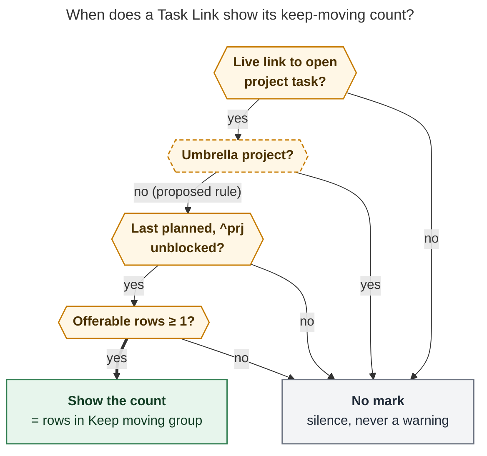

# Keep-moving marks on ledger Task Links: show `⏭ N` where a close will really offer N

*Lead researcher's consolidated report · 2026-11-11. Merges five independent reports
(cdx, cld, grk, mus, gem) with my own checks of bob-cli `b6f3b92c`, bob-plugins
`66841b1c`, and the vault at `d5d358c4`. Nothing in the vault or either code repo was
changed.*

## Bottom line

1. **Build it.** A quiet `⏭ N` after a ledger Task Link, the sibling of the shipped
   `🔑 N` frees mark, answers a real question before Ctrl+Enter: *will finishing this
   pull more of this project into my day, and how much?* `docs/frees-marks.md` already
   reserves the slot. It lists keep-moving offers (⏭, §12.15) under "deliberately not
   counted".
2. **Your example cannot show `4` today without a rule change.** `job_email_recruiters`
   has `parent: [[job]]`, and `job` is an area. That makes it a *top-level* project.
   Under Bob's current "leaf project" rule it is a root, never a leaf. Two researchers
   dry-ran the close on scratch vault copies, and it offers **nothing**. A badge reading
   `4` there would promise a picker that never opens. Four of five reports found this
   independently. gem assumed the opposite and is wrong on this point.
3. **The strict rule would also make the mark invisible everywhere.** My census of the
   vault matches cld's: all **34** current leaf projects hold **0** offerable tasks
   (242 residents, all Blocked). Every offerable project task today lives in a root
   project.
4. **Recommended rule change:** keep-moving should skip only **umbrella projects**.
   These are root projects whose `^prj` carries a `🧩 Sub-projects:` line. Every other
   project counts as a leaf. This is the minimal change that serves your example and
   keeps the original reason for excluding roots ("broad containers… a prompt there
   would be noise"). `bob`, `sase`, `sase_blog`, and `job_2026` stay excluded.
   `job_email_recruiters` qualifies, and so do the other standalone projects.
5. **The number must equal what the picker will show, so three requirements change.**
   The mark appears only on the project's **last planned** link (rule K4). It counts the
   **Keep moving group**, not "tasks without a link in today's file". It uses the
   picker's own skip-forward glyph, drawn as a themed mask rather than an emoji.
6. **There is a bug to fix first.** The Obsidian cycler's leaf check counts Bob's
   generated tag pages (`_generated/tag_pages/topic/sase.md`) as a second `sase` note.
   It therefore decides that every direct sub-project of `sase` is not a leaf. Rust
   ignores `_generated/` and disagrees. A badge ported from the cycler would inherit
   the bug.

With the recommendation applied, today's ledger shows exactly one new mark: `⏭ 4` on
`job_email_recruiters#^bryan-stephen-luzern-risk`. Ctrl+Enter then opens
`Keep job_email_recruiters moving` with those same four rows, nothing preselected.

## What was verified

| Claim | Evidence | Who |
| --- | --- | --- |
| The example is a top-level project, not a leaf | `job_email_recruiters.md` has `parent: "[[job]]"`, and `job.md` has `type: "[[area]]"`. Rust `is_leaf_project` and JS `successorLeafProject` both return false | cdx, cld, grk, mus; re-read by me |
| Closing it today offers nothing | `bob capture --dry-run -f json '!job_email_recruiters:bryan-stephen-luzern-risk'` on a scratch copy gives `"keep_moving":[]` | cld, mus (dry runs); cdx (JS planner simulation) |
| With leaf scope it offers exactly 4 | Reparented under `job_2026`, the dry run returns `keep_moving` with 4 rows: `ecogpt`, `ray-lyles`, `product-engineer-dan-dowd`, `senior-rust-java-engineer`. With only the injected leaf predicate widened, the JS planner returns the same 4 | cld, cdx |
| Strict leaves are all blocked today | 34 leaf projects, 0 offerable residents, 242 Blocked. 7 top-level projects plus 1 `root: true` | cld; reproduced by my census script |
| Umbrella split of root projects | Umbrellas (`🧩 Sub-projects:` line present): `sase` (3 offerable), `bob` (11), `sase_blog` (1), `job_2026` (0). Non-umbrella roots: `job_email_recruiters` (5 incl. X), `dev_plex_hack_patch`, `gkeep_gdocs_inbox_dump`, `needs_attn_tasks` (0 each) | cld, grk; reproduced by me |
| Why roots were excluded originally | Plan `202611/leaf_project_keep_moving_offers.md`: *"Roots are broad containers whose daily links routinely run out, so a prompt there would be noise."* Bryan defined leaf there as "project notes that are not root parents" | me |
| The `_generated/` collision bug | `successorKeepMovingResolveParent` treats a stem as ambiguous when `vault.getMarkdownFiles()` holds two files with that stem. A probe through the cycler test harness returned `leaf(sase_pager) = true` without the tag page and `false` with `_generated/tag_pages/topic/sase.md`. That tag page has been in git since 2026-05-30. Rust excludes `_generated` (`src/native.rs`), and so does the cycler's own `084-project-parent.js` | me |
| Widget order | 🔓 `side: 1`, 🔑 `side: 2`, off-clock chip `side: 3` (`271b`, `271c`) | cld, grk, mus; confirmed by me. gem's side table is wrong |
| Next colour | `task-statuses.css` sets `--task-status-next: var(--color-green, #3f8f5f)`. gem's "blue" is wrong | me |
| Mask-glyph precedent | `styles.css` already ships `--bob-task-link-glyph-*` and `--bob-off-clock-icon` masks | cld, grk; confirmed by me |
| The 🔑 rule needs X's `[id::]`, keep-moving does not | `freesMarkCount` returns null without an owner id. The §12.15 trigger has no such gate | cdx; confirmed by me. mus copied the gate in error |
| Relation successors outrank keep-moving | §12.18: dedup `hand_off > relation > project > project_finished > keep_moving`. Bryan's config enables `starts after` | cdx; confirmed by me |
| Kill switches default on | No `plan.keep_moving` or `plan.link_unblocked` keys in `~/.config/bob/config.yml` (apollo), so both default to true | me |

The feature already has a home task: `bob.md` `^leaf-task-link-icon` (Pending), "Make it
clear how many tasks succeed a task link corresponding w/ leaf project!"

## Is this a good idea?

**Yes, as a forecast of a picker that will actually open. No, as a generic backlog
counter.**

Why it earns ledger space:

- **It makes an interruption predictable.** Keep-moving is a modal that appears mid-flow.
  Seeing `⏭ 4` first turns the modal into a choice you expected.
- **Its presence carries information.** It says "this is the last thing keeping this
  project on today's plan", and the number says how much is behind it. That rewards a
  healthy baton pattern: plan one task per project, and let the close pull the next.
- **It completes a set.** 🔓 says something freed this task. 🔑 says closing it frees
  dependents. ⏭ says closing it keeps its project moving. Each matches a picker group.

Risks, and how the design answers each:

| Risk | Answer |
| --- | --- |
| **A wrong number destroys trust in every mark.** `4` with no picker teaches you to ignore 🔑 too | Define N by parity with the planner. Show the mark only when the group would open. Any doubt means silence |
| **A count reads as an obligation** | No red, no filled badge, no zero. Nothing is preselected and Esc still writes nothing (`decisions:unblocked-tasks-are-offered`) |
| **Ledger crowding.** Rows already carry ◐, 🔓, 🔑, off chips, and mail pills | Rare by construction: at most one link per project, count ≥ 1, same quiet pill grammar, session toggle |
| **A fourth implementation of the K-rules** (Rust, cycler, now ledger-tools) | Shared vectors plus a cross-plugin parity test. The `_generated/` bug shows the engines have already drifted once |

**Would I take a different approach?** I considered the alternatives in the table near
the end. None beats a per-link mark, because the decision happens at the link: which
task to close next. One reframe matters. If what you want while planning is *backlog
depth* ("how many unplanned tasks does this project still have?"), that is a different
question. The project note's Tasks header already answers it (`🔵 5 next/wip`). Don't
make the ledger mark answer both.

## Requirement changes (deliberate, called out)

| # | You asked | I recommend | Why |
| --- | --- | --- | --- |
| **A1** | Show only for tasks in "leaf projects" | Amend the leaf rule so only **umbrella** roots are excluded (next section). Fallback: reparent `job_email_recruiters` under `job_2026` | Under today's rule your example is not a leaf, its close offers nothing, and no leaf in the vault has offerable work |
| **A2** | Count Ready/Pending/Next tasks with no Task Link in today's file | **N = the rows of the `Keep ‹N› moving` group that completing this task alone would open now** | That is your stated purpose. Struck links and links under closed Pomodoros don't count as planned, so those tasks **are** offered. Blocked, later-scheduled, and `#hide` tasks are folded out. Dependents and `starts after` successors land in other groups |
| **A3** | Show on links into leaf projects | Show only on the link whose close would open the group: **no other open task of that project, nor its `^prj`, is live-linked today** (K4). Neither of two planned siblings shows the mark. When one closes, the survivor gains it with one tick (the "baton pass") | Under K4, closing the first of two planned siblings opens no picker, so a number there would be false |
| **A4** | "A similar icon" | The **skip-forward** silhouette the picker already uses, drawn as a CSS mask in the Next token, inside 🔑's pill metrics | One glyph per concept, so the mark looks like the group it predicts. The ⏭ emoji renders inconsistently. On macOS it often appears as a blue emoji tile and can't take theme colour |
| **A5** | (implicit) The mark predicts the picker | **Truthful or neutral:** a shown mark is a promise, but no mark is not a guarantee | Example: one `x` that closes a Pomodoro holding two sibling links still opens a group, though neither link was marked |
| **A6** | (implicit) | Honour `plan.keep_moving` and `plan.link_unblocked`, plus a session toggle | The mark must never forecast a group that config has disabled |

## Which projects should keep moving (the A1 decision)



*Figure carried over from grk (Mermaid CLI 12.0.0, 457 × 840 px; "work-leaf" is
grk's name for what this report calls the umbrella rule). Reporting leaves such as
`sase_pager` already keep moving. One exception: the Obsidian cycler currently misses
`sase_pager` because of the `_generated/` bug. The proposed change adds root projects
with no sub-projects and still leaves parent roots like `bob` and `sase` silent.*

| Option | Example shows `⏭ 4`? | Behaviour change | Verdict |
| --- | --- | --- | --- |
| **S. Strict leaf (as shipped)** | No, and no picker | none | Mark renders nowhere today. Every project promoted from an area task (always top-level) is excluded forever |
| **R. Reparent `job_email_recruiters` → `job_2026`** (mus) | Yes (dry-run verified: 4) | none in code; time rolls up to `job_2026` | Good zero-code stopgap. Doesn't fix the structural trap |
| **U. Exclude only umbrellas** (cld; grk's "work-leaf" is equivalent today) | Yes | 4 standalone roots gain keep-moving; `bob`, `sase`, `sase_blog`, `job_2026` stay out | **Recommended** |
| **D. Every project** (cdx) | Yes | `bob` (11 rows) and `sase` (3) would offer whenever their last planned link closes | Reopens the noise concern Bryan already ruled out. Reject |
| **T. Pure tree leaf: no sub-projects at any depth** | Yes | Also *removes* keep-moving from middle projects that have children (LP9: `sase_post_blog`, `sase_art`, `sase_memory`) | Most literal reading of "leaf", but it takes away working behaviour. Not now |

**Proposed definition** (a new decision record that partly supersedes the §12.15 leaf
vocabulary and `glossary:leaf-project`):

```text
UMBRELLA(N)  ⇔  R2root(N) = N  ∧  N's open ^prj carries a "🧩 Sub-projects:" line
                listing ≥ 1 child (open or struck ✅)
LEAF(N)      ⇔  N is a recognised project note  ∧  ¬UMBRELLA(N)
```

Design choices inside U, with my resolutions:

- **Source of truth: the marker line, not child frontmatter.** `bob projects sync`
  maintains it. §12.10 close gestures already read sub-projects "from the marker line
  rather than child notes' `parent:`". Both close engines already hold N's text, so the
  check costs no I/O there. grk's alternative, inverting child `parent:` fields, agrees
  today but needs a vault-wide frontmatter scan in Rust.
- **Struck children still count (my change from cld's LP15).** `bob` lists two open and
  four ✅ children. Under an open-children-only rule, `bob` would become a leaf once
  `bob_git` and `bob_easy_task_moves` close, and closing its last planned link would
  offer about 11 rows. A project that has ever split out children is a container in
  exactly the sense the original decision excluded. This is a judgment call; see open
  question 2.
- **Cheaper evaluation order.** A note with no marker line is a leaf **without any
  parent walk**. The R2 walk is needed only when the line exists, to tell a middle
  project (still a leaf, LP9) from a root umbrella. Today's LP1, LP4, and LP7–LP12 keep
  their answers. LP2 and LP3 still say "no" (`sase` and `sase_blog` have the line). LP6
  (orphan) becomes "leaf unless it has sub-projects".
- **Name.** Leafness has exactly one consumer, keep-moving (stats code uses "leaf" only
  in comments). I would therefore **redefine "Leaf Project"** rather than coin a parallel
  term. The new reading is "a project that is not an umbrella". That makes your own
  usage ("Split out job email tasks into a leaf project!") true. The glossary sentence
  "leaf names the reporting role" changes with it. Route the strand edit through
  `/sase_memory_write`.

`root: true` stops deciding offer behaviour on its own. The original keep-moving plan
listed that coupling as a cost. A `root: true` project with no sub-projects becomes a
leaf. A `root: true` project with sub-projects (`sase_blog`) stays an umbrella.

## When the mark shows



*Every gate must pass. Any failure leaves the link bare and never shows a warning. The
dashed gate is the proposed umbrella rule; today it reads "not a leaf". Rendered:
`keep_moving_link_marks__final_assets/mark_gates.svg`, 640 × 762 px, fit 100%,
Mermaid CLI 12.0.0.*

### Gates (each mirrors a §12.15 trigger rule on the pre-close state)

```text
X  = the open task this live link resolves to (🔑's unique-target resolution;
     no [id::] requirement)
N  = X's note        R = N's open ^prj
C  = {X} ∪ embedded subtasks the managed Done of X would close with it

G0  toggle on; plan.link_unblocked ∧ plan.keep_moving; Tasks memo and N's text warm  (K8)
G1  link passes 🔑's FL gates: today's canonical daily note, unstruck dedicated
    Task Link row under an open Pomodoro (incl. () placeholders); not prose,
    nested, fenced, embedded, Events, or a closed entry
G2  N is a recognised active project: outside done/, non-terminal, exactly one
    open ^prj, no scan issue                                                       (K1)
G3  LEAF(N) under the amended rule                                                 (K2)
G4  X ≠ R                                                                          (K3)
G5  every live link today that targets an OPEN task of N (R included) targets
    a task in C; links to closed tasks and to N's sub-projects don't count         (K4)
G6  R is not Blocked: status ≠ ?, no own open prerequisite, no future project
    schedule, no #prj_is_blocked                                                   (K5)
```

K6 (the close empties N) and K7 (a project group already claims N) fall out on their
own. In both cases OFFER is empty, and the picker shows a `project_finished` pull-in or
a project group instead.

## The count

```text
RESIDENTS = open task lines of N (Tasks memo, plus #ref lines without #task read
            from N's text, as the cycler does), excluding R and C;
            residents of N's sub-projects never count
OFFER     = { t ∈ RESIDENTS :
              status ∈ {' ' Ready, '*' Next, '/' Pending}
              ∧ no own open prerequisite     (X is still open, so X's dependents
                                              are excluded here; they are 🔑's)
              ∧ no #prj_is_blocked
              ∧ not scheduled after today
              ∧ no whole-token #hide
              ∧ not a `starts after` successor of X (the relation group owns it) }
FOLDED    = blocked / scheduled-later / hidden counts         (tooltip only)
mark      ⇔ G0–G6 ∧ |OFFER| ≥ 1;   label = |OFFER|
```

Clarifications:

| Case | Counted? | Why |
| --- | --- | --- |
| Ready, Next, or Pending resident with no live link | yes | the offer set (KM1) |
| Resident linked only by a struck link or under a closed Pomodoro | **yes** | not "planned" (KM3/KM4). The literal request would undercount these |
| Resident scheduled today, `#ref`, nested subtask, recurring occurrence due today | yes | KM17/KM18 |
| `[?]`, own open prerequisite, `#prj_is_blocked` | no; folded `blocked` | KM17 |
| Resident whose `[dependsOn::]` can't be proven closed | no; folded `blocked` | KM31: prefer undercount to a false promise |
| Resident that depends only on X | no | Blocked before the close. After it, the picker lists it under Hand-offs, which 🔑 already counts (KM15). No double counting |
| Resident with a `starts after` relation to X | no | moves to the relation group (§12.18 dedup) |
| `^prj`, a sub-project's tasks, custom marks | no | never offered |

**Parity invariant (the reliability backbone).** On every fixture, the mark's N equals
three things:

- the selectable `keep_moving` rows from `planSuccessorKeepMoving({ closed: C, … })`
  on the same day text;
- the length of `task_complete.keep_moving` from
  `bob capture --dry-run -f json '!N:x'` on the same vault;
- zero exactly when the mark is absent.

Compare **identity sets**, not just counts, so a same-size swap of titles still fails.

## Visual design

### What you see

```text
- [ ] () — WRITE   ○ job_email_recruiters · sase_blog
	- job_email_recruiters#^bryan-stephen-luzern-risk  ⏭ 4
	- ◐ sase_blog#^s0-spike  🔑 4
```

A link with every mark reads, left to right, as past → dependents → project → clock:

```text
	- ◐ bob_git#^wire-hooks 🔓 🔑 1 ⏭ 3 ⦸ off
```

The baton pass: with two recruiter links planned, neither is marked. Close one (no
picker opens), and the survivor pops in once:

```text
	- ~~job_email_recruiters#^ecogpt~~
	- job_email_recruiters#^ray-lyles  ⏭ 3        ← one 180 ms tick
```

### Anatomy

- **Host:** `span.bob-keep-moving-mark[role=img][aria-label][data-tooltip-position=top][data-count][data-project]`.
  It contains a glyph span and a tabular count. It is listener-free, so it survives
  Reading-view re-renders the way 🔑 does.
- **Glyph:** a *filled* skip-forward silhouette (triangle plus bar, the shape of the
  Mac's `forward.end.fill`) on a 16 × 16 CSS mask. At about 11 px a filled shape reads
  more cleanly than Lucide's 2 px stroke outline. It still matches the picker header's
  `skip-forward` icon at a glance. It is tinted with the **Next status token** (green in
  your theme).
- **Count:** `--text-muted` at rest, as with 🔑. The rule is that the glyph carries the
  colour and the number stays quiet. There is no border and no filled capsule at rest.
- **Metrics:** identical to `.bob-frees-mark`, so the two pills sit as twins: `0.8em`
  interface font, tabular numerals, `gap 0.22em`, `margin-inline-start 0.4em`, radius
  `999px`, no line-height change.

```css
body {
  --bob-keep-moving-glyph: url("data:image/svg+xml,%3Csvg xmlns='http://www.w3.org/2000/svg' viewBox='0 0 16 16'%3E%3Cpath d='M3.5 2.75 11 8l-7.5 5.25z'/%3E%3Crect x='11.75' y='2.75' width='1.9' height='10.5' rx='.6'/%3E%3C/svg%3E");
}
.bob-keep-moving-mark {               /* same box model as .bob-frees-mark */
  --bob-keep-moving-ink: var(--task-status-next, var(--color-green));
  display: inline-flex; align-items: baseline; gap: 0.22em;
  margin-inline-start: 0.4em; padding: 0 0.42em; border-radius: 999px;
  font-family: var(--font-interface); font-size: 0.8em;
  font-variant-numeric: tabular-nums; line-height: 1; white-space: nowrap;
  vertical-align: baseline; color: var(--text-muted);
  user-select: none; cursor: default; print-color-adjust: exact;
  transition: background-color 120ms ease, color 120ms ease;
}
.bob-keep-moving-mark-glyph {
  inline-size: 0.95em; block-size: 0.95em; align-self: center;
  background-color: var(--bob-keep-moving-ink);
  -webkit-mask: var(--bob-keep-moving-glyph) center / contain no-repeat;
          mask: var(--bob-keep-moving-glyph) center / contain no-repeat;
}
.bob-keep-moving-mark:hover {
  color: var(--text-normal);
  background-color: color-mix(in srgb, var(--bob-keep-moving-ink) 12%, transparent);
}
/* tick keyframes, prefers-reduced-motion, and forced-colors (glyph and text →
   CanvasText) copy the 🔑 block verbatim */
body:not(.bob-keep-moving-marks) .bob-keep-moving-mark { display: none; }
```

### Placement

- **Live Preview:** a zero-width `Decoration.widget` at the link end with **`side: 3`**.
  Move the off-clock chip from `side: 3` to `side: 4`, a one-constant change pinned by
  a placement vector. Sharing `side: 2` with 🔑 (gem) would leave the order to depend on
  extension precedence across two separate view plugins.
- **Reading view:** insert after `span.bob-frees-mark` if present, else after
  `span.bob-unblocked-glyph`, else after the link (or its sole `del`/`s` wrapper).
  Insert before any off-clock chip.
- **Cursor:** the raw `[[…]]` still reveals on the caret row. The widget covers no
  source text.

### Tooltip (`aria-label`, the §12.15 copy, never contains `::`)

```text
Closing this offers 4 to keep job_email_recruiters moving
It's the last job_email_recruiters task planned today
• ✉️ Founding Engineer at EcoGPT · Roej Hollon-Cal… · Next
• ✉️ 🔥 Bryan — your Python/release tooling made m… · Next
• ✉️ Product Engineer · Dan Dowd · Next
+1 more
ready in job_email_recruiters · not dependents
not offered  2 blocked · 1 scheduled later · 1 hidden      ← only non-zero parts
```

- Rows follow the picker's order: Pending → Next → Ready, then line in N.
- Titles are cleaned with `dependencyCleanTaskText` and cut to 47 characters plus `…`.
  Each row ends with the lane name, never a raw status symbol.
- Use singular copy for one row.
- Never use 🔓 or the word "unblocked". Keep-moving copy always says "not dependents".

### Interaction, motion, toggle

- **Click** places the caret and never writes. This matches ◐, 🔓, and 🔑.
- **Mod+click** opens the project note N in a new tab. 🔑 opens X because BLOCKS lives
  on X. The rows ⏭ counts live on N, so N is the useful target.
- There is no tab stop and no live region. In Reading view the description rides the
  link's focus.
- **Motion:** a per-view LRU keyed by X (`path\0blockId → last N`, with "no mark"
  stored as 0). A change to a new N ≥ 1 ticks once for 180 ms, which is the baton
  pass. There is no tick on first paint, scroll, or in Reading view, and none under
  reduced motion.
- **Toggle:** `toggle-keep-moving-marks` ("Toggle Task Link keep-moving marks"). It is
  a session toggle, default on, using `applyMarkGateClass` plus popout sync. There is
  no API namespace in v1.
- Show exact counts. There is no `9+` cap and never a `⏭ 0`.

## Implementation

### Architecture decision: port the classifier into ledger-tools and prove parity, don't call the cycler at render

cdx proposed a versioned read-only preview API exported by the cycler. The idea is
sound, but it is the wrong fit for v1:

- Render must be synchronous and disk-free, while the planner wants N's raw text, the
  dependency index, and day text.
- Today the dependency runs cycler → ledger-tools only. The reverse direction would be
  new coupling.
- `🔑` set the precedent: port the rule (BLOCKS), pin it with shared vectors, and test
  parity.

I adopt cld's version of that precedent with one addition from my reading of the
cycler. **ledger-tools needs N's text, not just the Tasks memo.** The text supplies the
`🧩 Sub-projects:` line and any `#ref` residents without `#task`, and neither is in the
memo. Keep a small async **project-text cache** for the notes behind today's live
links:

- fill it with `vault.cachedRead` outside rendering;
- key it by path and mtime;
- invalidate it on `modify`, `rename`, or `delete`;
- treat a cold entry as "no mark yet".

If parity drift becomes a recurring cost, revisit cdx's API, gated by capability
detection.

### Phases

| Phase | Repo | Work |
| --- | --- | --- |
| **0. Decide** | Bryan | A1 (U, or reparent only), plus the open questions below |
| **1. Contract** | bob-cli | New decision record (e.g. `decisions:keep-moving-skips-only-umbrellas`). §12.15 K2 and the LP vectors: add LP13 standalone top-level → leaf, LP14 `root: true` without sub-projects → leaf, LP15 root whose line lists only ✅ children → still umbrella, LP16 parent stem colliding with a `_generated/` page → resolves. `docs/projects.md` and `docs/pomodoro-homes.md` leaf sentences. Glossary strand via `/sase_memory_write`. New display contract `docs/keep-moving-marks.md`, cloned from `frees-marks.md` with KB vectors and the parity invariant. Point the frees-marks "not counted" line at it. Update `docs/off-clock-link-chips.md` (side 4) |
| **2. Engines** | bob-cli + bob-plugins | Rust `is_leaf_project`: umbrella check on N's held contents (zero I/O) plus tests. Cycler `successorLeafProject`: the same check using the planner's `noteTexts`, **and fix the `_generated/` ambiguity** by reusing `PROJECT_PARENT_EXCLUDED_DIRECTORIES`. Capture JSON stays additive (more groups fire), so no `!`. No `Cargo.toml` or `CHANGELOG.md` edits (daily release train) |
| **3. Mark** | bob-plugins `bob-ledger-tools` | `src/141d-keep-moving-marks.js` (pure gates, OFFER, tooltip, DOM builder; `141d` is free). `src/271d-plugin-keep-moving-marks.js` (Live Preview, Reading, refresh, toggle, project-text cache). CSS after the 🔑 block. `scripts/test-ledger-tools-keep-moving-marks.cjs`, plus **`scripts/test-keep-moving-marks-parity.cjs`**, which loads both plugins' helpers and asserts identity-set parity on every fixture. Real-Obsidian e2e in light/dark × Live Preview/Reading: N = 4 WRITE row, 🔓 🔑 ⏭ off order, baton tick, row height unchanged by the toggle. Then `npm run build` and `bob plugins sync` |
| **4. Audit** | scratch vault | For every rendered mark, compare against `bob capture --dry-run -f json '!N:x'` identity sets |

### Liveness and performance

- **Refresh triggers**, one coalesced refresh of about 120 ms:
  - Tasks `cache-update`;
  - `metadataCache` changes on today's daily note;
  - modify, rename, or delete of any cached project note;
  - config reload (`plan.*`);
  - local midnight and resume;
  - the toggle.
- **Per build:**
  - parse the live-link set once from the whole day, not just the viewport, because a
    link below the fold can suppress the mark;
  - group links by N, and evaluate G2–G6 plus OFFER once per N;
  - build widgets only for visible ranges.
- **Budget:** hold 🔑's ≤ 25 ms build budget (200 links, 2,000 tasks), with a synthetic
  50-link and 3,000-task ledger added.
- **Async results:** discard out-of-order async results. Never show a stale positive
  number after invalidation. Unknown and known-zero stay distinct internally, and both
  render as nothing.

### Conformance vectors (minimum set)

| # | Situation | Mark |
| --- | --- | --- |
| KB1 | Only live N link; residents Pending P, Next B, Ready A | `⏭ 3`; rows P, B, A |
| KB2 | Another open N task U is live-linked | none on X or U. After U closes, X ticks in |
| KB3 | U is linked only struck or under a closed entry | counted |
| KB4 | `^prj` R is live-linked today | none |
| KB5 | N is an umbrella (`bob`, `sase`, `sase_blog`) | none |
| KB6 | N is a standalone top-level project (`job_email_recruiters`) | `⏭ 4` (the screenshot) |
| KB7 | All other residents Blocked, later-scheduled, or `#hide` | none |
| KB8 | X is N's last open task | none (project_finished owns the close) |
| KB9 | Resident depends only on X | not in ⏭ (it's in 🔑) |
| KB10 | Resident `starts after` X | not in ⏭ |
| KB11 | R blocked, future-dated, or `#prj_is_blocked` | none |
| KB12 | `plan.keep_moving: false`, `plan.link_unblocked: false`, toggle off, cold memo or text | none |
| KB13 | X has no `[id::]` | mark still shows |
| KB14 | Same X linked twice | both rows marked, one identity for K4 |
| KB15 | N's parent stem collides with `_generated/tag_pages/topic/<stem>.md` | same answer as without the tag page |
| KB16 | Every row above | parity with the cycler planner and with `bob capture --dry-run` |

## Where the five reports disagreed, and how I resolved it

| Question | Positions | Resolution |
| --- | --- | --- |
| Is the example a leaf? | gem: yes. cdx, cld, grk, mus: no | **No.** Code, two dry runs, and my census agree |
| How to make the example work | cdx: every project. cld: exclude umbrellas. grk: exclude roots with child notes. mus: reparent | **Exclude umbrellas**, sourced from the marker line with struck children counted. Reparenting is the zero-code fallback. Every-project reopens a settled decision |
| Mark on every leaf link, or the last planned only? | mus: every link, with honest copy. Others: last planned only | **Last planned only.** A number on a link whose close opens nothing is the very failure this design must avoid |
| Require X's `[id::]`? | mus: yes (copied from 🔑). cdx: no | **No.** That gate belongs to the dependency rule, not keep-moving |
| Subtract hand-offs? | grk: subtract explicitly. cld: already excluded as Blocked. mus: count them | **Already excluded:** a dependent of open X is Blocked before the close |
| Relation successors | cdx: exclude. Others: silent | **Exclude**, per §12.18 group priority |
| Glyph | gem, mus: ⏭ text or emoji. cld, grk: mask. cdx: Lucide | **Filled mask** in the Next token |
| Colour | gem: blue. Others: Next token | **Next token** (green in your theme) |
| Placement | gem: shared `side: 2`. Others: `side: 3`, off chip to 4 | **`side: 3`**, off chip to 4 |
| Architecture | cdx: cycler preview API. Others: port plus parity | **Port plus parity, with an async project-text cache** |
| Mod+click | cld, grk: open N. cdx: inert | **Open N** |

## Alternatives considered

| Alternative | Why not (or not now) |
| --- | --- |
| Count every unplanned resident on every link (the literal formula) | Promises a picker that K4 suppresses. A backlog meter belongs in the project note, which already has a counts header |
| One combined pill (🔑 + ⏭ total) | §12.15 requires keep-moving to always read as "not dependents". The two marks mirror two picker groups |
| Count on the Pomodoro home chip | Wrong grain: the chip names the root, an entry can have two homes, and the trigger is per close |
| A dimmed "queued" variant when a sibling is also planned | Plausible later. It needs distinct copy and must not reuse the promise glyph. Deferred until you ask |
| Click the mark to pull tasks in | Turns information into a planning gesture and duplicates the picker |
| Rust count in JSON for the Mac agenda | Correct later for thin-client parity (`decisions:mac-capture-is-a-thin-client`). Deferred, as 🔑's Mac echo was |
| Per-note `keep_moving: false` override | Useful if a non-umbrella project proves noisy. Not needed in v1 |

## Open questions for Bryan

1. **A1:** adopt the umbrella rule (recommended), or keep the strict rule and reparent
   `job_email_recruiters` under `job_2026`?
2. **Struck children:** should a root whose sub-projects are all ✅ stay an umbrella
   (recommended, which keeps `bob` quiet for good), or become a leaf (cld's LP15)?
3. **Redefine "Leaf Project"** in place (recommended), or keep the reporting-role term
   and name the keep-moving set separately (cdx, grk)?

## Recommended solution

1. **Fix the scope first.** Write a decision record that partly supersedes the
   §12.15 leaf vocabulary. Leaf projects become every recognised project except
   **umbrellas**, which are root projects whose `^prj` carries a `🧩 Sub-projects:`
   line. Implement it in Rust and the cycler. In the same change, fix the cycler's
   `_generated/` stem-collision bug. Your recruiter close then really offers four rows,
   and so does any future project promoted from an area task.
2. **Ship the `⏭ N` keep-moving mark in bob-ledger-tools** as 🔑's twin:
   - **Look:** a filled skip-forward mask in the Next token with a muted tabular count,
     in 🔑's pill metrics, at `side: 3` after 🔑 (off chip moves to 4).
   - **Where:** only on the project's last planned live link, with the baton-pass tick.
   - **Number:** the rows of the `Keep ‹N› moving` group that closing this task would
     open now, computed on the pre-close state with the §12.15 folds and the
     hand-off/relation dedup.
   - **Tooltip:** the §12.15 copy.
   - **Interaction:** Mod+click opens the project note; a session toggle hides the
     mark.
   - **Silence** on any doubt.
3. **Guard trust with parity, not hope.** Cross-plugin identity-set parity tests against
   `planSuccessorKeepMoving`, shared KB/LP vectors with Rust, and a one-time audit
   against `bob capture --dry-run`.
4. **If you decline step 1,** reparent `job_email_recruiters` under `job_2026` (a
   one-line frontmatter edit, verified to yield the same four offers). Ship the mark
   unchanged otherwise. Do not ship a mark whose number the close won't honour.

## Sources

- **Reports (this folder):** `keep_moving_link_marks__cdx.md` (scope correction,
  identity-set parity, concept sheet
  `project_continuation_badge_scope_count_and_design__cdx.svg`);
  `keep_moving_link_marks__cld.md` (dry runs, census, umbrella rule, anatomy);
  `keep_moving_link_marks__grk.md` (work-leaf, today's-ledger table, figures in
  `leaf_task_link_keep_moving_mark__grk_assets/`); `keep_moving_link_marks__mus.md`
  (reparent fix, dry run); `keep_moving_link_marks__gem.md` (K4 failure case, glyph
  survey).
- **bob-cli:** `docs/task-dependencies.md` §12.15–§12.18 (K1–K8, offer set, copy, KM and
  LP vectors, relation dedup); `docs/frees-marks.md`; `docs/projects.md`;
  `docs/pomodoro-homes.md` R2; `src/native/task_complete/keep_moving.rs`;
  `src/native.rs` (excluded directories); plan
  `sase/repos/plans/202611/leaf_project_keep_moving_offers.md` (original leaf rationale
  and rejected alternatives).
- **bob-plugins:** `plugins/task-status-cycler/src/089c-successor-keep-moving.js`
  (`successorLeafProject`, `successorKeepMovingResolveParent`, `planSuccessorKeepMoving`),
  `085-successor-plan.js`, `084-project-parent.js`; `plugins/bob-ledger-tools/src/141b-frees-marks.js`,
  `271b-plugin-frees-marks.js`, `271c-plugin-off-clock-link-chips.js`,
  `142-pomodoro-home-chips.js`, `styles.css` (🔑 block, mask glyphs).
- **Vault:** `job_email_recruiters.md`, `job.md`, `job_2026.md`, `bob.md`
  (`^leaf-task-link-icon`, Sub-projects line), `2026/20261111.md`,
  `.obsidian/snippets/task-statuses.css`, `_generated/tag_pages/topic/`; screenshot
  `~/tmp/screenshots/20261111_063929.png`.
- **Memory:** `glossary:leaf-project`, `glossary:successor-offer`;
  `decisions:unblocked-tasks-are-offered`, `decisions:task-lanes-are-sticky`,
  `decisions:today-is-read-from-the-ledger`, `decisions:mac-capture-is-a-thin-client`,
  `decisions:bob-cli-releases-ride-a-daily-train`.
- **Web (via cdx):** CodeMirror decoration example; WCAG 2.2 Content on Hover or Focus,
  Contrast (Minimum), and Non-text Contrast; Lucide `skip-forward`.
