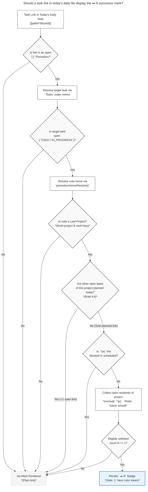

# Leaf Project Successor Marks: Design, Critique, and Implementation Blueprint

**Researcher:** `research.44.gem` (Antigravity)  
**Date:** 2026-11-11  
**Target Repositories:** `bob-plugins` (`bob-ledger-tools`), `bob-cli`  
**Artifact ID / Scope:** `research:202611/leaf_project_keep_moving_marks__gem.md`  

---

## 1. Executive Summary & Core Verdict

The user proposes adding an icon with a count next to ledger task links in today's daily file to show how many other unlinked `Ready`, `Pending`, or `Next` tasks exist in that task's leaf project. The stated goal is forward visibility: *"so I know how many tasks will appear in the successor offer when completing that task"*.

### High-Level Verdict: Strong Idea with One Critical Invariant Refinement

Surfacing upcoming project work directly beside task links under today's open Pomodoros is a **valuable, high-leverage ergonomic enhancement**. It solves a real blind spot in daily execution: Bryan currently has no visual cue in the daily note indicating whether finishing a planned task will conclude work on that project for the day or immediately unlock a queue of ready project work in the keep-moving successor picker.

However, the naive plan—*simply counting all unlinked open tasks in the leaf project and displaying that number on every task link from that project*—has **one critical design flaw**:

> [!WARNING]
> **The K4 "Last Planned Task" Invariant Violation**  
> Under Bob's accepted keep-moving contract (`docs/task-dependencies.md` §12.15, rule **K4**), keep-moving successor offers **ONLY trigger when the task being completed is the LAST live planned task for that leaf project today**.  
> If Bryan plans two tasks from the same leaf project today (e.g., `job_email_recruiters#^taskA` and `job_email_recruiters#^taskB`), completing `taskA` will **NOT** trigger a successor offer (0 tasks offered), because `taskB` is still planned! If the UI displays a badge promising `4` successors beside `taskA`, completing `taskA` will produce **silence**, breaking user trust and violating Bob's truthfulness guarantees.

### Summary of Recommended Design Decisions

1. **Iconography:** Use **`⏭`** (Unicode `\u23ED` / Lucide `skip-forward` / SF Symbol `forward.end.fill`). This is the **canonical glyph** already accepted and standardized throughout Bob's design system for keep-moving successor offers (`docs/task-dependencies.md` §12.15). Do not introduce an unrelated folder or document icon.
2. **Color Token:** Use the existing **Next** status color token (`--color-blue` / cyan-blue) in a muted resting state (`--text-muted`), brightening on hover. This maintains visual distinction from the amber/key color of `🔑 N` frees marks.
3. **The Gating Rule (Truth in Advertising):** Only display the `⏭ N` badge on a task link if that task link is the **sole remaining live planned task** for that leaf project today. If multiple tasks from the project are planned, the badge is withheld (or displayed in a distinct dimmed multi-plan state), because completing the first task will not trigger a successor offer.
4. **Candidate Filtering:** The count must strictly mirror the keep-moving classifier: exclude `^prj`, exclude `#hide`, exclude future scheduled dates (`scheduled > today`), exclude dependency-blocked tasks, exclude tasks already linked in today's file, and gate on the leaf project itself being unblocked.
5. **Architectural Home:** Implement cleanly inside `bob-plugins/plugins/bob-ledger-tools` as a modular sibling to `src/141b-frees-marks.js` and `src/271b-plugin-frees-marks.js`, leveraging the shared in-memory `freshnessEnsureMemo()` and `todayCache` without any extra disk I/O.

---

## 2. Context & Problem Analysis

### 2.1 The Daily Ledger Landscape

In Bryan's daily workflow (evidenced by screenshot `~/tmp/screenshots/20261111_063929.png` of `~/bob/2026/20261111.md`), open Pomodoro blocks contain task links:

```markdown
- [ ] () — WRITE • job_email_recruiters • sase_blog
	- [[job_email_recruiters#^bryan-stephen-luzern-risk]]
	- [[sase_blog#^s0-spike]] 🔑 4
```

In this snippet:
- `sase_blog#^s0-spike` displays `🔑 4`: this is a **Frees Mark** (`src/141b-frees-marks.js`). It tells Bryan that completing `s0-spike` is the last blocker for 4 dependent tasks waiting in the vault. Completing it unblocks them via causal dependency.
- `job_email_recruiters#^bryan-stephen-luzern-risk` displays **no mark at all**. It has no dependents waiting on it.
- However, `job_email_recruiters.md` is a **leaf project** (parent is `[[job]]`, status is `wip`, has an active `^prj` line). It contains 5 open tasks. Only 1 (`bryan-stephen-luzern-risk`) is planned in today's daily file; the other 4 are unlinked `Next` tasks.
- When Bryan completes `bryan-stephen-luzern-risk` using `Ctrl+Enter`, Bob's task-completion engine detects that this was the last planned task for `job_email_recruiters` today, activates §12.15 keep-moving, and displays a successor picker offering to pull in the remaining 4 tasks!

### 2.2 The Forward Visibility Gap

Without a visual indicator on the task link, Bryan suffers from an information asymmetry:
- He cannot tell from looking at the daily file whether `bryan-stephen-luzern-risk` is an isolated one-off task or the tip of an iceberg of 4 more tasks.
- This hinders scheduling decisions: e.g., should he allocate a 25-minute Pomodoro or a 5-minute Pomodoro? Should he complete this right before a meeting, or will it immediately offer 4 successor tasks that he will want to pull in and keep working on?

---

## 3. Plan Critique: Strengths, Pitfalls, and Nuances

### 3.1 Strengths of the Concept

1. **Symmetry with Frees Marks:** Frees marks (`🔑 N`) answer: *"What waiting work depends on this task?"* Successor marks (`⏭ N`) answer: *"What subsequent work in this project is queued up right behind this task?"* Together, they provide complete 360-degree forward awareness for task completion.
2. **Reduced Friction & Context Switching:** Bryan does not need to open `job_email_recruiters.md` to see if there are more recruiter emails to send. The daily note displays the depth of the project pipeline at a glance.
3. **Pacing and Momentum (GTD Flow):** The Pomodoro technique relies on momentum. Knowing that a task belongs to a deep project pool encourages batching and "keeping the project moving".

### 3.2 Critical Pitfall 1: The K4 "Last Planned Task" Invariant

Bryan's prompt states:
> *"so I know how many tasks will appear in the successor offer when completing that task"*

This expectation requires careful handling. Let us examine the exact rule from `docs/task-dependencies.md` §12.15 (Rule **K4**):

```text
K4: no live link on the baseline targets an OPEN task of N outside C
(the ^prj R counts as open N work; links to tasks already closed do not count;
 links to tasks in N's sub-projects do not count — residence is N only)
```

In plain English: **Keep-moving successor offers do not trigger if you already have another open task from that project planned today.**

#### The Concrete Failure Case:
Suppose today's daily file contains two tasks from `job_email_recruiters`:
- `(0630-0655) - WRITE`
  - `• job_email_recruiters#^bryan-stephen-luzern-risk`
  - `• job_email_recruiters#^ecogpt`

And 3 other tasks in `job_email_recruiters` remain unlinked.
- If we implement the naive rule ("count unlinked ready tasks in leaf project"), **both** task links would show a count of `3`.
- Bryan cursor-lands on `bryan-stephen-luzern-risk` and hits `Ctrl+Enter`.
- He expects: *"A modal will pop up offering 3 tasks"*.
- **Reality:** Nothing happens! No modal pops up!
- Why? Because `ecogpt` is still open in today's ledger! Bob's engine intentionally avoids interrupting the user with successor pull-ins when the user is already committed to working on that project later today.
- Only when `ecogpt` is eventually completed (becoming the *last* live task from that project) does the keep-moving modal appear.

#### The Required Adjustment:
The UI must honor reality:
- **Condition (A) [Recommended - Strict Promise]:** The `⏭ N` badge is rendered on a task link **if and only if** that task link is currently the **sole live link to an open task** in that leaf project in today's daily note. If there are 2 or more open task links to that project today, neither shows `⏭ N`. As soon as Bryan completes all but the last one, the final open link immediately renders `⏭ N`.
- **Condition (B) [Informational Backlog Variant]:** If Bryan prefers knowing the backlog depth regardless of multi-planning, the badge can render, but the tooltip must explicitly clarify: *"3 unlinked tasks in project · Successor offer triggers when the last planned task is completed (1 other task planned today)"*.
- **Recommendation:** Condition (A) is vastly superior for the badge itself because it ensures that whenever a badge is visible, completing that task **guarantees** the appearance of the successor offer with that exact count.

---

### 3.3 Critical Pitfall 2: Counting Logic vs. Offer Eligibility

The user prompt requests counting "ready/pending/next tasks exist in that task's leaf project which do not currently have task links associated with them in today's daily file".

A simple status-symbol count (`[ ]`, `[/]`, `[*]`) is insufficient because several categories of tasks are legally disqualified from keep-moving offers:

| Task Condition in Leaf Project | Offer Status in §12.15 | Should it be in the Badge Count? |
| :--- | :--- | :--- |
| `[*] #task ...` (Next) | **Offered** | **Yes** |
| `[/] #task ...` (Pending) | **Offered** | **Yes** |
| `[ ] #task ...` (Ready, unblocked) | **Offered** | **Yes** |
| `- [ ] #task #prj ... ^prj` | **Excluded** (Project line) | **NO** (Never offered) |
| `#hide` tag present | **Folded / Excluded** | **NO** (Not offered) |
| `scheduled > today` (Future schedule) | **Folded / Excluded** | **NO** (Not offered) |
| `[?]` or open `[dependsOn::]` | **Folded / Excluded** (Blocked) | **NO** (Not offered) |
| `#prj_is_blocked` tag | **Folded / Excluded** (Blocked) | **NO** (Not offered) |
| Linked elsewhere in today's file | **Excluded** | **NO** (Already planned) |
| Project `^prj` line is Blocked | **Entire Group Aborted** | **NO** (Count is 0) |

If the badge counted tasks without applying these filters, a project with 1 real ready task, 2 future-scheduled tasks, and 1 dependency-blocked task would show `4`, but completing the task would only offer `1`! The badge count must compute the **true selectable candidate set**.

---

### 3.4 Critical Pitfall 3: Semantics and Visual Clutter

Can a task link have **both** a Frees Mark (`🔑`) and a Successor Mark (`⏭`)?

**Yes.** Consider a task `sase_blog#^s0-spike`:
1. It unblocks 4 tasks across the vault that had `[dependsOn:: sase_blog__s0-spike]` (`🔑 4`).
2. It is also the last planned task of leaf project `sase_blog.md`, which contains 2 other ready articles (`⏭ 2`).

If both marks render on the same line:
```markdown
- [ ] () — WRITE • sase_blog
	- [[sase_blog#^s0-spike]] 🔑 4 ⏭ 2
```

If not designed with restraint:
- Two consecutive emojis and numbers could look cluttered and hard to parse.
- A user might confuse `🔑 4` (dependents) with `⏭ 2` (project siblings).
- Hence, the visual hierarchy, glyph design, spacing, and color distinction must be unmistakable.

---

## 4. Visual Design: Intuitive, Reliable, and Beautiful

### 4.1 Iconography Evaluation

We evaluated five candidate glyphs for this feature:

| Candidate | Glyph | Meaning / Pros | Cons | Verdict |
| :--- | :---: | :--- | :--- | :--- |
| **Skip Forward (Canonical)** | **`⏭`** | Already accepted throughout Bob (§12.15) for keep-moving offers in modals, notices, and CLI. Exact semantic match. | None. Unifies UI vocabulary. | **Recommended (Winner)** |
| **Folder / Project** | `📁` / `📂` | Intuitive for "project", but static. | Looks like a file browser; does not imply succession or momentum. | Rejected |
| **Puzzle Piece** | `🧩` | Used in Bob for `^prj` lines. | Signifies a project entity itself, not subsequent work bullets. | Rejected |
| **Queue / List** | `📋` / `📑` | Implies remaining list. | Visual clutter; too heavy. | Rejected |
| **Arrow / Turn** | `↳` / `↪` | Implies continuation. | Clashes with tree bullet indentation. | Rejected |

#### Why `⏭` Wins:
In `docs/task-dependencies.md` §12.15:
> *"Keep-moving surfaces always lead with why and always say not dependents. They never use 🔓 or the word 'unblocked'. Their glyph is ⏭: emoji/text: ⏭, Obsidian lucide: `skip-forward`, Mac SF Symbol: `forward.end.fill`."*

When Bryan clicks or completes the task, the modal that pops up is titled:
`⏭ Keep job_email_recruiters moving`
And the notification says:
`⏭ Next in WRITE: Founding Engineer at EcoGPT · keeps job_email_recruiters moving`

Showing `⏭ 4` on the task link provides **100% visual coherence**. Bryan sees `⏭ 4` on the link, presses `Ctrl+Enter`, and immediately sees `⏭ Keep moving` with the 4 tasks.

---

### 4.2 Styling and Color Tokens

To ensure beauty and seamless integration with Bob's existing theme:

1. **Badge Anatomy:**
   - Container: `.bob-keep-moving-mark`
   - Border radius: `999px` (pill shape matching `.bob-frees-mark`).
   - Font: `var(--font-interface)`, `font-size: 0.8em`, `font-variant-numeric: tabular-nums`.
   - Padding: `0 0.42em`.
   - Alignment: `display: inline-flex`, `align-items: baseline`, `gap: 0.22em`, `vertical-align: baseline`.
2. **Color Palette:**
   - Resting color: `var(--text-muted)` with a very subtle hint of Next blue (`color-mix(in srgb, var(--color-blue) 40%, var(--text-muted))`).
   - Hover state: Brightens to `var(--color-blue)` (`#2a78d6` in light mode, `#3987e5` in dark mode) with a soft background wash (`color-mix(in srgb, var(--color-blue) 12%, transparent)`).
   - This sharply contrasts with `🔑 N` (which uses `--bob-frees-mark-color`, trending warm/amber on hover).
3. **Motion / Micro-interactions:**
   - 180ms subtle scale pop (`bob-keep-moving-mark-tick`) when the count changes (e.g., when tasks are added or completed in another view).
   - Fully disabled under `@media (prefers-reduced-motion: reduce)`.

---

### 4.3 Position in the Decoration Chain

In Obsidian Live Preview and Reading views, task links in the daily note receive decorations via CodeMirror 6 `Decoration.widget`. The order must be strictly deterministic:

```text
[Task Link Text]  [Progress Mark]  [Unblocked 🔓]  [Frees 🔑 N]  [Keep Moving ⏭ N]  [Off-Clock Chip]  [Mail Mark]
 (anchor text)       (side: 1)       (side: 2)      (side: 2)         (side: 2)          (side: 3)       (side: 4)
```

Because `🔑 N` and `⏭ N` both operate at `side: 2`, their insertion order in the RangeSetBuilder determines their visual flow:
`[Frees Mark 🔑 N]` precedes `[Keep Moving Mark ⏭ N]`.
This places causal unblocking first, followed by project continuity.

---

### 4.4 Rich Tooltip Design

Hovering over the `⏭ N` mark reveals a rich, structured tooltip that explains the count and previews the upcoming tasks, following the gold standard established by `freesMarkTooltip`:

```text
Keep job_email_recruiters moving · 4 successors
• ✉️ Founding Engineer at EcoGPT · Roej Hollon-Calaguas [Next]
• ✉️ 🔥 Bryan — your Python/release tooling made me circle back [Next]
• ✉️ Product Engineer · Dan Dowd [Next]
+1 more
Offers when this last planned task is completed
```

If some project tasks are blocked or scheduled, the tooltip transparently accounts for them:

```text
Keep sase_badges moving · 2 successors
• Ship the badge renderer [Pending]
• Wire badges into the README [Next]
Also: 1 blocked · 2 scheduled later · 1 hidden
Offers when this last planned task is completed
```

And if multi-planned (under Option B):
```text
Keep job_email_recruiters moving · 4 successors
• ✉️ Founding Engineer at EcoGPT [Next]
...
Notice: 1 other job_email_recruiters task is planned today; offers after both complete
```

---

## 5. Architectural & Implementation Blueprint

### 5.1 Where It Lives

The feature belongs entirely in **`bob-plugins`**, specifically the **`bob-ledger-tools`** plugin, with zero changes required in `bob-cli` (since `bob-cli` already implements the underlying §12.15 logic and does not render the Obsidian daily note editor).

Within `bob-ledger-tools`:
1. `src/141d-keep-moving-marks.js`: Pure data model, candidate classification, and DOM element builder.
2. `src/271d-plugin-keep-moving-marks.js`: Live Preview `ViewPlugin` extension, Reading view Markdown postprocessor, and event hooks.
3. `styles.css`: CSS styles for `.bob-keep-moving-mark`.
4. `src/fragments.json`: Register the new fragments in the build bundle.

---

### 5.2 Standalone Mermaid Diagrams

#### Figure 1: Pipeline for Keep-Moving Mark Evaluation


*Caption: A task link renders the `⏭ N` successor mark only when it is an open task in a leaf project, has no sibling links open in today's file (K4), the project is unblocked, and at least one eligible unlinked candidate exists.*

---

#### Figure 2: Visual Layout of Task Link Decorators

```mermaid
---
title: "Ordering of decorators adjacent to a ledger task link"
accTitle: "Decorator Sequence on Ledger Row"
accDescr: "Flowchart showing the horizontal layout order of decorators after the task link text."
---
flowchart LR
    A["`[[target#^blockId]]`<br/>*(Anchor Link)*"] --> B["`◐` / Ring<br/>*(Progress Mark)*<br/>side: 1"]
    B --> C["`🔓`<br/>*(Unblocked Glyph)*<br/>side: 2"]
    C --> D["`🔑 N`<br/>*(Frees Mark)*<br/>side: 2"]
    D --> E["`⏭ N`<br/>*(Keep-Moving Mark)*<br/>side: 2"]
    E --> F["`off`<br/>*(Off-Clock Chip)*<br/>side: 3"]
    F --> G["`✉️` / Pill<br/>*(Mail/Event Marks)*<br/>side: 4"]

    classDef link fill:#fff,stroke:#333,stroke-width:2px;
    classDef dec fill:#f0f4f8,stroke:#555,stroke-width:1px;
    classDef targetMark fill:#e8f4fd,stroke:#2a78d6,stroke-width:2px;

    class A link;
    class B,C,D,F,G dec;
    class E targetMark;
```
*Caption: The `⏭ N` keep-moving mark sits immediately after the `🔑 N` frees mark at decoration position `side: 2`, ensuring causal dependents precede project continuity.*

---

### 5.3 Pure Model Specification (`src/141d-keep-moving-marks.js`)

Below is the concrete algorithmic specification for the pure model:

```javascript
// --- Ledger keep-moving marks: pure mark-core -----------------------------
// A display-only mark showing how many eligible successor tasks will appear
// in the keep-moving offer upon completing this leaf project's last planned task.
// Follows docs/task-dependencies.md §12.15 K1-K8. Never writes; never throws.

const KEEP_MOVING_MARK_GLYPH = "⏭";

function keepMovingIsLeafProject(taskPath, metadataCache) {
  try {
    if (!taskPath) return false;
    const file = metadataCache.getFirstLinkpathDest(taskPath, "");
    if (!file) return false;
    const cache = metadataCache.getFileCache(file);
    const frontmatter = cache && cache.frontmatter;
    if (!frontmatter) return false;
    
    // Must be type: project
    const type = String(frontmatter.type || "");
    if (!type.includes("project")) return false;
    
    // Check root parent using existing pomodoroHomeResolve logic
    const home = pomodoroHomeResolve(taskPath, dailyPath, metadataCache);
    if (!home || home.kind !== "project") return false;
    
    // Leaf condition: not its own root parent
    const key = pomodoroHomeStem(taskPath);
    return Boolean(home.root && home.root !== key && home.root !== taskPath);
  } catch (error) {
    return false;
  }
}

function keepMovingMarkCount(ownerTask, memo, todayCache, metadataCache) {
  try {
    const tasks = memo && Array.isArray(memo.tasks) ? memo.tasks : [];
    if (tasks.length === 0 || !ownerTask || !blocksTaskIsOpen(ownerTask)) {
      return null;
    }
    const ownerPath = planTaskPath(ownerTask);
    if (!ownerPath || !keepMovingIsLeafProject(ownerPath, metadataCache)) {
      return null;
    }

    // K4 Rule: Check if any OTHER open task from this same project is in today's ledger
    const ownerKey = freesMarkTaskKey(ownerTask);
    const todayKeys = todayCache && todayCache.rank instanceof Map ? todayCache.rank : new Map();
    
    for (const [todayKey] of todayKeys) {
      if (todayKey.startsWith(ownerPath + "#") && todayKey !== ownerKey) {
        // Resolve task from todayKey to verify if it is open
        const otherTask = memo.tasksByPathBlock.get(todayKey);
        if (otherTask && blocksTaskIsOpen(otherTask)) {
          // Another open task from this project is planned today!
          // K4 suppresses the keep-moving offer on this task.
          return null; 
        }
      }
    }

    // Collect all open residents in ownerPath
    const projectTasks = tasks.filter((t) => sameVaultPath(planTaskPath(t), ownerPath));
    
    // Check project ^prj line
    const prjTask = projectTasks.find((t) => planTaskBlockId(t) === "prj");
    if (prjTask && (planTaskIsBlocked(prjTask, tasks) || planTaskHasFutureSchedule(prjTask))) {
      return null; // Project itself is blocked
    }

    const eligible = [];
    let blockedCount = 0;
    let scheduledCount = 0;
    let hiddenCount = 0;

    for (const task of projectTasks) {
      if (task === ownerTask || planTaskBlockId(task) === "prj") continue;
      if (planTaskIsDone(task)) continue;
      
      // Check if already planned today
      const taskKey = freesMarkTaskKey(task);
      if (todayKeys.has(taskKey)) continue;

      if (planTaskHasTag(task, "hide")) {
        hiddenCount++;
        continue;
      }
      if (planTaskHasFutureSchedule(task)) {
        scheduledCount++;
        continue;
      }
      if (planTaskIsBlocked(task, tasks)) {
        blockedCount++;
        continue;
      }

      const statusType = task.status && task.status.type;
      const statusSymbol = planTaskStatusSymbol(task);
      if (statusType === "TODO" || statusType === "IN_PROGRESS" || statusSymbol === "*") {
        eligible.push(task);
      }
    }

    if (eligible.length === 0) return null;

    return {
      count: eligible.length,
      projectName: pomodoroHomeStem(ownerPath),
      eligible,
      blockedCount,
      scheduledCount,
      hiddenCount,
    };
  } catch (error) {
    return null;
  }
}
```

---

### 5.4 DOM Element Builder

```javascript
function buildKeepMovingMarkElement(doc, model) {
  try {
    if (!doc || typeof doc.createElement !== "function" || !model) return null;
    const count = Number(model.count);
    if (!Number.isInteger(count) || count < 1) return null;

    const host = doc.createElement("span");
    host.setAttribute("class", "bob-keep-moving-mark" + (model.tick ? " bob-keep-moving-mark-tick" : ""));
    host.setAttribute("role", "img");
    host.setAttribute("aria-label", keepMovingMarkTooltip(model));
    host.setAttribute("data-tooltip-position", "top");
    host.setAttribute("data-count", String(count));

    const glyph = doc.createElement("span");
    glyph.setAttribute("class", "bob-keep-moving-mark-glyph");
    glyph.textContent = KEEP_MOVING_MARK_GLYPH;
    host.appendChild(glyph);

    const countSpan = doc.createElement("span");
    countSpan.setAttribute("class", "bob-keep-moving-mark-count");
    countSpan.textContent = String(count);
    host.appendChild(countSpan);

    return host;
  } catch (error) {
    return null;
  }
}
```

---

### 5.5 CSS Specification (`styles.css`)

```css
/* Ledger keep-moving marks: a quiet compact ⏭ count after an eligible
   Task Link in a leaf project, showing upcoming unlinked successors. */
.bob-keep-moving-mark {
  display: inline-flex;
  align-items: baseline;
  gap: 0.22em;
  margin-inline-start: 0.35em;
  padding: 0 0.42em;
  border-radius: 999px;
  font-family: var(--font-interface);
  font-size: 0.8em;
  font-variant-numeric: tabular-nums;
  line-height: 1;
  white-space: nowrap;
  vertical-align: baseline;
  color: color-mix(in srgb, var(--color-blue, #2a78d6) 45%, var(--text-muted));
  user-select: none;
  cursor: default;
  print-color-adjust: exact;
  transition:
    background-color 120ms ease,
    color 120ms ease;
}

.bob-keep-moving-mark-glyph {
  font-size: 0.92em;
  line-height: 1;
}

.bob-keep-moving-mark:hover {
  color: var(--color-blue, #2a78d6);
  background-color: color-mix(in srgb, var(--color-blue, #2a78d6) 12%, transparent);
}

.bob-keep-moving-mark.bob-keep-moving-mark-tick {
  animation: bob-keep-moving-mark-tick 180ms cubic-bezier(0.2, 0.9, 0.3, 1.25);
}

@keyframes bob-keep-moving-mark-tick {
  from {
    opacity: 0.3;
    transform: scale(0.6);
  }
  to {
    opacity: 1;
    transform: scale(1);
  }
}

@media (prefers-reduced-motion: reduce) {
  .bob-keep-moving-mark,
  .bob-keep-moving-mark.bob-keep-moving-mark-tick {
    animation: none;
    transition: none;
  }
}

@media (forced-colors: active) {
  .bob-keep-moving-mark {
    color: CanvasText;
  }
}

body:not(.bob-keep-moving-marks) .bob-keep-moving-mark {
  display: none;
}
```

---

## 6. Implementation Checklist & Verification Strategy

### 6.1 Deliverables in `bob-plugins`

1. **New Files:**
   - `plugins/bob-ledger-tools/src/141d-keep-moving-marks.js` (Pure model & DOM builder)
   - `plugins/bob-ledger-tools/src/271d-plugin-keep-moving-marks.js` (Live Preview & Reading mixin)
   - `plugins/bob-ledger-tools/scripts/test-ledger-tools-keep-moving-marks.cjs` (Pure unit tests)
   - `plugins/bob-ledger-tools/scripts/obsidian-keep-moving-marks-e2e.cjs` (E2E integration tests)
2. **Updates to Existing Files:**
   - `plugins/bob-ledger-tools/src/fragments.json`: Insert the two new JS fragments.
   - `plugins/bob-ledger-tools/styles.css`: Append `.bob-keep-moving-mark` styles.
   - `plugins/bob-ledger-tools/src/170-plugin-lifecycle.js`: Call `this.setupKeepMovingMarks()` on load and `this.teardownKeepMovingMarks()` on unload.
   - `plugins/bob-ledger-tools/docs/bob-ledger-tools.md`: Document the new mark, session toggle command (`Toggle Task Link keep-moving marks`), and display contract.

### 6.2 Verification Matrix

| Test ID | Scenario | Expected Result |
| :--- | :--- | :--- |
| **KM-T01** | Task in leaf project (`job_email_recruiters`), 4 unlinked `Next` tasks, sole planned task today | Renders `⏭ 4` with full tooltip naming tasks |
| **KM-T02** | Task in root project (`job.md`, not a leaf) | No mark rendered |
| **KM-T03** | Task in leaf project, but 2 open tasks planned in today's ledger (**Rule K4**) | **No mark rendered** on either task (suppressed by sibling open link) |
| **KM-T04** | Task in leaf project with 2 tasks planned; first task is marked `[x]` | Second task immediately gains `⏭ N` mark |
| **KM-T05** | Task in leaf project where remaining tasks have `scheduled > today` | Scheduled tasks excluded; if 0 remaining, no mark |
| **KM-T06** | Task in leaf project where `^prj` line is Blocked | No mark rendered |
| **KM-T07** | Task with both Frees mark and Keep-Moving mark (`s0-spike`) | Renders `🔑 4 ⏭ 2` in correct sequence without collision |
| **KM-T08** | Session toggle command executed | Body class toggled; marks hide/show cleanly |
| **KM-T09** | Reading View postprocessor | Renders identical HTML structure and tooltip in Reading view |

---

## 7. Recommended Solution & Next Steps

### Recommendation: Proceed with Refined Requirements

We recommend approving and implementing this feature with the specific refinement that **Rule K4 is strictly enforced**:

1. **Adopt `⏭ N` as the official glyph and syntax.** It is already accepted, understood, and woven into Bob's design system.
2. **Apply the K4 gate:** Only render `⏭ N` when the task link is the sole active open task link for that leaf project today. This prevents user confusion and ensures that every visible `⏭ N` badge is an ironclad promise that completing the task will trigger a successor offer with exactly N tasks.
3. **Use the pure, memoized architecture in `bob-ledger-tools`:** Model it directly on `141b-frees-marks.js`. This guarantees zero performance regression in Obsidian and instant reactivity as tasks are typed or completed.

By adhering to these principles, the feature will be **intuitive** (natural continuation of GTD workflow), **reliable** (never promises an offer that won't happen), and **beautiful** (harmonious typography, subtle motion, and theme-native colors).
