# Keep-moving count marks on Task Links

> **Research query.** After the ledger `🔑 N` frees mark, add a similar icon
> that shows how many other Ready / Pending / Next tasks live in that task's
> leaf project and currently have no Task Link in today's daily file, so the
> count previews the successor offer that appears when completing the link.
> Show it only on Task Links whose tasks live in leaf projects. Lead the
> design; critique the idea; call out justified requirement changes; end with
> a recommended solution.
>
> Motivating example (2026-11-11 WRITE):
> `[[job_email_recruiters#^bryan-stephen-luzern-risk]]` should wear this icon
> with **4**, because `job_email_recruiters.md` holds four other Next tasks
> with no live link today.

**Researcher:** grk. Independent swarm report. Baselines: `docs/frees-marks.md`,
`docs/task-dependencies.md` §12.15–§12.17, `docs/projects.md` (Leaf projects),
`decisions:unblocked-tasks-are-offered`, bob-ledger-tools frees-mark widgets
(`src/141b-frees-marks.js`, `src/271b-plugin-frees-marks.js`), cycler
`planSuccessorKeepMoving` / `successorLeafProject`, and the live vault
example in `~/bob/job_email_recruiters.md` plus `~/bob/2026/20261111.md`
(screenshot `~/tmp/screenshots/20261111_063929.png`).

## Bottom line

**Build it, but as a truthful keep-moving preview, and widen the home set
so the motivating example actually fires.**

The idea is the same move frees marks already made for dependents: a quiet
trailing count on today's live Task Links that names the close consequence
before Ctrl+Enter. Keep-moving already has a glyph (`⏭` / lucide
`skip-forward` / SF `forward.end.fill`), a colour (the Next token), copy
that says *not dependents*, and an offer set of Pending then Next then Ready
residents. The ledger should echo that family, not invent a second "leaf
remainder" number.

Three requirement changes are load-bearing. Without them the screenshot
example either stays blank or lies about the picker.

1. **Work-leaf, not reporting-leaf.** Bob's glossary *leaf project* is a
   Stats role: a sub-project whose root parent is some other project.
   `job_email_recruiters` is a top-level project under the `job` **area**, so
   it is a root, and §12.15 K2 currently refuses it. Bryan's own completed
   task on 2026-11-11 is "Split out job email tasks into a leaf project!" —
   GTD tree-leaf language. Expand keep-moving homes to **reporting leaves or
   root projects that have no child projects**. That is the set this mark
   may appear on.
2. **Count the keep-moving offer set, using live links.** Scan "wikilinks
   anywhere in today's daily file" and you disagree with KM3/KM4 (struck and
   closed-entry links do not keep the project planned). Include future-dated
   Ready rows or an unhidden `^prj` and you disagree with the picker. The
   pill's N is `|OFFER|` from §12.15, excluding the linked task itself.
3. **Last live link only.** Keep-moving is a last-planned trigger (K4). A
   count on every work-leaf link overpromises. When two residents are
   planned, both stay bare; completing one makes the survivor tick in with
   `⏭ N`.

**Recommended design, in one sentence:** a compact skip-forward pill `⏭ N`
after a live Task Link in today's open Pomodoros, in Next ink, whose N
equals the keep-moving group that closing this task would open, shown only
when that group would actually open.

On the 2026-11-11 WRITE row that is exactly one mark: four, on
`job_email_recruiters#^bryan-stephen-luzern-risk`.

## Is this a good idea?

Yes. Keep-moving is currently a surprise. Frees marks already trained the
eye to read trailing ledger counts as *close consequences*. The WRITE
placeholder in the screenshot is a planning surface: Bryan is choosing what
to pull into the day, and the question "if I finish this recruiter email,
how many siblings will the picker offer?" is the same question `🔑 N`
answers for dependents.

Four facts from the current system make the gap concrete.

1. **Frees marks already refused to count this.** `docs/frees-marks.md`
   "What is deliberately not counted" lists keep-moving offers with the ⏭
   glyph and the reason they are already-Ready residents of a leaf project,
   never dependents. The deferred slot is this feature.
2. **The picker copy already exists.** Group title `Keep ‹N› moving`,
   contrast tag `ready in ‹N› · not dependents`, glyph ⏭, Next colour, lane
   names rather than raw status symbols (`docs/task-dependencies.md` §12.15
   copy table). The ledger mark should reuse that language so hover and
   picker teach each other.
3. **The motivating example is a last-planned work-leaf with N = 4.**
   `job_email_recruiters.md` has a hidden `^prj` and five `[*]` Next
   residents. Today's open Pomodoros contain exactly one live link into
   that note. Four selectable keep-moving rows. That is the screenshot
   request, and it is also KM1.
4. **Without a home-set change, the example stays blank.** `job` is
   `type: "[[area]]"`. `job_email_recruiters` therefore fails LP2 / K2
   (`is_leaf_project` requires `root_parent != key`). Completing
   `^bryan-stephen-luzern-risk` today would not open a keep-moving picker
   at all. An icon that showed 4 would be a tease.

This is a good idea *as a preview of a picker that will actually appear*.
It is a poor idea as a generic "how many tasks are in this note" badge.

## Critique of the request as written

### 1. "Leaf project" in the request is not Bob's leaf project

**Adjustment (required).** Do not gate this mark on glossary leafness
alone.

Bob's leaf project (`docs/projects.md`, `docs/reference/glossary.md`,
`keep_moving.rs::is_leaf_project`, `successorLeafProject` in the cycler) is
a reporting role:

- a project whose R2 root parent is some other project
- top-level projects, `root: true` projects, and orphans are roots, never
  leaves
- a leaf may itself have sub-projects; residents of those children are
  never offered (KM7)

Bryan's example is a **top-level tree-leaf**: `parent: "[[job]]"`, `job` is
an area, no child projects. Vault scan of open projects on 2026-11-11:

| Reporting role | Open projects | Of those, no child projects |
| --- | ---: | ---: |
| Reporting leaf (current keep-moving) | 34 | 28 |
| Top-level (parent is an area) | 7 | 4 |
| `root: true` | 1 (`sase_blog`) | 0 |

The four top-level tree-leaves are `job_email_recruiters`,
`dev_plex_hack_patch`, `gkeep_gdocs_inbox_dump`, and `needs_attn_tasks`.
Only the first currently has unhidden Ready/Pending/Next residents (five
Next). Parent roots such as `bob` (6 children, 11 unhidden R/P/N residents)
and `sase` (61 children, 3 unhidden R/P/N residents) stay out of the
expanded set, which keeps "keep this project moving" pointed at a focused
work container.

Call the expanded set a **work-leaf**. Do not rename the glossary term;
Stats and `[root::]` keep reporting-leaf. Change §12.15 K2 from `LEAF(N)`
to `WORK_LEAF(N)`:

```text
WORK_LEAF(N) ⇔ recognised non-terminal project N
  AND (
    root_parent(N) ≠ N                          // today's reporting leaf
    OR no other project note has parent → N     // tree-leaf root
  )
```

That is a product change to keep-moving itself, not only to the icon. Ship
them together. An icon on `job_email_recruiters` whose close stays silent
is worse than no icon.



Rendered size: 457 × 840 px; fit scale: 100%. Mermaid CLI 12.0.0.

*Caption: Reporting-leaf keep-moving already fires for nested work such as
`sase_pager`. It stays silent for `job_email_recruiters` because that
note's parent is an area. Work-leaf adds root projects that have no child
projects, and still leaves parent roots such as `bob` and `sase` silent.*

### 2. "No Task Link in today's daily file" is the wrong absence test

**Adjustment (required).** Count against **live links** as §12.15 defines
them: unstruck Task Link sub-bullets (plain, embed, or `#`-deferred) under
an **open** `[ ]` Pomodoro entry in today's `## Pomodoros`, including
planned `()` placeholders. This is the same allow-list
`progressMarkLinks` / `unblockedGlyphLinkedTask` / frees marks already use.

A sibling whose only mention today is struck, or sits under a closed
morning session, still has a wikilink in the daily file, and keep-moving
**would still offer it** (KM3, KM4). A naive daily-file scan would drop it
from the pill and then surprise Bryan in the picker.

### 3. "How many will appear in the successor offer" is broader than ⏭

**Adjustment (required).** The ⏭ count equals the **`keep_moving` group**,
not the whole picker.

Closing a work-leaf task can also offer:

- direct dependents as `hand_off` (already echoed by `🔑 N`)
- relation successors as `🪢` (deferred in frees marks)
- `project_finished` pull-in of `^prj` when the note is emptying (KM14)

A sibling that is also a dependent of X is deduped into `hand_off`
(priority `hand_off > relation > project > project_finished > keep_moving`).
`🔑` already counts it. Putting it in ⏭ as well would double-paint the
same row. The two pills compose:

```text
link 🔓 🔑 2 ⏭ 4 off
```

means: something freed this earlier today; closing it frees two dependents;
closing it also offers four project siblings that are not dependents.

If the only remaining residents are dependents, ⏭ stays off and 🔑 speaks.
If this close empties the project, ⏭ stays off (`|OFFER| = 0`) and the
`project_finished` path owns the picker. Do not invent a 🧩 pill in v1.

### 4. Show it on every work-leaf link, or only on the last planned one?

**Adjustment (required for v1).** Last live link only.

K4: any other live link to an open resident of N, including to `^prj`,
suppresses the whole keep-moving group. Two recruiter emails planned today
means completing the first does not open the picker. Painting `⏭ 3` on both
rows would be a broken promise.

Last-planned-only also keeps the ledger quiet. On 2026-11-11's open
Pomodoros, work-leaf + last-planned + N ≥ 1 matches **exactly one** link:
the motivating `job_email_recruiters` row. `bob` has three live links
(so not last-planned) and is a parent root besides. Area tasks in CHORE
never qualify. `sase_blog#^s0-spike` is a `root: true` parent with one
child and zero sibling R/P/N residents; it already wears `🔑 4`.

When two residents are planned and Bryan completes one, the survivor should
*tick in* with `⏭ N` using the same `bob-*-mark-tick` pop frees marks use.
That live appearance is the teaching moment: this close will now offer.

**Deferred, not v1:** a quieter remainder when another resident is still
planned (`3 more unplanned in ‹N› · another is planned today`). Different
copy, no skip-forward promise. Trigger: Bryan asks after living with
last-planned-only.

### 5. Ready / Pending / Next is the right lane set, with keep-moving folds

The request's lane list already matches `offer_lanes` (Pending → Next →
Ready). Keep that. Apply the rest of the offer-set table:

| Resident | Pill |
| --- | --- |
| the linked task X | excluded ("other") |
| `^prj` R | excluded |
| `[/]` `[ *]` `[ ]` with no fold | **counted** |
| `[?]`, open prerequisite, `#prj_is_blocked` | folded `blocked`, omitted |
| `scheduled` after today | folded `scheduled`, omitted |
| whole-token `#hide` | folded `hidden`, omitted |
| already live-linked | impossible under last-planned (K4) |
| residents of child projects | omitted (KM7) |
| `#ref`, nested, recurring due today | counted, like any resident (KM18) |

The example's four are all Next, so "4 next tasks" and "4 keep-moving
offers" agree. A mix should still be one number; the tooltip names lanes.

`plan.keep_moving: false` hides the mark and the picker together.

### 6. Clutter

The screenshot already carries status rings, 🔑, and occasional off-clock
chips. A third trailing pill is justified only when it is rare and
consequential. Last-planned work-leaf with N ≥ 1 is both. Do not put a
count on the Pomodoro home chip (`WRITE` already reads `job_email_recruiters · sase_blog`); that grain cannot say *which* link is the trigger, and
WRITE has two homes.

## Visual design

Frees marks decided compact `🔑 N`, muted rest ink, tooltip for meaning,
emoji as the only colour, `side: 2` after 🔓. Keep-moving already chose a
different family: skip-forward, Next colour, "not dependents." The ledger
pill should look like 🔑's *sibling*, not its clone.

### Anatomy

Host: `span.bob-keep-moving-mark[role=img]` with `data-count`,
`data-project`, `data-tooltip-position=top`, no `title`, listener-free.

Inside: a `::before` skip-forward mask in Next ink, then tabular `N`.

```text
- [ ] () — WRITE
	- job_email_recruiters > ^bryan-stephen-luzern-risk  ⏭ 4
	- sase_blog > ^s0-spike  🔑 4
```

Do not use a second colour emoji next to 🔑. Two emoji pills on adjacent
rows read as stickers. Frees keeps the gold key; keep-moving uses a
CSS-mask skip-forward (the same technique as task-link-mark rings and
off-clock chips) filled with
`var(--bob-keep-moving-mark-ink, var(--task-status-next, var(--color-green)))`.
The count stays `var(--text-muted)` at rest. Hover lifts both to Next and
washes the pill, matching frees-mark hover.

Reuse frees-mark metrics that already survived e2e: `font-size: 0.8em`,
`gap: 0.22em`, `margin-inline-start: 0.4em`, `border-radius: 999px`,
tabular nums, no line-height change, `bob-keep-moving-mark-tick` pop on
N changing to a new value ≥ 1, reduced-motion off, forced-colors
`CanvasText`.

Lucide `skip-forward` silhouette (triangle plus bar), 16×16 viewBox, so
the glyph is the same shape the Obsidian picker already puts in the
keep-moving header.

### Placement

Live Preview widget at the link token end, `side: 3`. Bump off-clock chips
from `side: 3` to `side: 4`. Reading view: insert after the run of
`span.bob-unblocked-glyph` / `span.bob-frees-mark`, before
`span.bob-off-clock-link-chip`. Event time pills stay *before* the link
and do not collide.

Order, always:

```text
[ring] link 🔓 🔑 N ⏭ M off
        past  frees  keep-moving  clock
```

Cursor on the row still reveals raw `[[…]]`; the widget covers no source
text. Print and copy ignore the host (`user-select: none`), as with 🔑.

### Tooltip (`aria-label`, never contains `::`)

```text
Closing this offers N more in ‹stem›
Keep ‹stem› moving · not dependents
• ‹title› · ‹lane›                 (up to 3, Pending → Next → Ready then line)
+K more
Not offered  2 blocked · 1 scheduled later · 1 hidden   (omit zero parts)
```

Titles cleaned with `dependencyCleanTaskText`, cut to 48 characters.
`‹stem›` is the project note basename. Stray `::` becomes `:`. This is the
§12.15 why-line plus the fold line, so hover and picker agree.

### Interaction

- Plain click: caret at the widget, focus the editor, never write. Same as
  ◐ / 🔓 / 🔑.
- Mod+click: `workspace.openLinkText(‹project stem›, sourcePath, "tab")` —
  the siblings live on N, not on X. 🔑 opens X because BLOCKS lives on X.
  Opening N here is the useful exception; document it in the tooltip's
  first line by naming the project.
- Session toggle `toggle-keep-moving-marks`, default on, CSS gate
  `body.bob-keep-moving-marks`. Also honour `plan.keep_moving`.
- No tab stop, no live region.

### Toggle and liveness

Copy the frees-mark refresh fan-out: Tasks `cache-update`, daily
`metadataCache` changed, local midnight, toggle, `docChanged` /
`viewportChanged`. Plus: metadataCache changes on **any project note**
(leafness and child-set can change when a `parent:` is edited). Coalesce
~120 ms. Visible-range only. One per-memo index of tasks-by-path, one
live-link set, one parent→children map over ~100 project notes.

## When the mark appears



Rendered size: 586 × 1168 px; fit scale: 76.4%. Mermaid CLI 12.0.0.

*Caption: The pill is shown only on today's daily note, only on a live Task
Link, only for a work-leaf project, only when this link is that project's
last live link today, and only when the keep-moving offer set is at least
one. Any failed gate is silence, never a warning glyph.*

Shared with frees marks: today's canonical daily path; `progressMarkLinks`
allow-list; warm Tasks memo; open target with a block id; N ≥ 1; session
toggle; truthful-or-neutral (unresolved, ambiguous, closed, id-less, thrown
error, cold memo → no mark).

Additional gates, all of K1–K8 that a display-time snapshot can evaluate:

- N is a recognised non-terminal project (K1)
- `WORK_LEAF(N)` (adjusted K2)
- X is a non-`^prj` resident with a block id (K3 predecessor)
- no other live link targets an open resident of N (K4)
- R is present, not in C, not Blocked (K5)
- N is not EMPTY (K6); emptying is `project_finished`, no ⏭
- no `project` / `project_finished` group for N would claim this close (K7)
  — at display time, approximate as: R is not the linked task
- `plan.link_unblocked` and `plan.keep_moving` are true (K8)

## Count rule

```text
X        = task this live link resolves to (Tasks memo)
N_note   = X's residence path
WORK_LEAF, LIVE, LAST as above
R        = N_note's open ^prj
RESIDENT = open #task lines of N_note other than R and X
           (include #ref / nested / recurring-due; exclude child-note tasks)
FOLDED   = blocked / future-scheduled / #hide  (same tests as §12.15)
HAND_OFF = RESIDENT rows that are last-blocker dependents of X
           (they belong to 🔑, not ⏭)
OFFER    = RESIDENT − FOLDED − HAND_OFF
N        = |OFFER|
mark     ⇔ OPEN(X) ∧ WORK_LEAF(N_note) ∧ LAST ∧ N ≥ 1 ∧ warm ∧ toggles
```

**Parity invariant.** For every qualifying X, the pill's N equals the
number of selectable rows `planSuccessorKeepMoving` would emit for N_note
if X were completed now, on the same memo and the same day text. A test
asserts this on every KM fixture that produces a group, and on KM2 / KM5 /
KM13 / KM14 (no group → no mark).

## Today's ledger, under this rule

Open-Pomodoro live links on 2026-11-11, evaluated against the vault as
read for this report:

| Live link | Home | Work-leaf? | Last live of home? | ⏭ |
| --- | --- | --- | --- | --- |
| `bob#^ref-album-and-record-notes` | `bob` (parent root, 6 children) | no | no (3 bob links) | — |
| `sase#^ref-the-ai-native-sdlc-playbook` | `sase` (parent root, 61 children) | no | yes | — |
| `bob#^ref-what-to-write-in-period-notes` | `bob` | no | no | — |
| `bob#^recruiter-private-event-note` | `bob` | no | no | — |
| `cash#^picture-of-real-id-paper` | `cash` area | no | — | — |
| `body#^clip-nails` | `body` area | no | — | — |
| `cash#^find-wallet` | `cash` area | no | — | — |
| `cash#^clean-out-bookbag` | `cash` area | no | — | — |
| **`job_email_recruiters#^bryan-stephen-luzern-risk`** | **tree-leaf root** | **yes** | **yes** | **⏭ 4** |
| `sase_blog#^s0-spike` | `root: true`, has child | no | yes | — (and `🔑 4`) |

The rule paints the screenshot request and nothing else on that day. That
is the right amount of ink.

## Would I take a different approach?

Several alternatives are attractive and should be rejected for v1.

**Paint a remainder on every work-leaf link, picker or not.** Useful while
planning two siblings, and it matches a literal reading of "how many other
R/P/N lack today's links." It also paints a skip-forward promise the close
will not keep. Last-planned-only is the truthful v1; remainder copy is a
follow-up with a different glyph.

**Gate on glossary leaf only, leave keep-moving's K2 alone.** Then the
icon never appears on the example, and this whole request fails its own
acceptance test. Widen the home set.

**Show the icon without widening keep-moving.** Four on the link, empty
picker on close. That is the worst of both.

**Widen keep-moving to every project note.** `sase.md` has only 3 unhidden
R/P/N residents (71 are Blocked, and blocked rows fold), so the "huge root
backlog" fear is weaker than it looks. `bob.md` would still offer ~10.
Bryan asked for *leaf* projects. Work-leaf is the conservative expansion
that hits the example and leaves parent roots alone. Reopen if he wants
`sase.md`'s two Ready rows offered when its last live link closes.

**Put the count on the Pomodoro home chip.** Wrong grain. WRITE has two
homes; the trigger is per link.

**Merge into 🔑.** Frees marks already separated the families. 🔑 means
*dependents leave Blocked*. ⏭ means *already-Ready siblings you may pull
in*. Mixing them makes both tooltips dishonest.

**Compute N in Rust and push JSON to the plugin.** Right for a later Mac
idle-agenda echo (`decisions:mac-capture-is-a-thin-client`, already
deferred for 🔑). Wrong for v1: every input is already in the Tasks memo,
metadataCache frontmatter, and today's day text, the same local snapshot
frees marks use. Plugin-only, with parity tests against the cycler
planner, matches `bob-cli-g1`.

**Auto-link the N siblings.** Violates
`decisions:unblocked-tasks-are-offered`. The mark previews a picker that
still starts with nothing marked.

## Recommended solution

### Product

1. Introduce **work-leaf** as the keep-moving home test (K2), without
   renaming glossary *leaf project*.
2. Add ledger **keep-moving marks**: compact skip-forward pill, Next ink,
   N = keep-moving offer set, last live link only, same allow-list as
   frees marks.
3. Ship the K2 change and the mark in one drop, so
   `job_email_recruiters#^bryan-stephen-luzern-risk` shows `⏭ 4` and
   Ctrl+Enter offers those four.
4. Leave Mac agenda, Task Card, nav pickers, remainder-when-not-last, and
   a 🧩 project-finished echo deferred, with the same triggers frees marks
   used.

### Contract surfaces

| Surface | Change |
| --- | --- |
| `docs/keep-moving-marks.md` | new display contract, frees-marks shape, FL/FC/FT/FP-style vectors plus KM parity |
| `docs/task-dependencies.md` §12.15 K2, §12.17 | `WORK_LEAF`; new LP rows for tree-leaf roots (job_email_recruiters yes, bob/sase no, orphan-with-no-children yes, `root: true` with no children yes, `root: true` with children no) |
| `docs/projects.md` Leaf projects | keep-moving sentence now says work-leaf; glossary leaf definition unchanged |
| `docs/frees-marks.md` Deferred | this mark is the keep-moving sibling; 🪢 remains deferred |
| `docs/off-clock-link-chips.md` | widget `side: 3` → `side: 4`; reading-view insert after ⏭ |
| `docs/develop/contracts.md` | index the new page |
| Decision record | new accepted record: keep-moving homes include tree-leaf roots. Do not edit `unblocked-tasks-are-offered` in place |

No capture JSON schema bump: `keep_moving[]` already exists. More groups
will fire. Tests, not `!`. Honour
`decisions:bob-cli-releases-ride-a-daily-train` (no `Cargo.toml` /
`CHANGELOG.md` edits).

### Implementation split

**Rust (`keep_moving.rs`).** Keep `is_leaf_project` as the reporting-leaf
helper. Add `is_keep_moving_home` = reporting leaf OR (project kind, own
key is root parent, no child project in the `NoteIndex` parent walk).
`classify_one_note` calls the new helper. New LP / KM vectors for
`job_email_recruiters`-shaped fixtures. Child detection is frontmatter
`parent` resolution, the same walk `HomeResolver` already does, inverted.

**Cycler (`089c-successor-keep-moving.js`).** `successorLeafProject`
stays. Add `successorWorkLeafProject(app, path)` that is true when
`successorLeafProject` is true *or* the note is a project root with no
metadataCache child whose `parent` resolves here. Inject it as
`options.keepMovingHome` (today's `leafProject` callback). Planner
unchanged apart from that predicate.

**Ledger-tools (new fragments, mirroring g1.2).**

- `src/141d-keep-moving-marks.js` — pure count core, tooltip, element
  builder. Reads `freshnessEnsureMemo()`, `progressMarkLinks`,
  `blocksLastBlocker` (for HAND_OFF subtraction), and a small frontmatter
  home helper ported from the cycler so ledger-tools does not import
  cycler internals.
- `src/271d-plugin-keep-moving-marks.js` — Live Preview `side: 3` widget,
  Reading post-processor, toggle, refresh, tick LRU.
- `styles.css` — pill + skip-forward mask, after the frees-mark block.
- `scripts/test-ledger-tools-keep-moving-marks.cjs` — vectors verbatim
  from the new contract, plus a parity suite that runs
  `planSuccessorKeepMoving` (cycler export) against the same fixtures.
- Isolated Obsidian e2e, same harness as
  `scripts/obsidian-frees-marks-e2e.cjs`: light/dark, Live Preview and
  Reading, the WRITE-shaped row with N = 4, 🔓+🔑+⏭ order, tooltip
  equals `aria-label`, caret on plain click, project note on Mod+click,
  tick when a second sibling link is deleted.

Do not hand-edit generated `main.js`; `npm run build` then
`bob plugins sync`.

**Mac.** No v1 work. Frees marks already deferred the idle-agenda echo
until Bryan asks, because it needs a Rust/JSON count. Same trigger here.

### Conformance sketch (contract vectors)

**KL — which links** (today's daily, target is a work-leaf last-planned
with N = 1 unless stated):

| # | Ledger | Mark? |
| --- | --- | --- |
| KL1 | open `()` / work-leaf link | yes |
| KL2 | running timed entry / work-leaf link | yes |
| KL3 | closed entry | no |
| KL4 | `🍅` prefix, alias, trailing ` #` | yes; widget before ` #` |
| KL5 | struck, embed, mixed prose, deeper bullet, fence, Events | no |
| KL6 | other daily note | no |
| KL7 | area-resident link (`cash#^…`) | no |
| KL8 | reporting-leaf last-planned (`sase_pager`) | yes |
| KL9 | `job_email_recruiters` last-planned, 4 Next siblings | `⏭ 4` |
| KL10 | `bob#^…` last-planned | no (parent root) |
| KL11 | two live links into the same work-leaf | no on both |
| KL12 | after one of those two is completed | survivor yes |
| KL13 | toggle off or `plan.keep_moving: false` | no |
| KL14 | cold memo | no |

**KC — count** (work-leaf N, X last-planned Next):

| # | Siblings | N | Mark |
| --- | --- | --- | --- |
| KC1 | 4 Next, none folded | 4 | `⏭ 4` (the screenshot) |
| KC2 | 1 Pending, 1 Next, 1 Ready | 3 | `⏭ 3`; tooltip lane order P→N→R |
| KC3 | 2 Next + 1 Blocked + 1 `#hide` | 2 | `⏭ 2`; fold line in tooltip |
| KC4 | 1 Next that is X's last-blocker dependent | 0 | none; `🔑 1` may show |
| KC5 | only `^prj` remains | 0 | none (KM14) |
| KC6 | all remaining folded | 0 | none (KM13) |
| KC7 | Ready with `scheduled` tomorrow | 0 from that row | omitted |
| KC8 | Ready with `scheduled` today | counted | yes |
| KC9 | child-project residents Ready | 0 from those | omitted (KM7) |
| KC10 | every KC row | pill N == cycler keep-moving selectable count | parity |

### CSS starting point

```css
.bob-keep-moving-mark {
  --bob-keep-moving-mark-ink: var(--task-status-next, var(--color-green));
  display: inline-flex;
  align-items: baseline;
  gap: 0.22em;
  margin-inline-start: 0.4em;
  padding: 0 0.42em;
  border-radius: 999px;
  font-family: var(--font-interface);
  font-size: 0.8em;
  font-variant-numeric: tabular-nums;
  line-height: 1;
  white-space: nowrap;
  vertical-align: baseline;
  color: var(--text-muted);
  user-select: none;
  cursor: default;
}
.bob-keep-moving-mark-glyph {
  width: 0.95em;
  height: 0.95em;
  background-color: var(--bob-keep-moving-mark-ink);
  -webkit-mask: var(--bob-keep-moving-glyph-skip) center / contain no-repeat;
  mask: var(--bob-keep-moving-glyph-skip) center / contain no-repeat;
}
.bob-keep-moving-mark:hover {
  color: var(--bob-keep-moving-mark-ink);
  background-color: color-mix(in srgb, var(--bob-keep-moving-mark-ink) 12%, transparent);
}
body:not(.bob-keep-moving-marks) .bob-keep-moving-mark {
  display: none;
}
```

`--bob-keep-moving-glyph-skip` is a skip-forward SVG data URI on `body`,
16×16, fill black, so the mask takes Next ink. No new hex values
(§12.15).

## Risks

- **Two JS leafness helpers.** Cycler and ledger-tools will both walk
  `parent`. Pin both to the LP table; do not share a runtime import across
  plugins. Rust remains the close-time authority; the pill is a preview
  and must stay silent when unsure.
- **Child-set staleness.** A newly created sub-project can turn a
  tree-leaf root into a parent root. Refresh on any project-note
  metadataCache change.
- **Dependency snapshot.** Keep-moving folds `dependsOn` rows as blocked
  when the vault-wide snapshot is unavailable (KM31). The plugin memo
  *is* that snapshot for display, so the pill can be slightly *more*
  willing to count a row than a capture path that skipped the snapshot.
  Prefer undercount: if `dependsOn` is non-empty and last-blocker is not
  proven, omit the row. Silence over a too-large N.
- **Plan budget.** Picking 4 Next siblings can push `max_links` / `max_next`.
  The picker already warns and never refuses. The tooltip does not need a
  budget line in v1.
- **iOS emoji** was a frees-mark follow-up. A CSS mask avoids that class
  of failure.

## What success looks like

On a morning ledger that looks like the 2026-11-11 screenshot, the WRITE
recruiter link wears a quiet green skip-forward 4. Hover lists the four
other Next emails and says they are not dependents. Ctrl+Enter opens
`Keep job_email_recruiters moving` with those four unmarked. Esc writes
nothing. Picking two inserts two Task Links after the completed bullet
and the pill on any remaining last-planned sibling updates in place.

No other open link that morning wears ⏭. `sase_blog#^s0-spike` still
wears `🔑 4`. Area CHORE links stay bare. Completing a `bob.md` task
still does not dump eleven residents into a picker.

That is intuitive (same slot as 🔑, same skip as the picker), reliable
(N is the offer set, last-planned, work-leaf includes the example), and
beautiful (one rare Next-ink pill, no second gold emoji, no line-height
change).

## Sources

- Live example: `~/bob/job_email_recruiters.md` (five `[*]` Next, hidden
  `^prj`, `parent: "[[job]]"`); `~/bob/job.md` (`type: "[[area]]"`);
  `~/bob/2026/20261111.md` WRITE live links; screenshot
  `~/tmp/screenshots/20261111_063929.png`.
- Task under design: `bob.md` `^leaf-task-link-icon` — "Make it clear how
  many tasks succeed a task link corresponding w/ leaf project!"
- `docs/frees-marks.md` (compact 🔑, deferred ⏭, placement `side: 2`).
- `docs/task-dependencies.md` §12.15–§12.17 (K1–K8, offer set, ⏭ copy,
  KM/LP vectors).
- `docs/projects.md` Leaf projects; `docs/reference/json-outputs.md`
  keep-moving payload.
- `docs/off-clock-link-chips.md` (`side: 3`, insert after 🔑).
- `src/native/task_complete/keep_moving.rs` `is_leaf_project`,
  `keep_moving_lane`.
- bob-plugins: `plugins/bob-ledger-tools/src/141b-frees-marks.js`,
  `271b-plugin-frees-marks.js`, `137-progress-marks.js`
  (`progressMarkLinks`);
  `plugins/task-status-cycler/src/089c-successor-keep-moving.js`
  (`successorLeafProject`, `planSuccessorKeepMoving`).
- `decisions:unblocked-tasks-are-offered`,
  `decisions:today-is-read-from-the-ledger`,
  `decisions:task-lanes-are-sticky`,
  `decisions:mac-capture-is-a-thin-client`,
  `decisions:bob-cli-releases-ride-a-daily-train`.
- Vault project census (open notes, 2026-11-11): 34 reporting leaves, 7
  top-level projects of which 4 are tree-leaves, 1 `root: true`.
