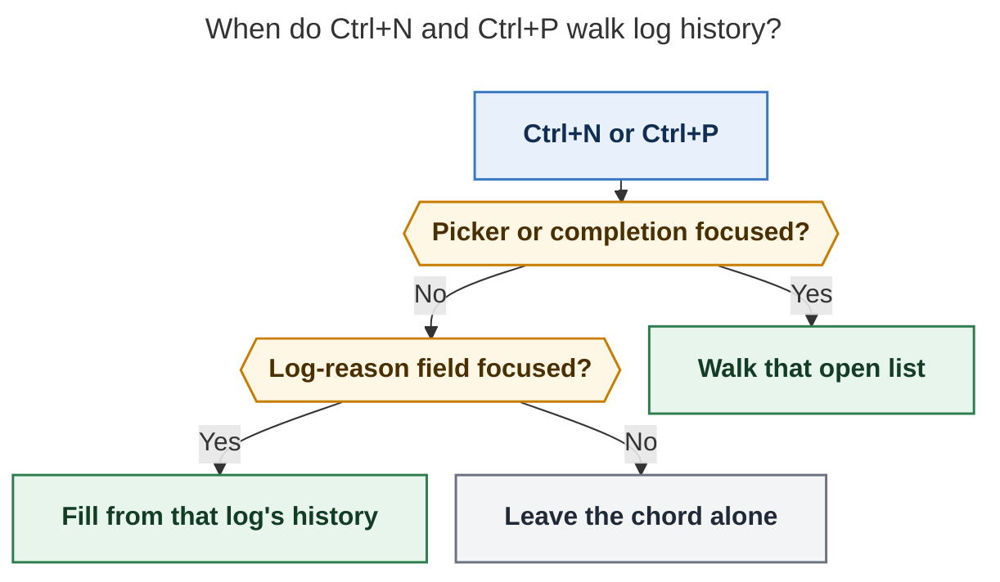
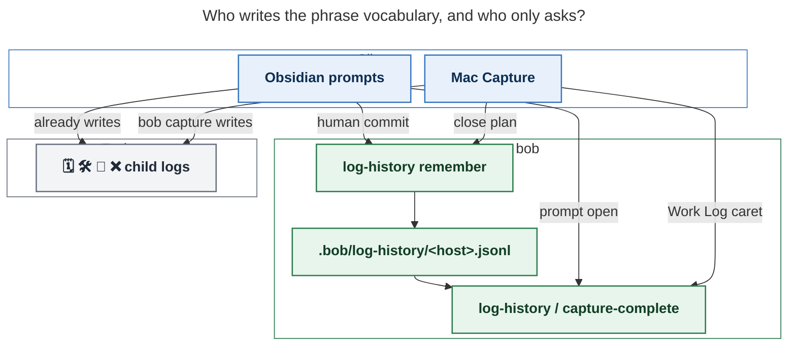

# Log-entry history for Ctrl+N/P: design critique and recommended solution

> **Context:** Independent swarm report (`__grk`) written **2026-11-19**. Grounded in
> a read-only audit of Bryan's Bob vault (`~/bob`, 6,934 Markdown files), bob-cli
> `5b4c2636`, bob-plugins `ccfc12b`, bob-mac-capture `868672fc`, audited SASE memory,
> prior research `research:202610/rotten_log_keep_history/rotten_log_keep_history.md`,
> and the established history UIs in GNU Readline, Emacs minibuffers, fish
> autosuggestions, and Atuin. Nothing in the vault or codebases was modified.

---

## Executive summary

**Build it. Do not ship a hidden bash-style stack and stop there.**

The instinct is right: every human log prompt today is a blank text field, and the
vault proves you retype the same sentences. The Work Log is the extreme case.
Of **598** human Work Log bodies, **358 (60%)** are repeats of just **38** phrases —
`athena agent` appears **104** times across **102** tasks, `apollo research` **93**
times across **92**. Ctrl+N/P that only walks an invisible list of 278 unique
summaries would be slower than typing. The feature is worth building if it is a
**visible, filtered, kind-separated phrase palette** that Ctrl+N/P fills from, sitting
on top of the live “what will be written” preview you already have.

Three of the four logs are *not* like the Work Log. Schedule Log is **97%
machine-written** (`🎲` rolls and `🤷 no reason given`). Rotten Log already shows this
task’s last three keeps. Cancel Log almost never repeats a sentence exactly. History
is still justified in those prompts, because the prompt only appears when a *human*
reason is needed, and those human reasons do cluster (`Or today?` ×15, `Duplicate`,
`Need to verify this still.`). They do not justify a second architecture.

**Bottom-line recommendation**

1. Store **four** independent global histories — Schedule, Work, Rotten, and Cancel —
   of **human phrase bodies**, never dated log lines, never `🎲`/`🤷`/`🍂`/`🪢`/`📥`
   machine text.
2. Bind **Ctrl+N/P** to “fill from this field’s history,” matching GNU Readline
   `previous-history` / `next-history`, while **showing** the matches as a quiet
   list. Empty field: recency. Nonempty field: prefix-then-substring filter (zsh
   `history-search-backward`, not fuzzy-for-v1).
3. Put the vocabulary in **bob’s `pref_journal`**, `.bob/log-history/<host>.jsonl`,
   with frecency fold, a 200-phrase cap per kind, and a one-time vault backfill.
   Bob is the only writer. Plugins and Mac Capture *ask* bob.
4. Build **one** shared Log Reason field and reuse it at every prompt site. On the
   Mac, grow `bob capture-complete` additively for Work Log bullet text (Ctrl+N/P
   already cycle completions). Do not add a new `capture-*` command.



*Ctrl+N/P already mean “move in the active list” in Bob. Log history is that list
when — and only when — a log-reason field is focused.*

---

## 1. Critique of the plan in general

Is adding Ctrl+N/P history to log prompts a good idea? **Yes for the Work Log, and
yes-with-a-narrower-ambition for the other three.** The original framing under-specifies
the interaction and over-indexes on “store three stacks, cycle them.”

### 1.1 What the request gets right

- **The prompts are a real speed bump.** Task Card schedule-review, cancel-reason,
  lane-release, the unlink Work Summary modal, Rotten Keep / Stay, Alt+N release,
  capture `x` Work Log bullets (`⌃J`), and the pull-in “Why cancel?” field are all
  blank inputs with a live formatted preview and no recall. You asked for history
  because you already feel the retyping.
- **Separate stores per log kind, global across tasks**, is the right grain. Mixing
  `athena agent` into a schedule-reason field would be a category error. Scoping
  history to the current task would miss the actual reuse pattern: Work Log phrases
  hop across **hundreds** of tasks.
- **Ctrl+N/P is the right chord.** Bob already documents `^N`/`^P` as list motion
  (relation card, command mode, album picker, successor picker, capture completions,
  pull-in offers). GNU Readline binds the same chord to `previous-history` /
  `next-history`. Emacs uses `M-p`/`M-n` for minibuffer history, with a **separate
  list per kind of argument** — exactly the “schedule vs work vs cancel” split.

### 1.2 Where a naïve stack would fail

- **Cycling without a filter does not scale.** 278 unique human Work Log phrases is
  already past the point where “press Ctrl+P until you see it” wins. Atuin exists
  because readline Ctrl+P and Ctrl+R both fail once history is large; its default is
  a *visible* fuzzy list with frecency. Fish’s winning trick is even quieter: a
  ghost suffix from history, accepted with →, plus ↑ for prefix search.
- **Capture is not a modal.** `bob capture` has no interactive schedule or rotten
  stage (`docs/projects.md`: a captured task is a brand-new line, so the `🤷`
  fallback never applies). The Mac prompt you actually type into is a **Work Log
  bullet** under `x`, plus the pull-in cancel field. Treating “Obsidian and the
  capture panel” as one UI would hide that.
- **Ctrl+N/P is already claimed.** In `FilteredPickerModal.handleKeydown`, Ctrl+N/P
  move `selectedIndex`. Log stages currently return **one** preview row, so the
  chord is a silent no-op — free to retarget. In capture, the same chord is
  `nextCompletion` / `previousCompletion` when a completion list is visible, and
  `nextPullInOffer` / `previousPullInOffer` on the pull-in card. A hidden history
  stack that steals those chords inside a picker would break muscle memory Bob
  spent a year teaching.
- **Rotten already has task-local history, and it is the right shape for audit.**
  `RottenKeepReasonStage` renders an `EARLIER KEEPS` band of this task’s last three
  dated entries (`bob-rotten-history-*` in `styles.css`). Global phrase recall is a
  *second* band, not a replacement. The original storage list omitted Rotten even
  though the prompt list included it.
- **Most Schedule / Rotten bytes are not reusable phrases.** History that ingested
  every `🎲 P2 → P3 · in **17** (8–30) days` or `🤷 no reason given` line would
  drown the human sentences. The task-local logs stay the audit trail. The new
  store is a **vocabulary of reasons you typed**.

### 1.3 Would I take a different approach?

I would take the same *goal* (reuse log sentences faster) and a different *object*:

| Original framing | Better object |
| :--- | :--- |
| Four dated log streams you cycle blindly | Four **phrase vocabularies**, filtered, ranked by frecency |
| Ctrl+N/P as bash history, list optional | Ctrl+N/P **fills** from a **visible** match list (Readline + Atuin compact) |
| Store “somewhere” | bob `pref_journal`, same fold as themes/relations |
| Implement at each prompt | **One** Log Reason field, parameterized by kind |
| Mac as a second prompt modal | Mac Work Log history **is** `capture-complete` (the chord already works) |

I would **not** replace the task-local logs, would **not** put keep reasons in the
Work Log (settled by `decisions:rotten-keeps-are-logged`), and would **not** invent
a new capture grammar token for “reuse last summary.”

---

## 2. Justified adjustments to the requirements

Call-outs relative to the original request. Each one is a requirement change, not
polish.

| # | Original | Adjustment | Why |
| :--- | :--- | :--- | :--- |
| **A1** | Histories for schedule, work, and cancel only | **Add Rotten as a fourth independent history** | Rotten is in the prompt list. Human keep reasons already repeat (`Need to verify this still.` ×5). Task-local `EARLIER KEEPS` stays; global `USED BEFORE` is extra. |
| **A2** | “Log history” as stored entries | Store **normalized human bodies** only (whitespace-collapsed, casefolded key, original display of the latest use). Never dated `*YYYY-MM-DD* — …` lines | Dates, `· kept N× in Ready` tails, and roll windows are per-event. Reuse is the sentence. |
| **A3** | Unspecified ingest | **Exclude machine text:** leading `🎲` `🤷` `🍂` `🪢` `📥` `🔓`, and the literal `no reason given`. Blank commits never enter the vocabulary | 2,842 / 2,922 Schedule entries are machine. 80 / 137 Rotten entries are `🤷`. Ingesting them would make Ctrl+P useless. |
| **A4** | Filtering/preview left open | **Ship both.** Prefix filter when the field is nonempty; substring fallback; no fuzzy in v1. Keep the existing formatted-entry preview; add a `USED BEFORE` list of up to 7 rows | 278 unique Work phrases make unfiltered cycling slower than typing. Live preview of *the write* already exists in every host. |
| **A5** | Ctrl+N/P “navigate through history” | In a log field: **Ctrl+P older, Ctrl+N newer, replacing the field** (Readline) **and** moving the list highlight. Enter always commits **the field**, so blank/`🤷` contracts stay. Tab is **not** stolen | Task Card schedule-review already uses Tab to cycle Reason ↔ Work summary ↔ Back (`cycleScheduleReviewFocus`). Relation card Tab accepts a label. Capture Tab is editor-assist / accept-completion. |
| **A6** | Unspecified storage | **`.bob/log-history/<host>.jsonl`** via `pref_journal` (O_APPEND, last-writer-wins, `merge=union`). Event `log.use` `{v:1, kind, text, norm, n}`. Cap **200 unique per kind**. Frecency = recency × uses | Matches `decisions:theme-prefs-live-in-per-host-journal` and `relation-label-prefs-live-in-per-host-journal`. Vault-scan-on-prompt is 6,934 files. Plugin `data.json` would not reach the Mac. |
| **A7** | Unspecified owner | **bob is the only writer.** `bob log-history` (read, `--kind`, `--query`) and `bob log-history remember` (write). Capture close records Work phrases itself. Plugins spawn `remember` after a human commit, never block the vault write on it | `cli_rules.md`: read-only reports stay top-level; `capture-*` names are frozen siblings. Mac is a thin client (`decisions:mac-capture-is-a-thin-client`). |
| **A8** | Implement “in Obsidian and the capture panel” as peers | **Obsidian owns every kind.** Mac v1 is Work Log bullets through `capture-complete` plus pull-in cancel when that field is focused. No schedule/rotten prompt on the Mac today | Documented: capture never prompts for a schedule reason; capture/Rust never write the Rotten Log. |
| **A9** | New UI per host | **One `LogReasonField`** (JS) / one completion kind (Rust/Swift). Six prompt copies of history logic is how this rots | There are already four JS prompt skins for the same job (Task Card stages, `WorkSummaryPromptModal`, `RottenKeepReasonStage`, `FreshnessRefreshSummaryModal`). |
| **A10** | Optional current-task bias | Global store, **rank current-task phrases first** when the focused task has used them, then frecency. Do not split the store | Honors “for all tasks” and still makes *this* task’s last summary one Ctrl+P away. |

---

## 3. What the vault says about reuse

Read-only parse of `~/bob` on 2026-11-19: every `🗓️ **SCHEDULE LOG**`,
`🛠️ **WORK LOG**`, `🥀 **ROTTEN LOG**`, and `❌ **CANCEL LOG**` parent, taking
direct-child `*stamp* — body` lines. Nested Work Log details are ignored.
“Human” means the body does not start with a machine emoji and does not contain
`no reason given`.

| Kind | Parents | Entries | Human | Machine / `🤷` | Unique human phrases | Phrases used more than once | Repeat occurrences | Cross-task phrases |
| :--- | ---: | ---: | ---: | ---: | ---: | ---: | ---: | ---: |
| **Work** | 496 | 605 | **598** | 7 | 278 | **38** | **358 (60% of human)** | 38 |
| **Schedule** | 862 | 2,922 | 80 | **2,842 (97%)** | 51 | 7 | 36 | 7 |
| **Rotten** | 62 | 137 | 33 | **104** (80 `🤷`) | 26 | 4 | 11 | 4 |
| **Cancel** | 118 | 118 | 118 | 0 in this parse | 112 | 5 | 11 | 5 |

**Work Log is the feature.** Keyword coverage on 605 entries: `agent` 238,
`apollo` 234, `athena` 204, `research` 195. Top phrases:

| Phrase | Uses | Distinct tasks |
| :--- | ---: | ---: |
| `athena agent` | 104 | 102 |
| `apollo research` | 93 | 92 |
| `apollo agent` | 54 | 54 |
| `athena research` | 21 | 21 |
| `Launched agent on athena` / `research on apollo` / `Running research on athena` | 5 each | 5 each |

A prefix filter on `ath` or `apo` would turn the morning close loop into two
keystrokes. Per-task duplicates are almost nonexistent (3 Work parents repeat a
phrase on the *same* task). The reuse you feel is **cross-task**, which is exactly
the store you asked for.

**Schedule Log history is a human-reason feature, not a log-ingest feature.**
Once `🎲` / `🤷` / `🔓 unblocked by hand` are stripped, 73 human sentences remain.
`Or today?` appears 15 times on 4 tasks; `Maybe today?` 4; `I'm not home yet.`
and `Going to LBI!` 3 each. Those fire on explicit date picks — the only time
the Task Card prompts. Ingesting 2,842 roll lines would hide them.

**Rotten Log is sparse and already partly solved.** 62 parents, 33 human reasons,
4 cross-task phrases. `Need to verify this still.` is the only real global hit
(5 tasks). The keep prompt already lists this task’s earlier keeps. Global
history is a small win here; omitting it (original storage list) would still be
defensible. Including it (A1) is cheap once the field is shared.

**Cancel Log is high-entropy.** 112 unique reasons in 118 entries. Exact repeats
are `Duplicate`, `Kelly is handling this.`, `Obsoleted by \`bob bank\`!`,
`I don't like this idea anymore.`, `Research said not to do this.` (2–3 each).
Near-duplicates (`I don't like this idea anymore although I'll still do the bug
bash.`) want a prefix/substring filter, not a 118-deep cycle. Several cancel
reasons are *task-specific* (`See [[madagascar]]!`) and should still enter the
store: they do no harm if ranking is frecency, and Ctrl+P on an empty field
will prefer `Duplicate` over a one-off.

Compared with the October rotten-log census (Schedule 558 / Work 166 / Cancel 75
parents), the logs have grown, and Work Log reuse has concentrated around agent
launches. That concentration is new evidence this feature’s ROI has gone *up*
since the Rotten Log shipped.

---

## 4. Verified system facts

### 4.1 Prompt sites that would gain history

**Obsidian (bob-navigation-hotkeys, block-id-prompt, task-status-cycler)**

| Site | Kind | Host | Today’s preview | Ctrl+N/P today |
| :--- | :--- | :--- | :--- | :--- |
| Task Card `schedule-review` | Schedule (+ optional Work) | `370-picker-schedule-work-log.js` | Formatted `*from → to* — reason` plus Work line | No-op (one preview row) |
| Task Card `schedule-work-log` | Work (legacy/adjacent stage) | same | Work stamp preview | No-op |
| Task Card `cancel-reason` | Cancel | `380-picker-cancel-and-lane.js` | `❌ **CANCEL LOG**` preview; empty may log `🤷` | No-op |
| Task Card `lane-release-reason` | Work | same | “Why is this pending?” → Work Log | No-op |
| Unlink `WorkSummaryPromptModal` | Work | `block-id-prompt/src/090-prompt-modals.js` | `🛠️ **WORK LOG**` / `No work-log entry will be added.` | Unbound (Enter only) |
| Move to Next prompt | Work | `docs/plan.md` | Same Work preview | Unbound |
| `RottenKeepReasonStage` | Rotten | `195-rotten-keep.js` | Formatted keep/stay line **plus** `EARLIER KEEPS` (3) | Unbound |
| `FreshnessRefreshSummaryModal` | Rotten (batch) | `192-freshness-refresh-summary-modal.js` | Keep-reason preview | Unbound |
| Decay-card Stay stage | Rotten | same stage class | Stay preview | Unbound |

**Bob Mac Capture**

| Site | Kind | Host | Today | Ctrl+N/P today |
| :--- | :--- | :--- | :--- | :--- |
| `x` Work Log bullets (`⌃J`) and inline `x summary` | Work | `docs/capture-panel.md`, `cursor_in_close_log_text` | Close card already previews stamped entries | Completions if a list is visible; otherwise unused / picker-chip |
| Pull-in `CapturePullInReasonField` (“⊘ Why cancel?”) | Cancel | `CapturePullInChoiceView.swift` | One-line field, no phrase list | `nextPullInOffer` / `previousPullInOffer` **unless** the reason field wins focus |

Capture does **not** prompt for Schedule or Rotten reasons. `$<N>` writes a
deterministic `🎲` Schedule entry. `decisions:rotten-keeps-are-logged` forbids
capture/Rust from writing the Rotten Log.

### 4.2 Live preview already exists; phrase recall does not

Every host already answers “what bullet will this write?”:

- Work Summary modal: `bid-wlp-preview-marker` + italic stamp + summary
  (`styles.css` `.bid-wlp-*`, 560px card, accent-tinted 36px icon).
- Task Card log stages: a single `bob-cnp-schedule-reason-row` /
  `bob-cnp-cancel-reason-row` with `::` inline-field warning.
- Rotten: the same row **and** a dated `EARLIER KEEPS` list.

What is missing is “what have I typed before, on any task?” Rotten’s band is
the visual language to extend (`bob-rotten-history-title` muted small caps,
tabular date column, ellipsized reason). Global recall should look like that
band, not like a second command palette.

### 4.3 Ctrl+N/P is Bob’s list chord

Confirmed bindings:

- `FilteredPickerModal.handleKeydown`: ArrowDown / Ctrl+N, ArrowUp / Ctrl+P.
- Relation label stage: same chord, `moveRelationLabelSelection` (`decisions:relation-card-tab-accepts-ctrl-d-hides`).
- bob-command-mode sheet and argument completion.
- Album schema / bank category cards (`Ctrl+N` / `Ctrl+P` in ledger-tools).
- Mac capture: `KeyCode.n` + Control → `nextCompletion` when
  `completionVisible`; pull-in / inbox-route / picker / relation-label /
  gcal-note lists all claim the same chord.
- Mac Mission Control’s **Ctrl+digit** “Switch to Desktop N” is a different
  chord (`docs/window-keys.md`). Control-N the *letter* is already in
  production. This feature does not create a new OS conflict.

So the design rule is not “invent a history chord.” It is **don’t fight the
list chord**: when the log field is focused, the history matches *are* the
list; when a picker is focused, leave it alone.

### 4.4 Capture-complete already knows Work Log text

`capture_complete/engine.rs` `cursor_in_close_log_text`: a cursor in a Work
Log bullet or inline close entry suppresses block-link candidates (entries
reject `[[note#^id]]`) and still completes note/heading wikilinks. Empty
free text currently returns a successful empty list. That empty list is the
additive hook: a new `work_log` candidate kind, `schema_version` 1,
`origin: "history"`, replacement = the phrase. Theme completion already
ships `origin=history` Recent rows capped at five on an empty query. Copy
that shape.

`cli_rules.md` forbids adding a subcommand under `bob capture` and freezes
existing `capture-*` names. Growing `bob capture-complete` is the legal Mac
path. A new `bob log-history` group is the legal Obsidian/plugin path
(read-only report plus an explicit `remember` writer).

### 4.5 Journals already exist for this job

`src/native/pref_journal/mod.rs` owns `.bob/themes`, `.bob/relations`,
`.bob/attachments` (and bank): per-host JSONL, `O_APPEND`, malformed-line
budget, last-writer-wins by `(ts, host, path, line)`. Theme and relation
decisions rejected daily-note frontmatter, machine-local SQLite, and one
shared JSON object. Log-history is the same sync problem (apollo morning
review, Mac capture closes). Reuse the module; add namespace
`LOG_HISTORY { dir: ".bob/log-history", noun: "log history" }`. Track
`!/.bob/log-history/*.jsonl` and `merge=union`, same as themes.

Rejected here too: **deriving the palette by grepping the vault on every
prompt** (6,934 files, machine-line noise, no frecency of *prompt* use),
and **plugin `data.json`** (does not sync to Mac Capture).

---

## 5. External analogs (what “intuitive” actually is)

| Analog | Chord | What it shows | What we steal | What we refuse |
| :--- | :--- | :--- | :--- | :--- |
| **GNU Readline** | Ctrl+P / Ctrl+N fill; Ctrl+R incremental search; `history-search-backward` is prefix from start-of-line to point | Usually nothing | Fill-the-field; separate lists per kind (Emacs minibuffer does this explicitly); prefix search when nonempty | Ctrl+R as a second mode in v1; ingesting the entire dated log |
| **Emacs minibuffer** | `M-p` / `M-n`; `M-r` regexp | The field itself | *Separate history variables per argument kind*; Enter commits the field, not a highlighted foreign row | A regexp search prompt inside an already-tiny reason field |
| **fish autosuggestions** | Ghost suffix; → / Ctrl+F accept; ↑ prefix-search | Dim inline ghost from history | Ghost as **v2** on single-field prompts (caret at end, field is a prefix of the top match) | Ghost in v1 on the two-field schedule-review form, where it would fight Tab |
| **Atuin** | Ctrl+R TUI; ↑ can be prefix or fuzzy; Enter runs, Tab edits | Full list, frecency, filter modes (global / session / directory) | Visible list, frecency, cap, “Tab edits / Enter commits” as a *possible* split we **do not** take in v1 | A fuzzy TUI, directory/session filters, encrypted sync server |
| **Bob similar-tasks** | Settle 350 ms; zero pixels unless a match clears the bar | Heads-up rows, Return never intercepted | Settle-gated fetch; no empty-state copy; bob owns meaning, client owns pixels | Making history a “possible duplicate” of the current *task* |
| **Bob theme Recent** | Completion list, `origin=history`, cap 5 empty / 12 filtered | Named rows under Recent | Empty-query recents cap; history origin on Mac completions | A create-row — the typed text *is* the create |
| **Bob Rotten EARLIER KEEPS** | Display only | This task’s last 3 dated events | Visual language for the global band | Using it as the global store |

Nielsen-style autocomplete guidance (show suggestions, keep the user’s text
authoritative, don’t auto-submit) lands on the same rule as similar-tasks:
**Return never changes.** Enter commits the field you see. History never
auto-logs.

---

## 6. Recommended interaction (the beautiful part)

### 6.1 One field, four skins

A shared **Log Reason field**:

1. **Header** already owned by the host (🥀 keep, 🛠️ unlink, ❌ cancel, 🗓️
   schedule). Do not restyle those.
2. **Input** with the existing placeholder (`Why this date?`, `What did you get
   done?`, `Why keep it in Ready?`, `Why cancel it?`).
3. **Write preview** (existing row): the exact bullet that will be prepended,
   including stamp, `::` warning, and blank/`🤷` copy. This row is **not** in
   the history list. It always reflects the field.
4. **`USED BEFORE` band** (new): up to 7 phrases for this kind. Zero pixels
   when the folded journal is empty (similar-tasks: no “No history” line).
   Each row: kind emoji as a quiet gutter, ellipsized phrase, faint
   `×N · last used` meta. Highlight follows Ctrl+N/P.
5. **`EARLIER KEEPS` band** (Rotten only, existing): this task’s dated events.
   Not navigable by Ctrl+N/P. Audit, not vocabulary.
6. **Footer**: add `^P` `^N` `reuse` next to the existing `↵` / `esc` hints,
   only when the band has rows.

On the two-field schedule-review form, each focused input has its *own*
history (Schedule vs Work). Ctrl+N/P never jumps fields; Tab still does.

### 6.2 Key contracts

| Key | Behavior |
| :--- | :--- |
| **Ctrl+P** | Older match for this kind fills the field; highlight moves. Empty field → frecency recents. Nonempty → prefix matches, then substring. Wrap with a one-frame bump, no error toast. |
| **Ctrl+N** | Newer match, same rules. From the newest, restores the **draft buffer** (what you were typing before the first Ctrl+P), like Readline’s “current line.” |
| **Typing** | Edits the field, resets the history cursor, refilters the band. A recalled phrase you then edit is a new candidate on commit if it isn’t a duplicate. |
| **Enter** | Commits the **field**, unchanged blank/`🤷`/Esc rules. History highlight does not override a blank Enter. |
| **Esc / q / Ctrl+[** | Host cancel. Unchanged (`decisions:q-and-ctrl-bracket-mirror-esc`). |
| **Click a USED BEFORE row** | Fills the field; does not commit. |
| **Tab** | Unchanged host behavior. |
| **ArrowUp / ArrowDown** | In Task Card log stages, keep them aliased to Ctrl+P/N *once history rows exist*, so the existing `handleKeydown` mapping stays honest. In the unlink modal (no list today), arrows stay native caret motion; only Ctrl+N/P fill. |

First-use empty journal: the band is absent, Ctrl+N/P no-op, footer omits
`^N`/`^P`. After the first remembered phrase, the next prompt shows it.

### 6.3 Mac Capture specifics

**Work Log bullets.** When `cursor_in_close_log_text` and the caret is in free
text (not inside `[[`), `bob capture-complete` returns `work_log` rows. Empty
query: top 5 recents (`origin=history`), matching theme Recent. Typed query:
prefix then substring, cap 12. Wikilinks keep precedence inside `[[`. Ctrl+N/P
already cycle completions; Tab already accepts. The close card remains the
write preview. Do **not** open a second modal.

Settle the complete call on the existing completion lane (not a new spawn per
key). Similar-tasks already proved a 350 ms settle plus `decodeIfPresent` keeps
old bob working.

**Pull-in cancel.** While `focusTarget == .pullInReasonField`, Ctrl+N/P fill
from the Cancel vocabulary and must **not** move offer highlight
(`CaptureKeyCommandRouter` needs that branch). Esc already restores
(`restorePullInReason`). Show a compact 3-row list under the field only after
the first Ctrl+P or once two characters match — the pull-in card is dense.

**Idle agenda / similar-tasks / stash / templates** keep their chords.

### 6.4 Beauty rules (non-negotiable)

- Kind color is the existing log emoji plus a 14% tint on the host icon
  (Rotten already uses `color-mix(in srgb, var(--color-red) 14%, transparent)`;
  Work modal uses `--interactive-accent`). Do not invent a fourth palette.
- The write preview stays the loudest row (valid / empty / warning classes
  already exist). USED BEFORE is muted. Highlight is a 1.5px accent bar, not
  a filled command-palette row.
- Phrases ellipsize; the write preview never does (you need to see `::`).
- No percentages, no “match score,” no task titles in the global band (that
  would leak other tasks’ names into a keep on this one). Optional v2: a
  tooltip with last-used date.
- Reduced-motion: no slide; opacity only (pull-in field already uses
  `.animation(reduceMotion ? nil : .snappy…)`).



*The task-local log remains the audit trail in the note. The journal is only
the phrase palette that Ctrl+N/P reads.*

---

## 7. Storage and ranking

**Event** (one JSON object per remember):

```json
{"v":1,"ts":"2026-11-19T09:41:00-05:00","host":"mac","kind":"work","text":"athena agent","norm":"athena agent"}
```

`kind` ∈ `schedule` | `work` | `rotten` | `cancel`. `norm` is Unicode
casefold + collapsed whitespace + stripped trailing punctuation. Empty,
machine-prefixed, and `no reason given` values are refused at the door.

**Fold:** last writer wins per `(kind, norm)` for display `text`; `n` is the
count of remember events; `ts` is the latest. Sort key: `n / (age_hours + 2)`
(standard frecency, Atuin-style; exact constants can be tuned once). Return
at most 200 folded phrases per kind; remember still appends, fold drops the
tail.

**Backfill (once):** walk vault logs, skip machine bodies, emit synthetic
`log.use` events with `n` = occurrence count and `ts` = parsed stamp (Work
has minute precision; others day). Day-one Ctrl+P on a Work Log bullet already
offers `athena agent`. Re-running backfill is idempotent on `norm`.

**Current-task boost:** query takes an optional `task` ref. Phrases whose
latest vault occurrence (from a cheap in-memory map built at prompt open from
the *current task’s* log children, not a vault scan) sit in a first group.
Rotten’s dated `EARLIER KEEPS` remains a separate band so “kept 3× in Ready”
does not collide with the phrase palette.

**Failure:** unreadable journal is an error for `remember` (do not pretend to
store); query degrades to empty + one bounded warning. A failed remember
**must not** roll back the task-log write. Next backfill recovers.

**Privacy:** the journal lives in the vault and syncs with it. That is
appropriate for a personal GTD store and identical to theme hide events. Do
not put other tasks’ *titles* in the palette.

---

## 8. Implementation map

Ship in this order so mixed versions stay safe.

1. **Decision record + glossary.** New record “Log reason history is a
   per-kind phrase journal.” Glossary: the four task-local logs stay as they
   are; add a sentence that prompt recall reads the journal, not the child
   bullets. Rotten’s `EARLIER KEEPS` sentence stays.
2. **bob-cli.** `pref_journal` namespace; `bob log-history` JSON (`kind`,
   `query`, optional `task`, `phrases[{text,n,last_used}]`); `bob log-history
   remember`; `bob log-history backfill`; capture close records Work phrases;
   `capture-complete` additive `work_log` kind when `cursor_in_close_log_text`.
   `schema_version` stays 1. Help is colored and complete. Tests for machine
   exclusion, cap, frecency, and mixed old-client `decodeIfPresent`.
3. **bob-plugins, one field.** Extract `LogReasonField` from
   `RottenKeepReasonStage` + `WorkSummaryPromptModal` preview. Wire Task Card
   log stages (override `handleKeydown` so Ctrl+N/P fill instead of wrapping
   a one-row list), unlink modal, lane-release, batch keep, decay Stay.
   Prefetch journal on prompt open (one spawn). `remember` after successful
   write, async. Footer hints. Screenshot goldens for the band.
4. **bob-mac-capture.** Decode `work_log` completions; pull-in reason-field
   Ctrl+N/P branch; no new modal. macOS CI on the exact SHA.
5. **Docs.** Plugin references, `docs/capture.md` Work Log bullet completion,
   `docs/projects.md` schedule-reason prompt, Mac `capture-panel.md`. No
   README essay (`docs.md` routing).

Do **not** wait on a vault-wide log index, embeddings, or a Settings toggle.
Rollback is `rm .bob/log-history/*.jsonl` plus ignoring unknown complete
kinds.

---

## 9. Alternatives considered

| Alternative | Verdict | Why |
| :--- | :--- | :--- |
| Hidden Ctrl+N/P stack only (literal request) | Reject as v1 | 278 Work phrases; undiscoverable; fights Task Card’s existing list chord |
| Fuzzy Atuin TUI / Ctrl+R | Reject for v1 | Overkill for 7 visible rows; second mode to teach; Ctrl+R is already “rerun” in command mode |
| Vault-scan at every prompt | Reject | 6,934 files; machine-line noise; Mac spawn budget |
| Plugin-local history | Reject | Breaks Mac; breaks apollo↔Mac review |
| Ingest dated log lines | Reject | Mixes stamps, roll windows, `· kept N×` tails with the reusable sentence |
| Per-task history only | Reject | Work reuse is 102-task `athena agent`, not same-task |
| One mixed history for all kinds | Reject | Category error; original request already split them |
| Steal Tab to accept | Reject | schedule-review field cycle; relation accept; capture editor-assist |
| Enter commits the highlighted history row even when the field is blank | Reject | Would log a phrase on a “skip” Enter and break `🤷` / “no Work Log” contracts |
| Mac-side Swift store | Reject | Thin-client decision; JSON must come from bob |
| New `bob capture-log-history` | Reject | `capture-*` names are frozen |
| Ghost suffix in v1 | Defer | Beautiful on single-field prompts; fights two-field Tab. Revisit after the list ships |
| Settings toggle | Not in v1 | Same as Rotten Log v1: ~one extra chord, easy rollback |

---

## 10. Recommended solution

Build a **per-kind phrase palette**, not a second copy of the task logs.

1. **Four journals, one module.** Schedule, Work, Rotten, Cancel. Human
   bodies only. `.bob/log-history/<host>.jsonl`, bob-owned, frecency, cap
   200, one-time backfill so tomorrow morning’s `⌃J` already offers
   `athena agent`.
2. **Ctrl+P / Ctrl+N fill the focused field** from that kind’s matches
   (empty = recents, typed = prefix then substring) and move a muted
   `USED BEFORE` highlight. Enter still commits the field. Esc still
   writes nothing. Tab still belongs to the host.
3. **Keep the write preview you already have** — it is the live preview
   that matters — and add the phrase band only when there is something to
   reuse. Rotten keeps `EARLIER KEEPS` for this task’s dated audit.
4. **One shared field in Obsidian; capture-complete on the Mac** for Work
   Log bullets; a focus-scoped exception for pull-in cancel. No new capture
   grammar, no new modal, no stolen picker chords.
5. **Ship Work first if the epic must split.** The vault says 60% of Work
   bodies are repeats across tasks. Schedule/Cancel/Rotten ride the same
   field for free once it exists.

That is the version I would bet the morning review on: the chord you asked
for, the filter the Work Log empirically requires, the journal Bob already
knows how to sync, and the preview language the prompts already speak.

## Method and sources

Independent `__grk` report. 2026-11-19. No product code, memory note, or vault
file was changed. Peer swarm reports were not read.

- **Vault (read-only):** 6,934 Markdown files under `~/bob`; parser for the
  four managed-log parents and `*stamp* — body` children; machine-emoji and
  `no reason given` exclusion.
- **bob-cli `5b4c2636`:** `docs/projects.md` schedule-log reason prompt;
  `docs/capture.md` / `docs/plan.md` Work Log; `docs/reference/cli/capture-complete.md`;
  `src/native/pref_journal/mod.rs`; `capture_complete/engine.rs`
  `cursor_in_close_log_text`; `capture_schedule_log.rs` / `capture_work_log.rs`
  / `task_cancel/line.rs`.
- **bob-plugins `ccfc12b`:** `FilteredPickerModal` Ctrl+N/P;
  `370-picker-schedule-work-log.js`; `380-picker-cancel-and-lane.js`;
  `195-rotten-keep.js` `EARLIER KEEPS`; `090-prompt-modals.js`
  `WorkSummaryPromptModal`; `styles.css` `.bid-wlp-*` / `.bob-rotten-history-*`.
- **bob-mac-capture `868672fc`:** `CaptureKeyCommandRouter.swift` Ctrl+N/P
  completions, pickers, pull-in; `CapturePullInReasonField`;
  `docs/capture-panel.md` `⌃J` Work Log bullets.
- **Audited memory:** `glossary` Work / Schedule / Rotten logs; `cli_rules.md`;
  `sase_artifacts.md`; decisions `mac-capture-is-a-thin-client`,
  `theme-prefs-live-in-per-host-journal`,
  `relation-label-prefs-live-in-per-host-journal`,
  `relation-card-tab-accepts-ctrl-d-hides`, `similar-tasks-are-a-settled-heads-up`,
  `rotten-keeps-are-logged`, `q-and-ctrl-bracket-mirror-esc`.
- **Prior research:** `research:202610/rotten_log_keep_history/rotten_log_keep_history.md`
  (task-local Rotten Log; prompt-with-history as display, not a global store).
- **External:** GNU Readline `previous-history` / `next-history` /
  `history-search-backward`; Emacs *Minibuffer History* (separate lists per
  argument kind); fish autosuggestions; Atuin filter modes and frecency.
