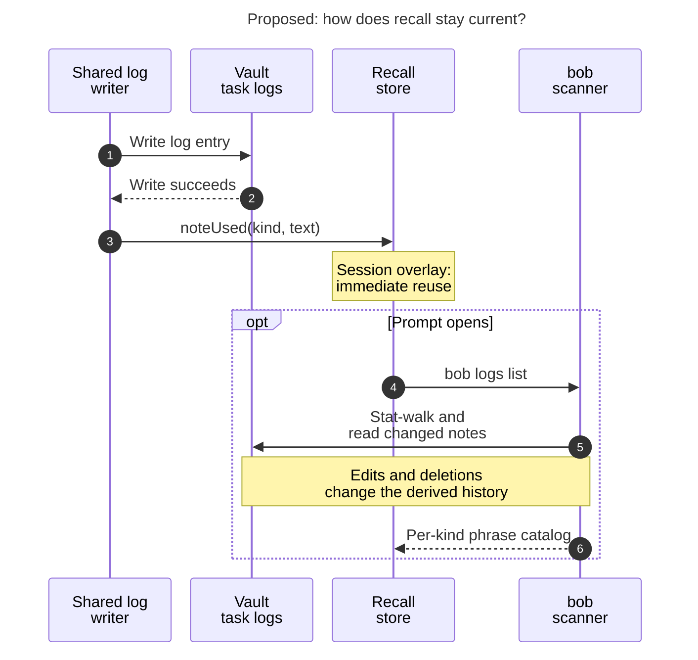
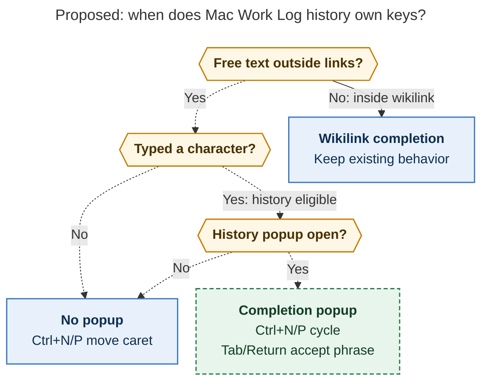

# Diagram proposals: Reason Recall: log-entry history for Ctrl+N/P in Bob's log prompts

Proposals for the swarm linker, not a report. Each diagram restates only what the source
report says.

```yaml
source: research:202611/log_reason_history/log_reason_history__final.md
producer: research.5h.image
check: "mmdc 12.0.0 with the PDF-mirroring config rendered 2 of 2 Mermaid diagrams; Puppeteer --no-sandbox; invalid-source rejection verified"
```

## vault-owned-history

```yaml
anchor: |-
  the log write *is* the history write. A journal is a second copy
question: |-
  How does recall stay current without a second durable phrase database?
illustrates: |-
  The log write is the history write, while the in-session overlay makes immediate reuse exact and prompt-open revalidation reads the current per-kind catalog.
caption: Successful writes feed immediate session recall; vault-derived history respects note edits and deletions without a second durable phrase database.
review: "760x719 px, fit 85.9%; question, source tracing, labels, arrowheads, crossings and reading direction passed; 0 visual revisions; 1 pre-render syntax correction"
```



## capture-completion-routing

```yaml
anchor: |-
  existing completion popup supplies keys (`Ctrl+N/P` cycle, Tab/Return accept),
question: |-
  When does Mac inline Work Log history own Ctrl+N/P?
illustrates: |-
  Within inline Work Log text, history is eligible outside wikilinks after a typed character, and Ctrl+N/P navigate candidates only while the completion popup is open.
caption: Within inline Work Log text, history needs free text and a typed character; an open popup owns navigation, otherwise caret motion stays native.
review: "677.924x808 px, fit 96.3%; question, source tracing, labels, arrowheads, crossings and reading direction passed; 1 visual revision clarified caret motion; converging No branches mean either"
```


