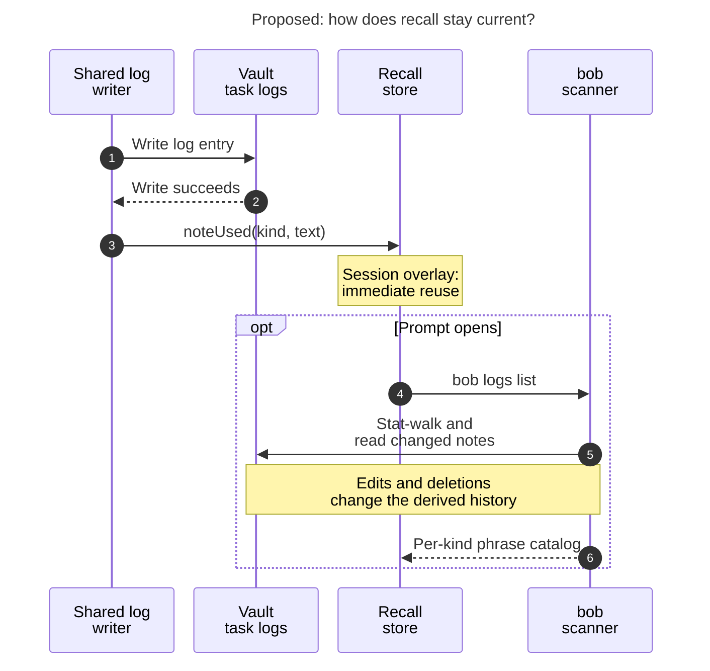
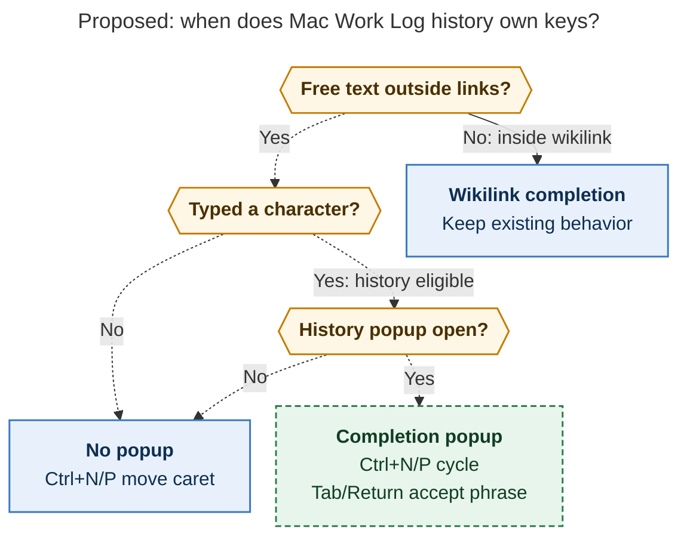

# Reason Recall: log-entry history for Ctrl+N/P in Bob's log prompts

> **Research query:** Users re-type the same Schedule, Work, Rotten, and Cancel log
> entries across tasks in Obsidian and the capture panel. How should Bob add
> `Ctrl+N`/`Ctrl+P` navigation through each log's history, with the schedule, work, and
> cancel histories stored separately but shared across all tasks, and is filtering or
> live preview of past entries worth adding? Critique the plan, call out any justified
> requirement changes, and recommend an intuitive, reliable, and beautiful solution.


## Bottom line

**Build it. All five reports independently reached "yes, with adjustments," and the
vault data is unambiguous.** Roughly half to 60% of human Work Log entries repeat an
earlier phrase across tasks (`athena agent` alone ~104 uses across ~102 tasks), the
Rotten keep prompt collapses to `🤷 no reason given` ~70% of the time — close to the
">80% 🤷 in a month" threshold that `decisions:rotten-keeps-are-logged` names as its
reopen condition — and schedule deferrals like `Or today?` repeat on consecutive
days. The pain is real and the fix is cheap relative to its daily payoff.

But every report also found that the request **as literally written would ship
[usability bugs](#adjusted-requirements-called-out-explicitly)**. The consolidated
design keeps the goal (reuse log sentences in two keystrokes) and changes three things:

1. **Four histories, not three.** The storage bullet omits the Rotten Log even
   though the prompt list includes it; Rotten is the log most starved for reasons.
2. **A visible, filtered, ranked phrase band — not a blind bash-style stack.**
   Unfiltered invisible cycling through ~280 unique Work phrases is slower than
   typing. Filtering is not optional polish; it is most of the value (measured: two
   typed letters more than double the one-press hit rate,
   [vault evidence](#what-the-vault-actually-shows)).
3. **History is derived from the vault, not stored in a new database.** Every
   submitted reason already lands durably in a task's log at the moment of use. A
   read-only `bob` scanner over those logs gives 500+ entries on day one, respects
   note edits and deletions, syncs across hosts via the vault itself, and eliminates
   the entire "did every writer remember to append?" failure class
   ([storage call](#storage-derived-from-the-vault)).

The recommended feature, in one paragraph: in every free-text Schedule, Work,
Rotten, and Cancel reason field — Obsidian Task Card stages, the standalone summary
modals, the batch keep form, the successor-picker inline cancel, the Mac pull-in
cancel field, and (via completion) Mac inline Work Log text — a muted
**[history band](#appearance)** below the existing live write-preview shows
previously used phrases for that log kind, ranked newest-pinned-then-frecency and
filtered live by what you've typed. `Ctrl+N`/`Ctrl+P` (and ↑/↓ where free) move
through the band and fill the field; typing edits and refilters; `Esc` restores your
draft; **Enter always commits exactly the visible text**, so every existing
blank-entry contract (`🤷 no reason given`, "no Work Log entry") is untouched. The
common case — "same reason as the last task" — is two keys: `Ctrl+P` (or `Ctrl+N`),
`Enter`.

## What the vault actually shows

Three reports (cld, grk, gem) independently parsed every managed-log child
(`*stamp* — body` under `🗓️ **SCHEDULE LOG**` / `🛠️ **WORK LOG**` /
`🥀 **ROTTEN LOG**` / `❌ **CANCEL LOG**`) across `~/bob`. Their counts differ in
dedup rules and scope (cld deduplicated `(stamp, body)` to drop split/merge copies;
gem's totals run lower, likely a narrower walk), but **every audit reaches the same
four conclusions**, so the spread does not matter:

| Log | Entries (range) | Human-typed | Distinct human | Repeat share of human writes | Dominant content |
|---|---|---|---|---|---|
| **Work** | 574–605 | ~500–600 | ~278–281 | **45–60%** | `athena agent` (~104), `apollo research` (~93), `apollo agent` (~54), `athena research` (~21) — top phrases are ~40–46% of all typed entries |
| **Schedule** | 746–2,922 | 23–80 | 23–51 | 0–23% | **~97% machine** (`🎲` rolls, `🤷`); human reasons are day-by-day deferrals (`Or today?` ×15) |
| **Rotten** | 110–137 | 28–33 | 26 | 7–33% | **~56–71% of keep opportunities end as `🤷`**; `Need to verify this still.` ×5 |
| **Cancel** | 117–118 | 113–118 | 110–112 | 3–8.5% | High-entropy one-offs; a few exact repeats (`Duplicate`, `Kelly is handling this.`) |

Conclusions all three audits share:

- **Work Log is ~85% of the value** and its reuse is *cross-task* (102 distinct
  tasks for `athena agent`), which is exactly the global store the request asks
  for. Per-task history would find almost nothing.
- **Machine text must be excluded** or it buries the human sentences ~30:1 in the
  Schedule Log: `🎲` rolls, `🤷`, `🍂` decay steps, `🪢` relation-cancel labels,
  `📬`/`🔓` markers, `Deleted in Google Calendar`, and merge-provenance reasons.
- **Filtering is load-bearing.** cld replayed the vault's actual Work Log history
  in chronological order: with pure recency and an empty field, only 21% of repeats
  are one press away and 53% within three; **after typing two letters, 46% are one
  press away and 88–92% within three**. Bryan's own zsh already binds
  `^P`/`^N` to `up-line-or-search`/`down-line-or-search` (chezmoi
  `home/dot_zshrc:141-142`) — filtered recall is the semantics his hands know.
- **Ranking: pin the newest, then frecency.** In the same replay, pure frecency
  wins the first press but breaks the request's core scenario ("the same entry
  again for a *different* task" — a brand-new reason would rank below `athena
  agent` on task 2). Newest-pinned-then-frecency keeps that case at one press and
  still reaches 74% ≤3 presses unfiltered / 92% with two letters. Use a ~7-day
  half-life as a tunable constant (cld tested 7d; gem proposed 14d untested).

A side observation worth its own follow-up (cld, grk): ~40% of Work Log entries are
`<host> agent/research` lines describing SASE runs that SASE itself launched.
History recall treats the symptom well; pre-staging that entry at SASE launch time
would be a bigger lever and is out of scope here
([open questions](#open-questions-for-bryan)).

## Verified surfaces and current key bindings

gem's audit found the most complete inventory — **13 Obsidian entry points + 2 Mac
surfaces** — consistent with cld's 12 and mus's 7 (coarser grouping). Condensed,
with the input → log-kind mapping that mus flagged as a shipping hazard (two
"scheduling" gestures write the *Work* Log, not the Schedule Log):

| Kind | Obsidian surfaces | Mac surfaces |
|---|---|---|
| **Schedule** | Task Card schedule-review *reason* field (`370-picker-schedule-work-log.js`) | — (`$<N>` writes an automatic `🎲` entry, no prompt) |
| **Work** | schedule-review *summary* field; post-roll/Pending work-log stage (same file); lane-release stage (`380-picker-cancel-and-lane.js`); `LaneReleaseSummaryModal` + Move-to-Next `TaskLinkLanePromptModal` (`190`/`196-…`); unlink `WorkSummaryPromptModal` (**block-id-prompt**, a separate plugin) | Inline close-log text (`x …`, `- 1 …`) in the capture editor |
| **Rotten** | `RottenKeepReasonStage` (single keep, decay-card Stay) and the separate batch-keep render path (`192`/`195`/`060-…`) | — (capture never writes the Rotten Log, per `decisions:rotten-keeps-are-logged`) |
| **Cancel** | Task Card cancel-reason stage (`380-…`); successor-picker inline reason (`206d-…`, **blur auto-commits** — hazard) | `CapturePullInReasonField` (**blur auto-confirms** — hazard; router claims only Return/Esc/Ctrl+[ when focused) |

**Explicitly excluded** (unanimous where discussed): the inline typed-date reason
(`3d waiting on X` in `280-notices-and-dates.js`), where Ctrl+N/P already moves the
date list; relation cancel labels (own vocabulary card); Work Log *detail* child
bullets (v1 recalls the summary line only).

Lead verification of the two load-bearing code claims:

- **The picker's log stages have no real list today.** Each of `schedule-review`,
  `schedule-work-log`, `lane-release-reason`, and `cancel-reason` returns a single
  frozen preview object as its *entire* filtered-items array
  (`410-picker-filter-and-render.js:31-88`), so the picker's Ctrl+N/P — bound at
  `200-filtered-picker-modals.js:192-199` as ArrowDown/`Ctrl+N` = down,
  ArrowUp/`Ctrl+P` = up — is currently a dead key in exactly the fields we want.
  The chord is free to claim there; the standalone modals have it unbound.
- **The Mac close-log choke point exists.** `completion.rs:1541` ("Work Log lines
  are literal text: no marker completion at all… wikilink completion keeps working")
  and `capture_complete/engine.rs:146` gate completion inside
  `cursor_in_close_log_text`; an additive `work_log` history candidate kind slots in
  exactly there, and Ctrl+N/P already cycle the completion popup when visible
  (`CaptureKeyCommandRouter.swift:756-762`).

## Adjusted requirements called out explicitly

| # | Original request | Adjustment | Why |
|---|---|---|---|
| A1 | Histories for schedule, work, cancel | **Four** histories: add **Rotten** | In the request's own prompt list; the log nearest its `>80% 🤷` design-reopen trigger; keep reasons are their own genre |
| A2 | Histories "stored" separately | **Derived** separately from the vault; no new store in v1 | [Storage call](#storage-derived-from-the-vault) — self-healing, zero cold start, no writer-coverage bugs |
| A3 | "Consider" filtering / live preview | **Both are required.** Live filter from the typed draft; keep every prompt's existing formatted write-preview; add the ranked band | Filter doubles the one-press hit rate; four prompts currently lack any preview and get the standard one as a side benefit |
| A4 | `Ctrl+N/P` "navigate history" | Scoped to focused log-reason fields/spans only; band-relative direction (`Ctrl+N` down / `Ctrl+P` up, dual entry); ↑/↓ aliases where free; **no wrap** (edge bump); IME-composing and modified chords ignored | Ctrl+N/P is Bob's list chord everywhere else; log fields are the one place it is currently dead (verified in [surfaces](#verified-surfaces-and-current-key-bindings)) |
| A5 | All log entries | **Human-typed text only**; machine prefixes, `🤷`, blanks, and structural tails excluded by a writer-constant classifier with a registry test | ~97% of Schedule entries are machine text; offering them buries the feature |
| A6 | (implicit) prompts map to logs by gesture | Mapping is **input → log-kind**, not gesture → kind: the schedule-review *summary*, scheduling work-log stage, lane-release, unlink, and Move-to-Next prompts all read/write the **Work** history | Two "scheduling" gestures write the Work Log; wiring by gesture would ship a wrong-history bug |
| A7 | "Obsidian and the capture panel" as peers | Obsidian first (nearly all value); Mac = pull-in cancel field + inline Work Log via `capture-complete`; capture has **no** Schedule/Rotten prompt to wire | Matches value to cost; thin-client decision keeps grammar and ranking in bob |
| A8 | (unspecified) | **Enter writes exactly what the field shows; nothing is ever pre-filled; recall failing never blocks a prompt** (no bob / timeout / mobile → keys inert, prompts unchanged) | The worst failure mode is silently logging a reason nobody chose |

## The three contested calls resolved

The five reports agree on far more than they disagree, but they split on three
design questions. These are the lead's resolutions with reasoning.

### Storage derived from the vault

*Derive from the vault (cld, gem) over a new typed-phrase journal (cdx, grk).*

cdx and grk proposed a bob-owned per-host journal
(`.bob/log-history/<host>.jsonl` via `pref_journal`, the themes/relations
precedent) recording each *use*; cld and gem proposed deriving history from the
logs the vault already contains via a cached scanner; mus landed between (capped
MRU seeded by a vault scan). **Derivation wins**, for reasons that defeat the
journal's own strongest arguments:

- **Every submitted reason is already durably written to the vault at the moment
  of use** — the log write *is* the history write. A journal is a second copy
  whose hardest problems (learn only at the successful-write boundary across ~15
  prompt paths in three codebases, failure isolation so a lost history append
  never re-runs a task write, idempotent receipts, backfill) consumed the bulk of
  cdx's and grk's designs. Derivation deletes that entire bug class: a forgotten
  writer can't leave a silent gap, undo can't leave stale entries.
- **No cold start and no backfill machinery.** 500+ human entries are available
  the first day; grk's one-time backfill and cdx's deferred import exist only to
  compensate for the journal's empty start.
- **Note edits and deletions are respected automatically.** Fixing a typo in a log
  entry fixes history; deleting a task's log removes its phrases. A journal
  diverges from the vault on every such edit. (This is also the v1 answer to
  "remove a junk suggestion": edit the note.)
- **Cost is measured and fine.** cld timed the scan: a stat-walk of 6,934 notes is
  61–74 ms; only ~106–124 notes contain a `LOG**` marker; a Rust scanner with a
  per-note `(mtime_ns, size)` fingerprint cache (the existing
  `relation_labels/scan.rs` / `pomodoro_themes/cache.rs` pattern) answers warm
  calls well under 100 ms including spawn.
- The journal's two genuine advantages are covered: **exact input recency** —
  Schedule stamps record the date *change*, not the typing time, but cld verified
  the earliest stamp date approximates the write day for the deferral pattern that
  dominates, and an **in-session overlay** (`noteUsed(kind, text)` called from the
  shared log writers after a successful write) makes the case that matters most —
  "same reason, next task, same sitting" — exact and instant. **Use counts**: a
  vault occurrence count *is* a use count, since each use writes an entry.

[The vault-owned history diagram](#figure-vault-owned-history) traces how one
successful log write feeds both the vault and the session overlay, and how
prompt-open revalidation reads the current per-kind catalog back through bob.

<div id="figure-vault-owned-history">



_Successful writes feed immediate session recall; vault-derived history respects note edits and deletions without a second durable phrase database._

</div>

Caveats carried from cdx: the scanner's machine-text classifier must be built from
the same constants the writers use, with a registry unit test that fails when a new
automatic writer's prefix isn't registered; strict kind-specific parsers (strip the
Rotten `· kept N×` / `· stayed …` tails before matching, Schedule transition
prefixes, Work detail subtrees) rather than heuristics. **Reopens if** the Schedule
recency approximation proves wrong in practice, or junk phrases demand a hide
feature — then `.bob/log-history/<host>.jsonl` joins as a low-churn *hide/unhide*
preference journal (the twin of theme/relation hides: suggestions-only, never
unhidden by use), which is the one part of the journal design worth keeping, in
phase 4 ([rollout](#rollout)).

### Presentation and direction as a visible ranked band

*A visible ranked band with Bob-native keys, entered by either chord.*

This is the real split. cdx and cld recommended invisible (or minimal-strip)
readline-style recall — `Ctrl+P` = older fills the field, no dropdown — to match
zsh muscle memory and avoid a list whose downward order would contradict
"P = previous." grk, gem, and mus recommended a visible filtered band; gem further
flipped direction to Bob-native `Ctrl+N` = down from rank #1.

**Resolution: visible band, Bob-native direction, with a dual-entry affordance.**

- **Visibility wins** because the list is what makes the feature discoverable,
  trustworthy (you see what a press will do before pressing — subsuming cld's
  footer "next-press hint"), and scalable to ~280 phrases; and because three of
  five reports plus the replay data say blind cycling underdelivers. The
  layout-stability worry (cdx) is handled by rendering the band *below* the
  existing write preview with a fixed row cap, and by gating it in dense surfaces
  ([appearance](#appearance)).
- **Bob-native direction wins** because the band is ranked by *relevance*
  (newest-pinned + frecency + match tier), not by time — so readline's
  "previous/next in time" is already a fiction here, while "next candidate down"
  is simply true. Bob has spent a year teaching `Ctrl+N` = down in every picker,
  the relation card, command mode, and — decisively — the Mac completion popup
  that this very feature reuses for inline Work Log text. A readline-direction
  Obsidian band plus a picker-direction Mac popup would make the feature disagree
  with itself.
- **The dual-entry rule preserves the zsh reflex.** From the draft state, *either*
  `Ctrl+P` or `Ctrl+N` enters the band at rank #1. Because rank #1 is the pinned
  most-recent matching phrase, the hard-wired `Ctrl+P`, `Enter` gesture still
  means "reuse the last reason" — two keys, same as zsh. Once in the band,
  `Ctrl+N` goes down, `Ctrl+P` goes up, and `Ctrl+P` above the top row restores
  the draft. The only divergence from the shell is deep chronological cycling,
  which the data says is the wrong tool past depth ~3 anyway — type two letters
  instead.

This deliberately differs from the relation card's accepted rule ("navigation never
edits the query" — `decisions:relation-card-tab-accepts-ctrl-d-hides`, read and
verified). That record governs a surface where the *list row* is the product being
chosen and Tab accepts it; here the *free text* is the product and the band only
speeds up typing it, so fill-on-navigate keeps the field the single on-screen
source of truth for what Enter writes. The failure that motivated that record —
refetch-per-accept collapsing the list to one row — cannot recur here because the
**filter keys off a preserved `draftQuery`, never off the filled field value**, the
catalog is fetched once per prompt, and selection is by normalized key, not index
(both lessons of that record are kept). Tab is not touched anywhere: it still
cycles Reason ↔ Work-summary in the schedule-review form
(`cycleScheduleReviewFocus`) and accepts completions in capture.

### Filtering and ranking by tiered literal matching

*Tiered literal matching over a frozen draft, no fuzz.*

- **Query = the draft**, live. Typing refilters the band; navigating never does
  (the `draftQuery` isolation gives cdx's "frozen query while cycling" for free).
  Empty draft matches everything (recents).
- **Match tiers** (gem's, matching the existing `pomodoro_themes/rank.rs`
  precedent): exact normalized → full prefix → word-boundary prefix (`ag` finds
  `athena agent`) → substring. Within a tier: pinned-newest first, then frecency.
  No fuzzy scores, no task-dependent ranking, no reordering of an open band when
  background data refreshes (selection survives by key).
- **Normalization**: NFC, whitespace-collapsed, casefolded key; display is the
  most recent original casing. Matching case-insensitive; stored text never
  rewritten.
- **Caps**: 200 folded phrases per kind served; 5–7 rows visible (scroll under a
  fixed max-height); ~200-char entry ceiling (mus) — longer bodies are real log
  entries but poor suggestions.

## Recommended design

### Interaction

```mermaid
---
title: "What does each key do in a log-reason field?"
accTitle: "Log-reason recall states"
accDescr: "A log-reason field is either showing your draft or a recalled phrase. Ctrl+N and Ctrl+P move through the visible ranked matches; Esc or going past the top restores the draft; typing adopts the shown text; Enter always commits exactly the visible text."
---
stateDiagram-v2
  direction TB
  state "Draft<br/>field shows your typed text<br/>band visible, nothing selected" as DRAFT
  state "Recalling<br/>field shows candidate k of n<br/>draft and filter preserved" as RECALL
  state "Committed<br/>the prompt's own Enter<br/>writes the visible text" as WRITE
  DRAFT --> RECALL: Ctrl+N or Ctrl+P<br/>fill top-ranked match
  RECALL --> RECALL: Ctrl+N next candidate down<br/>Ctrl+P back up
  RECALL --> DRAFT: Ctrl+P above top row,<br/>Esc, or Ctrl+[ restore draft
  RECALL --> DRAFT: typing or Backspace adopts<br/>shown text as new draft
  DRAFT --> WRITE: Enter (blank rules unchanged)
  RECALL --> WRITE: Enter
  classDef focus fill:#E8F1FB,stroke:#3B78C2,stroke-width:1.5px,color:#0F2E52
  classDef outcome fill:#E7F5EC,stroke:#2E7D4F,stroke-width:1.5px,color:#123D24
  class DRAFT focus
  class RECALL focus
  class WRITE outcome
```



*Recall is one decorator on the input: it only swaps the field's text, so every
prompt's own preview, validation, blank-entry fallback, and Enter path keep working
unchanged.* (Rendered 748×850 px, fit 87.3%, via `mmdc` 12.0.0 with the PDF
config.)

Key contract details beyond the figure:

- **Open state**: nothing selected (`selectedIndex = null`), field empty or
  host-provided, band muted below the write preview. An immediate Enter behaves
  exactly as today.
- **Esc layering** (per `decisions:q-and-ctrl-bracket-mirror-esc`): while
  recalling, Esc/`Ctrl+[` restore the draft and deselect — one layer; from the
  draft they run the host's normal cancel. `q` types in the field, as everywhere.
- **Typing while recalling** adopts the shown text as the new draft (so
  `Ctrl+P` → `Backspace` → edit "tweaks the last reason" naturally) and refilters.
- **Edges clamp with a ~120 ms bump** (the `bob-vim-yank-flash` feedback
  language); no wrap, no toast. Held-key `event.repeat` must not spin the band.
- **Click a band row** fills the field without committing — with a mousedown
  `preventDefault` / blur-suppression guard on the two **blur-commit surfaces**
  (successor-picker inline reason; Mac `pullInReasonFieldDidBlur()`), so a click
  can never auto-commit a half-typed filter (gem's hazard,
  [surfaces](#verified-surfaces-and-current-key-bindings)).
- **Accessibility**: announce "Recalled 1 of 3: apollo research" via the existing
  `aria-live="polite"` region / `accessibilityLabel`; focus never leaves the
  input; IME composition ignored; reduced-motion = opacity only.

### Appearance

*Quiet when idle, clear when recalling, no layout jumps.*

Merged from grk's "USED BEFORE band" and gem's drawer, in the prompts' existing
visual vocabulary — no new palette, no second command palette:

```text
🛠️  Release reason                       Wire the lexer · In Progress → Next
   ┌────────────────────────────────────────────────────────────┐
 ✎ │ ath▌                                                       │
   └────────────────────────────────────────────────────────────┘
 ✓ *2026-11-19 10:31* — ath                     ← existing write preview (loudest)
   USED BEFORE · matching “ath”                 ← new band (muted)
   ▸ athena agent                                104× · 2h ago
     athena research                              21× · yesterday
 ↵ Release & log   ⌃N/⌃P reuse   esc Cancel
```

- The **write preview stays the loudest row** and never ellipsizes (the `::`
  inline-field warning must stay visible); band phrases ellipsize at ~72 chars.
- Band rows: ellipsized phrase left, muted tabular `×N · last used` right. **No
  task titles in the band** — provenance would leak other tasks' names into this
  prompt; a tooltip may carry the last-used date.
- Highlight = the pickers' native selected-row treatment (a 1.5 px accent bar,
  not a filled palette row). Field icon flips `✎` → history glyph while
  recalling (Lucide `history`; SF Symbol `clock.arrow.circlepath`).
- **Zero pixels when there is no history** — no "No history" copy (the
  similar-tasks rule). Footer gains `⌃N/⌃P reuse` only when the band has rows.
- **Dense surfaces gate the band**: the Mac pull-in card and the successor-picker
  inline row show ≤3 rows, and only after a first `Ctrl+N/P` or ≥2 filter
  characters. Roomy modals show it on open.
- Rotten keeps its task-local **EARLIER KEEPS** block unchanged and clearly
  labeled apart from the global band — dated audit vs. reusable vocabulary.
- The **batch keep form and `LaneReleaseSummaryModal`** (currently bare inputs,
  no hints) adopt the standard preview + footer as part of this work — an
  existing inconsistency this feature fixes in passing.

### Data layer

*Read-only `bob logs list`.*

Per the verified CLI rules (read-only reports stay top-level or under a noun with
a stated membership rule; nothing under `bob capture`; `capture-*` frozen but may
grow additively; short aliases for public long options):

```
bob logs list [-l|--log schedule|work|rotten|cancel]... [-q|--query STEM]
              [-n|--limit N] [-f|--format text|json]
```

- Group membership rule: `bob logs` = views over task logs and their suggestion
  preferences (`hide`/`unhide` may join in phase 4).
- Default returns all four kinds in one call (one spawn per prompt refresh).
  Versioned JSON: per-kind `entries[{text, key, uses, last_used, recency_rank}]`,
  a `recency_precision` honesty field (`minute` for Work, `day`/`day-approx` for
  the others), and `excluded` counts; distinguish empty / unavailable /
  malformed.
- Scanner: walk active + `done/` notes, dot-dirs and `_conflicts` skipped, `LOG**`
  byte prefilter, per-note `(mtime_ns, size)` fingerprint cache under
  `~/.cache/bob-cli/logs/…` keyed by vault. **No TTL** — every call stat-walks
  (~70 ms) so a second-ago entry is visible; corruption rebuilds the cache.
- Classifier and parsers as in [the storage call](#storage-derived-from-the-vault);
  shared test vectors (stem + catalog → ordered keys) live with bob and are
  consumed by the JS and Swift tests so the three implementations cannot drift.

### Obsidian integration

`bob-navigation-hotkeys` owns the feature (10+ of the 13 prompts), as three
fragments under the 1,000-line rule: a pure recall/filter/rank model (tested
against the shared vectors), a store (prefetch on layout-ready;
stale-while-revalidate on prompt open; the `noteUsed` overlay called from the
**shared log writers** — cancel apply, work-log writers, rotten keep writer,
schedule writer — never from each prompt), and an input decorator
`attachLogRecall(inputEl, { kind })` exposed cross-plugin as `api.logRecall` v1 so
block-id-prompt's `WorkSummaryPromptModal` attaches the same behavior. Missing
nav/bob/mobile → decorator does nothing.

Inside `FilteredPickerModal` log stages, move the formatted write preview from the
fake one-item list into a pinned preview slot and let `listEl` host the band rows
with native selection styling (the `410-picker-filter-and-render.js` refactor gem
identified; verified in [surfaces](#verified-surfaces-and-current-key-bindings)).
The decorator claims `Ctrl+N/P` (capture-phase, `stopImmediatePropagation`) and
claims Esc/`Ctrl+[` **only while recalling**; in the successor-picker inline reason
it also stops propagation so keys never reach the offer list behind it.

### Mac Capture integration as a thin client

- **Pull-in cancel field**: fetch `bob logs list -l cancel` when the card opens;
  add `Ctrl+N/P` (and ↑/↓) to the router's `reasonFocused` branch; gated 3-row
  band; while recalling, first Esc restores the draft, second runs the existing
  `restorePullInReason`; blur-commit guard as in [interaction](#interaction).
- **Inline Work Log text**: additive `work_log` candidate kind in
  `bob capture-complete` when `cursor_in_close_log_text` and the caret is in free
  text outside `[[` (the verified choke point). Candidates carry
  `origin: "history"` like theme Recent rows; replacement is the phrase. The
  existing completion popup supplies keys (`Ctrl+N/P` cycle, Tab/Return accept),
  the dry-run preview shows the resulting entry, and `Ctrl+N/P` stay Emacs line
  motion whenever no popup is open. v1 requires ≥1 typed character to open (no
  popup flicker while traversing lines); an empty-query recents trigger is a
  possible follow-up. Swift decodes additively (`decodeIfPresent`) so mixed
  bob/client versions degrade to today's behavior; macOS exact-SHA CI gates.

[The inline Work Log routing diagram](#figure-capture-completion-routing) shows the
decision order: wikilinks keep their completion, free text needs a typed character,
and only an open popup gives `Ctrl+N/P` to history.

<div id="figure-capture-completion-routing">



_Within inline Work Log text, history needs free text and a typed character; an open popup owns navigation, otherwise caret motion stays native._

</div>

### Reliability rules as the test checklist

1. Enter writes exactly what the field shows; recall itself never writes.
2. Esc always recovers the draft; draft, selection, and caret survive no-match,
   repeated keys, blur, and edge presses; one undo step, no undo-trail spam.
3. Recall failure (no bob, timeout, malformed JSON, mobile) leaves typing and
   submission fully usable; stale async replies are rejected by field, vault, and
   request generation; a changed draft never receives a late fill.
4. Machine entries, `🤷`, blanks, and structural tails never appear; the writer
   registry test fails when a new automatic writer is unregistered.
5. No leakage across kinds or vaults; the two-field schedule-review form keeps
   independent Schedule/Work bands that follow focus (selection resets on Tab).
6. Key ownership: pickers with real lists, date filter, relation stages,
   completion popups, and native editing keep their chords; IME and modified
   chords pass through; `q` types in fields and mirrors Esc outside text
   controls.
7. Capture structure: inline, numbered, positional, star, incomplete, Unicode,
   and multi-item close-log cases replace only the summary span, preserving
   directives and details (UTF-8/UTF-16 exercised with emoji and combining
   characters).

## Rollout

| Phase | Repo | Deliverable | Gate |
|---|---|---|---|
| 1 | bob-cli | Scanner + cache + classifier (+ registry test), `bob logs list` text/JSON, shared test vectors, docs + release-train rules | Unit tests over vault fixtures; live `bob logs list -l work` surfaces `apollo research` near the top |
| 2 | bob-plugins | Recall fragments + `api.logRecall`, wiring for all 13 prompts, standard previews/footers for the bare modals, styles | Per-prompt key tests (Ctrl+N/P / Esc / typing / Enter / IME / no-bob), Linux + macOS Obsidian passes, `npm test`, `bob plugins sync` |
| 3a | bob-mac-capture | Pull-in cancel recall | Exact-SHA macOS CI green |
| 3b | bob-cli + bob-mac-capture | `work_log` completion kind, inline Work Log recall | Additive protocol change, coordinated; macOS CI |
| 4 (only if earned) | all | `Ctrl+D` hide via a `.bob/log-history/<host>.jsonl` preference journal (suggestions-only, never unhidden by use); empty-query capture recents; ghost-text experiment | Only if junk suggestions actually bother Bryan — editing the note already fixes history |

Phase 2 should land with a decision record ("Log reason recall derives per-kind
phrase history from the vault and fills the field"), a glossary term, and doc-page
updates — memory edits routed through `/sase_memory_write`, docs per the docs
memory. Deferred by consensus: fuzzy search, `Ctrl+R` browse mode, saved
templates, pre-filling, a Settings toggle, Work-detail-subtree reuse, and any
telemetry containing phrase text.

## Open questions for Bryan

1. **Direction veto.** The dual-entry band
   ([presentation and direction](#presentation-and-direction-as-a-visible-ranked-band))
   is the lead call; two reports preferred pure zsh semantics (`Ctrl+P` older, no
   list). If, after a week, deep `Ctrl+P`-cycling muscle memory fights the band, the
   model/store/CLI are unchanged — only the key handler flips.
2. **The bigger lever.** Should a SASE launch offer/pre-stage the `<host>
   agent/research` Work Log entry for the linked task? That's ~40% of Work Log
   volume and a separate research question.
3. **Mac inline Work Log priority.** Phase 3b is the costliest slice (protocol +
   Swift). How often do you type close-log text in the panel vs. closing through
   the Obsidian prompts? That decides whether 3b ships with 3a or waits.

## Provenance

Consolidated report, 2026-11-19. Lead synthesis of five independent swarm reports —
`__cdx`, `__cld`, `__grk`, `__mus`, `__gem` (this directory) — plus the lead's own
verification pass over bob-cli `5b4c2636`, bob-plugins (current `origin/master`
checkout), and audited SASE memory (`cli_rules.md`,
`decisions:rotten-keeps-are-logged`,
`decisions:relation-card-tab-accepts-ctrl-d-hides`). Three of the five reports also
audited the live `~/bob` vault read-only; their numbers are merged in
[the vault evidence](#what-the-vault-actually-shows).

- Swarm reports (read via `sase artifact read`): `log_reason_history__cdx.md`
  (interaction edge cases, failure isolation, accessibility, journal design),
  `__cld.md` (vault replay simulations, zsh bindings, derive-from-vault, `bob
  logs list`, rollout), `__grk.md` (vault census, external analogs, USED BEFORE
  band, capture-complete path), `__mus.md` (input→kind mapping, scoped-chord
  argument, MRU hygiene), `__gem.md` (fullest surface inventory, draftQuery state
  machine, blur-commit hazards, `410` refactor).
- Lead verification this session: `sase memory read cli_rules.md`
  `decisions:rotten-keeps-are-logged`
  `decisions:relation-card-tab-accepts-ctrl-d-hides`; bob-cli `5b4c2636`
  (`capture_language/completion.rs:1541,2173`, `capture_complete/engine.rs:36-146`,
  `pref_journal/mod.rs` namespaces); bob-plugins current master
  (`410-picker-filter-and-render.js:31-88`,
  `200-filtered-picker-modals.js:192-199`). Figure rendered and reviewed per the
  Mermaid skill (PDF config, neutral theme; 748×850 px, fit 87.3%).
- No vault content beyond the swarm's read-only audits was inspected; no product
  code was modified.
