# Log Reason Recall: `Ctrl+P` / `Ctrl+N` history for Bob's log prompts

*Researcher: cld · 2026-11-19 · repos read: bob-cli, bob-plugins, bob-mac-capture,
chezmoi (dotfiles), and the live vault (read-only)*

**Question.** Bob prompts for free-text entries for a task's Schedule, Work, Rotten,
and Cancel logs, both in Obsidian and in the capture panel. Nothing remembers what was
typed before, so the same entry gets retyped for task after task. Should `Ctrl+N` /
`Ctrl+P` page through each log's history? Should there also be filtering or a live
preview? What is the best way to build it?

---

## Bottom line

1. **Build it, but know where the value is.** The vault shows a strong case for the
   **Work Log**: 45% of human-typed Work Log entries repeat an earlier entry, and four
   phrases (`apollo research`, `athena agent`, `apollo agent`, `athena research`)
   account for 40% of all of them. **Schedule** reasons benefit moderately. **Rotten**
   and **Cancel** reasons almost never repeat today (2 of 28 and 3 of 113). Even so,
   every reason field should get the same keys, because one rule everywhere is what
   makes the feature intuitive.
2. **Copy the semantics Bryan already uses every day.** His zsh binds
   `^P → up-line-or-search` and `^N → down-line-or-search` (chezmoi
   `home/dot_zshrc:141-142`).
   - `Ctrl+P` replaces the field's text with the newest past reason that matches the
     words already typed.
   - Further `Ctrl+P` presses go older; `Ctrl+N` goes newer and ends back at your own
     text.
   - `Esc` restores your text.
   - `Enter` is unchanged: it writes exactly what the field shows.
3. **Filtering is not optional. It is most of the value.** In a replay of the vault's
   actual Work Log history, typing two letters before `Ctrl+P` more than doubles the
   one-press hit rate (21% → 46%). It also puts 92% of repeats within three presses.
4. **Derive history from the vault. Do not store it.** A new read-only `bob logs list`
   command scans the logs that already exist. That means no new synced state, no
   writer that can be forgotten, and more than 500 entries available on day one. The
   Obsidian plugins and Mac Capture both read the same bob-ranked list.
5. **Ranking: the newest entry first, then frecency.** Frecency here means a score
   built from both how often and how recently an entry was used, with a 7-day
   half-life.
   - Pinning the newest entry keeps the "same reason for the next task too" case at
     one press.
   - Frecency for the rest beats pure recency, raising repeats found within three
     presses from 53% to 74%.
6. **Live preview, chosen deliberately:**
   - The field itself shows the recalled entry.
   - Each prompt's existing preview row already renders the exact log line that
     will be written.
   - A footer "next press" hint (`⌃P apollo research`) shows what `Ctrl+P` will give
     you before you press it.
   - **No dropdown list and no inline ghost text in v1.** Section 6 explains why.

---

## 1. What exists today

### 1.1 Obsidian prompts that write typed text into a log

I found 12 prompts. Paths are in `bob-plugins:plugins/`; fragments without a plugin
prefix are in `bob-navigation-hotkeys/src/`.

| # | Prompt (gesture) | Log | Input / host | `Ctrl+N` / `Ctrl+P` today |
|---|---|---|---|---|
| 1 | Task Card cancel reason (`x`) | Cancel | picker `inputEl` (`380-picker-cancel-and-lane.js:2`) | eaten by `FilteredPickerModal.handleKeydown` (moves a 1-row list, effectively a no-op) |
| 2 | Task Card release reason (Alt+N) | Work | picker `inputEl` (`380:223`) | same as 1 |
| 3a | Schedule review: reason | Schedule | `#bob-schedule-review-reason` (`370-picker-schedule-work-log.js:28-108`) | same as 1 |
| 3b | Schedule review: summary | Work | `#bob-schedule-review-summary` (same form) | same as 1 |
| 4 | Work summary after a roll (Ctrl+Enter, 1–4) | Work | picker `inputEl` (`370:225`) | same as 1 |
| 5 | Inline reason after a typed date (`3d waiting on X`) | Schedule | date filter (`280-notices-and-dates.js:805-834`) | **already moves the date list. Leave it alone.** |
| 6 | `LaneReleaseSummaryModal` (Alt+N in editor) | Work | bare `<input>`, buttons, no hints (`190-summary-modals.js:739`) | unbound |
| 7 | `TaskLinkLanePromptModal` (Alt+[ / Alt+]) | Work | `.bob-tll-input` (`196-task-link-lane-modal.js:7`) | unbound |
| 8 | `WorkSummaryPromptModal` (Ctrl+Shift+Enter unlink) | Work | `block-id-prompt/src/090-prompt-modals.js:385` | unbound |
| 9 | `RottenKeepReasonStage` (Alt+F keep) | Rotten | `.bob-cnp-input` (`195-rotten-keep.js:488-536`) | unbound |
| 10 | Batch keep reason (N·Alt+F) | Rotten | `192-freshness-refresh-summary-modal.js:50-116` | unbound |
| 11 | Decay card Stay stage | Rotten | reuses #9 inside `060-decay-card-modal.js` | unbound |
| 12 | Successor picker inline cancel reason (Ctrl+Shift+X) | Cancel | `.bob-successor-reason-input` (`206d-successor-picker-verdict-render.js:318`) | unbound in the field, but keys bubble up to the picker's list handler (`206-successor-picker-modal.js:377-380`) |

What these prompts share:

- **Input.** Every one is a single-line `<input>`.
- **Preview.** Every one already re-renders a preview or Enter hint from
  `inputEl.value` on `input` events. For example, the cancel hint changes between
  "Cancel & log reason" and "Cancel & log 🤷" (`190:166`).
- **History.** None has history. #9 shows only *this task's* last three Rotten Log
  entries ("EARLIER KEEPS"), and only for display.
- **Machine-written entries.** These are written by code, never typed, and must never
  be offered: 🎲 rolls and randomize, 🍅 pull-ins, 🍂 decay steps, 🤷 blanks,
  📬 reopen, 🔓 manual unblock, 🪢 relation cancel labels, and
  `Deleted in Google Calendar`.

### 1.2 Mac Capture panel

There are only two places in Mac Capture where typed text becomes log text:

- **Cancel reason** on the Pull-In (successor offer) card.
  - The field is `CapturePullInReasonField`, an `NSTextField`
    (`Sources/BobMacCapture/CapturePullInChoiceView.swift:978-1046`).
  - The reason is sent as `--cancel-offer KEY=REASON`
    (`Sources/CaptureCore/BobProcessClient.swift:1200-1203`).
  - When this field is focused, the router claims only Return, Esc, and `Ctrl+[`
    (`CaptureKeyCommandRouter.swift:841-855`). `Ctrl+N` / `Ctrl+P` fall through to
    AppKit.
- **Work Log text typed inline in the draft**, for example `x wired the lexer` or
  `- 1 text` bullets.
  - Bob reports a span only for the index chip (`pomodoro_close_log_index`), not for
    the text's byte range.
  - In the editor, `Ctrl+N` / `Ctrl+P` act only when a completion menu is open
    (`CaptureKeyCommandRouter.swift:756-762`); otherwise AppKit handles them.

Mac Capture has no Schedule or Rotten prompt. `$<N>` writes an automatic 🎲 entry and
asks for no reason.

### 1.3 Building blocks that already exist

| Need | Precedent |
|---|---|
| A bob catalog that both clients read | `bob relations list -f json` and `bob types list -f json`. Both clients fetch once and filter locally (decision `relation-card-tab-accepts-ctrl-d-hides`). |
| A scan cache | relation, type, and drawer catalogs under `~/.cache/bob-cli/…`, keyed by a per-note `(mtime_ns, size)` fingerprint |
| Recent ranking derived from the vault, not a journal | Types: "History is derived only from ledger entries" (`docs/task-types.md`) |
| A per-host preference journal for hide | `.bob/themes/<host>.jsonl`, `.bob/relations/<host>.jsonl` (`src/native/pref_journal/`) |
| Cross-plugin APIs | versioned `app.plugins.plugins[id].api` namespaces (`docs/develop/plugin-apis.md`) |
| Spawning bob from a plugin | `bobSpawnJson` (bob-ledger-tools `236-plugin-stats-data.js:473`) |
| Key-hint vocabulary | `{keys, label}` → `kbd.bob-cnp-kbd` + `span.bob-cnp-hint-label` (`200:158-184`). Mac uses `CaptureKeycap`. |
| A "what the next press does" chip | Ctrl+Enter's `next ^↵` notice chip (`planNextPriorityRollHint`, `190:37`) |
| Shared test vectors across languages | `plugins/*/scripts/fixtures/*/vectors.json` |

---

## 2. Evidence from the vault

**Method.** I walked all 6,934 notes in `~/bob` read-only, skipping dot-directories,
`_conflicts`, and the template folders.

- **What counts as an entry:** a direct child of a `**SCHEDULE|WORK|ROTTEN|CANCEL
  LOG**` marker bullet.
- **Normalizing bodies:** I stripped the `*stamp* —` prefix and the Rotten
  `· kept N× …` / `· stayed …` suffixes. Matching ignores case and collapses
  whitespace.
- **Duplicates:** I deduplicated on (stamp, body), which removes logs copied by
  split or merge.
- **Typed vs. machine:** an entry counts as typed unless it starts with a machine
  emoji or is a known machine string.

Scripts are in Appendix A.

### 2.1 Volume

| Log | All entries | Human-typed | Distinct typed | Typed entries that repeat an earlier one | 🤷 blanks |
|---|---|---|---|---|---|
| Work | 574 | 502 | 278 | **45%** | (blank writes nothing) |
| Schedule | 2,351 | 65 | 50 | 23% | 50 |
| Rotten | 110 | 28 | 26 | 7% | **62 (56% of all entries)** |
| Cancel | 117 | 113 | 110 | 3% | 0 |

- **Work Log top phrases:** `apollo research` 78, `athena agent` 73, `apollo agent`
  36, `athena research` 15, which together are 40% of typed entries. In the last 30
  days there were 296 typed entries but only 87 distinct bodies.
- **Schedule reasons:** a day-by-day deferral pattern dominates. `Or today?` and
  `Maybe today?` repeat on consecutive days.
- **The task for this very feature** (`bob.md` `^work-schedule-cancel-cmpl`) got its
  Work Log entry when this research was launched. The entry was
  `apollo research`, the 78th use of that phrase.

### 2.2 How many presses would recall have taken?

I replayed each log in chronological order. For each typed entry that repeats an
earlier one, I asked: at what position would recall have put it, using only the
history written before it?

**Work Log, ranked by pure recency:**

| What you type before `Ctrl+P` | Found in 1 press | ≤ 3 presses | ≤ 5 presses |
|---|---|---|---|
| nothing | 21% | 53% | 78% |
| 1 letter | 24% | 59% | 82% |
| **2 letters** | **46%** | **88%** | 95% |

Recency alone is weak with an empty field because Bryan alternates between the four
top phrases. Typing a couple of letters fixes that, which is exactly what zsh's
`up-line-or-search` gives him.

### 2.3 Which ranking?

Same replay, Work Log:

| Ranking | empty: 1 / ≤3 / ≤5 | 2 letters: 1 / ≤3 / ≤5 |
|---|---|---|
| Pure recency | 21 / 53 / 78 % | 46 / 88 / 95 % |
| Pure frequency | 29 / 76 / 87 % | 64 / 90 / 94 % |
| Frecency, 7-day half-life | 32 / 78 / 88 % | 65 / 92 / 95 % |
| **Newest first, then frecency (7d)** | 21 / 74 / 88 % | 46 / 92 / 95 % |

Pure frecency wins the first press. **I still recommend pinning the newest entry**,
because pure frecency breaks the workflow the request is about: "re-type the same
entry over again (for different tasks)". Suppose a *new* reason is used on task 1.
Under frecency, it would rank below `athena agent` when task 2 asks. The pinned
ranking keeps that case at one press and keeps nearly all of frecency's depth
(74% vs 78% within three presses).

21% of Work Log repeats are exactly the previous entry. For Schedule reasons, the
consecutive-day pattern makes "newest first" the most useful order outright.

### 2.4 Cost of deriving history from the vault

- A Python stat walk of 6,934 notes takes 61–74 ms.
- A cold full read with a `LOG**` byte check takes 211–232 ms: 15.5 MB, of which
  only 106 notes contain a log marker.
- A Rust scan with a fingerprint cache should therefore answer a warm call in well
  under 100 ms, including process spawn. The relation catalog's warm call is
  0.29 s and the types call 0.06 s.

---

## 3. Critique: is this a good idea?

**Yes, with caveats. The idea is sound, and the vault data backs it for the Work Log
in particular.** Several things are worth saying plainly.

1. **The value is concentrated.** About 85% of the benefit is the Work Log, and
   Schedule reasons are a distant second. Rotten and Cancel reasons are almost all
   one-offs: they name a bead, an epic, or a specific person. I would still ship
   uniform keys everywhere, because a key that works in some reason fields and not
   others feels broken. But expectations for Cancel should be modest.
2. **Plain shell history without filtering underdelivers.** The request names only
   `Ctrl+N` / `Ctrl+P`. The data says that without the typed-words filter, only half
   of repeats are reachable in three presses. The filter is what makes this feel
   like magic rather than a slot machine. Bryan's own shell already works this way.
3. **The highest-volume entries may not need typing at all.** `apollo research`,
   `athena agent`, and similar mean "an agent or research run is going on host X for
   this task". That fact is known to SASE when it launches the agent. History recall
   treats the symptom well and should still be built. Separately, it may be worth
   asking whether SASE launches could offer or pre-stage that Work Log entry. That is
   out of scope here; see the open questions.
4. **A possible upside:** fewer 🤷 entries. 56% of Rotten entries are blank. Recall
   lowers the cost of giving a reason, so it may gradually turn blank keeps into
   reasoned ones. Nothing measures this yet.
5. **The main risk is writing the wrong text into a durable log.** Every design
   choice below is checked against one rule: **Enter writes exactly what the field
   shows, and nothing is ever pre-filled.** That rule is why I reject pre-filling
   the last reason and defer ghost text.

---

## 4. Requirement adjustments (called out explicitly)

| # | Original requirement | Adjusted to | Why |
|---|---|---|---|
| **A1** | Separate histories for Schedule, Work, and Cancel | **Four** separate histories: add **Rotten** | The request lists Rotten among the prompted logs, and Alt+F keeps and decay Stay prompt for it, so leaving it out looks like an oversight. Keep reasons are their own genre: "still need to verify" is not a deferral reason. |
| **A2** | Histories "stored separately" | **Derived** separately from the vault on demand. No new store. | Every existing and future writer feeds history automatically. Edits and deletions in notes are respected. There is no cold start. Nothing new is synced or merged. |
| **A3** | Navigate with `Ctrl+N` / `Ctrl+P` | Navigate **filtered by the words already typed** (zsh `up-line-or-search`) | The 2-letter filter more than doubles one-press hits (§2.2). |
| **A4** | Navigate "history" | Order is **newest first, then frecency**, not strict chronology | Keeps the batch case at one press and gains about 20 points within three presses (§2.3). |
| **A5** | All entries | **Human-typed reasons only**: machine entries and 🤷 excluded, Rotten suffixes stripped | about 95% of Schedule entries are machine text (🎲 rolls, 🍅 pull-ins). Offering them would bury the real reasons. |
| **A6** | "Live preview of previously used entries" | The field plus the existing preview row plus a **footer next-press hint**. No dropdown or ghost text in v1. | Previews without new failure modes; see §6. |
| **A7** | Every log prompt | Every free-text **log-reason field**, *except* the date filter's inline reason (#5) and relation cancel labels | In #5, `Ctrl+N` / `Ctrl+P` already move the date list. Relation labels have their own vocabulary card. |
| **A8** | Obsidian and capture panel together | Obsidian first. Then the Mac Cancel field. Then Mac inline Work Log text, which needs a new bob span contract. | Matches value to cost; §8. |

---

## 5. Design: "Reason Recall"

### 5.1 Interaction

```mermaid
---
title: "What does each key do in a log-reason field?"
accTitle: "Log reason recall states"
accDescr: "A reason field shows either your own draft or a recalled past reason. Ctrl+P and Ctrl+N move through past reasons; Esc or Ctrl+[ restores the draft; typing keeps the recalled text; Enter always writes exactly what the field shows."
---
stateDiagram-v2
  direction TB
  state "Your draft<br/>field shows what you typed" as DRAFT
  state "Recalling<br/>field shows past reason k of n" as RECALL
  state "Log entry written<br/>by the prompt's own Enter" as WRITE
  DRAFT --> RECALL: Ctrl+P<br/>newest match for typed words
  RECALL --> RECALL: Ctrl+P older<br/>Ctrl+N newer
  RECALL --> DRAFT: Ctrl+N past newest,<br/>Esc, or Ctrl+[ restore draft
  RECALL --> DRAFT: typing or deleting<br/>keeps the recalled text
  DRAFT --> WRITE: Enter
  RECALL --> WRITE: Enter writes<br/>the shown text
```



*Figure 1. Recall is one small layer on top of the existing prompt. It only swaps the
field's text, so every prompt's own preview, validation, and Enter path keep working
unchanged.*

| Key | In your draft | While recalling (entry k of n) |
|---|---|---|
| `Ctrl+P` | Freeze the typed text as the **stem**, then show the newest match (k = 1). If nothing matches, bump the field. | Older (k + 1). At n, nothing happens apart from a bump. **No wrap.** |
| `Ctrl+N` | Nothing (as in zsh) | Newer (k − 1). From k = 1, restore the stem. |
| `Esc` / `Ctrl+[` | The prompt's normal Esc | **Restore the stem** and leave recall. This is one layer, per decision `q-and-ctrl-bracket-mirror-esc`. |
| Type / Backspace / paste | normal | The recalled text becomes your draft, and editing continues from it. |
| `Enter` | The prompt's normal Enter | The prompt's normal Enter, writing the field's text |
| Tab / blur | normal | Keep the text and leave recall |
| IME composing | ignored | ignored |

**Two choices worth defending:**

- **Recall replaces the text instead of highlighting a row.** The relation card's
  accepted rule is "navigation never edits the query", which may look like it
  conflicts. It does not apply here. In the relation card, the list *is* the product:
  you are choosing a label. Here, the free text is the product and history only speeds
  it up.
  - Replacing the text keeps the field as the only on-screen source of truth for what
    Enter writes.
  - It turns the whole feature into an **input decorator**, so none of the 11 submit
    paths change.
  - The relation card's actual failure, refetching after each accept and collapsing
    the list, cannot happen here. The catalog is fetched once, and the **stem**, not
    the replaced text, is what filters.
- **`Ctrl+P` means older, not "up a list".** With no list on screen there is no
  spatial direction to disagree with. "P = previous" matches zsh, Vim's command line,
  and readline. A dropdown below the field would make `Ctrl+P` move the highlight
  *down* toward older entries. That reversal is one reason v1 has no dropdown.

### 5.2 Matching and ranking (identical in every client)

- **Normalization:** NFC, whitespace collapsed, case-folded. The **key** is the
  normalized text. The **display** is the most recent original casing.
- **Match:** every whitespace-separated stem token must be a prefix of some word in
  the entry, in any order. So `ath ag` matches `athena agent` and
  `launched agent on athena`. An empty stem matches everything.
- **Order:** bob returns entries in recall order: newest first, then frecency (7-day
  half-life). Each entry carries a `recency_rank` (0 = newest). A client filters
  bob's list, moves the matching entry with the lowest `recency_rank` to the front,
  and keeps the rest in bob's order.
- **Selection is by key, not index.** This is the relation card's lesson: if the
  catalog refreshes during recall, the current key survives.
- **Shared test vectors** (stem, catalog → ordered keys) live with bob. The JS and
  Swift tests read the same file, so the three implementations cannot drift.

### 5.3 Visual design

The rule is **quiet when idle, clear when recalling, and never a layout jump.**

**Idle, with matching history.** One extra footer hint shows what the next press
gives. It uses the same idea as the existing `next ^↵` chip.

```
🥀  Keep reason
    Fix the lexer · Next
✎  ┃                                                  ┃
✓  *2026-11-19* — 🤷 no reason given · kept 2× in Next
   EARLIER KEEPS  …
↵ Keep & log   esc Cancel   ⌃P  still need to verify
```

**Recalling.** The field's icon changes from `✎` to a history glyph (Lucide
`history`; SF Symbol `clock.arrow.circlepath` on the Mac). A badge on the field's
right edge shows the stem and the position. The footer previews both neighbours.
Esc's label changes to Restore because Esc now backs out one layer.

```
🛠️  Release reason
    Wire the lexer · In Progress → Next
↺  ┃apollo research                       ap · 1/3 ┃
✓  *2026-11-19 10:31* — apollo research
↵ Release & log   ⌃P  apollo agent   ⌃N  “ap”   esc Restore
```

**Details:**

- **Badge.** Tabular numerals in muted text, the stem in quotes, and a tooltip with
  provenance, e.g. "used 78× · last today 08:56". The badge appears without
  animation. At either end, `Ctrl+P` / `Ctrl+N` gives it a 120 ms nudge, the same
  feedback language as `bob-vim-yank-flash`.
- **Footer.** Peek labels are italic, muted, and cut at about 28 characters with an
  ellipsis. Use the `⌃P` / `⌃N` glyphs that the newer stages use, not the older
  `^P` style.
- **No match.** The `⌃P` hint dims to "no earlier match". Pressing `Ctrl+P` then
  bumps instead of doing nothing silently.
- **Modals without a hint row** (#6, #7, #8). Give them the standard `.bob-cnp-footer`
  so the vocabulary matches everywhere. This also fixes their current hint-less
  state.
- **Accessibility.** Announce "Recalled 1 of 3: apollo research" in an
  `aria-live="polite"` region.
- **Mac Pull-In reason field.** Same states: the icon swap, a `1/3` badge inside the
  field, and the existing inline hint growing to `↵ · Esc back · ⌃P recall`. When
  recalling, the hint shows `⌃P ‹older› · ⌃N ‹newer›` using `CaptureKeycap`.

### 5.4 Data: a new read-only `bob logs list`

This follows the CLI rules (`sase/memory/cli_rules.md`):

- read-only commands stay top-level;
- `bob task` is reserved for vault-wide rewriters;
- nothing goes under `bob capture`;
- every long option gets a short alias.

```
bob logs list [-l|--log schedule|work|rotten|cancel]... [-q|--query STEM]
              [-n|--limit N] [-f|--format text|json]
```

- **Membership rule for `bob logs`:** read-only views over task logs. `hide` and
  `unhide` may join later (Phase 4).
- **Default output:** all four logs in one call, so a client refreshes with one
  spawn. Text output is a colored table for humans; JSON is for clients.

```json
{
  "ok": true,
  "schema_version": 1,
  "now": "2026-11-19T10:31:00-05:00",
  "logs": {
    "work": {
      "recency_precision": "minute",
      "entries": [
        { "text": "apollo research", "key": "apollo research",
          "uses": 78, "last_used": "2026-11-19T10:25", "recency_rank": 0,
          "score": 9.41 }
      ],
      "excluded": { "machine": 72, "blank": 0 }
    },
    "schedule": { "recency_precision": "day-approx", "entries": [ … ] },
    "rotten":   { "recency_precision": "day", "entries": [ … ] },
    "cancel":   { "recency_precision": "day", "entries": [ … ] }
  },
  "warnings": []
}
```

**Rules bob owns:**

- **Machine classifier.** Built from the same constants the writers use: 🎲 🍅 🍂 🤷
  📬 🔓 🪢 ✉ prefixes, `Deleted in Google Calendar`, and merge-provenance reasons. A
  new automatic writer must register its prefix. Add a unit test that fails when a
  writer constant is not registered.
- **Rotten suffix stripping.** Uses the documented grammar
  (`docs/reference/vault-format.md:165-183`).
- **Work Log.** Only the summary line; detail child bullets are excluded.
- **Schedule recency.** Schedule stamps record the *date change* (`*from → to*`), not
  when the entry was written. bob uses the stamp's earliest date as an approximation.
  The vault's typed deferrals look like `*2026-08-30 → 2026-09-01* — Or today?`, and
  for these the earliest date is the write day. The in-session overlay (§5.5) makes
  the case that matters most exact.
- **Cache.** `~/.cache/bob-cli/logs/catalog-v1-<vault-hash>.json`, keyed by per-note
  `(mtime_ns, size)` fingerprints with a `LOG**` byte prefilter. **No TTL:** every
  call does a stat walk, so a reason written a second ago is always visible. This is
  unlike the relation catalog's 60 s snapshot.
- **Limit.** 200 entries per log by default.

### 5.5 Client architecture

**Obsidian.** bob-navigation-hotkeys owns the feature, since it has 10 of the 12
prompts. It is three fragments, each kept under the 1,000-line rule:

1. `log-recall-model.js` — pure functions: normalize, match, order, and the state
   transitions. Tested against the shared vectors.
2. `log-recall-store.js` — fetches `bob logs list -f json` with `bobSpawnJson`-style
   spawning:
   - **Prefetch:** on layout-ready.
   - **Prompt open:** use the cached list immediately and refresh in the background
     (stale-while-revalidate, at most every 10 s).
   - **`noteUsed(log, text)`:** an in-memory overlay that promotes a just-written
     reason to newest at once.
   - Call `noteUsed` from the **shared log writers**, not from each prompt: the cancel
     apply, the work-log writers, the rotten keep writer, and the schedule writer.
     Every path that writes a typed reason then feeds the overlay.
3. `log-recall-input.js` — `attachLogRecall(inputEl, { log, onState })`:
   - **Keydown:** a capture-phase listener on the input. It claims
     `Ctrl+N` / `Ctrl+P`, and claims Esc / `Ctrl+[` *only while recalling*, using
     `preventDefault` and `stopImmediatePropagation`. That lets it run ahead of the
     stage handlers and `FilteredPickerModal.handleKeydown`.
   - **Text change:** sets `value`, puts the caret at the end, and dispatches a
     synthetic `input` event, so each prompt's existing preview re-renders.
   - **Display:** renders the badge and icon, and returns footer hints for the host to
     merge.
   - **Cross-plugin:** exposed as `api.logRecall` (v1) so block-id-prompt's
     `WorkSummaryPromptModal` (#8) can use it. If nav is missing, bob is missing, or
     Obsidian is on mobile, it does nothing: no hint and no key claims.

**Mac Capture.** This stays a thin client: bob ranks, and the app only filters with
the shared vectors.

- **Pull-In Cancel reason:**
  - Fetch `bob logs list -l cancel -f json` when the card opens.
  - Add `Ctrl+P` / `Ctrl+N` to the router's `reasonFocused` branch as
    `.recallPullInReason(.older / .newer)`.
  - While recalling, Esc first restores the stem; a second Esc runs the existing
    `.restorePullInReason`.
- **Inline Work Log text (`x …`, `- 1 …`):**
  - bob adds an additive `pomodoro_close_log_text` span (a byte range) to
    `capture-parse`.
  - When the caret is inside that span and no completion menu is open, the router
    claims `Ctrl+P` / `Ctrl+N`. Today those keys fall to AppKit's `moveUp:` /
    `moveDown:`.
  - The app replaces the span's bytes. The existing `--dry-run` live preview then
    shows the resulting Work Log line for free.
  - An open `[[` wikilink menu keeps priority for `Ctrl+N` / `Ctrl+P`.

### 5.6 Reliability rules (for the plan and the tests)

1. **Enter writes exactly what the field shows.** Recall never touches a submit path.
2. **Recall itself writes nothing**, and Esc always gets your text back.
3. **Recall failing never blocks a prompt.** If bob is missing, times out, or errors,
   the hint is hidden and the keys pass through.
4. **Machine entries and 🤷 are never offered.**
5. **Selection is by key; the ends never wrap; IME composition is ignored.**
6. **One undo:** the existing write transaction is unchanged.
7. **Docs and a decision record** should land with Phase 2:
   - **Decision record:** "Log reason recall replaces field text and is derived from
     the vault."
   - **Glossary:** a term for *Reason Recall*.
   - **Reference docs:** pages for the four logs.
   - These are memory edits, so they go through `/sase_memory_write`.

---

## 6. Alternatives considered

| Alternative | Verdict | Why |
|---|---|---|
| **Per-device store** (plugin `data.json`, `localStorage`, `UserDefaults`) | Rejected | apollo, the Mac, and Mac Capture would each have their own history. A cold start on every device. |
| **Synced typed-reason journal** `.bob/logs/<host>.jsonl` | Rejected for v1 | Every writer must append: about 11 prompt paths across 2 plugins plus bob capture. A forgotten writer leaves a silent gap; undo leaves stale entries. It needs seeding and duplicates data the vault already has. The one real advantage, exact Schedule recency, is covered by the in-session overlay. **Reopens** if the Schedule approximation proves bad. |
| **Visible dropdown or combobox** of recent reasons (relation-card style) | Rejected for v1 | Adds noise to prompts that are often answered blank (56% of Rotten entries are 🤷). A list below the field reverses `Ctrl+P`'s direction. Highlight-without-edit means all 11 submit paths must learn "use the selected row", which is invasive and drifts. |
| **Inline ghost text** (zsh-autosuggestions style) | Deferred to Phase 4 | Bryan uses it (`ZSH_AUTOSUGGEST_STRATEGY=(history completion)`), so it is familiar. But Enter becomes ambiguous. If Enter writes the typed text, `ap` gets written into a durable log. If Enter accepts the ghost, a deliberately short reason gets silently extended. It also needs overlay alignment work in both an `<input>` and an `NSTextField`. The footer peek gives the same foresight without the hazard. |
| **Pre-fill the last reason** (selected, so typing replaces it) | Rejected | Breaks the "blank Enter means 🤷" contract and logs reasons nobody chose. |
| **Curated presets per log** in config | Rejected | Needs curation; history adapts by itself. |
| **One shared history across all logs** | Rejected | Different genres; the requirement asks for separation. |
| **Per-task history only** | Rejected | The requirement asks for all tasks. #9 already shows per-task context. |
| **Pure recency** or **pure frecency** ranking | Rejected | Recency: 53% vs 74% of repeats within three presses. Frecency: breaks the batch case (§2.3). |
| **The Obsidian plugin parses the vault itself** (no bob) | Rejected | Would be a fourth copy of the log regexes, and the Mac needs bob anyway. One classifier and ranker in bob keeps both clients identical. |

---

## 7. Rollout

| Phase | Repo | Deliverable | Gate |
|---|---|---|---|
| 1 | bob-cli | `bob logs list` (text + JSON), machine classifier and registry test, cache, shared `log_recall/vectors.json`, help and docs | Unit tests over vault fixtures. `bob logs list -l work` on the live vault shows `apollo research` near the top. |
| 2 | bob-plugins | nav `log-recall-*` fragments, wiring for #1–4 and #6–12, `api.logRecall` v1, block-id-prompt #8, standard footers for #6–8, `npm test` + `bob plugins sync` | Key tests per prompt: `Ctrl+P` / `Ctrl+N` / Esc / typing / Enter, IME, the no-bob fallback. Verify on **Linux** (`Ctrl+P` is the command palette outside modals) and **macOS** (Cocoa caret bindings). |
| 3a | bob-mac-capture | Pull-In Cancel reason recall | Exact-SHA macOS CI green |
| 3b | bob-cli + bob-mac-capture | `pomodoro_close_log_text` span, then editor recall for inline Work Log text | Additive protocol change, coordinated across both repos |
| 4 (only if needed) | all | `Ctrl+D` hide through a `.bob/logs/<host>.jsonl` preference journal (the twin of theme and relation hide: suggestions only, never unhidden by use); a ghost-text experiment | Only if junk entries actually bother Bryan. Fixing the note already fixes history. |

---

## 8. Open questions for Bryan

1. **Rotten history (A1):** is a fourth, separate Rotten history what you want? I
   believe it was simply left off the list.
2. **Inline Mac Work Log text (3b):** how often do you write Work Log text through
   `x …` in the panel, compared with the Obsidian unlink and release prompts? That
   decides whether 3b is worth its grammar-span work now.
3. **Bigger lever:** 40% of Work Log entries are "<host> research/agent/epic" lines
   written while a SASE run continues. Should a SASE launch offer to stage that entry
   for the linked task? This could be a separate research question.
4. **On-demand list:** if, after living with v1, you want to browse the long tail, a
   second gesture (for example `Ctrl+R`, as in fzf) could open a full filtered list.
   That would be its own layer and would not change `Ctrl+P` / `Ctrl+N`. Check
   `Ctrl+R` conflicts per stage first: relation rename already uses it.

---

## 9. Recommended solution

Build **Reason Recall**:

- **Keys:** in every free-text Schedule, Work, Rotten, and Cancel reason field,
  `Ctrl+P` / `Ctrl+N` walk that log's past reasons across all tasks, exactly like
  Bryan's zsh `up-line-or-search`.
  - Type a few letters to filter.
  - `Ctrl+P` goes older; `Ctrl+N` goes newer and ends back at your text.
  - `Esc` / `Ctrl+[` restores your text.
  - `Enter` writes precisely what the field shows.
- **Source:** history is **derived from the vault** by a new read-only
  `bob logs list`. It keeps four separate histories, includes only human-typed
  reasons, and orders them **newest first, then frecency**.
- **Clients:** both Obsidian and Mac Capture read the same bob-ranked list and filter
  it with shared test vectors.
- **Look:** quiet when idle, with one footer hint showing what `⌃P` will bring.
  Clear when recalling: a history glyph, a `stem · k/n` badge, neighbour peeks in the
  footer, and the existing preview row rendering the exact log line.
- **Build:** one input decorator in bob-navigation-hotkeys, shared with block-id-prompt
  through `api.logRecall`. No submit path changes.
- **Order of work:** bob first, then Obsidian (where nearly all the Work Log value
  is), then the Mac Cancel field, then inline Mac Work Log text.

---

## Appendix A: Reproducing the vault numbers

These are read-only scratch scripts outside every repo; nothing in the vault was
touched.

- `scan.py` collects direct children of log markers with
  `^(\s*)[-*+]\s+(?:\[.\]\s+)?(?:\S+\s+)?\*\*(SCHEDULE|WORK|ROTTEN|CANCEL) LOG\*\*:?\s*$`
  and parses `*stamp* — body`.
- `sim.py` and `rank.py` replay entries in stamp order. Schedule uses the stamp's
  earliest date, and ties are broken by path and position.
  - Work Log stamps have minute precision. Rotten and Cancel stamps have day
    precision, so same-day order within those two logs is approximate. This affects
    only the Rotten and Cancel replays, which have too few repeats to matter.
  - Rank is the entry's position among distinct earlier bodies that match the stem's
    word prefixes.
  - Frecency is Σ 0.5^(age_days / 7).

Counts differ slightly from a simple grep count because of the (stamp, body)
deduplication, which removes logs copied by task split and merge.

## Appendix B: Sources

- **bob-plugins** (`plugins/bob-navigation-hotkeys/src/`):
  - `200-filtered-picker-modals.js:191-211` (picker `Ctrl+N` / `Ctrl+P`)
  - `195-rotten-keep.js:488-536` (rotten stage keys)
  - `190-summary-modals.js:166, 739, 821-829` (hint builders and the release modal)
  - `428-picker-relation-label-vocabulary.js:891-955` (relation stage keys)
  - `206d-successor-picker-verdict-render.js:318-425`
  - `block-id-prompt/src/090-prompt-modals.js:385-451`
- **bob-mac-capture:**
  - `CaptureKeyCommandRouter.swift:756-762, 841-855`
  - `CapturePullInChoiceView.swift:978-1046`
  - `BobProcessClient.swift:1200-1203`
  - `CanceledDraftStashStore.swift` (the app-local store pattern)
- **bob-cli:**
  - `src/native/capture/sub_bullet.rs:323-440` (log markers)
  - `src/native/task_children.rs:25-104`
  - `src/native/capture_schedule_log.rs:27-161`
  - `src/native/task_complete/offer_close.rs:30` (`🤷 no reason given`)
  - `src/native/pref_journal/mod.rs`
  - `src/native/relation_labels/scan.rs:33-160` (scan cache pattern)
  - `sase/memory/cli_rules.md`
- **Decisions:**
  - `relation-card-tab-accepts-ctrl-d-hides`
  - `relation-label-hide-is-suggestions-only`
  - `theme-hide-is-recent-only`
  - `q-and-ctrl-bracket-mirror-esc`
  - `mac-capture-is-a-thin-client`
  - `task-decay-is-one-ladder`
- **chezmoi:**
  - `home/dot_zshrc:29, 32` (zsh-autosuggestions)
  - `home/dot_zshrc:141-142` (`^P` / `^N` → `up-/down-line-or-search`)
  - `home/dot_zshrc:69, 379` (fzf)
