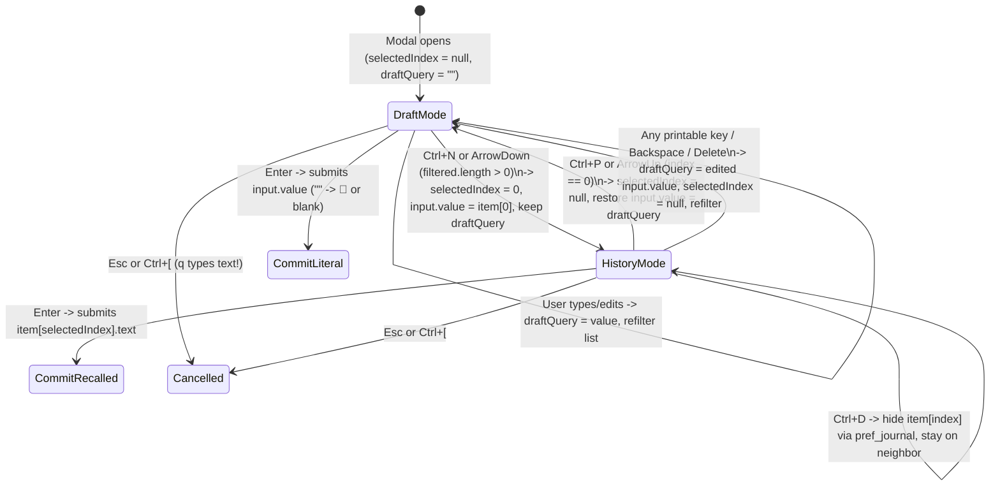

# Task Log Entry History & `<ctrl+n/p>` Navigation Across Obsidian and Capture Panel

Checked **November 19, 2026**, against `bob-cli`, `bob-plugins`, `bob-mac-capture`, SASE decision records, and Bryan's live `~/bob` vault (**124 notes** containing task logs).

## Executive Verdict

Adding per-log-kind entry history with `<ctrl+n/p>` navigation across Obsidian and Capture Panel is a **high-leverage improvement**, particularly for **Work Log** (where **59.2%** of all entries repeat) and **Rotten Log** (where **70.8%** of human keep prompts currently collapse to `🤷 no reason given`, near `decisions:rotten-keeps-are-logged`'s `>80% 🤷` reopen threshold).

However, implementing the request *literally* as blind bash-style `<ctrl+n/p>` history cycling backed by client-local state would feel inconsistent and fragile across Bob's codebase:

1. **Blind `Ctrl+N/P` clobbers Bob's vertical picker muscle memory and existing keybindings.** Every picker in Bob (`FilteredPickerModal`, `RelationCard`, `CapturePullInChoiceCard`, `CaptureCompletion`) binds `Ctrl+N` = **down** (rank #1 → older/lower rows) and `Ctrl+P` = **up**. Meanwhile, `Tab` is already bound to field switching in `schedule-review` (`cycleScheduleReviewFocus`), and `Ctrl+N/P` already owns Emacs line movement in Capture Panel's multiline editor (`CaptureKeyCommandRouter.swift`).
2. **Client-local storage fails across hosts, plugins, and existing history.** `block-id-prompt` (`WorkSummaryPromptModal`), `bob-navigation-hotkeys` (the remaining Obsidian prompts), and `bob-mac-capture` run in three separate contexts across macOS and Linux (`apollo`/`athena`). Local plugin `data.json` + `UserDefaults` would start blank (ignoring **771** existing human log entries in `~/bob`) and split history across machines and apps.
3. **Cancel Log has 8.5% repetition (`112` unique out of `117` entries), while Schedule Log is 96.9% machine noise (`723 / 746` `🎲` random rolls).** Pure sequential cycling over Cancel Log forces hunting through 100+ one-off sentences, so **live substring filtering** and **noise exclusion (`🎲`, `🤷`, `🍂`)** are essential rather than optional.

### Recommended Solution in One Glance

- **Scope all 4 logs separately:** **Schedule**, **Work**, **Rotten**, and **Cancel** (`ManagedLogKind::{Schedule, Work, Rotten, Cancel}`).
- **Source of truth:** Derive cross-task history directly from vault Markdown logs via a cached `bob` scanner (`bob log-history`, mtime+size+60s sweep mirroring `pomodoro_themes/cache.rs` & `relation_labels/scan.rs`), paired with a vault-synced per-host preference journal in **`.bob/log-history/<host>.jsonl`** (`pref_journal`) strictly for `hide` / `unhide` (`Ctrl+D`), plus in-memory optimistic updates in `bob-ledger-tools` (`api.logHistory`) and `CapturePanelModel`.
- **Interaction model:** Show an in-prompt **filtered ranked history drawer** (frecency × match tier) beneath the active field plus a **live formatted log-line preview**. Keep `selectedIndex = null` on open (so immediate `Enter` stays 100% safe for blank/optional submission), let `Ctrl+N` / `↓` fill-and-highlight downward from Rank #1 while preserving the typed filter in a protected `draftQuery`, let `Ctrl+P` / `↑` at row 0 restore `draftQuery`, let any edit detach from history smoothly, and let `Ctrl+D` hide noisy/typo entries across hosts.
- **Capture Panel integration:** Keep `BobMacCapture` a thin client of `bob` (`decisions:mac-capture-is-a-thin-client`). Surface **Cancel Log** history in an anchored non-blurring popover on `CapturePullInReasonField` (`⌃⇧X`), and surface **Work Log** history inside `bob`'s existing `completion` popup for `x` / `-` close-log spans (`cursor_in_close_log_text` in `src/native/capture_language/completion.rs`) so `Ctrl+N/P` Emacs cursor motion stays intact outside active completion.

---

## Empirical Baseline From `~/bob`

Auditing every Markdown note under `~/bob` (active notes plus `~/bob/done/*.md`, skipping dot-directories) reveals dramatically different usage shapes across the four log kinds:

| Log Kind | Total Entries | Automated / Blank Noise | Human Entries | Unique Strings | Repeated Strings (≥2×) | Repeat Share of Human Writes | Entry Length (`min / p50 / p90 / max`) | Top Recurring Examples (Count) |
| --- | ---: | ---: | ---: | ---: | ---: | ---: | --- | --- |
| **Work Log** | 598 | 0 | 598 | 281 | 37 | **354 / 598 (59.2%)** | `5 / 15 / 47 / 124` | `athena agent` (104), `apollo research` (93), `apollo agent` (54), `athena research` (21), `Launched agent on athena` (5) |
| **Rotten Log** | 137 | 24 `🍂` steps, 80 `🤷 no reason given` | 33 | 26 | 4 | **11 / 33 (33.3%)** | `11 / 26 / 58 / 73` | `Need to verify this still.` (5), `I still really need to clean up sase's memory.` (2), `sase-lt2 is wip!` (2), `bob-cli-hg is ongoing!` (2) |
| **Schedule Log** | 746 | 723 `🎲` random rolls (96.9%) | 23 | 23 | 0 | **0 / 23 (0.0%)** | `12 / 27 / 56 / 122` | Near-dups (`Start bug bash today?`, `Ready for bug bash?`, `Bug bash today?`) |
| **Cancel Log** | 117 | 0 `🤷` in vault today | 117 | 112 | 5 | **10 / 117 (8.5%)** | `2 / 32 / 66 / 154` | `Duplicate` (2), `Kelly is handling this.` (2), ``Obsoleted by `bob bank`!`` (2), `I don't like this idea anymore.` (2), `Research said not to do this.` (2) |

### Key Takeaways From Vault Data

1. **Work Log is overwhelmingly repetitive, short, and Capture-heavy.** The top 5 strings alone represent **46.3%** (`277 / 598`) of all Work Log entries, and median length is **15 characters**. Note that `268` entries carry `*YYYY-MM-DD HH:MM*` timestamps while `330` carry legacy `*YYYY-MM-DD*`; `12` contain wikilinks (`[[`/`((`), and `0` contain Dataview `::`.
2. **Rotten Log badly needs frictionless reuse.** Excluding automated `🍂` decay steps, **80 / 113 (70.8%)** of human Rotten Log opportunities became `🤷 no reason given` (echoing `decisions:task-decay-is-one-ladder`'s finding of 88 Next keeps with 0 written reasons). `decisions:rotten-keeps-are-logged` explicitly states that **`>80% 🤷` in a month reopens the design**. History reuse directly rescues Rotten Log signal quality.
3. **Schedule Log and Cancel Log prove filtering beats blind cycling.** Schedule Log has `723` automated `🎲` entries for `23` human entries; any naive capture of written Schedule lines would drown user entries 31:1. Cancel Log has **112** unique reasons out of `117`, so finding `"Obsoleted by..."` or `"Research said..."` requires **typing 2–4 filter characters**, not pressing `Ctrl+N` 40 times.
4. **Length distribution makes compact single-line / two-line rows ideal.** Across all 4 logs, `p90 <= 66` characters and `max = 154` characters; almost every suggestion fits cleanly in a single row inside Obsidian modals and Capture Panel cards.

---

## Complete Prompt Surface Inventory & Current Gaps

A full source audit across `bob-plugins`, `bob-mac-capture`, and `bob-cli` found **15 log-input entry points** (13 in Obsidian, 2 in Capture Panel) spanning all 4 log kinds:

### Obsidian (`bob-plugins`) — 13 Entry Points

| # | Log Kind | Surface / Symbol | File Location | Trigger | Live Log Preview Today? | Critical Architectural / UX Constraint |
| --- | --- | --- | --- | --- | --- | --- |
| 1 | **Work** | `WorkSummaryPromptModal` | `block-id-prompt/src/090-prompt-modals.js` | `Ctrl+Shift+Enter` unlink Task Link | Yes (`.bid-wlp-preview`) | Lives in **`block-id-prompt`**, separate `data.json` from `bob-navigation-hotkeys`. |
| 2 | **Work** | `TaskLinkLanePromptModal` | `bob-navigation-hotkeys/src/196-task-link-lane-modal.js` | `Alt+[` / `Alt+]` on Task Link (`[/]`→`[*]`) | Yes (`.bob-tll-preview`) | Uses `.bob-tll-*` design language; optional blank submit. |
| 3 | **Work** | `LaneReleaseSummaryModal` | `bob-navigation-hotkeys/src/190-summary-modals.js` | `Alt+N` in editor releasing `[*]`→`[ ]` | **No** | Legacy unstyled `Modal` (`bob-lane-release-*`) with plain `<input>` and static subtitle. |
| 4 | **Work** | `FilteredPickerModal` (`lane-release-reason`) | `bob-navigation-hotkeys/src/380-picker-cancel-and-lane.js` | Task Card → Release | Yes (`lane-release-reason-preview`) | `410-picker-filter-and-render.js` overwrites `getFilteredItems()` with a **1-element preview array**, leaving no list slot for history! |
| 5 | **Work** | `FilteredPickerModal` (`schedule-work-log`) | `bob-navigation-hotkeys/src/370-picker-schedule-work-log.js` | Task Card → post-roll/P1–P4 Pending summary | Yes (`schedule-work-log-preview`) | Same 1-element `getFilteredItems()` list overwrite in `410-picker-filter-and-render.js`. |
| 6 | **Schedule** | `FilteredPickerModal` (`schedule-review`, `#bob-schedule-review-reason`) | `bob-navigation-hotkeys/src/370-picker-schedule-work-log.js` | Task Card → Schedule review reason | Yes (`schedule-review-preview`) | Shares stage with `#bob-schedule-review-summary`. |
| 7 | **Work** | `FilteredPickerModal` (`schedule-review`, `#bob-schedule-review-summary`) | `bob-navigation-hotkeys/src/370-picker-schedule-work-log.js` | Task Card → Schedule review (when Pending/Next) | Yes (combined preview) | **`450-picker-keydown.js:131` binds `Tab` to `cycleScheduleReviewFocus`** between `#bob-schedule-review-reason` (Schedule) and `#bob-schedule-review-summary` (Work). History kind must follow focused field! |
| 8 | **Schedule** | Inline `scheduled` value (`3d <reason>`) | `bob-navigation-hotkeys/src/280-notices-and-dates.js` (`resolveTypedSchedule`) | Typed inline reason after date | Via picker row | Hybrid date+prose token; best kept out of `<ctrl+n/p>` date list (focus dedicated prompt #6 instead). |
| 9 | **Rotten** | `FreshnessRefreshSummaryModal` single (`RottenKeepReasonStage`) | `bob-navigation-hotkeys/src/192-freshness-refresh-summary-modal.js`, `195-rotten-keep.js` | `Alt+F` on counted Ready/WIP/Next keep | Yes (`RottenKeepReasonStage`) | Already renders up to 3 task-local `EARLIER KEEPS`/`EARLIER DECISIONS` hints above/below `.bob-cnp-input`. |
| 10 | **Rotten** | `FreshnessRefreshSummaryModal.renderBatchFields` (`keepInputEl`) | `bob-navigation-hotkeys/src/192-freshness-refresh-summary-modal.js` | Counted `N<Alt+F>` batch keep | **No** | Separate batch render path bypassing `RottenKeepReasonStage`! |
| 11 | **Rotten** | `FreshnessDecayCardModal` → Stay (`RottenKeepReasonStage`) | `bob-navigation-hotkeys/src/060-decay-card-modal.js` | Decay threshold Stay decision (`Alt+F`) | Yes (`RottenKeepReasonStage`) | Multi-action decision card owns keys until Stay stage mounts `RottenKeepReasonStage`. |
| 12 | **Cancel** | `FilteredPickerModal` (`cancel-reason`) | `bob-navigation-hotkeys/src/380-picker-cancel-and-lane.js` | Task Card → Cancel (`Ctrl+Shift+P x`) | Yes (`cancel-reason-preview`) | Same 1-element `getFilteredItems()` overwrite in `410-picker-filter-and-render.js`. |
| 13 | **Cancel** | `SuccessorOfferPickerModal` (`Ctrl+Shift+X` inline editor) | `bob-navigation-hotkeys/src/206d-successor-picker-verdict-render.js` | `Ctrl+Shift+X` on successor offer row | **No** | **`blur` auto-commits reason**, and outer offer picker owns `Ctrl+N/P` when closed—keys must stop propagating while inline `<input>` is focused! |

*(Note: `task-status-cycler` delegates offer-close UI cancellation to `bob-navigation-hotkeys`'s `api.cancel` in `src/137a-successor-offer-close-integration.js`.)*

### Capture Panel (`bob-mac-capture` + `bob-cli`) — 2 Active Surfaces (+ 2 Non-Surfaces)

| # | Log Kind | Surface / Symbol | File Location | Live Preview Today? | Critical Architectural / UX Constraint |
| --- | --- | --- | --- | --- | --- |
| 14 | **Cancel** | `CapturePullInReasonField` (`⌃⇧X`) | `CapturePullInChoiceView.swift`, `CaptureKeyCommandRouter.swift:839`, `CapturePanelModel.swift:5438` | **No** (footer consequence only) | `28pt` row-inline `NSTextField`. `pullInChoiceCommand(reasonFocused:)` only maps `Return`/`Esc`/`Ctrl+[/]` (others return `nil`), and **`pullInReasonFieldDidBlur()` auto-confirms if focus leaves**! |
| 15 | **Work** | Main Capture Editor Pomodoro Close (`x ...`, `- ...`, `x=`) | `src/native/capture_language/close_log.rs`, `completion.rs:2173`, `CaptureKeyCommandRouter.swift:686,756` | Capture card preview | Highest daily Work Log volume (`athena agent`, etc.), **yet `completion.rs:2173` suppresses completion inside `cursor_in_close_log_text`**, and **`Ctrl+N`/`Ctrl+P` move cursor lines whenever completion is hidden**! |
| — | **Schedule** | *None in Capture Panel* | — | — | `s:<N>` takes no reason; `$<N>` emits auto `🎲` roll. |
| — | **Rotten** | *None in Capture Panel* | — | — | `decisions:rotten-keeps-are-logged`: `bob capture` never writes Rotten Log. |

---

## Critique of the Plan & Justified Adjustments

### Is This Idea Good Overall?
**Yes — strongly so, especially if reshaped around Bob's existing picker and `pref_journal` idioms.**
Without history, Bryan re-types `"athena agent"` / `"apollo research"` dozens of times a week in Work Log closes and abandons Rotten Log keep reasons to `🤷 no reason given` ~71% of the time. Conversely, treating log history as a hidden, unranked readline ring buffer leaves Cancel Log (`8.5%` repeat rate across `112` entries) and Schedule Log (`23` human entries buried under `723` `🎲` lines) nearly useless.

### Explicit Adjustments to the Original Requirements

| Original Requirement / Premise | Critique | Adjusted Requirement |
| --- | --- | --- |
| Prompt intro names **schedule, work, rotten, and/or cancel**; bullet 1 only lists **schedule, work, and cancel** | Omitting Rotten Log ignores the single log most at risk of hitting its design reopen trigger (`>80% 🤷`, currently `70.8%`). `ManagedLogKind` already defines all 4 cleanly. | **Require 4 separate histories:** Schedule, Work, Rotten, and Cancel (`schedule`, `work`, `rotten`, `cancel`). |
| Blind `<ctrl+n/p>` history stepping | Bash `Ctrl+P`=older vs Bob's universal `Ctrl+N`=down list direction directly collide; blind cycling cannot search 100+ Cancel entries and risks clobbering half-typed drafts. | **Show a filtered, frecency-ranked list below the input with Bob-native direction:** `Ctrl+N` / `↓` moves down from Rank #1; `Ctrl+P` / `↑` moves up and restores `draftQuery` above row 0. `selectedIndex = null` on open so immediate `Enter` stays safe for blank submit. |
| "Whether some form of filtering and/or live preview might be useful" | Left optional, Cancel Log (`112` unique strings) gets minimal benefit without filtering, and 4 prompts currently have zero live Markdown preview (`LaneReleaseSummaryModal`, batch `FreshnessRefreshSummaryModal`, `SuccessorOfferPickerModal` inline editor, `CapturePullInReasonField`). | **Both are required:** (1) live substring/prefix filtering from the existing input box (no extra search field), (2) a visible multi-row candidate drawer with frequency/recency badges, and (3) live formatted log-line preview on every prompt. |
| Implicit client-local history list | Splitting Obsidian (`block-id-prompt` vs `bob-navigation-hotkeys`), `BobMacCapture`, and Linux vs Mac hosts loses cross-device history and ignores 771 existing entries in `~/bob`. | **Derive history from vault Markdown logs + `pref_journal` hides:** cached `bob log-history` scan of active + `done/` notes gives zero-migration seed + edits/deletes stay in sync, while `.bob/log-history/<host>.jsonl` syncs `Ctrl+D` hides across hosts. |
| Capture Panel scope focused on "prompts" | Leaving out Capture's main-editor `x` Work Log line misses ~60% of Work Log entry volume (`athena agent`, etc.), yet binding `Ctrl+N/P` unconditionally in main editor breaks multiline Emacs cursor motion. | **Integrate Capture Editor Work Log via `bob`'s existing `completion` engine** (`completion.rs` inside `cursor_in_close_log_text`), keeping `Ctrl+N/P` as cursor movement until the completion/history popup opens. |

---

## UX & Visual Design: Intuitive, Reliable, Beautiful

### 1. Non-Destructive State Machine (Why `RelationCard`'s Rule Needs One Refinement Here)

In `RelationCard` (`decisions:relation-card-tab-accepts-ctrl-d-hides`), `Ctrl+N/P` leaves `<input>` untouched and requires `Tab` to insert. That pattern breaks on **`schedule-review`** because **`Tab` is already claimed by `cycleScheduleReviewFocus`** (`450-picker-keydown.js:131`) to jump between `#bob-schedule-review-reason` and `#bob-schedule-review-summary`! It also adds an extra keystroke to tweak a recalled entry like `"Waiting on "` → `"Waiting on Alice"`.

Instead, use **Fill-With-Protected-Draft (`draftQuery` Isolation)**:



Why this feels effortless and bug-free:
- **Zero accidental autofill on `Enter`:** Prompt opens in `DraftMode` (`selectedIndex = null`, empty input). Hitting `Enter` immediately executes the existing blank behavior (`🤷 no reason given` / no summary).
- **2-keystroke exact reuse:** `Ctrl+N`, `Enter` submits Rank #1 (`athena agent`, `Duplicate`, `Need to verify this still.`).
- **Immediate editability without colliding with `Tab`:** After `Ctrl+N` fills `"athena agent"` into the box, typing `" #2"` or hitting `Backspace` detaches from `HistoryMode`, copies the edited text into `draftQuery`, and lets you finish cleanly — while **`Tab` continues to switch Reason ↔ Work Summary in `schedule-review` untouched**, and accepts top completion cleanly in Capture Editor!
- **Filter list never collapses during `Ctrl+N/P`:** Because `draftQuery` is held separately from programmatic `<input>.value` swaps, typing `"ath"` keeps all matching rows (`athena agent`, `athena research`, …) visible while stepping `Ctrl+N`/`Ctrl+P` cleanly through them, with a subtle trailing badge `filter: "ath" · ⌃P draft` inside the input container.
- **Universal escape & `q` safety:** Conforms strictly to `decisions:q-and-ctrl-bracket-mirror-esc` (`q` inserts `"q"` inside text fields; `Ctrl+[` and `Esc` cancel).

### 2. Visual Mockups & Layout Integration

#### A. Dedicated Obsidian Log Modal (Upgrading `WorkSummary`, `TaskLinkLane`, `LaneReleaseSummary` & Batch Rotten)

Modernizes `LaneReleaseSummaryModal` (currently an unstyled plain `<input>`) to match `.bid-wlp-*` / `.bob-tll-*` tokens cleanly:

```text
╭───────────────────────────────────────────────────────────────────╮
│ 🛠️ Work summary · Release to Ready                         [Alt+N] │
│ Implement retry queue (#bob-cli)                                  │
│                                                                   │
│ ┌───────────────────────────────────────────────────────────────┐ │
│ │ > athena agent█                         filter: "ath" · ⌃P ↩  │ │
│ └───────────────────────────────────────────────────────────────┘ │
│   Will log: 🛠️ *2026-11-19 15:42* — athena agent                  │
│                                                                   │
│ ┌─ WORK HISTORY (2 matching) ───────────────────────────────────┐ │
│ │ ▸ 𝐚𝐭𝐡ena agent                         104× · 2h ago   ★ [1]  │ │
│ │   𝐚𝐭𝐡ena research                       21× · yesterday       │ │
│ └───────────────────────────────────────────────────────────────┘ │
│   Ctrl+N/P cycle · Type to filter · Ctrl+D hide · Enter save      │
╰───────────────────────────────────────────────────────────────────╯
```

- **Row typography:** Left-aligned suggestion with `<mark>` accent highlight on substring matches (no ellipsis until `> ~72` chars, covering `>90%` of real vault entries cleanly). Right-aligned muted tabular metadata (`104× · 2h ago` in `--text-faint`, monospace tabular numerals). If an entry already exists on *this* task's own log (especially helpful for Rotten Log's `Need to verify this still.`), append a subtle muted pill `on task` rather than duplicating sections (keeping `RottenKeepReasonStage`'s compact `EARLIER KEEPS` context cleanly integrated or collapsible into those top task-tagged rows).
- **Drawer height cap:** Max **6 visible rows** (`max-height: 220px; overflow-y: auto`) so modals never overflow small laptop screens.

#### B. Obsidian `FilteredPickerModal` Stages (`schedule-review`, `schedule-work-log`, `lane-release-reason`, `cancel-reason`)

**Concrete Bug Fix Required in `410-picker-filter-and-render.js`:**
Currently `getFilteredItems()` returns a single fake preview item (`[{ kind: "cancel-reason-preview", ... }]`) in all 4 stages, hijacking `this.listEl`.
- **Fix:** Move the formatted preview block (`bob-cnp-cancel-reason-preview`, etc.) into a dedicated pinned preview header inside `this.previewSlotEl` (above `this.listEl`), and let `this.listEl` render the filtered history rows with native `.is-selected` row styling!
- **Dual-input `schedule-review` cue (`370-picker-schedule-work-log.js`):** When moving via `Tab` between `#bob-schedule-review-reason` and `#bob-schedule-review-summary`, highlight the active input with `--interactive-accent` and flip the drawer header badge (`🗓️ SCHEDULE HISTORY` ↔ `🛠️ WORK HISTORY`) while resetting `selectedIndex = null`.

#### C. Inline Cancel Prompts (`SuccessorOfferPickerModal` & `CapturePullInChoiceCard`)

Both inline row prompts have tight vertical budgets (`28pt` field in `CapturePullInChoiceView.swift`, single row in `206d-successor-picker-verdict-render.js`) and **blur-to-confirm handlers**:

```text
╭─ Pull In / Close Successors ──────────────────────────────────────╮
│   [ ] Fix cache invalidation in scan.rs             Next · Ready  │
│ ▸ [⊘] Old YAML fallback migration      (⌃⇧X)                      │
│   ┌─────────────────────────────────────────────────────────────┐ │
│   │ Cancel reason: Duplicate█                     (⌃D hide)    │ │
│   └─────────────────────────────────────────────────────────────┘ │
│   ↳ ❌ *2026-11-19* — Duplicate                                   │
│   ┌─────────────────────────────────────────────────────────────┐ │
│   │ ▸ Duplicate                              2× · 12d ago       │ │
│   │   Obsoleted by `bob bank`!               2× · 18d ago       │ │
│   │   Research said not to do this.          2× · 24d ago       │ │
│   └─────────────────────────────────────────────────────────────┘ │
│   ⌃N/P history · ↵ stage cancel · ⎋ restore offer · ⌃D hide       │
╰───────────────────────────────────────────────────────────────────╯
```

- **Blur-safety contract (Critical):**
  1. While the inline cancel input is focused, `keydown` (Obsidian) and `CaptureKeyCommandRouter.pullInChoiceCommand(reasonFocused: true)` (Swift) claim `Ctrl+N`, `Ctrl+P`, `ArrowDown`, `ArrowUp`, `Ctrl+D`, `Esc`, and `Ctrl+[` directly so focus never shifts to the parent offer list!
  2. Clicking a history row in SwiftUI/AppKit or Obsidian uses a **mouse-down suppression guard** (`mousedown.preventDefault()` in JS; `suppressReasonBlurCommit` while pointer down inside suggestion list in SwiftUI/AppKit) so `pullInReasonFieldDidBlur()` / Obsidian's `blur` listener does **not** auto-commit a partial filter string before the clicked row's text is inserted!
- **Bounded geometry:** Anchored below the active row (or capped to max 4–5 rows so `CapturePullInChoiceCard` stays inside `CapturePanel`'s popover bounds), updating `CapturePullInReasonField` live without jittering sibling offer rows unnecessarily.

#### D. Capture Panel Main Editor (`x` / `-` Pomodoro Close Work Log)

In `CapturePanelView`, `CaptureKeyCommandRouter.swift:756-762` already preserves `Ctrl+N`/`Ctrl+P` for Cocoa Emacs `moveDown:`/`moveUp:` when `completionVisible == false`, and switches `Ctrl+N`/`Ctrl+P` + `Tab` + `Return` (`completionHasSelection`) to completion navigation when `completionVisible == true`.
- **Trigger behavior inside `cursor_in_close_log_text`:**
  - When user types `x 1 |` followed by `≥ 1` query characters (`x 1 ath|`), `bob`'s completion engine returns ranked **Work Log** candidates automatically (same popup UI and palette as task/theme completion, prefixed gently with `🛠️` + `104×`).
  - When cursor is at an *empty* close-log segment (`x 1 |` or `  - |`), **do NOT auto-open on cursor entry** (keeping `Ctrl+N`/`Ctrl+P` line navigation unblocked for multiline drafts). Instead, press `Tab` after a trailing space (`"x 1 "`) to open the top-10 Work Log history popup immediately (leaving `Shift-Tab` outdent and leading-line indent untouched), with a subtle right-aligned footer cue `Tab ↹ Work history`. Once the popup is visible, `Ctrl+N/P` navigates rows, `Return`/`Tab` inserts into the line, and pressing `Return` again when `completionHasSelection == false` submits as normal!

---

## Technical Architecture

### Layer 1: Canonical Rust Engine in `bob-cli` (`src/native/log_history/`)

Reuse `bob-cli`'s proven `ScanCache` (`src/native/pomodoro_themes/cache.rs`) + `pref_journal` (`src/native/pref_journal/mod.rs`) architecture:

1. **Scanner & Noise Stripping (`scan.rs` + `cache.rs`):**
   - Walk vault `.md` files (active notes + `done/` archives, skipping dot-directories).
   - Store per-file `(mtime_ns, size)` fingerprints in `bob_env::bob_cli_cache_dir().join("log-history/catalog-v1.json")` with `60s` sweep TTL + byte prefilter matching `LOG**` (matching `relation_labels/scan.rs` pattern so warm runs read almost zero files and finish in single-digit milliseconds).
   - Recognize headers case-insensitively (`SCHEDULE LOG`, `WORK LOG`, `ROTTEN LOG`, `CANCEL LOG`, with/without emoji or colon, matching `010-requires-and-config.js` & `docs/reference/vault-format.md`).
   - Extract per-entry text by stripping structural wrappers:
     - **Common:** Strip leading `*YYYY-MM-DD( HH:MM)?* — ` (`[`—–-]`). Reject `🤷 no reason given` and empty strings.
     - **Schedule:** Reject lines containing `🎲` (`capture_schedule_log.rs` rolls — eliminates 96.9% noise). Strip optional `<transition> · ` prefix before extracting `<reason>`.
     - **Work:** Keep full summary body (`HH:MM` timestamp gives exact minute-level recency!).
     - **Rotten:** Reject `🍂` step/re-roll/drop lines (`docs/reference/vault-format.md:174-177`). Strip trailing ` · kept N×...` / ` · stayed in ...` rung decorators before checking for `🤷`.
     - **Cancel:** Keep clean reason text (and split/preserve ` · ` compound reasons carefully only as entered).
   - Normalize deduplication key: `collapse_whitespace(text).to_lowercase()` (matching `relation_labels::relation_label_key` design so `"athena agent"` / `"Athena  agent"` fold into one entry, keeping the most recent / most frequent display spelling cleanly).
   - **Intra-day chronological precision for date-only logs:** Schedule, Rotten, and Cancel entries only record `YYYY-MM-DD` in Markdown. Capture each entry's `(stamp_epoch_or_date, file_mtime_ns, reverse_line_index)` so multiple reasons entered *earlier today* still sort newest-first deterministically without needing extra journal writes!

2. **Frecency & Filter Ranking (`rank.rs`):**
   - Match tiers (adapted directly from `pomodoro_themes/rank.rs`):
     - Empty query: sort purely by **frecency score** descending, tie-breaking on `last_used_epoch_ms` desc → `count` desc → `text` asc.
     - Non-empty query: **Tier 0** exact normalized match → **Tier 1** full-string prefix → **Tier 2** word-boundary prefix (so `ag` matches `athena agent`) → **Tier 3** substring (`research` matches `apollo research`). Within each tier, sort by frecency.
   - Simple exponential-decay frecency (half-life = **14 days**, zero black-box magic):
     $$\text{score}(e) = \sum_{u \in \text{uses}(e)} 2^{-\Delta\text{days}(u) / 14}$$
     Note how `athena agent` (104×, recent) naturally beats stale one-offs, while a newly typed reason used twice today outranks an abandoned reason used twice 6 months ago!

3. **Shared Hide Preferences (`.bob/log-history/<host>.jsonl` via `pref_journal`):**
   - Mirror `decisions:theme-prefs-live-in-per-host-journal` and `decisions:relation-label-prefs-live-in-per-host-journal`:
     - Add `pub(crate) const LOG_HISTORY: Namespace = Namespace { dir: "log-history", noun: "log history" };` in `src/native/pref_journal/mod.rs`.
     - Events (`v: 1`, `ts`, `host`, `via`, `kind`: `"schedule"|"work"|"rotten"|"cancel"`, `action`: `"log_history.hide"|"log_history.unhide"`, `key`, `text`).
     - Fold via `pref_journal::sort_by_writer_order` — last writer wins across `apollo`, `athena`, and Mac over Git/Obsidian sync. `Ctrl+D` appends a hide event without mutating any task note's real audit trail!

4. **CLI & Capture Completion Contract:**
   - Subcommands (documenting in `sase/memory/cli_rules.md` & `docs/`):
     - `bob log-history [--kind schedule|work|rotten|cancel|all] [-q QUERY] [-a|--include-hidden] [-f json]`
     - `bob log-history hide --kind <kind> "<text>"`
     - `bob log-history unhide --kind <kind> "<text>"`
   - Completion (`src/native/capture_language/completion.rs:2173`): replace unconditional `return None` in `cursor_in_close_log_text` with Work Log history candidates (`kind = work`) whenever wikilink completion isn't active and query conditions match.
   - Cache invalidation: `bob capture` / `task_cancel` commits bump/invalidate `log_history` scan state just like `relation_labels::invalidate_scan` so the next prompt is immediately fresh.

### Layer 2: Obsidian Integration (`bob-ledger-tools` + Shared Prompt Controller)

1. **`bob-ledger-tools` `api.logHistory` v1 (`280-plugin-log-history.js` matching `279-plugin-pomodoro-themes.js`):**
   - **Desktop (`Platform.isDesktopApp === true`):** Stale-while-revalidate background fetch of `bob log-history --kind all -f json` via `bobSpawnJson`, refreshed on plugin load, vault `modify` debounces on files containing task logs, and client writes.
   - **Zero-latency same-session freshness:** Expose `recordUse(kind, text)` called immediately on modal submit across both `bob-navigation-hotkeys` and `block-id-prompt` — bumps frequency and `lastUsedMs` in memory instantly so back-to-back Work Log closes see the just-submitted text at Rank #1 in **0 ms**, before the background `bob` refresh completes.
   - **Hide (`Ctrl+D`):** Optimistically hides in memory and spawns `bob log-history hide --kind <kind> <text>`.
   - **Mobile fallback (`Platform.isDesktopApp === false`):** Never spawn `bob`; keep an explicit local MRU fallback in `bob-ledger-tools` `data.json` seeded on desktop sync + folded read-only `.bob/log-history/*.jsonl` hides directly through Obsidian's vault adapter (same graceful split as `pomodoroThemesIsDesktop()`).

2. **One Reusable Prompt History Controller (`BobLogHistoryController`):**
   - Exposed cleanly (or bundled identically via shared source) to **both** `bob-navigation-hotkeys` (12 prompts) and `block-id-prompt` (`WorkSummaryPromptModal`).
   - Attaches cleanly to any `<input>` (single-field modals, `RottenKeepReasonStage`, `renderBatchFields`, `SuccessorOfferPickerModal`'s inline input, or dynamically swapping `kind` inside `schedule-review`).
   - Owns: `draftQuery` preservation, `selectedIndex` state machine, filter rendering + match highlighting, live log-line preview updater, `Ctrl+N`/`P`/`↓`/`↑`/`Ctrl+D` event trapping (with `stopPropagation()` inside inline row editors), and `mousedown.preventDefault()` blur protection.

### Layer 3: `bob-mac-capture` Integration (Thin Client)

- **`CapturePanelModel`:** Cache `[CaptureLogHistoryEntry]` per kind (`cancel` fetched asynchronously on panel warm-up / pull-in open via `bob log-history --kind cancel -f json`, refreshed optimistically when staging/committing cancels). `Work` entries flow natively through existing `bob` completion responses (`CaptureCompletion`).
- **`CaptureKeyCommandRouter.pullInChoiceCommand(reasonFocused: true)`:** Route `Ctrl+N` / `ArrowDown`, `Ctrl+P` / `ArrowUp`, `Ctrl+D` (`hide`), `Return`, `Esc`, `Ctrl+[` cleanly while `reasonFocused == true`.
- **`CapturePullInChoiceView`:** Add anchored compact history drawer + single-line formatted `❌ *YYYY-MM-DD* — <reason>` preview pill, guarding `pullInReasonFieldDidBlur()` against clicks inside the drawer.
- Honor repo gates: run `just portable-check` on Linux and watch exact-SHA `Scripts/macos-ci-check` / GitHub Actions macOS target to green (`bob-mac-capture/AGENTS.md`).

---

## Phased Rollout Plan

1. **Phase 1 — `bob-cli` Core Catalog & Journal:** Build `src/native/log_history/` (`scan.rs`, `cache.rs`, `journal.rs`, `rank.rs`, `cli.rs`), `pref_journal::LOG_HISTORY`, golden unit tests for every parser/noise rule (`🎲`, `🤷`, `🍂`, `*HH:MM*`, `→`, `· kept N×`) verified against synthetic + snapshot vectors, and `docs/` / `sase/memory/cli_rules.md` updates.
2. **Phase 2 — Capture Panel Close + Pull-In:** Wire `work` log history into `completion.rs` (`cursor_in_close_log_text`), add `CapturePullInChoiceView` Cancel history popover + live preview + `didBlur` guard + `CaptureKeyCommandRouter` bindings (`bob-cli` + `bob-mac-capture`), verify via unit tests + macOS CI.
3. **Phase 3 — Obsidian Shared API & Unified Prompts:** Add `api.logHistory` v1 in `bob-ledger-tools`, create `BobLogHistoryController` + `.bob-log-history-*` styles, upgrade `LaneReleaseSummaryModal` + batch `FreshnessRefreshSummaryModal`, refactor `410-picker-filter-and-render.js` so `schedule-review`/`schedule-work-log`/`lane-release-reason`/`cancel-reason` keep a dedicated preview slot above `listEl`, wire `WorkSummaryPromptModal` (`block-id-prompt`), `TaskLinkLanePromptModal`, `RottenKeepReasonStage`, and `SuccessorOfferPickerModal` (with blur/propagation isolation), and run `bob plugins sync`.
