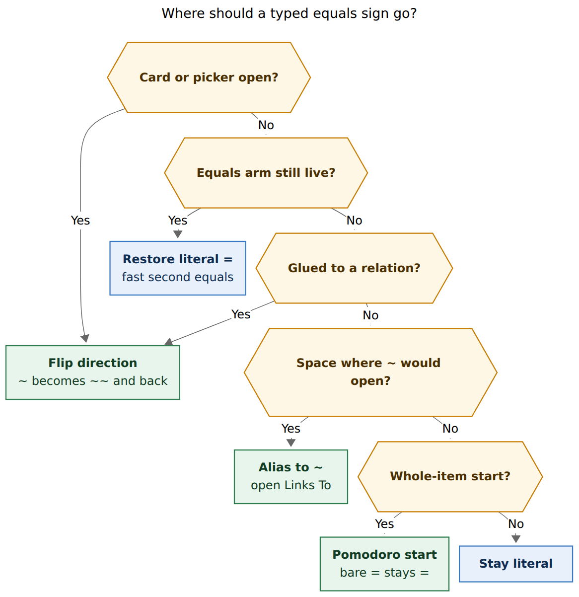
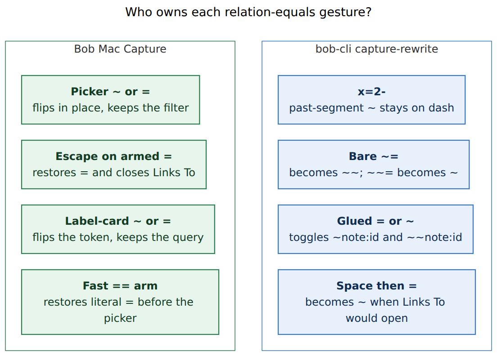

# Make `=` the relation-tilde alias, and flip direction after a complete token

> **Research query:** How should Bob Mac Capture treat `-` / `=` as aliases for relation `~` / `~~`, including flipping a complete `~foo:bar` token, escaping `=` with a fast `==`, and toggling direction from the relation-label card? Critique the plan, adjust requirements where justified, and recommend an implementation.

## Bottom line

**Do it, with `=` as the only *relation-opener* alias, and keep the dash for past-Pomodoro `~` only.**

The four requests are one family: `~` is painful to type (Shift+`` ` `` on a US layout), direction is easy to get backwards, and the current `-` opener fights other capture meanings of `-`. The architecture already has the right split: `bob capture-rewrite` owns draft transforms, Mac Capture owns key routing and one-shot restore arms. Reuse that split. Do not grow a second grammar in Swift.

The one collision the prompt understates is `==`. The same key that should *open* Links To (`=` → `~`) is also the key that already *flips* Links To to Linked From (`~=` → `~~`) and the key that should *escape* to a literal equals. Resolve that with the hash-alias double-tap pattern, not with a wall-clock timeout, and clear the escape arm as soon as the picker is visible so a later `=` still flips.

*Equals is a Pomodoro start only as a whole item; a fast second equals restores a literal `=`; glued to a relation token, or with the picker or label card open, it flips direction; after whitespace where `~` would open Links To, it aliases to `~`.*

## Critique of the request

This is a good idea. I would still take this approach. The current `-` opener was the wrong alias for relations, and the missing complete-token / label-card flips are real daily misses.

**`=` is the right opener.** `=` as a Pomodoro start is a *whole-item* operator (`=`, `=3`, `=-2`, `=bugs`; `docs/capture.md` “Starting the next Pomodoro”). A relation opener is a *trailing modifier* after task text (`Fix it ~`). Those contexts are disjoint once Bob’s completion grammar is the gate, the same way today’s dash alias already refuses `x -`, `=bugs -`, and `+5 -` (`rewrite.rs` `rewrite_draft_relation_dash_alias_stays_literal`). `x =` (close then start on one line) stays a start because `x ~` is an `operator_relation_error`, so the candidate never opens `relation_to`.

**`-` is a bad relation opener.** It is a Markdown bullet, the em-dash snippet (`--` → `—`), prose dashes, buffer `−N`, and the past-segment suffix (`x=2-` → `x=2~`, commit `35c2a426`). The Mac restore arm exists *because* the alias fights `--`: Space restores `- `, a second `-` restores `--`, Escape restores `-` (`CaptureRelationDashAliasTests`, `relationship-pickers.md`). Dropping the relation-dash alias makes `--` typeable again. That is a reason to switch, not a reason to keep both.

**The complete-token flip is the right new rewrite, and it is missing on purpose today.** `expand_relation_flip_alias` only fires when the byte before `=` is a bare `~` (or a `-` that would alias `~`). `Fix it ~tar=` and `Fix it ~~=` stay literal (`rewrite_draft_relation_flip_alias_stays_literal`). On the Mac, rewrite intent for `=` is gated even harder: the previous character must be `~` (U+007E) or `-` (U+002D) (`CapturePanelController.noteSeparatorToggleIntentIfEligible`). After `~foo:bar` the previous character is `r`, so the rewrite lane never runs.

**The label-card gap is also real, and it is a key-routing hole, not a grammar hole.** `flipRelationDirection()` already toggles `~` ↔ `~~` in the *task* picker and ignores repeats (`CapturePanelModel`, `CaptureKeyCommandRouter` `pickerSourceIsRelation`). `relationLabelPromptCommand` never claims `~` or `=`, so those keys fall through `isolatedPromptCommand` into `RelationLabelNSTextField` as query text. `CaptureRelationLabelPromptState.direction` is a `let`. The live sentence already swaps S and T from that field (`relationLabelSentenceSource`).

**Do not replace `~~` with `<` / `>` in this change.** `research:202610/relation_direction_markers_prompt_review.md` argued for putting direction on the label marker. That is a `feat(capture)!` break across bob-cli, plugins, and Mac, with shell-redirect traps. This request is an editor assist on the *existing* `~` / `~~` grammar. Keep it additive.

## What already exists

| Piece | Where it lives | What this change reuses |
| --- | --- | --- |
| Thin client | `decisions:mac-capture-is-a-thin-client` | bob owns grammar, rewrite, completion; Mac paints and routes keys |
| Sigil alias rewrite | `capture_language/rewrite.rs` `ExpandSigilAlias` | Same rule family as `.`→`^`, `;`→`:`, `,`→`+`, `\`/`/`→`#`, `-`→`~` |
| Relation dash opener | `expand_relation_dash_alias`, `relation_dash_position_ok` | Position and completion-field gate; retarget the alias byte from `-` to `=` |
| Bare flip | `expand_relation_flip_alias` | `~=` → `~~`; extend to `~~=` → `~` and to complete tokens |
| Past-segment dash | `expand_past_segment_dash_alias` | **Keep.** `x=2-` → `x=2~` is a different `~` |
| Dash restore arm | `CaptureRelationDashArm`, `restoreRelationDashLiteral` | Retarget to `=`; do **not** keep empty-filter restore once the picker is open |
| Hash double-tap | `CaptureHashAliasArm`, `HashAliasProbe` | Model for `==` before Bob answers, and for the next same key after the rewrite |
| Picker flip | `flipRelationDirection()`, `handleRelationLiveFlip` | Same in-place `~` insert/delete; label card calls this shape on `tokenRange` |
| Label card state | `CaptureRelationLabelPromptState` | `tokenRange`, `labelRange`, `direction`, live sentence, catalog; make `direction` a `var` |
| Trailing space on accept | `acceptPickerRow` for `isRelationshipModifier` | Today appends a space at end of draft; that blocks glued flip after Return |
| Label character rules | `docs/task-relations.md` §3.2 | Labels **must not** contain `~`; they **may** contain `=` |
| Docs | `docs/capture.md` Sigil alias; Mac `relationship-pickers.md`, `keyboard.md` | Contract first, then code |

The dash opener landed in `060d97ed` (`feat(capture): add relation dash rewrite aliases`). The `=` filter-flip landed in `7c71241f` (`feat(capture): flip relation direction with = anywhere in filter`). Both are editor assists: `bob capture` and `bob capture-parse` keep the literal typed text until rewrite has run.

## Requirement adjustments

These are tightenings of the prompt, not a different product.

1. **`=` is the only *relation-opener* alias. Keep past-segment `-` → `~`.** “Only alias for `~` when appropriate” must not steal `x=2-`, `x=~-`, or `x=#\"DEEP WORK\"-`. Those open `pomodoro_past_segment`, not `relation_to`. Document the two `~` meanings separately.

2. **Drop the relation-dash opener and `-=` → `~~`.** Do not leave `-` as a hidden second opener. `Fix it -` stays a dash. `Fix it -=` stays `-=`. The Mac dash arm, Space/`-`/Escape restore, and `relationDashLiteralArmed` go away.

3. **Complete-token flip is glued, and Mac must stop appending a trailing space after a relation accept.** Today Return on a terminal `&` / `*` / `~` inserts `replacement + " "` (`acceptPickerRow`). After `Fix it ~foo:bar `, the next `=` would be “after whitespace” and would *open a second relation*, not flip the first. User intent after picking a task is “maybe I got the direction wrong,” not “start another link.” `&` / `*` keep the trailing space (chaining is common). Relations do not. To add a second relation, type space then `=` or `~`.

4. **Flip both ways, including labelled tokens.** `~foo:bar=` / `~foo:bar~` → `~~foo:bar`. `~~foo:bar=` / `~~foo:bar~` → `~foo:bar`. The same on `|"label"` and `||label`. Consume the trigger byte. Do **not** auto-swap the label to its inverse; the catalog already shows the inverse as a muted hint. Keep `selectedKey` and `authoredLabel`.

5. **`==` escape is the hash-alias double-tap, not a millisecond timeout.** There is no timer in the current arms. “Fast enough” means: the second `=` arrives while the rewrite of the first is still in flight (`HashAliasProbe` shape), or is the next key after Bob rewrote `=` → `~` *and the Links To picker is not yet visible*. Once the picker is on screen, `=` flips. Escape on an armed empty Links To restores a literal `=` (like today’s dash Escape). Space does **not** restore `= `; it is filter input. Key repeat is ignored.

6. **Do not alias a leading / whole-item `=`.** `=`, `=3`, `=bugs`, `=-2` stay Pomodoro starts. `==` at item start stays the retired-start teaching error (`docs/capture.md`: `` `==` is retired: write `=` ``). The opener requires a preceding space or tab and a non-empty item prefix after stripping a bullet, matching `relation_dash_position_ok`.

7. **Label-card `~` / `=` never enter the query, including when the field is non-empty.** Match the picker: the typed `~` never enters the filter (`relationship-pickers.md`). Labels cannot contain `~` (§3.2), so intercepting `~` cannot hide a legal label. Intercepting `=` *can* hide a legal `=` in a typed name. Accept that cost: catalog rows with `=` are still chosen with arrows/Tab; typing `=` always means flip. Rename mode is excluded (the rename field owns printables, as today).

8. **After a label-card flip, re-probe `relation_label`.** Cancel, complete, merge, and successor effects are source-side. Flipping who is S changes the close-effect verdict. The catalog itself can stay; only the typed-row / effect probe refreshes. Rebase `tokenRange`, `labelRange`, and `restoreCursor` the way rename already rebases them.

9. **This is still `expand_sigil_alias`, not a grammar bump.** `bob capture` / `capture-parse` keep literal `=`. Mac must ship against a bob that implements the new rewrite cases; an older bob returns `changed: false` and `=` stays an equals, which is safe. New Mac + old bob degrades to “type a real `~`.” Old Mac + new bob never sends `Fix it =` to rewrite (previous-char gate), so it also stays safe.

10. **Do not put a wall-clock on `==`, and do not make `==` mean `~~`.** Fast `==` is the escape. Linked From without a tilde is: `=`, wait until Links To is visible, `=` again; or type `~=` / `~~`.

*bob `capture-rewrite` owns every draft transform, including keeping past-segment dash. Mac Capture owns the fast-escape arm, picker keys, the label-card toggle, and Escape-to-literal.*

## Recommended solution

### 1. bob-cli `capture-rewrite` (land first)

Retarget `expand_sigil_alias` for `=`:

- If the byte at `cursor-1` is `=`, try **complete-token toggle** (look behind the `=` for a relation token that ends at that byte: `~note:id`, `~~note:id`, optional `|label` / `||label`, quoted notes). If the token is `~~…`, delete one `~` and the trigger. If it is `~…`, insert one `~` at the sigil and consume the trigger. Candidate must parse as `relation_from` / `relation_to` at the new caret. Wikilink and backtick spans stay literal.
- Else try **bare reverse**: `~~=` → `~` when the candidate opens empty `relation_to` covering the remaining sigil. Today `~~=` is explicitly literal; that is the bug relative to “the reverse transformation should also be supported.”
- Else keep **bare forward**: `~=` → `~~` (existing).
- Else try **opener**: `=` after space/tab, same `relation_dash_position_ok` (rename it to a shared `relation_alias_position_ok`), swap to `~` only when `completion_field_at` is empty `relation_to` ending at the caret. Summary: `Typed ~ for =`.
- Drop `expand_relation_dash_alias` and `finish_relation_flip_dash_alias`. Keep `expand_past_segment_dash_alias` first when the alias byte is `-`.

Also accept a glued `~` as the toggle trigger on a complete token (`Fix it ~foo:bar~` → `Fix it ~~foo:bar`). Mac will forward that `~` through the rewrite lane only when a relation span already ends at the caret (thin: use the last `capture-parse` spans, do not lex in Swift).

Vectors to add beside the current dash/flip tables in `capture_language/tests/rewrite.rs` and `tests/cli/capture/rewrite.rs`:

| Input | Output |
| --- | --- |
| `Fix it =` | `Fix it ~` |
| `Fix it ~=` | `Fix it ~~` (already) |
| `Fix it ~~=` | `Fix it ~` (new reverse) |
| `Fix it ~foo:bar=` | `Fix it ~~foo:bar` |
| `Fix it ~~foo:bar=` | `Fix it ~foo:bar` |
| `Fix it ~foo:bar~` | `Fix it ~~foo:bar` |
| `Fix it ~foo:bar\|see=` | `Fix it ~~foo:bar\|see` |
| `=` / `=3` / `x =` / `Fix it ==` at item start | unchanged |
| `x=2-` | `x=2~` (unchanged) |
| `Fix it -` | unchanged (no longer an opener) |

Update `docs/capture.md` Sigil alias, `docs/reference/cli/capture-rewrite.md`, and the `capture-rewrite` long help (the “four rules” sentence and the `-` / `=` paragraphs). `just docs-check` after the contract edit.

### 2. Mac Capture (land second, additive)

**Rewrite intent.** Forward `=` the way `-` is forwarded today in the main editor (ungated except modifiers / IME / selection / modal), so Bob decides opener vs complete-token vs literal. Forward `~` to rewrite only when the last parse has a `relation_sigil` / `relation_note` / `relation_block_id` / `relation_label` span ending at the caret. Stop special-casing “previous char is `~` or `-`.”

**Equals arm**, cloned from hash-alias rather than from the persistent dash arm:

- After Bob rewrites space-prefixed `=` → `~`, arm `CaptureRelationEqualsArm` (same fields as `CaptureRelationDashArm`).
- Second `=` before the reply: probe the first draft, and if Bob would have aliased, delete the extra `=` and restore one literal `=` (hash `HashAliasProbe` / `typeKeyBeforeHashAliasReply`).
- Second `=` after the rewrite, picker not visible, caret still on the new `~`: restore literal `=`.
- Picker visible (even empty filter): **clear the arm** and run `flipRelationDirection`. This is the adjustment that makes `==` mean escape *and* `=` mean flip, without a timer.
- Escape while armed and filter empty: restore `=`, no chip.
- Do not restore on Space or on a second `=` once Links To is showing.

**Picker.** Keep `~` and `=` as flip anywhere in the filter (already tested in `CaptureRelationFlipAliasTests`). Delete dash-restore commands and `relationDashLiteralArmed`.

**Label card.** In `relationLabelPromptCommand`, if not in rename mode, unmodified `~` or `=` (ignore repeats) returns `.flipRelationLabelDirection`. Implementation:

1. Guard `relationLabelPrompt`, `!isSaving`, `rename == nil`.
2. Apply the same insert-or-delete-second-tilde edit at `tokenRange.start` as `flipRelationDirection`, through the native editor so Undo is one step.
3. Flip `direction` (`linksTo` ↔ `linkedFrom`), shift `tokenRange.end`, `labelRange`, `restoreCursor`.
4. Keep `authoredLabel`, `selectedKey`, `catalog`, `showHidden`, `oneOff`.
5. Re-fetch the typed-row / `relation_cancel` / `relation_complete` / `relation_successor` probe.
6. Footer grows a `~` / `=` “flip” keycap when there is room in the five-pair budget; otherwise VoiceOver and `keyboard.md` teach it.

**Accept.** For `picker.source.isRelation`, do not append the extra trailing space. `&` and `*` unchanged.

**Tests to retarget.** `CaptureRelationDashAliasTests` becomes equals-opener tests (open, Escape restore, fast `==`, older bob unchanged, no `--` dance). Keep `CaptureRelationFlipAliasTests` and add: glued `~foo:bar=` flip; reverse `~~=`; label-card `=` / `~` flips the live sentence and does not edit the query; `=` in rename mode types into the field.

### 3. What not to do

- **Do not parse relation tokens in Swift.** `BlockIDRules.swift` already says Bob is the only grammar authority. Complete-token detection is `capture-rewrite` plus parse spans as a send-filter.
- **Do not keep `-` and `=` as co-equal openers.** The restore matrix (Space, second `-`, Escape, `-=` flip) is the complexity this change is trying to delete.
- **Do not auto-invert labels** on flip. Inverse is a catalog hint (`docs/task-relations.md`, Mac inverse capsule).
- **Do not ship a `<` / `>` direction marker** here. Separate plan, `feat(capture)!`, three repos.
- **Do not wait on a timer.** The existing arms are “next matching key” plus “reply still pending.” That is what “fast enough” already means for `\\` and `--`.

### 4. Release and docs

bob-cli first, on the daily train, additive `expand_sigil_alias` cases, `schema_version` stays 1, no grammar bump. Mac follows; `decodeIfPresent` is irrelevant because rewrite already uses `changed` / `rule` / `edits`. Teach:

- Mac `relationship-pickers.md`: opener is `=` after space; drop the `-` paragraph; complete-token `=` / `~` toggles; `==` restores `=`; label card `~` or `=` flips.
- Mac `keyboard.md` Relation card keys: add the flip row.
- `docs/task-relations.md` opening paragraph already says `~` in the *task* filter flips; add the label-card sentence.
- `docs/capture.md` Sigil alias: replace the dash-opener paragraph with the equals-opener and complete-token toggle; keep past-segment dash.

Footer copy in the picker already says `~ or = flips direction`. After this, the empty-draft hint can say `= links to · == for a literal =`.

## Risks

- **`==` vs flip** is the only serious UX risk. Clearing the arm when the picker appears is the mitigation. If Bryan finds he double-taps `=` after the card is up intending a literal equals, restore can be widened later; start narrow.
- **Whole-item `==` retirement** is a different path (item-start teaching error) and must not go through the opener. The position_ok prefix rule already prevents it.
- **Labels containing `=`** become untypeable in the card. Rare under §3.2 phrasing; arrows still work. Call this out in the card footer if it ever bites.
- **macOS CI** still gates Swift. `portable-check` on Linux cannot type-check `Sources/BobMacCapture*`.

## Suggested implementation order

1. Contract: `docs/capture.md` Sigil alias + capture-rewrite help vectors.
2. bob-cli rewrite + unit/CLI tests (opener, reverse, complete token, past-segment regression, dash opener gone).
3. Mac: intent forwarding, equals arm, drop dash arm, no trailing space on relation accept, picker tests.
4. Mac: label-card key + sentence + probe refresh + `keyboard.md`.
5. Watch the exact-SHA macOS run after push.

That is the smallest change that matches the request, keeps Bob as the only grammar, and deletes the dash-restore maze instead of growing a third alias.
