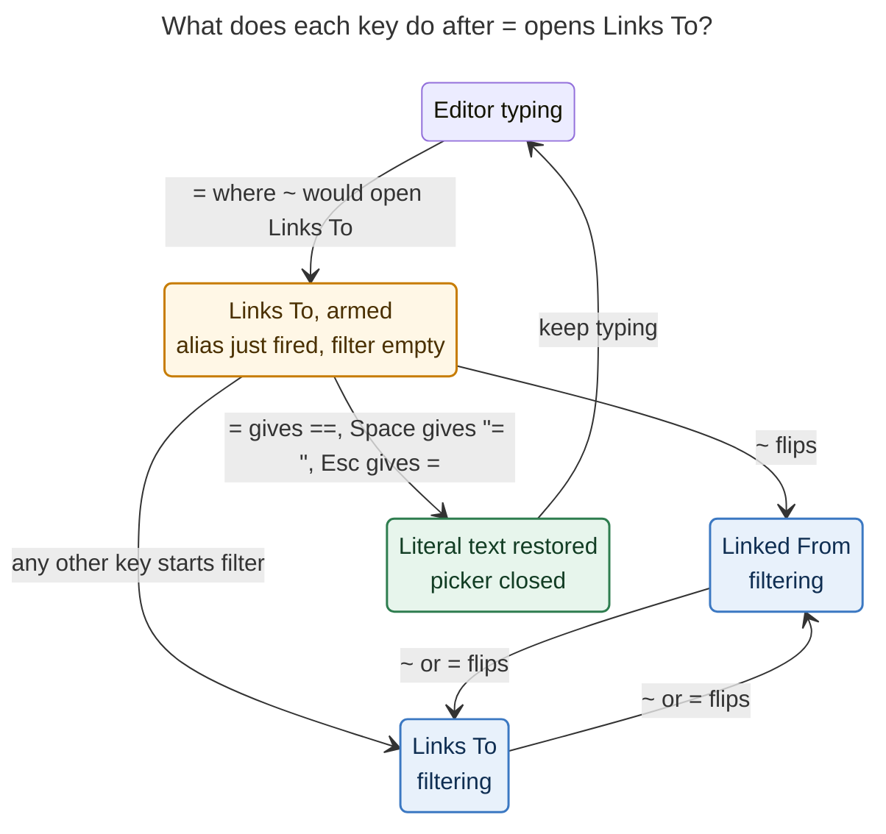

# Mac Capture task relations: `=` as the only `~` alias, flipping after the token, the `==` escape, and a direction flip in the label card

Researcher: `cld` · 2026-11-06 · Code read at bob-cli `ee05db4d` and bob-mac-capture
`e9d3ae2`. Probes ran against the installed `bob 0.4.0` on apollo, which already
includes the `-` alias (`060d97ed`) and the `=` flip (`7c71241f`).

## TL;DR

The plan is sound. All four bullets fix real friction, and the grammar supports them.
Each one needs a precise rule, though, and one needs a small change of meaning.

1. **Make `=` the only relation alias.** Yes. Bryan's premise ("`=` is never needed
   where the relation menu would open") is **true only if the `=` alias keeps the gate
   the `-` alias uses today**: whitespace before it, a non-empty line prefix, and Bob
   reporting that a bare `~` at that byte opens `relation_to`. Every `=` that means
   something after whitespace today (`x =`, `x =bugs`, `x =~2`, `=/ =`, `x2 =3`,
   `x=3 =`, `x wired the lexer =`) sits where `~` does *not* open Links To, so a gated
   alias leaves them alone (§2, F1). Dropping `-` also removes real collisions the dash
   has with prose (`-v`, `->`) and with the `- - -` session chain (F2).
   **Adjustment:** the `x=` past-segment `-` → `~` alias has to stay. It is a different
   `~`, and `=` already has structural meaning inside `x=` tokens (`x=~=!1`) (F10).
2. **Typing `~` or `=` after `~foo:bar` flips it to `~~foo:bar`, and back.** Yes. A
   glued `~` or `=` after a relation token is `invalid_relation` today, so the gesture
   takes nothing away (F4). **Adjustments:** (a) after a *labelled* token
   (`~foo:bar|label`) only `~` flips, because `=` is legal label text (F3); (b) the flip
   needs a new Bob rewrite rule. The thin-client decision rules out doing it in Swift.
   (c) Accepting a picker row appends a space, so in the most common flow you press
   Backspace before the flip key. A spaced ` =` keeps meaning "start another relation"
   (F8).
3. **`==` escapes the alias.** Yes, with two changes of meaning. (a) `==` should
   produce **`==`**, not a single `=`. That matches `--` → `--`, and it keeps Obsidian
   `==highlights==` and prose `a == b` typing naturally. (b) "Fast enough" should be a
   **state rule, not a clock rule**: while the alias-opened Links To picker still has an
   empty filter, the next `=` restores the literal (at any typing speed). Once you have
   typed a filter character, `=` flips as it does today. The app has no clock-based key
   rules anywhere. Bob's 0.5 s relation completion would also make a "before the picker
   appears" boundary unpredictable (F6, F7).
4. **`~` or `=` flips direction inside the relation label card.** Yes. This is the
   highest-value item and should ship first: it is Mac-only and needs no Bob release.
   It matters more than it looks. Bryan's label catalog is dominated by passive
   "… by" labels (80 of the 86 links that use a visible label), and four of the top
   five labels **cancel,
   complete, or merge the source task**. A flip therefore changes which task gets
   closed, so the card must re-ask Bob for its verdicts and must never commit against
   one computed for the other direction (F5). Bob already writes copy that says
   "…use ~~" (the inverse hint and the `new_task` refusal). Today that copy leads
   nowhere inside the card; a flip key makes it a one-keystroke fix.

Recommended order: **(1) label-card flip** (Mac only), **(2) Bob grammar** (`=` alias
replaces `-`, plus the new `flip_relation_direction` rule), **(3) Mac adoption** (the
`=` arm and restore keys, and forwarding `=`/`~` to Bob's rewrite lane). §5 has the
full spec.

---

## 1. What ships today (verified in code)

| Gesture | Behavior today | Where |
| --- | --- | --- |
| `-` after a space or tab where a bare `~` would open Links To | Becomes `~` and opens Links To. While the filter is empty, Space restores `- `, `-` restores `--`, and Escape restores `-` | bob-cli `src/native/capture_language/rewrite.rs:308` (`expand_relation_dash_alias`), gate at `:334`; Mac `CaptureKeyCommandRouter.swift:1209`, `CapturePanelModel.swift:15795` |
| `=` right after a bare `~`, or right after a `-` that would alias | Becomes `~~` (Linked From) | `rewrite.rs:388` (`expand_relation_flip_alias`) |
| `~` or `=` anywhere in a relation picker filter | Flips Links To ↔ Linked From in place; the filter is kept | `CaptureKeyCommandRouter.swift:1137`, `CapturePanelModel.swift:8897` |
| Backspace on an empty `~~` filter | Flips back | `CapturePanelModel.removePickerTrigger` |
| `-` inside an `x=` past token | Becomes the segment `~` (`x=2-` → `x=2~`) | `rewrite.rs:231` |
| `\|` after a relation token | Glues the pipe to the token and opens the label card | `rewrite.rs:1286` |
| Relation label card | **No direction control.** `direction`, `ownerText`, and `targetText` are `let` | `CapturePanelModel.swift:280–294`, opened at `:10955` |
| `~` or `=` glued after `~note:id` | Nothing; parses as `invalid_relation` | probe (F4) |
| Mac rewrite-lane forwarding of `=` | Only when the previous character is `~` or `-` | `CapturePanelController.swift:1136` |

## 2. Findings

**F1. Where a bare `~` opens Links To decides where an `=` alias can fire.**
`bob capture-complete` with the caret at the end of each draft:

| Opens `relation_to` | Does **not** open |
| --- | --- |
| `Fix it ~`, `Plan ~`, `@bob+fix ~`, `@bob:fix ~`, `- [ ] Fix ~`, `  - child ~`, `Fix it &foo:bar ~`, `Fix it ~foo:bar ~`, `= ~`, `+ ~`, `-- ~`, `! ~`, `& ~`, `> @bob ~`, `< ~` | `x ~`, `x wired the lexer ~`, `x2 ~`, `x0 ~`, `x=3 ~`, `=/ ~`, `=bugs ~`, `=3 ~`, `=* ~`, `+2 ~`, `x` + `- wired it ~` (Work Log child), `=bugs` + `  - child ~` |

Every whitespace-preceded `=` that has session meaning today falls in the right-hand
column, so a Bob-gated alias cannot touch it. A gated `=` alias would take over only
three spellings:

- `= =`, a chain the docs say "fails on the second start". It would become `= ~`.
  Bob then parses `= ~foo:bar` as a task whose text is `=`: harmless, but odd.
- Prose ` =word` in task text. `docs/capture.md` says "`Plan =bugs` stays prose"; this
  is now reachable via `==`.
- `@route+id =`, which parses as a sub-bullet whose text is `=` (nonsense).

The premise holds **only** with Bob's gate. A naive "`=` after whitespace" rule would
break `x =`, `x =bugs`, and every other session chain.

**F2. `-` collides with prose and chains more than `=` does.** Current behavior:
`Add -` → `Add ~` and `Migrate A -` → `Migrate A ~`. The empty-filter restore cannot
rescue `-v`, `-la`, or `->`, because the letter or `>` goes into the filter. Also
`- - -` (a documented "shorten three times" chain) → `- - ~`, and `-- -` → `-- ~` is
rescued only by the `-` restore. `=` has fewer prose uses after a space (`a = b`,
`a == b`, `=>`), and the restore keys below cover the first two.

**F3. Label character rules.** `docs/task-relations.md` §3.2 forbids `~` in a label but
allows `=`. `bob capture-parse -- 'Fix it ~foo:bar|see='` returns label `see=`. Bryan's
vault has 12 labels (7 visible, 5 hidden), and none contains `=` or `~`.

**F4. A glued key after a token is free today.** `~foo:bar~`, `~foo:bar=`, and
`~~foo:bar~` all parse as `invalid_relation`. `~~foo:bar~~` parses as strikethrough
prose, which is the one spelling the new rule makes slightly harder (Undo restores it).

**F5. Direction matters in the label card.** `bob relations list -f json`:

| Label | Uses | Effect |
| --- | ---: | --- |
| implemented by | 46 | completes source |
| superseded by | 18 | cancels source |
| inspired by | 12 | — |
| verified by | 4 | completes source |
| duplicate of | 3 | cancels source |
| merged into | 2 | merges source |
| idea for | 1 | — |

Flipping `~` ↔ `~~` swaps S and T in "S ‹label› T", so it changes **which task is
closed**. The card's `relation_cancel`, `relation_complete`, and `relation_successor`
verdicts come from a `capture-complete` probe built from `draftSnapshot`
(`CapturePanelModel.swift:12300`), so they are tied to the direction. Bob's canonical
copy already points at the fix (`docs/task-relations.md` CL6): the inverse hint says
"“supersedes” never cancels · to retire “{T}”, use ~~ with “superseded by”", and the
`new_task` refusal says "“{S}” is new — it would be born cancelled · to retire “{T}”,
use ~~". Inside the card, the only way to act on that today is Escape plus a re-pick,
or editing the draft by hand. This matches Bryan's "happened several times".

**F6. Latency on apollo** (Linux, not the Mac; median of 15 runs): `capture-rewrite`
takes about 8 ms; `capture-complete` for `Fix it ~` takes about 550 ms (max about
870 ms, a full task-catalog scan). After a fast `=`, the `~` rewrite lands long before
the picker appears. The second `=` of a quick `==` (about 100–150 ms later) therefore
arrives in the "already rewritten, picker not shown" window. Bob then sees `~=` and
turns it into `~~`. The stale-reply guard does **not** rescue a fast `==`, so the app
has to intercept that key on key-down. The existing dash arm already does this for
both states, with the picker open or not (`CapturePanelController` builds
`relationDashLiteralArmed` from either the picker or the live editor).

**F7. No timing-based key rules exist.** The router and controller contain no
`.timestamp`, `systemUptime`, or `Date()`. Every "double-tap" rule is a state arm:
`\\` works "at any typing speed" (`docs/capture-panel.md`), and the `-` restore lasts
"while that picker has an empty filter". bob-mac-capture's `AGENTS.md` already fights
hangs in async tests, and clock windows would add timing flakiness on top.

**F8. Accepting a picker row inserts a trailing space.** For a token at the end of the
draft, the inserted text is the replacement plus `" "`
(`openRelationLabelPromptFromPickerRow`, and the plain accept behaves the same way). So
after Return the caret sits at `~foo:bar ␣`. There, `~` or `=` means "start another
relation", which is legitimate and has to keep working. A glued post-hoc flip therefore
needs Backspace first. For flipping right after a pick, the picker flip (before
Return) and the card flip (Shift-Return) are the natural paths.

**F9. Probable latent bug, found by reading the code but not reproduced.** Escape from
a label card opened with Shift-Return sets `picker = returnPicker`
(`CapturePanelModel.swift:12120`). It does **not** restore the pre-insert draft, and
`closePickerForAccept` had already set `pickerIndex` to nil, so
`pickerPresentation = pickerIndex?.presentation(…)` is nil. The restored picker's
`draftSnapshot` (`New task ~`) no longer matches the draft (`New task ~tasks:target `),
so `flipRelationDirection` and accept fail the `plainDraft == draftSnapshot` guard.
`testRelationCardEscapeReturnsToPickerWhenStaged` only asserts `picker != nil`. A card
flip has to define what Escape does, so fix this alongside it.

**F10. The `x=` segment `-` is a different `~`.** Inside `x=` tokens, `=` is structural:
a second `=` starts the close part (`x=~=!1`). The past-segment `-` alias must survive
"`=` is the only alias".

**F11. Swift arm keying.** The Mac decides which arm to set from the shape of Bob's
rewrite (`trigger`, `replacement`). Today's `~=` → `~~` reply is an edit that replaces
`=` with `~`, the **same shape** as a future `=` → `~` alias. The new arm therefore has
to check the byte before the edit (whitespace for the alias, `~` for the flip) or use a
distinct rule code. Otherwise `~=` would wrongly arm the restore keys.

## 3. Critique, bullet by bullet

### 3.1 "`=` is the only alias for `~` when appropriate"

Agree. One alias per sigil is easier to learn. `=` sits on the home row's top-right
with no Shift, and its after-whitespace prose uses are rarer than `-`'s. "When
appropriate" should mean exactly **Bob's current gate**: whitespace before, a non-empty
line prefix after stripping any bullet marker, no unclosed backtick span, no wikilink,
and a candidate `~` that opens `relation_to` with replacement exactly
`[start, cursor)`. Keep `~=` → `~~` for an explicitly typed `~`: it covers the race
before the picker opens and matches "`=` flips". Remove the relation `-` alias and the
`-=` branch.

### 3.2 "`~`/`=` after `~foo:bar` → `~~foo:bar` (and reverse)"

Agree, as a **Bob rewrite rule**: grammar belongs to bob-cli, and the Mac only forwards
the key (decision `mac-capture-is-a-thin-client`). Restrictions:

- The key must be glued to the token. A spaced key keeps meaning "start another
  relation".
- After `|label` or `||label`, only `~` flips; `=` stays label text.
- The rule is lexical. If the flipped `~~` target is not writable (a daily note or
  `done/`), the live preview shows Bob's refusal, as it would for hand-typed text.
- Typing strikethrough `~~foo:bar~~` now needs Undo after the first `~`. That is
  acceptable: it is vanishingly rare in a relation run.

### 3.3 "Escape `=` with `==` fast enough"

Agree with the intent, but I would change two details:

- **Result `==`, not `=`.** `\\` collapses to one `\` because backslash is the
  conventional escape character. `=` is different: `==` is Obsidian highlight syntax,
  and the docs already say the doubled `==` "keeps protecting Obsidian highlights".
  With collapse-to-one, typing `==important==` would come out as `=important==`. With
  keep-both, it comes out right, `a == b` works, and the rule mirrors `--` → `--`. A
  lone literal `=` is still reachable: `a = b` via Space, or Escape for `=`.
- **A state rule instead of a time window.** See F6 and F7. A time window would be the
  app's first clock-based key rule. The tempting boundary, "before the picker is
  visible", is about 0.5 s on apollo and unknown on the Mac, and a window is hard to
  test deterministically in CI. The state rule: **while the alias-opened Links To
  picker (or the pending one) has an empty filter, `=` restores `==`, Space restores
  `= `, and Escape restores `=`.** Its only cost: on an *empty* alias-opened filter,
  `=` no longer flips, and `~` does that job. Once any filter text exists, `=` flips
  as before, and the post-hoc and card flips cover later changes of mind. To keep the
  picker's hint truthful, show "`=` again types `==` · `~` flips" while the arm is live,
  instead of "~ or = flips direction".
- Optional and cheap: let `>` restore `=>` on an empty armed filter, since no task
  query starts with `>`.

### 3.4 "`~`/`=` in the label card toggles direction"

Strongly agree, and I would ship it first (F5). It needs more care than the picker
flip:

- **Re-ask Bob after a flip.** The flip edits the token (`~` ↔ `~~`) in
  `draftSnapshot`, so `relationLabelProbe` automatically builds a probe for the new
  direction. The card must clear the stale verdicts immediately, hiding ⊘/✓ until the
  fresh reply arrives. It must cancel `pendingSubmit` and bump both generation counters.
  The existing `current.draftSnapshot == draftSnapshot` guards already drop replies for
  the old direction.
- **Return never commits against a verdict from the other direction.** If Return lands
  while the fresh probe is in flight, reuse the existing pending-submit path, which
  waits for Bob's typed row.
- **Keep the user's work.** The flip preserves the query, `selectedKey`, one-off, and
  the Hidden section. The catalog's labels don't depend on direction; only the verdict
  fields do. Because the flip is an edit rather than navigation, refetching is
  consistent with decision `relation-card-tab-accepts-ctrl-d-hides`. Strictly, though,
  that record says the catalog is "fetched once on open", so see §5.6.
- **`=` vs labels.** `~` can never appear in a label, so intercepting it is free. `=`
  is legal but unused in the vault. Recommendation: `=` flips, and an immediate second
  `=` undoes that flip and types a literal `=` into the field. This is the same escape
  rule, applied "anywhere `=` aliases `~`". It is optional; skipping it costs nobody
  anything today.
- **Escape** must land in a picker of the *new* direction, so flip `returnPicker` as
  well (source, snapshot, range). Fix F9 at the same time.
- In rename mode, `~` and `=` belong to the rename field.

## 4. Adjusted requirements (my changes, called out)

| # | Change | Why |
| --- | --- | --- |
| A1 | **[ADJUSTED]** `=` aliases `~` only where Bob's gate says a bare `~` opens Links To (same gate as today's `-`) | F1: a naive rule breaks session chains |
| A2 | **[ADJUSTED]** Keep the `x=` past-segment `-` → `~` alias; remove only the *relation* `-` alias and `-=` | F10 |
| A3 | **[ADJUSTED]** `==` restores **`==`** (both characters), not one `=` | Obsidian highlights, `a == b`, `--` precedent |
| A4 | **[ADJUSTED]** "Fast enough" becomes a state rule (armed while the alias-opened filter is empty), not a clock window | F6, F7 |
| A5 | **[ADJUSTED]** Post-hoc flip: glued key only; after a `\|label`, only `~` flips | F3, F8 |
| A6 | **[ADDED]** The label-card flip re-probes Bob, never commits against a stale verdict, and flips `returnPicker` | F5, F9 |
| A7 | **[ADDED]** Truthful hints: an armed-picker subtitle, a card header "~ flips", and a footer "~ flip direction" item when Bob's copy says "use ~~" | Make the gesture discoverable without a sixth footer pair |
| A8 | **[ADDED]** Fix the probable Escape-from-Shift-Return bug (F9) in the same change | The card flip depends on Escape being correct |
| A9 | **[OPTIONAL]** `>` on an empty armed filter restores `=>`; `==` in the card types a literal `=` | Cheap prose protection, consistent escape |

## 5. Recommended solution



*Proposed. Only the armed, empty-filter state treats `=` as an escape; everywhere
else `~` and `=` flip direction, so `==` is literal at any typing speed and a flip is
always one key away.* (Rendered with mermaid-cli 12.0.0 in the PDF configuration:
644 × 758 px, 100% fit.)

### 5.1 Phase 1: label-card flip (bob-mac-capture only, no Bob release)

1. **Router** (`CaptureKeyCommandRouter.relationLabelPromptCommand`, `:918`): in choose
   mode, before `isolatedPromptCommand`, map an unmodified `~` or `=` with no marked
   text to a new `.flipRelationLabelDirection`; consume key repeats. In rename mode,
   pass the key through.
2. **State**: change `direction` to `var` in `CaptureRelationLabelPromptState`.
   `ownerText` and `targetText` stay as they are, because the sentence already picks S
   and T from `direction` (`relationLabelSentenceSource`).
3. **Model** `flipRelationLabelDirection()`, modelled on `flipRelationDirection`
   (`:8897`):
   - Guard `!isSaving`, no rename, `draftSnapshot == plainDraft`, and a `~` at
     `tokenRange.start`.
   - Insert or remove one `~` at `tokenRange.start + 1`.
   - Shift `tokenRange.end`, `labelRange`, and `restoreCursor` by ±1.
   - Update `draftSnapshot` and toggle `direction`.
   - Clear `relationCancel`, `relationComplete`, `relationSuccessor`,
     `suggestionAuthoredLabel`, `errorMessage`, and `pendingSubmit`.
   - Bump `relationLabelCatalogGeneration` and `relationLabelSuggestionGeneration`, and
     clear both in-flight markers.
   - Call `fetchRelationLabelCatalog()`, and `fetchRelationLabelSuggestions()` when the
     query is non-empty.
   - Flip `returnPicker` (`source`, `draftSnapshot`, `replacementRange.end`,
     `restoreCursor`).
   - Announce "Linked From" or "Links To" (status text and VoiceOver).
4. **Optional `==` in the card**: a one-shot arm after an `=` flip. If the next key is
   `=`, undo the flip and insert a literal `=` into the field.
5. **Fix F9**: on Escape with `returnPicker`, restore the draft to
   `returnPicker.draftSnapshot` (undoably), rebuild the picker index from the
   snapshot's candidates, and refocus the filter.
6. **UI**:
   - Show a "`~` flips" keycap next to the "🪢 Relation" header
     (`CapturePanelView.swift:2314`).
   - When the selected or typed row is refused with the `new_task` verdict, or an
     inverse hint is showing, put `("~", "flip direction")` first in
     `relationLabelFooterItems`.
   - Add "tilde or equals flips direction" to the card's accessibility hint.
7. **Tests** (`CaptureRelationPanelTests`):
   - Flip in both directions edits the token, ranges, and caret.
   - Verdicts are cleared and refetched.
   - A late old-direction reply is dropped.
   - Return during a pending probe waits.
   - The query, selection, and one-off survive.
   - Rename mode ignores the keys.
   - Escape after a flip lands in the flipped picker with the draft restored.
   - Key repeat is consumed.

### 5.2 Phase 2: Bob grammar (bob-cli first, per the thin-client decision)

1. **`=` alias.** In `expand_sigil_alias`, put a new `expand_relation_equals_alias` in
   place of `expand_relation_dash_alias`. Keep the gate (rename
   `relation_dash_position_ok` to `relation_alias_position_ok`) and `wikilink_claims`,
   and require the `relation_to` replacement to be exactly `(start, cursor)`. Summary:
   "Typed ~ for =".
   - Keep the `~=` → `~~` branch of `expand_relation_flip_alias` and delete its `-=`
     branch.
   - Leave `expand_past_segment_dash_alias` untouched.
   - Order for `=`: post-hoc flip first, then `~=`, then the alias.
2. **New rule `flip_relation_direction`.** Add a `RewriteRule` variant with its own
   code so the Mac never mistakes it for an alias arm.
   - Fires when the byte before the cursor is `~` or `=`, glued to the end of a span
     Bob's editor parser classifies as a complete relation token (`~note:id`,
     `~~note:id`, quoted note forms) in a directive run.
   - After `|label` or `||label`, only `~` fires.
   - Edit: delete the typed byte, then insert `~` after the sigil (Links To → Linked
     From) or delete the second `~` (Linked From → Links To).
   - The caret stays at the token's end.
   - Validate by re-parsing: the result must be the same target and label with the
     opposite direction.
   - Summary: "Flipped to Linked From (~~)" or "Flipped to Links To (~)".
3. **Docs.** Update `docs/capture.md` (the editor-assist paragraphs near the relation
   `-` text) and `docs/reference/cli/capture-rewrite.md` (description plus examples
   `'Fix it ='` and `'Fix it ~work:foo='`). Update the CLI help where it describes the
   aliases; the implementer should read the `docs` and `cli_rules` reference memory
   first.
4. **Tests.**
   - Unit tests (`src/native/capture_language/tests/rewrite.rs`) and CLI tests
     (`tests/cli/capture/rewrite.rs`) for: every F1 row with `=`.
   - `= =` → `= ~`.
   - Line, bullet, backtick, and wikilink starts stay literal.
   - `-` after a space is now literal.
   - `x=2-` still gives `x=2~`.
   - Glued flips both ways, including quoted notes and a leading-run token.
   - `|see=` stays literal and `|see~` flips.
   - `~~foo:bar~` → `~foo:bar`.
   - Feeding the output back in is a no-op.
5. **Commit marker.** I would use `feat(capture)!:`, because a documented
   `capture-rewrite` behavior (`-` → `~`) goes away (decision
   `bob-cli-releases-ride-a-daily-train`). The JSON shape is unchanged.

### 5.3 Phase 3: Mac adoption of the Bob grammar

1. **Forwarding** (`CapturePanelController.swift:~1115–1139`): drop the
   "previous is `~` or `-`" precondition for `=`, and add `~` to the forwarded keys.
   Bob decides; each forwarded key costs one ~8 ms process run (measured on apollo).
   Keep forwarding `-` for the past-segment alias.
2. **Arm.** Replace `CaptureRelationDashArm` with an equals arm, set only when the rule
   is `expand_sigil_alias`, the trigger is `=`, the replacement is `~`, and the byte
   before the edit is whitespace (F11).
   - Restore keys: `=` → `==`, Space → `= `, Escape → `=`, and optionally `>` → `=>`.
   - `~` flips, and any other key disarms.
   - Intercept on key-down in both states (picker open, or the live editor still
     matching), as `relationDashRestoreCommand` does today.
   - If the second `=` beats the first reply, the lane drops the stale reply and Bob
     leaves `==` literal (an `=` after `=` is not after whitespace), so the result is
     still `==`.
3. **Hint.** While armed, the picker subtitle reads "`=` again types `==` · `~` flips".
   Otherwise it keeps today's "~ or = flips direction" (an `=` after an explicitly typed
   `~` keeps flipping).
4. **Post-hoc flip.** Apply `flip_relation_direction` through the existing native-edit
   path (undoable), announce Bob's summary, and run analysis again. No arm.
5. **Docs** (`just docs-check`): `docs/relationship-pickers.md`, `docs/keyboard.md`
   (relation picker and card keys), and `docs/capture-panel.md` (the rewrite-lane
   paragraph).
6. **Tests.** Port `CaptureRelationDashAliasTests` to `=`. Add `==` both before and
   after the picker opens, Space and Escape restores, `~` flips while armed, `=` flips
   after filter text, `~=` does not arm (F11), the post-hoc flip with Undo, and update
   the fake-bob fixtures.

### 5.4 Compatibility

New Mac with old Bob: `=` after a space comes back unchanged and stays literal. The old
`-` alias still fires but has no restore keys, which is a brief and tolerable mismatch
while bob updates on its daily train. Old Mac with new Bob: the old Mac never forwards
a bare `=` or `~`, so nothing rewrites, and `-` is literal. Both directions degrade to
plain typing.

### 5.5 Verification constraints

Swift changes need a Mac compile (`just typecheck-tests` on a scratch copy) and the
exact-SHA macOS CI run, per bob-mac-capture's `AGENTS.md`. I verified the Swift
behavior in this report by reading code only. I did not run the app.

### 5.6 Records to update afterwards (implementer, via `/sase_memory_write`)

- A new decision record: "`=` is the only relation alias; `==` is literal; flips work
  in picker, card, and post-hoc".
- A record that partly supersedes `relation-card-tab-accepts-ctrl-d-hides` for the
  "catalog fetched once on open" clause, because a direction flip re-probes.

## 6. Alternatives I rejected

- **`==` means Linked From** (mirroring `~~`). This contradicts the request and breaks
  highlights and `a == b`.
- **A time window for `==`.** It would be the first clock-based key rule, latency makes
  the boundary unpredictable, and CI tests would get flaky (F6, F7).
- **`==` collapses to one `=`, like `\\`.** It mangles `==highlight==` (§3.3).
- **Keep `-` as a second alias.** Its collisions are worse (F2), and two aliases for
  one sigil are more to learn.
- **Post-hoc flip in Swift.** This violates `mac-capture-is-a-thin-client`.
- **Flip on a spaced key after a token** (`~foo:bar =`). That collides with "start
  another relation".
- **Auto-invert the label on a card flip** (`supersedes` → `superseded by`). Bob's
  inverse table is display-only and one-way, so this risks silently changing meaning.
  A possible later step: Bob suggests the inverse as a row.

## 7. Open questions for Bryan

1. On an empty, alias-opened filter, should a slow second `=` stay literal
   (recommended, deterministic) or flip?
2. Should `==` produce `==` (recommended) or a single `=`?
3. Do you want the optional extras: `>` → `=>` on an empty armed filter, and `==` → a
   literal `=` in the label card?
4. Should the label-card flip ship ahead of the Bob work? I recommend yes.

## Appendix: reproduce the probes

```bash
# where a bare ~ opens Links To (context and replacement)
bob capture-complete -c 8 -f json -- 'Fix it ~'      # relation_to 7..8
bob capture-complete -c 3 -f json -- 'x ~'           # none
# current aliases
bob capture-rewrite -c 8 -f json -- 'Fix it -'       # -> 'Fix it ~'
bob capture-rewrite -c 5 -f json -- '- - -'          # -> '- - ~' (chain hijacked)
bob capture-rewrite -c 9 -f json -- 'Fix it ~='      # -> 'Fix it ~~'
# glued keys after a token
bob capture-parse -f json -- 'Fix it ~foo:bar='      # invalid_relation
bob capture-parse -f json -- 'Fix it ~foo:bar|see='  # label "see="
bob capture-parse -f json -- 'Fix it ~~foo:bar~~'    # strikethrough prose
# label catalog and effects
bob relations list -f json
```
