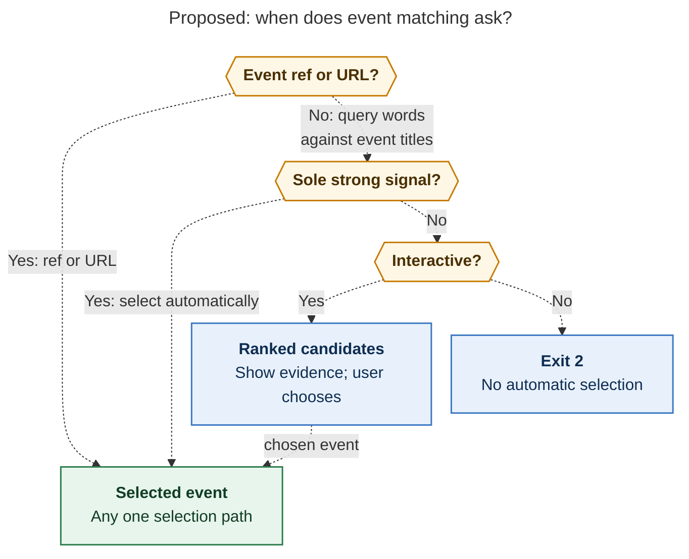
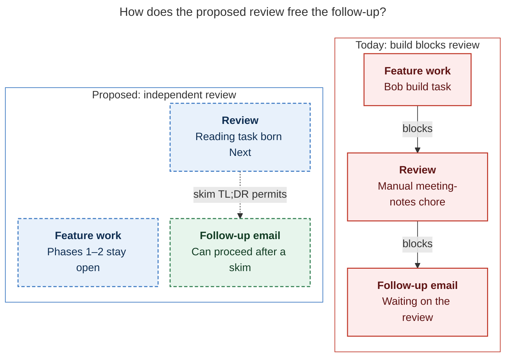
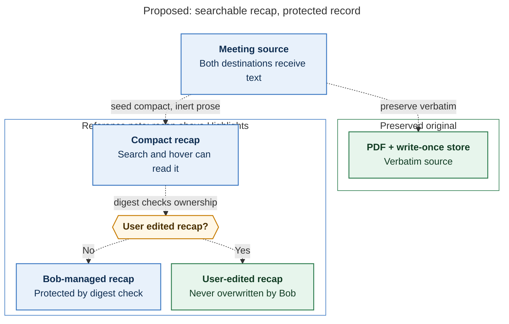

# Diagram proposals: Meeting notes become event-linked references: consolidated design

Proposals for the swarm linker, not a report. Each diagram restates only what the source
report says.

```yaml
source: research:202611/meeting_notes_event_refs/meeting_notes_event_refs__final.md
producer: research.65.image
check: "mmdc 12.0.0 with the PDF-mirroring config rendered 3 of 3 Mermaid diagrams; Puppeteer --no-sandbox; deliberate parse failure returned nonzero"
```

## matching-fallback

```yaml
anchor: |-
  candidates and per-row evidence otherwise, exit 2 off a TTY.
question: |-
  When can Bob select an event, and when must it ask?
illustrates: |-
  Matching prioritizes explicit ref/URL and title queries, auto-selects only on a sole strong signal (recording-window overlap when present or ≥75% of title content words in the notes), and otherwise shows ranked candidates with evidence or exits 2 off a TTY.
caption: "Proposed auto-selection needs one strong match: recording-window overlap or ≥75% of title content words in notes; otherwise choose from evidence or exit 2 noninteractively."
review: "684.5×984 px, fit 90.7%; question, source, arrow, label, and visual checks passed; 1 revision"
```



## review-dependency

```yaml
anchor: |-
  The reading task **is** the review — that is the insight
question: |-
  How does the proposed review remove the build dependency from follow-up?
illustrates: |-
  The reading task replaces the manual review chore that is blocked on a bob build task, so the Derrick follow-up email can proceed after skimming the TL;DR while feature work stays open.
caption: "Replacing the build-blocked chore with the reading task lets the Derrick follow-up proceed after a skim while feature work stays open."
review: "722×553 px, fit 90.4%; question, source, arrow, label, and visual checks passed; 1 revision"
```



## recap-ownership

```yaml
anchor: |-
  stays in the write-once store and the PDF; the recap is deliberately compact.
question: |-
  How does a searchable recap preserve the original record and user edits?
illustrates: |-
  The compact recap makes meeting text available to Obsidian search and hover while the verbatim source stays in the PDF and write-once store, and the digest guard prevents Bob from overwriting user-edited recap text.
caption: "The recap makes meeting text searchable while the PDF and write-once store preserve the source; the digest guard protects user edits."
review: "853×845 px, fit 76.5%; question, source, arrow, label, and visual checks passed; 0 revisions"
```


